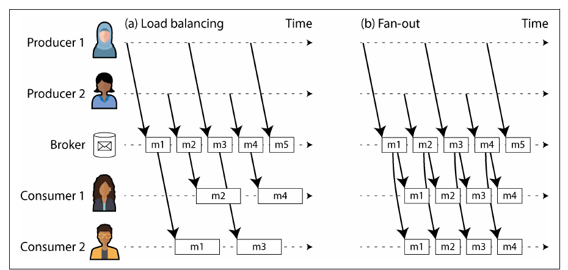
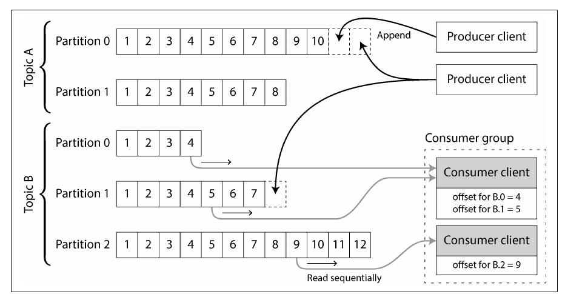
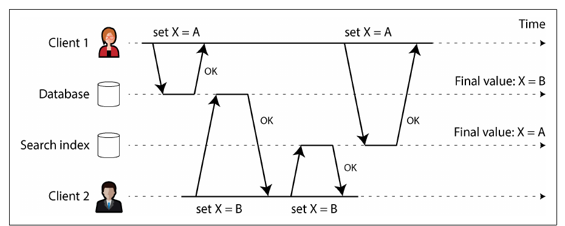
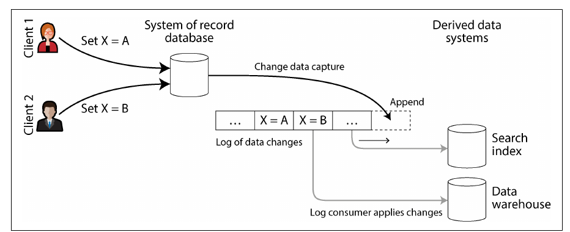
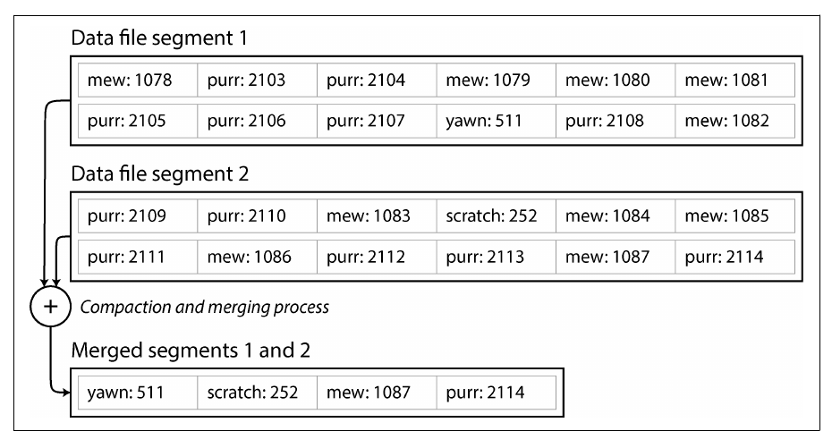
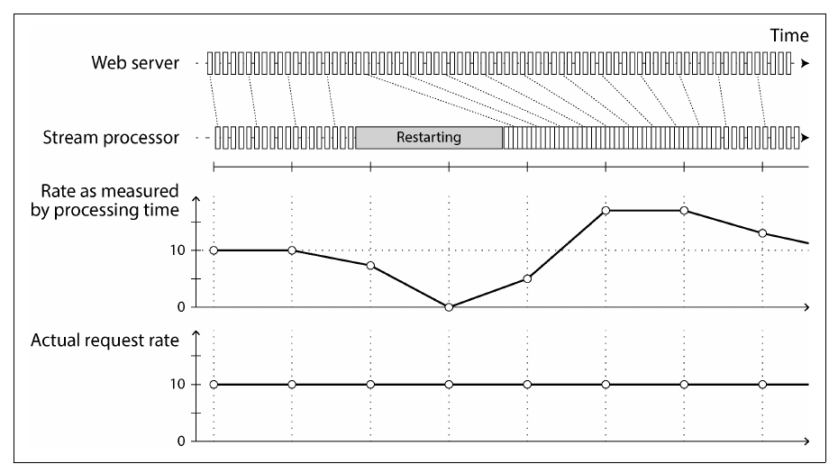

# 12. Stream Processing

[← 11. Batch Processing](11-batch-processing.md) · [Book](../README.md) · [13. A Philosophy of Streaming Systems →](13-a-philosophy-of-streaming-systems.md)

## Summary

Stream processing is batch processing on unbounded input: events are processed continuously, shortly after they happen. The chapter covers how event streams are **transmitted** — direct messaging, AMQP/JMS-style brokers that assign and delete messages, and **log-based brokers** (Kafka-style) that retain an ordered, sharded log consumers read by offset. It then treats a **database as a stream**: change data capture and event sourcing keep derived systems in sync without dual writes, and log compaction lets a stream hold a full copy of a database. Finally it covers **processing streams**: uses (complex event processing, stream analytics, materialized views), the difficulty of **time** (event time vs processing time, stragglers, window types), three kinds of **stream joins**, and **fault tolerance** with exactly-once (effectively-once) semantics via microbatching, checkpointing, transactions, and idempotence.

## Key takeaways

- **Two broker philosophies**: AMQP/JMS brokers assign individual messages and delete them after acknowledgment (great as task queues); log-based brokers append to sharded logs, retain them, and let consumers track offsets (great for ordered, replayable processing) (pp. 491–500).
- **Dual writes are a race condition and a partial-failure hazard**; deriving every system from one ordered change log avoids both (pp. 501–503).
- **Change data capture** turns a database's replication log into a public stream; **log compaction** retains the latest value per key so a new consumer can rebuild state from the log (pp. 503–508).
- **State is the integral of a stream of changes; the stream is the derivative of state.** Immutable events give auditability, multiple views, and easier recovery — but deleting data is hard (pp. 508–513).
- **Event time ≠ processing time.** Windowing by processing time creates artifacts; windowing by event time forces you to decide when a window is complete and what to do with stragglers (pp. 518–523).
- **Stream–stream, stream–table, and table–table joins** each keep different state; the result can depend on event ordering across streams (pp. 523–526).
- **Exactly-once means effectively-once**: discard or deduplicate partial output via microbatching, checkpoints, atomic commits, or idempotent writes (pp. 526–529).

## Section outline

*From the book’s own table of contents (PDF bookmarks); printed page numbers.*

- Transmitting Event Streams — p. 488
  - Messaging Systems — p. 489
  - Log-Based Message Brokers — p. 495
- Databases and Streams — p. 500
  - Keeping Systems in Sync — p. 501
  - Change Data Capture — p. 503
  - State, Streams, and Immutability — p. 508
- Processing Streams — p. 513
  - Uses of Stream Processing — p. 514
  - Reasoning About Time — p. 518
  - Stream Joins — p. 523
  - Fault Tolerance — p. 526
- Summary — p. 529

## Notes

Batch processing assumes **bounded** input — sorting can’t emit anything until it has seen the last record. Real data is **unbounded**: users keep producing it, so batch jobs slice it artificially (a day, an hour) and results lag. Process smaller slices, or **every event as it happens**: stream processing. A *stream* is data made available incrementally — stdin/stdout, lazy lists, `FileInputStream`, TCP, video — here specifically **event streams** for data management (pp. 487–488).

### Transmitting event streams

An **event** is a small, self-contained, **immutable** record of something that happened at a point in time (usually with a time-of-day timestamp): a page view, a purchase, a sensor reading, a log line. Encoded as text, JSON or binary; generated once by a **producer** (publisher, sender), processed by many **consumers** (subscribers, recipients); related events form a **topic** (stream) (pp. 488–489). Consumers polling a database get expensive as polling speeds up, and database **triggers** are limited — so specialized notification tools exist (p. 489).

#### Messaging systems (pp. 489–495)

Unlike a pipe or TCP connection (one sender, one receiver), messaging lets many producers and consumers share a topic. Two questions classify them:

| Question | Options |
|---|---|
| Producers faster than consumers? | **Drop** messages, **buffer** in a queue (in memory? spill to disk? what when the disk fills?), or apply **backpressure** (block the sender — Unix pipes, TCP) |
| Nodes crash or go offline? | Durability via disk and/or replication costs throughput and latency. Lost metrics points may not matter (but mass drops go unnoticed); lost counted events mean wrong counters |

| | **Direct messaging** | **Message broker** (message queue) |
|---|---|---|
| Examples | UDP multicast for stock feeds; ZeroMQ, nanomsg; StatsD over UDP (counters only approximately right); webhooks | RabbitMQ, ActiveMQ, HornetQ, Qpid, TIBCO EMS, IBM MQ, Azure Service Bus, Google Pub/Sub (JMS, AMQP) |
| Faults tolerated | Few — app must handle loss; assumes both sides online; a crashed producer loses its retry buffer | Clients may come and go; durability is the broker’s job; usually **unbounded queueing**; consumers are **asynchronous** |

**Brokers vs databases** (p. 492): brokers usually delete messages once delivered (not for long-term storage), assume short queues (throughput degrades when backlogs spill to disk), offer topic-pattern subscriptions instead of queries, and **notify** of new data instead of returning a point-in-time snapshot. Some participate in XA/JTA two-phase commit; databases can serve as queues but are hard to tune for it.

*Figure 12-1 (p. 493): (a) consumers share the work; (b) every consumer gets its own copy.*

Load balancing (AMQP shared queue, JMS shared subscription) shares expensive work; fan-out (JMS topic subscriptions, AMQP exchange bindings) lets independent consumers “tune in”. Kafka **consumer groups** combine them: one consumer per group per message, every group gets every message (pp. 492–493).

**Acknowledgments and redelivery** (pp. 493–495): a consumer must **ack** a message before the broker deletes it; no ack (connection closed, timeout) → redeliver to another consumer — possibly a message already processed whose ack was lost (needs atomic commit or idempotence). Combined with load balancing, redelivery **reorders** messages (Figure 12-2: consumer 1 processes m4, m3, m5); avoid with a queue per consumer. A malformed message that crashes every consumer loops forever (blocking strongly ordered brokers); **dead letter queues** move it aside for an operator to drop, fix or handle — now also in Pulsar and Kafka Streams.

#### Log-based message brokers (pp. 495–500)

AMQP/JMS brokers inherited a *transient* mindset: receiving is destructive, so you can’t rerun a consumer, and a new consumer sees only messages sent after it subscribed. Databases keep everything until deleted. **Log-based brokers** combine durable storage with low-latency notification (pp. 495–496):

- A producer **appends** to a log; consumers **read sequentially** (like `tail -f`). For throughput the log is **sharded**: a **topic** = a set of shards (Kafka’s **partitions**), each with monotonically increasing **offsets** and total order within it — none across partitions (Figure 12-3) (pp. 496–497).
- **Apache Kafka** and **Amazon Kinesis Streams** work this way (Google Pub/Sub is similar underneath but JMS-style); disk-based yet millions of messages per second via sharding, fault-tolerant via replication (p. 497).

*Figure 12-3 (p. 496): a partition is an append-only file; a consumer's whole progress is one offset per partition.*

| | AMQP/JMS-style broker | Log-based broker |
|---|---|---|
| Fan-out | Supported | Trivial: reading doesn’t delete |
| Load balancing | Per message | Per **partition**: at most one consumer per partition per group |
| Slow message | Others proceed | Blocks its partition — **head-of-line blocking** |
| Best for | Expensive, independent tasks where order doesn’t matter | High throughput, fast per-message work, order matters — route by key (e.g. user ID) to keep a user’s events ordered |
| Bookkeeping | Ack every message | Periodically record one **consumer offset** per partition — like a replication log sequence number |
| Crash | Redeliver unacked messages | Resume from last *recorded* offset — later messages processed twice |
| Re-reading | Impossible | **Replay** from any retained offset — copy yesterday’s offset into a new consumer |

(Kafka now also supports JMS-style shared consumption of a partition.) **Disk space**: the log is divided into **segments**, old ones deleted or archived — a bounded on-disk **circular buffer**. Back-of-envelope: a **20 TB** drive written at **250 MB/s** fills in about **22 hours**, so retention is at least that, typically days or weeks; tiered storage (Kafka, Redpanda) or object-store-only designs (WarpStream, Confluent Freight, Bufstream) extend it. A consumer that falls behind retention misses messages — but the lag is easy to monitor, and a slow or dead consumer affects nobody else (pp. 498–500).

> **Try it:** [Partitioned logs and consumer offsets](../widgets/12-log-offsets.html) — crash a consumer to re-process messages, or let one fall behind retention.

### Databases and streams

Event sourcing makes an event stream the system of record; but even mutable databases are streams: every write is an event — a **replication log** is a stream of writes, and **state machine replication** applies the same deterministic events in the same order (pp. 500–501).

#### Keeping systems in sync (pp. 501–502)

Real apps combine an OLTP database, a cache, a search index and a warehouse, each with its own copy. Full dumps (ETL) are slow, so some apps use **dual writes** — the application writes to each system itself. Two failure modes:

*Figure 12-4 (p. 502): with dual writes, the two systems can apply the same writes in different orders and silently disagree for good.*

Without version vectors you won’t even notice; and one write can fail while the other succeeds (an atomic-commit problem). There are two leaders and neither follows the other. Better: make the database the **only leader** and the index its **follower**.

> **Try it:** [Dual writes vs a change log](../widgets/13-dual-writes.html) — race two concurrent updates into a database and a search index, with and without a change log.

#### Change data capture (pp. 503–508)

Replication logs were long an internal detail, not an API. **CDC** observes every change written to a database and exposes it, ideally as a stream, so derived systems apply changes **in the database’s order** (Figure 12-5). CDC makes one database the leader and the others followers; a log-based broker transports changes without reordering (pp. 503–504).

*Figure 12-5 (p. 503): derived systems follow the database's log, so they all apply changes in the same order.*

| Aspect | Detail |
|---|---|
| Tools | **Debezium** (MySQL, PostgreSQL, Oracle, SQL Server, Db2, Cassandra… with a standard event schema), Kafka Connect, Maxwell (MySQL binlog), GoldenGate (Oracle), pgcapture; first-class change streams in MySQL/PostgreSQL replication and cloud services like Datastream |
| Timing | **Asynchronous**: slow consumers don’t hurt the source, but all replication-lag issues apply |
| **Initial snapshot** | Full logs are too big to keep; start from a consistent snapshot tied to a log offset — Debezium uses Netflix’s **DBLog** watermarking for incremental snapshots |
| **Log compaction** | Keep only the latest value per key (tombstones delete) — size depends on current contents, not write history; rebuild a derived system from offset 0 of a compacted Kafka topic, no new snapshot needed |
| Quorum databases | No single source of truth: Cassandra exposes per-node raw log segments for consumers to merge |

*Figure 12-6 (p. 505): compaction keeps the newest value per key, so the log's size depends on the number of keys, not of writes.*

**CDC vs event sourcing** (pp. 507–508):

| | CDC | Event sourcing |
|---|---|---|
| Level | Low-level row changes extracted from a mutable database | Application-level, immutable events by design |
| Adoption | Bolt onto an existing database; the app may not know | Big change to the application |
| Log compaction | Latest event per key = full current record → compactable | Events express intent; later ones don’t supersede earlier → need full history (plus snapshots as an optimization) |
| Schema risk | Internal table schemas become **public APIs**; dropping a column breaks consumers — **data contracts**, or the **outbox pattern**: write to a dedicated outbox table in the same transaction (a dual write made safe by one system), at the cost of maintaining the mapping and extra writes | Events are the public format |

#### State, streams, and immutability (pp. 508–513)

Current state — seats available, an account balance, a response-time graph — is the result of events. **State is the integral of the event stream over time; the change stream is the derivative of state** (Figure 12-7). Jim Gray and Andreas Reuter (1992): with the log you don’t fundamentally need the database — it exists for read performance. Log compaction bridges log and state (pp. 508–509).

- **Advantages of immutable events** (pp. 509–510): accountants’ append-only **ledgers** correct mistakes with compensating entries; buggy deployments are easier to diagnose and recover from; customer service gets an audit log; events keep information state discards (an item added then removed from a cart — useful for analytics).
- **Several views from one log** (pp. 510–511): Druid ingests from Kafka; Kafka Connect sinks export anywhere; run a new read-optimized view beside the old one instead of a risky migration. Writing data in the form it’s queried is a fallacy; normalization debates fade when views are derived (the social timeline is highly denormalized but kept in sync by fan-out).
- **Concurrency control** (pp. 511–512): views update asynchronously — read-your-writes problems (synchronous view updates need distributed transactions or waiting, usually impractical). But a self-contained event makes a user action **one atomic append**; if log and state shard alike, a single-threaded consumer per shard needs no concurrency control. Databases (MVCC snapshots) and Git, Mercurial, Fossil also rely on immutability.
- **Limitations of immutability** (pp. 512–513): high-churn datasets make history huge (fragmentation, compaction and GC costs); privacy law, errors and leaks require **rewriting history** — Datomic’s **excision**, Fossil’s **shunning**. True deletion is hard (copies in storage engines, SSDs, immutable backups); **crypto-shredding** forgets the key, moving mutability to key storage and forcing key granularity up front (puncturable encryption isn’t yet widespread). Deletion is about “making it harder to retrieve the data”.

### Processing streams

Three things to do with a stream: **write it to storage** (database, cache, index — the streaming version of batch outputs), **push it to humans** (alerts, notifications, dashboards), or **process it into other streams** via **operators/jobs** — read-only input, append-only output, sharded and parallelized like dataflow engines. The crucial difference from batch: **a stream never ends** — no sort-merge joins, and restarting a years-long job from the beginning isn’t an option (pp. 513–514).

#### Uses of stream processing (pp. 514–518)

| Use | What it does | Examples |
|---|---|---|
| Monitoring | Alert when something happens | Fraud detection, trading rules, factory machines, military intelligence |
| **Complex event processing** (1990s) | Regex-like patterns over events; **queries stored long-term, data flows past** — the reverse of a database; emits a “complex event” on a match | Esper, Apama, TIBCO StreamBase; SQL in Flink and Spark Streaming |
| **Stream analytics** | Rates, rolling averages, comparisons with last week, p99 over the last 5 minutes — over **windows**; may use Bloom filters, **HyperLogLog** and percentile sketches (an optimization — streaming isn’t inherently approximate) | Storm, Spark Streaming, Flink, Samza, Beam, Kafka Streams; Dataflow, Azure Stream Analytics |
| **Maintaining materialized views** | Keep caches, indexes, warehouses — or event-sourced state — up to date; needs a window back to the beginning of time | Kafka Streams, ksqlDB (on log compaction) |
| **Search on streams** | Stored queries matched against incoming documents — media monitoring, property alerts; index the queries too | Elasticsearch **percolator** |

**Incremental view maintenance** (pp. 516–517): `REFRESH MATERIALIZED VIEW` reprocesses everything (inefficient, stale between refreshes); hand-written triggers work only for naturally incremental cases (daily revenue). **IVM** compiles queries into incremental operators — **Materialize, RisingWave, ClickHouse, Feldera** buffer recent events in memory and merge them with on-disk views.

**Event-driven architectures and RPC** (p. 518): actor frameworks manage concurrency (ephemeral, one-to-one, possibly cyclic communication, often no delivery guarantee); stream processing manages data (durable, multi-subscriber, acyclic pipelines). Crossovers exist, e.g. Storm’s **distributed RPC**.

#### Reasoning about time (pp. 518–522)

Batch jobs use the timestamps inside events (deterministic reruns); many stream frameworks use the processing machine’s clock — fine only if lag is negligible (pp. 518–519).

| | **Event time** | **Processing time** |
|---|---|---|
| Meaning | When it happened (timestamp in the event) | When the processor saw it |
| Star Wars analogy | Episode number | The date you watched it (IV, V, VI came out first) |
| Rate per second during a backlog after a redeploy | Steady (correct) | A false spike (Figure 12-8) |

*Figure 12-8 (p. 520): windowing by processing time invents a dip and a spike that never happened.*

Delays come from queueing, network faults, broker contention, consumer restarts and reprocessing; they reorder events (server B’s event arrives before A’s) (p. 519).

**Straggler events** (pp. 520–521): when is the 37th-minute window complete? Time out, then either **ignore stragglers** (count them and alert if many) or **publish a correction**, retracting the old value. Producers can emit “no more events before *t*” markers — but every producer must be tracked.

**Whose clock?** (p. 521): a mobile app buffers events offline for hours or days; device clocks are untrustworthy, server receipt times are accurate but less meaningful. Log three timestamps — occurred (device), sent (device), received (server) — and use received − sent to estimate the device’s offset.

> **Try it:** [Event time, processing time, and stragglers](../widgets/12-stream-time.html) — window a delayed stream, decide when a window is complete, and drop or correct late events.

**Types of windows** (p. 522):

| Window | Definition | The book’s example |
|---|---|---|
| **Tumbling** | Fixed length; each event in exactly one window (round timestamps down) | 1 min: 10:03:00–10:03:59, then 10:04:00–10:04:59 |
| **Hopping** | Fixed length, overlapping — smoothing (aggregate adjacent tumbling windows) | 5 min with a 1 min hop: 10:03:00–10:07:59, then 10:04:00–10:08:59 |
| **Sliding** | All events within an interval of each other; needs a time-sorted buffer | 5 min: 10:03:39 and 10:08:12 share one, unlike fixed-boundary windows |
| **Session** | No fixed length; per user, ends after inactivity | Ends after 30 minutes without events — website analytics |

Counters keep fixed-size state; sliding windows and joins must buffer events, so large windows or high throughput mean lots of state (p. 522).

> **Try it:** [Tumbling, hopping, sliding and session windows](../widgets/12-windows.html) — group the same events four ways.

#### Stream joins (pp. 523–526)

| Join | Inputs | State kept | The book’s example |
|---|---|---|---|
| **Stream–stream** (window join) | Two event streams | Recent events of both, by key, for the window | Searches and clicks by session ID within an hour → click-through rates; also emit “not clicked” when a search expires (embedding search details in clicks would miss unclicked searches) |
| **Stream–table** (enrichment) | Events + a database **changelog** (CDC) | A local copy of the table — a **hash join**, kept fresh by CDC (window back to the beginning of time) | Activity events enriched with user profiles — querying a remote database per event is slow and risky |
| **Table–table** (materialized view maintenance) | Two changelogs | Both tables | Home timelines from post and follow events: post → follower timelines; delete → remove; follow → add recent posts; unfollow → remove |

The table–table join maintains `SELECT follows.follower_id AS timeline_id, array_agg(posts.* ORDER BY posts.timestamp DESC) FROM posts JOIN follows ON follows.followee_id = posts.sender_id GROUP BY follows.follower_id` — and its change stream obeys the **product rule** (u·v)′ = u′v + uv′ (p. 525).

**Time dependence of joins** (pp. 525–526): Kafka orders within a partition only, so which activity events see the old vs new profile? Joining sales with the tax rate *at the time of sale* matters when reprocessing; undetermined ordering makes joins **nondeterministic**. Warehouses call this a **slowly changing dimension** and version the joined record (each tax rate gets an ID cited by the invoice) — deterministic, but no log compaction; or denormalize the rate into each sale event.

#### Fault tolerance (pp. 526–529)

Batch jobs restart failed tasks and discard partial output, so output looks as if every record were processed **exactly once** (“effectively-once” would be more accurate). Streams never finish, so output can’t wait (pp. 526–527).

| Mechanism | How | Limit |
|---|---|---|
| **Microbatching** (Spark Streaming) | ~1-second mini-batches — smaller = more overhead, larger = more delay; implicit processing-time tumbling window | Exactly-once only inside the framework |
| **Checkpointing** (Flink) | Barriers in the stream trigger rolling state snapshots to durable storage; restart from the last one and discard later output | Same: external side effects (DB writes, emails) may repeat |
| **Atomic commit revisited** | Outputs, state changes and input acks/offsets all-or-nothing, inside the framework — Google Cloud Dataflow, VoltDB, Kafka; amortized over several messages | Not across heterogeneous systems |
| **Idempotence** | Store the triggering Kafka offset with each external write and skip re-applied ones (Storm Trident) | Requires same replay order, deterministic processing, no concurrent writers, and **fencing** on failover |

**Rebuilding state after a failure** (p. 529): keep state remotely (slow per message) or locally with periodic replication — Flink snapshots to a DFS, Kafka Streams writes state changes to a compacted topic, VoltDB processes each message on several nodes — or simply rebuild from input (short windows, CDC-fed local databases). Which is best depends on whether network beats disk in your infrastructure.

## Trade-offs at a glance

| Straggler policy | Results are | Cost |
|---|---|---|
| Wait a short time, ignore stragglers | Fast, permanently slightly wrong | Must monitor dropped events |
| Wait a long time | Complete but late | Every result delayed |
| Publish corrections | Fast, eventually right | Consumers must handle retracted/updated results |

## Beyond the book

- The term **watermark** — which the book does not use for this purpose — is how Flink, Beam, and Google's Dataflow model name the "no earlier events will arrive" signal; Akidau et al., "The Dataflow Model" (VLDB 2015), is the standard reference.
- Jay Kreps's essay "The Log: What every software engineer should know about real-time data's unifying abstraction" (2013) is the classic argument for log-based integration.

## Connections

- **Run it:** [Event-time windows and stragglers](../lab/12-stream-windows/README.md).
- **Related chapters:** [5. Encoding and Evolution](05-encoding-and-evolution.md) (event-driven architectures), [6. Replication](06-replication.md) (replication logs), [10. Consistency and Consensus](10-consistency-and-consensus.md) (total order broadcast), [11. Batch Processing](11-batch-processing.md), [13. A Philosophy of Streaming Systems](13-a-philosophy-of-streaming-systems.md).

## Check yourself

*Questions and answers are the vault's, written from the notes above; answers cite the book's pages.*

1. **Why does a log-based broker preserve message order while an AMQP-style broker with load balancing may not?**

   *Answer:* With load balancing plus acknowledgements and redelivery, a message that wasn't acknowledged is delivered again to another consumer after later messages have been processed. A log-based broker assigns a whole shard to one consumer, which reads sequentially (pp. 489–500).

2. **Describe the race condition in dual writes to a database and a search index.**

   *Answer:* Two clients write the same item; the database receives A then B while the index receives B then A. Both systems end up permanently inconsistent with no error. Making the database the leader and deriving the index from its change log fixes the order (pp. 501–503).

3. **How can a new consumer build a full copy of a database from a log-compacted topic alone?**
   - [ ] It can't; it always needs a database snapshot
   - [x] Compaction keeps the latest value for every key, so reading the topic from the beginning yields the current state
   - [ ] The topic stores full database dumps every hour
   - [ ] It replays only the most recent hour

   *Answer:* Log compaction discards overwritten values and keeps tombstones for deletes, so the topic itself is a complete copy of the current data (pp. 506–508).

4. **A consumer restarts after an hour and catches up in minutes. What happens to per-minute counts?**

   *Answer:* Counting by processing time produces a huge spike while it catches up and a gap for the outage — an artefact. Counting by event time assigns events to the minute they happened, giving correct counts (pp. 518–520).

5. **Why must a stream–table join keep a local copy of the table, and how is it kept current?**

   *Answer:* Querying a remote database for every event would be slow and could overload it. The processor loads the table and subscribes to its change stream (CDC) to keep the local copy up to date (pp. 524–525).

6. **Why is "exactly-once" better called "effectively-once"?**
   - [ ] Because messages are never retried
   - [x] Because processing may happen more than once, but the visible effects are as if it happened once
   - [ ] Because only one consumer is allowed
   - [ ] Because events are deduplicated by the producer only

   *Answer:* Failed work is retried, so records can be processed several times; mechanisms such as atomic commits, idempotent writes and checkpoints make the outcome the same as processing each once (pp. 526–529).
