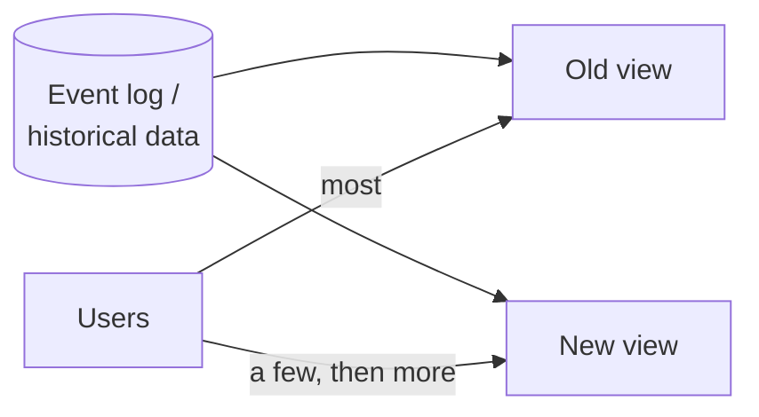
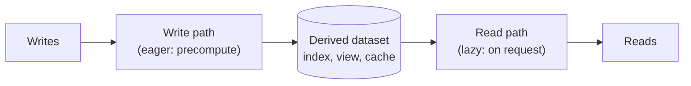
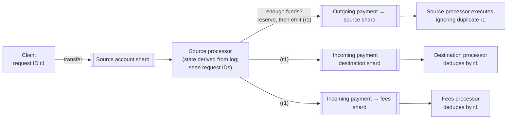

# 13. A Philosophy of Streaming Systems

[← 12. Stream Processing](12-stream-processing.md) · [Book](../README.md) · [14. Doing the Right Thing →](14-doing-the-right-thing.md)

## Summary

The penultimate chapter steps back from mechanisms to a way of designing whole systems. Because no single tool serves every access pattern, applications must **integrate** several, and the authors argue for doing so by designating systems of record and **deriving** everything else through batch and stream processing. Seen this way, an organization's dataflow is an **unbundled database**: indexes, caches, and materialized views maintained by stream processors instead of inside one product, with application code as derivation functions and state changes pushed all the way to end-user devices. The second half asks how to keep such systems **correct**: end-to-end request IDs for idempotence, uniqueness constraints via sharded logs, the distinction between **timeliness** and **integrity**, coordination-avoiding designs that apologize instead of block, and auditing — *trust, but verify*.

## Key takeaways

- **Be explicit about which system is the source of truth** and derive the rest by applying an ordered change log; this is far more robust than dual writes (pp. 539–544).
- **Derived views can be rebuilt**, so schema changes become "reprocess the history into a new view, migrate readers gradually" (pp. 544–546).
- **Unbundling**: federated querying unifies *reads*; ordered logs and CDC unify *writes*; stream processors play the role of a database's index and view maintenance (pp. 546–551).
- **The write path and the read path meet at the derived dataset**; shifting that boundary trades write work for read work, and can extend to clients that subscribe to state changes (pp. 555–561).
- **Database transactions aren't end-to-end**: exactly-once needs a request ID generated by the client and checked at the final write (pp. 562–566).
- **Integrity matters more than timeliness.** Event-driven systems give up immediate visibility but can keep integrity without distributed transactions (pp. 571–575).
- **Many constraints can be loose**: detect violations and compensate (apologize) rather than coordinate up front (pp. 573–575).
- **Check your data end to end** — software and hardware do corrupt it; design for auditability (pp. 575–579).

## Section outline

*From the book’s own table of contents (PDF bookmarks); printed page numbers.*

- Data Integration — p. 539
  - Combining Specialized Tools by Deriving Data — p. 540
  - Batch and Stream Processing — p. 544
- Unbundling Databases — p. 546
  - Composing Data Storage Technologies — p. 547
  - Designing Applications Around Dataflow — p. 551
  - Observing Derived State — p. 555
- Aiming for Correctness — p. 561
  - The End-to-End Argument for Databases — p. 562
  - Enforcing Constraints — p. 566
  - Timeliness and Integrity — p. 571
  - Trust, but Verify — p. 575
- Summary — p. 579

## Notes

This chapter pulls the book’s themes — reliability, scalability, maintainability — into one **opinionated** philosophy built on the streaming ideas of Chapter 12, rather than comparing approaches (p. 539).

### Data integration

Every tool, even a “general-purpose” database, is designed for a usage pattern; trying to serve everything makes features worse, and vendors rarely say what they’re bad at. Complex applications therefore **combine** tools — e.g. an OLTP database plus a full-text index (PostgreSQL’s built-in search suffices only for simple needs, and search indexes make poor systems of record), plus warehouses, caches, ML pipelines and notifications (pp. 539–540).

#### Reasoning about dataflows (pp. 541–544)

Be explicit: where is data written first, and what is derived from what? If **CDC from the system of record is the only way** the search index is updated, the index is fully derived and consistent (bugs aside). Letting the app write to both reintroduces Figure 12-4’s race. Funnel input through one system that decides a **total order** — state machine replication; CDC vs event sourcing matters less than that decision. Updates from an event log can be deterministic and idempotent, so recovery is easy (p. 541).

> **Try it:** [Dual writes vs a change log](../widgets/13-dual-writes.html) — race two concurrent updates into a database and a search index, with and without a change log.

| | Distributed transactions | Log-based derived data |
|---|---|---|
| Correctness via | Atomic commit (and locks) | Deterministic retry + idempotence |
| Read your own writes | Usually immediately | Not by default — derived systems update asynchronously |
| Practicality | XA’s poor fault tolerance and performance; a better protocol is unlikely to be adopted soon | “The most promising approach” for integrating heterogeneous systems |

Telling everyone “eventual consistency is inevitable — suck it up” isn’t productive; the chapter works toward a middle ground (pp. 541–542).

**The limits of total ordering** (pp. 542–544) — a totally ordered log needs one leader, which breaks down when:

| Situation | Why order becomes undefined |
|---|---|
| Throughput beyond one machine | The log is sharded; order across shards is ambiguous |
| Multiple regions | A leader per datacenter; events from two datacenters are unordered |
| Microservices | Each service owns its state; events from different services are unordered |
| Offline-capable clients | Clients and servers see events in different orders |

Total order broadcast ≡ consensus, and consensus algorithms assume one node can handle the whole stream (p. 543). **Ordering to capture causality**: after unfriending an ex, a user posts a complaint; if friendships and messages live in different places, the notification service may process the message first and notify the ex — effectively a time-dependent join. No simple answer; starting points: logical timestamps (but receivers must handle out-of-order delivery and extra metadata), logging the state the user saw with an ID that later events reference, and conflict resolution (useless for external side effects like notifications) (pp. 543–544).

#### Batch and stream processing (pp. 544–546)

Both derive datasets — indexes, views, recommendations, metrics; they differ only in bounded vs unbounded input.

- **Maintaining derived state** (pp. 544–545): batch’s functional flavour (deterministic pure functions, immutable inputs, append-only outputs) extends to streams with managed fault-tolerant state, and simplifies reasoning about organization-wide dataflows. Derived data *could* be maintained synchronously like a secondary index, but **asynchrony is what makes event logs robust**: faults stay local, while distributed transactions abort if any participant fails, amplifying failures. Cross-shard secondary indexes are likewise most reliable when maintained asynchronously.
- **Reprocessing for evolution** (pp. 545–546): streams reflect changes quickly; batch reprocesses history to derive new views. Without reprocessing, schema evolution is limited to optional fields and new record types; with it you can restructure completely. *Railway gauges*: after England standardized the gauge in 1846, lines were converted gradually by adding a **third rail** (BART still uses a different gauge). Likewise run old and new views side by side, shift users gradually, and keep every step reversible.

- **Unifying batch and stream** (p. 546): the **lambda architecture** fell out of use; the **kappa** approach runs both in one engine. It needs: replay of historical events through the same engine, exactly-once semantics, and **event-time** windowing (Apache Beam on Flink or Dataflow).

### Unbundling databases

Databases, batch/stream processors and operating systems all store and process data (a filesystem chokes on 10 million small files; a database doesn’t). Unix offers a thin low-level abstraction — files and pipes; relational databases a high-level one — SQL and transactions hiding storage, concurrency and recovery. NoSQL can be seen as applying the Unix philosophy to distributed OLTP; the chapter tries to reconcile the two (pp. 546–547).

#### Composing data storage technologies (pp. 547–551)

`CREATE INDEX` scans a consistent snapshot, sorts the indexed values, processes the backlog of writes since, then keeps the index current — exactly like **bootstrapping a follower** or **CDC’s initial snapshot**. Seen this way, an organization’s dataflow is **one huge database**: batch, stream and ETL jobs are elaborate triggers, stored procedures and view maintenance; derived systems are index types run by different teams (pp. 547–548).

| | **Federated databases** (unifying reads) | **Unbundled databases** (unifying writes) |
|---|---|---|
| Idea | One query interface over many stores — a *polystore* | Reliably plug stores together so every change reaches every place |
| Examples | PostgreSQL foreign data wrappers, Trino, Hoptimator, Xorq | CDC + event logs (Debezium, Kafka) |
| Tradition | Relational: one integrated system, high-level language | Unix: small tools, a uniform low-level API (pipes), composed by a shell |
| Difficulty | Mapping data models — manageable | Synchronizing writes — the hard part |

**Making unbundling work** (pp. 549–550): transactions within one system are fine; across technologies, **an ordered log with idempotent consumers** is simpler and more feasible than a missing standard transaction protocol. Its loose coupling pays twice: at the **system** level the log buffers for slow or failed consumers and contains faults (distributed transactions escalate them); at the **human** level teams develop components independently behind a log interface that carries strong ordering and durability yet suits almost any data.

**Unbundled vs integrated** (pp. 550–551): databases remain essential (stream-processor state, serving outputs), as do specialized engines. Many moving parts mean learning curves and quirks; an integrated product may perform more predictably; building for scale you don’t need is premature optimization. Unbundling is about **breadth, not depth** — use one product if it does everything you need. Tools are improving: Debezium, Kafka’s protocol as a de facto standard, incremental view maintenance engines.

#### Designing applications around dataflow (pp. 551–555)

**Spreadsheets** already recompute formulas when inputs change — data systems still have something to learn from VisiCalc (1979), but must also be fault-tolerant, scalable, durable and integrate many technologies (p. 551).

| Derived dataset | Derivation function (pp. 551–552) |
|---|---|
| Secondary index | Pick out the indexed fields and sort — built in as `CREATE INDEX` |
| Full-text index | Language detection, segmentation, stemming, spelling correction, synonyms → inverted index |
| ML model | Feature extraction and statistics over training data |
| Cache | Aggregation in the shape the UI displays |

Custom derivation code is where databases struggle: triggers, stored procedures and UDFs are afterthoughts, and databases lack dependency management, version control, rolling upgrades, monitoring and network access — which Kubernetes, Docker, Mesos and YARN do well (p. 552). Hence stateless services plus a database: “the separation of Church and state” (Alonzo Church’s lambda calculus has no mutable state). But a database is a mutable variable you can only **poll**; subscribing to changes is just emerging (pp. 552–553).

**Dataflow** renegotiates this: application code responds to state changes by producing state changes elsewhere — as in CDC, actors, triggers and IVM. Log-based brokers provide what it needs: **stable ordering** (views stay mutually consistent) and **fault tolerance** (one lost message permanently desynchronizes a view) — demanding, but cheaper and more robust than distributed transactions. Stream operators compose like Unix pipes (pp. 553–554).

**Stream processors and services** (pp. 554–555): both get organizational scalability, but streams are one-directional and asynchronous. Currency conversion for a purchase:

| Microservices | Dataflow |
|---|---|
| Query an exchange-rate service on each purchase | Subscribe to exchange-rate updates ahead of time; keep a local copy |
| Network request on the critical path | Local lookup — “the fastest and most reliable network request is no network request at all” |
| A local cache would need polling or a subscription anyway | A **stream join** of purchases with rate updates — time-dependent if reprocessed (use the historical rate) |

### Observing derived state

*After Figure 13-1 (pp. 555–556): the derived dataset is where write path and read path meet — eager vs lazy evaluation.*

#### Materialized views and caching (pp. 556–557)

| Option for search | Write-path work | Read-path work |
|---|---|---|
| No index (grep everything) | None | Scan all documents |
| Full-text index | Update entries for every term | Look up words, combine with AND/OR |
| Precompute results for all queries | Impossible — the query space is infinite | Just a lookup |
| Cache common queries (a materialized view) | Update when new documents match | Lookup for common queries, index for the rest |

Caches, indexes and materialized views **shift the boundary** between read and write paths — the home-timeline case study of Chapter 2, with celebrities on a different boundary: “after 500 pages, we have come full circle” (p. 557).

#### Pushing the write path to the user (pp. 557–559)

- **Stateful, offline-capable clients**: single-page and mobile apps hold state; on-device state is a **cache of server state** — pixels are a materialized view of client model objects, which replicate a remote datacenter (sync engines, Ch. 6) (pp. 557–558).
- **Pushing state changes**: a loaded page is a stale cache (RSS is just polling); **server-sent events** and **WebSockets** let the server push, extending the write path to the end user; offline devices resume like log consumers using offsets (pp. 558–559).
- **End-to-end event streams**: React and Elm already re-render on state changes; extend that to server-pushed events, so a change on one device reaches another’s UI in under a second — as messaging apps and games do. The obstacle is that databases, libraries and protocols assume request/response, not subscriptions (p. 559).

#### Reads are events too (pp. 559–561)

Stream processors’ state stores can be queried directly; go further and send **read requests as events** through the processor alongside writes — a **stream–table join** between queries and the database (a one-off read is forgotten, a subscription is a persistent join). Logging reads records **what the user saw** before deciding — e.g. the shipping date and stock shown before a purchase — at extra storage cost (an open research problem). **Multi-shard processing** via streams: Storm’s distributed RPC counting everyone who saw a URL (a union of follower sets across shards); fraud scoring that joins a purchase with differently sharded reputation databases (IP, email, billing, shipping addresses). Usually a database with this feature is simpler (pp. 559–561).

### Aiming for correctness

Stateless read-only services recover by restarting; stateful systems remember mistakes forever. ACID has been the tool for ~40 years, but weak isolation is confusing, some systems abandoned transactions, “consistency” is ill-defined, and it is hard to tell whether an app is safe at a given isolation level — Jepsen keeps finding gaps between claimed and actual guarantees. Serializability and atomic commit work but usually only in one datacenter and limit scale (pp. 561–562).

#### The end-to-end argument for databases (pp. 562–566)

Serializable transactions don’t stop an application bug from writing bad data — an argument for **immutable, append-only** data. Processing twice is corruption too (double charges, inflated counters); **exactly once** means the final effect equals a fault-free run, best via idempotence (with metadata such as operation IDs, and fencing on failover) (pp. 562–563).

| Layer | Duplicate suppression it gives | Why it’s not enough |
|---|---|---|
| TCP | Sequence numbers within one connection | A retry after a timeout uses a new connection — Example 13-1 could move **$22 instead of $11** |
| Database transaction / 2PC | One transaction per coordinator | The user’s browser re-POSTs after a lost response (“submit this form again?”) — a brand-new request (Post/Redirect/Get doesn’t help on timeout) |
| Stream processor | Exactly-once message processing | Same: the duplicate comes from the user |
| **End to end** | A request ID (UUID in a hidden form field, or a hash of the fields) passed to the database with `UNIQUE (request_id)` (Example 13-2) | — |

Real banks don’t work like Example 13-1. A uniqueness constraint is reliable even at weak isolation (unlike check-then-insert); the `requests` table doubles as an event log from which balance updates could be derived downstream (pp. 564–565).

**The end-to-end argument** (Saltzer, Reed and Clark, 1984): a function can be implemented completely and correctly only with the knowledge of the application at the endpoints; lower-level versions are performance enhancements. It applies to **duplicate suppression**, **integrity checks** (Ethernet/TCP/TLS checksums miss software bugs and disk corruption — use end-to-end checksums) and **encryption** (WiFi passwords and TLS don’t protect against compromised servers). Low-level features still reduce problem rates. We lack an abstraction that wraps up application-level fault tolerance: transactions collapse many failures into commit-or-abort but are expensive across technologies, and hand-rolled replacements are usually wrong (pp. 565–566).

> **Try it:** [Exactly once, end to end](../widgets/13-request-ids.html) — retry a $11 transfer over a flaky network, with and without a request ID.

#### Enforcing constraints (pp. 566–570)

Uniqueness (usernames, file paths, seats) and similar constraints (non-negative balances, stock, non-overlapping bookings) **require consensus** — typically one leader per value, scaled by sharding on that value (request ID, hash of username). Asynchronous multi-leader replication is ruled out; rejecting violations *immediately* needs synchronous coordination (pp. 566–567).

**Uniqueness in log-based messaging** (pp. 567–568): append each username request to the shard for hash(username); a single-threaded processor tracks taken names in a local database and emits success or rejection; the client waits on the output stream. It is the shared-log consensus construction, scales with shards, and works for any constraint whose conflicting writes can be routed to one shard and checked by arbitrary logic.

**Multi-shard request processing** (pp. 568–570) — a payment with fees, without atomic commit (Figure 13-2):

Requirements: per-account events processed in log order with at-least-once delivery, and deterministic processors. After a crash the source processor reprocesses the request, makes the same decision and emits the same events, which consumers dedupe. **Atomicity comes from appending the single request event**: once it is in the log, everything downstream eventually happens. Users subscribe for the outgoing (or “declined”) event (pp. 569–570).

#### Timeliness and integrity (pp. 571–575)

| | **Timeliness** | **Integrity** |
|---|---|---|
| Means | Users see up-to-date state (linearizability; weaker: read-after-write) | No corruption, loss or contradiction; derived data correct |
| If violated | Temporary — wait and retry | **Permanent** — needs explicit checking and repair |
| Credit-card example | Yesterday’s transaction not yet on the statement: fine | Balance ≠ previous balance + transactions, or charged but merchant unpaid: catastrophic |
| ACID transactions | Provide both | Provide both |
| Event-based dataflow | Not guaranteed unless clients wait | **Central**: exactly-once delivery and idempotence |

“Violations of timeliness are allowed under eventual consistency, whereas violations of integrity result in perpetual inconsistency” (p. 572). Dataflow preserves integrity by: the write as **one atomically written message**; all other updates derived **deterministically**; an **end-to-end request ID** for deduplication; **immutable** messages and periodic reprocessing (pp. 572–573).

**Loosely interpreted constraints** (pp. 573–574): businesses already handle violations — order more stock, apologize and discount (as when a forklift destroys inventory); airlines and hotels **overbook** deliberately and compensate (and need those processes anyway for strikes and weather); banks charge overdraft fees and cap daily withdrawals; cross-organization settlement corrects mismatches. These are **compensating transactions**; the cost of an apology (a follow-up email, a refund) is a business decision, so write optimistically and check afterwards — still validating before irreversible actions like ATM payouts. Integrity is still required; timeliness of constraint enforcement isn’t.

**Coordination-avoiding data systems** (pp. 574–575): dataflow gives integrity without atomic commit, linearizability or synchronous cross-shard coordination, and many constraints can be loose — so most coordination can go, e.g. multi-leader across regions with weak timeliness but strong integrity. Serializable transactions still help at small scope; XA isn’t needed; coordination is reserved for steps that can’t be undone. Coordination trades **apologies for inconsistencies** against **apologies for outages** — you can’t reach zero, only a sweet spot.

#### Trust, but verify (pp. 575–579)

System models treat faults as possible or impossible; reality is probabilistic — and at scale even unlikely corruption (memory, disk, network) happens (p. 575).

- **Software bugs**: past MySQL versions failed to maintain uniqueness constraints; PostgreSQL’s serializable level has exhibited write skew; application code is reviewed far less and often misuses foreign-key and uniqueness constraints. ACID consistency assumes bug-free transactions (p. 576).
- **Don’t just blindly trust what they promise**: check — **auditing**. HDFS and S3 continually read back files, compare replicas and move data to fight silent corruption; restore from backups periodically. Few systems self-audit today; more may in future (pp. 576–577).
- **Designing for auditability**: a mutation across tables hides its *why*; an event-sourced input plus **deterministic** derivations can be hashed, re-derived to compare, run redundantly in parallel, and replayed for time-travel debugging (p. 577).
- **The end-to-end argument again**: check whole pipelines end to end — every disk, network, service and algorithm on the path is then covered; continuous checks, like tests, let you move faster (pp. 577–578).
- **Tools** (p. 578): audit tables are hard to make trustworthy; signing a log with a hardware security module doesn’t prove the right transactions went in. **Blockchains** (Bitcoin, Ethereum) are shared append-only logs with cryptographic checks — transactions are events, smart contracts are stream processors — and Byzantine fault-tolerant, but too costly for most applications. Lighter tools: **Merkle trees** (efficient proofs that a record is in a dataset) and **certificate transparency** (verified append-only logs of TLS certificates with a single leader per log, no consensus). Such auditing may spread to data systems generally.

## Trade-offs at a glance

| | Distributed transactions | Log-based derived data |
|---|---|---|
| Ordering | Locks / atomic commit | Single ordered log per shard |
| Read-your-writes | Yes (linearizable) | Not by default (asynchronous) |
| Fault isolation | Poor — failures spread across participants | Good — consumers fail and catch up independently |
| Heterogeneous systems | XA, fragile | Natural (CDC + idempotent consumers) |
| Guarantees | Timeliness + integrity | Integrity; timeliness only if you wait |

## Beyond the book

- Pat Helland's "Life beyond Distributed Transactions" (2007) and "Memories, Guesses, and Apologies" anticipate the apologize-and-compensate approach to constraints.
- The CALM theorem (Hellerstein and Alvaro) formalizes which programs can avoid coordination: exactly the monotonic ones.

## Connections

- **Related chapters:** [1. Trade-Offs](01-trade-offs-in-data-systems-architecture.md) (systems of record), [6. Replication](06-replication.md) (sync engines), [8. Transactions](08-transactions.md), [10. Consistency and Consensus](10-consistency-and-consensus.md), [11. Batch Processing](11-batch-processing.md), [12. Stream Processing](12-stream-processing.md).

## Check yourself

*Questions and answers are the vault's, written from the notes above; answers cite the book's pages.*

1. **Why is "CDC is the only way the index is updated" stronger than having the application write to both the database and the index?**

   *Answer:* With a single ordered change log, every derived system applies the same writes in the same order, so they converge; dual writes can be applied in different orders or partially fail (pp. 540–544).

2. **Where do the write path and read path meet in a full-text search system?**
   - [ ] In the browser
   - [x] At the index: writes do the work of updating it in advance; reads use it
   - [ ] In the network load balancer
   - [ ] At the backup system

   *Answer:* Work done on writes (building the index) saves work on reads. Caches and materialized views move the boundary further toward the write path; searching without an index would put all the work on the read path (pp. 555–557).

3. **Why doesn't a database transaction prevent a double payment when the browser retries a timed-out request? What does?**

   *Answer:* The retry is a new request and a new transaction, so the database sees two separate payments. An end-to-end request ID generated by the client, stored with a uniqueness constraint, lets the system detect the duplicate (pp. 562–566).

4. **How can a sharded log enforce username uniqueness without a distributed lock?**

   *Answer:* Shard requests by username, so all requests for a name go through one log shard in order; a single processor reads them sequentially and accepts the first, rejecting later ones (pp. 566–571).

5. **Which property must never be violated, even when the other is relaxed?**
   - [ ] Timeliness
   - [x] Integrity
   - [ ] Throughput
   - [ ] Availability

   *Answer:* A delayed balance update (a timeliness violation) is tolerable and resolves itself; a lost or duplicated transfer (an integrity violation) is permanent damage. For example, a credit card transaction may appear late in a statement, but its amount must be right (pp. 571–575).

6. **What does it mean to design a system for auditability?**

   *Answer:* To assume that things will go wrong and check: keep immutable event logs from which derived state can be recomputed, so data can be verified end to end and corruption detected rather than trusted blindly (pp. 575–579).
