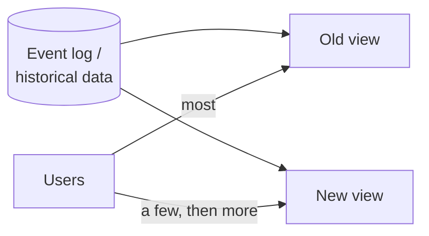
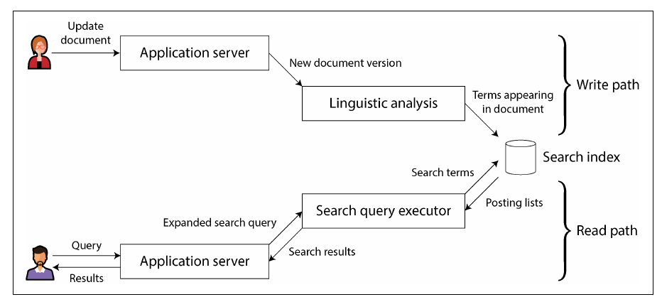
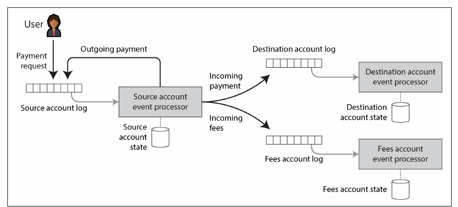

# فصل ۱۳: فلسفه‌ی سیستم‌های streaming

[فصل ۱۲: پردازش stream →](12-stream-processing.md) · [کتاب](../README.md) · [فصل ۱۴: کار درست را انجام دادن ←](14-doing-the-right-thing.md)

## خلاصه

فصل یکی مانده به آخر از سازوکارها فاصله می‌گیرد و به شیوه‌ای برای طراحی کل سیستم می‌رسد. چون هیچ ابزاری به همه‌ی الگوهای دسترسی جواب نمی‌دهد، اپلیکیشن‌ها باید چند ابزار را **یکپارچه** کنند، و نویسنده‌ها پیشنهاد می‌کنند این کار با تعیین system of record و **مشتق کردن** بقیه با پردازش batch و stream انجام شود. از این نگاه، جریان داده‌ی یک سازمان یک **دیتابیس unbundled** است: index، cache و materialized view به جای درون یک محصول، با stream processorها نگه داشته می‌شوند، کد اپلیکیشن نقش تابع مشتق‌سازی را دارد و تغییرهای state تا دستگاه کاربر نهایی push می‌شوند. نیمه‌ی دوم می‌پرسد چطور چنین سیستم‌هایی را **درست** نگه داریم: request ID سرتاسری برای idempotence، uniqueness constraint با logهای shardشده، تفاوت **timeliness** و **integrity**، طراحی‌های بی‌نیاز از coordination که به جای مسدود کردن عذرخواهی می‌کنند، و حسابرسی؛ یعنی *اعتماد کن، اما وارسی کن*.

## نکته‌های کلیدی

- **صریح بگویید کدام سیستم منبع حقیقت است** و بقیه را با اعمال یک change log مرتب مشتق کنید؛ این بسیار محکم‌تر از dual write است (pp. 539–544).
- **مفهوم derived view را می‌شود دوباره ساخت**، پس تغییر schema یعنی «تاریخچه را در یک view تازه دوباره پردازش کن و خواننده‌ها را کم‌کم منتقل کن» (pp. 544–546).
- **مفهوم unbundling:** federated query *خواندن‌ها* را یکپارچه می‌کند؛ logهای مرتب و CDC *نوشتن‌ها* را؛ و stream processorها نقش نگه‌داری index و view در یک دیتابیس را بازی می‌کنند (pp. 546–551).
- **مسیر نوشتن و مسیر خواندن در dataset مشتق‌شده به هم می‌رسند**؛ جابه‌جا کردن این مرز کار نوشتن را با کار خواندن معاوضه می‌کند و می‌تواند تا clientهایی برسد که مشترک تغییرهای state هستند (pp. 555–561).
- **تراکنش دیتابیس سرتاسری نیست:** exactly-once به request IDی نیاز دارد که client می‌سازد و در نوشتن نهایی بررسی می‌شود (pp. 562–566).
- **مفهوم integrity از timeliness مهم‌تر است.** سیستم‌های event-driven دیده شدن فوری را از دست می‌دهند اما بدون تراکنش توزیع‌شده integrity را نگه می‌دارند (pp. 571–575).
- **خیلی از constraintها می‌توانند شل باشند:** به جای coordination از پیش، تخلف را تشخیص دهید و جبرانش کنید، یعنی عذرخواهی کنید (pp. 573–575).
- **داده را سرتاسری وارسی کنید**؛ نرم‌افزار و سخت‌افزار واقعاً آن را خراب می‌کنند؛ برای حسابرسی‌پذیری طراحی کنید (pp. 575–579).

## فهرست بخش‌ها

*از فهرست مطالب خود کتاب، یعنی bookmarkهای PDF، با شماره‌ی صفحه‌های چاپی.*

- یکپارچه‌سازی داده (p. 539)
  - ترکیب ابزارهای تخصصی با مشتق کردن داده (p. 540)
  - پردازش batch و stream (p. 544)
- مفهوم unbundling دیتابیس‌ها (p. 546)
  - ترکیب فناوری‌های ذخیره‌سازی داده (p. 547)
  - طراحی اپلیکیشن‌ها حول dataflow (p. 551)
  - مشاهده‌ی state مشتق‌شده (p. 555)
- هدف‌گیری درستی (p. 561)
  - استدلال end-to-end برای دیتابیس‌ها (p. 562)
  - اعمال constraintها (p. 566)
  - مفهوم timeliness و integrity (p. 571)
  - اعتماد کن، اما وارسی کن (p. 575)
- جمع‌بندی (p. 579)

## یادداشت‌ها

این فصل موضوع‌های کتاب، یعنی reliability، scalability و maintainability، را در یک فلسفه‌ی **صاحب‌نظر** روی ایده‌های streaming فصل ۱۲ جمع می‌کند، به جای اینکه رویکردها را مقایسه کند (p. 539).

> **Try it:** [فصل ۱۳ در طول یک pipeline داده](../widgets/13-pipeline-map.html): از دیتابیس منبع تا داشبورد را با lensهای منبع حقیقت، مرز نوشتن و خواندن، و integrity طی کنید.

### یکپارچه‌سازی داده

هر ابزاری، حتی یک دیتابیس «همه‌منظوره»، برای یک الگوی استفاده طراحی شده؛ تلاش برای جواب دادن به همه چیز قابلیت‌ها را بدتر می‌کند، و فروشنده‌ها به‌ندرت می‌گویند در چه چیزی بدند. پس اپلیکیشن‌های پیچیده ابزارها را **ترکیب** می‌کنند؛ مثلاً یک دیتابیس OLTP به‌علاوه‌ی یک full-text index، که جست‌وجوی داخلی PostgreSQL فقط برای نیازهای ساده کافی است و search indexها system of record خوبی نیستند، به‌علاوه‌ی warehouse، cache، pipelineهای ML و اعلان‌ها (pp. 539–540).

#### استدلال درباره‌ی dataflowها (pp. 541–544)

صریح باشید: داده اول کجا نوشته می‌شود و چه چیزی از چه چیزی مشتق می‌شود؟ اگر **CDC از system of record تنها راه** به‌روز شدن search index باشد، index کاملاً مشتق‌شده و سازگار است، جز در صورت باگ. اگر اپلیکیشن در هر دو بنویسد، race شکل ۱۲-۴ برمی‌گردد. ورودی را از یک سیستم بگذرانید که **ترتیب کامل** را تعیین می‌کند، یعنی state machine replication؛ انتخاب بین CDC و event sourcing از خود این تصمیم کم‌اهمیت‌تر است. به‌روزرسانی از یک event log می‌تواند قطعی و idempotent باشد، پس بازیابی آسان است (p. 541).

> **Try it:** [مفهوم dual write در برابر change log](../widgets/13-dual-writes.html): دو به‌روزرسانی هم‌زمان را به یک دیتابیس و یک search index بفرستید، یک بار با change log و یک بار بدون آن.

| | تراکنش توزیع‌شده | داده‌ی مشتق‌شده بر پایه‌ی log |
|---|---|---|
| درستی از راه | مفهوم atomic commit، و lock | مفهوم retry قطعی به‌علاوه‌ی idempotence |
| خواندن نوشته‌های خود | معمولاً فوری | به طور پیش‌فرض نه؛ سیستم‌های مشتق‌شده asynchronous به‌روز می‌شوند |
| عملی بودن | مفهوم XA تحمل fault و کارایی ضعیفی دارد؛ پروتکل بهتر به این زودی‌ها پذیرفته نمی‌شود | امیدوارکننده‌ترین رویکرد برای یکپارچه کردن سیستم‌های ناهمگون |

اینکه به همه بگوییم eventual consistency اجتناب‌ناپذیر است و باید تحملش کرد، سازنده نیست؛ فصل به سمت یک راه میانه می‌رود (pp. 541–542).

> **In practice:** در reference stack دیتابیس‌های منبع system of record هستند و Bronze، Silver و Gold همه مشتق‌شده‌اند؛ هر جدول Silver یا Gold با اجرای دوباره‌ی SQL از Bronze ساخته می‌شود.
>
> **Your turn:** یک تحلیل‌گر عدد غلطی را مستقیماً در یک جدول Gold اصلاح می‌کند تا داشبورد امروز درست شود. فردا چه می‌شود، و اصلاح درست کجا باید انجام شود؟
>
> *Answer:* ساختن بعدی Gold از Silver اصلاح دستی را پاک می‌کند و عدد غلط برمی‌گردد؛ نوشتن مستقیم در یک سیستم مشتق‌شده همان ناسازگاری dual write است (pp. 540–541). اصلاح باید در منبع حقیقت انجام شود، یعنی دیتابیس منبع، یا در خود منطق مشتق‌سازی، یعنی SQL ساختن Silver یا Gold، تا هر بار ساختن دوباره همان نتیجه‌ی درست را بدهد.

**محدودیت‌های ترتیب کامل** (pp. 542–544): یک log با ترتیب کامل به یک leader نیاز دارد، و این در این حالت‌ها می‌شکند:

| وضعیت | چرا ترتیب نامعین می‌شود |
|---|---|
| مفهوم throughput بیش از یک ماشین | مفهوم log شکسته به shardها می‌شود؛ ترتیب بین shardها مبهم است |
| چند region | برای هر datacenter یک leader؛ رویدادهای دو datacenter ترتیبی ندارند |
| مفهوم microservice | هر سرویس صاحب state خودش است؛ رویدادهای سرویس‌های مختلف ترتیبی ندارند |
| مفهوم clientهای آفلاین‌پذیر | مفهوم client و سرور رویدادها را با ترتیب‌های متفاوت می‌بینند |

مفهوم total order broadcast معادل consensus است، و الگوریتم‌های consensus فرض می‌کنند یک node می‌تواند کل stream را پردازش کند (p. 543). **ترتیب برای ثبت causality:** کاربری دوست سابقش را unfriend می‌کند و بعد پستی در گلایه می‌گذارد؛ اگر دوستی‌ها و پیام‌ها در جاهای مختلف باشند، سرویس اعلان ممکن است اول پیام را پردازش کند و به همان دوست سابق خبر بدهد؛ در عمل یک join وابسته به زمان. جواب ساده‌ای ندارد؛ نقطه‌های شروع: timestamp منطقی، که گیرنده‌ها باید با تحویل بی‌ترتیب و metadata اضافه کنار بیایند؛ ثبت stateی که کاربر دیده با یک شناسه که رویدادهای بعدی به آن ارجاع می‌دهند؛ و conflict resolution، که برای اثرهای جانبی بیرونی مثل اعلان بی‌فایده است (pp. 543–544).

#### پردازش batch و stream (pp. 544–546)

هر دو dataset مشتق می‌کنند، یعنی index، view، پیشنهاد و metric؛ فقط در ورودی محدود در برابر unbounded فرق دارند.

- **نگه‌داری state مشتق‌شده** (pp. 544–545): حال‌وهوای تابعی batch، یعنی تابع‌های خالص قطعی، ورودی immutable و خروجی append-only، با state مدیریت‌شده و fault-tolerant به streamها هم می‌رسد و استدلال درباره‌ی dataflow کل سازمان را ساده می‌کند. داده‌ی مشتق‌شده را *می‌شود* مثل secondary index synchronous نگه داشت، اما **asynchrony همان چیزی است که event log را محکم می‌کند**: faultها محلی می‌مانند، در حالی که تراکنش توزیع‌شده با fail شدن هر شرکت‌کننده abort می‌شود و fault را بزرگ می‌کند. secondary index بین shardها هم وقتی asynchronous نگه داشته شود قابل‌اعتمادتر است.
- **پردازش دوباره برای تکامل** (pp. 545–546): streamها تغییر را سریع منعکس می‌کنند؛ batch تاریخچه را دوباره پردازش می‌کند تا viewهای تازه بسازد. بدون پردازش دوباره، تکامل schema به فیلدهای اختیاری و نوع رکورد تازه محدود است؛ با آن می‌شود ساختار را کاملاً عوض کرد. *عرض ریل راه‌آهن:* بعد از استاندارد شدن عرض ریل در انگلستان در ۱۸۴۶، خط‌ها کم‌کم با افزودن **ریل سوم** تبدیل شدند؛ BART هنوز عرض متفاوتی دارد. به همین شکل، view قدیم و جدید را کنار هم اجرا کنید، کاربران را کم‌کم منتقل کنید و هر قدم را برگشت‌پذیر نگه دارید.

> **In practice:** یک جدول Silver در reference stack باید از نو ساختاربندی شود؛ مثلاً یک ستون به دو ستون تقسیم شود و granularity جدول عوض شود. چند داشبورد Metabase و چند notebook از آن می‌خوانند.
>
> **Your turn:** این تغییر را به شیوه‌ی «ریل سوم» چطور انجام می‌دهید، و چرا Bronze این کار را ممکن می‌کند؟
>
> *Answer:* جدول تازه را با نام دیگری کنار جدول قدیم از روی Bronze بسازید، هر دو را با هم به‌روز نگه دارید، داشبوردها و notebookها را یکی‌یکی منتقل کنید، و جدول قدیم را فقط وقتی پاک کنید که دیگر کسی از آن نمی‌خواند؛ تا آن موقع هر قدم برگشت‌پذیر است (pp. 545–546). Bronze همان تاریخچه‌ی خام است که پردازش دوباره را ممکن می‌کند؛ بدون آن فقط می‌شد ستون اختیاری اضافه کرد.

- **یکی کردن batch و stream** (p. 546): **lambda architecture** از رواج افتاد؛ رویکرد **kappa** هر دو را در یک موتور اجرا می‌کند. این‌ها لازم است: replay رویدادهای تاریخی از همان موتور، معنای exactly-once، و window بر اساس **event time**؛ مثلاً Apache Beam روی Flink یا Dataflow.

### مفهوم unbundling دیتابیس‌ها

دیتابیس‌ها، پردازش‌کننده‌های batch و stream، و سیستم‌عامل‌ها همه داده ذخیره و پردازش می‌کنند؛ یک filesystem زیر ۱۰ میلیون فایل کوچک از پا می‌افتد، اما دیتابیس نه. Unix یک abstraction نازک و سطح پایین می‌دهد، یعنی فایل و pipe؛ دیتابیس‌های رابطه‌ای یک abstraction سطح بالا، یعنی SQL و تراکنش، که ذخیره‌سازی، concurrency و بازیابی را پنهان می‌کند. می‌شود NoSQL را اعمال فلسفه‌ی Unix به OLTP توزیع‌شده دید؛ فصل می‌کوشد این دو را آشتی دهد (pp. 546–547).

#### ترکیب فناوری‌های ذخیره‌سازی داده (pp. 547–551)

دستور `CREATE INDEX` یک snapshot سازگار را scan می‌کند، مقدارهای index را مرتب می‌کند، نوشتن‌های عقب‌افتاده از آن لحظه را پردازش می‌کند و بعد index را به‌روز نگه می‌دارد؛ درست مثل **راه‌اندازی یک follower** یا **snapshot اولیه‌ی CDC**. از این نگاه، dataflow یک سازمان **یک دیتابیس عظیم** است: jobهای batch، stream و ETL triggerها، stored procedureها و نگه‌داری viewهای مفصل‌اند؛ سیستم‌های مشتق‌شده نوع‌هایی از index‌اند که تیم‌های مختلف اجرایشان می‌کنند (pp. 547–548).

| | **دیتابیس federated**، یعنی یکی کردن خواندن‌ها | **دیتابیس unbundled**، یعنی یکی کردن نوشتن‌ها |
|---|---|---|
| ایده | یک interface کوئری روی چند store؛ یک *polystore* | وصل کردن قابل‌اعتماد storeها تا هر تغییر به همه‌جا برسد |
| مثال‌ها | قابلیت foreign data wrapper در PostgreSQL، و Trino، Hoptimator و Xorq | مفهوم CDC به‌علاوه‌ی event log، مثل Debezium و Kafka |
| سنت | رابطه‌ای: یک سیستم یکپارچه با زبان سطح بالا | سنت Unix: ابزارهای کوچک، یک API یکنواخت سطح پایین، یعنی pipe، که با shell ترکیب می‌شوند |
| دشواری | mapping مدل‌های داده؛ شدنی | synchronous کردن نوشتن‌ها؛ بخش سخت |

**کارآمد کردن unbundling** (pp. 549–550): تراکنش درون یک سیستم خوب است؛ بین فناوری‌ها، **یک log مرتب با consumerهای idempotent** ساده‌تر و شدنی‌تر از پروتکل تراکنش استانداردی است که وجود ندارد. وابستگی سستش دو بار سود می‌دهد: در سطح **سیستم**، log برای consumerهای کند یا fail‌شده buffer می‌شود و fault را مهار می‌کند، در حالی که تراکنش توزیع‌شده آن را تشدید می‌کند؛ در سطح **انسانی**، تیم‌ها اجزا را مستقل پشت یک interface log توسعه می‌دهند که ترتیب و دوام قوی دارد و تقریباً با هر داده‌ای جور است.

**مقایسه‌ی unbundled و یکپارچه** (pp. 550–551): دیتابیس‌ها همچنان ضروری‌اند، برای state پردازش‌کننده‌ی stream و برای serve کردن خروجی، و موتورهای تخصصی هم. اجزای متحرک زیاد یعنی منحنی یادگیری و رفتارهای عجیب؛ یک محصول یکپارچه ممکن است کارایی قابل‌پیش‌بینی‌تری داشته باشد؛ ساختن برای مقیاسی که لازم ندارید بهینه‌سازی زودهنگام است. unbundling درباره‌ی **گستره است، نه عمق**؛ اگر یک محصول همه‌ی نیازتان را برآورده می‌کند، از همان استفاده کنید. ابزارها بهتر می‌شوند: Debezium، پروتکل Kafka به عنوان استاندارد عملی، و موتورهای incremental view maintenance.

#### طراحی اپلیکیشن‌ها حول dataflow (pp. 551–555)

**صفحه‌گسترده‌ها** از قبل با تغییر ورودی فرمول‌ها را دوباره حساب می‌کنند؛ سیستم‌های داده هنوز می‌توانند از VisiCalc، در ۱۹۷۹، چیزی یاد بگیرند، اما باید تحمل‌پذیر fault، مقیاس‌پذیر و durable هم باشند و فناوری‌های زیادی را یکپارچه کنند (p. 551).

| مفهوم dataset مشتق‌شده | تابع مشتق‌سازی (pp. 551–552) |
|---|---|
| مفهوم secondary index | انتخاب فیلدهای index و مرتب کردن؛ درون دیتابیس به شکل `CREATE INDEX` |
| مفهوم full-text index | تشخیص زبان، بخش‌بندی، ریشه‌یابی، اصلاح املا و مترادف‌ها، و ساختن inverted index |
| مدل ML | استخراج feature و آمار روی داده‌ی آموزشی |
| مفهوم cache | مفهوم aggregation به همان شکلی که UI نشان می‌دهد |

کد مشتق‌سازی سفارشی جایی است که دیتابیس‌ها لنگ می‌زنند: trigger، stored procedure و UDF فکرهای بعدی‌اند، و دیتابیس‌ها مدیریت وابستگی، version control، rolling upgrade، monitoring و دسترسی شبکه ندارند؛ چیزهایی که Kubernetes، Docker، Mesos و YARN خوب انجام می‌دهند (p. 552). نتیجه: سرویس‌های stateless به‌علاوه‌ی یک دیتابیس، یا به تعبیر کتاب جدایی Church و state، چون lambda calculus آلونزو چرچ state mutable ندارد. اما دیتابیس یک متغیر mutable است که فقط می‌شود **poll**اش کرد؛ اشتراک در تغییرها تازه دارد پیدا می‌شود (pp. 552–553).

**مفهوم dataflow** این قرارداد را از نو می‌چیند: کد اپلیکیشن به تغییر state با تولید تغییر state در جای دیگر جواب می‌دهد؛ مثل CDC، actorها، triggerها و IVM. brokerهای مبتنی بر log همان چیزی را می‌دهند که لازم است: **ترتیب پایدار**، تا viewها با هم سازگار بمانند، و **تحمل fault**، چون یک پیام گم‌شده یک view را برای همیشه asynchronous می‌کند؛ پرتوقع است، اما ارزان‌تر و محکم‌تر از تراکنش توزیع‌شده. عملگرهای stream مثل pipeهای Unix ترکیب می‌شوند (pp. 553–554).

**پردازش‌کننده‌های stream و سرویس‌ها** (pp. 554–555): هر دو مقیاس‌پذیری سازمانی می‌دهند، اما streamها یک‌طرفه و asynchronous‌اند. تبدیل ارز برای یک خرید:

| رویکرد microservice | رویکرد dataflow |
|---|---|
| برای هر خرید از سرویس نرخ ارز کوئری بگیر | از پیش مشترک به‌روزرسانی‌های نرخ ارز شو؛ یک نسخه‌ی محلی نگه دار |
| یک درخواست شبکه روی مسیر بحرانی | جست‌وجوی محلی؛ به تعبیر کتاب سریع‌ترین و قابل‌اعتمادترین درخواست شبکه آن است که اصلاً فرستاده نشود |
| یک cache محلی به هر حال به poll یا اشتراک نیاز دارد | یک **stream join** از خریدها با به‌روزرسانی‌های نرخ؛ اگر دوباره پردازش شود وابسته به زمان است، پس نرخ تاریخی را به کار ببرید |

### مشاهده‌ی state مشتق‌شده

*Figure 13-1 (p. 556): مفهوم search index جایی است که مسیر نوشتن، یعنی محاسبه‌ی مشتاقانه از پیش، به مسیر خواندن، یعنی محاسبه‌ی تنبل هنگام درخواست، می‌رسد.*

#### مفهوم materialized view و cache (pp. 556–557)

| گزینه برای جست‌وجو | کار مسیر نوشتن | کار مسیر خواندن |
|---|---|---|
| بدون index، یعنی grep روی همه چیز | هیچ | مفهوم scan همه‌ی سندها |
| مفهوم full-text index | به‌روز کردن entryها برای هر واژه | جست‌وجوی واژه‌ها و ترکیب با AND و OR |
| محاسبه‌ی از پیش نتیجه برای همه‌ی کوئری‌ها | ناممکن؛ فضای کوئری بی‌نهایت است | فقط یک جست‌وجو |
| مفهوم cache برای کوئری‌های رایج، یعنی یک materialized view | به‌روز کردن وقتی سند تازه‌ای جور درمی‌آید | جست‌وجو برای کوئری‌های رایج، index برای بقیه |

مفهوم cache، index و materialized view **مرز** بین مسیر خواندن و نوشتن را جابه‌جا می‌کنند؛ همان مطالعه‌ی موردی home timeline در فصل ۲، که سلبریتی‌ها مرز دیگری داشتند؛ کتاب می‌گوید بعد از ۵۰۰ صفحه به نقطه‌ی شروع برگشته‌ایم (p. 557).

> **In practice:** یک داشبورد Metabase در reference stack می‌تواند هر بار مستقیم از Silver کوئری بگیرد یا از یک جدول Gold که هر صبح از پیش جمع شده.
>
> **Your turn:** با چشم مسیر نوشتن و خواندن، این دو گزینه را مقایسه کنید. کی ارزش دارد مرز را به سمت نوشتن ببرید؟
>
> *Answer:* کوئری مستقیم روی Silver همه‌ی کار را روی مسیر خواندن می‌گذارد: هر بار باز شدن داشبورد scan و aggregation کامل، اما همیشه تازه. جدول Gold کار را به مسیر نوشتن می‌برد، مثل یک materialized view: خواندن ارزان، اما فقط به تازگی آخرین ساختن (pp. 556–557). وقتی داشبورد زیاد باز می‌شود و کوئری سنگین است، Gold می‌ارزد؛ وقتی کم باز می‌شود یا تازگی مهم‌تر است، خواندن مستقیم.

#### بردن مسیر نوشتن تا کاربر (pp. 557–559)

- **مفهوم clientهای stateful و آفلاین‌پذیر:** اپلیکیشن‌های تک‌صفحه‌ای و موبایل state نگه می‌دارند؛ state روی دستگاه یک **cache از state سرور** است: پیکسل‌ها materialized view اشیای مدل client‌اند، و این اشیا نسخه‌ای از یک datacenter دور هستند؛ مثل sync engineها در فصل ۶ (pp. 557–558).
- **مفهوم push تغییرهای state:** یک صفحه‌ی load‌شده یک cache کهنه است، و RSS هم فقط poll است؛ **server-sent events** و **WebSocket** اجازه می‌دهند سرور push کند و مسیر نوشتن را تا کاربر نهایی امتداد دهد؛ دستگاه‌های آفلاین مثل consumerهای log با offset ادامه می‌دهند (pp. 558–559).
- **مفهوم event stream سرتاسری:** React و Elm از قبل با تغییر state دوباره render می‌کنند؛ این را به رویدادهایی که سرور push می‌کند امتداد دهید تا تغییری روی یک دستگاه در کمتر از یک ثانیه به UI دستگاه دیگر برسد، کاری که اپلیکیشن‌های پیام‌رسان و بازی‌ها می‌کنند. مانع این است که دیتابیس‌ها، کتابخانه‌ها و پروتکل‌ها request/response فرض می‌کنند، نه اشتراک (p. 559).

#### خواندن هم رویداد است (pp. 559–561)

می‌شود state storeهای پردازش‌کننده‌های stream را مستقیم کوئری گرفت؛ یک قدم جلوتر، **درخواست‌های خواندن را هم به شکل رویداد** کنار نوشتن‌ها از پردازش‌کننده بگذرانید؛ یک **stream–table join** بین کوئری‌ها و دیتابیس، که خواندن یک‌باره فراموش می‌شود و اشتراک یک join durable است. ثبت خواندن‌ها **آنچه کاربر دیده** را پیش از تصمیمش ثبت می‌کند؛ مثلاً تاریخ ارسال و موجودی‌ای که پیش از خرید نشان داده شده، به قیمت فضای ذخیره‌سازی بیشتر، که مسئله‌ای باز در پژوهش است. **پردازش چند shard** با stream: distributed RPC در Storm برای شمردن همه‌ی کسانی که یک URL را دیده‌اند، یعنی اجتماع مجموعه‌های دنبال‌کننده‌ها بین shardها؛ و امتیازدهی fraud که یک خرید را با دیتابیس‌های اعتبار با shardبندی متفاوت join می‌کند، مثل IP، ایمیل، آدرس صورت‌حساب و آدرس ارسال. معمولاً دیتابیسی که این قابلیت را دارد ساده‌تر است (pp. 559–561).

### هدف‌گیری درستی

سرویس‌های stateless read-only با restart بازیابی می‌شوند؛ سیستم‌های stateful اشتباه را برای همیشه به خاطر می‌سپارند. ACID حدود ۴۰ سال ابزار این کار بوده، اما isolation ضعیف گیج‌کننده است، بعضی سیستم‌ها تراکنش را کنار گذاشتند، «consistency» تعریف روشنی ندارد، و سخت است بگوییم یک اپلیکیشن در یک سطح isolation امن است یا نه؛ Jepsen مدام فاصله‌ی تضمین ادعاشده و واقعی را پیدا می‌کند. serializability و atomic commit کار می‌کنند، اما معمولاً فقط در یک datacenter و با محدود کردن مقیاس (pp. 561–562).

#### استدلال end-to-end برای دیتابیس‌ها (pp. 562–566)

تراکنش serializable جلوی باگ اپلیکیشن را که داده‌ی بد می‌نویسد نمی‌گیرد؛ دلیلی به نفع داده‌ی **immutable و append-only**. دو بار پردازش هم خرابی است، مثل دو بار برداشت از حساب یا شمارنده‌ی باد کرده؛ **exactly once** یعنی اثر نهایی همان اجرای بی‌fault است، که بهترین راهش idempotence است، با metadataیی مثل شناسه‌ی عملیات و fencing هنگام failover (pp. 562–563).

| لایه | حذف تکراری که می‌دهد | چرا کافی نیست |
|---|---|---|
| مفهوم TCP | شماره‌ی ترتیب درون یک اتصال | مفهوم retry بعد از timeout از اتصال تازه‌ای می‌رود؛ مثال ۱۳-۱ ممکن است به جای **۱۱ دلار، ۲۲ دلار** منتقل کند |
| تراکنش دیتابیس یا 2PC | یک تراکنش برای هر coordinator | مرورگر کاربر بعد از گم شدن پاسخ دوباره POST می‌کند، یعنی پیام «فرم دوباره فرستاده شود؟»، که درخواستی کاملاً تازه است؛ Post/Redirect/Get هنگام timeout کمکی نمی‌کند |
| پردازش‌کننده‌ی stream | پردازش exactly-once پیام | همان مشکل: تکراری از خود کاربر می‌آید |
| **سرتاسری** | یک request ID، یعنی UUID در یک فیلد پنهان فرم یا hash فیلدها، که با `UNIQUE (request_id)` به دیتابیس می‌رسد؛ مثال ۱۳-۲ | کافی است |

بانک‌های واقعی مثل مثال ۱۳-۱ کار نمی‌کنند. uniqueness constraint حتی در isolation ضعیف قابل‌اعتماد است، برخلاف بررسی و بعد درج؛ جدول `requests` خودش یک event log است که به‌روزرسانی موجودی‌ها می‌تواند downstream از آن مشتق شود (pp. 564–565).

**استدلال end-to-end**، از Saltzer، Reed و Clark در ۱۹۸۴: یک کارکرد را فقط با دانش اپلیکیشن در دو سر می‌شود کامل و درست پیاده کرد؛ نسخه‌های سطح پایین‌تر فقط بهبود کارایی‌اند. این درباره‌ی **حذف تکراری‌ها** صدق می‌کند، درباره‌ی **بررسی integrity**، که checksumهای Ethernet، TCP و TLS باگ نرم‌افزار و خرابی دیسک را نمی‌گیرند، پس checksum سرتاسری لازم است، و درباره‌ی **رمزنگاری**، که رمز WiFi و TLS در برابر سرور نفوذشده محافظت نمی‌کنند. قابلیت‌های سطح پایین همچنان نرخ مشکل را کم می‌کنند. abstractionی نداریم که تحمل fault در سطح اپلیکیشن را بسته‌بندی کند: تراکنش‌ها خرابی‌های زیادی را به commit یا abort فرو می‌کاهند اما بین فناوری‌ها گران‌اند، و جایگزین‌های دست‌ساز معمولاً غلط‌اند (pp. 565–566).

> **Try it:** [مفهوم exactly-once سرتاسری](../widgets/13-request-ids.html): یک انتقال ۱۱ دلاری را روی یک شبکه‌ی ناپایدار retry کنید، با request ID و بدون آن.

> **In practice:** یک task در Airflow در reference stack داده‌ی یک ماه را در جدولی از ClickHouse درج می‌کند؛ اتصال بعد از درج و پیش از پاسخ قطع می‌شود و Airflow task را retry می‌کند.
>
> **Your turn:** retry خودکار Airflow و تراکنش‌های دیتابیس جلوی تکرار را می‌گیرند؟ اگر نه، چه چیزی می‌گیرد؟
>
> *Answer:* نه؛ retry یک اجرای تازه است و دیتابیس آن را درج دیگری می‌بیند، مثل مرورگری که فرم را دوباره POST می‌کند (pp. 563–564). محافظت باید سرتاسری باشد: شناسه‌ای که از خود task می‌آید، مثل تاریخ منطقی اجرا، و نوشتنی که با همان شناسه idempotent است؛ مثلاً جایگزین کردن کل partition آن ماه به جای افزودن به آن، یا حذف تکراری‌ها با کلید در Silver (pp. 564–566).

#### اعمال constraintها (pp. 566–570)

مفهوم uniqueness، مثل نام کاربری، مسیر فایل یا صندلی، و constraintهای مشابه، مثل موجودی نامنفی، انبار یا رزروهای بی‌هم‌پوشانی، **به consensus نیاز دارند**؛ معمولاً یک leader برای هر مقدار، که با shardبندی بر اساس همان مقدار مقیاس می‌گیرد، یعنی request ID یا hash نام کاربری. replication چند leader asynchronous کنار گذاشته می‌شود؛ رد کردن *فوری* تخلف به coordination synchronous نیاز دارد (pp. 566–567).

**مفهوم uniqueness در پیام‌رسانی مبتنی بر log** (pp. 567–568): هر درخواست نام کاربری را به shard مربوط به hash آن نام append کنید؛ یک پردازش‌کننده‌ی تک‌رشته‌ای نام‌های گرفته‌شده را در یک دیتابیس محلی دنبال می‌کند و پیام موفقیت یا رد را منتشر می‌کند؛ client روی stream خروجی منتظر می‌ماند. این همان ساختن consensus از روی log مشترک است، با shardها مقیاس می‌گیرد، و برای هر constraintی کار می‌کند که نوشتن‌های متعارضش را بشود به یک shard فرستاد و با هر منطقی بررسی کرد.

**پردازش درخواست چند shard** (pp. 568–570): یک پرداخت با کارمزد، بدون atomic commit، در شکل ۱۳-۲:

*Figure 13-2 (p. 569): پردازش‌کننده‌ی مبدأ موجودی را بررسی می‌کند و هر سه اثر را منتشر می‌کند؛ هر کدام request ID را با خود دارد، پس هر پردازش‌کننده می‌تواند تکراری‌ها را دور بریزد.*

پیش‌نیازها: رویدادهای هر حساب به ترتیب log و با تحویل at-least-once پردازش شوند، و پردازش‌کننده‌ها قطعی باشند. بعد از crash، پردازش‌کننده‌ی مبدأ درخواست را دوباره پردازش می‌کند، همان تصمیم را می‌گیرد و همان رویدادها را منتشر می‌کند، که consumerها dedupشان می‌کنند. **مفهوم atomicity از append شدن همان یک رویداد درخواست می‌آید**: وقتی در log نشست، همه چیز downstream سرانجام رخ می‌دهد. کاربران برای رویداد خروجی، یا «رد شد»، مشترک می‌شوند (pp. 569–570).

#### مفهوم timeliness و integrity (pp. 571–575)

| | **مفهوم timeliness** | **مفهوم integrity** |
|---|---|---|
| یعنی | کاربران state به‌روز را ببینند؛ linearizability، یا ضعیف‌ترش read-after-write | خرابی، گم شدن یا تناقض نباشد؛ داده‌ی مشتق‌شده درست باشد |
| اگر نقض شود | موقت است؛ صبر کنید و دوباره امتحان کنید | **دائمی** است؛ بررسی و تعمیر صریح لازم دارد |
| مثال کارت اعتباری | تراکنش دیروز هنوز در صورت‌حساب نیامده: اشکالی ندارد | موجودی برابر موجودی قبلی به‌علاوه‌ی تراکنش‌ها نیست، یا پول برداشته شده اما به فروشنده نرسیده: فاجعه |
| تراکنش ACID | هر دو را می‌دهد | هر دو را می‌دهد |
| مفهوم dataflow رویدادمحور | تضمین نمی‌شود، مگر client منتظر بماند | **محوری** است: تحویل exactly-once و idempotence |

به تعبیر کتاب، نقض timeliness زیر eventual consistency مجاز است، اما نقض integrity به ناسازگاری همیشگی می‌انجامد (p. 572). dataflow این‌طور integrity را حفظ می‌کند: نوشتن به شکل **یک پیام که اتمی نوشته می‌شود**؛ همه‌ی به‌روزرسانی‌های دیگر **قطعی** از آن مشتق می‌شوند؛ یک **request ID سرتاسری** برای حذف تکراری؛ و پیام‌های **immutable** با پردازش دوباره‌ی دوره‌ای (pp. 572–573).

> **In practice:** دو مشکل در reference stack: داشبورد امروز صبح هنوز عددهای دیروز را نشان می‌دهد، چون DAG یک جدول دیر تمام شده؛ و جمع ماهانه‌ی یک جدول Gold با جمع همان ماه در Silver یکی نیست.
>
> **Your turn:** کدام نقض timeliness است و کدام نقض integrity؟ هر کدام چه واکنشی لازم دارد؟
>
> *Answer:* داشبورد کهنه نقض timeliness است: موقت است و با تمام شدن DAG خودبه‌خود درست می‌شود؛ کافی است تازگی داده را نشان دهید و monitoring کنید. اختلاف Gold و Silver نقض integrity است: خودش درست نمی‌شود و باید علتش، مثلاً تکراری یا ردیف گم‌شده، پیدا و جدول دوباره ساخته شود (pp. 571–572). برای همین بررسی‌های تطبیق بین لایه‌ها، که در reference stack برنامه‌ریزی شده‌اند، از هشدار تازگی مهم‌ترند.

**مفهوم constraintهای شل** (pp. 573–574): کسب‌وکارها از قبل با تخلف کنار می‌آیند؛ موجودی بیشتر سفارش می‌دهند، عذرخواهی می‌کنند و تخفیف می‌دهند، مثل وقتی که یک لیفتراک کالای انبار را از بین می‌برد؛ ایرلاین‌ها و هتل‌ها عمداً **overbook** می‌کنند و جبران می‌کنند، و این فرایندها را به هر حال برای اعتصاب و آب‌وهوا لازم دارند؛ بانک‌ها کارمزد اضافه‌برداشت می‌گیرند و سقف برداشت روزانه می‌گذارند؛ تسویه بین سازمان‌ها ناهماهنگی‌ها را اصلاح می‌کند. این‌ها **compensating transaction** هستند؛ هزینه‌ی یک عذرخواهی، مثل یک ایمیل پیگیری یا بازپرداخت، تصمیمی تجاری است، پس خوش‌بینانه بنویسید و بعد بررسی کنید؛ اما پیش از کارهای برگشت‌ناپذیر، مثل پرداخت ATM، همچنان اعتبارسنجی کنید. integrity همچنان لازم است؛ timeliness اعمال constraint نه.

**سیستم‌های داده‌ی بی‌نیاز از coordination** (pp. 574–575): dataflow بدون atomic commit، linearizability یا coordination synchronous بین shardها integrity می‌دهد، و خیلی از constraintها می‌توانند شل باشند؛ پس بیشتر coordination را می‌شود حذف کرد؛ مثلاً چند leader بین regionها با timeliness ضعیف اما integrity قوی. تراکنش serializable در دامنه‌ی کوچک همچنان مفید است؛ XA لازم نیست؛ coordination برای قدم‌هایی می‌ماند که برگشت‌پذیر نیستند. coordination **عذرخواهی برای ناسازگاری** را با **عذرخواهی برای قطعی** معاوضه می‌کند؛ نمی‌شود به صفر رسید، فقط به یک نقطه‌ی بهینه.

#### اعتماد کن، اما وارسی کن (pp. 575–579)

مدل‌های سیستم faultها را ممکن یا ناممکن فرض می‌کنند؛ واقعیت احتمالاتی است، و در مقیاس بزرگ حتی خرابی نامحتمل، در حافظه، دیسک یا شبکه، رخ می‌دهد (p. 575).

- **باگ نرم‌افزار:** نسخه‌های گذشته‌ی MySQL در نگه داشتن uniqueness constraint شکست خورده‌اند؛ سطح serializable در PostgreSQL write skew نشان داده؛ کد اپلیکیشن خیلی کمتر بازبینی می‌شود و اغلب foreign key و uniqueness constraint را بد به کار می‌برد. consistency در ACID فرض می‌کند تراکنش‌ها بی‌باگ‌اند (p. 576).
- **کورکورانه به وعده‌ها اعتماد نکنید:** بررسی کنید، یعنی **حسابرسی**. HDFS و S3 مدام فایل‌ها را دوباره می‌خوانند، replicaها را مقایسه می‌کنند و داده را جابه‌جا می‌کنند تا با خرابی خاموش بجنگند؛ backupها را دوره‌ای restore کنید. امروز کمتر سیستمی خودش را حسابرسی می‌کند؛ شاید در آینده بیشتر شوند (pp. 576–577).
- **طراحی برای حسابرسی‌پذیری:** یک تغییر روی چند جدول *چرایی*اش را پنهان می‌کند؛ ورودی event-sourced به‌علاوه‌ی مشتق‌سازی **قطعی** را می‌شود hash کرد، دوباره مشتق کرد و مقایسه کرد، به طور موازی و افزونه اجرا کرد، و برای debug با سفر در زمان replay کرد (p. 577).
- **دوباره استدلال end-to-end:** کل pipelineها را سرتاسری بررسی کنید؛ آن وقت هر دیسک، شبکه، سرویس و الگوریتم روی مسیر پوشش داده می‌شود؛ بررسی پیوسته، مثل تست، اجازه می‌دهد سریع‌تر جلو بروید (pp. 577–578).
- **ابزارها** (p. 578): جدول‌های audit را سخت می‌شود قابل‌اعتماد کرد؛ امضای یک log با hardware security module ثابت نمی‌کند تراکنش‌های درست وارد آن شده‌اند. **بلاکچین‌ها**، مثل Bitcoin و Ethereum، logهای append-only مشترک با بررسی رمزنگارانه‌اند؛ تراکنش‌ها رویدادند و smart contractها پردازش‌کننده‌ی stream؛ و Byzantine fault-tolerant هستند، اما برای بیشتر اپلیکیشن‌ها بیش از حد گران‌اند. ابزارهای سبک‌تر: **Merkle tree**، یعنی اثبات کارآمد اینکه یک رکورد در یک dataset هست، و **certificate transparency**، یعنی logهای append-only وارسی‌شده از گواهی‌های TLS با یک leader برای هر log و بدون consensus. چنین حسابرسی‌ای ممکن است به سیستم‌های داده به طور کلی هم برسد.

> **In practice:** مفهوم pipeline در reference stack از دیتابیس منبع تا Gold چند قدم دارد: loader، مرحله‌ی PII، staging، Bronze، Silver و Gold؛ هر قدم ممکن است ردیف گم کند یا تکرار کند.
>
> **Your turn:** یک بررسی سرتاسری پیشنهاد کنید که به جای اعتماد به تک‌تک قدم‌ها کل مسیر را بپوشاند. کدام خرابی‌ها را می‌گیرد که بررسی هر قدم جداگانه نمی‌گیرد؟
>
> *Answer:* تعداد ردیف و جمع یک ستون مبلغ را برای هر روز در دیتابیس منبع حساب کنید و با همان عددها در Silver و Gold مقایسه کنید؛ این همان تطبیق با منبع است که در reference stack برنامه‌ریزی شده. چون دو سر مسیر را می‌سنجد، هر خرابی در میانه را می‌گیرد: ردیفی که loader به خاطر حذف در منبع ندیده، تکراری‌ای که retry ساخته، یا باگی در SQL ساختن Gold؛ بررسی هر قدم جداگانه فقط چیزی را می‌گیرد که برایش نوشته شده (pp. 577–578).

## بده‌بستان‌ها در یک نگاه

| | تراکنش توزیع‌شده | داده‌ی مشتق‌شده بر پایه‌ی log |
|---|---|---|
| ترتیب | مفهوم lock یا atomic commit | یک log مرتب برای هر shard |
| خواندن نوشته‌های خود | بله، linearizable | به طور پیش‌فرض نه، چون asynchronous است |
| جداسازی fault | ضعیف؛ خرابی بین شرکت‌کننده‌ها پخش می‌شود | خوب؛ consumerها مستقل fail می‌شوند و جبران می‌کنند |
| سیستم‌های ناهمگون | مفهوم XA، شکننده | طبیعی، با CDC و consumerهای idempotent |
| تضمین‌ها | مفهوم timeliness و integrity | مفهوم integrity؛ timeliness فقط اگر منتظر بمانید |

## فراتر از کتاب

- مقاله‌های Pat Helland با عنوان‌های «Life beyond Distributed Transactions» در ۲۰۰۷ و «Memories, Guesses, and Apologies» رویکرد عذرخواهی و جبران برای constraintها را پیش‌بینی کرده بودند.
- قضیه‌ی CALM، از Hellerstein و Alvaro، صورت‌بندی می‌کند کدام برنامه‌ها می‌توانند از coordination بگذرند: دقیقاً برنامه‌های monotonic.

## پیوندها

- **فصل‌های مرتبط:** [فصل ۱: بده‌بستان‌ها در معماری سیستم‌های داده](01-trade-offs-in-data-systems-architecture.md) برای system of record، [فصل ۶: مفهوم replication](06-replication.md) برای sync engineها، [فصل ۸: تراکنش‌ها](08-transactions.md)، [فصل ۱۰: مفهوم consistency و consensus](10-consistency-and-consensus.md)، [فصل ۱۱: پردازش batch](11-batch-processing.md)، و [فصل ۱۲: پردازش stream](12-stream-processing.md).

## خودتان را بسنجید

*پرسش‌ها و پاسخ‌ها را خود vault از روی یادداشت‌های بالا نوشته است؛ پاسخ‌ها به صفحه‌های کتاب ارجاع می‌دهند.*

1. **چرا «CDC تنها راه به‌روز شدن index است» از نوشتن اپلیکیشن در هم دیتابیس و هم index محکم‌تر است؟**

   *Answer:* با یک change log مرتب، هر سیستم مشتق‌شده همان نوشتن‌ها را با همان ترتیب اعمال می‌کند، پس همه به یک نتیجه می‌رسند؛ dual write ممکن است با ترتیب‌های متفاوت اعمال شود یا نیمه‌کاره fail شود (pp. 540–544).

2. **در یک سیستم جست‌وجوی full-text، مسیر نوشتن و مسیر خواندن کجا به هم می‌رسند؟**
   - [ ] در مرورگر
   - [x] در index: نوشتن‌ها کار به‌روز کردنش را از پیش انجام می‌دهند و خواندن‌ها از آن استفاده می‌کنند
   - [ ] در load balancer شبکه
   - [ ] در سیستم backup

   *Answer:* کاری که هنگام نوشتن انجام می‌شود، یعنی ساختن index، کار هنگام خواندن را کم می‌کند. cache و materialized view مرز را بیشتر به سمت مسیر نوشتن می‌برند؛ جست‌وجو بدون index همه‌ی کار را روی مسیر خواندن می‌گذارد (pp. 555–557).

3. **چرا تراکنش دیتابیس جلوی پرداخت دوباره را وقتی مرورگر یک درخواست timeout‌شده را retry می‌کند نمی‌گیرد؟ چه چیزی می‌گیرد؟**

   *Answer:* مفهوم retry یک درخواست تازه و یک تراکنش تازه است، پس دیتابیس دو پرداخت جدا می‌بیند. یک request ID سرتاسری که client می‌سازد و با uniqueness constraint ذخیره می‌شود اجازه می‌دهد سیستم تکراری را تشخیص دهد (pp. 562–566).

4. **یک log shardشده چطور می‌تواند یکتایی نام کاربری را بدون lock توزیع‌شده اعمال کند؟**

   *Answer:* درخواست‌ها را بر اساس نام کاربری shard کنید تا همه‌ی درخواست‌های یک نام به‌ترتیب از یک shard بگذرند؛ یک پردازش‌کننده آن‌ها را پشت سر هم می‌خواند، اولی را می‌پذیرد و بعدی‌ها را رد می‌کند (pp. 566–571).

5. **کدام ویژگی هرگز نباید نقض شود، حتی وقتی دیگری شل می‌شود؟**
   - [ ] مفهوم timeliness
   - [x] مفهوم integrity
   - [ ] مفهوم throughput
   - [ ] مفهوم availability

   *Answer:* به‌روزرسانی دیرهنگام موجودی، یعنی نقض timeliness، تحمل‌پذیر است و خودش حل می‌شود؛ انتقال گم‌شده یا تکراری، یعنی نقض integrity، آسیب دائمی است. مثلاً یک تراکنش کارت اعتباری ممکن است دیر در صورت‌حساب بیاید، اما مبلغش باید درست باشد (pp. 571–575).

6. **طراحی یک سیستم برای حسابرسی‌پذیری یعنی چه؟**

   *Answer:* یعنی فرض کنید چیزها خراب می‌شوند و بررسی کنید: event logهای immutable نگه دارید که state مشتق‌شده را بشود از رویشان دوباره حساب کرد، تا داده سرتاسری وارسی و خرابی تشخیص داده شود، نه اینکه کورکورانه به آن اعتماد شود (pp. 575–579).
