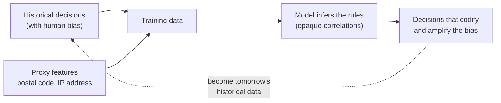
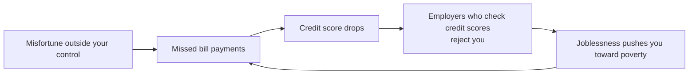

# 14. Doing the Right Thing

[← 13. A Philosophy of Streaming Systems](13-a-philosophy-of-streaming-systems.md) · [Book](../README.md)

## Summary

The final chapter turns from how to build data systems to whether and how we should. Every system is built for a purpose, and its consequences for the people whose data it processes are the engineers' responsibility too. The authors examine **predictive analytics** — algorithmic decisions about loans, jobs, insurance, and criminal justice that can encode bias, evade accountability, and create self-reinforcing feedback loops — and **privacy and tracking**, arguing that much behavioural data collection amounts to surveillance, that "consent" through terms of service is rarely meaningful, that privacy is a *decision right* rather than secrecy, and that personal data is both an asset and a liability. Drawing a parallel with the Industrial Revolution's pollution and labour abuses, they argue that data needs its own protections — through legislation such as the GDPR and through a change of culture within the industry. The book closes by summarizing all fourteen chapters.

## Key takeaways

- **Algorithmic decisions have real consequences** for people who may be wrongly excluded with no way to appeal — an "algorithmic prison" (pp. 586–587).
- **Models learn and amplify the bias in their training data**; prediction from the past can't build a better future — that needs moral imagination (pp. 586–587).
- **Accountability doesn't disappear when a decision is automated**; opaque models make errors hard to explain and correct (pp. 587–588).
- **Feedback loops** (credit scores → jobs → poverty → credit scores; recommendation echo chambers) can be anticipated with systems thinking (pp. 588–589).
- **Swap "data" for "surveillance"** and many common phrases sound alarming — a deliberate thought experiment (pp. 590–591).
- **Consent is often not meaningful** when users can't understand what's collected or can't realistically opt out of near-ubiquitous services (pp. 591–592).
- **Privacy is a decision right**; data collected is a toxic asset that can leak; data minimization and purpose limitation (GDPR) run counter to "collect everything" big-data culture (pp. 592–597).

## Section outline

*From the book’s own table of contents (PDF bookmarks); printed page numbers.*

- Predictive Analytics — p. 586
  - Bias and Discrimination — p. 586
  - Responsibility and Accountability — p. 587
  - Feedback Loops — p. 588
- Privacy and Tracking — p. 589
  - Surveillance — p. 590
  - Consent and Freedom of Choice — p. 591
  - Privacy and Use of Data — p. 592
  - Data as Assets and Power — p. 594
  - Remembering the Industrial Revolution — p. 595
  - Legislation and Self-Regulation — p. 596
- Summary — p. 597

## Notes

Every system has a purpose and both intended and unintended consequences; engineers must consider them. Many datasets are **about people** — treat them “with humanity and respect”. Guidelines like the **ACM Code of Ethics** exist but are rarely applied, so privacy is often treated cavalierly. Technology is neither good nor bad in itself — like a search engine or a gun, it depends on use. Ethics isn’t a checklist but “a participatory and iterative process of reflection”, in dialogue with those affected and with accountability (pp. 585–586).

### Predictive analytics

Predicting weather or disease spread is one thing; predicting whether a convict reoffends, a borrower defaults or a customer makes costly claims directly shapes individual lives (p. 586). Organizations rationally say no when in doubt — a missed opportunity is cheap, a bad loan or hire expensive — but someone labelled risky, accurately or not, then collects “no”s everywhere: jobs, air travel, insurance, renting, finance. This exclusion has been called **“algorithmic prison”** — exclusion without proof of guilt and with little chance to appeal, unlike the presumption of innocence (p. 586).

#### Bias and discrimination (pp. 586–587)

Algorithms aren’t inherently better or worse than biased humans, and data could help the overlooked. But ML **infers the rules** from data, opaquely; biased input is learned and **amplified**. Anti-discrimination law protects traits such as ethnicity, age, gender, sexuality, disability and beliefs — yet correlated features act as proxies: in segregated neighbourhoods a **postal code or IP address** predicts race. Believing biased data can yield fair output has been satirized as “machine learning is like money laundering for bias”. Predictive systems extrapolate from the past and codify its discrimination; a better future needs **moral imagination**, which only humans provide — “data and models should be our tools, not our masters” (p. 587).

#### Responsibility and accountability (pp. 587–588)

Who is accountable when a self-driving car crashes or a credit algorithm discriminates by race or religion? Can you explain your model to a judge? Nobody should evade responsibility by blaming an algorithm.

| | Credit score | ML-based scoring |
|---|---|---|
| Question asked | “How did *you* behave in the past?” | “Who is **similar** to you, and how did people like you behave?” |
| Inputs | Relevant borrowing history | Much wider, opaque inputs |
| Errors | Correctable (though agencies don’t make it easy) | Stereotyping by proxies (where you live); wrong buckets; recourse “almost impossible” |

Data is **statistical**: an average life expectancy of 80 doesn’t mean you die on your 80th birthday; correct distributions can be wrong for individuals. “A blind belief in the supremacy of data… is positively dangerous.” The same analytics can target aid — or let **predatory businesses** find vulnerable people to sell high-cost loans or worthless degrees (p. 588).

#### Feedback loops (pp. 588–589)

- **Echo chambers**: recommenders that show people what they already agree with breed stereotypes, misinformation and polarization — with visible effects on elections.
- **Self-reinforcing loops** when predictions affect lives:

*The book’s downward spiral (pp. 588–589) — “poisonous assumptions” behind “a camouflage of mathematical rigor”.*

- **Algorithmic collusion**: when German gas stations adopted algorithmic pricing, competition fell and prices rose as the algorithms learned to collude (p. 589).
- **Systems thinking** — modelling the whole system including the people — helps anticipate such loops: does it amplify differences (rich richer, poor poorer) or combat injustice? Beware unintended consequences even with good intentions (p. 589).

> **Try it:** [Credit-score feedback loop](../widgets/14-feedback-loop.html) — let employers screen by credit score and watch temporary misfortune turn into lasting exclusion.

### Privacy and tracking

Beyond decisions about people, collecting data raises its own questions (pp. 589–590):

| Relationship | Who is the customer | Tracking serves |
|---|---|---|
| User explicitly enters data for the service to process | The user | The user |
| Activity tracked as a side effect, used to improve features (search ranking, “people who liked X”, A/B tests) | The user | Mostly the user |
| Advertising-funded service | **The advertisers** | Advertisers: detailed profiles, long retention, engagement maximized |

The last relationship has a more sinister name: **surveillance** (p. 590).

#### Surveillance (pp. 590–591)

Replace *data* with *surveillance*: “In our surveillance-driven organization we collect real-time surveillance streams and store them in our surveillance warehouse…” — *Designing Surveillance-Intensive Applications*. Software “eating the world” has built the greatest mass surveillance infrastructure ever: internet-connected microphones in phones, TVs, assistants, baby monitors and toys, many insecure. Digitization made collecting location, relationships, purchases and health data cheap; companies may know of an illness or money problem before you do. Totalitarian regimes could only dream of a microphone in every room — we accept it voluntarily because corporations, not agencies, collect it (p. 590). “Nothing to hide” assumes you aren’t marginalized. And it isn’t benign once it decides life outcomes: car-driving data affecting insurance without consent, health cover tied to fitness trackers, smartwatch motion sensors revealing typed passwords (pp. 590–591).

#### Consent and freedom of choice (pp. 591–592)

| Claim | Problem |
|---|---|
| “Tracking is necessary for the service” | For ranking and related products, maybe; for ad profiles — only because ads pay |
| “Users agreed to the policy” | Users don’t know what is collected or how it is combined; policies obscure; data about one user reveals others who never agreed; derived datasets are incomprehensible |
| “It’s a fair exchange” | One-way extraction: no dialogue or negotiation; the service sets the terms |
| “Just don’t use it” | Essential services (smartphones, social networks, Google) carry social and professional costs to refuse; engagement uses gambling-like mechanics; opting out is a **privilege** of those with time, knowledge and means |

The **GDPR** requires consent to be “freely given, specific, informed, and unambiguous”, refusable “without detriment”, in plain language — silence, pre-ticked boxes and inactivity don’t count. Other legal bases exist (legal obligations, protecting a life, **legitimate interest** such as fraud prevention), but consent is the most common for internet services (p. 592).

#### Privacy and use of data (pp. 592–594)

“Privacy is dead” misreads privacy: it isn’t secrecy but **the freedom to choose what to reveal to whom** — a **decision right** along a spectrum from secrecy to transparency, e.g. a patient with a rare condition sharing data with researchers but not insurers or employers (pp. 592–593). Surveillance doesn’t erode that right; it **transfers** it to the collector (“trust us”), who keeps results secret (to avoid seeming creepy) and reveals intimate facts indirectly — e.g. ad targeting of people with an illness. Companies manage *perceptions* of creepiness rather than intrusiveness, and correct data can still hurt (painful memories): build mechanisms for data that is wrong, undesirable or inappropriate. Privacy settings control other users’ view, not the service’s. This transfer is historically unprecedented: surveillance used to be manual and costly, and trusted relationships (doctor, attorney) are tightly regulated (pp. 593–594).

#### Data as assets and power (pp. 594–595)

“**Data exhaust**” suggests waste being recycled; more accurately, if ads pay, user activity is **labour**, and the app is bait for the surveillance machine. **Data brokers** buy, aggregate and resell personal data in secret; startups are valued by “eyeballs”. Everyone wants it — companies, governments (secret deals, coercion, compulsion, theft), buyers in bankruptcy — and breaches are frequent. Hence data as a **“toxic asset”**, “hazardous material”, “the new uranium”. Consider every possible future government — Bruce Schneier: “It is poor civic hygiene to install technologies that could someday facilitate a police state.” Knowledge is power, and scrutinizing others while avoiding scrutiny is a key form of it (pp. 594–595).

#### Remembering the Industrial Revolution (pp. 595–596)

| Industrial age | Information age |
|---|---|
| Growth and better living standards in the long run | Information technology reshaping economy and society |
| Air and water pollution; cramped, unsanitary housing; harsh work; child labour in mines | Data collection and misuse |
| Eventually: environmental rules, workplace safety, child-labour laws, food inspection — costlier business, far better society | Still to come |

Schneier: data is the **pollution problem** of the information age and privacy protection the environmental challenge — our grandchildren will judge us on it. “We should try to make them proud” (p. 596).

#### Legislation and self-regulation (pp. 596–597)

The GDPR demands data “collected for specified, explicit and legitimate purposes” and “limited to what is necessary” — **purpose limitation** and **data minimization** — directly opposing big data’s collect-everything-and-explore philosophy. It affected online advertising somewhat but is weakly enforced and hasn’t changed industry culture. Industry calls regulation a burden — partly fairly: shared medical data might save lives, so balance matters (p. 596). The authors’ prescription (pp. 596–597):

- A **culture shift**: users are humans owed respect, dignity and agency, not metrics to optimize.
- **Self-regulate** collection and processing to keep trust; **educate** users about how their data is used.
- Let individuals keep **control** of their data — like a national park, unprotected it becomes a tragedy of the commons; “ubiquitous surveillance is not inevitable”.
- **Purge data** when no longer needed and minimize collection: data you don’t have can’t be leaked, stolen or compelled.
- “If we don’t consider the societal impact of our work, we’re not doing our job.”

### Summary (of the whole book)

| Chapter | What it covered (pp. 597–598) |
|---|---|
| 1 | Analytical vs operational, cloud vs self-hosting, distributed vs single-node, business vs users |
| 2 | Performance, reliability, scalability, maintainability |
| 3 | Relational, document, graph, event sourcing, DataFrames; SQL, Cypher, SPARQL, Datalog, GraphQL |
| 4 | LSM-trees, B-trees, column storage; full-text and vector search |
| 5 | Encodings and evolution; dataflow via databases, services, workflows, events |
| 6 | Single-leader, multi-leader, leaderless replication; read-after-write; sync engines |
| 7 | Sharding, rebalancing, request routing, secondary indexes |
| 8 | Durability, isolation levels, distributed atomicity |
| 9 | Network faults, clocks, pauses, crashes — why even a lock is hard |
| 10 | Linearizability and consensus |
| 11 | From Unix pipes to distributed batch processing |
| 12 | Message brokers, CDC, fault tolerance, stream joins |
| 13 | Integrating, evolving and scaling systems around dataflow |
| 14 | Ethics: decisions, discrimination, surveillance, breaches, unintended consequences |

See the [book landing page](../README.md#how-the-book-fits-together) for the vault’s chapter map. The book closes asking engineers to work toward “a world that treats people with humanity and respect” (p. 598).

## Beyond the book

- Practical techniques that put this chapter into engineering terms: data retention policies enforced in code, crypto-shredding (deleting a per-user key to make their data in immutable logs unreadable), differential privacy for aggregate analytics, and fairness audits of models.
- Two books cited in the chapter's references develop its two halves at length: Cathy O'Neil's *Weapons of Math Destruction* (predictive analytics) and Shoshana Zuboff's *The Age of Surveillance Capitalism* (tracking).

## Connections

- **Related chapters:** [1. Trade-Offs](01-trade-offs-in-data-systems-architecture.md) (data systems, law, and society), [11. Batch Processing](11-batch-processing.md) (ML pipelines), [12. Stream Processing](12-stream-processing.md) (deletion in immutable logs), [13. A Philosophy of Streaming Systems](13-a-philosophy-of-streaming-systems.md).

## Check yourself

*Questions and answers are the vault's, written from the notes above; answers cite the book's pages.*

1. **Why can a model trained on historical decisions be discriminatory even if protected attributes are excluded?**

   *Answer:* Other features correlate with them (a zip code, for instance, can be a proxy for race), and the training data encodes past bias, so the model learns to reproduce it (pp. 586–587).

2. **Describe a feedback loop that an automated decision system could create in a domain you know.**

   *Answer:* For example, the book's case: a bad credit score makes it harder to find work, unemployment worsens the score, and so on — a self-reinforcing loop. Systems thinking helps anticipate these effects (pp. 588–589).

3. **Why is "users consented to the terms of service" a weak justification for extensive tracking?**
   - [ ] Because consent is illegal
   - [x] Because users rarely understand what is collected and how it is used, and often cannot refuse without giving up a service they need
   - [ ] Because terms of service are never legally binding
   - [ ] Because tracking data is always anonymized

   *Answer:* Consent requires understanding and a real choice; for services that are effectively mandatory, it is neither (pp. 591–592).

4. **In what sense is privacy a decision right rather than secrecy?**

   *Answer:* Privacy means people decide what to reveal to whom; collecting data through surveillance transfers that decision from the individual to the data collector (pp. 592–594).

5. **How do purpose limitation and data minimization conflict with common data-engineering practice?**
   - [ ] They require encrypting all data
   - [x] Data engineering often collects everything in case it is useful later, while these principles require collecting only what a stated purpose needs
   - [ ] They forbid data warehouses
   - [ ] They require storing data in one country

   *Answer:* GDPR's principles cut against the "big data" philosophy of keeping all data indefinitely for unknown future uses (pp. 596–597).
