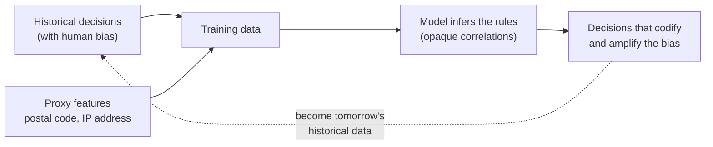
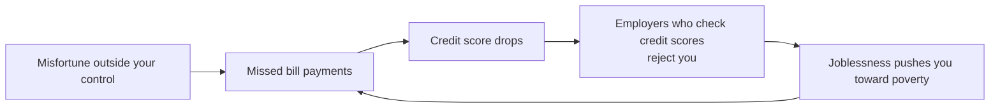

# فصل ۱۴: کار درست را انجام دادن

[فصل ۱۳: فلسفه‌ی سیستم‌های streaming →](13-a-philosophy-of-streaming-systems.md) · [کتاب](../README.md)

## خلاصه

فصل آخر از اینکه سیستم‌های داده را چطور بسازیم به این می‌رسد که آیا و چطور باید بسازیم. هر سیستمی برای هدفی ساخته می‌شود، و پیامدهایش برای آدم‌هایی که داده‌شان پردازش می‌شود مسئولیت مهندس‌ها هم هست. نویسنده‌ها دو موضوع را بررسی می‌کنند. اول **predictive analytics**، یعنی تصمیم‌های الگوریتمی درباره‌ی وام، شغل، بیمه و عدالت کیفری، که می‌توانند bias را در خود بگیرند، از پاسخ‌گویی فرار کنند و feedback loopهای خودتقویت‌کننده بسازند. دوم **حریم خصوصی و ردیابی**: استدلال می‌کنند که بخش بزرگی از جمع‌آوری داده‌ی رفتاری در واقع نظارت است، «رضایت» از راه terms of service به‌ندرت معنادار است، حریم خصوصی یک *حق تصمیم* است نه پنهان‌کاری، و داده‌ی شخصی هم دارایی است و هم بدهی. با مقایسه‌ای با آلودگی و بهره‌کشی از کارگران در انقلاب صنعتی، می‌گویند داده هم به محافظت‌های خودش نیاز دارد؛ هم از راه قانون، مثل GDPR، و هم با تغییر فرهنگ درون صنعت. کتاب با جمع‌بندی هر چهارده فصل تمام می‌شود.

## نکته‌های کلیدی

- **تصمیم‌های الگوریتمی پیامد واقعی دارند** برای آدم‌هایی که ممکن است به اشتباه کنار گذاشته شوند و راهی برای اعتراض نداشته باشند؛ یک «زندان الگوریتمی» (pp. 586–587).
- **مدل‌ها bias داده‌ی آموزشی را یاد می‌گیرند و بزرگ‌ترش می‌کنند**؛ پیش‌بینی از روی گذشته نمی‌تواند آینده‌ی بهتری بسازد؛ این کار تخیل اخلاقی می‌خواهد (pp. 586–587).
- **پاسخ‌گویی با خودکار شدن تصمیم از بین نمی‌رود**؛ مدل‌های مبهم توضیح و اصلاح خطا را سخت می‌کنند (pp. 587–588).
- **مفهوم feedback loop**، مثل امتیاز اعتباری که به شغل، فقر و دوباره امتیاز اعتباری می‌رسد، یا اتاق پژواک سیستم‌های پیشنهاددهنده، را می‌شود با تفکر سیستمی پیش‌بینی کرد (pp. 588–589).
- **واژه‌ی «داده» را با «نظارت» عوض کنید** تا خیلی از عبارت‌های رایج نگران‌کننده به نظر برسند؛ یک آزمایش فکری عمدی (pp. 590–591).
- **رضایت اغلب معنادار نیست**، وقتی کاربران نمی‌فهمند چه چیزی جمع می‌شود یا عملاً نمی‌توانند از سرویس‌هایی که همه‌جا هستند کنار بکشند (pp. 591–592).
- **حریم خصوصی حق تصمیم است**؛ داده‌ی جمع‌شده دارایی سمی است که ممکن است نشت کند؛ data minimization و purpose limitation در GDPR با فرهنگ «همه چیز را جمع کن» big data در تضادند (pp. 592–597).

## فهرست بخش‌ها

*از فهرست مطالب خود کتاب، یعنی bookmarkهای PDF، با شماره‌ی صفحه‌های چاپی.*

- مفهوم predictive analytics (p. 586)
  - مفهوم bias و تبعیض (p. 586)
  - مسئولیت و پاسخ‌گویی (p. 587)
  - مفهوم feedback loop (p. 588)
- حریم خصوصی و ردیابی (p. 589)
  - نظارت (p. 590)
  - رضایت و آزادی انتخاب (p. 591)
  - حریم خصوصی و استفاده از داده (p. 592)
  - داده به عنوان دارایی و قدرت (p. 594)
  - به یاد انقلاب صنعتی (p. 595)
  - قانون‌گذاری و خودتنظیمی (p. 596)
- جمع‌بندی (p. 597)

## یادداشت‌ها

هر سیستمی هدفی دارد و پیامدهای خواسته و ناخواسته؛ مهندس‌ها باید به آن‌ها فکر کنند. خیلی از datasetها **درباره‌ی آدم‌ها** هستند؛ کتاب می‌گوید باید با انسانیت و احترام با آن‌ها رفتار کرد. راهنماهایی مثل **ACM Code of Ethics** وجود دارند اما کم به کار می‌روند، پس با حریم خصوصی اغلب سهل‌انگارانه رفتار می‌شود. فناوری به‌خودی‌خود خوب یا بد نیست؛ مثل موتور جست‌وجو یا اسلحه، به نحوه‌ی استفاده بستگی دارد. اخلاق یک چک‌لیست نیست، بلکه به تعبیر کتاب فرایندی مشارکتی و تکراری از تأمل است، در گفت‌وگو با کسانی که تحت تأثیرند و همراه با پاسخ‌گویی (pp. 585–586).

> **Try it:** [فصل ۱۴ در طول یک pipeline داده](../widgets/14-pipeline-map.html): از دیتابیس منبع تا داشبورد را با lensهای هدف، تصمیم درباره‌ی آدم‌ها و عمر داده طی کنید.

### مفهوم predictive analytics

پیش‌بینی آب‌وهوا یا شیوع بیماری یک چیز است؛ پیش‌بینی اینکه یک محکوم دوباره جرم می‌کند، یک وام‌گیرنده نکول می‌کند یا یک مشتری خسارت پرهزینه می‌خواهد مستقیماً زندگی تک‌تک آدم‌ها را شکل می‌دهد (p. 586). سازمان‌ها منطقاً در صورت تردید «نه» می‌گویند، چون از دست دادن یک فرصت ارزان است و یک وام یا استخدام بد گران؛ اما کسی که پرخطر برچسب خورده، درست یا غلط، بعد همه‌جا «نه» می‌شنود: شغل، سفر هوایی، بیمه، اجاره و خدمات مالی. به این کنار گذاشتن **«زندان الگوریتمی»** گفته‌اند: طرد بدون اثبات گناه و با شانس کم برای اعتراض، برخلاف اصل برائت (p. 586).

#### مفهوم bias و تبعیض (pp. 586–587)

الگوریتم‌ها ذاتاً بهتر یا بدتر از آدم‌های biasدار نیستند، و داده می‌تواند به کسانی که نادیده گرفته شده‌اند کمک کند. اما ML **قاعده‌ها را** از داده **استنتاج می‌کند**، آن هم به شکلی مبهم؛ ورودی biasدار یاد گرفته و **بزرگ‌تر** می‌شود. قانون ضد تبعیض از ویژگی‌هایی مثل قومیت، سن، جنسیت، گرایش جنسی، معلولیت و باورها محافظت می‌کند، اما ویژگی‌های همبسته نقش جانشین را بازی می‌کنند: در محله‌های جداافتاده **کد پستی یا آدرس IP** نژاد را پیش‌بینی می‌کند. این باور که داده‌ی biasدار می‌تواند خروجی منصفانه بدهد به طنز «پول‌شویی برای bias» خوانده شده. سیستم‌های پیش‌بین از گذشته برون‌یابی می‌کنند و تبعیض آن را قانون می‌کنند؛ آینده‌ی بهتر به **تخیل اخلاقی** نیاز دارد که فقط آدم‌ها دارند؛ به تعبیر کتاب، داده و مدل باید ابزار ما باشند، نه ارباب ما (p. 587).

> **In practice:** فرض کنید در reference stack مدلی در notebookها آموزش داده و در model registry ثبت شود که درخواست‌های وام را رتبه‌بندی کند، و از Silver ویژگی‌هایی مثل شهر، محله و نوع دستگاه را بگیرد.
>
> **Your turn:** ستون‌های حساس، مثل قومیت یا جنسیت، در داده نیستند. آیا این کافی است تا مدل تبعیض نگذارد؟ پیش از ثبت مدل چه چیزی را بررسی می‌کنید؟
>
> *Answer:* کافی نیست؛ ویژگی‌هایی مثل محل زندگی می‌توانند جانشین ویژگی‌های محافظت‌شده باشند، و اگر برچسب‌های آموزشی از تصمیم‌های گذشته‌ی آدم‌ها آمده باشند، bias آن تصمیم‌ها را هم با خود دارند (pp. 586–587). پیش از ثبت، نرخ قبول و خطای مدل را برای گروه‌های مختلف مقایسه کنید، ویژگی‌های جانشین را شناسایی کنید، و مطمئن شوید هر تصمیم را می‌شود توضیح داد و برایش راه اعتراض وجود دارد (pp. 587–588).

#### مسئولیت و پاسخ‌گویی (pp. 587–588)

وقتی یک خودروی خودران تصادف می‌کند یا یک الگوریتم اعتباری بر اساس نژاد یا دین تبعیض می‌گذارد، چه کسی پاسخ‌گوست؟ می‌توانید مدلتان را برای یک قاضی توضیح دهید؟ هیچ‌کس نباید با مقصر دانستن یک الگوریتم از مسئولیت فرار کند.

| | امتیاز اعتباری | امتیازدهی مبتنی بر ML |
|---|---|---|
| پرسشی که می‌پرسد | «*خودت* در گذشته چطور رفتار کرده‌ای؟» | «چه کسانی **شبیه** تو هستند، و آدم‌هایی مثل تو چطور رفتار کرده‌اند؟» |
| ورودی‌ها | سابقه‌ی وام‌گیری مرتبط | ورودی‌های خیلی گسترده‌تر و مبهم |
| خطاها | قابل اصلاح، هرچند مؤسسه‌ها کار را آسان نمی‌کنند | کلیشه‌سازی با جانشین‌ها، مثل محل زندگی؛ دسته‌بندی غلط؛ به تعبیر کتاب راه جبران تقریباً ناممکن |

داده **آماری** است: میانگین امید به زندگی ۸۰ سال یعنی این نیست که در تولد ۸۰ سالگی می‌میرید؛ توزیع درست ممکن است برای فرد غلط باشد. کتاب باور کورکورانه به برتری داده را صراحتاً خطرناک می‌داند. همان analytics می‌تواند کمک را هدف‌گیری کند، یا به **کسب‌وکارهای سودجو** اجازه دهد آدم‌های آسیب‌پذیر را برای فروش وام‌های گران یا مدرک‌های بی‌ارزش پیدا کنند (p. 588).

#### مفهوم feedback loop (pp. 588–589)

- **اتاق پژواک:** سیستم‌های proposerی که به آدم‌ها چیزی را نشان می‌دهند که از قبل با آن موافق‌اند کلیشه، اطلاعات غلط و قطبی‌شدن می‌سازند؛ با اثرهای آشکار بر انتخابات.
- **حلقه‌های خودتقویت‌کننده** وقتی پیش‌بینی‌ها بر زندگی اثر می‌گذارند:

*مارپیچ رو به پایین کتاب (pp. 588–589)؛ به تعبیر کتاب فرض‌های سمی که پشت ظاهری از دقت ریاضی پنهان شده‌اند.*

- **تبانی الگوریتمی:** وقتی پمپ‌بنزین‌های آلمان قیمت‌گذاری الگوریتمی را به کار گرفتند، رقابت کم شد و قیمت‌ها بالا رفت، چون الگوریتم‌ها یاد گرفتند تبانی کنند (p. 589).
- **تفکر سیستمی**، یعنی مدل کردن کل سیستم همراه با آدم‌هایش، به پیش‌بینی چنین حلقه‌هایی کمک می‌کند: آیا تفاوت‌ها را بزرگ‌تر می‌کند، یعنی ثروتمند ثروتمندتر و فقیر فقیرتر، یا با بی‌عدالتی می‌جنگد؟ حتی با نیت خوب مراقب پیامدهای ناخواسته باشید (p. 589).

> **Try it:** [مفهوم feedback loop امتیاز اعتباری](../widgets/14-feedback-loop.html): بگذارید کارفرماها با امتیاز اعتباری غربال کنند و ببینید چطور بدشانسی موقت به طرد durable تبدیل می‌شود.

> **In practice:** فرض کنید یک جدول Gold در reference stack امتیازی برای مشتری‌ها حساب کند و همین امتیاز سقف اعتبار بعدی‌شان را تعیین کند؛ رفتار بعدی مشتری‌ها دوباره در Bronze می‌نشیند و داده‌ی آموزشی نسخه‌ی بعدی مدل می‌شود.
>
> **Your turn:** این حلقه کجا ممکن است خودتقویت‌کننده شود؟ چه چیزی را در داده نگه می‌دارید تا بعداً بتوانید آن را تشخیص دهید؟
>
> *Answer:* مشتری‌ای که سقف پایین گرفته فرصت کمتری دارد سابقه‌ی خوب بسازد، پس امتیاز بعدی‌اش هم پایین می‌ماند؛ مدل بعدی از نتیجه‌ی تصمیم‌های مدل قبلی یاد می‌گیرد، مثل مارپیچ امتیاز اعتباری (pp. 588–589). نگه داشتن نسخه‌ی مدل، امتیاز و تصمیمی که برای هر مشتری گرفته شده، کنار نتیجه‌ی بعدی، اجازه می‌دهد اثر تصمیم را از رفتار خود مشتری جدا کنید؛ این همان تفکر سیستمی است که کتاب می‌خواهد (p. 589).

### حریم خصوصی و ردیابی

جدا از تصمیم درباره‌ی آدم‌ها، خود جمع‌آوری داده هم پرسش‌های خودش را دارد (pp. 589–590):

| رابطه | مشتری کیست | ردیابی به نفع کیست |
|---|---|---|
| کاربر صریحاً داده‌ای وارد می‌کند تا سرویس پردازشش کند | کاربر | کاربر |
| فعالیت به عنوان اثر جانبی ردیابی می‌شود تا قابلیت‌ها بهتر شوند؛ مثل رتبه‌بندی جست‌وجو، «کسانی که X را پسندیدند» و A/B test | کاربر | بیشتر کاربر |
| سرویسی که از تبلیغات درآمد دارد | **تبلیغ‌کننده‌ها** | تبلیغ‌کننده‌ها: پروفایل‌های دقیق، نگه‌داری طولانی، بیشینه کردن engagement |

رابطه‌ی آخر اسم شوم‌تری دارد: **نظارت** (p. 590).

#### نظارت (pp. 590–591)

به جای *داده* بگذارید *نظارت*: «در سازمان نظارت‌محور ما streamهای بلادرنگ نظارت را جمع می‌کنیم و در warehouse نظارت ذخیره می‌کنیم…»؛ و کتاب می‌شود *طراحی اپلیکیشن‌های نظارت‌محور*. نرم‌افزاری که به تعبیر رایج دنیا را می‌بلعد بزرگ‌ترین زیرساخت نظارت جمعی تاریخ را ساخته: میکروفون‌های متصل به اینترنت در گوشی، تلویزیون، دستیار صوتی، مانیتور کودک و اسباب‌بازی، که خیلی‌هایشان ناامن‌اند. دیجیتال شدن جمع کردن مکان، روابط، خریدها و داده‌ی سلامت را ارزان کرده؛ شرکت‌ها ممکن است پیش از خودتان از یک بیماری یا مشکل مالی باخبر شوند. رژیم‌های تمامیت‌خواه فقط می‌توانستند خواب میکروفونی در هر اتاق را ببینند؛ ما داوطلبانه آن را می‌پذیریم چون شرکت‌ها جمعش می‌کنند، نه سازمان‌های امنیتی (p. 590). استدلال «چیزی برای پنهان کردن ندارم» فرض می‌کند در حاشیه نیستید. و وقتی سرنوشت زندگی را تعیین کند بی‌خطر نیست: داده‌ی رانندگی که بدون رضایت بر بیمه اثر می‌گذارد، پوشش درمانی وابسته به fitness tracker، و حسگرهای حرکتی ساعت هوشمند که رمزهای تایپ‌شده را لو می‌دهند (pp. 590–591).

#### رضایت و آزادی انتخاب (pp. 591–592)

| ادعا | مشکل |
|---|---|
| «ردیابی برای سرویس لازم است» | برای رتبه‌بندی و محصولات مرتبط شاید؛ برای پروفایل تبلیغاتی فقط چون تبلیغات پول می‌دهد |
| «کاربران با سیاست موافقت کردند» | کاربران نمی‌دانند چه چیزی جمع و چطور ترکیب می‌شود؛ سیاست‌ها مبهم‌اند؛ داده‌ی یک کاربر درباره‌ی دیگرانی هم که موافقت نکرده‌اند چیزهایی لو می‌دهد؛ datasetهای مشتق‌شده فهم‌ناپذیرند |
| «مبادله‌ای منصفانه است» | استخراج یک‌طرفه: نه گفت‌وگویی، نه مذاکره‌ای؛ سرویس شرط‌ها را تعیین می‌کند |
| «خب استفاده نکن» | کنار گذاشتن سرویس‌های ضروری، مثل گوشی هوشمند، شبکه‌های اجتماعی و Google، هزینه‌ی اجتماعی و حرفه‌ای دارد؛ engagement از سازوکارهای شبیه قمار استفاده می‌کند؛ کنار کشیدن **امتیاز** کسانی است که وقت، دانش و امکانش را دارند |

قانون **GDPR** می‌خواهد رضایت آزادانه، مشخص، آگاهانه و بی‌ابهام باشد، بشود بدون زیان ردش کرد و به زبان ساده بیان شود؛ سکوت، چک‌باکس‌های از پیش تیک‌خورده و بی‌عملی رضایت حساب نمی‌شوند. مبناهای قانونی دیگری هم هست، مثل الزام قانونی، حفظ جان و **legitimate interest** مثل پیشگیری از تقلب، اما برای سرویس‌های اینترنتی رضایت رایج‌ترین است (p. 592).

> **In practice:** در reference stack هر جدول در یک فایل YAML با فهرست ستون‌هایی که load می‌شوند تعریف شده. یک تحلیل‌گر می‌خواهد همه‌ی ستون‌های جدول مشتری‌ها را اضافه کنید، «شاید روزی به کار بیاید».
>
> **Your turn:** با چشم purpose limitation و data minimization، به این درخواست چه جوابی می‌دهید؟ فهرست ستون‌های YAML چه نقشی دارد؟
>
> *Answer:* هر ستون باید برای هدفی مشخص و صریح لازم باشد؛ «شاید روزی» همان فلسفه‌ی «همه چیز را جمع کن» است که GDPR با آن مخالف است (p. 596). فهرست ستون‌های YAML جایی است که minimization اعمال می‌شود: ستونی که load نشود نه نشت می‌کند، نه دزدیده می‌شود و نه می‌شود مجبور به تحویلش شد (pp. 596–597). جواب درست این است که بپرسید برای کدام پرسش لازم است و فقط همان ستون‌ها را اضافه کنید.

#### حریم خصوصی و استفاده از داده (pp. 592–594)

جمله‌ی «حریم خصوصی مرده» حریم خصوصی را بد می‌فهمد: حریم خصوصی پنهان‌کاری نیست، بلکه **آزادی انتخاب اینکه چه چیزی را به چه کسی نشان دهید** است؛ یک **حق تصمیم** روی طیفی از پنهان‌کاری تا شفافیت؛ مثلاً بیماری با یک بیماری نادر که داده‌اش را با پژوهشگران به اشتراک می‌گذارد، اما با بیمه یا کارفرما نه (pp. 592–593). نظارت این حق را از بین نمی‌برد؛ آن را به جمع‌کننده **منتقل می‌کند**، با پیام «به ما اعتماد کنید»، که نتیجه‌ها را پنهان نگه می‌دارد تا ترسناک به نظر نرسد و حقایق خصوصی را غیرمستقیم لو می‌دهد؛ مثلاً هدف‌گیری تبلیغاتی آدم‌هایی که یک بیماری دارند. شرکت‌ها *برداشت* از ترسناک بودن را مدیریت می‌کنند، نه خود تجاوز به حریم را، و داده‌ی درست هم می‌تواند آسیب بزند، مثل خاطره‌های دردناک: برای داده‌ای که غلط، ناخواسته یا نامناسب است سازوکار بسازید. تنظیمات حریم خصوصی دید کاربران دیگر را کنترل می‌کنند، نه دید خود سرویس را. این انتقال در تاریخ بی‌سابقه است: نظارت قبلاً دستی و پرهزینه بود، و رابطه‌های مبتنی بر اعتماد، مثل پزشک و وکیل، به‌شدت تنظیم‌شده‌اند (pp. 593–594).

#### داده به عنوان دارایی و قدرت (pp. 594–595)

اصطلاح **data exhaust** القا می‌کند که زباله‌ای بازیافت می‌شود؛ دقیق‌تر این است که اگر تبلیغات پول می‌دهد، فعالیت کاربر **کار** است و اپلیکیشن طعمه‌ی ماشین نظارت. **data brokerها** داده‌ی شخصی را پنهانی می‌خرند، ترکیب می‌کنند و دوباره می‌فروشند؛ ارزش startupها با تعداد چشم‌ها سنجیده می‌شود. همه داده را می‌خواهند؛ شرکت‌ها، دولت‌ها با قرارداد پنهانی، فشار، اجبار یا دزدی، و خریداران در ورشکستگی؛ و نشت داده زیاد است. پس داده **«دارایی سمی»** است، «ماده‌ی خطرناک» و «اورانیوم تازه». به هر دولت ممکن در آینده فکر کنید؛ Bruce Schneier نصب فناوری‌ای را که روزی می‌تواند یک دولت پلیسی را ممکن کند بهداشت مدنی ضعیف می‌داند. دانش قدرت است، و زیر نظر گرفتن دیگران در حالی که خودتان از نظارت فرار می‌کنید شکل اصلی آن است (pp. 594–595).

> **In practice:** مرحله‌ی PII در reference stack شماره‌ی تلفن، کد ملی و شماره‌ی کارت را پیش از ذخیره normalize و با SHA-256 و salt ثابت hash می‌کند، تا hash یک کلید join پایدار باشد.
>
> **Your turn:** آیا این ستون‌های hash‌شده دیگر داده‌ی شخصی نیستند؟ اگر warehouse نشت کند، چه چیزی در خطر است؟
>
> *Answer:* هنوز داده‌ی شخصی‌اند، فقط با اسم مستعار: چون پایدارند، همه‌ی رکوردهای یک نفر را به هم وصل می‌کنند، و هر کس salt را داشته باشد می‌تواند فهرست شماره‌های ممکن را hash کند و مقدار اصلی را پیدا کند؛ فضای شماره‌ی تلفن و کد ملی کوچک است. این بخش برداشت خود vault است، نه کتاب. نکته‌ی کتاب این است که هر داده‌ی جمع‌شده یک دارایی سمی است که ممکن است نشت کند (p. 594)؛ پس salt را جدا از warehouse نگه دارید و فقط ستون‌هایی را hash و نگه دارید که واقعاً برای join لازم‌اند.

#### به یاد انقلاب صنعتی (pp. 595–596)

| عصر صنعتی | عصر اطلاعات |
|---|---|
| رشد و سطح زندگی بهتر در درازمدت | فناوری اطلاعات که اقتصاد و جامعه را از نو شکل می‌دهد |
| آلودگی هوا و آب؛ خانه‌های تنگ و غیربهداشتی؛ کار طاقت‌فرسا؛ کار کودکان در معدن | جمع‌آوری و سوءاستفاده از داده |
| سرانجام: قانون‌های محیط زیست، ایمنی کار، منع کار کودکان و بازرسی غذا؛ کسب‌وکار پرهزینه‌تر، جامعه‌ای بسیار بهتر | هنوز در راه است |

به نظر Schneier، داده **مسئله‌ی آلودگی** عصر اطلاعات است و محافظت از حریم خصوصی چالش محیط زیستی آن؛ نوه‌های ما درباره‌ی ما بر همین اساس قضاوت خواهند کرد. کتاب می‌خواهد بکوشیم آن‌ها به ما افتخار کنند (p. 596).

#### قانون‌گذاری و خودتنظیمی (pp. 596–597)

قانون GDPR می‌خواهد داده برای هدف‌های مشخص، صریح و مشروع جمع شود و به آنچه لازم است محدود بماند؛ یعنی **purpose limitation** و **data minimization**، که مستقیماً با فلسفه‌ی big data، یعنی همه چیز را جمع کن و بعد بگرد، در تضاد است. تا حدی بر تبلیغات آنلاین اثر گذاشته، اما ضعیف اجرا می‌شود و فرهنگ صنعت را عوض نکرده. صنعت قانون را دست‌وپاگیر می‌خواند، که تا حدی منصفانه است: به اشتراک گذاشتن داده‌ی پزشکی ممکن است جان نجات دهد، پس تعادل مهم است (p. 596). نسخه‌ی نویسنده‌ها (pp. 596–597):

- **تغییر فرهنگ:** کاربران انسان‌هایی‌اند که سزاوار احترام، کرامت و اختیارند، نه metricهایی برای بهینه‌سازی.
- جمع‌آوری و پردازش را **خودتنظیم** کنید تا اعتماد بماند؛ کاربران را درباره‌ی نحوه‌ی استفاده از داده‌شان **آگاه** کنید.
- بگذارید آدم‌ها **کنترل** داده‌شان را نگه دارند؛ مثل یک پارک ملی، بدون محافظت به تراژدی منابع مشترک تبدیل می‌شود؛ به تعبیر کتاب نظارت همه‌جایی اجتناب‌ناپذیر نیست.
- وقتی داده دیگر لازم نیست **پاکش کنید** و جمع‌آوری را کمینه کنید: داده‌ای که ندارید نه نشت می‌کند، نه دزدیده می‌شود و نه می‌شود مجبور به تحویلش شد.
- به تعبیر کتاب، اگر به اثر اجتماعی کارمان فکر نکنیم، کارمان را انجام نداده‌ایم.

> **In practice:** در reference stack فایل‌های staging فقط تا load بعدی جدول نگه داشته می‌شوند، اما Bronze تاریخچه‌ی خام هر ردیف را برای همیشه نگه می‌دارد تا هر Silver و Gold قابل بازسازی باشد. مشتری‌ای حسابش را می‌بندد و می‌خواهد داده‌اش پاک شود.
>
> **Your turn:** کجاها باید پاک شود، و چرا immutability Bronze این کار را سخت می‌کند؟ چه سیاستی پیشنهاد می‌کنید؟
>
> *Answer:* در Bronze، Silver، Gold، نسخه‌های محلی در notebookها و هر داده‌ی آموزشی مدل. Bronze را طوری طراحی کرده‌اند که چیزی از آن پاک نشود، و هر ساختن دوباره‌ی Silver از روی آن داده را برمی‌گرداند؛ پس پاک کردن باید از Bronze شروع شود و بعد لایه‌های مشتق‌شده دوباره ساخته شوند. سیاست پیشنهادی: برای هر جدول مدت نگه‌داری تعریف کنید و داده‌ی قدیمی‌تر را دوره‌ای پاک کنید، چون داده‌ای که ندارید نه نشت می‌کند و نه می‌شود مجبور به تحویلش شد (pp. 596–597). روش‌هایی مثل crypto-shredding در *فراتر از کتاب* آمده‌اند.

### جمع‌بندی کل کتاب

| فصل | آنچه پوشش داد (pp. 597–598) |
|---|---|
| فصل ۱ | سیستم تحلیلی در برابر عملیاتی، cloud در برابر self-hosting، توزیع‌شده در برابر تک‌node، کسب‌وکار در برابر کاربران |
| فصل ۲ | مفهوم performance، reliability، scalability و maintainability |
| فصل ۳ | مدل‌های relational، document، graph، event sourcing و DataFrame؛ زبان‌های SQL، Cypher، SPARQL، Datalog و GraphQL |
| فصل ۴ | مفهوم LSM-tree، B-tree و column storage؛ جست‌وجوی full-text و vector |
| فصل ۵ | مفهوم encoding و تکامل؛ dataflow از راه دیتابیس، سرویس، workflow و رویداد |
| فصل ۶ | مفهوم replication تک‌leader، چند leader و بی‌leader؛ read-after-write؛ sync engineها |
| فصل ۷ | مفهوم sharding، rebalancing، مسیریابی درخواست و secondary index |
| فصل ۸ | مفهوم durability، سطح‌های isolation و atomicity توزیع‌شده |
| فصل ۹ | مفهوم fault شبکه، ساعت‌ها، مکث‌ها و crashها؛ اینکه چرا حتی یک lock سخت است |
| فصل ۱۰ | مفهوم linearizability و consensus |
| فصل ۱۱ | از pipeهای Unix تا پردازش batch توزیع‌شده |
| فصل ۱۲ | مفهوم message broker، CDC، تحمل fault و stream join |
| فصل ۱۳ | یکپارچه کردن، تکامل دادن و مقیاس دادن سیستم‌ها حول dataflow |
| فصل ۱۴ | اخلاق: تصمیم‌ها، تبعیض، نظارت، نشت داده و پیامدهای ناخواسته |

برای نقشه‌ی فصل‌های vault، [صفحه‌ی کتاب](../README.md#کتاب-چطور-به-هم-وصل-است) را ببینید. کتاب با این خواسته از مهندس‌ها تمام می‌شود که به سوی دنیایی کار کنند که با آدم‌ها با انسانیت و احترام رفتار کند (p. 598).

## فراتر از کتاب

- تکنیک‌های عملی که این فصل را به زبان مهندسی درمی‌آورند: سیاست‌های نگه‌داری داده که در کد اعمال می‌شوند، crypto-shredding، یعنی پاک کردن کلید رمز هر کاربر تا داده‌اش در logهای immutable خواندنی نباشد، differential privacy برای تحلیل‌های تجمیعی، و حسابرسی انصاف مدل‌ها.
- دو کتاب از مرجع‌های این فصل دو نیمه‌ی آن را مفصل بسط می‌دهند: کتاب *Weapons of Math Destruction* از Cathy O'Neil برای predictive analytics، و کتاب *The Age of Surveillance Capitalism* از Shoshana Zuboff برای ردیابی.

## پیوندها

- **فصل‌های مرتبط:** [فصل ۱: بده‌بستان‌ها در معماری سیستم‌های داده](01-trade-offs-in-data-systems-architecture.md) برای سیستم‌های داده، قانون و جامعه، [فصل ۱۱: پردازش batch](11-batch-processing.md) برای pipelineهای ML، [فصل ۱۲: پردازش stream](12-stream-processing.md) برای حذف در logهای تغییرناپذیر، و [فصل ۱۳: فلسفه‌ی سیستم‌های streaming](13-a-philosophy-of-streaming-systems.md).

## خودتان را بسنجید

*پرسش‌ها و پاسخ‌ها را خود vault از روی یادداشت‌های بالا نوشته است؛ پاسخ‌ها به صفحه‌های کتاب ارجاع می‌دهند.*

1. **چرا مدلی که روی تصمیم‌های تاریخی آموزش دیده ممکن است تبعیض بگذارد، حتی وقتی ویژگی‌های محافظت‌شده کنار گذاشته شده‌اند؟**

   *Answer:* ویژگی‌های دیگر با آن‌ها همبسته‌اند؛ مثلاً کد پستی ممکن است جانشین نژاد باشد. داده‌ی آموزشی هم bias گذشته را در خود دارد، پس مدل یاد می‌گیرد آن را تکرار کند (pp. 586–587).

2. **یک feedback loop را توصیف کنید که یک سیستم تصمیم‌گیری خودکار ممکن است در حوزه‌ای که می‌شناسید بسازد.**

   *Answer:* مثلاً همان مورد کتاب: امتیاز اعتباری بد پیدا کردن کار را سخت‌تر می‌کند، بیکاری امتیاز را بدتر می‌کند، و همین‌طور تا آخر؛ یک حلقه‌ی خودتقویت‌کننده. تفکر سیستمی به پیش‌بینی این اثرها کمک می‌کند (pp. 588–589).

3. **چرا «کاربران با terms of service موافقت کرده‌اند» توجیه ضعیفی برای ردیابی گسترده است؟**
   - [ ] چون رضایت غیرقانونی است
   - [x] چون کاربران به‌ندرت می‌فهمند چه چیزی جمع و چطور استفاده می‌شود، و اغلب نمی‌توانند بدون کنار گذاشتن سرویسی که لازم دارند ردش کنند
   - [ ] چون terms of service هرگز از نظر قانونی الزام‌آور نیست
   - [ ] چون داده‌ی ردیابی همیشه ناشناس‌سازی می‌شود

   *Answer:* رضایت به فهم و انتخاب واقعی نیاز دارد؛ برای سرویس‌هایی که عملاً اجباری‌اند، هیچ‌کدام وجود ندارد (pp. 591–592).

4. **به چه معنا حریم خصوصی حق تصمیم است و نه پنهان‌کاری؟**

   *Answer:* حریم خصوصی یعنی آدم‌ها تصمیم بگیرند چه چیزی را به چه کسی نشان دهند؛ جمع‌آوری داده از راه نظارت این تصمیم را از فرد به جمع‌کننده‌ی داده منتقل می‌کند (pp. 592–594).

5. **مفهوم purpose limitation و data minimization چطور با رویه‌ی رایج مهندسی داده در تضادند؟**
   - [ ] رمزنگاری همه‌ی داده‌ها را الزامی می‌کنند
   - [x] مهندسی داده اغلب همه چیز را جمع می‌کند چون شاید بعداً به کار بیاید، در حالی که این اصول فقط جمع کردن آنچه یک هدف مشخص لازم دارد را مجاز می‌دانند
   - [ ] مفهوم data warehouse را ممنوع می‌کنند
   - [ ] ذخیره‌ی داده در یک کشور را الزامی می‌کنند

   *Answer:* اصول GDPR با فلسفه‌ی big data، یعنی نگه داشتن همه‌ی داده‌ها برای همیشه برای کاربردهای نامعلوم آینده، در تضادند (pp. 596–597).
