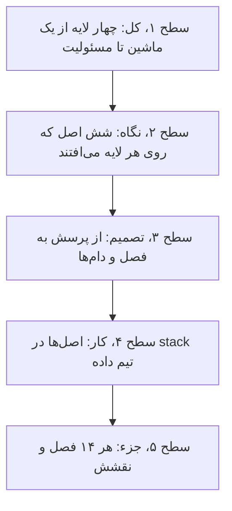
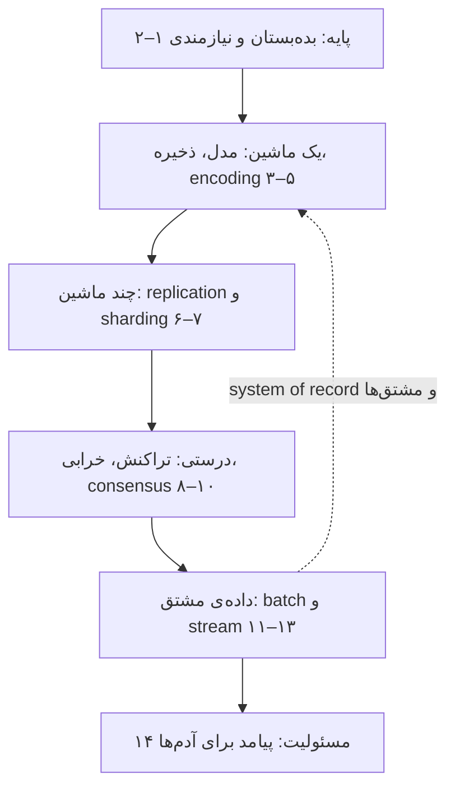
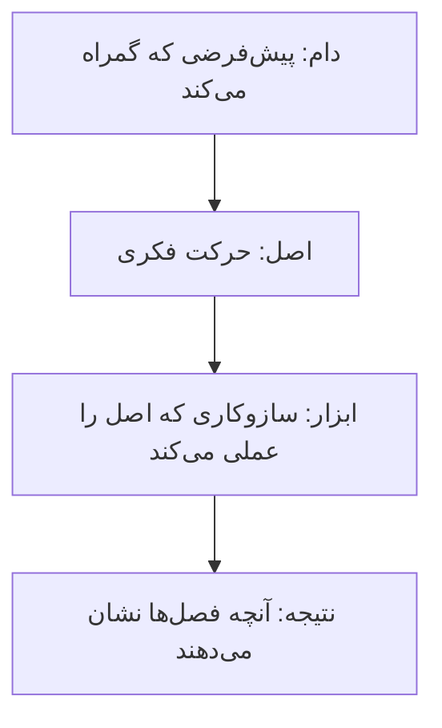
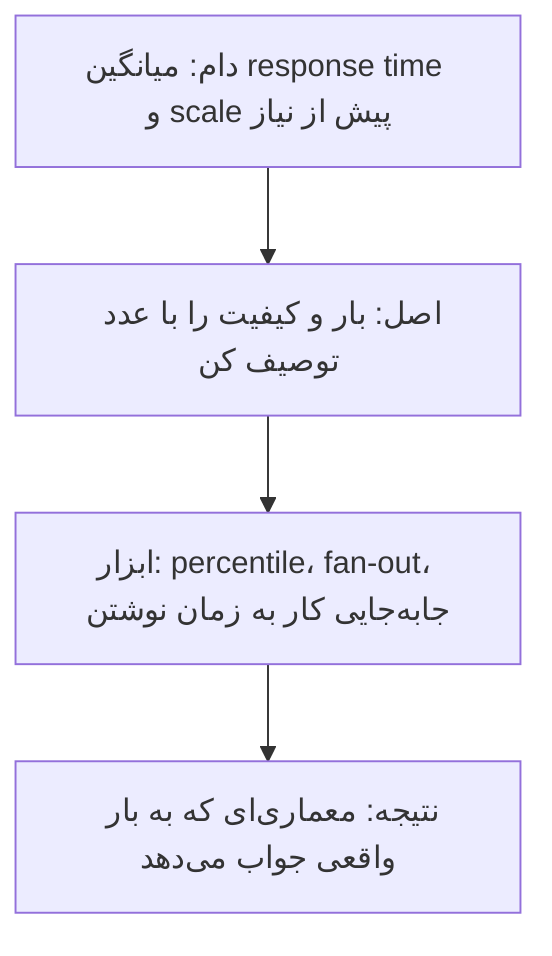
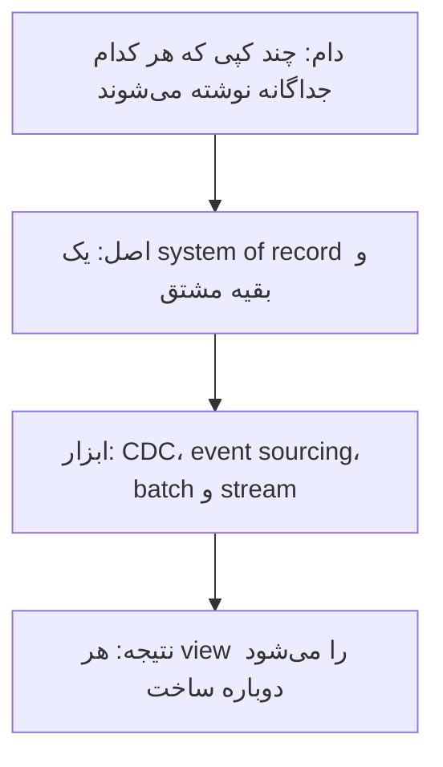
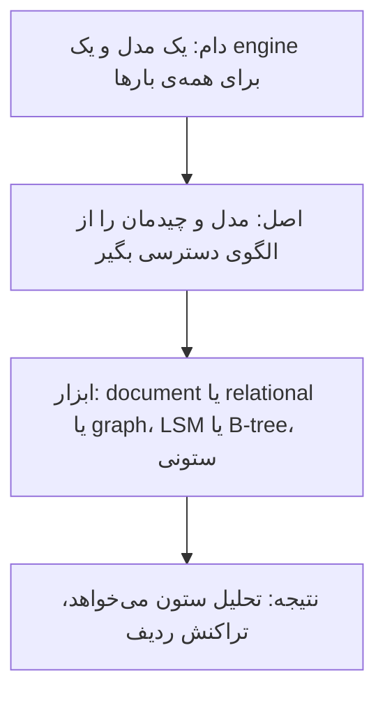
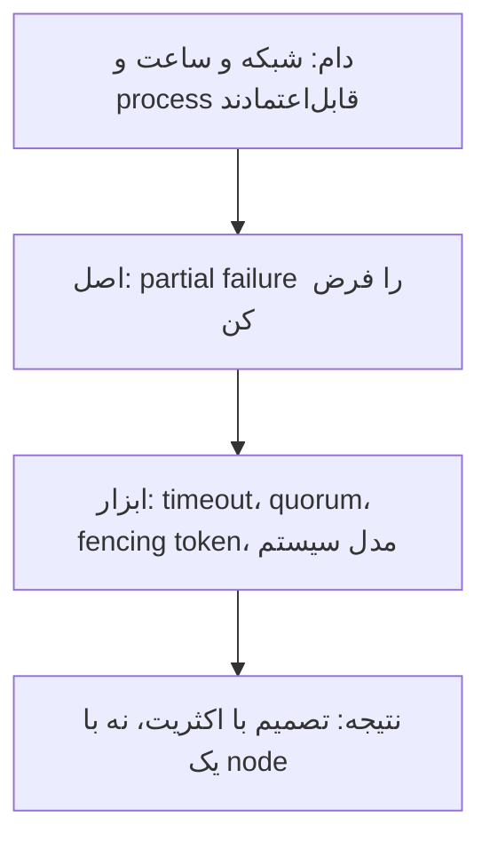
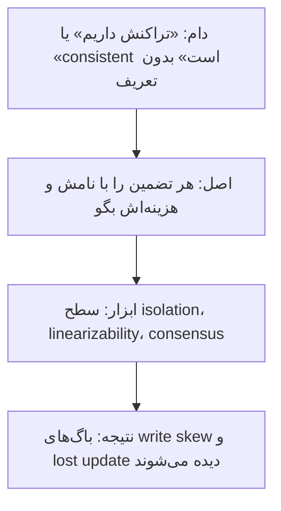
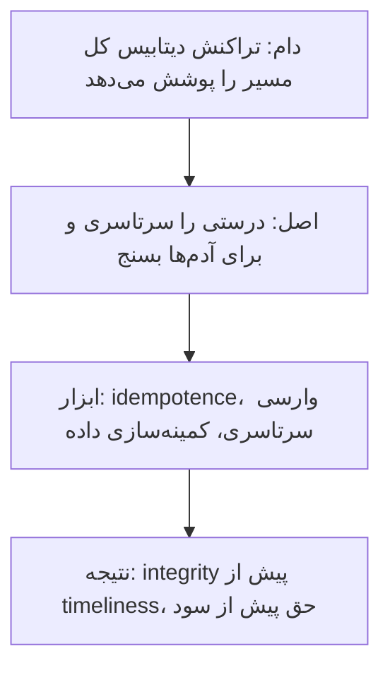

# چارچوب کتاب: از یک ماشین تا یک سازمان داده

[کتاب](README.md) · [فصل ۱ ←](chapters/01-trade-offs-in-data-systems-architecture.md)

این صفحه **سنتز خود vault** است، نه بخشی از کتاب. کتاب چهارده فصل دارد و هر فصل یک لایه از سیستم داده را باز می‌کند؛ این‌جا همان فصل‌ها در یک ساختار کنار هم می‌نشینند تا بدانید هر فصل کجای تصویر کل است و کدام فصل‌ها مکمل هم‌اند.

چارچوب سه لایه دارد. **نقشه‌ی کتاب** می‌گوید سیستم داده از چه لایه‌هایی ساخته می‌شود: از یک ماشین، به چند ماشین، به داده‌ی مشتق‌شده و در آخر به مسئولیت. **شش اصل** می‌گوید با چه نگاهی هر لایه را بخوانید. **راهنمای تصمیم و stack** می‌گوید برای هر پرسش کدام فصل را باز کنید و هر اصل در کار روزمره‌ی تیم داده کجا می‌نشیند. همه‌ی ادعاها به فصل‌ها ارجاع می‌دهند؛ نام‌گذاری اصل‌ها مال vault است.

## تصویر کل

### کل کتاب در سه جمله

خوانش vault از کتاب، پیش از هر جزئی:

1. **هر انتخاب معماری یک بده‌بستان است و پاسخ همه‌جا درست وجود ندارد.** مهارت اصلی شناختن انتخاب‌ها و پیامدهایشان است، از OLTP و OLAP تا cloud و self-hosting ([۱](chapters/01-trade-offs-in-data-systems-architecture.md)، [۲](chapters/02-defining-nonfunctional-requirements.md)).
2. **وقتی داده روی چند ماشین می‌رود، هیچ ماشینی حقیقت را با اطمینان نمی‌داند.** replication و sharding و تراکنش و consensus همه پاسخ‌هایی به partial failure‌اند ([۶](chapters/06-replication.md)–[۱۰](chapters/10-consistency-and-consensus.md)).
3. **یک system of record داشته باشید و بقیه را از آن مشتق کنید.** index و cache و view و مدل را می‌شود دوباره ساخت، و جریان داده‌ی یک سازمان در واقع یک دیتابیس unbundled است ([۱](chapters/01-trade-offs-in-data-systems-architecture.md)، [۱۱](chapters/11-batch-processing.md)–[۱۳](chapters/13-a-philosophy-of-streaming-systems.md)).

### از کل به جزء

این صفحه مثل نقشه از دور به نزدیک خوانده می‌شود. هر سطح همان سطح قبلی است با بزرگ‌نمایی بیشتر، و هر اسلاید بالای خود می‌گوید در کدام سطح هستید:

## نقشه‌ی کتاب

### چهار لایه

*سطح ۱ از ۵: کل.*

کتاب از یک ماشین شروع می‌کند و قدم‌به‌قدم بزرگ‌نمایی را کم می‌کند. اول زبان مشترک و نیازمندی‌ها، بعد این‌که داده روی یک ماشین چطور مدل و ذخیره و encode می‌شود، بعد این‌که روی چند ماشین چه چیزی خراب می‌شود و چه abstractionهایی آن را مهار می‌کنند، و در آخر این‌که داده‌ی مشتق‌شده چطور ساخته می‌شود و چه مسئولیتی دارد.

### لایه‌ها و پرسش‌هایشان

| لایه | پرسش اصلی | سازوکارهای کلیدی | بده‌بستان اصلی | فصل‌ها |
|---|---|---|---|---|
| پایه | سیستم برای چه کسی و با چه کیفیتی؟ | OLTP و OLAP، percentile، fault در برابر failure | سرعت تحویل در برابر سادگی و هزینه | [۱](chapters/01-trade-offs-in-data-systems-architecture.md)، [۲](chapters/02-defining-nonfunctional-requirements.md) |
| یک ماشین | داده چه شکلی دارد و کجا می‌نشیند؟ | مدل relational و document و graph، LSM و B-tree، ذخیره‌سازی ستونی، Avro و Protobuf | خواندن در برابر نوشتن | [۳](chapters/03-data-models-and-query-languages.md)–[۵](chapters/05-encoding-and-evolution.md) |
| چند ماشین | کپی‌ها و تکه‌ها چطور هماهنگ می‌مانند؟ | single-leader و leaderless، replication lag، hash و range | availability در برابر تازگی | [۶](chapters/06-replication.md)، [۷](chapters/07-sharding.md) |
| درستی | با خرابی و concurrency چه تضمینی داریم؟ | isolation، 2PC، fencing token، linearizability، consensus | تضمین قوی در برابر latency | [۸](chapters/08-transactions.md)–[۱۰](chapters/10-consistency-and-consensus.md) |
| داده‌ی مشتق | viewها چطور از منبع ساخته و تازه می‌مانند؟ | shuffle، CDC، log-based broker، event time | تازگی در برابر سادگی و هزینه | [۱۱](chapters/11-batch-processing.md)–[۱۳](chapters/13-a-philosophy-of-streaming-systems.md) |
| مسئولیت | آیا باید این را ساخت؟ | bias، feedback loop، حریم خصوصی | سود کسب‌وکار در برابر حق آدم‌ها | [۱۴](chapters/14-doing-the-right-thing.md) |

## شش اصل

*سطح ۲ از ۵: نگاه.*

شش حرکت فکری در سراسر کتاب تکرار می‌شوند. هر اصل با یک زنجیره‌ی چهارتایی شروع می‌شود: **دام** رایج، **اصلی** که آن را می‌بندد، **ابزاری** که اصل را عملی می‌کند و **نتیجه**. بعد مصداق‌ها از فصل‌ها می‌آیند.

### اصل ۱: بار را توصیف کن، بعد معماری را انتخاب کن

- **مقدار response time یک توزیع است**؛ p99 را ببینید، چون fan-out دُم را بزرگ‌تر می‌کند ([۲](chapters/02-defining-nonfunctional-requirements.md)).
- **کار را بین خواندن و نوشتن جابه‌جا کنید**: timeline شبکه‌ی اجتماعی با جابه‌جا کردن کار به زمان نوشتن دوباره طراحی می‌شود ([۲](chapters/02-defining-nonfunctional-requirements.md))؛ index و materialized view هم همین معامله‌اند ([۴](chapters/04-storage-and-retrieval.md)، [۱۳](chapters/13-a-philosophy-of-streaming-systems.md)).
- **پیش از نیاز توزیع نکنید**: سیستم توزیع‌شده هزینه‌ی پیچیدگی دارد ([۱](chapters/01-trade-offs-in-data-systems-architecture.md))، و sharding را فقط وقتی لازم است انجام دهید ([۷](chapters/07-sharding.md)).

### اصل ۲: یک منبع حقیقت، بقیه مشتق

- **نسخه‌ی معتبر هر واقعیت در system of record است**؛ cache و index و مدل را می‌شود دوباره ساخت ([۱](chapters/01-trade-offs-in-data-systems-architecture.md)).
- **ورودی immutable اجرای دوباره را امن می‌کند** ([۱۱](chapters/11-batch-processing.md))، و state انتگرال stream تغییرهاست ([۱۲](chapters/12-stream-processing.md)).
- **مفهوم dual write یک race condition است**؛ CDC و event sourcing جایش می‌نشینند ([۱۲](chapters/12-stream-processing.md))، و از این نگاه کل سازمان یک دیتابیس unbundled است ([۱۳](chapters/13-a-philosophy-of-streaming-systems.md)).

### اصل ۳: شکل داده را از الگوی دسترسی بگیر

- **شکل رابطه‌ها مدل را تعیین می‌کند**: درخت one-to-many برای document، ارجاع many-to-many برای relational و graph ([۳](chapters/03-data-models-and-query-languages.md)).
- **تحلیل ستون می‌خواهد، نه ردیف**؛ و LSM نوشتن تصادفی را ترتیبی می‌کند ([۴](chapters/04-storage-and-retrieval.md)).
- **حتی schema-on-read هم schema است** ([۳](chapters/03-data-models-and-query-languages.md))، و backward compatibility و forward compatibility باید از اول طراحی شوند ([۵](chapters/05-encoding-and-evolution.md)).

### اصل ۴: خرابی را بخشی از طراحی بدان

- **ویژگی اصلی سیستم توزیع‌شده partial failure است** و شبکه نمی‌گوید کدام packet گم شد ([۹](chapters/09-the-trouble-with-distributed-systems.md)).
- **ساعت time-of-day برای timestamp است و monotonic برای مدت**؛ process pause هر جا ممکن است ([۹](chapters/09-the-trouble-with-distributed-systems.md)).
- **کار failover پرخطر است** و replication جای backup را نمی‌گیرد ([۶](chapters/06-replication.md)).

### اصل ۵: تضمین را دقیق نام ببر

- **حرف‌های ACID هم‌وزن نیستند** و isolation ضعیف رایج است و باگ واقعی می‌سازد ([۸](chapters/08-transactions.md)).
- **مفهوم linearizability با serializability یکی نیست** و بین regionها گران است ([۱۰](chapters/10-consistency-and-consensus.md)).
- **مفهوم consensus یعنی single-leader replication که درست انجام شده** ([۱۰](chapters/10-consistency-and-consensus.md))؛ coordination service همین را بسته‌بندی می‌کند.

### اصل ۶: درستی سرتاسری و مسئولیت

- **تراکنش دیتابیس سرتاسری نیست**؛ integrity از timeliness مهم‌تر است و داده را باید سرتاسری وارسی کرد ([۱۳](chapters/13-a-philosophy-of-streaming-systems.md)).
- **مفهوم idempotence بدون commit اتمی بین سیستم‌ها exactly-once می‌دهد** ([۸](chapters/08-transactions.md)، [۱۲](chapters/12-stream-processing.md)).
- **تصمیم الگوریتمی پیامد واقعی دارد** و حریم خصوصی حق تصمیم است ([۱۴](chapters/14-doing-the-right-thing.md)).

## از پرسش به فصل

*سطح ۳ از ۵: تصمیم.*

| پرسش | اول بخوانید | بعد |
|---|---|---|
| کدام دیتابیس برای این بار؟ | [۳](chapters/03-data-models-and-query-languages.md)، [۴](chapters/04-storage-and-retrieval.md) | [۱](chapters/01-trade-offs-in-data-systems-architecture.md) |
| سرویس کند است ولی میانگین خوب است | [۲](chapters/02-defining-nonfunctional-requirements.md) | [۴](chapters/04-storage-and-retrieval.md) |
| تغییر schema بدون downtime | [۵](chapters/05-encoding-and-evolution.md) | [۱۲](chapters/12-stream-processing.md) |
| داده بین replicaها فرق دارد | [۶](chapters/06-replication.md) | [۱۰](chapters/10-consistency-and-consensus.md) |
| یک shard داغ است | [۷](chapters/07-sharding.md) | [۲](chapters/02-defining-nonfunctional-requirements.md) |
| دو نوشتن هم‌زمان هم را خراب می‌کنند | [۸](chapters/08-transactions.md) | [۱۰](chapters/10-consistency-and-consensus.md) |
| بعد از failover دو leader داریم | [۹](chapters/09-the-trouble-with-distributed-systems.md) | [۱۰](chapters/10-consistency-and-consensus.md) |
| چند سیستم را چطور هم‌گام نگه داریم؟ | [۱۲](chapters/12-stream-processing.md) | [۱۳](chapters/13-a-philosophy-of-streaming-systems.md) |
| backfill یا اجرای دوباره‌ی pipeline | [۱۱](chapters/11-batch-processing.md) | [۱۳](chapters/13-a-philosophy-of-streaming-systems.md) |
| آیا باید این داده را جمع کنیم؟ | [۱۴](chapters/14-doing-the-right-thing.md) | [۱](chapters/01-trade-offs-in-data-systems-architecture.md) |

## دام‌ها

1. **میانگین را گزارش کردن** وقتی کاربر دُم توزیع را تجربه می‌کند ([۲](chapters/02-defining-nonfunctional-requirements.md)).
2. **رفتن سراغ scale پیش از نیاز** و هزینه‌ی پیچیدگی توزیع ([۱](chapters/01-trade-offs-in-data-systems-architecture.md)، [۷](chapters/07-sharding.md)).
3. **کلید hash mod N** که با هر تغییر تعداد node همه‌چیز را جابه‌جا می‌کند ([۷](chapters/07-sharding.md)).
4. **یکی دانستن replication و backup** ([۶](chapters/06-replication.md)).
5. **اعتماد به ساعت دیواری** برای ترتیب یا مدت ([۹](chapters/09-the-trouble-with-distributed-systems.md)).
6. **سطح isolation پیش‌فرض را serializable فرض کردن** ([۸](chapters/08-transactions.md)).
7. **مفهوم dual write** به‌جای CDC یا event log ([۱۲](chapters/12-stream-processing.md)).
8. **پردازش بر پایه‌ی processing time** وقتی event time مهم است ([۱۲](chapters/12-stream-processing.md)).
9. **تراکنش دیتابیس را تضمین سرتاسری دانستن** ([۱۳](chapters/13-a-philosophy-of-streaming-systems.md)).
10. **جمع کردن داده چون شدنی است** ([۱۴](chapters/14-doing-the-right-thing.md)).

## در stack شما

*سطح ۴ از ۵: کار.*

هر اصل در [stack مرجع](../../practice/reference-stack.md) یک جای مشخص دارد. این جدول برداشت vault است و کادرهای *In practice* هر فصل جزئیاتش را می‌دهند.

| بخش stack | اصل | فصل‌ها | یادآوری |
|---|---|---|---|
| loader با dlt و cursor روی `update_date` | ۲، ۶ | [۵](chapters/05-encoding-and-evolution.md)، [۱۱](chapters/11-batch-processing.md)، [۱۲](chapters/12-stream-processing.md) | cursor یعنی CDC فقیرانه؛ حذف‌ها را نمی‌بیند و اجرای دوباره باید idempotent باشد |
| ClickHouse با MergeTree | ۳ | [۴](chapters/04-storage-and-retrieval.md) | همان ایده‌ی LSM و ذخیره‌سازی ستونی؛ partهای کوچک زیاد یعنی write amplification |
| دو replica با Keeper | ۴، ۵ | [۶](chapters/06-replication.md)، [۹](chapters/09-the-trouble-with-distributed-systems.md)، [۱۰](chapters/10-consistency-and-consensus.md) | Keeper همان consensus است؛ replica کهنه ممکن است داده‌ی قدیمی بدهد |
| لایه‌های Bronze و Silver و Gold | ۲ | [۱](chapters/01-trade-offs-in-data-systems-architecture.md)، [۱۱](chapters/11-batch-processing.md)، [۱۳](chapters/13-a-philosophy-of-streaming-systems.md) | Bronze منبع حقیقت است؛ Silver و Gold مشتق‌اند و باید دوباره‌ساختنی بمانند |
| Airflow و retry | ۴، ۶ | [۸](chapters/08-transactions.md)، [۱۱](chapters/11-batch-processing.md) | retry فقط با نوشتن idempotent امن است |
| Prometheus و Grafana | ۱ | [۲](chapters/02-defining-nonfunctional-requirements.md) | latency را با percentile بسنجید، نه میانگین |
| hash کردن PII و Authentik | ۶ | [۱۴](chapters/14-doing-the-right-thing.md) | کمینه‌سازی داده و دسترسی در یک جا |

> **In practice:** سه اصل «منبع حقیقت»، «خرابی بخشی از طراحی» و «درستی سرتاسری» در یک backfill به هم می‌رسند.
>
> **Your turn:** باید شش ماه داده‌ی یک جدول Silver را دوباره بسازید، در حالی که loader هر ساعت داده‌ی تازه می‌آورد. ترتیب کار چیست؟
>
> *Answer:* از Bronze بخوانید، چون منبع حقیقت است ([۱](chapters/01-trade-offs-in-data-systems-architecture.md))؛ هر partition را جدا و idempotent بنویسید تا retry امن باشد ([۸](chapters/08-transactions.md)، [۱۱](chapters/11-batch-processing.md))؛ نسخه‌ی تازه را کنار نسخه‌ی قدیم بسازید و با یک جابه‌جایی اتمی عوض کنید؛ و در آخر شمارش و جمع را سرتاسری با منبع مقایسه کنید ([۱۳](chapters/13-a-philosophy-of-streaming-systems.md)).

## نقشه‌ی فصل‌ها

*سطح ۵ از ۵: جزء.*

| فصل | لایه | اصل | نقش در چارچوب |
|---|---|---|---|
| [۱](chapters/01-trade-offs-in-data-systems-architecture.md) | پایه | ۱، ۲ | زبان مشترک: OLTP و OLAP، system of record، cloud در برابر self-hosting |
| [۲](chapters/02-defining-nonfunctional-requirements.md) | پایه | ۱ | نیازمندی‌های غیرکارکردی؛ response time به شکل توزیع |
| [۳](chapters/03-data-models-and-query-languages.md) | یک ماشین | ۳ | مدل‌های داده و این‌که شکل رابطه‌ها مدل را تعیین می‌کند |
| [۴](chapters/04-storage-and-retrieval.md) | یک ماشین | ۱، ۳ | ساختار LSM و B-tree، ذخیره‌سازی ستونی |
| [۵](chapters/05-encoding-and-evolution.md) | یک ماشین | ۳، ۶ | قالب encoding و سازگاری دوطرفه در dataflow |
| [۶](chapters/06-replication.md) | چند ماشین | ۴، ۵ | سه خانواده‌ی replication و ناهنجاری‌های lag |
| [۷](chapters/07-sharding.md) | چند ماشین | ۱ | ساختار key range و hash، hot spot و rebalance |
| [۸](chapters/08-transactions.md) | درستی | ۵، ۶ | تراکنش، سطح‌های isolation و راه‌های serializability |
| [۹](chapters/09-the-trouble-with-distributed-systems.md) | درستی | ۴ | شبکه و ساعت و pause؛ quorum و fencing |
| [۱۰](chapters/10-consistency-and-consensus.md) | درستی | ۵ | مفهوم linearizability، logical clock و consensus |
| [۱۱](chapters/11-batch-processing.md) | داده‌ی مشتق | ۲، ۶ | پردازش batch، shuffle و ورودی immutable |
| [۱۲](chapters/12-stream-processing.md) | داده‌ی مشتق | ۲، ۶ | broker مبتنی بر log، CDC، event time |
| [۱۳](chapters/13-a-philosophy-of-streaming-systems.md) | داده‌ی مشتق | ۲، ۶ | دیتابیس unbundled و درستی سرتاسری |
| [۱۴](chapters/14-doing-the-right-thing.md) | مسئولیت | ۶ | پیامد تصمیم الگوریتمی و حریم خصوصی |
