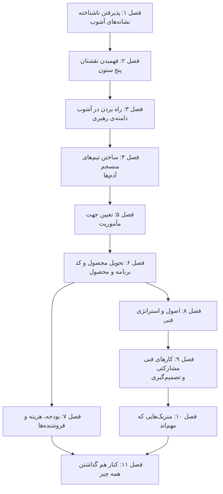

# Engineering Leadership: The Hard Parts

**نسخه‌ی تعاملی را با باز کردن [`index.html`](index.html) در مرورگر ببینید**: برای هر فصل یک درس اسلاید‌به‌اسلاید، با شبیه‌سازی‌های جاسازی‌شده و خودسنجی. همین متن روی GitHub هم خوب خوانده می‌شود.

## درباره‌ی کتاب

کتاب *Engineering Leadership: The Hard Parts* درباره‌ی رهبری تیم‌های مهندسی است وقتی سازمان دور و برشان آشوب‌زده است: مالکیت نامشخص، اولویت‌های مدام در حال تغییر، و بحران پیوسته. نویسنده‌ها در جمعی صبحانه برای رهبران مهندسی استارتاپ‌ها با هم آشنا شدند و مدام همان الگوهای آشوب و ناکارکردی را در سازمان‌هایی از هر اندازه می‌دیدند. اول رویکردهایشان را به یک دوره‌ی آموزشی تبدیل کردند و بعد به این کتاب (پیش‌گفتار، ص. xiii). کتاب برای مدیرها و directorها و VPهای تازه‌ی مهندسی در سازمان‌هایی نوشته شده که از processهای خودشان جلو زده‌اند، و برای staff engineerها و معمارهایی که بدون اختیار رسمی رهبری می‌کنند (p. xiv). بیشتر توصیه‌های رهبری سازمانی باثبات و پر‌منابع را فرض می‌گیرند؛ این کتاب می‌خواهد جایی کار کند که این فرض برقرار نیست (pp. xiv–xv).

کتاب روی پنج ستون رهبری ساخته شده: **آدم‌ها، مأموریت، برنامه، process و محصول**، که در فصل ۱ معرفی می‌شوند و در فصل ۲ به شرح نقش تبدیل می‌شوند. جعبه‌های تکرارشونده‌ی **In Practice** داستان April را دنبال می‌کنند که تیم از‌هم‌گسیخته‌ی StudioOps در شرکت PixelCurl را تحویل می‌گیرد. **تمرین‌ها**، یعنی نظرسنجی Process Pulse و تشخیص رانش و جلسه‌ی نگاشت اثر در برابر تلاش و کارگاه اصول فنی، به رهبرها چیزی می‌دهند که هفته‌ی بعد اجرا کنند.

## محتوای این پوشه

| مسیر | چیست |
|---|---|
| [`chapters/NN-*.md`](chapters/01-embracing-the-unknown.md) | یادداشت فصل‌ها، **منبع اصلی**. کنار هر `.md` یک درس `.html` ساخته می‌شود |
| [`figures/`](figures/02-01.png) | شکل‌های خود کتاب، بریده‌شده از PDF؛ فایل `figures.tsv` صفحه و کادر هر برش را ثبت می‌کند |
| [`widgets/`](widgets/02-process-pulse.html) | شبیه‌سازی‌های دست‌ساز که در درس‌ها جاسازی شده‌اند؛ هر کدام جداگانه هم باز می‌شوند |
| [`lab/`](lab/05-focus-vs-spread/README.md) | آزمایش‌های اجراشدنی Python با خروجی مورد انتظار |
| `index.html` | صفحه‌ی کتاب که از همین README و فصل‌ها ساخته می‌شود |

## کتاب چطور به هم وصل است

کتاب از شناختن آشوب و تعریف کردن نقش شما شروع می‌کند، از آدم‌ها و جهت می‌گذرد و به سازوکار تحویل دادن و بودجه و استراتژی فنی و همکاری و اندازه‌گیری می‌رسد، و بعد همه را کنار هم می‌گذارد.

*ترتیب فصل‌ها مال کتاب است؛ پیکان‌ها و برچسب ستون‌ها خوانش vault است از این‌که فصل‌ها چطور روی هم سوار می‌شوند.*

چند رشته در کل کتاب کشیده شده‌اند:

- **به‌اندازه process**، یعنی سبک به‌جای سنگین: نظرسنجی Process Pulse (۲)، حرکت به‌جای دیوان‌سالاری (۳)، sprint و تخمین سبک (۶)، RFC به‌جای شوراهای حاکمیتی (۹)، و کمینه‌ی process قابل‌استفاده (۱۱).
- **تمرکز**، یعنی روشنی خودش کار است: رانش و فهرست کوتاه اولویت‌ها (۵)، اثر در برابر تلاش (۶)، بودجه به‌عنوان اولویت‌بندیِ دلاردار (۷)، و token نوآوری (۸).
- **امنیت روانی**: از آشوبی که حس ناامنی می‌دهد (۳) و اعتماد تیم (۴) تا مخالفت امن (۹)، متریک‌هایی که آدم‌ها را تنبیه نمی‌کنند (۱۰)، و «بدون امنیت هیچ چیز دیگری کار نمی‌کند» (۱۱).
- **مراقب خودتان باشید**: رفتن شکست نیست (۱)، فرسودگی‌ای که لباس مقاومت می‌پوشد (۳)، و کنار کشیدن برای حفظ سلامتی (۱۱).

## فصل‌ها

| # | فصل | صفحه‌ها |
|---:|---|---|
| ۱ | [پذیرفتن ناشناخته](chapters/01-embracing-the-unknown.md) | ۱–۱۱ |
| ۲ | [فهمیدن نقشتان](chapters/02-understanding-your-role.md) | ۱۳–۳۴ |
| ۳ | [راه بردن در آشوب](chapters/03-navigating-chaos.md) | ۳۵–۵۸ |
| ۴ | [ساختن تیم‌های منسجم](chapters/04-building-cohesive-teams.md) | ۵۹–۷۳ |
| ۵ | [تعیین جهت](chapters/05-setting-direction.md) | ۷۵–۹۲ |
| ۶ | [تحویل محصول و کد در محیط‌های آشوب‌زده](chapters/06-shipping-products-and-code-in-chaotic-environments.md) | ۹۳–۱۲۲ |
| ۷ | [بودجه، هزینه و فروشنده‌ها](chapters/07-budgeting-costs-and-vendors.md) | ۱۲۳–۱۴۵ |
| ۸ | [اصول و استراتژی فنی](chapters/08-technical-principles-and-strategy.md) | ۱۴۷–۱۷۲ |
| ۹ | [کارهای فنی مشارکتی و تصمیم‌گیری](chapters/09-collaborative-technical-practices-and-decision-making.md) | ۱۷۳–۲۰۶ |
| ۱۰ | [متریک‌هایی که برای تیم‌های مهندسی مهم‌اند](chapters/10-metrics-that-matter-for-engineering-teams.md) | ۲۰۷–۲۲۶ |
| ۱۱ | [کنار هم گذاشتن همه چیز](chapters/11-fitting-it-all-together.md) | ۲۲۷–۲۴۰ |

شماره‌ها صفحه‌ی چاپی‌اند. مطالب ابتدای کتاب، یعنی پیش‌گفتار، صص. xiii–xviii را می‌گیرند و کتاب با یک نمایه در ص. ۲۴۱ تمام می‌شود.

## مفهوم‌های کلیدی

این ایده‌ها در چند فصل تکرار می‌شوند و هر ردیف فصل‌هایی را که به آن می‌پردازند فهرست می‌کند. تعریف‌ها خلاصه‌ی vault از توضیح کتاب‌اند.

| مفهوم | تعریف | فصل‌ها |
|---|---|---|
| نشانه‌های آشوب | ده نشانه: نبود مالکیت، نبود ساختار، مسئولیت بیش از اندازه، process تعریف‌نشده، ارتباط ضعیف، سرزنش، ریزش نیرو، نبود استراتژی، بحران پیوسته، و نبود اندازه‌گیری. | [۱](chapters/01-embracing-the-unknown.md) · [۲](chapters/02-understanding-your-role.md) |
| پنج ستون | آدم‌ها، مأموریت، برنامه، process و محصول؛ بخش‌های نقش یک رهبر مهندسی. | [۱](chapters/01-embracing-the-unknown.md) · [۲](chapters/02-understanding-your-role.md) · [۱۱](chapters/11-fitting-it-all-together.md) |
| جزیره‌های ثبات | حوزه‌هایی که در کنترل شمایند و آرامشان می‌کنید، و می‌توانند برای بقیه‌ی سازمان الگوی تغییر شوند. | [۱](chapters/01-embracing-the-unknown.md) · [۱۱](chapters/11-fitting-it-all-together.md) |
| دامنه‌ی رهبری | جابه‌جایی عامدانه در لحن و سرعت و تمرکز: تشخیص زمینه، دوام آوردن در آشوب، تمرکز بر نتیجه، و رفتن بین نقش‌ها. | [۳](chapters/03-navigating-chaos.md) |
| خلبان، امدادگر، مهندس | سه حالت رهبری: زوم کردن به عقب برای تعیین جهت، آرام کردن اوضاع و بازسازی اعتماد، یا رفتن وسط خود کار. | [۳](chapters/03-navigating-chaos.md) · [۱۱](chapters/11-fitting-it-all-together.md) |
| توانمندی‌های تیم | هفت توانایی قابل‌مشاهده، از تبدیل ابهام به عمل تا وصل کردن تلاش به نتیجه، که تیم یکی دوتا یکی دوتا می‌سازدشان. | [۴](chapters/04-building-cohesive-teams.md) |
| رانش | حرکت بدون معنا: از بیرون شلوغ و از درون تهی‌کننده‌ی تیم؛ با جدول ۵-۱ تشخیص داده می‌شود. | [۵](chapters/05-setting-direction.md) · [۱۱](chapters/11-fitting-it-all-together.md) |
| اثر در برابر تلاش | یک شبکه‌ی دو‌در‌دو برای ترتیب دادن کار: اول بردهای سریع، شکستن شرط‌های بزرگ، و پرهیز از منطقه‌ی خطر. | [۶](chapters/06-shipping-products-and-code-in-chaotic-environments.md) · [۷](chapters/07-budgeting-costs-and-vendors.md) |
| اقتصاد واحد | معیارهای COGS و CAC و LTV و حاشیه‌ی ناخالص؛ اصطلاح‌هایی که تصمیم فنی را به تصمیم کسب‌وکاری تبدیل می‌کنند. | [۷](chapters/07-budgeting-costs-and-vendors.md) |
| هزینه‌ی تمام‌شده‌ی نیرو | هزینه‌ی واقعی یک نفر، معمولاً ۱٫۳ تا ۱٫۸ برابر حقوق پایه، به‌علاوه‌ی زمان جا افتادن و ریزش. | [۷](chapters/07-budgeting-costs-and-vendors.md) |
| ساختن در برابر خریدن | فقط چیزی را بسازید که کسب‌وکار را متمایز می‌کند؛ سرویس‌های کالایی را بخرید. | [۷](chapters/07-budgeting-costs-and-vendors.md) · [۸](chapters/08-technical-principles-and-strategy.md) |
| اصول فنی | مجموعه‌ای کوتاه و ساخته‌ی خود تیم، مثل اول سادگی و مستندسازی و تست، که هم به کد و هم به فرهنگ شکل می‌دهد. | [۸](chapters/08-technical-principles-and-strategy.md) · [۹](chapters/09-collaborative-technical-practices-and-decision-making.md) · [۱۱](chapters/11-fitting-it-all-together.md) |
| token نوآوری | مدل Dan McKinley: هر شرکت حدود سه انتخاب فناوری غیرکسل‌کننده دارد؛ خرجشان کنید سر چیزی که متمایزتان می‌کند. | [۸](chapters/08-technical-principles-and-strategy.md) |
| سند RFC و ADR | سند RFC پیش از ساختن، تصمیم را مشارکتی می‌گیرد؛ سند ADR ثبت می‌کند چه تصمیمی گرفته شد. | [۸](chapters/08-technical-principles-and-strategy.md) · [۹](chapters/09-collaborative-technical-practices-and-decision-making.md) |
| امنیت روانی | این باور که بابت حرف زدن تنبیه نمی‌شوید؛ پایه‌ی تصمیم‌های مشارکتی و پایه‌ی همه چیز دیگر. | [۳](chapters/03-navigating-chaos.md) · [۹](chapters/09-collaborative-technical-practices-and-decision-making.md) · [۱۰](chapters/10-metrics-that-matter-for-engineering-teams.md) · [۱۱](chapters/11-fitting-it-all-together.md) |
| متریک‌های DORA | تکرار deployment، زمان رسیدن تغییر، نرخ خرابی تغییر و زمان بازیابی؛ مجموعه‌ی شروع، به‌علاوه‌ی یکی دو متریک زمینه‌ای. | [۱۰](chapters/10-metrics-that-matter-for-engineering-teams.md) · [۱۱](chapters/11-fitting-it-all-together.md) |
| قانون Goodhart | وقتی یک سنجه به هدف تبدیل شود، دیگر سنجه‌ی خوبی نیست؛ velocity نمونه‌ی کلاسیکش است. | [۱۰](chapters/10-metrics-that-matter-for-engineering-teams.md) |

## این یادداشت‌ها چطور نوشته شده‌اند

- **هر چیزی که در یادداشت یک فصل بالای *فراتر از کتاب* است، خود کتاب را بازگو می‌کند**، با ارجاع به صفحه. مطالب مکمل، یعنی منابع بیرونی و خوانش vault، زیر *فراتر از کتاب* یا در کادرهای `> **Vault note:**` می‌آیند.
- **شماره‌ی صفحه‌ها صفحه‌ی چاپی‌اند** (صفحه‌ی PDF منهای ۲۰).
- جعبه‌های تکرارشونده‌ی کتاب، یعنی In Practice با داستان April و تمرین‌ها، به شکل کادر با شماره‌ی صفحه‌شان می‌آیند.
- فهرست بخش‌ها همان فهرست مطالب خود کتاب است که از bookmarkهای PDF برداشته شده.
- شکل‌های کتاب از PDF بریده شده‌اند و با برچسب و صفحه‌ی چاپی و زیرنویسی که می‌گوید به چه چیزی نگاه کنید نشان داده می‌شوند؛ نمودارهای Mermaid جمع‌بندی خود vault هستند و زیرنویسشان همین را می‌گوید.
- پرسش‌های *خودتان را بسنجید* و پاسخ‌هایشان مال vault است و از روی همین یادداشت‌ها نوشته شده؛ پاسخ‌ها به صفحه ارجاع می‌دهند.
- شبیه‌سازی‌ها و آزمایش‌ها پیاده‌سازی خود vault از موقعیت‌هایی‌اند که کتاب شرح می‌دهد: نظرسنجی Process Pulse، حالت‌های رهبری، توانمندی‌های تیم، تشخیص رانش، اثر در برابر تلاش، اقتصاد واحد، token نوآوری، انتخاب رسانه، انتخاب متریک، تمرکز در برابر پراکندگی، هزینه‌ی نیرو و هدف‌گذاری velocity. هر کدام می‌گویند کدام صفحه‌ها را نشان می‌دهند و چه چیزی را خودشان ساخته‌اند.

## منبع

- **منبع اصلی:** نسخه‌ی PDF ناشر از ویراست اول در سال ۲۰۲۶، با انتشار اول در ۲۰۲۶-۰۱-۲۰، © ۲۰۲۶ Worthwhile Technology LLC و James Turnbull، O'Reilly Media، با ۲۷۳ صفحه‌ی PDF. این PDF بیرون از version control نگه داشته می‌شود؛ `.gitignore` را ببینید.
- **فهرست مطالب:** از bookmarkهای PDF برداشته شده و شماره‌ی صفحه‌های چاپی از پانویس صفحه‌ها می‌آیند.
- **ساختار:** مطالب ابتدای کتاب شامل پیش‌گفتار، یازده فصل، و یک نمایه.
- **پوشش:** هر یازده فصل پوشش داده شده‌اند.
- **شکل‌ها:** کتاب هشت شکل در فصل‌های ۲ تا ۸ دارد که هفت‌تایشان در یادداشت‌ها آمده‌اند، یعنی شکل‌های ۲-۱ و ۳-۱ و ۵-۱ و ۶-۲ و ۷-۱ و ۸-۱ و ۸-۲. شکل ۶-۱، یعنی قالب user story، به‌جای تصویر به شکل متن آمده. جدول‌های کتاب به شکل جدول Markdown بازسازی شده‌اند.
