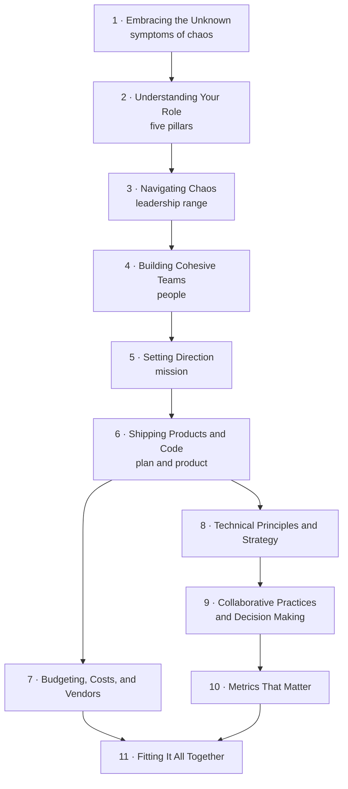

# Engineering Leadership: The Hard Parts

**Open [`index.html`](index.html) in a browser** for the interactive version: one slide-by-slide lesson per chapter, with embedded simulations and self-checks. Everything here also reads fine on GitHub.

## About

*Engineering Leadership: The Hard Parts* is about leading engineering teams when the organization around them is chaotic: unclear ownership, shifting priorities, constant crises. The authors met in a breakfast group for startup engineering leaders and kept seeing the same patterns of chaos and dysfunction in organizations of every size. They first turned their approaches into a training course, then into this book (Preface, p. xiii). It is written for new engineering managers, directors and VPs in organizations outgrowing their processes, and staff engineers and architects leading without formal authority (p. xiv). Much leadership advice assumes a stable, well-resourced organization; this book aims to work where that isn't true (pp. xiv–xv).

The book is built on five pillars of leadership — **people, mission, plan, process and product** — introduced in Chapter 1 and turned into a role description in Chapter 2. Recurring **In Practice** boxes follow April as she takes over PixelCurl's fractured StudioOps team. **Exercises** — the Process Pulse survey, the drift diagnostic, the impact-versus-effort mapping session, a technical principles workshop — give leaders something to run the next week.

## What's in this folder

| Path | What it is |
|---|---|
| [`chapters/NN-*.md`](chapters/01-embracing-the-unknown.md) | Chapter notes, **the source of truth**. Each `.md` has a generated `.html` lesson next to it |
| [`figures/`](figures/02-01.png) | The book's own figures, cropped from the PDF; `figures.tsv` records each crop's page and box |
| [`widgets/`](widgets/02-process-pulse.html) | Hand-built simulations, embedded in the lessons; each also opens on its own |
| [`lab/`](lab/05-focus-vs-spread/README.md) | Runnable Python experiments with expected output |
| `index.html` | The book hub, generated from this README and the chapters |

## How the book fits together

The book moves from recognizing chaos and defining your role, through people and direction, to the mechanics of shipping, budgets, technical strategy, collaboration and measurement, before pulling everything together.

*The chapter order is the book's; the arrows and the pillar labels are the vault's reading of how the chapters build on each other.*

Some threads run through the whole book:

- **Just enough process** — light-touch over heavy-handed: the Process Pulse (2), motion over bureaucracy (3), lightweight sprints and estimates (6), RFCs instead of governance boards (9), minimal viable process (11).
- **Focus** — clarity as the work: drift and a short list of priorities (5), impact versus effort (6), budgeting as prioritization with dollar signs (7), innovation tokens (8).
- **Psychological safety** — from chaos that feels unsafe (3) and team trust (4) to safe disagreement (9), metrics that don't punish people (10), and "without safety, nothing else works" (11).
- **Look after yourself** — leaving isn't failure (1), burnout masquerading as resistance (3), and walking away to protect your health (11).

## Chapters

| # | Chapter | Pages |
|---:|---|---|
| 1 | [Embracing the Unknown](chapters/01-embracing-the-unknown.md) | 1–11 |
| 2 | [Understanding Your Role](chapters/02-understanding-your-role.md) | 13–34 |
| 3 | [Navigating Chaos](chapters/03-navigating-chaos.md) | 35–58 |
| 4 | [Building Cohesive Teams](chapters/04-building-cohesive-teams.md) | 59–73 |
| 5 | [Setting Direction](chapters/05-setting-direction.md) | 75–92 |
| 6 | [Shipping Products and Code in Chaotic Environments](chapters/06-shipping-products-and-code-in-chaotic-environments.md) | 93–122 |
| 7 | [Budgeting, Costs, and Vendors](chapters/07-budgeting-costs-and-vendors.md) | 123–145 |
| 8 | [Technical Principles and Strategy](chapters/08-technical-principles-and-strategy.md) | 147–172 |
| 9 | [Collaborative Technical Practices and Decision Making](chapters/09-collaborative-technical-practices-and-decision-making.md) | 173–206 |
| 10 | [Metrics That Matter for Engineering Teams](chapters/10-metrics-that-matter-for-engineering-teams.md) | 207–226 |
| 11 | [Fitting It All Together](chapters/11-fitting-it-all-together.md) | 227–240 |

Page ranges are printed pages. Front matter (the preface) takes pp. xiii–xviii; the book ends with an index (p. 241).

## Key concepts

These ideas recur across chapters; each row lists the chapters that discuss them. The definitions are the vault's summaries of the book's explanations.

| Concept | Definition | Chapters |
|---|---|---|
| Symptoms of chaos | Ten signs — lack of ownership, no structure, outsized responsibility, undefined process, poor communication, blame, turnover, no strategy, constant crisis, no measurement. | [1](chapters/01-embracing-the-unknown.md) · [2](chapters/02-understanding-your-role.md) |
| Five pillars | People, mission, plan, process and product — the parts of an engineering leader's role. | [1](chapters/01-embracing-the-unknown.md) · [2](chapters/02-understanding-your-role.md) · [11](chapters/11-fitting-it-all-together.md) |
| Pockets of stability | Areas you control and make calm, which can model change for the rest of the organization. | [1](chapters/01-embracing-the-unknown.md) · [11](chapters/11-fitting-it-all-together.md) |
| Leadership range | Deliberate switches in tone, pace and focus: diagnose context, thrive in chaos, focus on outcomes, shift between roles. | [3](chapters/03-navigating-chaos.md) |
| Pilot, medic, engineer | Three leadership modes: zoom out for direction, stabilize and rebuild trust, or get into the work. | [3](chapters/03-navigating-chaos.md) · [11](chapters/11-fitting-it-all-together.md) |
| Team capabilities | Seven observable abilities — from turning ambiguity into action to connecting effort to outcomes — that a team builds one or two at a time. | [4](chapters/04-building-cohesive-teams.md) |
| Drift | Motion without meaning: busy from outside, hollowing out the team inside; diagnosed with Table 5-1. | [5](chapters/05-setting-direction.md) · [11](chapters/11-fitting-it-all-together.md) |
| Impact versus effort | A two-by-two grid for ordering work: quick wins first, big bets broken down, the danger zone avoided. | [6](chapters/06-shipping-products-and-code-in-chaotic-environments.md) · [7](chapters/07-budgeting-costs-and-vendors.md) |
| Unit economics | COGS, CAC, LTV and gross margin — the terms that turn technical decisions into business ones. | [7](chapters/07-budgeting-costs-and-vendors.md) |
| Fully loaded cost | A person's real cost, typically 1.3–1.8× base salary, plus ramp-up and attrition. | [7](chapters/07-budgeting-costs-and-vendors.md) |
| Build versus buy | Build only what differentiates the business; buy commodity services. | [7](chapters/07-budgeting-costs-and-vendors.md) · [8](chapters/08-technical-principles-and-strategy.md) |
| Technical principles | A short, team-made set of guides (simplicity first, documentation, testing…) that shape both code and culture. | [8](chapters/08-technical-principles-and-strategy.md) · [9](chapters/09-collaborative-technical-practices-and-decision-making.md) · [11](chapters/11-fitting-it-all-together.md) |
| Innovation tokens | Dan McKinley's model: about three non-boring technology choices per company — spend them on differentiators. | [8](chapters/08-technical-principles-and-strategy.md) |
| RFCs and ADRs | Requests for comments decide collaboratively before building; architecture decision records document what was decided. | [8](chapters/08-technical-principles-and-strategy.md) · [9](chapters/09-collaborative-technical-practices-and-decision-making.md) |
| Psychological safety | The belief you won't be punished for speaking up — the foundation of collaborative decisions and of everything else. | [3](chapters/03-navigating-chaos.md) · [9](chapters/09-collaborative-technical-practices-and-decision-making.md) · [10](chapters/10-metrics-that-matter-for-engineering-teams.md) · [11](chapters/11-fitting-it-all-together.md) |
| DORA metrics | Deployment frequency, lead time for changes, change failure rate, time to restore — the starting set, plus one or two context metrics. | [10](chapters/10-metrics-that-matter-for-engineering-teams.md) · [11](chapters/11-fitting-it-all-together.md) |
| Goodhart's Law | When a measure becomes a target, it ceases to be a good measure — velocity is the classic case. | [10](chapters/10-metrics-that-matter-for-engineering-teams.md) |

## How these notes work

- **Everything above *Beyond the book* in a chapter note restates the book**, with page references. Supplementary material, meaning outside sources and the vault's interpretation, lives under *Beyond the book* or in `> **Vault note:**` callouts.
- **Page numbers are printed pages** (PDF page − 20).
- The book's recurring boxes — In Practice (April's story) and Exercises — appear as callouts with their pages.
- Section outlines are the book's own table of contents, taken from the PDF's bookmarks.
- The book's figures are cropped from the PDF and shown with their label, printed page and a caption saying what to look at; Mermaid diagrams are the vault's own summaries, and their captions say so.
- *Check yourself* questions and answers are the vault's, written from the notes; the answers cite pages.
- Simulations and experiments are the vault's own implementations of situations the book describes — the Process Pulse, leadership modes, team capabilities, the drift diagnostic, impact versus effort, unit economics, innovation tokens, choosing a medium, choosing metrics, focus versus spread, headcount costs and velocity targets. Each says which pages it illustrates and what it invents.

## Source

- **Primary source:** the publisher's PDF of the First Edition (2026; first release 2026-01-20), © 2026 Worthwhile Technology LLC and James Turnbull, O'Reilly Media (273 PDF pages). The PDF is kept outside version control (see `.gitignore`).
- **Table of contents:** taken from the PDF's bookmark outline; printed page numbers come from the page footers.
- **Structure:** front matter (preface), eleven chapters and an index.
- **Coverage:** all eleven chapters are covered.
- **Figures:** the book has eight figures in Chapters 2–8; seven are shown in the notes (Figures 2-1, 3-1, 5-1, 6-2, 7-1, 8-1 and 8-2). Figure 6-1, the user story template, is given as text instead. The book's tables are reproduced as Markdown tables.
