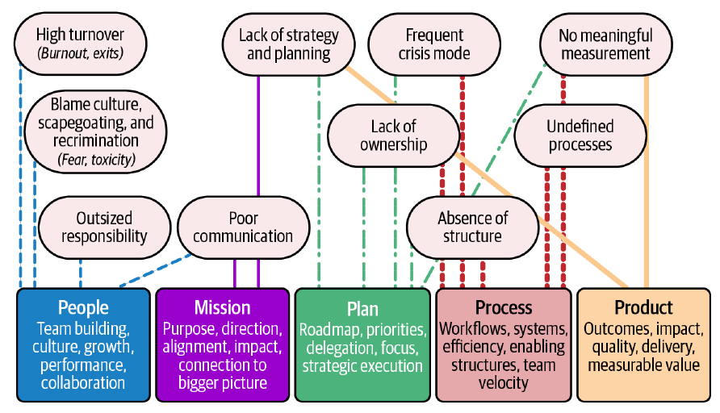

# فصل ۲: فهمیدن نقشتان

[فصل ۱: پذیرفتن ناشناخته →](01-embracing-the-unknown.md) · [کتاب](../README.md) · [فصل ۳: راه بردن در آشوب ←](03-navigating-chaos.md)

## خلاصه

پیش از رهبری کردن کسی باید درباره‌ی شغل خودتان روشن باشید، و در محیط‌های آشوب‌زده هیچ‌کس شرح قابل‌استفاده‌ای از آن دستتان نمی‌دهد. این فصل یکی می‌سازد، حول پنج ستون، یعنی آدم‌ها و مأموریت و برنامه و process و محصول، و هر کدام را به نشانه‌های آشوب فصل ۱ نگاشت می‌کند (شکل ۲-۱، جدول ۲-۱). در این مسیر هشدار می‌دهد که به کار فنیِ راحت عقب‌نشینی نکنید، استدلال می‌کند رهبرها باید «همه‌فن‌حریف با دامنه» باشند و عمل از بی‌عملی بهتر است، و برای هر ستون یک تمرین می‌دهد، با داستان April که تازه رهبر تیم StudioOps در شرکت PixelCurl شده. نتیجه شرح نقشی شخصی و زنده است (pp. 13–34).

## نکته‌های کلیدی

- **تیمتان آینه‌ی شماست:** اگر گیج باشید آن‌ها سردرگم می‌شوند؛ لازم نیست همه‌ی جواب‌ها را داشته باشید، فقط چارچوب پنج ستون را (p. 14).
- **شرح شغل‌ها «آگهی‌های آب‌و‌تاب‌دار»اند** که به‌ندرت از اولین برخورد با خود شغل جان سالم به در می‌برند؛ سندی زنده از کاری که واقعاً می‌کنید بنویسید (pp. 15–18).
- **به کار راحت عقب‌نشینی نکنید.** انجام دادن دائمی کار individual contributor پنهان شدن است، نه رهبری؛ رهبری مهندس‌ها شغلی تازه است، نه یک ارتقا (p. 16).
- **همه‌فن‌حریف با دامنه باشید** و بدانید کِی باید عمیق شوید؛ وقتی اطلاعات ناقص است **عمل از بی‌عملی بهتر است** (pp. 16–17).
- **مأموریت را به هدف‌های اندازه‌پذیر تبدیل کنید**، مثلاً «زمان onboarding مشتری را ۲۰٪ کم کنیم»، نه «performance را بهتر کنیم» (p. 23).
- **اگر درد نداشته باشد اولویت‌بندی نیست؛** و «نه»ی امروز «هیچ‌وقت» نیست (p. 26).
- **کمتر بودن process بهتر است**؛ با تیم بسازیدش، تکاملش بدهید، و اصطکاک را با یک نظرسنجی دو‌دقیقه‌ای «نبض process» و آزمایش‌های دو‌هفته‌ای اندازه بگیرید (pp. 28–31).
- **نتیجه از خروجی مهم‌تر است**، کیفیت یعنی بی‌نقص بودن نیست، و کار نامرئی مثل زیرساخت و بدهی و ابزار هم قدردانی می‌خواهد (pp. 31–32).

## فهرست بخش‌ها

*از فهرست مطالب خود کتاب، از bookmarkهای PDF؛ شماره‌ها صفحه‌ی چاپی‌اند.*

- دقیقاً شغلتان چیست؟ — p. 13
  - پنج ستون رهبری مهندسی — p. 15
  - رئیس، نقشه‌ی راه کجاست؟ — p. 15
  - به کار راحت عقب‌نشینی نکنید — p. 16
  - رهبری مهندسی یعنی «همه‌فن‌حریف با دامنه» بودن — p. 16
  - عمل همیشه از بی‌عملی بهتر است — p. 17
  - شرح نقش: نقشه‌ای که خودتان می‌کشید — p. 17
- آدم‌ها: همه چیز از تیمتان شروع می‌شود — p. 18
  - نقطه‌ی شروعتان کجاست؟ — p. 18
  - مأموریتتان چیست؟ — p. 19
  - برای رسیدن به آن چه ابزاری لازم دارید؟ — p. 19
- مأموریت: خدمه دارید؛ حالا مقصد لازم دارید — p. 22
  - از کجا شروع کنیم — p. 22
  - همراه کردن تیم — p. 23
  - تبدیل مأموریت به عمل — p. 23
- برنامه: می‌دانید کجا بروید؛ حالا مسیر را بکشید — p. 25
  - با شریک‌هایتان بسازید — p. 25
  - بدانید چه چیزی را اولویت بدهید — p. 25
  - تبدیل استراتژی به عمل — p. 26
  - تنظیم کنید ولی متمرکز بمانید — p. 26
- بخش process: سیستمی که کارها را در حرکت نگه می‌دارد — p. 28
  - سبک ولی اثربخش نگهش دارید — p. 28
  - بخش process را کار تیمی کنید — p. 29
  - در مسیر تنظیمش کنید — p. 29
- محصول: واقعاً داریم چه چیزی تحویل می‌دهیم؟ — p. 31
  - بدانید موفقیت چه شکلی است — p. 31
  - تعادل کیفیت و سرعت — p. 32
  - نتیجه همیشه feature نیست — p. 32
- جمع‌بندی: کنار هم گذاشتن همه — p. 34

## یادداشت‌ها

شغل شما در آشوب این است که روشنی بسازید، ثبات بیاورید و تیم را لنگر بیندازید: وقتی جهتی نیست جهت تعیین کنید و مهندس‌ها را به تصویر بزرگ‌تر وصل کنید، حتی وقتی آن تصویر تار است. این فصل را onboarding خودتان برای این نقش بدانید (p. 13).

### دقیقاً شغلتان چیست؟

هزار کلاه سرتان می‌گذارید؛ رهبر آدم‌ها، راهنمای فنی، استراتژیست، مدیر محصول، آتش‌نشان و گاهی تراپیست، و چالش این است که بدانید کِی کدام را بگذارید (p. 13). نقش شما چسب کار است و **تیمتان آینه‌ی شماست** (p. 14). چارچوب، پنج ستون است که هر کدام به نشانه‌هایی از آشوب فصل ۱ می‌پردازند:

*Figure 2-1 (p. 14): هر نشانه‌ی آشوب را تا ستون‌هایی دنبال کنید که به آن می‌پردازند؛ به بیشتر نشانه‌ها از بیش از یک ستون می‌شود رسید.*

| *جدول ۲-۱. چارچوب مداخله‌ی رهبری* (p. 14) | رویکرد مداخله |
|---|---|
| **آدم‌ها** | به ریزش بالای نیرو، فرهنگ سرزنش، مسئولیت بیش از اندازه و ارتباط ضعیف می‌پردازد |
| **مأموریت** | سراغ نبود استراتژی، ارتباط ضعیف و بریدگی از هدف می‌رود |
| **برنامه** | نبود استراتژی، مسئله‌های مالکیت، حالت بحران، نبود ساختار و نبود اندازه‌گیری را حل می‌کند |
| **process** | processهای تعریف‌نشده، نبود ساختار، نبود مالکیت، بحران‌های پرتکرار و نبود اندازه‌گیری را درست می‌کند |
| **محصول** | اندازه‌گیری معنادار، تمرکز بر نتیجه، استانداردهای کیفیت، ارزش تحویل‌شده و هم‌راستایی راهبردی را برقرار می‌کند |

#### پنج ستون رهبری مهندسی

| ستون | شغل شما (p. 15) |
|---|---|
| **آدم‌ها** | فرهنگ بسازید، از رشد پشتیبانی کنید و کاری کنید مهندس‌ها مثل یک واحد کار کنند، نه فقط تعداد نیرو را مدیریت کنید |
| **مأموریت** | همان «چرا»: کاری که مهندس‌ها می‌کنند را به هدف‌های شرکت و اثرشان وصل کنید |
| **برنامه** | نقشه‌ی راه و اولویت‌ها و واگذاری؛ جهت و تمرکز، نه دیکته کردن جزئیات |
| **process** | پشتیبان مهندس‌ها باشد نه باتلاقشان؛ process بی‌اثر پیشرفت را نابود می‌کند |
| **محصول** | نتیجه‌هایی تحویل بدهید که اهمیت دارند و اثرشان اندازه‌پذیر است، چه feature باشد چه رفع باگ چه ابزار داخلی |

#### رئیس، نقشه‌ی راه کجاست؟

بیشتر رهبرها فقط یک مأموریت مبهم می‌گیرند که «تیم را رهبری کن»؛ حتی شرح شغل باجزئیات هم از ماه اول جان سالم به در نمی‌برد، چون با بزرگ شدن سازمان مسئولیت‌ها جابه‌جا می‌شوند. به **سندی زنده** از مسئولیت‌هایتان و شیوه‌ی انجامشان نیاز دارید (pp. 15–16).

#### به کار راحت عقب‌نشینی نکنید

وقتی آشوب می‌رسد، وسوسه این است که خشکتان بزند یا دوباره توی refactoring و رفع باگ شیرجه بزنید. انجام دادن دائمی کار individual contributorها یعنی «شما رهبری نمی‌کنید؛ پنهان شده‌اید». ارزش شما در این است که چقدر خوب تیم را توانمند می‌کنید؛ **رهبری مهندس‌ها ارتقا نیست، شغلی تازه است** (p. 16).

#### رهبری مهندسی یعنی «همه‌فن‌حریف با دامنه» بودن

رهبرها به کمی دانش درباره‌ی چیزهای زیاد و توانایی جابه‌جا شدن بینشان نیاز دارند؛ نویسنده‌ها به جمله‌ی Robert A. Heinlein ارجاع می‌دهند که «تخصص مال حشره‌هاست»، در *Time Enough for Love* سال ۱۹۷۳. این بهانه‌ی فکر سطحی نیست: بدانید همه چیز چطور به هم وصل است و کِی باید عمیق شوید؛ یعنی جابه‌جایی هدفمند بین زمینه‌ها (p. 16).

#### عمل همیشه از بی‌عملی بهتر است

ریسک در آشوب انجام دادن کار اشتباه نیست، هیچ کاری نکردن است و منتظر روشنی‌ای ماندن که شاید هیچ‌وقت نیاید. با اطلاعات ناقص تصمیم بگیرید، تطبیق بدهید و تکرار کنید؛ عمل کردن وقتی هیچ‌کس دیگری عمل نمی‌کند شما را متمایز می‌کند (p. 17).

#### شرح نقش: نقشه‌ای که خودتان می‌کشید

مستند کردن مسئولیت‌هایتان اولین «بخش سخت» است، چون یعنی باید خوب بنویسید. شرح شغل‌ها «آگهی‌های آب‌و‌تاب‌دار»اند و منشور تیم‌ها اغلب متن کلیشه‌ای مبهمی از کارگاهی فراموش‌شده است. شرح نقشِ زمینی هم جهت می‌دهد و هم کمک می‌کند نشان بدهید چه کرده‌اید (pp. 17–18).

### آدم‌ها: همه چیز از تیمتان شروع می‌شود

رهبری با شنیدن و روشن دیدن شروع می‌شود؛ در ضرب‌الاجل‌های از‌دست‌رفته و تغییر مدام featureها و بدهی فنی گم نشوید، اول بفهمید آدم‌هایتان با چه چیزی کار می‌کنند و چه چیزی جلویشان را گرفته (p. 18).

| پرسش | به چه نگاه کنید (pp. 18–20) |
|---|---|
| **نقطه‌ی شروعتان کجاست؟** | تیم را به ارث برده‌اید یا تازه است؛ آدم‌های کلیدی و شکاف‌های مهارتی و انسجامی؛ سیلوها؛ اعتماد یا طناب‌کشی. وقتی از صفر می‌سازید، هر استخدام مسیر را تعیین می‌کند. و **واقعاً چقدر نفوذ دارید؟** دانستن این‌که چه چیزی را نمی‌توانید عوض کنید تلاشتان را متمرکز می‌کند |
| **مأموریتتان چیست؟** | تیمی که از جمع اجزایش بزرگ‌تر است و «روان» کار می‌کند چون مأموریت و نقش خودش را می‌فهمد؛ توسعه‌ی نرم‌افزار کاری اجتماعی است |
| **چه ابزاری لازم دارید؟** | **روحیه**، که با تنقلات و تقدیر درست نمی‌شود بلکه با بردهای کوچک و گفت‌وگوهای صادقانه. **مدیریت عملکرد**، یعنی بازخورد پیوسته و راهنمایی به‌جای ارزیابی؛ حتی بدون پشتیبانی شرکت هم شما پاسخ‌گویید. **استخدام و onboarding**، که ۳۰ روز اولش لحن کار را تعیین می‌کند |

> **تمرین: تعریف نقشتان به‌عنوان رهبر آدم‌ها** (pp. 20–21). نقطه‌ی شروع را در دو سه جمله بسنجید؛ وضعیت نهایی را مشخص توصیف کنید؛ پنج تا هفت مسئولیت عمل‌شدنی بنویسید. **April** که تازه تیم بااستعداد ولی از‌هم‌گسیخته‌ی StudioOps در PixelCurl را تحویل گرفته، با آدم‌های ارشدِ در سیلو و تازه‌کارهای بی‌منتور و ضرب‌الاجل‌های در حال لغزش، مسئولیت‌هایی می‌نویسد مثل بافتن همکاری در کار روزمره، منتور شدن برای مدیرهای مهندسی تا خودش روی استراتژی تمرکز کند، استخدام سه مهندس برای پر کردن شکاف frontend و DevOps، ساختن onboarding ساختارمند، و وصل کردن کد به مسئله‌های کاربرها.

> **In practice:** اولین کار در تیم داده‌ای تازه فهمیدن این است که آدم‌ها با چه چیزی کلنجار می‌روند، نه انتخاب ابزار.
>
> **Your turn:** تازه lead تیم شده‌اید. در هفته‌ی اول چه چیزی را از هر نفر می‌پرسید؟
>
> *Answer:* کدام بخش pipeline بیشتر از همه وقتش را می‌گیرد، کدام alert او را شب بیدار می‌کند، و چه چیزی جلوی کارش را گرفته. کتاب رهبری را با شنیدن و فهمیدن نقطه‌ی شروع تیم آغاز می‌کند (pp. 18–20).

### مأموریت: خدمه دارید؛ حالا مقصد لازم دارید

مهندس‌ها وقتی می‌درخشند که ببینند کارشان چطور به محصول و کاربرها و شرکت شکل می‌دهد؛ رهبرها مسئله حل می‌کنند، پس **تیم را به مسئله‌ها نزدیک کنید**. اگر مأموریت از بالا روشن نیست، به تیمتان مأموریت خودش را بدهید: سرآمدی فنی، نوآوری، حل مسئله‌های سخت کاربرها (p. 22).

| قدم | چطور (pp. 22–23) |
|---|---|
| **از کجا شروع کنیم** | مأموریت شرکت فهمیده شده، یا مهندس‌ها کد می‌زنند بدون این‌که پیوندش را ببینند، یا فناوری را چون جذاب است انتخاب می‌کنند؟ اولویت‌های سطح بالا را به چیزی ملموس ترجمه کنید |
| **همراه کردن تیم** | هم‌راستایی به پیوند شخصی نیاز دارد: نشان بدهید API تازه تجربه‌ی مشتری را چطور بهتر می‌کند و زیرساخت چطور پایه‌ی مقیاس گرفتن را می‌ریزد |
| **تبدیل مأموریت به عمل** | هدف‌های اندازه‌پذیر: «زمان onboarding مشتری را ۲۰٪ کم کنیم»، نه «performance را بهتر کنیم»؛ «uptime را تا جایی ببریم که مشتری سازمانی را پشتیبانی کند»، نه «بدهی فنی را کم کنیم». اگر مأموریت روشن نیست، بروید از product و بازاریابی و رهبری بگیریدش |

> **تمرین: هم‌راستایی مأموریت با اثر اندازه‌پذیر** (pp. 24–25). ۱) یکی از نشانه‌های فصل ۱ را تشخیص بدهید که بریدگی از مأموریت به آن خوراک می‌دهد. ۲) یک تغییر اندازه‌پذیر در ۹۰ روز تعریف کنید؛ مثلاً مهندس‌ها بتوانند بگویند پروژه‌شان چطور به هدف‌های شرکت وصل است، و کمتر از ۲۰٪ ظرفیت صرف کار برنامه‌ریزی‌نشده و ناهم‌راستا شود. ۳) دو سه اقدام مشخص: جلسه‌های ماهانه‌ی اثر، بازبینی فصلی نقشه‌ی راه با رهبری کسب‌وکار، و متریک‌های مشترک. ۴) یک شاخص پیشرو در ۳۰ روز: مهندس‌ها بدون این‌که بپرسید کارشان را به نتیجه وصل کنند.

### برنامه: می‌دانید کجا بروید؛ حالا مسیر را بکشید

برنامه تمرکز و هم‌راستایی و شتاب می‌سازد، و قرار هم نیست تنها بسازیدش: «رهبری که تنها برنامه می‌ریزد سرنوشتش گلوگاه شدن است» (p. 25).

| کار | جزئیات (pp. 25–27) |
|---|---|
| **با شریک‌هایتان بسازید** | product برای نیاز مشتری، بازاریابی برای تغییرهای بازار، فروش برای چیزی که معامله را می‌شکند؛ و بگذارید سرپرست‌های فنی صاحب تکه‌هایی از نقشه‌ی راه باشند |
| **بدانید چه چیزی را اولویت بدهید** | وقتی همه چیز مهم است، هیچ چیز مهم نیست. «اگر درد نداشته باشد اولویت‌بندی نیست.» نه گفتن مهم است؛ «نه»ی امروز «هیچ‌وقت» نیست. دلیل‌ها را توضیح بدهید |
| **تبدیل استراتژی به عمل** | هدف‌ها را به قدم‌های مشخص و اندازه‌پذیر بشکنید؛ به سرپرست‌های فنی واگذار کنید و به‌جای ذره‌بین گذاشتن هدایت کنید؛ و ایستگاه‌های بازبینی در milestoneها بگذارید |
| **تنظیم کنید ولی متمرکز بمانید** | هیچ برنامه‌ای از اولین برخورد با واقعیت جان سالم به در نمی‌برد؛ هدف‌های اصلی می‌مانند و تاکتیک‌ها عوض می‌شوند؛ نشان بدهید تغییرها چطور به مأموریت می‌خورند |

> **تمرین: تعریف نقشتان در برنامه‌ریزی راهبردی** (pp. 27–28). برنامه‌ریزی فعلی را بسنجید، رویکرد مشارکتی تعریف کنید و دو سه مسئولیت اضافه کنید. تیم April گیر واکنش نشان دادن به آخرین خواسته‌های product افتاده، پس او با product و بازاریابی و عملیات همکاری می‌کند، بین feature و بدهی فنی و مقیاس‌پذیری تعادل برقرار می‌کند، و تکه‌هایی از نقشه‌ی راه را به سرپرست‌های فنی واگذار می‌کند.

### مفهوم process: سیستمی که کارها را در حرکت نگه می‌دارد

مفهوم process موتور اجراست؛ اگر بد ساخته شود گلوگاه است. **کمتر بهتر است**: پشتیبانی، نه کنترل (p. 28).

- **سبک ولی اثربخش نگهش دارید.** تأییدهای طولانی و جلسه‌های بی‌پایان و بازبینی‌های سنگین شتاب را می‌کشند؛ code review و deployment و حلقه‌های بازخورد را نگه دارید ولی روانشان کنید. بپرسید «این دارد کمک می‌کند بهتر شویم یا دارد کندمان می‌کند؟» و اگر دومی است، حذفش کنید (p. 28).
- **مفهوم process را کار تیمی کنید**، یعنی با تیم یا توسط تیم ساخته شود، نه برای تیم، که حس مالکیت می‌سازد (p. 29).
- **در مسیر تنظیمش کنید**، چون چیزی که برای ۵ نفر کار می‌کرد شاید برای ۲۰ نفر شکست بخورد (p. 29).

> **تمرین: نظرسنجی نبض process** (pp. 29–31). یک نظرسنجی ناشناس دو‌دقیقه‌ای، چون کاربرِ process خود تیم شماست: این هفته چند بار دو ساعت بی‌وقفه داشتید؛ چند بار راه غیررسمی برای انجام دادن کار پیدا کردید؛ بیشتر منتظر چه چیزی می‌مانید، یعنی review و تأیید، کار دیگران، دسترسی، تصمیم از بالا، اطلاعات، یا هیچ؛ چقدر زود چراغ سبز می‌گیرید؛ «این‌جا کارها واقعاً چطور پیش می‌روند؟»؛ و آن یک چیزی که عوضش می‌کردید. **بخوانیدش** و دنبال الگو بگردید، مثل انتظار و دور زدن و نبود وقت تمرکز، که نشانه‌ی اصطکاک‌اند، نه شکایت. **تکرار کنید** روی همان یک الگویی که بیشترین آدم‌ها را بیشترین بار کند می‌کند، با آزمایشی دو‌هفته‌ای: تأیید همان‌روزِ تغییرهای معمول، بلوک‌های تمرکز دو‌ساعته‌ی محافظت‌شده در صبح، مسیر سریع برای درخواست‌های کوچکِ کم‌ریسک، یا deployment ساده‌تر. **اندازه بگیرید** با اجرای دوباره‌ی نظرسنجی بعد از دو هفته و گفتن آنچه یاد گرفته‌اید.

> **Try it:** [نبض process](../widgets/02-process-pulse.html)؛ همان نظرسنجی کتاب را روی یک تیم شبیه‌سازی‌شده اجرا کنید، اصطکاکی را که بیشترین آدم‌ها را کند می‌کند پیدا کنید و یکی از آزمایش‌های دو‌هفته‌ای‌اش را امتحان کنید.

### محصول: واقعاً داریم چه چیزی تحویل می‌دهیم؟

**نتیجه از خروجی مهم‌تر است**؛ همان تفاوت تیمی که feature منتشر می‌کند با تیمی که ارزش تحویل می‌دهد (p. 31).

| کار | جزئیات (pp. 31–32) |
|---|---|
| **بدانید موفقیت چه شکلی است** | چه مسئله‌ای را حل می‌کنید؟ هر featureای را به یک نتیجه گره بزنید: تجربه، سرعت، reliability، مقیاس، درآمد، هزینه. موفقیت سیال است: این فصل یک feature و فصل بعد کم کردن هزینه‌ی زیرساخت |
| **تعادل کیفیت و سرعت** | سرعت بدون کیفیت فاجعه‌ای در راه است؛ برای «تمام‌شده» استاندارد روشن بگذارید. کیفیت یعنی بی‌نقص بودن نیست؛ بدانید کِی چیزی به‌اندازه‌ی کافی خوب است که تحویل شود |
| **نتیجه همیشه feature نیست** | زیرساخت و بدهی فنی و ابزارهای داخلی «موتورهای خاموش»اند؛ ارزششان را توضیح بدهید و بردهای پنهان را جشن بگیرید |

> **تمرین: بازتعریف نقشتان برای اثرگذاری** (pp. 33–34). تمرکز تیمتان را بسنجید، تعریف کنید چطور از خروجی به نتیجه می‌روید، و مسئولیت اضافه کنید. تیم April برای تحویل دادن می‌دوید و کیفیت افتاده بود، پس او سنجه‌های موفقیتی تعریف می‌کند که اثر را بر خروجی مقدم می‌دانند، سرعت را با کیفیت متعادل می‌کند و روی کار نامرئی تأکید می‌گذارد.

> **In practice:** خروجی تیم داده جدول و داشبورد است؛ نتیجه، تصمیمی است که کسی با آن می‌گیرد.
>
> **Your turn:** تیم این فصل ۱۲ داشبورد تازه در Metabase منتشر کرده. چطور می‌فهمید ارزش تحویل داده است؟
>
> *Answer:* از Metabase بپرسید کدام داشبوردها واقعاً باز می‌شوند و از صاحبانشان بپرسید چه تصمیمی را عوض کرده‌اند؛ داشبورد بی‌بیننده خروجی است، نه نتیجه. کتاب نتیجه را مهم‌تر از خروجی می‌داند و هر feature را به یک نتیجه گره می‌زند (pp. 31–32).

### جمع‌بندی: کنار هم گذاشتن همه

حالا شرح نقشی دارید که آدم‌ها و مأموریت و برنامه و process و محصول را پوشش می‌دهد. رهبری ایستا نیست: همراه با تکامل تیم و شرکت دوباره سراغ این پرسش‌ها بروید (p. 34).

## بده‌بستان‌ها در یک نگاه

| انتخاب | چه می‌دهد | چه می‌گیرد |
|---|---|---|
| عقب‌نشینی به کار فنی | راحتی، خروجی دیدنی | پنهان شده‌اید، نه رهبری |
| همه‌فن‌حریف با دامنه | بین حوزه‌ها جابه‌جا می‌شوید؛ کل را می‌بینید | باز هم باید بدانید کِی عمیق شوید |
| عمل کردن با اطلاعات ناقص | شتاب؛ متمایزتان می‌کند | گاهی اشتباه است؛ به تکرار نیاز دارد |
| تنها برنامه ریختن | سرعت، کنترل | گلوگاه؛ از دست دادن زمینه |
| گفتن «امروز نه» | تمرکز و روشنی | ذی‌نفع ناراضی |
| process سنگین | کنترل | دیوان‌سالاری؛ شتاب از دست می‌رود |
| process سبکِ ساخته‌ی تیم | مالکیت؛ اصطکاک کمتر | با بزرگ شدن تیم باید دوباره سنجیده شود |
| سرعت بر کیفیت | اول تحویل می‌دهید | بدهی، باگ، اعتماد فرسوده |

## فراتر از کتاب

- **دامنه.** عبارت «همه‌فن‌حریف با دامنه» با کتاب *Range: Why Generalists Triumph in a Specialized World* از David Epstein در سال ۲۰۱۹ هم‌صداست، که می‌گوید تجربه‌ی گسترده در محیط‌های «شرور» و پیش‌بینی‌ناپذیر کمک می‌کند.
- **نظرسنجی نبض** شبیه نظرسنجی‌های سبک تجربه‌ی توسعه‌دهنده است که در صنعت به کار می‌روند؛ [این ویجت](../widgets/02-process-pulse.html) پاسخ‌های یک تیم ساختگی و اثرهای ساختگی هر آزمایش را شبیه‌سازی می‌کند.

## پیوندها

- **فصل‌های مرتبط:** [فصل ۱: پذیرفتن ناشناخته](01-embracing-the-unknown.md) که نشانه‌هایی را می‌گوید که ستون‌ها به آن‌ها می‌پردازند، [فصل ۴: ساختن تیم‌های منسجم](04-building-cohesive-teams.md) برای ستون آدم‌ها، [فصل ۵: تعیین جهت](05-setting-direction.md) برای مأموریت، [فصل ۶: تحویل محصول و کد](06-shipping-products-and-code-in-chaotic-environments.md) برای برنامه و process و محصول، [فصل ۸: اصول و استراتژی فنی](08-technical-principles-and-strategy.md)، و [فصل ۹: کارهای فنی مشارکتی](09-collaborative-technical-practices-and-decision-making.md).

## خودتان را بسنجید

*پرسش‌ها و پاسخ‌ها مال vault است و از روی یادداشت‌های بالا نوشته شده؛ پاسخ‌ها به صفحه‌ی چاپی کتاب ارجاع می‌دهند.*

1. **پنج ستون را نام ببرید و برای هر کدام یک نشانه‌ی آشوب که به آن می‌پردازد.**

   *Answer:* آدم‌ها برای ریزش بالای نیرو و فرهنگ سرزنش، مأموریت برای نبود استراتژی و بریدگی از هدف، برنامه برای حالت بحران و مسئله‌های مالکیت، process برای processهای تعریف‌نشده و نبود ساختار، و محصول برای نبود اندازه‌گیری معنادار و تمرکز بر نتیجه؛ جدول ۲-۱ (p. 14).

2. **وقتی شرح شغل دارید چرا شرح نقش خودتان را بنویسید؟**
   - [ ] واحد HR می‌خواهد
   - [x] شرح شغل‌ها آگهی‌هایی آرمانی‌اند که پیش از شروع شما نوشته شده‌اند؛ شرح زنده کاری را نشان می‌دهد که واقعاً می‌کنید و کمک می‌کند پیشرفت را نشان بدهید
   - [ ] جای منشور تیم را می‌گیرد

   *Answer:* pp. 15–18.

3. **«به کار راحت عقب‌نشینی نکنید» از چه چیزی برحذر می‌دارد؟**

   *Answer:* از شیرجه زدن دوباره در کار فنیِ individual contributor وقتی آشوب می‌رسد؛ این پنهان شدن است نه رهبری، چون ارزش شما در توانمند کردن تیم است (p. 16).

4. **عبارت «performance را بهتر کنیم» را به شیوه‌ای که کتاب می‌گوید بازنویسی کنید.**

   *Answer:* به شکل هدفی مشخص و اندازه‌پذیر که به مأموریت گره خورده، مثلاً «زمان onboarding مشتری را ۲۰٪ کم کنیم» (p. 23).

5. **کتاب چه آزمونی برای اولویت‌بندی واقعی می‌دهد؟**

   *Answer:* «اگر درد نداشته باشد اولویت‌بندی نیست»؛ باید تصمیم‌های سخت بگیرید و نه بگویید (p. 26).

6. **بعد از نظرسنجی نبض process چطور باید روی نتیجه‌ها عمل کرد؟**
   - [ ] همه‌ی مسئله‌هایی را که رو می‌کند یک‌دفعه درست کنید
   - [x] همان یک الگویی را که بیشترین آدم‌ها را بیشترین بار کند می‌کند بردارید و آزمایشی کوچک و دو‌هفته‌ای اجرا کنید و بعد نظرسنجی را دوباره بگیرید
   - [ ] برای هر مشکل یک مرحله‌ی تأیید اضافه کنید

   *Answer:* pp. 30–31.

7. **چرا «نتیجه همیشه feature نیست» برای یک رهبر مهم است؟**

   *Answer:* کار نامرئی، یعنی زیرساخت و بدهی فنی و ابزارهای داخلی، محصول را می‌راند؛ رهبر باید ارزشش را توضیح بدهد و جشنش بگیرد تا تیم انگیزه‌اش را حفظ کند (p. 32).
