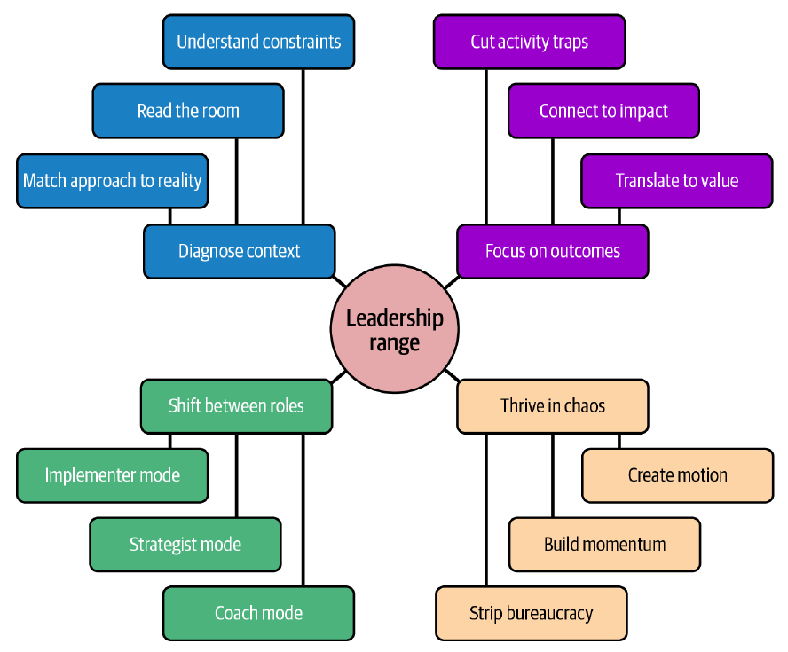

# 3. Navigating Chaos

[← 2. Understanding Your Role](02-understanding-your-role.md) · [Book](../README.md) · [4. Building Cohesive Teams →](04-building-cohesive-teams.md)

## Summary

Leaders are usually hired because something is broken, and the authors argue you fix it with range, not control. Range is four "switches" — deliberate shifts in tone, pace and focus: **diagnose context** through system, human, work and cultural lenses; **thrive in chaos** by creating motion instead of bureaucracy (illustrated with punk, hardcore and open source); **focus on outcomes** rather than activity, without sliding into outcome obsession; and **shift between roles** — pilot, medic and engineer. The chapter is candid that identity and position limit which approaches are available, and follows April through an outage and its post-incident meeting (pp. 35–58).

## Key takeaways

- **You don't fix chaos with control; you fix it with range** — four switches that are lenses for reading a situation and tools for acting (pp. 35–36).
- **Diagnose before you act:** read the system (early stage, scale-up, enterprise), the people, the work and the culture; mismatches waste energy (pp. 37–43).
- **Burnout masquerades as resistance.** Resistance needs vision and buy-in; burnout needs capacity protection — opposite interventions (p. 39).
- **Diagnosis isn't neutral:** identity, background and position change which approaches are viable — including the authors' own advice (pp. 40–41).
- **Motion creates clarity.** Bureaucratic control looks productive but adds paperwork to drowning teams; ship small, prototype, write the first draft — and build the coalition before the solution (pp. 43–47).
- **Don't confuse activity with progress.** Experienced teams fall into a "sophistication trap"; aim for outcome awareness, not outcome obsession (pp. 47–51).
- **Switch consciously between pilot, medic and engineer**, explaining why, rather than defending a fixed style (pp. 51–56).

## Section outline

*From the book’s own table of contents (PDF bookmarks); printed page numbers.*

- Diagnose Context — p. 37
  - Why Diagnosis Matters More Than Style — p. 37
  - Four Lenses for Reading Context — p. 38
  - The Reality of Power and Identity — p. 40
  - Rapid Assessment When You’re New — p. 41
  - When Diagnosis Reveals Hard Truths — p. 42
  - Connecting Diagnosis to Action — p. 42
- Thrive in Chaos — p. 43
  - The Trap of Bureaucratic Control — p. 44
  - The Punk Alternative: Motion Creates Clarity — p. 44
  - From Energy to Discipline — p. 45
  - Open Source: Punk Principles at Scale — p. 45
  - What This Means for Seasoned Leaders — p. 46
  - The Political Reality — p. 46
  - When Momentum Matters Most — p. 46
- Focus on Outcomes — p. 47
  - The Sophistication Trap — p. 47
  - Why Outcome Frameworks Miss the Point — p. 47
  - When Outcomes Are Genuinely Unclear — p. 48
  - The Political Dimension — p. 48
  - Context Shapes Outcome Focus — p. 49
  - Failure Modes of Outcome Obsession — p. 49
  - What This Looks Like in Practice — p. 50
  - Making It Sustainable — p. 51
- Shift Between Roles — p. 51
  - The Cost of Leadership Rigidity — p. 51
  - Three Essential Modes — p. 52
  - The Switching Skill — p. 54
  - The Reality of Constraints — p. 54
  - Leading Through Others — p. 55
  - What This Looks Like in Practice — p. 55
- Conclusion: Pulling It All Together — p. 58

## Notes

Most leaders inherit something broken — a team behind, shaky trust, inconsistent delivery — with no onboarding guide for chaos. Range lets you read the room, lead with clarity, be decisive without rigidity, and calm things down without slowing them down. The authors call the shifts **switches**: adjustments in tone, pace and focus, not personality changes (p. 35).

*Figure 3-1 (p. 36): each of the four switches breaks down into three concrete moves — for example, shifting between roles means choosing implementer, strategist or coach mode.*

### Diagnose Context

One of the fastest ways to lose a team is leading them as if they're somewhere else: many leaders fall back on what worked before (p. 37). Diagnosis reads three **dimensions** — **human** (energy, trust), **operational** (clear priorities, visible work, sustainable pace) and **cultural** (unspoken rules about what is rewarded or punished) (p. 37).

#### Four Lenses for Reading Context

| Lens | Question | What to look for (pp. 38–40) |
|---|---|---|
| **1. System** | What kind of environment are we in? | Constraints that set pace and risk tolerance: startup speed is a liability under compliance; enterprise caution is costly in a startup, where hesitation burns runway |
| **2. Human** | What shape are my people in? | Energy, trust and history decide whether people can absorb new challenges |
| **3. Work** | What's actually on the plate? | Hidden or misaligned work makes good teams look dysfunctional |
| **4. Cultural** | What are the unspoken rules? | The right strategy with the wrong cultural approach gets "rejected like a bad organ transplant" |

| *Table 3-1. Leadership by organizational stage* (p. 38) | Defining traits | Leadership focus |
|---|---|---|
| **Early stage** | Existential pressure, resource constraints, rapid iteration | Protecting energy, simplifying decisions, maintaining focus |
| **Scale-up** | Growth outpacing systems, unclear ownership, increasing complexity | Building sustainable practices, clarifying boundaries, managing overwhelm |
| **Enterprise** | Established processes, political dynamics, interdependencies | Navigating stakeholders, influencing indirectly, finding leverage points |

| *Table 3-2. Readiness for change* (p. 39) | Warning signs | Leadership response |
|---|---|---|
| **Energy levels** | Fatigue versus enthusiasm in meetings and work | Protect recovery time, or channel momentum |
| **Trust dynamics** | How freely people raise problems and disagree constructively | Rebuild through small, visible commitments |
| **Historical baggage** | References to past failures, leadership changes, broken promises | Acknowledge history; create safety before pushing change |

**Burnout often masquerades as resistance** (p. 39). Resistance shows up as active pushback and vocal concerns; burnout as withdrawal, declining quality and hollow compliance. The interventions are opposite: resistance needs vision clarification and rebuilt buy-in; burnout needs capacity protection — slowing down, reducing scope, recovery time.

| *Table 3-3. Productivity illusions* (p. 40) | Warning signs | Leadership action |
|---|---|---|
| **Hidden work** | Complaints about being "busy" with low visible output | Make all work visible; track interruptions |
| **Low-impact focus** | Lots of activity, unclear business connection | Reconnect work to outcomes; cut low-value tasks |
| **Unsustainable balance** | Constant crisis response or endless optimization | Protect capacity; enforce prioritization boundaries |

| *Table 3-4. Cultural dimensions* (p. 40) | Strengths to amplify | Leadership action |
|---|---|---|
| **Speed versus stability** | Move fast and break things / measure twice, cut once | Calibrate pace to context; explain timing decisions |
| **Decision-making style** | Consensus-driven / top-down clarity | Set decision timelines; create safe dissent channels |
| **Risk tolerance** | Innovation rewarded / failure punished | Align incentives with desired risk behaviour; celebrate intelligent failures |

#### The Reality of Power and Identity

Diagnosis isn't neutral: background, identity and position affect what you can see and do. Some leaders can challenge executives directly and gain trust; others face more scrutiny for the same behaviour because of their background, accent or visible identity, and those with multiple marginalized identities may face compounded challenges (p. 40). The authors — "both bald, tattooed men, one Colombian, one Australian" — note that what works for one of them may not work for the other, so **adaptable frameworks matter more than specific tactics** (p. 41). Sometimes the effective approach is indirect — allies, small-scale results, reframing proposals — and sometimes a direct challenge (p. 41).

#### Rapid Assessment When You’re New

Observe before acting: attend meetings without fixing them, read Slack channels, follow a deploy or an incident (p. 41). Ask questions about dynamics: *What's working well that I shouldn't break? What keeps falling through the cracks? Where does the team feel most and least confident?* Seek quiet voices and one-on-one conversations, look for patterns, and **test small hypotheses** — propose a minor process change and watch the response (pp. 41–42).

#### When Diagnosis Reveals Hard Truths

Sometimes the team isn't dysfunctional but "responding rationally to irrational constraints" — years of pressure to ship over investing in stability. **Name the context**: acknowledge that the system creates unsustainable demands while improving what you can (p. 42).

> **In Practice: April's Story** (pp. 42–43). After a 30-minute outage from a routine deployment, April applies the lenses: scale-up chaos (system), a team exhausted by six months of firefighting (human), hidden operational work consuming 40% of capacity (work), and a culture valuing fast shipping over safe shipping. It isn't a technical problem: she'd been trying to solve an organizational mismatch with monitoring tools. Her breakthrough comes from addressing all four dimensions together.

#### Connecting Diagnosis to Action

System insights set your pace and communication; human insights your emotional approach (exhausted teams need protection, anxious teams predictability, confident teams can take ambiguity); work insights drive operational changes; cultural insights shape your political strategy — direct challenge or coalition building. The goal is a good-enough assessment that avoids big mismatches (pp. 42–43).

> **Try it:** [Pilot, medic or engineer?](../widgets/03-leadership-modes.html) — read the signals in the book's own situations, tell burnout from resistance, and choose the mode each moment needs.

### Thrive in Chaos

When things fall apart most leaders grab for control — approval layers, checkpoints — and everyone feels busy but achieves nothing; control is often the problem (p. 43).

- **The trap of bureaucratic control.** More meetings, sign-offs and reports that nobody reads: "now your team is drowning and filling out paperwork." It isn't anti-process — architecture decisions, incident protocols and clear ownership help — but there's a difference between infrastructure that helps people do the job and bureaucracy that becomes the job (p. 44).
- **The punk alternative: motion creates clarity.** Punk bypassed the music industry's gatekeepers: the Ramones recorded their debut album in seven days; Minor Threat released eight songs in under ten minutes; Black Flag played anywhere. You get good by doing, failing fast and doing it again (pp. 44–45).
- **From energy to discipline.** Some punk scenes burned out; hardcore kept the urgency but added discipline and community — shared vans and gear, zines connecting cities. Move from motion to *sustainable* motion, "from moving fast to moving fast together" (p. 45).
- **Open source: punk principles at scale.** Linux, PostgreSQL and Apache came from people who fixed what was broken and shared it; influence was earned commit by commit, coordination replaced control. Open source also shows the limits: maintainer burnout, messy governance, broken funding models (p. 45).

| What this means for seasoned leaders (p. 46) | Instead of… |
|---|---|
| Ship something small and learn from it | More planning meetings when the roadmap fails |
| Prototype the most likely path for executives to react to | Waiting while they debate strategy |
| Write the first draft of the broken process yourself | Waiting for someone to own fixing it |

Read the situation: some teams need *more* structure, and moving fast in a compliance-heavy industry can create legal problems. Distinguish **constraints that serve the work from constraints that serve themselves** (p. 46). Leading this way carries career risk; sustainable change needs community — start small, demonstrate results, find allies: **build the coalition before you build the solution** (p. 46). In circular debates or broken processes, the worst move isn't the wrong decision but no decision (pp. 46–47).

### Focus on Outcomes

In unstable environments teams grab what they can measure — velocity, story points, deployment frequency — because measurable activity feels safe. But "activity without direction burns people out faster than honest idleness" (p. 47).

- **The sophistication trap.** Experienced teams don't chase vanity metrics; they pursue work that *feels* important — architecture discussions that never conclude, refactoring that unlocks nothing, elaborate planning, process polish — until it becomes an end in itself (p. 47).
- **Why outcome frameworks miss the point.** OKRs fail when they treat symptoms: clarity comes from understanding context, not better goal writing. The discipline is the same everywhere — connect daily work to meaningful outcomes, even indirect or delayed ones (pp. 47–48).
- **When outcomes are genuinely unclear** — exploratory product work, architecture, platform investments that create leverage — be explicit about the hypothesis you're testing or the capability you're building (p. 48).
- **The political dimension.** Reframe outcomes in business language — technical debt reduction becomes "increasing feature delivery predictability," infrastructure "reducing business risk from outages" — or surface the trade-off explicitly; know when to align, push back, or document disagreement and move on (pp. 48–49).
- **Context shapes outcome focus:** the system sets the time horizon, the human context how you communicate (burned-out, low-trust teams need quick, frequent wins), the work context whether outcomes are even the problem, and culture what's politically viable (p. 49).

| Failure mode of outcome obsession (pp. 49–50) | Looks like |
|---|---|
| **Measurement illusion** | More time tracking progress than making it; unused dashboards |
| **Outcome rigidity** | Treating outcome statements as contracts, not hypotheses |
| **False precision** | Pretending to measure morale or code quality instead of using judgement |
| **Gaming** | Splitting changes into meaningless commits to raise deployment frequency; hitting delivery targets by cutting quality |

In practice, measure leading indicators: a feature's early engagement, not completion percentage; a deployment migration's time to production and rollback success, not percent migrated; an internal tool's onboarding time and pipeline failures, not adoption (pp. 50–51). Make it sustainable with outcome reviews ("What did we achieve?" not "What did we ship?"), retrospectives that ask whether work solved problems, and planning that starts from outcomes (p. 51).

### Shift Between Roles

Most leaders fail not from lack of skill but from **rigidly applying what worked before** — the VP still in implementation details, the consensus-building director when decisions must be fast, the staff engineer who can't step back. It deepens when identity fuses with style ("I'm a service-oriented leader"); leadership is a situational skill, not a brand (pp. 51–52).

| Mode | Use it when | Looks like | Backfires when (pp. 52–54) |
|---|---|---|---|
| **Pilot** — zoom out for direction | Priorities are unclear, teams stuck in tactical debates, competing stakeholder pressures | Reframing a circular architecture discussion around user impact; surfacing real trade-offs | The team is overwhelmed by operational problems; cultures resist top-down direction |
| **Medic** — stabilize and rebuild trust | Tension rising, someone burned out or isolated, a hard decision just landed | Discovering a quiet senior engineer is overwhelmed by scope changes; admitting a reorganization was disruptive | Emotional labour becomes expected, especially of underrepresented leaders; cultures punish "soft" work |
| **Engineer** — get into the work | Momentum stalled despite clarity; critical details blocking; the team needs to see you with them | Pairing on a complex migration; joining customer calls; writing the first draft of a process | Overuse undermines autonomy; your skills may be outdated; strategy suffers |

**The switching skill** is judgement: pattern recognition (people talking past each other, energy dropping, work stalling), mode flexibility without losing authenticity, and awareness of switching costs — teams need to know *why* you changed approach (p. 54). Identity, position and culture limit which modes are available (p. 54). In senior roles, help reports develop their own range, building collective range across managers, and decide when your switch should be visible (p. 55).

> **In Practice: April's Story** (p. 56). In the post-incident meeting the business wants timelines, seniors are defensive and juniors quietly blame themselves. April starts as pilot (the outage and infrastructure needs), switches to medic when tension rises with product (acknowledging stress and capacity), and to engineer when the discussion stalls on detail (mapping fixes) — ending with alignment on fixes and platform investment.

> **Exercise: Practice Your Switches** (pp. 56–58). Pick a stalled situation in one sentence; run it through the four lenses and write the biggest insight; decide whether it needs more momentum, more (useful) control, or a different focus; write the real outcome — not "better communication"; choose pilot, medic or engineer and one action for the next three days. If nothing would change, diagnose again.

### Conclusion: Pulling It All Together

You don't beat chaos with control or earn trust with posturing; you act, commit, teach and show up consistently. The switches work together: diagnosis tells you which approach; motion builds momentum; outcomes keep you pointed at impact; role flexibility meets each moment. "Range beats rigidity," and motion creates clarity (p. 58).

## Trade-offs at a glance

| Choice | Buys | Costs |
|---|---|---|
| Bureaucratic control | Visible activity; feels safe | Paperwork for drowning teams; no momentum |
| Punk-style motion | Momentum and clarity | Burnout without discipline; career and compliance risk |
| Pushing a resistant team | Buy-in once vision is clear | Deepens burnout if the team is actually depleted |
| Outcome focus | Effort on what matters | Can slide into measurement illusion, rigidity, gaming |
| Pilot mode | Clarity on direction | Feels disconnected to overwhelmed teams |
| Medic mode | Trust and recovery | Unequal emotional labour; seen as "soft" |
| Engineer mode | Unblocks; shows solidarity | Undermines autonomy; distracts from strategy |
| Frequent switching | Fits each moment | Confuses teams without explanation |

## Beyond the book

- **Situational leadership.** The idea that style should match the situation goes back to Hersey and Blanchard's Situational Leadership model (1969); the book's pilot, medic and engineer are its own, chaos-oriented modes.
- **Goodhart's law** — "when a measure becomes a target, it ceases to be a good measure" — names the gaming failure mode the book describes (p. 50).

## Connections

- **Related chapters:** [1. Embracing the Unknown](01-embracing-the-unknown.md) (symptoms of chaos), [2. Understanding Your Role](02-understanding-your-role.md) (the five pillars), [4. Building Cohesive Teams](04-building-cohesive-teams.md) (applying the switches to teams), [5. Setting Direction](05-setting-direction.md) (drift and alignment), [10. Metrics That Matter](10-metrics-that-matter-for-engineering-teams.md) (measurement illusion and gaming).

## Check yourself

*Questions and answers are the vault's, written from the notes above; answers cite the book's printed pages.*

1. **What are the four switches of leadership range?**

   *Answer:* Diagnose context, thrive in chaos, focus on outcomes, shift between roles (p. 36).

2. **A team has gone quiet: quality is slipping and people comply without volunteering ideas. What is it more likely to be, and what does it need?**
   - [ ] Resistance — clarify the vision and rebuild buy-in
   - [x] Burnout — protect capacity by slowing down, cutting scope or creating recovery time
   - [ ] Laziness — add accountability

   *Answer:* Burnout masquerades as withdrawal and hollow compliance; resistance shows up as active pushback (p. 39).

3. **Which leadership focus does Table 3-1 give for a scale-up?**

   *Answer:* Building sustainable practices, clarifying boundaries and managing overwhelm (p. 38).

4. **What did April's four lenses reveal about the outage?**

   *Answer:* Scale-up chaos, an exhausted team, hidden operational work consuming 40% of capacity, and a culture that rewarded fast over safe shipping — an organizational mismatch, not a technical problem (p. 42).

5. **How do the authors tell useful structure from bureaucracy?**

   *Answer:* Constraints that serve the work versus constraints that serve themselves; infrastructure that helps people do the job versus bureaucracy that becomes the job (pp. 44, 46).

6. **What is the "sophistication trap"?**

   *Answer:* Experienced teams pursuing work that feels important — endless architecture discussions, refactoring that unlocks nothing, elaborate planning — as an end in itself, disconnected from outcomes (p. 47).

7. **Which mode fits a critical migration stalled on integration details?**
   - [ ] Pilot
   - [ ] Medic
   - [x] Engineer

   *Answer:* Sit with the team and work through the details (pp. 53, 55).
