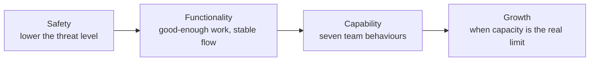

# 4. Building Cohesive Teams

[← 3. Navigating Chaos](03-navigating-chaos.md) · [Book](../README.md) · [5. Setting Direction →](05-setting-direction.md)

## Summary

Most leaders inherit a team under pressure, not a cohesive one, and chaos is very good at breaking teams. The chapter's roadmap is a sequence: first **safety** (lower the threat level), then **functionality** (understand the work, renegotiate inherited commitments, remove blockers, get capacity under control, address performance), then **capability** — seven observable team behaviours assessed with a team-level framework inspired by engineering ladders — and only then **growth**, when a capable team's capacity is the real limit. As the team grows you lead through leverage, make yourself replaceable and scale the culture deliberately (pp. 59–73).

## Key takeaways

- **Rebuild from the inside out:** safety, then functionality, then capabilities, and only then growth (p. 59).
- **Lower the threat level first.** Psychological safety, Project Aristotle's top factor in team effectiveness, means honesty without fear — not comfort or coddling (pp. 59–60).
- **Stabilize before you optimize:** get the team doing good-enough work; understand the actual work, not the roadmap (pp. 61–62).
- **Spend your trust credit** renegotiating inherited commitments early, with alternatives and data (pp. 62–63).
- **Small fixes build trust:** ask "What's slowing you down?" and fix something within a week (pp. 63–64).
- **All work is visible, all work is prioritized, we only work on what matters** — and route new requests through one intake (pp. 64–65).
- **Capable teams** turn ambiguity into action, communicate without being chased, manage dependencies, execute with discipline, see risk coming, invest in team health, and connect effort to outcomes (pp. 68–71).
- **Grow when you're ready, not just when you're allowed**; build a team that doesn't depend on you (pp. 71–73).

## Section outline

*From the book’s own table of contents (PDF bookmarks); printed page numbers.*

- It Starts with Safety — p. 59
- Get a Functional Team, Fast — p. 61
  - Understand the Work — p. 61
  - Renegotiate Commitments — p. 62
  - Remove Blockers — p. 63
  - Get Capacity Under Control — p. 64
  - Understand Skills, Dynamics, and Performance — p. 65
- Capacity Is Not Enough; Build Capabilities — p. 67
  - Capabilities as a Team-Level Tool — p. 67
  - What Great Teams Do — p. 68
- Growing Without Losing the Plot — p. 71
  - From Supporter to Supported — p. 72
  - You Make Yourself Replaceable — p. 72
  - You Scale the Culture, Too — p. 72
  - The Bottom Line — p. 73
- Conclusion: From Chaos to Cohesion — p. 73

## Notes

When Juan joined Splice as its first engineering leader, the company was about to raise a major round; inside there were 12 people — 5 engineers — fragile engineering fundamentals and no team structure: smart, exhausted individuals sprinting toward burnout. You don't fix that with process but by rebuilding the team from the inside out. If you're not new, pretend you are and look with fresh eyes (p. 59).

*The vault's summary of the chapter's sequence (p. 59).*

### It Starts with Safety

A new leader makes the room quieter: people edit themselves, wondering what you mean for them. That's survival instinct, and you can't drive change while the team feels threatened — **lower the threat level** first (pp. 59–60). Google's Project Aristotle found psychological safety, not intelligence, tenure or tooling, the number-one factor in team effectiveness; without it you get silence instead of feedback (p. 60).

> **In Practice: April's Story** (p. 60). In April's first PixelCurl meetings, cameras are off and "What have you been struggling with?" gets silence, then "Nothing that we can't handle." Next time she shares her own confused attempt to understand the deployment pipeline. A junior engineer types that two seniors each deploy differently and there are no docs — and the floodgates open.

Safety isn't comfort or coddling; it's honesty, courage and clarity without fear of punishment or humiliation. In practice: show up curious and calm, protect your team publicly, name the tension and uncertainty, normalize learning and failure, and listen more than you speak (p. 60).

### Get a Functional Team, Fast

On a struggling team the temptation is to go big — a bold direction, a new process, a culture fix — and trying to solve everything at once makes it worse. The first milestone: **get the team doing good work** — good enough to keep moving. Stabilization, not optimization; functionality first, cohesion and performance later (p. 61).

#### Understand the Work

Accounts from people pass through a human filter, so study the actual work — not the roadmap or strategy doc — by sitting in on standups, watching a deploy, or having someone walk you through their week (p. 61). If the work is viable and well scoped, look at the team; if it's unclear, with unrealistic expectations or constant pivots, the problem is in planning, dependencies or upstream leadership. There are two sides: "The team missed a deadline" versus "We were given a date without a chance to agree to it." A missed date is a symptom, not a diagnosis (pp. 61–62).

> **In Practice: April's Story** (p. 62). April reviews every ticket and watches a full deployment cycle. The roadmap shows rendering features, but **60% of engineering time** goes to sales-team requests for custom client integrations, handled as "quick favors" that take weeks. It isn't a team problem but a strategy problem no process improvement could fix.

#### Renegotiate Commitments

You inherit promises you didn't make — in backlogs, on a board slide, from people who've left. New leaders often protect them at the team's expense to look dependable. Don't. There's a window of **trust credit** when you start: you can ask hard questions, call out broken plans and pause work (p. 62). Be convincing, not just right: bring alternatives, data and a clear-eyed risk assessment; reset expectations early, before morale erodes (pp. 62–63). Ask: *Who made this commitment? Was the team involved? What would we actually need to deliver it? What does struggling quietly cost compared with renegotiating openly?* (p. 63)

#### Remove Blockers

Teams are rarely blocked by big strategic problems but by "100 small things" — a broken staging environment, a flaky deploy, a slow approval process — that are morale killers. Ask "What's slowing you down?" and act (p. 63). Small wins: fix a frustration within a week (or a day), remove a painful dependency, cancel a pointless meeting, correct a long-wrong tool permission, buy a cheap ($20/month) tool the team has needed. The size doesn't matter; the message does (pp. 63–64).

#### Get Capacity Under Control

Capacity isn't what's in the tracker. Untracked work eats it: a founder's "quick change," a product manager's "small tweak," another urgent issue, a curious detour into a new language. Ask "Where is the team's time going?" — to gather facts, not shame (p. 64). Then set a standard (p. 64):

- **All work is visible.**
- **All work is prioritized.**
- **We only work on what matters.**

Don't leave saying no to founders to individual contributors: give them language and permission, and tell other leaders that all new requests go through a shared intake process — then repeat it when people forget (pp. 64–65).

> **In Practice: April's Story** (p. 65). Founders message engineers directly about demo features; product managers reassign sprint work midweek. April routes all new requests through sprint planning and redirects a founder: added to the intake board for Monday, and if it's blocking, let's discuss trade-offs. The first weeks are uncomfortable; within a month the team's velocity increases.

A rigid intake is temporary; over time the team should own its priorities. And shift the balance: a team doing only unplanned, reactive work is maintaining, not building (p. 65).

#### Understand Skills, Dynamics, and Performance

Every team has a map of trust, influence, capability and tension that isn't the org chart. Talk to everyone and listen for who fills the gaps, who never asks for help, who's disengaged, who's stretched too thin. When you see a performance issue, don't wait: the team has noticed and is watching whether you will (pp. 65–66).

> **In Practice: April's Story** (p. 66). Marcus, a brilliant senior engineer, dismisses review feedback, won't pair with juniors and owns code only he understands. April tells him pairing twice a week and constructive reviews aren't optional. He tests her for three weeks; she holds firm. He stays, and six months later is one of the team's strongest mentors — and the juniors learn she means what she says.

You set the bar: if poor-quality work slips through, it becomes the standard (p. 66).

### Capacity Is Not Enough; Build Capabilities

A functional team is a win, not the goal. **Capability** lets a team take on harder problems without breaking: from "Can we deliver this sprint?" to "Can we consistently deliver value under pressure?" and "Can we improve how we operate, together?" (p. 67)

#### Capabilities as a Team-Level Tool

Inspired partly by Camille Fournier's post on engineering ladders, a **capability framework** does for teams what ladders do for individuals: defines what "better" looks like, for guidance rather than evaluation (p. 67). How it works (pp. 67–68):

1. **Define team capabilities** — a tight set of skills and behaviours (navigating ambiguity, sharing progress, managing dependencies).
2. **Assess team effectiveness** — self-assessment through structured conversation and partner input, not grades.
3. **Identify areas for improvement** — pick a few.
4. **Provide a path to grow** — examples of success and observable behaviours.

#### What Great Teams Do

Seven observable capabilities distinguish teams that deliver from teams that get stuck (pp. 68–71):

| Capability | Strong team | Weak team |
|---|---|---|
| **Turn ambiguity into action** | Asks focused questions: is "improve onboarding" about first-session drop-off or day-seven activation? Proposes direction | Spins for weeks building something "important-ish" |
| **Communicate relentlessly** | Shares status early, flags risks in standup, asks for help with context. Test: can an outsider explain what you're doing and why? | Goes silent for three weeks, then "actually, we're behind" — a trust issue |
| **Manage dependencies without drama** | Sees a dependency two weeks out, raises it in planning, derisks or rescopes; escalates for clarity, not blame | "We can't ship because Team X didn't deliver their API" |
| **Execute with discipline, not heroics** | "We're paced to 70% load and shipping every two weeks… let's discuss scope trade-offs" | "We need to double our headcount to hit our commitments" |
| **See risk coming** | Monitors flag an issue at 2:00 a.m.; on-call follows the runbook; fixed in 40 minutes, report by end of day | Learns of the outage from a customer's social media post |
| **Invest in team health** | Buddies and 90-day plans for new hires, revisited working agreements, regular recovery, permission to say "I'm at capacity" | Two weeks to run the app locally; normalized burnout; only loud voices heard |
| **Connect effort to outcomes** | "Onboarding improvements reduced drop-off by 12%, putting us ahead of our Q3 engagement goal" | "We shipped five features this sprint" |

You don't need all seven on day one: assess, pick one or two, and build (p. 71).

> **Try it:** [Team capability check](../widgets/04-team-capabilities.html) — rate a team on the book's seven capabilities using its own strong and weak examples, and see which one or two to work on first.

### Growing Without Losing the Plot

**Once a well-run team's capacity is the limiting factor, you've earned the right to grow** — not because of chaos or someone asking for more hands. Adding people doesn't automatically increase velocity; new teammates should broaden strengths. A healthy team can develop people earlier in their careers, and seniors grow by mentoring them (pp. 71–72).

| Shift | What changes (pp. 72–73) |
|---|---|
| **From supporter to supported** | From leading by proximity to leading through leverage: systems that support the work, people who carry the standard, trust earned and extended. You can't lead 5 and 20 people the same way |
| **You make yourself replaceable** | If your absence breaks the system, you've built dependency, not a system. Tech leads shape strategy, ICs mentor, people fill gaps |
| **You scale the culture, too** | At 10 people culture spreads by presence; at 50 it fragments. Evolve team agreements, explain the "why" in onboarding, keep decision stories and written norms, keep values visible |

**The bottom line:** grow when you're ready, not just when you're allowed; hire for fresh energy, not just capacity; build a team that can operate and decide without you (p. 73).

### Conclusion: From Chaos to Cohesion

The hardest part is creating conditions for people to succeed together: functional before fast, capable before big, trustworthy before impressive (p. 73).

## Trade-offs at a glance

| Choice | Buys | Costs |
|---|---|---|
| Going big on day one | Looks decisive | Usually makes things worse |
| Stabilizing first | A win and a breather | Optimization waits |
| Protecting inherited commitments | Looks dependable | The team pays; illusion of progress |
| Renegotiating early | Real momentum; trust | Uses trust credit; needs data and alternatives |
| Strict intake process | Visible, prioritized work; focus | Uncomfortable for founders; temporary scaffolding |
| Confronting a brilliant isolate | Team health; a credible bar | A few weeks of pushback; risk they leave |
| Growing headcount early | More hands | Velocity doesn't scale; culture fragments |
| Making yourself replaceable | Sustainable team; room to look ahead | Letting go of control |

## Beyond the book

- **Psychological safety** as a team property was defined by Amy Edmondson (1999); Google's Project Aristotle (published 2015–2016) popularized it, as the book's footnote notes (p. 60).
- **Engineering ladders.** The book credits Camille Fournier's post on engineering ladders as inspiration for team capabilities (p. 67); her *The Manager's Path* discusses writing a career ladder in [Chapter 9](../../the-managers-path/chapters/09-bootstrapping-culture.md).
- **Brooks's law** — adding people to a late project makes it later (*The Mythical Man-Month*, 1975) — is the classic statement of the book's point that headcount doesn't automatically raise velocity (p. 71).

## Connections

- **Related chapters:** [3. Navigating Chaos](03-navigating-chaos.md) (the four lenses applied here), [2. Understanding Your Role](02-understanding-your-role.md) (the people pillar), [6. Shipping Products and Code](06-shipping-products-and-code-in-chaotic-environments.md) (balancing planned and unplanned work), [9. Collaborative Technical Practices](09-collaborative-technical-practices-and-decision-making.md) (psychological safety in decisions).

## Check yourself

*Questions and answers are the vault's, written from the notes above; answers cite the book's printed pages.*

1. **In what order does the chapter rebuild a team?**

   *Answer:* Psychological safety, then functionality, then capabilities, and only then growth (p. 59).

2. **What does the book say safety is *not*?**
   - [ ] Speaking up without fear
   - [x] Comfort or coddling
   - [ ] Normalizing failure

   *Answer:* It means operating with honesty, courage and clarity without fear of punishment or humiliation (p. 60).

3. **Why study the actual work rather than the roadmap?**

   *Answer:* People's accounts pass through a human filter and the roadmap can be fiction — April found 60% of time going to untracked sales favors, a strategy problem rather than a team problem (pp. 61–62).

4. **What is "trust credit," and how should you use it?**

   *Answer:* The early window when people hope you'll turn things around; use it to renegotiate inherited, unrealistic commitments early, with alternatives, data and a risk assessment (pp. 62–63).

5. **State the three-part standard for capacity.**

   *Answer:* All work is visible; all work is prioritized; we only work on what matters (p. 64).

6. **"We need to double our headcount to hit our commitments" signals a gap in which capability?**
   - [ ] Managing dependencies
   - [x] Executing with discipline, not heroics
   - [ ] Seeing risk coming

   *Answer:* A disciplined team knows its pace and discusses scope trade-offs (pp. 69–70).

7. **When has a team earned the right to grow?**

   *Answer:* When it is focused, capable and delivering, and its capacity has become the real limiting factor (p. 71).
