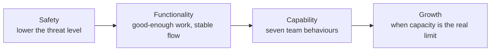

# فصل ۴: ساختن تیم‌های منسجم

[فصل ۳: راه بردن در آشوب →](03-navigating-chaos.md) · [کتاب](../README.md) · [فصل ۵: تعیین جهت ←](05-setting-direction.md)

## خلاصه

بیشتر رهبرها تیمی زیر فشار به ارث می‌برند، نه تیمی منسجم، و آشوب در شکستن تیم‌ها خیلی خوب است. نقشه‌ی راه این فصل یک ترتیب است: اول **امنیت**، یعنی پایین آوردن سطح تهدید؛ بعد **کارکرد**، یعنی فهمیدن خود کار و مذاکره‌ی دوباره بر سر تعهدهای به‌ارث‌رسیده و برداشتن سدها و مهار کردن ظرفیت و رسیدگی به عملکرد؛ بعد **توانمندی**، یعنی هفت رفتار قابل‌مشاهده‌ی تیمی که با چارچوبی در سطح تیم سنجیده می‌شوند و از نردبان‌های مهندسی الهام گرفته‌اند؛ و تازه بعد از آن **رشد**، وقتی ظرفیتِ تیمی توانمند واقعاً محدودکننده شده باشد. با بزرگ شدن تیم، از راه اهرم رهبری می‌کنید، خودتان را جایگزین‌پذیر می‌کنید و فرهنگ را عامدانه مقیاس می‌دهید (pp. 59–73).

## نکته‌های کلیدی

- **از درون به بیرون بازسازی کنید:** امنیت، بعد کارکرد، بعد توانمندی، و تازه بعد رشد (p. 59).
- **اول سطح تهدید را پایین بیاورید.** امنیت روانی، که در پژوهش Project Aristotle مهم‌ترین عامل اثربخشی تیم بود، یعنی صداقت بدون ترس، نه راحتی و نه لوس کردن (pp. 59–60).
- **پیش از بهینه کردن، تثبیت کنید:** کاری کنید تیم کار به‌اندازه‌ی کافی خوب تحویل بدهد؛ خود کار را بفهمید، نه نقشه‌ی راه را (pp. 61–62).
- **اعتبار اعتمادتان را خرج کنید** و زود سر تعهدهای به‌ارث‌رسیده دوباره مذاکره کنید، با گزینه‌های جایگزین و داده (pp. 62–63).
- **رفع‌های کوچک اعتماد می‌سازند:** بپرسید «چه چیزی کندتان می‌کند؟» و ظرف یک هفته چیزی را درست کنید (pp. 63–64).
- **همه‌ی کار دیدنی است، همه‌ی کار اولویت‌بندی شده، و فقط روی چیزی کار می‌کنیم که مهم است**، و درخواست‌های تازه از یک ورودی مشترک می‌گذرند (pp. 64–65).
- **تیم‌های توانمند** ابهام را به عمل تبدیل می‌کنند، بدون این‌که دنبالشان بدوید گزارش می‌دهند، وابستگی‌ها را مدیریت می‌کنند، با انضباط اجرا می‌کنند، ریسک را از دور می‌بینند، روی سلامت تیم سرمایه‌گذاری می‌کنند، و تلاش را به نتیجه وصل می‌کنند (pp. 68–71).
- **وقتی آماده‌اید بزرگ شوید، نه وقتی فقط اجازه دارید**؛ و تیمی بسازید که به شما وابسته نباشد (pp. 71–73).

## فهرست بخش‌ها

*از فهرست مطالب خود کتاب، از bookmarkهای PDF؛ شماره‌ها صفحه‌ی چاپی‌اند.*

- از امنیت شروع می‌شود — p. 59
- سریع به تیمی کارآمد برسید — p. 61
  - کار را بفهمید — p. 61
  - سر تعهدها دوباره مذاکره کنید — p. 62
  - سدها را بردارید — p. 63
  - ظرفیت را مهار کنید — p. 64
  - مهارت‌ها و پویایی‌ها و عملکرد را بفهمید — p. 65
- ظرفیت کافی نیست؛ توانمندی بسازید — p. 67
  - توانمندی به‌عنوان ابزاری در سطح تیم — p. 67
  - تیم‌های درخشان چه می‌کنند — p. 68
- بزرگ شدن بدون گم کردن رشته — p. 71
  - از پشتیبان بودن تا پشتیبانی‌شدن — p. 72
  - خودتان را جایگزین‌پذیر می‌کنید — p. 72
  - فرهنگ را هم مقیاس می‌دهید — p. 72
  - خط آخر — p. 73
- جمع‌بندی: از آشوب تا انسجام — p. 73

## یادداشت‌ها

وقتی Juan به‌عنوان اولین رهبر مهندسی به Splice پیوست، شرکت در آستانه‌ی جذب سرمایه‌ی بزرگی بود؛ داخلش ۱۲ نفر بودند که ۵ تایشان مهندس بودند، مبانی مهندسی شکننده بود و ساختار تیمی وجود نداشت: آدم‌های باهوش و خسته‌ای که به سمت فرسودگی می‌دویدند. این را با process درست نمی‌کنید، با بازسازی تیم از درون به بیرون درست می‌کنید. اگر تازه‌وارد نیستید، وانمود کنید که هستید و با چشم تازه نگاه کنید (p. 59).

*جمع‌بندی vault از ترتیب این فصل (p. 59).*

### از امنیت شروع می‌شود

رهبر تازه اتاق را ساکت‌تر می‌کند: آدم‌ها حرفشان را سانسور می‌کنند و از خودشان می‌پرسند شما برایشان چه معنایی دارید. این غریزه‌ی بقاست، و تا وقتی تیم حس تهدید می‌کند نمی‌توانید تغییر را جلو ببرید؛ اول **سطح تهدید را پایین بیاورید** (pp. 59–60). پژوهش Project Aristotle در Google نشان داد امنیت روانی، و نه هوش و سابقه و ابزار، عامل شماره‌ی یک اثربخشی تیم است؛ بدون آن به‌جای بازخورد سکوت می‌گیرید (p. 60).

> **کادر In Practice: داستان April** (p. 60). در اولین جلسه‌های April در PixelCurl دوربین‌ها خاموش‌اند و پرسش «با چه چیزی دست‌وپنجه نرم می‌کنید؟» سکوت می‌گیرد و بعد «چیزی که از پسش برنیاییم نیست». دفعه‌ی بعد خودش از تلاش گیج‌کننده‌اش برای فهمیدن pipeline انتشار می‌گوید. یک مهندس تازه‌کار می‌نویسد که دو آدم ارشد هر کدام جور دیگری deploy می‌کنند و مستندی هم نیست، و سیل راه می‌افتد.

امنیت یعنی راحتی و لوس کردن نیست؛ یعنی صداقت و شجاعت و روشنی بدون ترس از تنبیه یا تحقیر. در عمل: کنجکاو و آرام ظاهر شوید، جلوی دیگران از تیمتان دفاع کنید، تنش و بلاتکلیفی را به زبان بیاورید، یادگیری و شکست را عادی کنید، و بیش از آن‌که حرف بزنید گوش بدهید (p. 60).

> **In practice:** blameless incident review مهم‌ترین ابزار امنیت روانی در تیم داده است.
>
> **Your turn:** یک نفر با یک `DROP` اشتباه جدول Silver را پاک کرد. review را چطور اداره می‌کنید؟
>
> *Answer:* پرسش این است که چرا سیستم اجازه داد، نه چه کسی: چرا دسترسی `DROP` روی production بود و چرا restore از Bronze دستی بود. اگر تیم حس تهدید کند، خطای بعدی پنهان می‌شود؛ کتاب امنیت را پیش‌شرط هر چیز دیگری می‌داند (pp. 59–60).

### سریع به تیمی کارآمد برسید

در تیمی که به زحمت افتاده وسوسه این است که بزرگ عمل کنید، یعنی جهتی جسورانه و processی تازه و اصلاح فرهنگ، و تلاش برای حل یک‌دفعه‌ی همه چیز اوضاع را بدتر می‌کند. اولین milestone: **کاری کنید تیم کار خوب تحویل بدهد**، آن‌قدر خوب که در حرکت بماند. تثبیت، نه بهینه‌سازی؛ اول کارکرد و بعد انسجام و عملکرد (p. 61).

#### کار را بفهمید

روایت آدم‌ها از فیلتر انسانی رد می‌شود، پس خود کار را بررسی کنید، نه نقشه‌ی راه یا سند استراتژی را، یعنی در standup بنشینید، یک deploy را تماشا کنید، یا از کسی بخواهید هفته‌اش را برایتان مرور کند (p. 61). اگر کار شدنی و خوب دامنه‌بندی‌شده است، به تیم نگاه کنید؛ و اگر مبهم است، با انتظارهای غیرواقعی یا چرخش‌های دائمی، مسئله در برنامه‌ریزی یا وابستگی‌ها یا رهبری بالادست است. دو روایت هست: «تیم از ضرب‌الاجل جا ماند» در برابر «تاریخی به ما دادند بی‌آن‌که فرصت موافقت داشته باشیم». تاریخ از‌دست‌رفته نشانه است، نه تشخیص (pp. 61–62).

> **کادر In Practice: داستان April** (p. 62). او همه‌ی ticketها را مرور می‌کند و یک چرخه‌ی کامل deployment را تماشا می‌کند. نقشه‌ی راه featureهای rendering را نشان می‌دهد، ولی **۶۰٪ وقت مهندسی** صرف درخواست‌های تیم فروش برای یکپارچه‌سازی سفارشی مشتری‌ها می‌شود، که به‌عنوان «لطف‌های سریع» برداشته می‌شوند و هفته‌ها طول می‌کشند. این مسئله‌ی تیم نیست، مسئله‌ی استراتژی است که هیچ بهبود processی درستش نمی‌کرد.

#### سر تعهدها دوباره مذاکره کنید

قول‌هایی را به ارث می‌برید که خودتان نداده‌اید؛ در backlogها، روی یک اسلاید هیئت‌مدیره، از آدم‌هایی که رفته‌اند. رهبرهای تازه اغلب به قیمت تیم از آن‌ها محافظت می‌کنند تا قابل‌اتکا به نظر برسند. این کار را نکنید. وقتی تازه شروع می‌کنید پنجره‌ای از **اعتبار اعتماد** دارید: می‌توانید پرسش‌های سخت بپرسید، برنامه‌های شکسته را نام ببرید و کار را متوقف کنید (p. 62). فقط درست نگویید، قانع‌کننده هم باشید: گزینه‌ی جایگزین و داده و ارزیابی روشن ریسک بیاورید؛ و انتظارها را زود بازتنظیم کنید، پیش از آن‌که روحیه فرسوده شود (pp. 62–63). بپرسید: *این تعهد را چه کسی داد؟ تیم در آن دخیل بود؟ برای تحویلش واقعاً به چه نیاز داریم؟ کلنجار بی‌صدا در برابر مذاکره‌ی علنی چقدر هزینه دارد؟* (p. 63)

#### سدها را بردارید

تیم‌ها به‌ندرت پشت مسئله‌های بزرگ راهبردی گیر می‌کنند، بلکه پشت «۱۰۰ چیز کوچک» گیر می‌افتند، مثل محیط staging خراب و deploy نامطمئن و process تأیید کند، که قاتل روحیه‌اند. بپرسید «چه چیزی کندتان می‌کند؟» و عمل کنید (p. 63). بردهای کوچک: یک دلخوری را ظرف یک هفته یا یک روز درست کنید، یک وابستگی دردناک را بردارید، جلسه‌ای بی‌فایده را لغو کنید، دسترسی ابزاری را که مدت‌ها غلط بوده اصلاح کنید، یا ابزار ارزانی را، مثلاً ماهی ۲۰ دلار، بخرید که تیم لازمش دارد. اندازه مهم نیست؛ پیامش مهم است (pp. 63–64).

#### ظرفیت را مهار کنید

ظرفیت آن چیزی نیست که در ابزار پیگیری است. کار ثبت‌نشده می‌خوردش: «تغییر سریع» یک بنیان‌گذار، «اصلاح کوچک» یک product manager، یک مسئله‌ی فوری دیگر، یا یک انحراف کنجکاوانه به زبانی تازه. بپرسید «وقت تیم کجا می‌رود؟» تا واقعیت‌ها را جمع کنید، نه برای شرمنده کردن (p. 64). بعد استانداردی بگذارید (p. 64):

- **همه‌ی کار دیدنی است.**
- **همه‌ی کار اولویت‌بندی شده است.**
- **فقط روی چیزی کار می‌کنیم که مهم است.**

نه گفتن به بنیان‌گذارها را به individual contributorها نسپارید: به آن‌ها هم زبانش را بدهید و هم اجازه‌اش را، و به رهبرهای دیگر بگویید همه‌ی درخواست‌های تازه از یک process ورودی مشترک رد می‌شوند، و هر وقت یادشان رفت دوباره بگوییدش (pp. 64–65).

> **کادر In Practice: داستان April** (p. 65). بنیان‌گذارها مستقیم به مهندس‌ها درباره‌ی featureهای دمو پیام می‌دهند و product managerها وسط هفته کار sprint را دوباره تخصیص می‌دهند. April همه‌ی درخواست‌های تازه را به برنامه‌ریزی sprint می‌برد و به یک بنیان‌گذار می‌گوید: روی تخته‌ی ورودی برای دوشنبه اضافه شد، و اگر سد راه است بیایید درباره‌ی معامله‌هایش حرف بزنیم. هفته‌های اول معذب‌کننده است؛ ظرف یک ماه velocity تیم بالا می‌رود.

ورودیِ خشک موقتی است؛ به‌مرور خود تیم باید صاحب اولویت‌هایش شود. و تعادل را جابه‌جا کنید: تیمی که فقط کار برنامه‌ریزی‌نشده و واکنشی می‌کند دارد نگه می‌دارد، نه می‌سازد (p. 65).

#### مهارت‌ها و پویایی‌ها و عملکرد را بفهمید

هر تیم نقشه‌ای از اعتماد و نفوذ و توانمندی و تنش دارد که با چارت سازمانی یکی نیست. با همه حرف بزنید و گوش بدهید ببینید چه کسی شکاف‌ها را پر می‌کند، چه کسی هیچ‌وقت کمک نمی‌خواهد، چه کسی بی‌انگیزه شده و چه کسی بیش از حد کشیده شده. وقتی مسئله‌ی عملکردی دیدید منتظر نمانید: تیم دیده و دارد می‌بیند شما چه می‌کنید (pp. 65–66).

> **کادر In Practice: داستان April** (p. 66). مهندس ارشد درخشانی به نام Marcus بازخورد review را پس می‌زند، با تازه‌کارها pair نمی‌کند و صاحب کدی است که فقط خودش می‌فهمدش. April به او می‌گوید هفته‌ای دو بار pair کردن و review سازنده اختیاری نیست. سه هفته او را می‌آزماید؛ April کوتاه نمی‌آید. Marcus می‌ماند و شش ماه بعد یکی از قوی‌ترین منتورهای تیم است، و تازه‌کارها یاد می‌گیرند که April پای حرفش می‌ایستد.

سطح را شما تعیین می‌کنید: اگر کار بی‌کیفیت رد شود، همان استاندارد می‌شود (p. 66).

### ظرفیت کافی نیست؛ توانمندی بسازید

تیم کارآمد یک برد است، نه هدف. **توانمندی** است که به تیم اجازه می‌دهد مسئله‌های سخت‌تر بردارد بی‌آن‌که بشکند: از «می‌توانیم این sprint را تحویل بدهیم؟» به «می‌توانیم زیر فشار پیوسته ارزش تحویل بدهیم؟» و «می‌توانیم با هم شیوه‌ی کارمان را بهتر کنیم؟» (p. 67)

#### توانمندی به‌عنوان ابزاری در سطح تیم

با الهام از یادداشت Camille Fournier درباره‌ی نردبان‌های مهندسی، **چارچوب توانمندی** برای تیم همان کاری را می‌کند که نردبان برای فرد: تعریف می‌کند «بهتر» چه شکلی است، برای راهنمایی نه ارزیابی (p. 67). چطور کار می‌کند (pp. 67–68):

۱. **توانمندی‌های تیم را تعریف کنید**، یعنی مجموعه‌ای فشرده از مهارت‌ها و رفتارها، مثل راه بردن در ابهام و گزارش پیشرفت و مدیریت وابستگی‌ها.
۲. **اثربخشی تیم را بسنجید** با خودارزیابی در قالب گفت‌وگوی ساختارمند و نظر شریک‌ها، نه با نمره.
۳. **حوزه‌های بهبود را مشخص کنید** و چندتا را انتخاب کنید.
۴. **مسیری برای رشد بدهید**، با نمونه‌های موفقیت و رفتارهای قابل‌مشاهده.

#### تیم‌های درخشان چه می‌کنند

هفت توانمندی قابل‌مشاهده، تیم‌هایی را که تحویل می‌دهند از تیم‌هایی که گیر می‌کنند جدا می‌کنند (pp. 68–71):

| توانمندی | تیم قوی | تیم ضعیف |
|---|---|---|
| **تبدیل ابهام به عمل** | پرسش‌های متمرکز می‌پرسد: «بهتر کردن onboarding» درباره‌ی ریزش در اولین session است یا فعال‌سازی روز هفتم؟ و جهت پیشنهاد می‌دهد | هفته‌ها می‌چرخد و چیزی «تقریباً مهم» می‌سازد |
| **ارتباط بی‌وقفه** | وضعیت را زود می‌گوید، ریسک را در standup علامت می‌زند، و با زمینه کمک می‌خواهد. آزمونش: یک نفر بیرونی می‌تواند بگوید دارید چه می‌کنید و چرا؟ | سه هفته ساکت می‌ماند و بعد «راستش، عقبیم»؛ که مسئله‌ی اعتماد است |
| **مدیریت وابستگی بدون درام** | وابستگی را دو هفته جلوتر می‌بیند، در برنامه‌ریزی مطرحش می‌کند و ریسکش را کم می‌کند یا دامنه را عوض؛ و برای روشن شدن ارجاع می‌دهد، نه برای سرزنش | «نمی‌توانیم تحویل بدهیم چون تیم X آن API را نداد» |
| **اجرا با انضباط، نه قهرمان‌بازی** | «با ۷۰٪ بار پیش می‌رویم و هر دو هفته تحویل می‌دهیم… بیایید درباره‌ی معامله‌های دامنه حرف بزنیم» | «باید تعداد نیرو را دو برابر کنیم تا به تعهدهایمان برسیم» |
| **دیدن ریسک از دور** | ساعت ۲ بامداد سیستم monitoring مسئله‌ای را علامت می‌زند؛ شیفت on-call از runbook پیروی می‌کند؛ ۴۰ دقیقه‌ای رفع می‌شود و تا پایان روز گزارشش می‌آید | قطعی را از پست شبکه‌ی اجتماعی یک مشتری می‌فهمد |
| **سرمایه‌گذاری روی سلامت تیم** | برای تازه‌واردها همراه و برنامه‌ی ۹۰ روزه دارد، توافق‌های کاری را بازبینی می‌کند، بازیابی منظم دارد و اجازه می‌دهد کسی بگوید «ظرفیتم پر است» | دو هفته طول می‌کشد تا اپلیکیشن روی لپ‌تاپ بالا بیاید؛ فرسودگی عادی است؛ و فقط صدای بلندها شنیده می‌شود |
| **وصل کردن تلاش به نتیجه** | «بهبود onboarding ریزش را ۱۲٪ کم کرد و ما را از هدف درگیری سه‌ماهه‌ی سوم جلو انداخت» | «این sprint پنج feature تحویل دادیم» |

لازم نیست از روز اول هر هفت‌تا را داشته باشید: بسنجید، یکی دوتا را بردارید و بسازید (p. 71).

> **Try it:** [سنجش توانمندی تیم](../widgets/04-team-capabilities.html)؛ یک تیم را روی هفت توانمندی کتاب و با نمونه‌های قوی و ضعیف خودش امتیاز بدهید و ببینید اول روی کدام یکی دوتا کار کنید.

> **In practice:** تیمی که فقط یک نفر می‌تواند ClickHouse یا Argo CD را debug کند ظرفیت دارد ولی توانمندی ندارد.
>
> **Your turn:** چطور bus factor را در دانش platform بالا می‌برید؟
>
> *Answer:* on-call چرخشی همراه با runbook، pair کردن در incidentها، و merge requestهایی که نفر دوم بازبینی می‌کند. کتاب توانمندی را توان برداشتن مسئله‌های سخت‌تر بی‌شکستن تیم می‌داند (pp. 67–70).

### بزرگ شدن بدون گم کردن رشته

**وقتی ظرفیتِ تیمی خوش‌گردان محدودکننده شد، حق بزرگ شدن را به دست آورده‌اید**، نه به‌خاطر آشوب یا به‌خاطر این‌که کسی دست بیشتری خواسته. اضافه کردن آدم خودبه‌خود velocity را بالا نمی‌برد؛ هم‌تیمی تازه باید نقاط قوت را گسترده‌تر کند. تیم سالم می‌تواند آدم‌های اول مسیر را بپروراند، و آدم‌های ارشد با منتور شدنشان رشد می‌کنند (pp. 71–72).

| جابه‌جایی | چه چیزی عوض می‌شود (pp. 72–73) |
|---|---|
| **از پشتیبان بودن تا پشتیبانی‌شدن** | از رهبری با نزدیکی به رهبری با اهرم: سیستم‌هایی که از کار پشتیبانی می‌کنند، آدم‌هایی که استاندارد را حمل می‌کنند، و اعتمادی که به دست آمده و گسترده شده. ۵ نفر و ۲۰ نفر را نمی‌شود یک‌جور رهبری کرد |
| **خودتان را جایگزین‌پذیر می‌کنید** | اگر نبودتان سیستم را بشکند، وابستگی ساخته‌اید نه سیستم. tech leadها به استراتژی شکل می‌دهند، individual contributorها منتور می‌شوند، و آدم‌ها شکاف‌ها را پر می‌کنند |
| **فرهنگ را هم مقیاس می‌دهید** | در ۱۰ نفر فرهنگ با حضور پخش می‌شود؛ در ۵۰ نفر تکه‌تکه می‌شود. توافق‌های تیمی را تکامل بدهید، «چرا» را در onboarding توضیح بدهید، داستان تصمیم‌ها و قاعده‌های نوشته را نگه دارید، و ارزش‌ها را دیدنی نگه دارید |

**خط آخر:** وقتی آماده‌اید بزرگ شوید، نه وقتی فقط اجازه دارید؛ برای انرژی تازه استخدام کنید، نه فقط برای ظرفیت؛ و تیمی بسازید که بتواند بدون شما بچرخد و تصمیم بگیرد (p. 73).

### جمع‌بندی: از آشوب تا انسجام

سخت‌ترین بخش ساختن شرایطی است که آدم‌ها در آن با هم موفق شوند: اول کارآمد و بعد سریع، اول توانمند و بعد بزرگ، اول قابل‌اعتماد و بعد چشمگیر (p. 73).

## بده‌بستان‌ها در یک نگاه

| انتخاب | چه می‌دهد | چه می‌گیرد |
|---|---|---|
| بزرگ عمل کردن از روز اول | قاطع به نظر می‌رسد | معمولاً اوضاع را بدتر می‌کند |
| اول تثبیت کردن | یک برد و یک نفس تازه | بهینه‌سازی صبر می‌کند |
| محافظت از تعهدهای به‌ارث‌رسیده | قابل‌اتکا به نظر می‌رسید | تیم تاوانش را می‌دهد؛ توهم پیشرفت |
| مذاکره‌ی زودهنگام | شتاب واقعی؛ اعتماد | اعتبار اعتماد را خرج می‌کند؛ داده و جایگزین می‌خواهد |
| process ورودیِ سخت‌گیر | کار دیدنی و اولویت‌بندی‌شده؛ تمرکز | برای بنیان‌گذارها معذب‌کننده است؛ داربستی موقتی است |
| رویارویی با نابغه‌ی گوشه‌گیر | سلامت تیم؛ سطحی باورپذیر | چند هفته پس زدن؛ خطر رفتنش |
| بزرگ کردن زودهنگام تیم | دست بیشتر | velocity مقیاس نمی‌گیرد؛ فرهنگ تکه‌تکه می‌شود |
| جایگزین‌پذیر کردن خودتان | تیم پایدار؛ فرصت نگاه به جلو | باید کنترل را رها کنید |

## فراتر از کتاب

- **امنیت روانی** به‌عنوان ویژگی تیم را Amy Edmondson در سال ۱۹۹۹ تعریف کرد؛ پژوهش Project Aristotle در Google که در سال‌های ۲۰۱۵ و ۲۰۱۶ منتشر شد همه‌گیرش کرد، همان‌طور که پانویس کتاب می‌گوید (p. 60).
- **نردبان‌های مهندسی.** کتاب یادداشت Camille Fournier درباره‌ی نردبان‌های مهندسی را الهام‌بخش توانمندی‌های تیمی می‌داند (p. 67)؛ کتاب او *The Manager's Path* در [فصل ۹](../../the-managers-path/chapters/09-bootstrapping-culture.md) درباره‌ی نوشتن نردبان شغلی حرف می‌زند.
- **قانون Brooks**، یعنی اضافه کردن آدم به پروژه‌ای که عقب است عقب‌ترش می‌کند، در *The Mythical Man-Month* سال ۱۹۷۵، بیان کلاسیک همان نکته‌ی کتاب است که تعداد نیرو خودبه‌خود velocity را بالا نمی‌برد (p. 71).

## پیوندها

- **فصل‌های مرتبط:** [فصل ۳: راه بردن در آشوب](03-navigating-chaos.md) که چهار عدسیِ به‌کاررفته این‌جا را می‌گوید، [فصل ۲: فهمیدن نقشتان](02-understanding-your-role.md) که ستون آدم‌ها را دارد، [فصل ۶: تحویل محصول و کد](06-shipping-products-and-code-in-chaotic-environments.md) که تعادل کار برنامه‌ریزی‌شده و نشده را می‌گوید، و [فصل ۹: کارهای فنی مشارکتی](09-collaborative-technical-practices-and-decision-making.md) که امنیت روانی در تصمیم‌ها را دارد.

## خودتان را بسنجید

*پرسش‌ها و پاسخ‌ها مال vault است و از روی یادداشت‌های بالا نوشته شده؛ پاسخ‌ها به صفحه‌ی چاپی کتاب ارجاع می‌دهند.*

1. **این فصل تیم را با چه ترتیبی بازسازی می‌کند؟**

   *Answer:* امنیت روانی، بعد کارکرد، بعد توانمندی، و تازه بعد رشد (p. 59).

2. **کتاب می‌گوید امنیت چه *نیست*؟**
   - [ ] حرف زدن بدون ترس
   - [x] راحتی یا لوس کردن
   - [ ] عادی کردن شکست

   *Answer:* یعنی کار کردن با صداقت و شجاعت و روشنی، بدون ترس از تنبیه یا تحقیر (p. 60).

3. **چرا به‌جای نقشه‌ی راه، خود کار را بررسی کنیم؟**

   *Answer:* روایت آدم‌ها از فیلتر انسانی رد می‌شود و نقشه‌ی راه می‌تواند داستان باشد؛ April دید ۶۰٪ وقت صرف لطف‌های ثبت‌نشده به فروش می‌شود، که مسئله‌ی استراتژی بود نه تیم (pp. 61–62).

4. **«اعتبار اعتماد» چیست و چطور باید خرجش کرد؟**

   *Answer:* همان پنجره‌ی اول کار که آدم‌ها امید دارند اوضاع را برگردانید؛ خرجش کنید تا زود سر تعهدهای به‌ارث‌رسیده و غیرواقعی دوباره مذاکره کنید، با گزینه‌ی جایگزین و داده و ارزیابی ریسک (pp. 62–63).

5. **استاندارد سه‌بخشی ظرفیت را بگویید.**

   *Answer:* همه‌ی کار دیدنی است؛ همه‌ی کار اولویت‌بندی شده است؛ فقط روی چیزی کار می‌کنیم که مهم است (p. 64).

6. **جمله‌ی «باید تعداد نیرو را دو برابر کنیم تا به تعهدهایمان برسیم» نشانه‌ی کمبود کدام توانمندی است؟**
   - [ ] مدیریت وابستگی‌ها
   - [x] اجرا با انضباط، نه قهرمان‌بازی
   - [ ] دیدن ریسک از دور

   *Answer:* تیم بانضباط سرعتش را می‌شناسد و درباره‌ی معامله‌های دامنه حرف می‌زند (pp. 69–70).

7. **تیم کِی حق بزرگ شدن را به دست آورده؟**

   *Answer:* وقتی متمرکز و توانمند است و تحویل می‌دهد، و ظرفیتش واقعاً به عامل محدودکننده تبدیل شده (p. 71).
