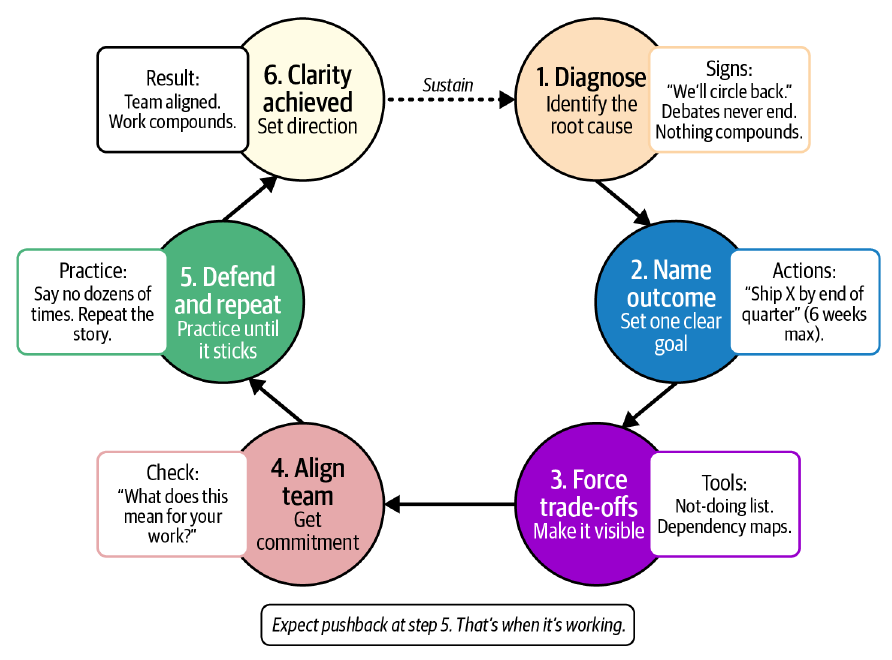

# فصل ۵: تعیین جهت

[فصل ۴: ساختن تیم‌های منسجم →](04-building-cohesive-teams.md) · [کتاب](../README.md) · [فصل ۶: تحویل محصول و کد ←](06-shipping-products-and-code-in-chaotic-environments.md)

## خلاصه

رهبرها به‌ندرت کار کم به ارث می‌برند؛ دیواری از اولویت‌های «حیاتی» به ارث می‌برند. داستان مرکزی این فصل تیم Juan در Stripe برای منطقه‌ی آمریکای لاتین است: ۳۰ اولویت رقیب، تیمی که به همه چیز بله می‌گفت، و یک نشست رهبری مجازی در سال ۲۰۲۰ که آن‌ها را به شش رساند، یعنی دوتا برای هر تیم، و بعد از آن کار روی هم جمع شدن گرفت. نویسنده‌ها حالت جایگزین را **رانش** می‌نامند: حرکت بدون معنا، که از بیرون شلوغ به نظر می‌رسد و در خلوت تیم را تهی می‌کند. آن‌ها یک ابزار تشخیص رانش می‌دهند (جدول ۵-۱)، دام‌هایی که به آن می‌انجامند، نقش رهبر به‌عنوان «فانوس دریایی»، رویه‌هایی برای هم‌راستایی که تعهد است نه توافق، و شیوه‌ی عوض کردن برنامه بدون پاره کردن روایت. جمله‌ی تکرارشونده: روشنی کار اضافه نیست؛ روشنی خودِ کار است (pp. 75–92).

## نکته‌های کلیدی

- **از بیرون، آشوب شبیه شتاب است؛ از درون حس رانش دارد**، و رانش جاه‌طلبی را در همه‌ی سطح‌ها می‌خورد (p. 75).
- **رانش با طفره رفتن شروع می‌شود** و در زبان پیدا می‌شود: «بیایید روی این هم‌راستا شویم»، «بعداً برمی‌گردیم سراغش» (p. 76).
- **دو نشانه یا بیشتر در ابزار تشخیص رانش** یعنی تیم تمرکزش را از دست داده؛ یک اقدام فوری برای همین هفته بردارید (pp. 77–78).
- **جهت خوب یعنی تمرکز به‌علاوه‌ی شتاب**: تیم Stripe در آمریکای لاتین روی OXXO در مکزیک و Boleto در برزیل متمرکز شد و همان آدم‌ها پیشرفتشان روی هم جمع شدن گرفت (pp. 79–81).
- **دام‌ها:** نبود ورودی روشن، ورودی بیش از حد، رهبری مردد، نقشه‌ی راه واکنشی، و دام اجماع (pp. 81–83).
- **فانوس دریایی باشید:** یک نتیجه، افقی کوتاه، فهرست دیدنیِ کارهایی که نمی‌کنید، و جمله‌ی «ما X را می‌کنیم تا به Y برسیم» (pp. 83–84).
- **هم‌راستایی توافق نیست**؛ مخالفت کنید و بعد متعهد شوید؛ وارسی تعهد بگیرید و سیاست‌بازی راهرویی را تمام کنید (pp. 84–87).
- **برنامه‌ها عوض می‌شوند؛ روایت دست‌نخورده می‌ماند.** وقتی از تکرار خودتان خسته شده‌اید، تیمتان تازه دارد باورتان می‌کند (pp. 87–92).

## فهرست بخش‌ها

*از فهرست مطالب خود کتاب، از bookmarkهای PDF؛ شماره‌ها صفحه‌ی چاپی‌اند.*

- چه چیزی رانش می‌سازد — p. 76
  - ابزار تشخیص رانش — p. 77
- هزینه‌ی خاموش رانش — p. 78
- جهت خوب چه شکلی است — p. 79
- دام‌هایی که رانش می‌سازند — p. 81
  - نبود ورودی روشن — p. 81
  - ورودی بیش از حد — p. 81
  - رهبری مردد — p. 82
  - نقشه‌ی راه واکنشی و دام اجماع — p. 82
- فانوس دریایی باشید — p. 83
- ساختن هم‌راستایی — p. 84
  - چرا هم‌راستایی می‌شکند — p. 85
  - هم‌راستایی توافق نیست — p. 85
  - رهبرها چطور هم‌راستایی می‌سازند — p. 86
- تطبیق بدون گم کردن رشته — p. 87
  - اگر برنامه عوض شود، روایت دست‌نخورده می‌ماند — p. 88
- روشنی خودِ کار است — p. 88
  - تأمل — p. 90
- جمع‌بندی: کنار هم گذاشتن همه — p. 91

## یادداشت‌ها

وقتی Juan تیم مهندسی Stripe در آمریکای لاتین را رهبری می‌کرد، تیترها از گسترش می‌گفتند؛ داخل، تیمی در حال رشد با **۳۰ اولویت رقیب** روبه‌رو بود، یعنی پشتیبانی از مشتری‌ها و استقرارها، بررسی سه کشور تازه، انطباق با مقررات مکزیک و برزیل، راه‌اندازی روش‌های پرداخت محلی مثل OXXO و Boleto، و کار امنیتی در کل شرکت، و تیم به همه چیز بله می‌گفت (p. 75). مهندس‌های ارشد دیگر انتخاب‌های جسورانه‌ی معماری نمی‌کردند؛ تازه‌کارها برای رد شدن از code review بهینه می‌کردند (p. 75). در نشست رهبری مجازی سال ۲۰۲۰، مهندسی و محصول و عملیات و حقوقی هر ۳۰ مورد را روی میز گذاشتند و معامله‌ها را صریح کردند؛ ظرف ۶۰ روز **شش اولویت ماند، دوتا برای هر تیم**. مهندس‌ها اجازه‌ی نه گفتن داشتند، جلسه‌ها کوتاه‌تر شدند و کار روی هم جمع شد (p. 76). آشوب با آدم بیشتر یا process بیشتر تمام نمی‌شود؛ وقتی تمام می‌شود که جهت تعیین کنید (p. 76).

### چه چیزی رانش می‌سازد

رانش با نیت خوب شروع می‌شود: باز نگه داشتن گزینه‌ها، آزمودن هر دو رویکرد به‌جای انتخاب، و نصف کردن یک شرط معماری. اولین نشانه **زبان** است: «بیایید روی این هم‌راستا شویم»، «بعداً برمی‌گردیم سراغش»، «هنوز داریم جزئیات را درمی‌آوریم»، یعنی هیچ‌کس صاحب تصمیم نیست (p. 76). وقتی معامله‌ها «زیرزمینی» می‌شوند شتاب می‌گیرد: فروش featureای قول می‌دهد، یک مدیر اجرایی «ایده‌ی سریعی» در Slack می‌اندازد، حقوقی چیزی را بالا می‌فرستد، و هر کدام منطقی‌اند، ولی کسی نمی‌پرسد برای باز کردن جا چه چیزی متوقف می‌شود. مهندس‌ها از «چرا این مهم است؟» به «امروز کدام آتش را خاموش کنم؟» می‌روند (p. 77).

> **کادر In Practice: داستان April** (p. 77). یک مهندس ارشد StudioOps به April می‌گوید قبلاً به معماری اهمیت می‌داد و حالا فقط به رد شدن از code review اهمیت می‌دهد؛ این بدبینی نیست، تطبیق با رانش است.

| *جدول ۵-۱. ابزار تشخیص رانش* (p. 77) | ریشه | اقدام فوری | رویه‌ی پایدار |
|---|---|---|---|
| آدم‌ها می‌گویند «بعداً برمی‌گردیم سراغش» ولی هیچ‌وقت برنمی‌گردند | اولویت‌های رقیب زیاد و نبود تمرکز روشن | یک هدف اصلی برای شش هفته‌ی بعد انتخاب کنید | همه‌ی کار را دیدنی ثبت کنید؛ کار ثبت‌نشده اولویتش پایین می‌آید |
| تیم‌ها مدام می‌پرسند «اول روی چه کار کنیم؟» | رهبری از تصمیم‌های سخت اولویت فرار می‌کند | تصمیم اولویت روشنی بگیرید و دلیلش را بگویید | اولویت‌ها را آن‌قدر تکرار کنید که پیام بنشیند |
| کارها تمام می‌شوند ولی چیزی ساخته نمی‌شود | واکنش به هر چیزی که فوری به نظر می‌رسد، به‌جای دنبال کردن یک برنامه | فهرست صریحِ «این‌ها را نمی‌کنیم» بسازید | هدف هر جلسه را پیش از برگزاری‌اش بسنجید |
| بهترین آدم‌های تیم دنبال جای دیگری می‌گردند | تصمیم‌های مهم گیر کرده‌اند چون همه باید موافق باشند | منظم بگویید چه می‌سازید و چرا | راه‌های امنی برای مخالفت و پرسش سخت بسازید |
| همان بحث‌ها در هر جلسه‌ی برنامه‌ریزی برمی‌گردند | تصمیم‌ها بدون به زبان آوردن چیزی که از دست می‌رود گرفته می‌شوند | نام ببرید چه چیزی را انجام نمی‌دهید | بعد از تصمیم پیگیری کنید تا تعهد قوی بماند |

دو نشانه یا بیشتر از ستون اول یعنی تیم تمرکزش را از دست داده؛ یک اقدام فوری انتخاب کنید و همین هفته انجامش بدهید (p. 78).

> **Try it:** [تشخیص رانش](../widgets/05-drift-diagnostic.html)؛ نشانه‌هایی را که می‌بینید تیک بزنید و جدول خود کتاب ریشه‌های محتمل و اقدام این هفته و رویه‌ای را می‌دهد که رانش را دور نگه می‌دارد.

### هزینه‌ی خاموش رانش

رانش شلوغ به نظر می‌رسد، با ticketهایی که بسته می‌شوند و دموهایی که زمان‌بندی شده‌اند و standupهای پر، در حالی که فوریت جای روشنی را گرفته و **تلاش دیگر روی هم جمع نمی‌شود** (p. 78). به‌جایش چیز دیگری جمع می‌شود: هر معامله‌ی مبهم کار را دو برابر می‌کند و هر اولویت رهاشده خرابی به جا می‌گذارد. اجرا کند می‌شود، تصمیم‌ها نمی‌مانند، مهندس‌ها ابتکار را کنار می‌گذارند، product managerها برای بازاریابی بهینه می‌کنند، و بهترین‌ها اول از همه می‌سوزند (p. 78). در تیم آمریکای لاتین Stripe، مهندس‌ها مستندات مقرراتی می‌نوشتند که شاید اهمیتی نداشت و یکپارچه‌سازی‌هایی می‌ساختند که با عوض شدن شراکت‌ها می‌خوابید؛ طراح‌ها هر چیزی را تحویل می‌دادند که تأیید می‌شد؛ مدیرها ticket می‌شمردند. آدم‌ها «تکه‌تکه» استعفا می‌دادند (pp. 78–79).

> **کادر In Practice: داستان April** (p. 79). فصل قبل دو مهندس ارشد بی‌سروصدا PixelCurl را ترک کرده بودند؛ تازه‌کارها دیگر در standup پرسش نمی‌پرسیدند؛ و یک طراح فقط منتظر می‌ماند تا به او بگویند چه بسازد.

خرابی به آدم‌هاست، نه فقط به زمان، ولی حتی کمی روشنی می‌تواند انرژی تیم را برگرداند (p. 79).

> **In practice:** تیم داده بیشتر از هر تیمی در معرض رانش است: صف درخواست‌های داشبورد و کوئری موردی هیچ‌وقت خالی نمی‌شود.
>
> **Your turn:** تیم هر هفته ده ticket می‌بندد ولی هیچ پروژه‌ی platform جلو نمی‌رود. نشانه‌ی چیست؟
>
> *Answer:* رانش: فوریت جای روشنی را گرفته و تلاش روی هم جمع نمی‌شود. بخشی از ظرفیت را صریحاً برای کار platform کنار بگذارید و درخواست‌های موردی را به سمت self-service در Metabase ببرید (p. 78).

### جهت خوب چه شکلی است

اگر رانش حرکت بدون معناست، **جهت تمرکز به‌علاوه‌ی شتاب است** (p. 79). وقتی تیم آمریکای لاتین Stripe روی **OXXO در مکزیک و Boleto در برزیل** متمرکز شد، حالت همه عوض شد (pp. 79–81):

| چه کسی | قبل | بعد |
|---|---|---|
| مهندس‌های ارشد | بحث بی‌پایان به نظر می‌رسید؛ چرا کاری را تیز کنیم که شاید حذف شود؟ | پس زدن استقبال می‌شد؛ معامله‌ها فهمیده می‌شدند |
| مهندس‌های تازه‌کار | ticket می‌زدند در خلأ | می‌دیدند کارشان چطور به مکزیک و برزیل وصل است؛ سریع‌تر یاد می‌گرفتند |
| product managerها | رقابت برای تأیید featureها پیش از عوض شدن اولویت‌ها | با مهندس‌ها هم‌راستا بودند؛ می‌توانستند نه بگویند و به تصمیم‌ها اعتماد کنند |
| سرپرست‌های تیم | داوری هر معامله | تیم‌ها با زمینه‌ی کافی خودشان تصمیم‌های خوب می‌گرفتند |
| زبان | «یک چیزی بیرون می‌دهیم دیگر» | «اگر این دامنه را اضافه کنیم، از ضرب‌الاجل برزیل جا می‌مانیم» |

روشنی حس قید می‌دهد ولی آزادی است؛ تصمیم Boleto، یعنی **اول پرداخت پایه و بعد بهبودها**، مرزها را صریح کرد. به توافق نیاز ندارید، فقط به تعهد بعد از گرفته شدن تصمیم (p. 80).

### دام‌هایی که رانش می‌سازند

| دام | چه شکلی است | راه بیرون (pp. 81–83) |
|---|---|---|
| **نبود ورودی روشن** | استراتژی واقعی‌ای نیست، یا یک اسلاید ۴۰ صفحه‌ای که به هیچ چیز متعهد نمی‌شود؛ در Stripe سیگنال‌های رقیب از مشتری‌ها و پژوهش گسترش و تنظیم‌گرها | مأموریتی محلی و حتی موقت بگذارید: «این چیزی است که شش هفته‌ی آینده اهمیت دارد» |
| **ورودی بیش از حد** | backlogی که «زباله‌دان فوریت‌های رقیب» است؛ ۳۰ اولویت «حیاتی» | همه چیز را بنویسید و انتخاب کنید: نقشه‌ی وابستگی‌ها و فهرست «این‌ها را نمی‌کنیم» نشان می‌دهند هر بله‌ای هزینه دارد |
| **رهبری مردد** | رهبرها آشوب را می‌بینند و منتظر قطعیت می‌مانند؛ حس باز نگه داشتن گزینه‌ها دارد و برای مهندس‌ها حس رها شدن | روشنی قطعیت نمی‌خواهد: تصمیم بگیرید، دلیلش را بگویید، و پایش بایستید |
| **نقشه‌ی راه واکنشی** | نقشه با هر ارجاع به بالا جابه‌جا می‌شود؛ تیم‌ها دنبال بلندترین صدا می‌روند | به نتیجه لنگر بیندازید، مثل «reliability را ۵۰٪ بهتر کنیم» یا «۱٬۰۰۰ فروشنده را onboard کنیم»، و هر درخواست را با آن بسنجید |
| **دام اجماع** | انتظار تا وقتی همه موافق شوند؛ بحث بی‌پایان | تا لحظه‌ی تصمیم بحث کنید و بعد پشتش بایستید؛ تمرکز روی مکزیک و برزیل اجماعی نبود، ولی همه متعهد شدند |

### فانوس دریایی باشید

وقتی رانش جا افتاده، تیم‌ها به یک نقطه‌ی ثابت نیاز دارند (p. 83). نشانه‌هایش آرام‌اند: «sprint بعد تیزش می‌کنیم»، «وقتی تحویل بدهیم بیشتر می‌فهمیم»، و «این از بالا آمده» که بحث را می‌بندد؛ backlogی که در آن هیچ چیز با یک نتیجه‌ی واحد سنجیده نمی‌شود؛ و جاه‌طلبی‌ای که به چیزی محدود شده که از review رد شود (p. 83). پاسخ، اسلاید استراتژی نیست بلکه **یک نتیجه‌ی روشن و افقی کوتاه** است که ماه‌ها از آن دفاع می‌کنید (p. 83).

کار Boleto ماه‌ها زیر درخواست‌های معقول دور خودش می‌چرخید، مثل تشخیص پیشرفته‌ی تقلب و یکپارچه‌سازی با چند بانک و احراز هویت تقویت‌شده و تحلیل پذیرش، که روی هم آن را بی‌پایان عقب می‌انداختند. تمرکز روی پرداخت پایه‌ی قابل‌اتکا دامنه را کوچک کرد، و بهبودها در نسخه‌های بعدی بر پایه‌ی داده‌ی استفاده آمدند (p. 84).

> **کادر In Practice: داستان April** (p. 84). April یک هدف برمی‌دارد: pipeline پایدار rendering برای پنج مشتری اصلی تا پایان فصل؛ اپلیکیشن موبایل و بازنویسی زیرساخت و آزمایش‌ها صبر می‌کنند. در هر گفت‌وگو می‌پرسد «این به تحویل pipeline رندر کمک می‌کند؟» تا هفته‌ی سوم تیم دیگر نمی‌پرسد؛ تا هفته‌ی ششم سریع‌تر از ماه‌هاست.

اگر تیمی در حال رانش را تحویل گرفته‌اید، کوچک شروع کنید (p. 84):

- **یک نتیجه را برای چرخه‌ی بعد نام ببرید**، به زبان ساده و بدون متریک پوچ.
- **فهرست دیدنیِ «این‌ها را نمی‌کنیم» بنویسید** و هر بار که نه می‌گویید به‌روزش کنید.
- **گزارش وضعیت را به یک جمله لنگر بیندازید:** «ما X را می‌کنیم تا به Y برسیم».
- **دور بلاتکلیفی ضرب‌الاجل بگذارید:** اگر الان نمی‌شود تصمیم گرفت، تاریخی بگذارید و بگویید تا آن تاریخ چه چیزی روشن خواهد بود.

### ساختن هم‌راستایی

هم‌راستایی بین تیم‌ها و کارکردها همان‌جایی است که استراتژی‌ها از هم می‌پاشند، چون آدم‌های باهوش محلی بهینه می‌کنند (p. 84).

- **چرا هم‌راستایی می‌شکند.** product دنبال نمره‌ی رضایت است، مهندس‌ها دنبال ظرافت فنی، فروش دنبال درآمد، و مالی دنبال حاشیه؛ بدون زمینه‌ی مشترک این انتخاب‌ها هم را خنثی می‌کنند. در Stripe واحد شراکت‌ها زمان‌بندی‌هایی را هل می‌داد که با انطباق مقرراتی در تعارض بود، و موفقیت مشتری بدون وارسی ظرفیت featureها را قول می‌داد؛ نتیجه‌اش ماه‌ها تأخیر در راه‌اندازی و featureهای نیمه‌کاره بود (p. 85).
- **هم‌راستایی توافق نیست.** یعنی **مخالفت کن و متعهد شو**. اول مکزیک و برزیل را تثبیت کنیم یا به سه کشور تازه برویم؟ بحث داغ بود؛ تصمیم این شد که «اول تثبیت، بعد گسترش»، و تیم متعهد شد. تعارض علنی سالم است؛ سکوت بعد از تصمیم خطرناک است (p. 85).

| رهبرها چطور هم‌راستایی می‌سازند | رویه (p. 86) |
|---|---|
| **مأموریت را به چیزی ملموس ترجمه کنید** | نه «در آمریکای لاتین گسترش پیدا کنیم» بلکه «کاری کنیم اولین ۱٬۰۰۰ فروشنده در برزیل بتوانند پرداخت بگیرند» |
| **معامله‌ها را دیدنی کنید** | همه چیز را فهرست کنید؛ دیدن هر ۳۰ مورد، نادیده گرفتن هزینه‌ی بله را ناممکن کرد |
| **بعد از بحث حلقه را ببندید** | تا نقطه‌ی تصمیم بحث کنید و بعد مثل یک تیم اجرا کنید |
| **وارسی تعهد بگیرید** | هر رهبر بگوید این تصمیم برای تیمش چه معنایی دارد؛ پاسخ‌های واگرا یعنی هم‌راستا نیستید |
| **سیاست‌بازی راهرویی را تمام کنید** | «این تصمیم را با هم گرفتیم. اگر اطلاعات تازه‌ای داری، بیا با همه‌ی تیم درباره‌اش حرف بزنیم» |
| **اثر ناهم‌راستایی را نشان بدهید** | featureهای نیمه‌کاره برای مشتری، و استعفای آدم‌های ارشد؛ هزینه‌ی بهینه‌سازی محلی را دیدنی کنید |

> **تمرین: وارسی هم‌راستایی** (p. 87). بعد از هر تصمیم بزرگ، هر رهبر بلند جواب بدهد: «چه چیزی تصمیم گرفتیم و این برای کار تیم من در این فصل چه معنایی دارد؟» اگر پاسخ‌ها واگرا بودند جلو نروید؛ تصمیم را آن‌قدر تکرار کنید تا هم‌گرا شوند.

> **In practice:** تیم داده بین product، مالی و مهندسی می‌نشیند و هر کدام metric خودش را بهینه می‌کند.
>
> **Your turn:** مالی و product دو تعریف متفاوت از «مشتری فعال» دارند و هر دو از تیم داده می‌خواهند. چه می‌کنید؟
>
> *Answer:* یک تعریف مشترک در یک مدل Gold با مالک روشن، که هر دو تأیید کرده‌اند. کتاب می‌گوید هم‌راستایی جایی می‌شکند که آدم‌های باهوش محلی بهینه می‌کنند (pp. 84–86).

### تطبیق بدون گم کردن رشته

برنامه‌ها عوض می‌شوند؛ مسئله **تغییر بدون توضیح** است، که سریع‌تر از خبر بدِ روشن‌گفته‌شده اعتماد را می‌خورد (p. 87). زیر فشار باز کردن سه کشور تازه در حالی که مکزیک و برزیل به‌زحمت باثبات بودند و خطر بحران انطباق وجود داشت، رهبرهای Stripe در آمریکای لاتین مأموریت را نگه داشتند، یعنی رشد منطقه‌ای، و مسیر را عوض کردند: اول انطباق و پذیرش، بعد گسترش. بعضی‌ها مخالف بودند و بعضی‌ها خیالشان راحت شد. وقتی معامله‌ها و ریسک کسب‌وکار توضیح داده شدند، تصمیم ماند (pp. 87–88).

**اگر برنامه عوض شود، روایت دست‌نخورده می‌ماند.** آدم‌ها برنامه‌ی جابه‌جاشده را می‌پذیرند وقتی بفهمند چطور به مأموریت وصل است؛ ولی اگر روایت مدام عوض شود همه چیز فرو می‌پاشد. هر بار که برنامه خم می‌شود باید روشنی را از نو ساخت (p. 88).

### روشنی خودِ کار است

تیم‌ها از کار سخت نمی‌سوزند، از **کار مبهم** می‌سوزند (p. 88). روشنی در عادت‌های بی‌زرق‌وبرق هم زندگی می‌کند (p. 89):

- **بدون ticket، کاری نیست**؛ کار ثبت‌نشده کار فعال نیست.
- **هدف هر جلسه را بگویید**؛ بدون هدف، جلسه‌ای نیست.
- **یک کانال باز برای پرسش** بدون ترس.

رهبرها از تکرار خودشان خسته می‌شوند، ولی «وقتی از تکرار خودتان خسته شده‌اید، تیمتان تازه دارد باورتان می‌کند». روشنی قطعیت نیست؛ نقطه‌ای تیز است که به سمتش جهت می‌گیرید (p. 89).

> **تمرین: کارگاه روشنی** (p. 90). ۷۵ تا ۹۰ دقیقه، با تلفن‌های کنار گذاشته: ۱) واقعیت را بدون لعاب نقشه کنید، ۲۰ دقیقه؛ ۲) یکی دو نتیجه را انتخاب کنید و بگویید از کجا می‌فهمید موفق شده‌اید، ۱۵ دقیقه؛ ۳) خط «این‌ها را نمی‌کنیم» را بکشید، ۱۵ دقیقه؛ ۴) روایت را بسازید، یعنی «ما X را می‌کنیم تا به Y برسیم»، ۱۰ دقیقه؛ ۵) با هم متعهد شوید و هر کس بگوید این برای کارش چه معنایی دارد، ۱۰ تا ۲۰ دقیقه. خود گفت‌وگو از سند نهایی مهم‌تر است.

#### تأمل

کدام کار فعلی رانش است؟ چه نتیجه‌ای حذفش می‌کند؟ می‌توانستید فهرست «این‌ها را نمی‌کنیم» را جلوی یک مدیر اجرایی دفاع کنید (p. 90)؟

*Figure 5-1 (p. 91): چرخه به ترتیب از ابزارهای این فصل می‌گذرد؛ و حواستان به هشدارش باشد که پس زدن در مرحله‌ی پنجم، یعنی دفاع و تکرار، نشانه‌ی کار کردنِ آن است.*

### جمع‌بندی: کنار هم گذاشتن همه

بخش سخت، نگه داشتن جهت است: بعد از این‌که تیم آمریکای لاتین Stripe اولویت‌هایش را کم کرد، فروش و مدیران اجرایی و شرکا مدام درخواست استثنا می‌کردند و رهبرها ده‌ها بار نه گفتند (p. 91). جهت تعیین می‌شود، از نو تعیین می‌شود، از آن دفاع می‌شود و دوباره توضیح داده می‌شود، و شما را هدف می‌کند (pp. 91–92). **رانش حالت پیش‌فرض است**؛ کوچک‌تر از آنچه فکر می‌کنید شروع کنید: **یک نتیجه، یک فهرست «این‌ها را نمی‌کنیم»، و شش هفته** (p. 92).

> **Run it:** آزمایش [تمرکز در برابر پراکندگی](../lab/05-focus-vs-spread/README.md) به همان تیم ۳۰ اولویت یا ۶ اولویت می‌دهد و می‌شمارد در یک فصل چه چیزی تمام می‌شود.

## بده‌بستان‌ها در یک نگاه

| انتخاب | چه می‌دهد | چه می‌گیرد |
|---|---|---|
| باز نگه داشتن گزینه‌ها | حس انعطاف؛ کسی سد نمی‌شود | رانش؛ هیچ چیز روی هم جمع نمی‌شود |
| بله گفتن به همه چیز | صدای هر ذی‌نفعی شنیده می‌شود | تلاش پراکنده؛ بهترین‌ها می‌سوزند |
| شش اولویت به‌جای ۳۰ | تمرکز؛ اجازه‌ی نه گفتن؛ کاری که جمع می‌شود | ذی‌نفع ناراضی؛ بعضی شرط‌ها صبر می‌کنند |
| اول دامنه‌ی اصلی، مثل Boleto | تحویل می‌دهید و از استفاده‌ی واقعی یاد می‌گیرید | بهبودها عقب می‌افتند |
| انتظار برای اجماع | همه موافق‌اند | بحث بی‌پایان؛ هیچ چیز تکان نمی‌خورد |
| مخالفت کن و متعهد شو | تصمیم‌ها می‌مانند | بعضی‌ها جور دیگری انتخاب می‌کردند |
| توضیح دادن هر تغییر برنامه | اعتماد از تغییر جان سالم به در می‌برد | تکرار؛ و پذیرفتن بلاتکلیفی |

## فراتر از کتاب

- **عبارت «disagree and commit»** با فرهنگ Intel در دوران Andy Grove و بعدتر اصول رهبری Amazon گره خورده است؛ کتاب از آن به‌عنوان تعریف هم‌راستایی استفاده می‌کند (p. 85).
- **کار در جریان.** هزینه‌ی پخش کردن تلاش روی اولویت‌های زیاد همان چیزی است که سقف WIP در Kanban و قانون Little به آن می‌پردازند: با توان عبور ثابت، کار در جریانِ بیشتر یعنی هر قلم بیشتر طول می‌کشد. [این آزمایش](../lab/05-focus-vs-spread/README.md) مدلی اسباب‌بازی از همان اثر با عددهای ساختگی است.

## پیوندها

- **Run it:** [تمرکز در برابر پراکندگی](../lab/05-focus-vs-spread/README.md)؛ همان ظرفیت روی ۳۰ اولویت یا ۶ اولویت: در یک فصل چه چیزی تمام می‌شود، با احتساب هزینه‌ی جابه‌جایی زمینه.
- **فصل‌های مرتبط:** [فصل ۲: فهمیدن نقشتان](02-understanding-your-role.md) که ستون مأموریت را دارد، [فصل ۳: راه بردن در آشوب](03-navigating-chaos.md) که نتیجه را بر فعالیت مقدم می‌کند، [فصل ۴: ساختن تیم‌های منسجم](04-building-cohesive-teams.md) که دیدنی بودن همه‌ی کار را می‌گوید، [فصل ۶: تحویل محصول و کد](06-shipping-products-and-code-in-chaotic-environments.md) که اولویت‌بندی در همان جهت را می‌گوید، و [فصل ۱۱: کنار هم گذاشتن همه چیز](11-fitting-it-all-together.md) که فانوس دریایی را دارد.

## خودتان را بسنجید

*پرسش‌ها و پاسخ‌ها مال vault است و از روی یادداشت‌های بالا نوشته شده؛ پاسخ‌ها به صفحه‌ی چاپی کتاب ارجاع می‌دهند.*

1. **بعد از نشست سال ۲۰۲۰ چه چیزی برای تیم آمریکای لاتین Stripe عوض شد؟**

   *Answer:* سی اولویت رقیب ظرف ۶۰ روز شش‌تا شد، یعنی دوتا برای هر تیم؛ مهندس‌ها می‌توانستند نه بگویند، جلسه‌ها کوتاه‌تر شدند و کار روی هم جمع شد (p. 76).

2. **کدام عبارت نشانه‌ی زودهنگام رانش است؟**
   - [ ] «اگر این دامنه را اضافه کنیم، از ضرب‌الاجل برزیل جا می‌مانیم»
   - [x] «بعداً برمی‌گردیم سراغش»
   - [ ] «ما X را می‌کنیم تا به Y برسیم»

   *Answer:* یعنی هیچ‌کس نمی‌خواهد صاحب تصمیم باشد (p. 76).

3. **اگر دو نشانه یا بیشتر از ابزار تشخیص رانش را دیدید، چه باید کرد؟**

   *Answer:* تیم تمرکز و شتابش را از دست داده؛ یک اقدام از ستون «اقدام فوری» بردارید و همین هفته اجرایش کنید (p. 78).

4. **راه‌اندازی Boleto چطور از رانش بیرون آمد؟**

   *Answer:* با محدود کردن دامنه به پرداخت پایه‌ی قابل‌اتکا و تحویل دادن بهبودها، یعنی تشخیص تقلب و بانک‌های بیشتر و احراز هویت و تحلیل، در مرحله‌های بعد و بر پایه‌ی داده‌ی استفاده (p. 84).

5. **تفاوت هم‌راستایی و توافق چیست؟**

   *Answer:* هم‌راستایی یعنی همه با تمام توان پشت تصمیم می‌ایستند حتی اگر مخالف باشند؛ یعنی مخالفت کن و متعهد شو (p. 85).

6. **وارسی تعهد را چطور می‌گیرید؟**

   *Answer:* از هر رهبر بپرسید این تصمیم برای کار تیمش در این فصل چه معنایی دارد؛ اگر پاسخ‌ها واگرا بودند هم‌راستا نیستید و نباید جلو بروید (pp. 86–87).

7. **کوچک‌ترین نسخه‌ی تعیین جهت که نویسنده‌ها پیشنهاد می‌دهند چیست؟**
   - [ ] یک نشست استراتژی و چارچوب تازه‌ی OKR
   - [x] یک نتیجه، یک فهرست دیدنیِ «این‌ها را نمی‌کنیم»، و شش هفته
   - [ ] یک اسلاید استراتژی ۴۰ صفحه‌ای

   *Answer:* p. 92.
