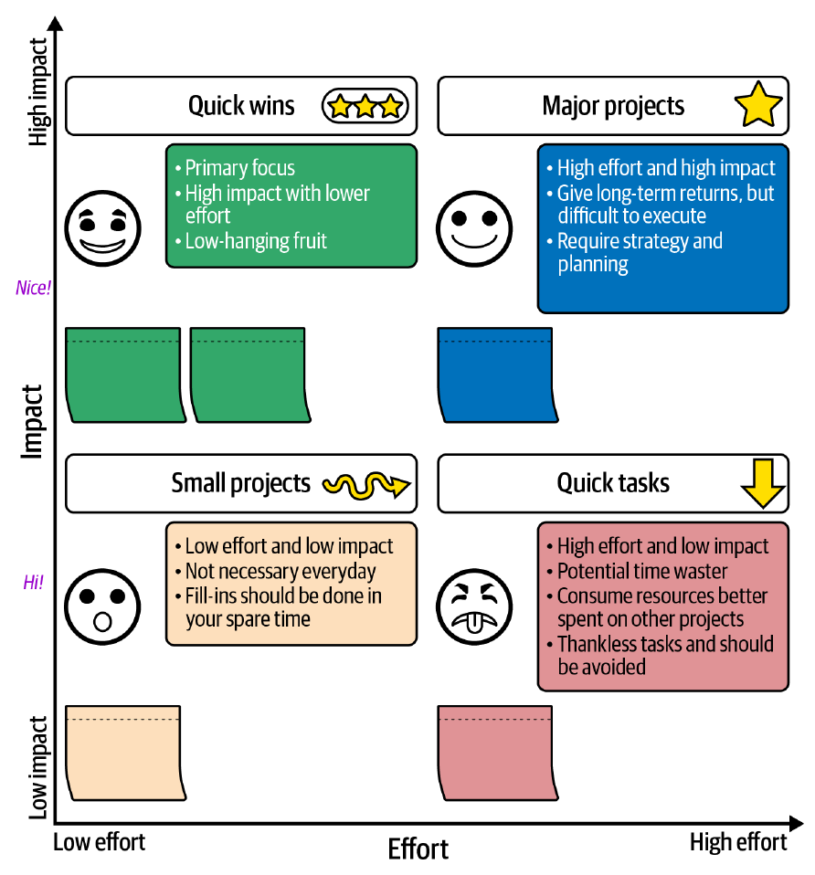

# 6. Shipping Products and Code in Chaotic Environments

[← 5. Setting Direction](05-setting-direction.md) · [Book](../README.md) · [7. Budgeting, Costs, and Vendors →](07-budgeting-costs-and-vendors.md)

## Summary

You can't do everything, so you must decide what to do and in what order — but elaborate processes in chaos mean serving the process instead of the outcome. The chapter sets five criteria for any technique (inspire confidence, focus on execution, stay lightweight, foster learning, communicate), summed up in Kevin Stewart's rule "Use a process. Not too much. Mostly agile." It then builds a lightweight prioritization toolkit: key inputs, user stories with acceptance criteria, the impact-versus-effort matrix, backlog pruning, a two-week cadence, consistent estimates, one backlog for features, bugs, debt and maintenance, and transparent communication. It closes by recognizing work that isn't a product — office moves, audits, migrations — and runs best on a linear plan alongside sprints (pp. 93–122).

## Key takeaways

- **Pick techniques that** inspire confidence, focus on execution, are lightweight and adaptable, foster learning, and support communication (p. 93).
- **A process that works 80% of the time is a success;** acknowledge uncertainty in estimates rather than guessing wildly (p. 94).
- **You can always add a process, but it's much harder to remove it** — start with the bare minimum (p. 96).
- **"Use a process. Not too much. Mostly agile."** — adopt agile practices selectively, not dogmatically (pp. 96–97).
- **Scheduling is a jigsaw, not a queue;** not all work fits the same process, and not all work is known up front (pp. 99–101).
- **User stories feed prioritization; the impact-versus-effort matrix ranks them** — quick wins first, stage big bets, question low-impact/high-effort work (pp. 103–111).
- **Prune the backlog,** run a steady cadence, estimate consistently, and keep features, bugs, debt and maintenance in one backlog (pp. 111–116).
- **Not everything is a product:** linear work needs a clear endpoint, dependencies, single owners and checkpoints — run both tracks together (pp. 118–121).

## Section outline

*From the book’s own table of contents (PDF bookmarks); printed page numbers.*

- Inspire Confidence — p. 94
- Be Execution-Focused — p. 95
- Be Lightweight and Adaptable — p. 96
- Foster Continuous Learning — p. 98
- Focus on Communication and Collaboration — p. 98
- Celebrate — p. 99
- Other Prioritization Concerns — p. 99
  - Not All Work Is Created Equal — p. 100
  - Not All Work Can Use the Same Process — p. 100
  - Not All Work Is Known at the Start of Prioritization — p. 100
- Prioritization Techniques — p. 101
  - Key Inputs for Decision Making — p. 101
  - Utilize Established Frameworks — p. 102
  - Managing Backlogs Effectively — p. 111
  - A Good Cadence — p. 112
  - Approaching Estimates Wisely — p. 113
  - Balancing Different Types of Work — p. 114
  - Addressing Technical Debt — p. 115
  - Monitoring Progress and Adjusting Priorities — p. 116
  - Communicating Priorities Transparently — p. 117
- Not Everything Is a Product — p. 118
  - When Linear Makes Sense — p. 119
  - Creating Just Enough Structure — p. 120
  - Working the Plan, Not Serving It — p. 120
  - Connecting Linear and Iterative Work — p. 121
- Conclusion: Driving to Execution — p. 121

## Notes

Doing something beats doing nothing, but with limited resources you must choose what and in what order. Elaborate processes in chaos mean serving the process instead of driving the outcome; don't underestimate simplicity and common sense (p. 93). The chapter is a crash course, not a full guide to the software development lifecycle (p. 94).

### Inspire Confidence

The authors like the **80/20 rule: a process that works 80% of the time is a success**; admit failures and turn them into learning (p. 94). Estimation is scary in chaos and early estimates will be wrong, so acknowledge uncertainty and put a stake in the ground — accept, say, a 50% variance (a week could be two) — and refine as you learn (p. 94). James once inherited an organization so stacked with process that development had halted; stripping it back to what mattered — shipping quality code — let the team ship again, and progress after months of stagnation changed its outlook (p. 94).

> **In Practice: April's Story** (p. 95). April pairs senior and junior StudioOps engineers on a quick bug-fix sprint; clearing a months-old backlog together rebuilds confidence and collaboration.

### Be Execution-Focused

A process that prioritizes itself over the outcome is a red flag — ceremonies that matter more than shipping, endless fine-tuning, the board-game rules reader who wants every edge case covered. "The process worked" is meaningless if it didn't deliver. Work backward from the deliverable and add the bare minimum process (p. 95).

### Be Lightweight and Adaptable

**You can always add a process, but it's much harder to remove it** — people fear losing safety nets and dependencies form around processes (p. 96). Let process grow from a seedling rather than planting a forest. Kevin Stewart paraphrases Michael Pollan's *Food Rules* ("Eat food. Not too much. Mostly plants.") as **"Use a process. Not too much. Mostly agile."** (p. 96)

| Rule | Meaning (pp. 96–97) |
|---|---|
| **Use a process** | Individuals working separately can build an MVP, but not decide priorities at scale or collaborate across teams |
| **Not too much** | Too much process means serving it instead of delivering |
| **Mostly agile** | Lowercase and "mostly": agile is "the least bad approach to building products"; keep the Agile Manifesto's values (individuals and interactions, working software, customer collaboration, responding to change) and adopt practices selectively |

For depth the authors point to Martin Fowler's Agile guides, *The Art of Agile Development*, *Essential Scrum* and *User Stories Applied* (p. 98).

### Foster Continuous Learning, Communication and Celebration

- **Measure every new process** — qualitatively (a retrospective) or quantitatively (stories completed against plan); measurable experiments support decisions (p. 98).
- **Change is scary:** communicate openly, collaborate with the people who run the process daily, and don't change too much at once (pp. 98–99).
- **Celebrate** successful weeks and sprints, however small — confidence in new process is fragile (p. 99).

### Other Prioritization Concerns

| Concern | Why it matters (pp. 99–101) |
|---|---|
| **Not all work is created equal** | Work varies in size, skills, dependencies and difficulty, so scheduling is **a jigsaw puzzle, not a queue** (some colleagues insist it's Jenga) |
| **Not all work can use the same process** | Agile suits small iterative work; an office move suits traditional project management |
| **Not all work is known at the start** | Change keeps arriving; processes must be flexible enough to accommodate it and strong enough to protect against fluctuating priorities |

### Prioritization Techniques

#### Key Inputs for Decision Making

Not perfect information, but some understanding of why, the impact and the broad requirements (p. 101):

| Input | Question (p. 102) |
|---|---|
| **Business impact** | Does it drive revenue, satisfaction or new markets? |
| **Urgency** | Go-to-market, contractual or competitive deadlines? |
| **Effort** | Days, weeks or months — and does it exceed capacity? |
| **People** | Available, with the right skills? |
| **Dependencies** | What must finish first? |

#### Utilize Established Frameworks

Take the parts of established frameworks that work and shape them into your own system; any tool from a spreadsheet or Trello to Linear, Shortcut or Jira will do — Jira may overwhelm a small team (pp. 102–103).

**User stories** map features to user needs and focus on an MVP that delivers value early; they're a decomposition method that feeds prioritization, and they apply to internal tools and platforms too (p. 103). The template is *as a [role], I want [capability], so that [benefit]*; variants put the benefit first, add context, or write "evil user stories" from an attacker's view (p. 104). Example: a registered user wants two-factor authentication via an authenticator app or text message to secure their account; implementation details belong in an RFC, ticket or pull request (p. 104).

> **In Practice: April's Story** (p. 103). April frames the mentorship gap as a user story for an internal tool: a junior StudioOps engineer wants to find and book time with seniors who have specific expertise, so they get unblocked and learn.

- **Acceptance criteria** define done — for 2FA in given-when-then form: *given* a registered, logged-in user on the security page, *when* they enable 2FA with an authenticator app, *then* it is enabled (p. 105).
- **A start, not a solution.** Stories don't scale (they "multiply like rabbits"), are open to interpretation, get grouped into epics, themes and initiatives, can miss nonfunctional requirements (hence technical-only stories), and can feel like "concrete shoes" when you must pivot (pp. 105–106).

**Impact-versus-effort analysis** is layered on top to decide which stories come first (p. 106): impact is the benefit to users, customers or the business; effort the time, skill and complexity required.

*Figure 6-2 (p. 107): read it by quadrant — top left is the primary focus, bottom right the "thankless" work to avoid.*

| Quadrant | What to do | Book's examples (pp. 107–109) |
|---|---|---|
| **High impact, low effort** — the sweet spot | Tackle first | A long-requested product-listing filter; a navigation tweak that raises retention |
| **High impact, high effort** — strategic | Break down or time carefully | Rebuilding a core component for scale; a new module integrating many systems |
| **Low impact, low effort** | Spare moments or morale boosters; don't let them dominate | A page colour; a tooltip tweak |
| **Low impact, high effort** — the danger zone | Deprioritize, avoid, or reimagine cheaper | A refactor with no measurable benefit; an unrequested complex feature |

> **In Practice: April's Story** (p. 109). A comprehensive onboarding program is high impact, high effort; weekly cross-team code reviews are high impact, low effort. April starts the reviews now and plans onboarding for next quarter.

The matrix also starts conversations — maybe a simpler solution reaches the same outcome, or a low-impact story becomes critical as circumstances change — and it scales from a to-do list to organization-wide planning (p. 110).

> **Exercise: The Impact-Versus-Effort Mapping Session** (pp. 110–111). List 10–15 competing items, write each as a story or one sentence, plot them with relative sizing, then decide: two or three quick wins this week; which big item to break down; which small items are "Friday afternoon" tasks; which to deprioritize. Share the grid — disagreements are data about differing views of impact.

> **Try it:** [Impact versus effort](../widgets/06-impact-effort.html) — place the book's example items and your own on the grid, and see which quadrant each lands in and what the book says to do with it.

#### Managing Backlogs Effectively

In chaos, ownership is diffuse, and both authors have managed backlogs as de facto product managers (p. 111). Review it regularly (weekly or biweekly, matching sprints) and **prune stale items**: you already have more work than capacity, and if it's important it will come up again. If pruning feels too ruthless, park ideas in an "icebox." Groom the backlog collaboratively with product, design and other stakeholders (pp. 111–112).

> **In Practice: April's Story** (p. 112). In April's grooming sessions, managers Jordan and Priya prioritize team-development work alongside features; when a senior engineer proposes dropping junior training for a feature, the group discusses the long-term velocity cost of under-mentored developers.

#### A Good Cadence

One-week sprints are too short and a month too long in chaos, so the authors use **two-week sprints**: week 1 starts with Monday planning, standups Tuesday–Thursday and an asynchronous Friday standup; week 2 has standups Monday–Thursday and a Friday demo and retrospective. Adjust — standups every second day may suit you better (pp. 112–113).

#### Approaching Estimates Wisely

Estimates are a powerful and dangerous compass. Seek **consistency, not perfection**: story points, time or "difficulty tokens," used in the same spirit by everyone (p. 113). **Avoid bikeshedding** about estimates or estimation methods; accept broad early ranges such as ±25% and narrow them; be transparent that estimates are guideposts, not guarantees (pp. 113–114).

#### Balancing Different Types of Work

Treat the product as a living ecosystem: only features leave a fragile codebase; only debt and maintenance mean stagnation. Put **features, technical debt, bugs and maintenance in one backlog** under the same prioritization criteria (p. 114).

> **In Practice: April's Story** (p. 115). April treats "organizational debt" like technical debt: "Implement peer programming sessions" sits next to "Refactor authentication service."

#### Addressing Technical Debt

Technical debt is invisible until it's not. Translate it for nonengineers as **a tax you keep paying** in slower releases or more defects, and quantify it — fixing a piece of debt might cut future feature time by 20% (p. 115). Write debt as a user story: not "our React pages and components are duplicative and unwieldy," but *as a developer maintaining the frontend, I want to refactor them … so that we deliver features faster with fewer defects* — now it can be compared with a feature (pp. 115–116).

> **Exercise: The Process-Debt Audit** (p. 116). Brain-dump process friction for 15 minutes; turn the top three into user stories; give each its current cost, the minimum viable fix (the 20% effort for 80% improvement) and a success metric; put them in the backlog. Would you tolerate the equivalent technical debt?

#### Monitoring Progress, Communicating Priorities

Define success metrics per category (features shipped per quarter, time to resolve critical bugs, bottlenecks removed) and hold periodic reviews to pivot early instead of after months (pp. 116–117). Communicate the *why* of priorities, and bad news as clearly as good — "nothing erodes trust faster than silently missed deadlines" (p. 117).

> **In Practice: April's Story** (p. 118). April quietly reshuffled priorities toward cohesion and the confusion eroded trust. She corrected course with a company-wide three-month plan: month one quick wins and breaking silos, month two sustainable processes, month three accelerated delivery — so the slowdown read as strategy, not chaos.

### Not Everything Is a Product

Office moves, compliance requirements, infrastructure migrations and vendor evaluations have fixed endpoints and linear sequences; forcing agile onto them creates friction. The impact-versus-effort matrix still applies; the execution model changes (pp. 118–119).

| When linear makes sense (p. 119) | Example |
|---|---|
| **Fixed dependencies** | No network installation before the lease is signed |
| **External constraints** | Vendor availability, regulatory deadlines, physical logistics |
| **Binary outcomes** | Complete success or failure, not partial shipping |
| **Limited iteration potential** | You don't move offices again next sprint |

> **In Practice: April's Story** (p. 119). A team restructuring (iterative) and a security audit (linear, deadline-driven) at the same time: running the audit as sprints would fail as surely as restructuring the team with a Gantt chart.

**Creating just enough structure** ("Everyone has a plan until they get punched in the mouth"): define the endpoint, map critical dependencies, assign single owners (decompose any task needing several), build in checkpoints, and communicate the plan widely (p. 120). **Work the plan, don't serve it:** adjust timelines and assignments, accept wrong assumptions, keep the plan living (p. 120). **Connect the tracks:** reserve sprint capacity for linear tasks, make dependencies visible, adjust sprints near milestones, and use the same impact-versus-effort criteria (p. 121).

### Conclusion: Driving to Execution

The tools are "designed to be wielded, not worshipped": start small, measure what matters, iterate, and never let process matter more than the outcome (p. 121).

## Trade-offs at a glance

| Choice | Buys | Costs |
|---|---|---|
| Heavy, edge-case-complete process | Feels safe | Serving the process; slow to remove |
| Minimal process grown over time | Speed; easy to change | Gaps until it grows |
| Wild-guess estimates | Quick answers | Lost confidence when wrong |
| Ranges (±25–50%) | Honest; builds trust | Less precise commitments |
| User stories | User value; early delivery | Proliferate; miss nonfunctional needs |
| Impact-versus-effort | Quick, visual ranking | Coarse; must be revisited |
| Aggressive backlog pruning | Lean, current backlog | Some ideas lost (they'll come back if important) |
| One backlog for all work | Fair trade-offs; healthy balance | Harder conversations about debt |
| Agile for linear work | Familiar ceremonies | Friction with fixed sequences |

## Beyond the book

- **RICE and WSJF.** Richer scoring models — Intercom's RICE (reach × impact × confidence ÷ effort) and SAFe's Weighted Shortest Job First (cost of delay ÷ duration) — extend the impact-versus-effort idea with more inputs; the book deliberately keeps the simple 2 × 2.
- **INVEST.** Bill Wake's checklist for good user stories (independent, negotiable, valuable, estimable, small, testable, 2003) complements the book's "conversation starters, not contracts" (p. 105).
- **Bikeshedding** comes from C. Northcote Parkinson's law of triviality (1957): a committee spends more time on a bike shed than on a nuclear plant.

## Connections

- **Related chapters:** [2. Understanding Your Role](02-understanding-your-role.md) (plan, process and product pillars), [5. Setting Direction](05-setting-direction.md) (the direction you prioritize), [7. Budgeting, Costs, and Vendors](07-budgeting-costs-and-vendors.md) (build versus buy), [10. Metrics That Matter](10-metrics-that-matter-for-engineering-teams.md) (estimates and velocity).

## Check yourself

*Questions and answers are the vault's, written from the notes above; answers cite the book's printed pages.*

1. **What are the five criteria the chapter sets for techniques in chaos?**

   *Answer:* Inspire confidence, be execution-focused, be lightweight and adaptable, foster continuous learning, focus on communication and collaboration (p. 93).

2. **Why start with the bare minimum of process?**
   - [ ] Processes are always harmful
   - [x] You can always add a process, but it's much harder to remove one — people fear losing safety nets and dependencies form
   - [ ] Agile forbids processes

   *Answer:* p. 96.

3. **What does Kevin Stewart's rule say?**

   *Answer:* "Use a process. Not too much. Mostly agile." — paraphrasing Michael Pollan's food rules (p. 96).

4. **Why is scheduling work "a jigsaw, not a queue"?**

   *Answer:* Work varies in size, skills, dependencies and difficulty, so you fit pieces together rather than processing a stack-ranked list (p. 100).

5. **Where does a complex refactor with no measurable benefit fall in the impact-versus-effort matrix, and what should you do?**

   *Answer:* Low impact, high effort — the danger zone; deprioritize or avoid it, or reimagine it in a cheaper, more valuable form (pp. 108–109).

6. **How do the authors make technical debt comparable with a feature?**

   *Answer:* Translate it into a tax with quantified cost and write it as a user story with a benefit ("so that we deliver features faster with fewer defects"), then prioritize it in the same backlog (pp. 115–116).

7. **Which project characteristics call for linear planning rather than sprints?**

   *Answer:* Fixed dependencies, external constraints, binary outcomes and limited iteration potential — e.g. an office move or a compliance audit (p. 119).
