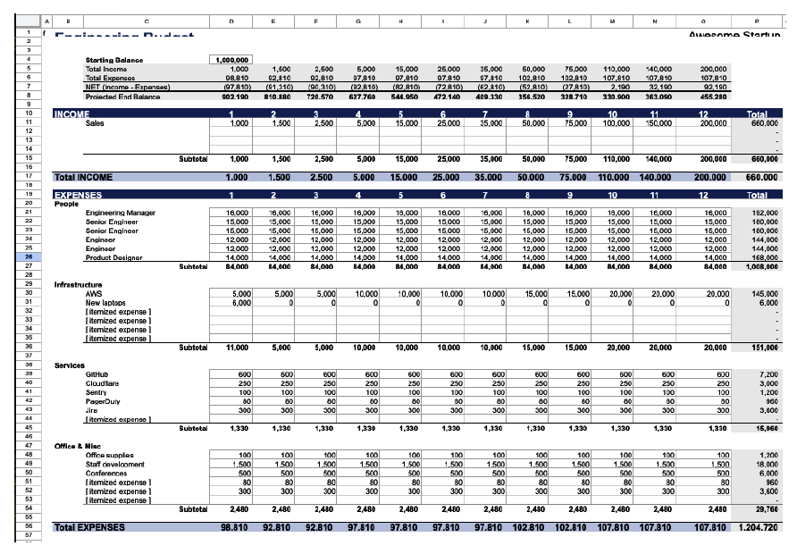

# فصل ۷: بودجه، هزینه و فروشنده‌ها

[فصل ۶: تحویل محصول و کد →](06-shipping-products-and-code-in-chaotic-environments.md) · [کتاب](../README.md) · [فصل ۸: اصول و استراتژی فنی ←](08-technical-principles-and-strategy.md)

## خلاصه

رهبرهای مهندسی معمولاً بودجه را «مسئله‌ی کسب‌وکار» می‌بینند، ولی حل کردنش همان راهی است که آدم و منابع می‌گیرید، و در آشوب بودجه لنگری است که به برنامه‌ریزی و اولویت‌بندی گره می‌خورد. این فصل، که صریحاً راهنمای یک غیرمتخصص است و نه مشاوره‌ی مالی یا حقوقی، می‌گوید چرا بودجه اهمیت دارد، از جمله اقتصاد واحد با COGS و CAC و LTV و حاشیه‌ی ناخالص؛ هزینه‌های ثابت و متغیر و پله‌ای؛ ساختن و پیگیری بودجه با نگاهی دقیق به هزینه‌ی تمام‌شده‌ی نیرو و زمان جا افتادن و ریزش؛ مدیریت فروشنده‌ها و تصمیم ساختن در برابر خریدن؛ رفتار با پیمانکارها به‌عنوان بخشی از تیم؛ و اخلاق (pp. 123–145).

## نکته‌های کلیدی

- **بودجه‌ریزی همان اولویت‌بندی است با علامت دلار چسبیده به آن**؛ همان تفکر اثر در برابر تلاش فصل ۶ در مقیاس بزرگ‌تر (p. 127).
- **خرجتان باید با اولویت‌های اعلام‌شده‌تان بخواند؛** اگر نمی‌خواند، یا استراتژی را عوض کنید یا خرج را (p. 124).
- **اقتصاد واحد تصمیم فنی را به تصمیم کسب‌وکاری تبدیل می‌کند:** ماهی ۵۰٬۰۰۰ دلار AWS برای ۱٬۰۰۰ مشتری یعنی ۵۰ دلار COGS برای هر مشتری؛ حاشیه‌ی ناخالص برابر است با درآمد منهای COGS تقسیم بر درآمد (pp. 125–126).
- **بدانید هزینه‌ها چطور رفتار می‌کنند:** ثابت، متغیر، و پله‌ای که سر آستانه‌ها جهش می‌کنند؛ و این‌که چه کسی پولش را می‌دهد (pp. 130–131).
- **هزینه‌ی تمام‌شده‌ی یک نفر ۱٫۳ تا ۱٫۸ برابر حقوق پایه است؛** تازه‌واردها اول ظرفیت تیم را کم می‌کنند؛ برای ۱۰ تا ۱۵٪ ریزش و استخدام‌های ناموفق بودجه بگذارید (pp. 133–136).
- **بودجه‌ی بهترین و مورد‌انتظار و بدترین حالت را آماده کنید؛** هزینه‌های بزرگ را ماهانه مرور کنید، انحراف‌ها را توضیح بدهید و فراتر رفتن از بودجه را اعلام کنید (pp. 137–138).
- **فقط هسته‌ی کسب‌وکارتان را بسازید؛** سرویس‌های کالایی را بخرید؛ هیچ‌وقت process اصلی استخدامتان را برون‌سپاری نکنید؛ و با پیمانکارها مثل هم‌تیمی رفتار کنید (pp. 139–142).
- **اخلاق:** حقوق منصفانه و رفتار شایسته؛ از این تصمیم روی صفحه‌ی اول فردا سربلند بیرون می‌آمدید (pp. 142–144)؟

## فهرست بخش‌ها

*از فهرست مطالب خود کتاب، از bookmarkهای PDF؛ شماره‌ها صفحه‌ی چاپی‌اند.*

- چرا بودجه اهمیت دارد — p. 124
  - هم‌راستایی راهبردی — p. 124
  - مدیریت هزینه — p. 124
  - کاهش ریسک — p. 127
  - پایش عملکرد — p. 127
  - بهینه کردن منابع — p. 127
  - مدیریت ذی‌نفع‌ها — p. 128
  - نوآوری و رشد — p. 129
  - یادگیری سازمانی — p. 129
  - مزیت رقابتی — p. 129
- فهمیدن مدیریت هزینه — p. 129
  - هزینه‌های ثابت: پایه — p. 130
  - هزینه‌های متغیر: بازیکن‌های منعطف — p. 130
  - هزینه‌های پله‌ای: هزینه‌ی رفتن به سطح بعد — p. 130
  - چه کسی پولش را می‌دهد؟ — p. 131
  - سمت انسانی مدیریت هزینه — p. 131
- ساختن و مدیریت بودجه — p. 131
  - شروع از تاریخچه — p. 132
  - دسته‌بندی هزینه‌ها — p. 132
  - برنامه‌ریزی نیرو و هزینه‌هایش — p. 133
  - گذاشتن هدف‌هایی که معنا دارند — p. 136
  - ساختن قالب بودجه — p. 137
  - پیگیری و مدیریت — p. 138
  - یاد گرفتن از تجربه — p. 138
- مدیریت فروشنده‌ها — p. 139
  - بحث بزرگ ساختن در برابر خریدن — p. 139
  - انتخاب شریک‌ها — p. 140
  - مدیریت رابطه — p. 140
  - آدم‌ها و تیم‌های برون‌سپاری‌شده — p. 141
- اخلاق — p. 142
  - مراقبت از آدم‌هایمان — p. 143
  - همسایه‌ی خوبی بودن — p. 143
  - نگاه جهانی — p. 143
  - نگاه به آینده — p. 144
  - واقعی کردنش — p. 144
- جمع‌بندی: بودجه به‌مثابه استراتژی — p. 144

## یادداشت‌ها

بودجه‌ریزی processی راهبردی است که بین جایی که هستید و جایی که می‌خواهید باشید پل می‌زند، نه فقط عددبازی، هرچند spreadsheet هم خواهد بود. نویسنده‌ها تأکید می‌کنند حسابدار نیستند: روی بودجه با CFO یا تیم مالی کار کنید (p. 123).

### چرا بودجه اهمیت دارد

بودجه پل بین «چقدر خوب می‌شد اگر…» و «واقعاً انجامش دادیم!» است (p. 124).

| دلیل | یعنی چه (pp. 124–129) |
|---|---|
| **هم‌راستایی راهبردی** | خرج با اولویت‌های اعلام‌شده می‌خواند؛ تجربه‌ی مشتری نمی‌تواند اولویت اول باشد وقتی همه چیز خرج ابزار داخلی می‌شود |
| **مدیریت هزینه** | فهمیدن رابطه‌ی خرج و ارزش، نه فقط برداشتن ارزان‌ترین گزینه |
| **کاهش ریسک** | ذخیره برای ریسک مالی مثل رفتن بزرگ‌ترین مشتری، ریسک عملیاتی مثل خراب شدن دیتابیس، و ریسک راهبردی مثل منسوخ شدن محصول |
| **پایش عملکرد** | شاخص‌های پیشرو و پسرو، نه متریک پوچ |
| **بهینه کردن منابع** | «بودجه‌ریزی صرفاً اولویت‌بندی است با علامت دلار چسبیده به آن»؛ بودجه‌تان backlog سطح شرکت است |
| **مدیریت ذی‌نفع‌ها** | بودجه اولویت‌ها را به سرمایه‌گذارها و کارکنان و مشتری‌ها می‌گوید |
| **نوآوری و رشد** | هم بهبود تدریجی را تأمین کنید و هم شرط‌های دگرگون‌کننده؛ هم گوجه‌ی این تابستان و هم درخت برای بعدها |
| **یادگیری سازمانی** | هر چرخه یک آزمایش است |
| **مزیت رقابتی** | سریع پاسخ بدهید؛ در زمان درست سرمایه‌گذاری کنید. ساده شروع کنید، چون می‌شود process بودجه اضافه کرد ولی به‌ندرت می‌شود برش داشت |

> **کادر In Practice: داستان April** (p. 124). تیم StudioOps ادعا می‌کند همکاری و منتورینگ اولویت‌اند، ولی بودجه‌ی سه‌ماهه‌ی اولش ۱۵٬۰۰۰ دلار برای licenseهای انفرادی IDE دارد، ۵٬۰۰۰ دلار برای ابزار پیگیری بهره‌وری که استفاده نمی‌شود، هیچ چیز برای ابزار برنامه‌نویسی دونفره، و ۵۰۰ دلار «پیتزای فصلی» برای تیم‌سازی. April ابزار پیگیری را حذف می‌کند، license تیمی برنامه‌نویسی دونفره می‌خرد با ۸٬۰۰۰ دلار، ناهار هفتگی تیم را با ماهی ۶۰۰ دلار راه می‌اندازد و ۱۰٬۰۰۰ دلار برای ابزار code review کنار می‌گذارد.

#### فهمیدن سمت درآمد

رهبرهای مهندسی به‌ندرت صاحب درآمدند، ولی **اقتصاد واحد** شما را از یک مرکز هزینه به شریکی راهبردی تبدیل می‌کند (p. 125):

| مفهوم | تعریف و نمونه (p. 125) |
|---|---|
| **بهای تمام‌شده‌ی کالا یا COGS** | هزینه‌های مستقیم تحویل سرویس: زیرساخت، هزینه‌ی طرف‌های سوم، پشتیبانی. ماهی ۵۰٬۰۰۰ دلار AWS برای ۱٬۰۰۰ مشتری یعنی ۵۰ دلار برای هر مشتری |
| **هزینه‌ی جذب مشتری یا CAC** | هزینه‌ی به دست آوردن یک مشتری؛ featureهای نداشته‌ای که به ازای هر مشتری سازمانی ۵٬۰۰۰ دلار تلاش فروش تحمیل می‌کنند اثر دلاری دارند |
| **ارزش طول عمر یا LTV** | کل درآمد در طول رابطه؛ با ماهی ۱٬۰۰۰ دلار، رفتن بعد از ۱۰ ماه به‌جای ۱۲ ماه ۲٬۰۰۰ دلار از LTV کم می‌کند |
| **حاشیه‌ی ناخالص** | درآمد منهای COGS تقسیم بر درآمد؛ چیزی که برای حقوق و دفتر و قهوه‌ساز می‌ماند. با ۷۰٪ و هدف ۸۰٪، بهینه کردن کوئری‌ای که ۲۰٪ زیرساخت را می‌خورد شاید از یک feature تازه بهتر باشد |

> **کادر In Practice: داستان April** (p. 126). فروش تخفیف می‌دهد چون رقیب‌ها سریع‌تر تحویل می‌دهند؛ و بعد از قطعی‌ها churn جهش می‌کند. کندی رفع باگ ماهی ۳۰٬۰۰۰ دلار درآمد از‌دست‌رفته برای PixelCurl آب می‌خورد، که حالا ورودی بودجه و نیروی April است.

با اقتصاد واحد، اولویت‌ها قابل‌مقایسه می‌شوند: feature اول ماهی ۱۰٬۰۰۰ دلار از زیرساخت کم می‌کند و ۲ واحد به حاشیه‌ی ناخالص اضافه؛ feature دوم قیمت‌گذاری سازمانی را ممکن می‌کند و LTV را از ۱۰٬۰۰۰ به ۲۵٬۰۰۰ دلار می‌برد. استخدام یک DevOps را می‌شود این‌طور قاب گرفت که COGS زیرساخت را ۲۵٪ کم می‌کند و حاشیه‌ی ناخالص را از ۷۲٪ به ۷۶٪ می‌برد، یعنی «۲ میلیون دلار به ارزش‌گذاری ما با ضریب‌های معمول SaaS». مدیریت هزینه یعنی فهمیدن رفتار هزینه‌ها؛ گاهی خرج بیشتر پول کم می‌کند، مثل نظریه‌ی «پوتین» Sam Vimes در نوشته‌ی Terry Pratchett (p. 126).

> **Try it:** [اقتصاد واحد](../widgets/07-unit-economics.html)؛ از نمونه‌های کتاب شروع کنید و خرج زیرساخت و تعداد مشتری و قیمت و churn را بگذارید و ببینید COGS هر مشتری و حاشیه‌ی ناخالص و LTV چطور جابه‌جا می‌شوند.

#### بهینه کردن منابع در عمل

بلاتکلیفی تخمین در مقیاس بزرگ هم هست: همان‌طور که تخمین sprint ‎±۲۵٪‎ است، برای پیمانکار سه‌ماهه چهار ماه بودجه بگذارید، و بپرسید اگر ارتقای ۵۰٬۰۰۰ دلاری ۶۵٬۰۰۰ دلار شد چه می‌شود (p. 128). با ارتقاهای عقب‌انداخته مثل بدهی فنی برخورد کنید؛ نرخ بهره‌اش چقدر است (p. 128)؟

> **کادر In Practice: داستان April** (p. 128). اگر تیم ۳۰٪ کمتر از واقع تخمین بزند، برنامه‌ریزی نیرو هم به همان اندازه غلط است، پس April برنامه‌ریزی بودجه را مثل برنامه‌ریزی sprintِ گسترده می‌گرداند و روی هر دو محور اثر و تلاش عدد دلاری می‌گذارد.

### فهمیدن مدیریت هزینه

هزینه‌ها نیمی از داستان‌اند؛ اهمیتشان در نسبت با ارزشی است که ساخته می‌شود (pp. 129–130).

| نوع هزینه | نمونه و مدیریت (pp. 130–131) |
|---|---|
| **هزینه‌های ثابت**، یعنی پایه | دفتر، حقوق دائمی، بیمه، زیرساخت اصلی. زیاد بودنشان شما را خشک می‌کند و کم بودنشان ناتوان از رشد |
| **هزینه‌های متغیر**، یعنی بازیکن‌های منعطف | cloud و SaaS بر پایه‌ی مصرف. بین کارآمدی و اثربخشی تعادل برقرار کنید |
| **هزینه‌های پله‌ای**، یعنی رفتن به سطح بعد | سر آستانه‌ها جهش می‌کنند: سطح بالاتر SaaS، دفتر تازه، گسترش زیرساخت؛ پیش از جهش آماده باشید |
| **چه کسی پولش را می‌دهد؟** | هزینه‌های مستقیم مثل آدم‌ها راحت تخصیص می‌یابند؛ هزینه‌های غیرمستقیم و مشترک، مثل سهم یک مشتری از زیرساخت، باید درآورده شوند، چون باید نشان بدهید سرمایه‌گذاری‌ها ارزشش را داشته‌اند |

**سمت انسانی:** فرهنگی بسازید که در آن مهندس‌های ارشد هزینه‌ی یک انتخاب معماری، مثل ابزار تازه یا هزینه‌ی پله‌ای، را بخشی از برنامه‌ریزی ظرفیت ببینند (p. 131).

> **In practice:** هزینه‌ی platform داده بیشتر متغیر است: CPU، دیسک و نگهداری داده.
>
> **Your turn:** دیسک ClickHouse هر ماه ۱۵٪ رشد می‌کند. چه کاری پیش از خریدن دیسک بیشتر انجام می‌دهید؟
>
> *Answer:* TTL روی partitionهای کهنه در Bronze، بررسی codec فشرده‌سازی، و حذف جدول‌هایی که کسی نمی‌خواند؛ و رشد را در Grafana به ارزشی که ساخته می‌شود گره بزنید. کتاب هزینه را در نسبت با ارزش می‌سنجد (pp. 129–131).

### ساختن و مدیریت بودجه

حتی با وجود تیم مالی، خرج‌کننده‌ی بودجه شمایید و مسئولش هم شمایید (p. 131).

- **از تاریخچه شروع کنید**، اگر می‌شود دست‌کم سه سال: فصل‌ها، مثل هزینه‌های ecommerce حول Black Friday، وابستگی به مشتری‌ها، روند هزینه‌ها، حادثه‌های یک‌باره، و «چرا»ی پشت عددها (p. 132).
- **هزینه‌ها را دسته‌بندی کنید**: اول آدم‌ها، یعنی حقوق پایه و پرداخت متغیر و مزایا و آموزش و سفر و پذیرایی، بعد زیرساخت، یعنی cloud و فضا و تجهیزات، و بعد سرویس‌ها، یعنی SaaSها از CRM تا observability، ابزار استخدام، وکیل، حسابدار و امنیت (p. 132).

#### برنامه‌ریزی نیرو و هزینه‌هایش

**هزینه‌ی تمام‌شده‌ی** یک کارمند معمولاً **۱٫۳ تا ۱٫۸ برابر حقوق پایه** است (pp. 133–134):

| جزء | اندازه‌ی معمول (p. 133) |
|---|---|
| مالیات و الزام‌های حقوق و دستمزد | در آمریکا حدود ۷٫۶۵٪ |
| مزایا | ۲۰ تا ۳۰٪ حقوق پایه |
| تجهیزات و license | سالی ۵٬۰۰۰ تا ۱۰٬۰۰۰ دلار برای مهندس‌ها |
| آموزش و توسعه | سالی ۲٬۰۰۰ تا ۵٬۰۰۰ دلار |
| استخدام | کارمزد آژانس ۱۵ تا ۲۵٪ حقوق پایه، یا وقت recruiter |
| ناکارآمدی onboarding | تازه‌واردها تا سه ماه حدود ۵۰٪ بهره‌وری دارند |

> **کادر In Practice: داستان April** (p. 134). او برای سه مهندس هر کدام ۱۵۰٬۰۰۰ دلار بودجه می‌گذارد، یعنی ۴۵۰٬۰۰۰ دلار، ولی هزینه‌ی واقعی نزدیک ۶۷۵٬۰۰۰ دلار است، آن هم پیش از حساب کردن وقت منتورینگ مهندس‌های ارشد.

- **رشد و ریزش.** ریزش نیرو در مهندسی سالی ۱۰ تا ۱۵٪ است، پس تیم ۲۰ نفره سالی دو سه نفر را جایگزین می‌کند. هر تازه‌وارد در ماه اول ۱۰٪ و در ماه دوم ۵٪ از ظرفیت تیم کم می‌کند و در ماه سوم به آن اضافه می‌شود (p. 134).
- **زمان‌بندی.** استخدام در سه‌ماهه‌ی چهارم سخت‌تر است؛ استخدام دسته‌ای وقت recruiter را کم می‌کند ولی گلوگاه onboarding می‌سازد؛ در سه‌ماهه‌ی اول استخدام کنید تا در سه‌ماهه‌ی سوم بهره‌ور باشد؛ و پنجره‌ی سالانه‌ی تعداد نیرو را از دست ندهید (p. 134).
- **سناریوها.** April بهترین و مورد‌انتظار و بدترین حالت را بودجه می‌گذارد، از جمله سختی پیدا کردن استعداد DevOps که به پوشش پیمانکاری نیاز دارد، به‌علاوه‌ی وقت منتور و افت انتقال دانش (p. 135).

| *جدول ۷-۱. بازه‌های تخمینی حقوق* (p. 135) | تخمین هزینه | ملاحظه‌ها |
|---|---|---|
| **ارشد** | ۱۸۰٬۰۰۰ تا بیش از ۳۰۰٬۰۰۰ دلار | رهبری فنی، معماری، منتورینگ |
| **میانی** | ۱۲۰٬۰۰۰ تا ۱۸۰٬۰۰۰ دلار | اجرای اصلی، استقلال رو به رشد |
| **تازه‌کار** | ۸۰٬۰۰۰ تا ۱۲۰٬۰۰۰ دلار | توان بالقوه‌ی بالا، نیازمند سرمایه‌گذاری، خط لوله‌ی آینده |

استارتاپ‌ها شاید برای سرعت به سمت ارشد بچرخند و شرکت‌های جاافتاده روی تازه‌کارها سرمایه‌گذاری کنند. تیم ارشد-سنگینِ April لایه‌ی میانی‌ای را ندارد که به رشد تازه‌کارها کمک می‌کند (p. 135). **هزینه‌های پنهان:** استخدام بد می‌تواند دو سه برابر حقوقش آب بخورد، پس ۱۰ تا ۱۵٪ اضافه بودجه بگذارید؛ نقش‌های کلیدی سه تا شش ماه طول می‌کشند؛ پیشنهادهای رقابتی شاید ۱۰ تا ۲۰٪ بالاتر از بودجه بخواهند؛ و صندوقی برای نگه‌داشت نیرو داشته باشید (pp. 135–136).

**پرونده‌ی کسب‌وکاری نیرو** استخدام را سرمایه‌گذاری قاب می‌گیرد: درآمد ممکن‌شده، یعنی «X دلار درآمد می‌آورد»؛ هزینه‌ی فرصت، یعنی «تأخیرش launch را X ماه عقب می‌اندازد»؛ هزینه‌ی اجتناب‌شده، یعنی «بدون آن X دلار خرج پیمانکار و قطعی می‌کنیم»؛ و سلامت تیم، یعنی «نرخ فعلی اضافه‌کاری پایدار نیست» (p. 136).

> **Run it:** آزمایش [برنامه‌ی نیرو](../lab/07-headcount-plan/README.md) قاعده‌های کتاب درباره‌ی هزینه‌ی تمام‌شده و جا افتادن و ریزش را روی استخدام سه مهندس به شکل دسته‌ای یا پلکانی به کار می‌برد.

#### هدف و قالب و پیگیری و یادگیری

- **هدف‌ها به بودجه و سنجه نیاز دارند**، چه مطلق مثل «به ۱۰ میلیون دلار درآمد برسیم» و چه نسبی مثل «سریع‌تر از بازار رشد کنیم» (p. 136).
- **قالب** هزینه‌ها و در صورت ربط درآمد را ماه به ماه نشان می‌دهد؛ نسخه‌های بهترین و مورد‌انتظار و بدترین حالت را آماده کنید (pp. 137–138).

*Figure 7-1 (p. 137): به ساختارش نگاه کنید؛ مانده‌ی پیش‌بینی‌شده در بالا، آدم‌ها به‌عنوان بزرگ‌ترین بلوک هزینه، و ستون‌های ماهانه با جمع سالانه در سمت راست.*

- **پیگیری:** هزینه‌های مهم مثل نیرو و cloud را ماهانه مرور کنید و برای cloud هشدار بودجه بگذارید؛ بازبینی‌های راهبردی فصلی و بودجه‌ی تازه سالانه (p. 138). انحراف‌ها را توضیح بدهید، یعنی قیمت و حجم و زمان‌بندی و کارآمدی، و **فراتر رفتن از بودجه را اعلام کنید**؛ پنهان کردنش هیچ‌وقت جواب نمی‌دهد. به هر مخاطبی سطح درست جزئیات را بدهید (p. 138).
- **یادگیری:** بعد از هر چرخه بپرسید چه چیزی کار کرد، چه چیزی شکست خورد، چه چیزی غافلگیرتان کرد و چه یاد گرفتید (pp. 138–139).

### مدیریت فروشنده‌ها

فروشنده‌ها حالا شریک‌های راهبردی‌اند که می‌توانند جلو ببرندتان یا نگهتان دارند (p. 139).

- **ساختن در برابر خریدن.** **هسته‌ی کسب‌وکارتان را بسازید**، یعنی چیزی که مزیت رقابتی می‌دهد، و بقیه را بخرید؛ راه‌حل سفارشی سال‌ها نگه‌داری می‌آورد. دیتابیس خودتان، مگر شرکت دیتابیس باشید، یا scheduler یا احراز هویت و رمزنگاری خودتان «تجمل است، نه الزام» (pp. 139–140).

> **کادر In Practice: داستان April** (p. 139). سیستم CI/CD خانگی‌ای که سال‌ها پیش ساخته شده ۲۰٪ وقت دو مهندس ارشد را می‌خورد. deployment مزیت PixelCurl نیست، موتور رندر انیمیشنش مزیت است، پس April به یک platform تجاری مهاجرت می‌کند و آدم‌های ارشد را برای منتورینگ آزاد.

- **انتخاب شریک‌ها** مثل استخدام است: توانمندی، کارنامه، ثبات، تناسب فرهنگی، چیزهای حتماً‌لازم در برابر خوب‌است‌باشد، ماندگاری و هزینه. قرارداد خوب تعریف می‌کند چه می‌گیرید، موفقیت چطور سنجیده می‌شود، و وقتی چیزی خراب شد چه می‌شود (p. 140).
- **مدیریت رابطه:** جلسه و بازبینی منظم؛ یک شراکت، نه یک معامله (p. 140). بازبینی فصلی فروشنده‌های April نشان می‌دهد سه مهندس جداگانه برای ابزارهای مشابه تحلیل کد پول می‌دهند (p. 141).
- **آدم‌ها و تیم‌های برون‌سپاری‌شده.** شریک‌ها ممکن است مهارت و انطباق را بر فرهنگ و رشد مقدم کنند. **هیچ‌وقت process اصلی استخدامتان را برون‌سپاری نکنید**؛ بگذارید شریک‌ها آدم پیدا کنند و بعد خودتان مصاحبه بگیرید: اعتماد کنید ولی وارسی هم بکنید. با مهندس‌های بیرونی مثل بخشی از تیم رفتار کنید، یعنی ۱-۱ و standup و بحث معماری و ساعت‌های جلسه‌ی هم‌پوشان، که James جلسه‌های صبح وقت شرق آمریکا می‌گذاشت تا با اوکراین هم‌پوشانی داشته باشد، و مسائل حقوقی و مقرراتی و حریم خصوصی داده را بسنجید؛ هر چقدر پول بدهید همان‌قدر می‌گیرید (pp. 141–142).

> **کادر In Practice: داستان April** (p. 141). پیمانکار موقت DevOps او در standupها و بحث‌های معماری شرکت می‌کند و با تازه‌کارها pair می‌کند، و مسئله‌ی حیاتی‌ای در زیرساخت پیدا می‌کند که آدم‌های ارشدِ در سیلو ندیده بودند.

> **In practice:** stack ما تقریباً همه‌اش open source و self-hosted است، و این خودش یک تصمیم ساختن در برابر خریدن است.
>
> **Your turn:** چرا ClickHouse را self-host می‌کنید و چه هزینه‌ای در این تصمیم پنهان است؟
>
> *Answer:* هزینه‌ی license نیست ولی زمان مهندس برای ارتقا، backup، تنظیم Keeper و on-call هست. کتاب می‌گوید هسته‌ی کسب‌وکار را بسازید و بقیه را بخرید؛ پس بپرسید نگهداری warehouse مزیت رقابتی شماست یا نه (pp. 139–141).

### اخلاق

کار درست را بکنید چون درست است، یا دست‌کم برای این‌که به برندتان آسیب نزنید (pp. 142–143).

| حوزه | چه می‌پرسد (pp. 143–144) |
|---|---|
| **مراقبت از آدم‌هایمان** | حقوق منصفانه، رشد، شرایط امن. April می‌بیند تازه‌کارها ۳۰٪ زیر بازار حقوق می‌گیرند به بهانه‌ی «یاد گرفتن سر کار» و برای اصلاح حقوق تا سطح بازار و وقت منتورینگ بودجه می‌گذارد |
| **همسایه‌ی خوبی بودن** | اثر زیست‌محیطی و اجتماعی |
| **نگاه جهانی** | به رسوم محلی احترام بگذارید و در همان حال استانداردهای اخلاقی و کار را یکدست نگه دارید |
| **نگاه به آینده** | هوش مصنوعی و automation، مالکیت فکری، حریم خصوصی، پایداری |
| **واقعی کردنش** | آموزش و امنیت برای حرف زدن؛ James برنامه‌ی سناریومحور Microsoft را دیده بود. بپرسید: از دیدن این تصمیم روی صفحه‌ی اول فردا سربلند بودیم؟ |

### جمع‌بندی: بودجه به‌مثابه استراتژی

شاید بودجه و هزینه و فروشنده‌ها دلیل رهبر شدنتان نبوده باشد، ولی آوردن دقت مهندسی به آن‌ها شرایطی می‌سازد که چشم‌انداز فنی تحویل شود، و این مهارت‌ها برای individual contributorهای ارشد هم مهم‌اند (pp. 144–145).

## بده‌بستان‌ها در یک نگاه

| انتخاب | چه می‌دهد | چه می‌گیرد |
|---|---|---|
| هزینه‌ی ثابت بیشتر | پایه‌ی باثبات | خشکی |
| سرویس‌های متغیر بر پایه‌ی مصرف | انعطاف؛ مقیاس گرفتن با تقاضا | هزینه با مصرف بالا می‌رود؛ پیش‌بینی‌پذیری کمتر |
| رد شدن از یک پله‌ی هزینه | سطح بعدی ظرفیت | جهش خرج پیش از رسیدن ارزش |
| استخدام دسته‌ای | کارآمدی recruiter | گلوگاه onboarding؛ افت بزرگ‌تر بهره‌وری |
| تیم ارشد-سنگین | سرعت و استقلال | هزینه؛ خط لوله‌ی ضعیف تازه‌کارها بدون لایه‌ی میانی |
| ساختن در خانه | کنترل؛ دقیقاً اندازه | سال‌ها نگه‌داری؛ دور شدن از هسته |
| خریدن سرویس‌های کالایی | تمرکز روی هسته‌ی کسب‌وکار | وابستگی به فروشنده |
| رفتار با پیمانکارها مثل هم‌تیمی | دانش و فرهنگ مشترک | وقت مدیریتی بیشتر |

## فراتر از کتاب

- **ضریب‌های ارزش‌گذاری SaaS** با نرخ رشد و شرایط بازار خیلی فرق می‌کنند؛ «۲ میلیون دلار با ضریب‌های معمول SaaS» در کتاب (p. 126) یک نمونه است، نه قاعده.
- **قاعده‌ی ۴۰** یعنی نرخ رشد به‌علاوه‌ی حاشیه‌ی سود دست‌کم ۴۰، سنجه‌ی سرانگشتی رایج سلامت SaaS است که تیم‌های مالی شاید کنار حاشیه‌ی ناخالص به کار ببرند.
- **نسبت‌های هزینه‌ی تمام‌شده** خیلی به کشور بستگی دارند: عدد مالیات حقوق در کتاب برای آمریکاست (p. 133). [این آزمایش](../lab/07-headcount-plan/README.md) از قاعده‌های سرانگشتی کتاب با حقوق‌های ساختگی استفاده می‌کند.

## پیوندها

- **Run it:** [برنامه‌ی نیرو](../lab/07-headcount-plan/README.md)؛ هزینه‌ی تمام‌شده و ظرفیت سال اول سه استخدام، به شکل دسته‌ای در برابر پلکانی، با قاعده‌های جا افتادن و ریزش کتاب.
- **فصل‌های مرتبط:** [فصل ۶: تحویل محصول و کد](06-shipping-products-and-code-in-chaotic-environments.md) که اثر در برابر تلاش و تخمین را دارد، [فصل ۴: ساختن تیم‌های منسجم](04-building-cohesive-teams.md) که بزرگ شدن در زمان درست را می‌گوید، [فصل ۸: اصول و استراتژی فنی](08-technical-principles-and-strategy.md) که انتخاب فناوری کسل‌کننده را می‌گوید، و [فصل ۱۰: متریک‌هایی که مهم‌اند](10-metrics-that-matter-for-engineering-teams.md) که شاخص‌های پیشرو و پسرو را دارد.

## خودتان را بسنجید

*پرسش‌ها و پاسخ‌ها مال vault است و از روی یادداشت‌های بالا نوشته شده؛ پاسخ‌ها به صفحه‌ی چاپی کتاب ارجاع می‌دهند.*

1. **کتاب بهینه کردن منابع را چطور خلاصه می‌کند؟**

   *Answer:* «بودجه‌ریزی صرفاً اولویت‌بندی است با علامت دلار چسبیده به آن»؛ بودجه‌تان backlog سطح شرکت است (p. 127).

2. **ماهی ۵۰٬۰۰۰ دلار AWS به ۱٬۰۰۰ مشتری سرویس می‌دهد. COGS زیرساخت برای هر مشتری چقدر است؟**
   - [ ] ۵ دلار
   - [x] ۵۰ دلار
   - [ ] ۵۰۰ دلار

   *Answer:* p. 125.

3. **هزینه‌ی پله‌ای چیست؟**

   *Answer:* هزینه‌ای که به‌جای رشد خطی سر یک آستانه جهش می‌کند، مثل سطح بالاتر SaaS یا دفتر تازه یا گسترش زیرساخت (p. 130).

4. **چرا ۴۵۰٬۰۰۰ دلار April برای سه مهندس به حدود ۶۷۵٬۰۰۰ دلار رسید؟**

   *Answer:* هزینه‌ی تمام‌شده، یعنی مالیات و مزایا و تجهیزات و آموزش و استخدام و onboarding، ۱٫۳ تا ۱٫۸ برابر حقوق پایه است (pp. 133–134).

5. **با قاعده‌ی سرانگشتی کتاب، وقتی یک نفر تازه می‌آید سر ظرفیت تیم چه می‌آید؟**

   *Answer:* ماه اول ۱۰٪ و ماه دوم ۵٪ افت می‌کند، و تازه‌وارد از ماه سوم به ظرفیت اضافه می‌شود (p. 134).

6. **چه چیزی را باید در خانه بسازید؟**
   - [ ] احراز هویت و رمزنگاری خودتان را
   - [x] چیزی که به کسب‌وکارتان مزیت رقابتی می‌دهد، یعنی هسته‌اش
   - [ ] دیتابیس خودتان را، برای صرفه‌جویی در هزینه‌ی license

   *Answer:* سرویس‌های کالایی را بخرید؛ ساختنشان «تجمل» است (pp. 139–140).

7. **چرا هیچ‌وقت نباید process اصلی استخدام را برون‌سپاری کرد؟**

   *Answer:* شریک‌ها شاید به‌جای فرهنگ و رشد برای مهارت و انطباق بهینه کنند؛ بگذارید آن‌ها آدم پیدا کنند ولی از مصاحبه‌های خودتان ردشان کنید؛ اعتماد کنید ولی وارسی هم بکنید (pp. 141–142).
