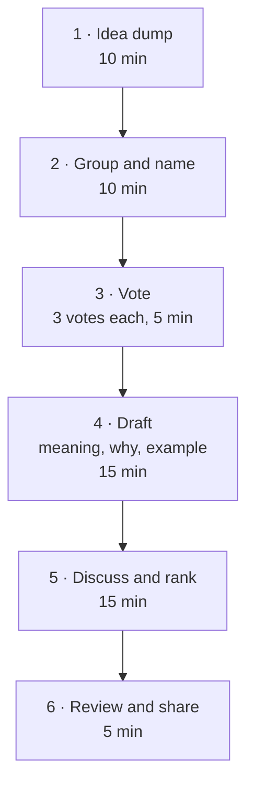

# فصل ۸: اصول و استراتژی فنی

[فصل ۷: بودجه، هزینه و فروشنده‌ها →](07-budgeting-costs-and-vendors.md) · [کتاب](../README.md) · [فصل ۹: کارهای فنی مشارکتی ←](09-collaborative-technical-practices-and-decision-making.md)

## خلاصه

استراتژی فنی مثل یک اسلاید ۲۰۰ صفحه‌ای به نظر می‌رسد، ولی فقط می‌پرسد فناوری و اصول و معماری و توانمندی‌هایتان برای رسیدن به هدف‌های کسب‌وکار باید چه شکلی باشند و چطور به آن‌جا برسید. جایش در نقشه‌ی راه شماست و در محیط آشوب‌زده باید خم شود. این فصل آن را لایه‌لایه می‌سازد: سیاهه‌ای از چشم‌انداز فعلی، هم انسانی و هم فنی؛ مجموعه‌ای کوتاه از اصول فنیِ ساخته‌ی تیم؛ مقیاس گرفتن بدون مهندسی بیش از حد با انتخاب فناوری کسل‌کننده و خرج محتاطانه‌ی token نوآوری؛ سندی از استراتژی که جزئیاتش با گذشت زمان کم می‌شود؛ و اجرایی که آدم‌ها را منصفانه تخصیص می‌دهد، ریسک را مدیریت می‌کند، چشم‌انداز را اعلام می‌کند و با عمل الگو می‌شود (pp. 147–171).

## نکته‌های کلیدی

- **استراتژی انتخاب‌های فنی را با هدف‌های کسب‌وکار هم‌راستا می‌کند**، از جمله نیازهای غیرکارکردی مثل امنیت و انطباق و در دسترس بودن، که سازمان‌های آشوب‌زده یا نادیده‌شان می‌گیرند یا بیش از حد رویشان می‌روند (p. 148).
- **با یک سیاهه شروع کنید:** نمودار درشتی از معماری، ابزارها، صاحب‌ها، نقطه‌های تکِ شکست و شکاف‌ها، به‌علاوه‌ی آدم‌ها و processهای پشتشان (pp. 149–153).
- **اصول فنی قطب‌نمایند:** جلوی بدتر کردن اوضاع را می‌گیرند و تصمیم‌های روزمره مثل code review را هدایت می‌کنند؛ با تیم بسازیدشان (pp. 153–158).
- **بر پایه‌ی شواهد مقیاس بگیرید، نه پیش‌بینی؛** فقط چیزی را بسازید که متمایزتان می‌کند (p. 158).
- **فناوری کسل‌کننده را انتخاب کنید:** هر انتخاب غیرکسل‌کننده یکی از آن حدوداً سه token نوآوری را خرج می‌کند (pp. 160–162).
- **با جزئیات رو به کاهش برنامه بریزید**، یعنی باجزئیات برای سه‌ماهه‌ی اول و جهت‌دار برای آخری، و ماهانه بازبینی کنید (p. 163).
- **سند استراتژی زنده است** و فقط وقتی ارزشی دارد که رهبرها خودشان الگویش باشند (pp. 164–171).

## فهرست بخش‌ها

*از فهرست مطالب خود کتاب، از bookmarkهای PDF؛ شماره‌ها صفحه‌ی چاپی‌اند.*

- چرا استراتژی فنی اهمیت دارد؟ — p. 148
- ساختن یک پایه — p. 149
- فقط قطعه‌های فنی کافی نیستند — p. 151
- برقرار کردن اصول فنی — p. 153
  - نمونه‌هایی از اصول فنی — p. 154
  - کارگاه ساختن اصول فنی — p. 156
  - زندگی کردن با اصولتان — p. 158
- مقیاس گرفتن بدون مهندسی بیش از حد — p. 158
  - فناوری کسل‌کننده را انتخاب کنید — p. 160
- پروراندن استراتژی فنی‌تان — p. 162
  - انتخاب سطح جزئیات — p. 163
  - تعادل انعطاف و جهت — p. 164
  - پروراندن مشارکتی — p. 164
  - اجزای سند استراتژی فنی — p. 164
  - رویکرد سند زنده — p. 167
  - واقعی کردن استراتژی فنی — p. 167
- جمع‌بندی: ممکن کردن اجرا با استراتژی فنی — p. 171

## یادداشت‌ها

استراتژی فنی «برنامه‌ی جامعی است که تصمیم‌های فناوری و انتخاب‌های معماری و پروراندن توانمندی را با هدف‌های کسب‌وکار هم‌راستا می‌کند». بخشی نقشه‌ی راه است و بخشی نقشه‌ی ساختمان، یعنی سند معماری به‌علاوه‌ی فهرستی از ابزارها و معیار انتخابشان، و پایه‌ی برنامه‌ی افزودن آدم و مهارت است (p. 147).

### چرا استراتژی فنی اهمیت دارد؟

- هر تصمیم فنی را، از معماری تا «این هفته کدام framework جاوااسکریپتی؟»، با چیزی که شرکت دنبالش است هم‌راستا نگه می‌دارد (p. 148).
- برنامه‌های خشک زود کهنه می‌شوند؛ استراتژی باید انعطاف‌پذیر و تکرارشونده باشد و بین سرعت و دست‌وپا زدن تعادل برقرار کند (p. 148).
- **نیازهای غیرکارکردی جایشان همین‌جاست:** مقررات GDPR اگر مشتری اروپایی دارید، گواهی SOC 2 اگر مشتری‌ها انتظارش را دارند، و دو منطقه‌ی cloud اگر uptime قول داده‌اید. نیاز امروز را مستند کنید و از بهینه‌سازی زودهنگام پرهیز کنید (p. 148).
- **استراتژی محصول می‌گوید چه و چرا؛ استراتژی فنی می‌گوید چطور.** در شرکت‌های اولیه این دو جدایی‌ناپذیرند؛ بعدتر از هم فاصله می‌گیرند ولی باید هم‌راستا بمانند (p. 148).

### ساختن یک پایه

باید بدانید کجا ایستاده‌اید. سیاهه به‌ندرت از مستندات کامل شروع می‌شود؛ محتمل‌تر این است که فهرستی از اپلیکیشن‌ها و زبان‌ها و frameworkها و ابزارها باشد که به چیزی پخته‌تر تکاملش می‌دهید (p. 149).

*Figure 8-1 (p. 149): طرحی که James در روز اولش از سیستم‌های یک استارتاپ کشید، از دل گفت‌وگو با تیم؛ کار سختی نیست و کادر و پیکان و ابزارهای دور و برش برای شروع کافی‌اند.*

تا پایان هفته‌ی اول، James نمودار را با گردش‌کارهای بیشتر حاشیه‌نویسی کرده بود، بیشتر ابزارها و شکاف‌های دیگر را مستند کرده بود، نقطه‌های تکِ شکست را پیدا کرده بود، سیستم‌ها را به صاحب‌هایشان وصل کرده بود، یعنی Rae برای backend و Jeff برای frontend با React و Jess برای CI/CD، ضعف‌هایی مثل پوشش تست backend زیر ۵۰٪ را یادداشت کرده بود، دنبال مستندات و رویه‌ها گشته بود که چیز زیادی نبود، امنیت و انطباق را سنجیده بود و شروع کرده بود به صورت‌بندی این‌که اول سراغ چه چیزی برود (p. 150).

### فقط قطعه‌های فنی کافی نیستند

استراتژی را آدم‌ها پیاده و اجرا می‌کنند، پس تخصص تیم و گردش‌کارها و وابستگی‌ها را هم بفهمید: «درخشان‌ترین استراتژی فنی دنیا که تیمتان نتواند اجرایش کند» سندی بی‌فایده است (p. 151).

*Figure 8-2 (p. 152): فهرست وارسی James از چیزهایی که در سازمانی تازه باید درباره‌شان پرسید، در چهار حوزه، یعنی شرکت و محصول و انسان‌ها و فنی. هر قلم را سرسری نگاه کنید و تصمیم بگیرید: خوب است، کار دارد، یا اصلاً نیست و آیا باید نگرانم کند.*

برای هر قلم به یکی از سه نتیجه برسید: کاری لازم نیست؛ کار دارد، که باید بگویید چه کاری و کِی؛ یا هیچ چیزی نیست و باید بپرسید این باید نگرانم کند؟ بعد چیزهای خراب را اولویت بدهید (p. 153).

### برقرار کردن اصول فنی

بهترین اصول روشن و فشرده و بدون اصطلاح تخصصی‌اند، **رو به جلو و آرمانی‌اند**، و آن‌قدر مشخص‌اند که تصمیم روزمره را هدایت کنند و آن‌قدر منعطف‌اند که جلوی نوآوری را نگیرند؛ وگرنه تیم دورشان می‌زند (p. 153). حتی وقتی بخش زیادی از محیط آن‌ها را نقض می‌کند، اصول دو کار می‌کنند (pp. 153–154):

۱. **جلوی بدتر کردن اوضاع را می‌گیرند**؛ قطب‌نمایی در برابر ریختن پول خوب پشت پول بد.
۲. **در کل چرخه‌ی عمر تصمیم‌ها را هدایت می‌کنند**؛ بهترین‌هایشان آن‌هایی‌اند که سر review یک pull request یا طراحی یک محصول یا انتخاب فناوری تازه به آن‌ها ارجاع می‌دهند.

#### نمونه‌هایی از اصول فنی

چهارده نمونه که هر کدام با کم کردن هزینه یا بالا بردن رضایت مشتری یا ممکن کردن رشد به هدف‌های کسب‌وکار خدمت می‌کنند (pp. 154–155):

| اصل | دلیل کسب‌وکاری (pp. 154–155) |
|---|---|
| اول سادگی | هزینه‌ی پشتیبانی کمتر، onboarding سریع‌تر |
| مقیاس‌پذیری | رشد مشتری بدون بازنویسی |
| ماژولار بودن | توسعه‌ی موازی، رسیدن سریع‌تر به بازار |
| reliability | نگه‌داشت مشتری، churn کمتر |
| قابلیت نگه‌داری | هزینه‌ی بلندمدت کمتر |
| مستندسازی | onboarding سریع‌تر، سیلوی کمتر |
| تست | هیچ کد تست‌نشده یا شکست‌خورده‌ای merge نمی‌شود؛ نقص کمتر |
| دیده شدن | observability و متریک تصمیم داده‌محور را ممکن می‌کنند |
| امنیت از پایه | ریسک نشت کمتر، اعتماد مشتری |
| حواس‌جمعی به performance | تجربه‌ی بهتر کاربر، متعادل با نیازهای عملی |
| یکدستی | بار ذهنی کمتر |
| automation | هزینه‌ی عملیاتی کمتر |
| گشودگی | استانداردهای باز از قفل شدن به فروشنده جلوگیری می‌کنند |
| تکامل | هزینه‌ی refactoring آینده کمتر |

#### کارگاه ساختن اصول فنی

قالبی مشارکتی و یک‌ساعته، تا اصول از خرد جمعی دربیایند نه از سلیقه‌ی یک نفر (pp. 156–157):

نتیجه را در architecture decision recordها و فهرست وارسی code review و مواد onboarding بگذارید (p. 157).

> **کادر In Practice: داستان April** (p. 157). او کارگاه را از نقطه‌های درد شروع می‌کند: کد frontend مستندنشده، stored procedureهای ناخوانا، و سیستم احراز هویتی که دستی باید ری‌استارت شود. تیم به «مستندسازی پیش از استقرار» و «اول فناوری کسل‌کننده» و «به‌طور پیش‌فرض قابل‌مشاهده» می‌رسد. آدم‌های ارشد مقاومت می‌کنند تا April ساعت‌هایی را نشان می‌دهد که آن فصل فقط صرف رمزگشایی کد همدیگر شده.

#### زندگی کردن با اصولتان

همه‌ی رهبرها، از CTO تا مدیرهای مهندسی و staff و principal engineerها، باید پرچم‌دار اصول باشند تا همه چیز را از استراتژی تا کد شکل بدهند (p. 158).

> **In practice:** چند اصل فنی روشن تصمیم‌های روزمره‌ی تیم داده را بدون جلسه حل می‌کند.
>
> **Your turn:** سه اصل برای platform داده‌ی خودتان بنویسید.
>
> *Answer:* نمونه: «هر جدول Gold مالک و تست دارد»، «هر چیزی که در production اجرا می‌شود از git و Argo CD می‌آید»، «PII پیش از warehouse hash می‌شود». کتاب اصول خوب را فشرده، آرمانی و آن‌قدر مشخص می‌خواهد که تصمیم روزمره را هدایت کنند (pp. 153–157).

### مقیاس گرفتن بدون مهندسی بیش از حد

ساده نگهش دارید؛ سراغ نیاز امروز بروید و بگذارید تقاضای واقعی و داده تصمیم‌های مقیاس را برانند (p. 158). معامله‌های کلیدی **تمایز در برابر کالا**، یعنی فقط چیزی را بسازید که متمایزتان می‌کند و بقیه را بخرید، و **مقیاس‌پذیری به‌موقع**، یعنی بر پایه‌ی شواهد مقیاس بگیرید نه پیش‌بینی خوش‌بینانه، هستند (p. 158).

- **نمونه: دیتابیس‌ها.** دیتابیس PostgreSQL برای بیشتر اپلیکیشن‌ها انتخاب اول خوبی است، چون پربازده و خوب‌پشتیبانی‌شده است و زیست‌بوم سالمی دارد، البته همراه با schema عاقلانه، مثل استفاده از bigint برای فیلدهای عددی‌ای که ممکن است بزرگ شوند. دیتابیس SQLite به کاربرد تعبیه‌شده و توسعه می‌خورد؛ و CockroachDB وقتی که واقعاً به توزیع جهانی نیاز دارید و از پس پیچیدگی‌اش برمی‌آیید (pp. 158–159).

> **کادر In Practice: داستان April** (p. 159). تیم StudioOps دیتابیس‌های MongoDB و PostgreSQL و Redis و Elasticsearch و DynamoDB را با هم می‌گرداند، هر کدام چون «همان چیزی است که آن مهندس ارشد بهتر بلد است». صورت‌حساب AWS ماهی ۴۵٬۰۰۰ دلار است که ۱۲٬۰۰۰ دلارش برای پنج دیتابیس است. جمع کردنشان روی PostgreSQL با نگه داشتن Redis صورت‌حساب را به ۳۱٬۰۰۰ دلار و زمان استقرار را ۴۰٪ کم می‌کند.

- **از کشسانی cloud و SaaS استفاده کنید** به‌جای معماری‌ای که می‌خواهد هر آینده‌ای را پیش‌بینی کند (p. 159). شرکت بزرگی که Juan در آن بود ابزارهای ticketing و مدیریت سرویس خودش را ساخته بود، که نان‌و‌آب نبود و تمایز هم نمی‌آورد، و به خریدن رو آورد (p. 160).
- **معماری تطبیق‌پذیر** تدریجی تکامل می‌یابد: microservice جایی که به کار می‌آید نه به‌طور پیش‌فرض، لایه‌های انتزاع، مرزهای روشن API، و زیست‌بوم‌های قوی (p. 160).

#### فناوری کسل‌کننده را انتخاب کنید

هر تصمیمی یک معامله است؛ صریح بگویید چه چیزی را مقدم می‌دانید. در برابر بازنویسی با تازه‌ترین زبان یا framework صفحه‌ی اول Hacker News مقاومت کنید (p. 160). کتاب از **token نوآوری** Dan McKinley نقل می‌کند: هر شرکت حدود سه‌تا دارد و هر انتخاب فناوری غیرکسل‌کننده یکی را خرج می‌کند (pp. 160–161). کسل‌کننده یعنی بد نیست؛ PostgreSQL و Python و cron کسل‌کننده و خوب‌اند. نویسنده‌ها می‌گویند امروز «باید Kubernetes بگیریم» یا «به service mesh نیاز داریم» را در سطل token می‌گذارند (p. 161). هر تلاش refactoring تلاشی است که صرف محصول نشده (p. 161).

> **کادر In Practice: داستان April** (p. 162). مهندسی به نام Marcus پیشنهاد می‌دهد احراز هویت با Rust بازنویسی شود. سیستم فعلی با Node.js در ثانیه ۱٬۰۰۰ درخواست را با p99 برابر ۵۰ میلی‌ثانیه جواب می‌دهد؛ Rust شاید به ۲۰ میلی‌ثانیه برسد، ولی هیچ‌کس در تیم Rust بلد نیست. دو token از قبل خرج شده، یعنی موتور رندر انیمیشن و همکاری بلادرنگ که هر دو متمایزکننده‌اند. پیشنهاد پس گرفته می‌شود و یک هفته بهینه‌سازی Node.js به ۳۵ میلی‌ثانیه می‌رسد.

فناوری تازه باید ارزش اندازه‌پذیر بسازد: هزینه‌ی عملیاتی کمتر، توسعه‌ی سریع‌تر، بازار بزرگ‌تر، مشتری راضی‌تر یا درآمد تازه؛ وگرنه احتمالاً دارید tokenها را نابخردانه خرج می‌کنید (p. 162).

> **Try it:** [tokenهای نوآوری](../widgets/08-innovation-tokens.html)؛ با سه token، یک stack از انتخاب‌های کسل‌کننده و براق بسازید و ببینید استدلال کتاب اجازه می‌دهد کدام انتخاب‌ها بمانند.

> **In practice:** وسوسه‌ی افزودن Kafka، streaming یا shard کردن ClickHouse پیش از نیاز واقعی همیشه هست.
>
> **Your turn:** کسی می‌خواهد loader ساعتی را به streaming تبدیل کند. چه داده‌ای می‌خواهید پیش از تصمیم؟
>
> *Answer:* کدام تصمیم کسب‌وکار با تأخیر یک‌ساعته آسیب می‌بیند، و هزینه‌ی نگهداری یک سیستم streaming. کتاب می‌گوید سراغ نیاز امروز بروید و بگذارید تقاضای واقعی تصمیم مقیاس را براند (pp. 158–161).

### پروراندن استراتژی فنی‌تان

استراتژی مثل برنامه‌ریزی سفر است: مقصد، مسیر، و جا برای انحراف؛ پویاست نه ایستا (pp. 162–163).

- **انتخاب سطح جزئیات.** پنجره‌ای عملی بردارید؛ یک سه‌ماهه می‌تواند یک عمر باشد و یک سال هم ممکن است. جزئیات را کم کنید: زیاد در سه‌ماهه‌ی اول، متوسط در دوم و سوم، کم در چهارم؛ و ماهانه بازبینی کنید (p. 163). برنامه‌ی April: سه‌ماهه‌ی اول جمع کردن روی PostgreSQL و monitoring همه‌ی سرویس‌ها و یکدست کردن REST؛ سه‌ماهه‌ی دوم جمع کردن احراز هویت و React 18 و CI/CD؛ سه‌ماهه‌ی سوم مقیاس و بدهی؛ سه‌ماهه‌ی چهارم جهت‌دار. تا هفته‌ی ششم مهاجرت کندتر از انتظار بود، پس سه‌ماهه‌ی اول را به MongoDB محدود کرد و DynamoDB را به دوم انداخت: **استراتژی می‌ماند و تاکتیک تطبیق می‌یابد** (p. 163).
- **انعطاف همراه با جهت.** قطب‌نما، نه GPS با دستور پیچ‌به‌پیچ؛ اصول نرده‌ی محافظ‌اند، نه دیوار بتنی (p. 164).
- **پروراندن مشارکتی.** از مهندس‌ها و product و رهبری نظر بگیرید، ولی تصمیم را به کمیته نسپارید (p. 164).

#### اجزای سند استراتژی فنی

| بخش | محتوا (pp. 164–167) |
|---|---|
| مقدمه و نمای کلی | هدف، مخاطب، نتیجه‌های مورد انتظار |
| چشم‌انداز و هدف‌های راهبردی | این‌که فناوری چطور از هدف‌های شرکت پشتیبانی می‌کند، مثل «تا از کاربر بیشتر پشتیبانی نکنیم نسخه‌ی دو را نمی‌توانیم منتشر کنیم»، یا نقشه‌ی راه محصول |
| چشم‌انداز فعلی فناوری | سیستم‌های موجود با نقاط قوت و ضعف؛ با بهتر شدن اوضاع به‌روز می‌شود |
| چشم‌انداز وضعیت آینده | هسته‌ی سند: چه چیزی منسوخ، چه چیزی تکامل و چه چیزی بازنشسته می‌شود، از جمله processهایی مثل بازبینی حادثه |
| اصول فنی | یا همین‌جا نوشته می‌شوند یا به آن‌ها ارجاع می‌شود |
| نقشه‌ی راه اجرا | برنامه‌ی مرحله‌ای، با صراحت درباره‌ی این‌که کار فنی و محصولی چطور در هم بافته می‌شوند؛ مثلاً خط‌های جدا با نسبت ۷۰ به ۳۰، برداشتن فرصتی، یا کار جاسازی‌شده |
| آدم‌ها و منابع و تیم‌ها | اعضای تیم، ابزارها، بودجه‌ها، بازسازی‌های سازمانی |
| مدیریت ریسک و برنامه‌ی جایگزین | ریسک‌های مشخص و کمی‌شده با کاهش‌دهنده‌های ملموس و بازه‌ی زمانی و معیار موفقیت |
| حاکمیت و تصمیم‌گیری | نقش‌ها و رویه‌های بازبینی؛ سند RFC در فصل ۹ |
| پایش و بهبود پیوسته | متریک‌های کیفی و کمی؛ ایستگاه‌های بازبینی هر دو sprint یا ماهانه |

نمونه‌های ریسک در کتاب: سرویس احراز هویت طرف سوم با سه قطعی در شش ماه، با راه‌حل جایگزین در پنج دقیقه و هشدار سر زمان پاسخ دو ثانیه؛ سیلوی دانش پرداخت‌ها با یک مهندس به نام Rajiv، با مرور هفتگی و دو مهندس دیگر که تا سه‌ماهه‌ی سوم بتوانند پشتیبانی‌اش کنند؛ و monolithی که رفع باگ در آن ۳۰٪ بیشتر از شش ماه پیش طول می‌کشد، با بیرون کشیدن دو سرویس تا سه‌ماهه‌ی دوم (p. 166).

#### رویکرد سند زنده

مثل همان نمودار روز اول James، استراتژی هم تکامل می‌یابد؛ ماهانه یا فصلی بازبینی‌اش کنید تا در پوشه‌ای فراموش‌شده ننشیند (p. 167).

#### واقعی کردن استراتژی فنی

بیشتر استراتژی‌ها بین «این کاری است که باید بکنیم» و «واقعاً داریم انجامش می‌دهیم» شکست می‌خورند (p. 167).

| کار | یعنی چه (pp. 168–171) |
|---|---|
| تخصیص منابع بدون فرسودگی | کار سخت را پخش کنید؛ هیچ‌کس چهار سه‌ماهه‌ی پیاپی monolith قدیمی را درست نمی‌کند. «برنامه‌ریزی بد شما نباید برای تیمتان اورژانس بسازد.» |
| فناوری‌ای که خودِ آینده‌تان نفرینتان نکند | مثل خالکوبی است؛ مسئله‌ی واقعی را حل می‌کند و وقتی مدافعش رفت می‌توانیم نگهش داریم؟ |
| مدیریت ریسک | برای بزرگ‌ترین ریسک‌ها برنامه بریزید؛ بدانید چه کسی مسئول است؛ و مدام بازبینی کنید |
| «منظورم این نبود!» | «تمام‌شده» برای مهندسی و محصول و موفقیت مشتری فرق دارد؛ زبان مشترک بسازید و تصمیم‌ها و دلیلشان را مستند کنید |
| دست روی نبض | متریک‌های فنی و انسانی (فصل ۱۰) |
| تعادل بین همه چیز | معامله‌ها را صریح کنید و ثبتشان کنید |
| ساختن توانمندی | آموزش و فضا برای یاد گرفتن؛ بهره‌وری پیش از بهتر شدن افت می‌کند |
| اعلام چشم‌انداز | هدف‌های ملموس مثل «کم کردن ۵۰ درصدی خطاهای رو به مشتری…»، تکرارشده در هر رسانه‌ای |
| الگو بودن با عمل | عمل بلندتر از حرف است؛ خودتان اصول را زندگی کنید |

> **کادر In Practice: داستان April** (pp. 169–170). روبه‌روی رندر 4K برای یک مشتری کلیدی در برابر کار امنیتیِ ناشی از انطباق، تیم انتخاب کرد اول وصله‌های امنیتی حیاتی در دو sprint، بعد 4K، و بعد بازسازی کامل در سه‌ماهه‌ی دوم، که در یک architecture decision record ثبت شد. برای مهاجرت به PostgreSQL «جمعه‌های PostgreSQL» گذاشت، یک دوره خرید و هفته‌ای چهار ساعت برای یادگیری تخصیص داد: ماه اول velocity ۳۰٪ افت کرد، ولی تا ماه دوم تیم سریع‌تر از قبل تحویل می‌داد.

### جمع‌بندی: ممکن کردن اجرا با استراتژی فنی

استراتژی خوب جهتی روشن می‌گذارد که تکامل می‌یابد، بین نوآوری و عمل‌گرایی تعادل برقرار می‌کند، و روی نتیجه تمرکز دارد، نه روی فناوری جذاب (p. 171).

## بده‌بستان‌ها در یک نگاه

| انتخاب | چه می‌دهد | چه می‌گیرد |
|---|---|---|
| فناوری کسل‌کننده | ثبات، استخر استخدام، دانش عمیق تیم | از سودهای ممکن و اغلب کوچک می‌گذرید |
| خرج کردن یک token نوآوری | تمایز در جایی که مهم است | سربار عملیاتی، بی‌ثباتی، استخر استخدام کوچک‌تر |
| یک data warehouse یکپارچه | عملیات ساده‌تر، صورت‌حساب کمتر | زحمت مهاجرت؛ افت یادگیری |
| مقیاس گرفتن جلوتر از تقاضا | فضای تنفس | منابع هدررفته؛ پیچیدگی برای آینده‌ای که شاید نیاید |
| برنامه‌های باجزئیات بلندمدت | ظاهر قطعیت | در آشوب زود کهنه می‌شوند |
| استراتژی با کمیته | صدای همه شنیده می‌شود | استراتژی رقیق‌شده |
| ثبت صریح معامله‌ها | فهم مشترک | وقت نوشتن |

## فراتر از کتاب

- **یادداشت «Choose Boring Technology» از Dan McKinley** در سال ۲۰۱۵ همان متنی است که کتاب مفصل از آن نقل می‌کند؛ آن یادداشت می‌گوید مجموعه‌ی ابزار کوچک و خوب‌شناخته‌شده بهتر است، چون هزینه‌ی عملیاتی هر ابزار تازه برای همیشه پرداخت می‌شود.
- **سندهای architecture decision record** با قالب Michael Nygard در سال ۲۰۱۱، یعنی زمینه و تصمیم و پیامد، خانه‌ی سبکی برای ثبت معامله‌های April هستند؛ فصل ۹ درباره‌ی RFC حرف می‌زند.
- **کتاب *Staff Engineer* از Will Larson** نوشتن استراتژی مهندسی را جمع‌بندی چند سند طراحی می‌داند، که مکمل خوبی برای ساختار سند بالاست.

## پیوندها

- **فصل‌های مرتبط:** [فصل ۵: تعیین جهت](05-setting-direction.md) که چشم‌انداز و استراتژی را می‌گوید، [فصل ۶: تحویل محصول و کد](06-shipping-products-and-code-in-chaotic-environments.md) که اولویت‌بندی را دارد، [فصل ۷: بودجه، هزینه و فروشنده‌ها](07-budgeting-costs-and-vendors.md) که ساختن در برابر خریدن را می‌گوید، [فصل ۹: کارهای فنی مشارکتی](09-collaborative-technical-practices-and-decision-making.md) که RFC و تصمیم‌گیری را دارد، و [فصل ۱۰: متریک‌هایی که مهم‌اند](10-metrics-that-matter-for-engineering-teams.md).
- **کتاب‌های دیگر:** *The Manager's Path* درباره‌ی نقش‌های CTO و VP of Engineering حرف می‌زند، همان نقش‌هایی که فهرست وارسی ۹۰ روزه‌ی شکل ۸-۲ برایشان نوشته شده.

## خودتان را بسنجید

*پرسش‌ها و پاسخ‌ها مال vault است و از روی یادداشت‌های بالا نوشته شده؛ پاسخ‌ها به صفحه‌ی چاپی کتاب ارجاع می‌دهند.*

1. **اصول فنی حتی وقتی محیطتان هنوز با آن‌ها نمی‌خواند، چه دو کاری می‌کنند؟**

   *Answer:* جلوی بدتر کردن اوضاع را می‌گیرند، و تصمیم‌های روزمره را هدایت می‌کنند، یعنی code review و طراحی محصول و انتخاب فناوری تازه (p. 154).

2. **در نقشه‌ی ذهنی ۹۰ روز اول، برای هر قلم به کدام سه نتیجه می‌شود رسید؟**

   *Answer:* کاری لازم نیست؛ کار دارد، که باید بگویید چه کاری و کِی؛ یا هیچ چیزی نیست و باید بپرسید این باید نگرانم کند (p. 153)؟

3. **«مقیاس‌پذیری به‌موقع» یعنی چه؟**
   - [ ] از پیش برای بزرگ‌ترین باری که می‌توانید تصور کنید بسازید
   - [x] فقط وقتی مقیاس بگیرید که شواهد نیازش را نشان بدهند
   - [ ] اصلاً مقیاس نگیرید

   *Answer:* نه بر پایه‌ی پیش‌بینی‌های خوش‌بینانه (p. 158).

4. **در مدل McKinley هر شرکت چند token نوآوری دارد؟**
   - [ ] یکی
   - [x] حدود سه‌تا
   - [ ] به تعداد تیم‌هایش

   *Answer:* pp. 160–161.

5. **چرا April بازنویسی احراز هویت با Rust را رد کرد؟**

   *Answer:* آخرین token نوآوری را خرج سود ۳۰ میلی‌ثانیه‌ای‌ای می‌کرد که کسی نخواسته بود، آن هم بدون مهارت Rust در تیم؛ و یک هفته بهینه‌سازی Node.js مقدار p99 را به ۳۵ میلی‌ثانیه رساند (p. 162).

6. **سطح جزئیات برنامه‌ریزی در طول یک سال چطور باید عوض شود؟**

   *Answer:* جزئیات زیاد برای سه‌ماهه‌ی اول، متوسط برای دوم و سوم، و کم یا جهت‌دار برای چهارم، با بازبینی ماهانه (p. 163).

7. **چه چیزی یک ردیف ریسک در سند استراتژی را عمل‌شدنی می‌کند؟**

   *Answer:* ریسک مشخص و در حالت ایده‌آل کمی‌شده، به‌علاوه‌ی کاهش‌دهنده‌ای ملموس با بازه‌ی زمانی و معیار موفقیت (pp. 166–167).
