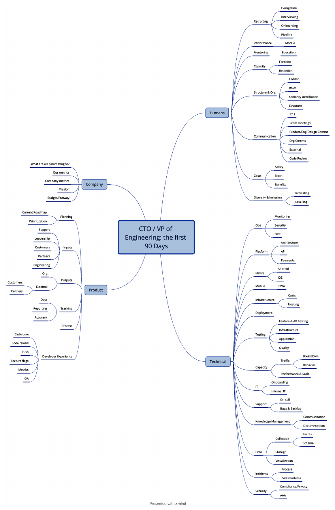
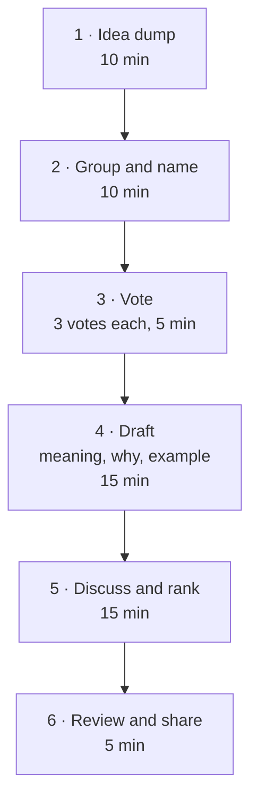

# 8. Technical Principles and Strategy

[← 7. Budgeting, Costs, and Vendors](07-budgeting-costs-and-vendors.md) · [Book](../README.md) · [9. Collaborative Technical Practices →](09-collaborative-technical-practices-and-decision-making.md)

## Summary

Technical strategy sounds like a 200-slide deck, but it just asks what your technology, principles, architecture and capabilities need to look like to meet business goals, and how to get there. It belongs in your roadmap and must flex in chaotic environments. The chapter builds it in layers: an inventory of the current landscape, human and technical; a short set of team-made technical principles; scaling without overengineering by choosing boring technology and spending innovation tokens carefully; a strategy document with granularity that fades over time; and implementation that allocates people fairly, manages risk, communicates the vision and leads by example (pp. 147–171).

## Key takeaways

- **Strategy aligns tech choices with business goals** — including non-functional needs such as security, compliance and availability, which chaotic organizations either ignore or overcompensate for (p. 148).
- **Start with an inventory:** a rough architecture diagram, tools, owners, single points of failure and gaps — plus the people and processes behind them (pp. 149–153).
- **Technical principles are a compass:** they stop you making things worse and guide everyday decisions such as code review; build them with the team (pp. 153–158).
- **Scale on evidence, not projections;** build only what differentiates you (p. 158).
- **Choose boring technology:** every non-boring choice spends one of roughly three innovation tokens (pp. 160–162).
- **Plan with fading granularity** — detailed for the next quarter, directional for the last — and review monthly (p. 163).
- **The strategy document is living,** and is only worth something when leaders model it (pp. 164–171).

## Section outline

*From the book’s own table of contents (PDF bookmarks); printed page numbers.*

- Why Does Technical Strategy Matter? — p. 148
- Building a Foundation — p. 149
- You Need More than Technical Widgets — p. 151
- Establishing Technical Principles — p. 153
  - Example Technical Principles — p. 154
  - Crafting Technical Principles Workshop — p. 156
  - Living Your Principles — p. 158
- Scaling Without Overengineering — p. 158
  - Choose Boring Technology — p. 160
- Developing Your Technical Strategy — p. 162
  - Choosing Granularity — p. 163
  - Balancing Flexibility with Direction — p. 164
  - Collaborative Development — p. 164
  - Elements of a Technical Strategy Document — p. 164
  - The Living Document Approach — p. 167
  - Making Technical Strategies Real — p. 167
- Conclusion: Enabling Execution with Technical Strategy — p. 171

## Notes

Technical strategy is "the comprehensive plan that aligns technology decisions, architecture choices, and capability development with business objectives." It is part roadmap, part blueprint — architecture document plus a register of tools and their selection criteria — and it underpins plans to add people and skills (p. 147).

### Why Does Technical Strategy Matter?

- It keeps every technical decision — from architecture down to "Which JavaScript framework should we use this week?" — aligned with what the company is trying to achieve (p. 148).
- Rigid plans go stale fast; strategy must be flexible and iterative, balancing speed against flailing (p. 148).
- **Non-functional needs belong in it:** GDPR if you have EU customers, SOC 2 if customers expect it, two cloud regions if you've promised uptime. Document today's needs and avoid premature optimization (p. 148).
- **Product strategy says what and why; technical strategy says how.** In early companies they're inseparable; later they diverge but must stay aligned (p. 148).

### Building a Foundation

You must know where you stand. The inventory rarely starts as complete documentation — more likely a list of applications, languages, frameworks and tools that you evolve into something more mature (p. 149).

*Figure 8-1 (p. 149): James's first-day sketch of a startup's systems, drawn from conversations with the team — not rocket science; boxes, arrows and the tools around them are enough to start.*

By the end of his first week James had annotated the diagram with more workflows, documented most other tools and gaps, found single points of failure, matched systems to owners (Rae for the backend, Jeff for the React frontend, Jess for CI/CD), noted weaknesses such as backend test coverage below 50%, checked for documentation and procedures (not much), assessed security and compliance, and started to formulate what to tackle first (p. 150).

### You Need More than Technical Widgets

Strategies are implemented and operated by people, so understand team expertise, workflows and dependencies too: "The most brilliant technical strategy in the world that your team can't execute" is a useless artifact (p. 151).

*Figure 8-2 (p. 152): James's checklist of what to ask about in a new organization, across four domains — company, product, humans and technical. Skim each item and decide: fine, needs work, or missing (and should that worry me?).*

For each item, reach one of three conclusions: no action needed; needs work (decide what and when); or nothing's there — should that worry me? Then prioritize what's broken (p. 153).

### Establishing Technical Principles

The best principles are clear, concise, jargon-free, **forward-looking and aspirational**, and specific enough to guide everyday decisions while flexible enough not to block innovation — otherwise the team bypasses them (p. 153). Even when much of the environment violates them, principles have a two-fold function (pp. 153–154):

1. **They stop you making things worse** — a compass against throwing good money after bad.
2. **They guide decisions throughout the lifecycle** — the best ones are referenced when reviewing a pull request, a product design or a new technology.

#### Example Technical Principles

Fourteen examples; each supports business goals by reducing costs, raising customer satisfaction, or enabling growth (pp. 154–155):

| Principle | Business reason (pp. 154–155) |
|---|---|
| Simplicity first | Lower support costs, faster onboarding |
| Scalability | Customer growth without rewrites |
| Modularity | Parallel development, faster time to market |
| Reliability | Retention, less churn |
| Maintainability | Lower long-term costs |
| Documentation | Faster onboarding, fewer silos |
| Testing | No untested or failing code is merged — fewer defects |
| Visibility | Observability and metrics enable data-driven decisions |
| Security by design | Lower breach risk, customer trust |
| Performance awareness | Better user experience, balanced against practical needs |
| Consistency | Lower cognitive load |
| Automation | Lower operating costs |
| Openness | Open standards avoid vendor lock-in |
| Evolution | Lower future refactoring costs |

#### Crafting Technical Principles Workshop

A one-hour collaborative format, so principles come from collective wisdom, not individual preference (pp. 156–157):

Put the result into architecture decision records, code review checklists and onboarding material (p. 157).

> **In Practice: April's Story** (p. 157). April starts the workshop from pain points: undocumented frontend code, unreadable stored procedures, an auth system needing manual restarts. The team derives "documentation before deployment," "boring technology first" and "observable by default." Seniors resist until April shows the hours lost that quarter just deciphering each other's code.

#### Living Your Principles

All leaders — CTOs to engineering managers, staff and principal engineers — must champion the principles so they shape everything from strategy to code (p. 158).

### Scaling Without Overengineering

Keep it simple; tackle today's requirements and let real demand and data drive scaling decisions (p. 158). The key trade-offs are **differentiation versus commodity** (build only what differentiates you; buy the rest) and **just-in-time scalability** (scale on evidence, not optimistic projections) (p. 158).

- **Example: databases.** PostgreSQL is a strong first choice for most applications — performant, well supported, with a healthy ecosystem — combined with a sensible schema (bigint for integer fields that may grow). SQLite fits embedded and development use; CockroachDB fits when you genuinely need global distribution and can afford the complexity (pp. 158–159).

> **In Practice: April's Story** (p. 159). StudioOps runs MongoDB, PostgreSQL, Redis, Elasticsearch and DynamoDB — each "what that senior engineer knows best." The AWS bill is $45,000 a month, $12,000 of it for five databases. Consolidating onto PostgreSQL (keeping Redis) cuts the bill to $31,000 and deployment time by 40%.

- **Use cloud and SaaS** elasticity rather than architecture that predicts every future (p. 159). Juan's corporation had built its own ticketing and service-management tools — bread and butter, not differentiation — and switched to buying (p. 160).
- **Adaptable architecture** evolves incrementally: microservices where appropriate (not by default), abstraction layers, clear API boundaries, strong ecosystems (p. 160).

#### Choose Boring Technology

Every decision is a trade-off; be explicit about what you prioritize. Resist rewriting in the latest language or Hacker News framework (p. 160). The book quotes Dan McKinley's **innovation tokens**: every company gets about three, and each non-boring technology choice spends one (pp. 160–161). Boring isn't bad — PostgreSQL, Python and cron are boring and good. Today the authors would put "We should use Kubernetes" or "we need a service mesh" in the token bucket (p. 161). Every refactoring effort is effort not spent on the product (p. 161).

> **In Practice: April's Story** (p. 162). Marcus proposes rewriting authentication in Rust. It handles 1,000 requests per second at a p99 of 50 ms in Node.js; Rust might reach 20 ms, but nobody on the team knows Rust. Two tokens are already spent — the animation rendering engine and real-time collaboration, both differentiators. The proposal is withdrawn; a week of Node.js optimization reaches 35 ms.

New technology should create measurable value: lower operating costs, faster development, a bigger market, happier customers or new revenue — otherwise you're probably spending tokens unwisely (p. 162).

> **Try it:** [Innovation tokens](../widgets/08-innovation-tokens.html) — build a stack from boring and shiny choices with three tokens to spend, and see which choices the book's reasoning would let you keep.

### Developing Your Technical Strategy

Strategy is like planning a holiday: destination, route, and room for detours — dynamic rather than static (pp. 162–163).

- **Choosing granularity.** Pick a practical window — a quarter can be a lifetime; a year is possible. Fade detail: high in Q1, medium in Q2 and Q3, low in Q4; review monthly (p. 163). April's plan: Q1 consolidate to PostgreSQL, monitor all services, standardize REST; Q2 auth consolidation, React 18, CI/CD; Q3 scale and debt; Q4 directional. By week 6 the migration was slower than expected, so she narrowed Q1 to MongoDB and pushed DynamoDB to Q2: **the strategy stays, the tactics adapt** (p. 163).
- **Flexibility with direction.** A compass, not turn-by-turn GPS; principles are guardrails, not concrete barriers (p. 164).
- **Collaborative development.** Get input from engineers, product and leadership — but not decision by committee (p. 164).

#### Elements of a Technical Strategy Document

| Section | Contents (pp. 164–167) |
|---|---|
| Introduction and overview | Purpose, audience, intended outcomes |
| Strategic vision and objectives | How technology supports company goals ("can't release version 2 unless we support more users") or the product roadmap |
| Current technology landscape | Existing systems with strengths and weaknesses; refreshed as things improve |
| Future state landscape | The core: what will be deprecated, evolved, decommissioned — including processes such as incident reviews |
| Technical principles | Lived here or cited |
| Implementation roadmap | Phased plan, explicit about how technical and product work interweave — lanes (for example 70/30), opportunistic pulls, or embedded work |
| People, resources and teams | Team members, tools, budgets, reorganizations |
| Risk management and contingency | Specific, quantified risks with concrete mitigations, time frames and success criteria |
| Governance and decision making | Roles and review procedures (RFCs in Chapter 9) |
| Monitoring and continuous improvement | Qualitative and quantitative metrics; checkpoints every two sprints or monthly |

The book's risk examples: a third-party auth service with three outages in six months (fallback within five minutes, alert at two-second response times); a payments knowledge silo with one engineer, Rajiv (weekly walkthroughs, two more engineers able to support it by Q3); and a monolith where bug fixes take 30% longer than six months ago (extract two services by Q2) (p. 166).

#### The Living Document Approach

Like James's first-day diagram, the strategy evolves; review it monthly or quarterly so it doesn't sit forgotten in a folder (p. 167).

#### Making Technical Strategies Real

Most strategies fail between "Here's what we should do" and "We're actually doing it" (p. 167).

| Practice | What it means (pp. 168–171) |
|---|---|
| Resource allocation without burnout | Spread the hard work; nobody fixes the legacy monolith four quarters running. "Your poor planning should not constitute an emergency for your team." |
| Tech future-you won't curse | Like a tattoo — will it solve real problems, and can we maintain it when its champion leaves? |
| Risk management | Plan for the biggest risks; know who's responsible; revisit often |
| "But that's not what I meant!" | "Done" differs between engineering, product and customer success — create shared language and document decisions and reasoning |
| Finger on the pulse | Technical and human metrics (Chapter 10) |
| Balancing all the things | Make trade-offs explicit and record them |
| Building capabilities | Training and room to learn; productivity dips before it improves |
| Communicating the vision | Concrete goals ("reducing customer-facing errors by 50%…"), repeated in every medium |
| Leading by example | Actions speak louder than words — model the principles |

> **In Practice: April's Story** (pp. 169–170). Facing 4K rendering for a key customer against compliance-driven security work, the team chose critical security patches in two sprints, then 4K, then the full overhaul in Q2 — recorded in an architecture decision record. For the PostgreSQL move she ran "PostgreSQL Fridays," bought a course and allocated four hours a week for learning: velocity fell 30% in month one, but by month two the team shipped faster than before.

### Conclusion: Enabling Execution with Technical Strategy

A good strategy sets a clear direction that evolves, balances innovation and practicality, and focuses on outcomes, not cool technology (p. 171).

## Trade-offs at a glance

| Choice | Buys | Costs |
|---|---|---|
| Boring technology | Stability, hiring pool, deep team knowledge | Forgo possible (often small) gains |
| Spending an innovation token | Differentiation where it matters | Operational overhead, instability, smaller hiring pool |
| One consolidated datastore | Simpler operations, lower bill | Migration effort; a learning dip |
| Scaling ahead of demand | Headroom | Wasted resources; complexity for a future that may not happen |
| Detailed long-range plans | Apparent certainty | Obsolete quickly in chaos |
| Strategy by committee | Everyone heard | A watered-down strategy |
| Explicit trade-off records | Shared understanding | Writing time |

## Beyond the book

- **Dan McKinley's "Choose Boring Technology"** (2015) is the essay the book quotes at length; it also argues for a small, well-understood toolset because each new tool's operational cost is paid forever.
- **Architecture decision records** (Michael Nygard's 2011 format: context, decision, consequences) are a lightweight home for April's trade-off records; Chapter 9 covers RFCs.
- **Will Larson's *Staff Engineer*** treats writing engineering strategy as synthesizing several design documents — a useful complement to the document outline above.

## Connections

- **Related chapters:** [5. Setting Direction](05-setting-direction.md) (vision and strategy), [6. Shipping Products and Code](06-shipping-products-and-code-in-chaotic-environments.md) (prioritization), [7. Budgeting, Costs, and Vendors](07-budgeting-costs-and-vendors.md) (build versus buy), [9. Collaborative Technical Practices](09-collaborative-technical-practices-and-decision-making.md) (RFCs and decision making), [10. Metrics That Matter](10-metrics-that-matter-for-engineering-teams.md).
- **Other books:** *The Manager's Path* discusses the CTO and VP of Engineering roles that Figure 8-2's 90-day checklist is written for.

## Check yourself

*Questions and answers are the vault's, written from the notes above; answers cite the book's printed pages.*

1. **What two functions do technical principles serve even when your environment doesn't yet match them?**

   *Answer:* They stop you making things worse, and they guide everyday decisions — code review, product design, choosing new technology (p. 154).

2. **In the first-90-days mind map, what three conclusions can you reach for each item?**

   *Answer:* No action needed; needs work (decide what and when); or nothing's there — and should that worry me? (p. 153)

3. **What does "just-in-time scalability" mean?**
   - [ ] Pre-build for the largest load you can imagine
   - [x] Scale only when you have evidence you need to
   - [ ] Avoid scaling at all

   *Answer:* Not based on optimistic projections (p. 158).

4. **How many innovation tokens does a company get in McKinley's model?**
   - [ ] One
   - [x] About three
   - [ ] As many as it has teams

   *Answer:* pp. 160–161.

5. **Why did April turn down rewriting authentication in Rust?**

   *Answer:* It would spend the last innovation token on a 30 ms gain nobody had asked for, with no Rust skills on the team; a week of Node.js optimization got p99 to 35 ms (p. 162).

6. **How should planning granularity change over a year?**

   *Answer:* High detail for Q1, medium for Q2 and Q3, low or directional for Q4, reviewed monthly (p. 163).

7. **What makes a risk entry in the strategy document actionable?**

   *Answer:* Specific risk, ideally quantified, plus a concrete mitigation with time frames and success criteria (pp. 166–167).
