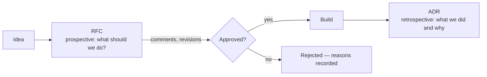

# 9. Collaborative Technical Practices and Decision Making

[← 8. Technical Principles and Strategy](08-technical-principles-and-strategy.md) · [Book](../README.md) · [10. Metrics That Matter →](10-metrics-that-matter-for-engineering-teams.md)

## Summary

In chaos, success hinges on how well teams work together and decide: decisions must be crisp and fast, with everyone moving the same way. The authors repeat the light-touch rule from Chapter 6 — people innovate in light-touch environments and stagnate in high-touch ones — and build on Chapter 8's principles. The chapter covers how shared principles shape culture as well as code, communication as multicasting the right message over the right media, collaboration like a jazz ensemble rather than a kitchen brigade, execution through coding practices, humane code review and RFCs with ADRs, and decision making founded on psychological safety, inclusive and data-driven choices, and continuous improvement of the process itself (pp. 173–205).

## Key takeaways

- **Technical principles do double duty:** they guide implementation and shape team culture — "simplicity first" also shortens meetings (pp. 174–175).
- **Make principles stick** by displaying them, referencing them in reviews and planning, modelling them, and reviewing them quarterly (pp. 176–177).
- **Product teams are jazz ensembles, not kitchen brigades** — the brigade is built for repetition, not discovery (pp. 177–179).
- **Match the medium to the message and multicast** — the same information through several media isn't spam (pp. 180–181).
- **Communication isn't done until it's understood;** passive disagreement is more dangerous than active (pp. 187–188).
- **Code reviews improve the team's output, not gatekeep;** separate "must fix" from "consider" (pp. 193–194).
- **RFCs decide before implementation; ADRs record what was decided** (pp. 194–201).
- **Psychological safety is the foundation of collaborative decisions;** fast-track reversible decisions and concentrate on irreversible ones (pp. 201–203).

## Section outline

*From the book’s own table of contents (PDF bookmarks); printed page numbers.*

- Shared Technical Principles — p. 174
- Communication, Collaboration, and Execution — p. 177
  - Communicate, Communicate, Communicate — p. 179
  - Collaboration — p. 189
  - Execution — p. 192
- Decision Making in Chaotic Conditions — p. 201
  - Psychological Safety — p. 201
  - Inclusive and Data-Driven Decision Making — p. 203
  - Continuous Improvement — p. 204
- Conclusion: Collaboration Is the Glue — p. 205

## Notes

Without robust collaborative practices, even talented engineers build the wrong things, add complexity and duplicate effort. Start with the smallest process and add only if needed (p. 173).

### Shared Technical Principles

The 14 principles from Chapter 8 are almost never purely technical — they carry social and cultural elements by design. Tabs versus spaces isn't a principle: it is narrow and delivers no real value, and principles that detailed hinder innovation (pp. 174–175).

| Principle | Technical side | Cultural side (p. 175) |
|---|---|---|
| Simplicity first | Fewer moving parts | Permission to question a 12-microservice design; shorter meetings; onboarding starts with core concepts |
| Documentation | Code comments | A teaching culture; avoids dependence on individuals |
| Automation | Infrastructure as code | Valuing everyone's time for creative work |

> **In Practice: April's Story** (p. 176). Three seniors, three philosophies: Marcus's "performance above all," Sarah's "move fast and break things," Derek's "fortress engineering" — juniors got whiplash. The first shared principle, "simplicity first," made code reviews less combative within weeks.

**Making principles stick** (pp. 176–177): display them prominently — James, a cynic, came to value printing them on the wall — and reference them in design discussions, reviews and planning; staff and principal engineers are ideal champions. Model them: if you preach simplicity but approve complex designs, the team follows your actions. Review them perhaps quarterly.

### Communication, Collaboration, and Execution

The reflex fix for uncoordinated work is rigid command and control. The authors — Juan was a professional chef — reject the **kitchen brigade** as a model (pp. 177–179):

| Kitchen brigade | Product team |
|---|---|
| Designed for execution and repetition | Discovery, iteration, problem-solving |
| "Just cook it as directed" | Best ideas come from those closest to the problem |
| Station silos are acceptable | Silos create dangerous dependencies |
| "Yes, chef!" | Questioning and challenging drive innovation |

Successful teams look more like **jazz ensembles**: individual expertise, collaborative improvisation, shared objectives (p. 179).

> **In Practice: April's Story** (p. 178). Marcus's authentication service fails at 2:00 a.m.; Derek and Sarah spend four hours on his undocumented JWT rotation; he fixes it in five minutes after his vacation. April starts "Documentation Fridays": two hours each week documenting institutional knowledge, presented to juniors until they can operate the systems.

#### Communicate, Communicate, Communicate

Communication isn't just transferring information; it creates shared context, which grows harder to keep as teams grow. Leaders weave individual contributions into a coherent narrative (p. 179).

- **Cadences:** daily check-ins, weekly syncs, monthly reviews. If you ask "Do you know what you need to know?" and see panic, look at frequency (p. 180).
- **Mediums and modalities:** different information flows best, is consumed best, and survives time zones and cultures best through different channels — so match the medium to the message and **multicast** it. Spamming is the same message repeatedly through the same medium (pp. 180–181).

| Medium | Best for | Watch out for (pp. 181–186) |
|---|---|---|
| **Visualizations** | Relationships and patterns; progressive disclosure | Over-detailed diagrams; inconsistent notation; colour alone (~8% have colour vision deficiency) |
| **Video calls** | Emotion, relationships, complex discussion; virtual coffee | Terrible for detailed work unless structured — "avoid slides. Please." |
| **Audio** | Nuanced feedback (voice-note code reviews), recorded discussions, listening on a walk | Underused |
| **Chat** | Day-to-day coordination; threads; culture channels | Firehoses; always-on pressure — create channels only when needed; Juan's prefixes (Team-, Proj-, Ext-) |
| **Email** | Formality, paper trails, crossing organizational boundaries, considered proposals | Reply-all and notification fatigue; threads of 10+ emails need another medium |
| **In person** | Whiteboarding, pairing, serendipity; off-sites every few months | Hard for distributed teams |
| **Documentation** | External team memory — "a form of time travel" | Drift; keep it with the code and in the definition of done |

On documentation: reference docs (APIs, schemas) benefit from automation; conceptual docs need human explanation and visuals; procedural docs need step-by-step examples. James's team spent three weeks reverse-engineering an undocumented API after a security incident. The adage: document the why thoroughly, the what clearly, and the how only when the code doesn't show it (pp. 186–187).

> **Try it:** [Medium matcher](../widgets/09-medium-matcher.html) — pick a channel for each message, from an architecture debate to a decision that needs a paper trail, and compare with the strengths the book gives each medium.

**Confirming understanding and handling disagreement** (pp. 187–188):

- Ask people to summarize back — framed as checking *your* explanation; ask for explicit acknowledgment of written decisions.
- If it doesn't land, switch modality; after three failed attempts, escalate or find a translator.
- **Passive disagreement** (nodding along) is more dangerous than active — invite it: "If you had to argue against this, what would you say?"
- Restate an objection before countering, then document unresolved disagreement with a trigger for revisiting it.

**Transparency and ambiguity:** reduce anxiety with frameworks, not false certainty — clear decision processes, a definition of "good enough," structured speculation. Juan's motto: "Default to open and public" (p. 188).

**Exercise: The Architecture Telephone Game** (p. 189). One person describes a system diagram verbally for two minutes; the next draws it and describes it on; compare the first and last drawings and debrief where information was lost — terminology, missing context, unstated knowledge.

#### Collaboration

- Break down "us and them" with shared goals and metrics, joint planning, and leaders who reward collaboration (pp. 189–190).
- Include everyone who should own the outcome. James fixed features rejected by users with kickoff sessions where product, engineering and QA refined requirements together (p. 190).
- Default to open channels: a private engineering channel "so nonengineers don't bug us" is the wrong answer — point people to a support channel instead (p. 190).
- Build shared language and psychological safety, for example senior "designated novice" questions such as "Can you explain that concept again? I'm not following." (p. 191)
- **Change direction based on input,** or people conclude "my input never matters" (p. 191).
- James replaced handovers (product to design to engineering to QA) with cross-functional pods, and collaboration "soared" (pp. 191–192).

#### Execution

**Coding practices** make principles concrete. Develop them collaboratively — though someone still makes the final call — aim for consistency, reinforce through mentoring and review, evolve them (what works for 3 may not work for 30), and borrow from open source (p. 192).

**Navigating code-review drama.** Reviews catch bugs, uphold standards, spread knowledge and mentor — not gatekeeping (p. 193).

> **In Practice: April's Story** (p. 193). Marcus leaves 47 comments on junior Emma's first pull request ("Did you even read the documentation?"). April finds the code solid — it just ignored Marcus's undocumented preferences. Her fix: a checklist separating "must fix" (security, bugs) from "consider" (style); constructive tone as a rule; and pairing Marcus with Emma for a week.

Talk privately to harsh reviewers — many were never taught feedback; suggest opening with positives and asking questions. James asks senior candidates what they'd tell a junior after a bad review; "suck it up" is illuminating. His "code review buddies" pre-review juniors' code (p. 194).

**Making good technical decisions: RFCs.** Architecture governance boards are "committees powered by presentation slides" (p. 194). The authors prefer **RFCs**: short proposals of significant changes that invite structured discussion, check alignment with principles (a maze of twisty passages fails "simplicity first"), and establish clear ownership — "Jamal owns this decision." Wherever they introduced RFCs, decisions got faster (pp. 194–195).

> **In Practice: April's Story** (pp. 195–196). Before RFCs, "whoever builds it first, wins" produced three logging systems. Marcus's first RFC — rewrite the backend in Rust — meets Sarah's hiring costs (three Rust developers at $300K each), Derek's estimate of 18 months without features, and the juniors' question about the 4K feature. His replacement RFC, optimizing Node.js hot paths, gives a threefold improvement in three weeks.

The book's example is an "RFC on RFCs" (pp. 196–199):

| Section | Content |
|---|---|
| Header | Title, main author, backers, status (draft, in review, rejected, approved) |
| Motivation | Early light design; shared risks and expertise; institutional knowledge; onboarding; belonging; less fear of failure; clear ownership; less bikeshedding |
| When to RFC | New endpoint, new project, architectural impact, new tool, library, technology or process — or when reviewers ask for one on a pull request |
| How to RFC | Template → numbered (000X) draft → share → all-day calendar deadline → everyone reads (no votes needed) → authors resolve comments → approve or veto → publish a readable version |
| Notes | Start work early if acceptance is likely; urgent RFCs can review in under 24 hours; allow for time zones; extend the deadline if needed |
| Drawbacks, alternatives, impact of not doing it, unresolved questions | Slower shipping at first; a Discourse-style forum; lost knowledge; including non-engineers |

RFCs are living documents and can include non-technical stakeholders (p. 200).

**ADRs** record final decisions — context, options, choice, consequences — so settled questions aren't relitigated; some teams generate them from approved RFCs (pp. 200–201).

**Leadership:** where leaders spend time signals what matters — reviews, technical discussion, knowledge sharing, protecting the team from context switching (p. 201).

### Decision Making in Chaotic Conditions

Streamline **reversible** decisions; concentrate effort on **irreversible**, high-stakes ones to reduce decision fatigue (p. 201).

#### Psychological Safety

The belief you won't be punished or humiliated for speaking up — the foundation of collaborative decisions. It focuses critique on work, not people; it doesn't lower standards (pp. 201–202). A CTO who shot down ideas got safe, predictable proposals, low morale and turnover (p. 202).

> **In Practice: April's Story** (p. 202). In architecture meetings the loudest (Marcus) won. April had everyone write proposals on sticky notes before discussion. Derek's connection pooling saved $3,000 a month; junior Alex's caching cut API latency by 60%; participation went from three speakers to eight in a month.

Leaders build it by admitting mistakes, asking "What can we learn?" not "Who screwed up?", and thanking dissenters (p. 202).

#### Inclusive and Data-Driven Decision Making

Include affected perspectives — product, design, SRE — in moderation ("vote with your feet" from meetings you don't add to). Speak in outcomes to non-technical people; draw out juniors; not everyone gets an equal vote, but all are heard. State the factors considered. Use data, and where none exists, build proofs of concept and small experiments (p. 203).

#### Continuous Improvement

Run post-decision retrospectives and process-health check-ins; amplify what works; leaders guide rather than decide everything — but remain accountable (p. 204).

> **In Practice: April's Story** (pp. 204–205). Three months in, the RFC retrospective finds RFCs under two pages approved quickly while longer ones stalled (Marcus stopped at page 3), synchronous reviews ate time, and juniors feared commenting. Fixes: a strict two-page limit with appendices, async-first review, and "RFC buddies" — juniors must ask at least one question. Decision time drops from two weeks to three days.

Model intellectual humility: "Be curious, not judgmental" — reductive, and not Walt Whitman's, but a good habit of asking rather than telling (p. 205).

### Conclusion: Collaboration Is the Glue

Shared principles, consistent practices, RFCs and inclusive collaboration aren't bureaucracy; they pay off in less rework and preserved knowledge. Start light and refine (p. 205).

## Trade-offs at a glance

| Choice | Buys | Costs |
|---|---|---|
| Brigade-style command and control | Clear roles; repeatable execution | Silos; suppressed ideas; poor fit for discovery |
| Jazz-ensemble teams | Adaptation, shared ownership | Needs shared goals and trust |
| Multicasting across media | Message reaches everyone | Effort to adapt the message |
| RFCs | Faster, owned, documented decisions | Slower shipping at first; reading time |
| Long RFCs | Thoroughness | Stall — nobody reads past page 3 |
| Async-first review | Time zones, less meeting time | Slower back-and-forth |
| Inviting more people to decisions | Diverse perspectives | Meetings people don't need |

## Beyond the book

- **Reversible versus irreversible decisions** echoes Amazon's "one-way" and "two-way door" framing from Jeff Bezos's 2015 shareholder letter.
- **Psychological safety** as a team construct comes from Amy Edmondson's research (1999); Google's Project Aristotle later found it the strongest predictor of team effectiveness.
- **Joel Parker Henderson's ADR repository** on GitHub, which the book recommends (p. 201), collects many ADR templates.

## Connections

- **Related chapters:** [8. Technical Principles and Strategy](08-technical-principles-and-strategy.md) (the 14 principles), [6. Shipping Products and Code](06-shipping-products-and-code-in-chaotic-environments.md) (light-touch process), [3. Navigating Chaos](03-navigating-chaos.md) (communication strategies), [10. Metrics That Matter](10-metrics-that-matter-for-engineering-teams.md).
- **Other books:** *The Manager's Path*'s tech lead chapter covers understanding the architecture and leading technical decisions within a team.

## Check yourself

*Questions and answers are the vault's, written from the notes above; answers cite the book's printed pages.*

1. **Why isn't "tabs versus spaces" a good technical principle?**

   *Answer:* It is a very narrow focus and delivers no real value; principles that detailed become impossible to reason about (pp. 174–175).

2. **Why do the authors reject the kitchen brigade as a model for product teams?**

   *Answer:* It was designed for execution and repetition, not creation; its hierarchy, silos and "Yes, chef!" style stifle the collaboration and challenge that discovery needs (pp. 177–178).

3. **What is the difference between multicasting and spamming?**
   - [x] Multicasting sends the message through several media; spamming repeats it through the same medium
   - [ ] Multicasting goes to more people
   - [ ] There is none

   *Answer:* p. 181.

4. **Which kind of disagreement is more dangerous, and why?**

   *Answer:* Passive disagreement — nodding along — which surfaces late as slow execution, subtle sabotage or surprise objections (p. 187).

5. **What did April's code review checklist separate?**

   *Answer:* "Must fix" items (security issues, bugs) from "consider" items (style preferences) (p. 193).

6. **What is the difference between an RFC and an ADR?**

   *Answer:* An RFC is prospective — collaborative input on what to do; an ADR is retrospective — a record of what was decided and why (pp. 200–201).

7. **What changes cut April's RFC decision time from two weeks to three days?**

   *Answer:* A two-page limit with appendices, async-first reviews, and RFC buddies who must ask at least one question (pp. 204–205).
