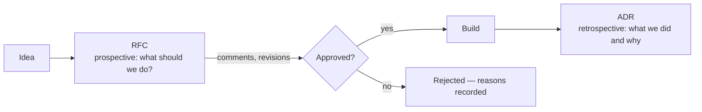

# فصل ۹: کارهای فنی مشارکتی و تصمیم‌گیری

[فصل ۸: اصول و استراتژی فنی →](08-technical-principles-and-strategy.md) · [کتاب](../README.md) · [فصل ۱۰: متریک‌هایی که مهم‌اند ←](10-metrics-that-matter-for-engineering-teams.md)

## خلاصه

در آشوب، موفقیت به این بسته است که تیم‌ها چقدر خوب با هم کار می‌کنند و تصمیم می‌گیرند: تصمیم‌ها باید تیز و سریع باشند و همه در یک جهت حرکت کنند. نویسنده‌ها همان قاعده‌ی دست‌سبک فصل ۶ را تکرار می‌کنند، یعنی آدم‌ها در محیط‌های دست‌سبک نوآوری می‌کنند و در محیط‌های دست‌سنگین راکد می‌شوند، و روی اصول فصل ۸ می‌سازند. این فصل می‌گوید اصول مشترک چطور هم به کد و هم به فرهنگ شکل می‌دهند، ارتباط یعنی پخش کردن پیام درست روی رسانه‌های درست، همکاری بیشتر شبیه گروه جَز است تا آشپزخانه‌ی نظامی، اجرا از دل رویه‌های کدنویسی و code review انسانی و RFC و ADR می‌گذرد، و تصمیم‌گیری روی امنیت روانی و انتخاب فراگیر و داده‌محور و بهبود پیوسته‌ی خود process بنا می‌شود (pp. 173–205).

## نکته‌های کلیدی

- **اصول فنی دو کار می‌کنند:** هم پیاده‌سازی را هدایت می‌کنند و هم به فرهنگ تیم شکل می‌دهند؛ «اول سادگی» جلسه‌ها را هم کوتاه‌تر می‌کند (pp. 174–175).
- **اصول را ماندگار کنید** با نمایش دادنشان، ارجاع به آن‌ها در review و برنامه‌ریزی، الگو بودن، و بازبینی فصلی (pp. 176–177).
- **تیم‌های محصول گروه جَزند، نه آشپزخانه‌ی نظامی**؛ آن ساختار برای تکرار ساخته شده، نه برای کشف (pp. 177–179).
- **رسانه را با پیام جور کنید و چندرسانه‌ای پخش کنید**؛ گفتن یک اطلاعات روی چند رسانه اسپم نیست (pp. 180–181).
- **ارتباط تا وقتی فهمیده نشود تمام نشده؛** مخالفت منفعل از مخالفت فعال خطرناک‌تر است (pp. 187–188).
- **مفهوم code review خروجی تیم را بهتر می‌کند، دروازه‌بانی نمی‌کند؛** «حتماً درست شود» را از «در نظر بگیرید» جدا کنید (pp. 193–194).
- **سند RFC پیش از پیاده‌سازی تصمیم می‌گیرد و سند ADR ثبت می‌کند چه تصمیمی گرفته شد** (pp. 194–201).
- **امنیت روانی پایه‌ی تصمیم‌های مشارکتی است؛** تصمیم‌های برگشت‌پذیر را سریع رد کنید و انرژی را روی تصمیم‌های برگشت‌ناپذیر بگذارید (pp. 201–203).

## فهرست بخش‌ها

*از فهرست مطالب خود کتاب، از bookmarkهای PDF؛ شماره‌ها صفحه‌ی چاپی‌اند.*

- اصول فنی مشترک — p. 174
- ارتباط، همکاری و اجرا — p. 177
  - ارتباط، ارتباط، ارتباط — p. 179
  - همکاری — p. 189
  - اجرا — p. 192
- تصمیم‌گیری در شرایط آشوب‌زده — p. 201
  - امنیت روانی — p. 201
  - تصمیم‌گیری فراگیر و داده‌محور — p. 203
  - بهبود پیوسته — p. 204
- جمع‌بندی: همکاری همان چسب است — p. 205

## یادداشت‌ها

بدون رویه‌های مشارکتی محکم، حتی مهندس‌های بااستعداد هم چیز اشتباه می‌سازند، پیچیدگی اضافه می‌کنند و کار تکراری انجام می‌دهند. از کوچک‌ترین process شروع کنید و فقط در صورت نیاز اضافه کنید (p. 173).

### اصول فنی مشترک

آن ۱۴ اصل فصل ۸ تقریباً هیچ‌وقت صرفاً فنی نیستند؛ عمداً عنصر اجتماعی و فرهنگی هم دارند. tab در برابر space اصل نیست: خیلی باریک است، ارزش واقعی نمی‌دهد، و اصول در این حد جزئیات جلوی نوآوری را می‌گیرند (pp. 174–175).

| اصل | سمت فنی | سمت فرهنگی (p. 175) |
|---|---|---|
| اول سادگی | قطعه‌های متحرک کمتر | اجازه‌ی زیر سؤال بردن طراحی ۱۲ microserviceای؛ جلسه‌های کوتاه‌تر؛ onboarding که از مفهوم‌های اصلی شروع می‌شود |
| مستندسازی | توضیح در کد | فرهنگ یاد دادن؛ دوری از وابستگی به افراد |
| automation | زیرساخت به‌شکل کد | ارزش دادن به وقت همه برای کار خلاقانه |

> **کادر In Practice: داستان April** (p. 176). سه آدم ارشد با سه فلسفه: «performance بالاتر از همه» برای Marcus، «سریع حرکت کن و بشکن» برای Sarah، و «مهندسی دژگونه» برای Derek؛ تازه‌کارها گیج می‌شدند. اولین اصل مشترک، یعنی «اول سادگی»، ظرف چند هفته code reviewها را کم‌تنش‌تر کرد.

**ماندگار کردن اصول** (pp. 176–177): آن‌ها را جایی پیدا نمایش بدهید، و James که آدم بدبینی است بالاخره به چاپ کردنشان روی دیوار رسید، و در بحث‌های طراحی و reviewها و برنامه‌ریزی به آن‌ها ارجاع بدهید؛ staff و principal engineerها پرچم‌دارهای ایده‌آلند. الگو باشید: اگر سادگی موعظه کنید و طراحی پیچیده را تأیید کنید، تیم از عملتان پیروی می‌کند. شاید فصلی یک‌بار بازبینی‌شان کنید.

> **In practice:** اصلی مثل «SQL با حروف بزرگ» اصل نیست؛ قاعده‌ی lint است و جایش در CI است.
>
> **Your turn:** کدام قاعده‌ها را به linter در GitLab CI می‌سپارید و کدام را اصل تیم می‌کنید؟
>
> *Answer:* سبک SQL و Python را linter اعمال کند؛ اصل باید ارزش واقعی داشته باشد، مثلاً «هر مدل Gold مالک و تست دارد». کتاب می‌گوید اصل در حد tab در برابر space خیلی باریک است (pp. 174–175).

### ارتباط، همکاری و اجرا

واکنش غریزی به کار ناهماهنگ، فرمان و کنترل خشک است. نویسنده‌ها، که Juan سرآشپز حرفه‌ای بوده، **آشپزخانه‌ی نظامی** را به‌عنوان الگو رد می‌کنند (pp. 177–179):

| آشپزخانه‌ی نظامی | تیم محصول |
|---|---|
| برای اجرا و تکرار ساخته شده | کشف، تکرار، حل مسئله |
| «همان‌طور که گفتم بپز» | بهترین ایده‌ها از نزدیک‌ترین آدم‌ها به مسئله می‌آیند |
| سیلوی ایستگاه‌ها پذیرفتنی است | سیلوها وابستگی خطرناک می‌سازند |
| «بله سرآشپز!» | پرسیدن و به چالش کشیدن نوآوری را می‌رانند |

تیم‌های موفق بیشتر شبیه **گروه جَز**ند: تخصص فردی، بداهه‌نوازی مشارکتی، هدف‌های مشترک (p. 179).

> **کادر In Practice: داستان April** (p. 178). سرویس احراز هویت Marcus ساعت ۲ بامداد خراب می‌شود؛ Derek و Sarah چهار ساعت با چرخش JWT مستندنشده‌ی او کلنجار می‌روند و خودش بعد از مرخصی در پنج دقیقه درستش می‌کند. April «جمعه‌های مستندسازی» را راه می‌اندازد: هفته‌ای دو ساعت مستند کردن دانش سازمانی، که به تازه‌کارها ارائه می‌شود تا بتوانند سیستم‌ها را بگردانند.

#### ارتباط، ارتباط، ارتباط

ارتباط فقط منتقل کردن اطلاعات نیست؛ زمینه‌ی مشترک می‌سازد، که با بزرگ شدن تیم نگه داشتنش سخت‌تر می‌شود. رهبرها مشارکت‌های فردی را به یک روایت منسجم می‌بافند (p. 179).

- **ریتم‌ها:** سرکشی روزانه، هم‌سوسازی هفتگی، بازبینی ماهانه. اگر بپرسید «چیزهایی که باید بدانید را می‌دانید؟» و وحشت ببینید، به تکرارشان نگاه کنید (p. 180).
- **رسانه‌ها و شیوه‌ها:** هر نوع اطلاعاتی بهتر از کانالی جاری می‌شود، بهتر از کانالی مصرف می‌شود و بهتر از کانالی از منطقه‌های زمانی و فرهنگ‌ها رد می‌شود؛ پس رسانه را با پیام جور کنید و **چندرسانه‌ای پخشش کنید**. اسپم یعنی همان پیام، مکرر، روی همان رسانه (pp. 180–181).

| رسانه | برای چه خوب است | مراقب چه باشید (pp. 181–186) |
|---|---|---|
| **تصویرسازی** | رابطه‌ها و الگوها؛ آشکارسازی تدریجی | نمودار بیش از حد ریز؛ نمادگذاری ناهمسان؛ تکیه بر رنگ به‌تنهایی، چون حدود ۸٪ آدم‌ها نقص دید رنگ دارند |
| **تماس تصویری** | احساس، رابطه، بحث پیچیده؛ قهوه‌ی مجازی | برای کار باجزئیات افتضاح است مگر ساختار داشته باشد؛ «از اسلاید پرهیز کنید. لطفاً.» |
| **صوت** | بازخورد ظریف مثل code review صوتی، بحث ضبط‌شده، گوش دادن حین قدم زدن | کم‌استفاده مانده |
| **چت** | هماهنگی روزمره؛ thread؛ کانال‌های فرهنگی | سیل پیام؛ فشار همیشه-روشن بودن؛ فقط وقتی لازم است کانال بسازید؛ Juan پیشوندهای Team- و Proj- و Ext- را به کار می‌برد |
| **ایمیل** | رسمیت، ردِ مکتوب، عبور از مرزهای سازمانی، پیشنهاد سنجیده | پاسخ به همه و خستگی اعلان؛ thread با بیش از ۱۰ ایمیل رسانه‌ی دیگری می‌خواهد |
| **حضوری** | وایت‌برد، pair کردن، برخوردهای اتفاقی؛ نشست هر چند ماه | برای تیم‌های پراکنده سخت است |
| **مستندات** | حافظه‌ی بیرونی تیم؛ «یک جور سفر در زمان» | رانش؛ کنار کد نگهش دارید و در تعریف «تمام‌شده» بیاوریدش |

درباره‌ی مستندات: سندهای مرجع مثل API و schema از automation سود می‌برند؛ سندهای مفهومی به توضیح انسانی و تصویر نیاز دارند؛ و سندهای رویه‌ای به نمونه‌ی قدم‌به‌قدم. تیم James بعد از یک حادثه‌ی امنیتی سه هفته صرف مهندسی معکوس یک API مستندنشده کرد. قاعده‌اش: «چرا» را کامل مستند کنید، «چه» را روشن، و «چطور» را فقط وقتی که کد خودش نشان نمی‌دهد (pp. 186–187).

> **Try it:** [جورکننده‌ی رسانه](../widgets/09-medium-matcher.html)؛ برای هر پیام یک کانال انتخاب کنید، از بحث معماری تا تصمیمی که ردِ مکتوب می‌خواهد، و با نقاط قوتی که کتاب برای هر رسانه می‌گوید مقایسه کنید.

**وارسی فهم و برخورد با مخالفت** (pp. 187–188):

- از آدم‌ها بخواهید حرف را برایتان خلاصه کنند، و قابش این باشد که دارید *توضیح خودتان* را می‌سنجید؛ و برای تصمیم‌های مکتوب تأیید صریح بخواهید.
- اگر پیام ننشست، شیوه را عوض کنید؛ بعد از سه تلاش ناموفق، ارجاع بدهید یا مترجمی پیدا کنید.
- **مخالفت منفعل**، یعنی سر تکان دادن، از مخالفت فعال خطرناک‌تر است؛ دعوتش کنید: «اگر قرار بود علیه این استدلال کنی، چه می‌گفتی؟»
- پیش از پاسخ دادن، اعتراض را دوباره بیان کنید، و بعد مخالفت حل‌نشده را با یک ماشه برای بازگشت به آن ثبت کنید.

**شفافیت و ابهام:** اضطراب را با چارچوب کم کنید، نه با قطعیت دروغین؛ یعنی process تصمیم روشن، تعریف «به‌اندازه‌ی کافی خوب»، و گمانه‌زنی ساختارمند. شعار Juan: «پیش‌فرض باز و عمومی باشد» (p. 188).

**تمرین: بازی تلفن معماری** (p. 189). یک نفر دو دقیقه نمودار یک سیستم را شفاهی توصیف می‌کند؛ نفر بعد می‌کشدش و برای نفر بعد توصیفش می‌کند؛ اولین و آخرین نقاشی را مقایسه کنید و ببینید اطلاعات کجا گم شده، یعنی اصطلاح‌ها یا زمینه‌ی نگفته یا دانش ضمنی.

#### همکاری

- «ما و آن‌ها» را با هدف و متریک مشترک و برنامه‌ریزی مشترک و رهبرهایی که همکاری را پاداش می‌دهند بشکنید (pp. 189–190).
- هر کسی را که باید صاحب نتیجه باشد دخیل کنید. James featureهایی را که کاربرها پس زده بودند با جلسه‌های شروع درست کرد، جایی که product و مهندسی و QA با هم نیازمندی‌ها را تیز می‌کردند (p. 190).
- پیش‌فرض را کانال باز بگذارید: کانال خصوصی مهندسی «تا آدم‌های غیرفنی مزاحممان نشوند» پاسخ غلطی است؛ به‌جایش آدم‌ها را به کانال پشتیبانی راهنمایی کنید (p. 190).
- زبان مشترک و امنیت روانی بسازید، مثلاً با پرسش‌های «تازه‌کارِ تعیین‌شده» از آدم‌های ارشد: «می‌شود آن مفهوم را دوباره توضیح بدهی؟ متوجه نمی‌شوم.» (p. 191)
- **بر پایه‌ی نظر آدم‌ها جهت را عوض کنید**، وگرنه نتیجه می‌گیرند «نظر من هیچ‌وقت فرقی نمی‌کند» (p. 191).
- کادر James تحویل‌دهی زنجیره‌ای از product به design به مهندسی به QA را با podهای بین‌کارکردی جایگزین کرد و همکاری «اوج گرفت» (pp. 191–192).

#### اجرا

**رویه‌های کدنویسی** اصول را ملموس می‌کنند. آن‌ها را مشارکتی بپرورانید، هرچند بالاخره یک نفر تصمیم آخر را می‌گیرد، دنبال یکدستی باشید، با منتورینگ و review تقویتشان کنید، تکاملشان بدهید، چون چیزی که برای ۳ نفر کار می‌کند شاید برای ۳۰ نفر کار نکند، و از open source قرض بگیرید (p. 192).

**رد شدن از درام code review.** review باگ می‌گیرد، استاندارد را نگه می‌دارد، دانش پخش می‌کند و منتورینگ است؛ دروازه‌بانی نیست (p. 193).

> **کادر In Practice: داستان April** (p. 193). مهندسی به نام Marcus روی اولین pull request یک تازه‌کار به نام Emma ۴۷ نظر می‌گذارد، از جمله «اصلاً مستندات را خواندی؟» April می‌بیند کد محکم است و فقط سلیقه‌های مستندنشده‌ی Marcus را نادیده گرفته. راه‌حلش: فهرست وارسی‌ای که «حتماً درست شود»، یعنی امنیت و باگ، را از «در نظر بگیرید»، یعنی سبک، جدا می‌کند؛ لحن سازنده به‌عنوان قاعده؛ و pair کردن Marcus و Emma برای یک هفته.

با بازبین‌های تند خصوصی حرف بزنید؛ خیلی‌هایشان هیچ‌وقت بازخورد دادن را یاد نگرفته‌اند؛ پیشنهاد بدهید با نکته‌ی مثبت شروع کنند و پرسش بپرسند. James از نامزدهای ارشد می‌پرسد بعد از یک review بد به یک تازه‌کار چه می‌گویند؛ پاسخ «تحمل کن» روشنگر است. «رفیق‌های code review» او کد تازه‌کارها را پیش‌بینی می‌کنند (p. 194).

**گرفتن تصمیم‌های فنی خوب با RFC.** شوراهای حاکمیت معماری «کمیته‌هایی‌اند که با اسلاید کار می‌کنند» (p. 194). نویسنده‌ها **RFC** را ترجیح می‌دهند: پیشنهادهای کوتاه برای تغییرهای مهم که بحث ساختارمند را دعوت می‌کنند، هم‌خوانی با اصول را می‌سنجند، چون هزارتویی از دالان‌های پیچ‌درپیچ از آزمون «اول سادگی» رد نمی‌شود، و مالکیت روشن برقرار می‌کنند: «Jamal صاحب این تصمیم است». هر جا RFC آوردند، تصمیم‌ها سریع‌تر شدند (pp. 194–195).

> **کادر In Practice: داستان April** (pp. 195–196). پیش از RFC، قاعده‌ی «هر کس اول بسازد برنده است» سه سیستم logging ساخته بود. اولین RFC مربوط به Marcus، یعنی بازنویسی backend با Rust، با هزینه‌ی استخدام از نگاه Sarah، یعنی سه برنامه‌نویس Rust هر کدام ۳۰۰ هزار دلار، و تخمین Derek یعنی ۱۸ ماه بدون feature، و پرسش تازه‌کارها درباره‌ی feature مربوط به 4K روبه‌رو می‌شود. RFC جایگزینش، یعنی بهینه کردن مسیرهای داغ Node.js، در سه هفته سه برابر بهبود می‌دهد.

نمونه‌ی کتاب یک «RFC درباره‌ی RFC» است (pp. 196–199):

| بخش | محتوا |
|---|---|
| سربرگ | عنوان، نویسنده‌ی اصلی، حامی‌ها، وضعیت مثل پیش‌نویس و در حال بررسی و رد‌شده و تأییدشده |
| انگیزه | طراحی سبک زودهنگام؛ ریسک و تخصص مشترک؛ دانش سازمانی؛ onboarding؛ حس تعلق؛ ترس کمتر از شکست؛ مالکیت روشن؛ بحث کمتر بر سر بی‌اهمیت‌ها |
| کِی RFC بنویسیم | endpoint تازه، پروژه‌ی تازه، اثر معماری، ابزار یا کتابخانه یا فناوری یا process تازه، یا وقتی بازبین‌ها سر یک pull request درخواستش می‌کنند |
| چطور RFC بنویسیم | قالب، بعد پیش‌نویس شماره‌دار با الگوی 000X، بعد اشتراک‌گذاری، بعد ضرب‌الاجل تمام‌روز روی تقویم، بعد خواندن همه بدون نیاز به رأی، بعد حل نظرها توسط نویسنده‌ها، بعد تأیید یا وتو، و بعد انتشار نسخه‌ی خواندنی |
| یادداشت‌ها | اگر پذیرش محتمل است کار را زود شروع کنید؛ RFCهای فوری می‌توانند زیر ۲۴ ساعت بررسی شوند؛ منطقه‌های زمانی را در نظر بگیرید؛ در صورت نیاز ضرب‌الاجل را تمدید کنید |
| معایب، جایگزین‌ها، اثر انجام ندادنش، پرسش‌های حل‌نشده | اولش تحویل کندتر می‌شود؛ یک انجمن سبک Discourse؛ دانش از‌دست‌رفته؛ دخیل کردن آدم‌های غیرمهندس |

سندهای RFC زنده‌اند و می‌توانند ذی‌نفع‌های غیرفنی را هم در بر بگیرند (p. 200).

سندهای **ADR** تصمیم‌های نهایی را ثبت می‌کنند، یعنی زمینه و گزینه‌ها و انتخاب و پیامدها، تا پرونده‌های بسته دوباره باز نشوند؛ بعضی تیم‌ها آن‌ها را از RFCهای تأییدشده تولید می‌کنند (pp. 200–201).

**رهبری:** جایی که رهبرها وقت می‌گذارند نشان می‌دهد چه چیزی مهم است، یعنی reviewها، بحث فنی، به اشتراک گذاشتن دانش، و محافظت از تیم در برابر جابه‌جایی زمینه (p. 201).

### تصمیم‌گیری در شرایط آشوب‌زده

تصمیم‌های **برگشت‌پذیر** را روان کنید؛ انرژی را روی تصمیم‌های **برگشت‌ناپذیر** و پرریسک بگذارید تا خستگی تصمیم کم شود (p. 201).

#### امنیت روانی

این باور که بابت حرف زدن تنبیه یا تحقیر نمی‌شوید؛ پایه‌ی تصمیم‌های مشارکتی. نقد را روی کار متمرکز می‌کند، نه روی آدم‌ها، و استاندارد را پایین نمی‌آورد (pp. 201–202). یک CTO که ایده‌ها را می‌کوبید در نهایت پیشنهادهای امن و قابل‌پیش‌بینی و روحیه‌ی پایین و ریزش نیرو گرفت (p. 202).

> **کادر In Practice: داستان April** (p. 202). در جلسه‌های معماری بلندترین صدا، یعنی Marcus، برنده می‌شد. April از همه خواست پیش از بحث پیشنهادشان را روی کاغذ یادداشت بنویسند. ایده‌ی connection pooling از Derek ماهی ۳٬۰۰۰ دلار صرفه‌جویی کرد؛ caching از Alex که تازه‌کار بود latency یک API را ۶۰٪ کم کرد؛ و مشارکت ظرف یک ماه از سه نفر به هشت نفر رسید.

رهبرها آن را با پذیرفتن اشتباه‌هایشان، با پرسیدن «چه یاد می‌گیریم؟» به‌جای «چه کسی خراب کرد؟»، و با تشکر از مخالف‌ها می‌سازند (p. 202).

#### تصمیم‌گیری فراگیر و داده‌محور

زاویه‌های اثرپذیر، یعنی product و design و SRE، را به‌اندازه دخیل کنید؛ «با پای خودتان رأی بدهید» و از جلسه‌هایی که چیزی به آن‌ها اضافه نمی‌کنید بیرون بیایید. با آدم‌های غیرفنی به زبان نتیجه حرف بزنید؛ تازه‌کارها را به حرف بیاورید؛ رأی همه برابر نیست، ولی حرف همه شنیده می‌شود. بگویید چه عامل‌هایی را در نظر گرفته‌اید. از داده استفاده کنید، و جایی که داده نیست، نمونه‌ی اولیه و آزمایش‌های کوچک بسازید (p. 203).

#### بهبود پیوسته

بعد از تصمیم‌ها retrospective بگیرید و سلامت process را وارسی کنید؛ چیزی را که کار می‌کند تقویت کنید؛ و رهبرها به‌جای تصمیم گرفتن درباره‌ی همه چیز هدایت کنند، ولی پاسخ‌گو بمانند (p. 204).

> **کادر In Practice: داستان April** (pp. 204–205). بعد از سه ماه، retrospective مربوط به RFCها نشان می‌دهد RFCهای زیر دو صفحه سریع تأیید می‌شوند و بلندترها می‌خوابند، چون Marcus از صفحه‌ی سوم جلوتر نمی‌رفت، بررسی هم‌زمان وقت می‌خورد، و تازه‌کارها از نظر دادن می‌ترسند. راه‌حل‌ها: سقف سخت دو صفحه با پیوست، بررسی ناهمگام به‌عنوان پیش‌فرض، و «رفیق‌های RFC» که تازه‌کارها باید دست‌کم یک پرسش بپرسند. زمان تصمیم از دو هفته به سه روز می‌افتد.

فروتنی فکری را الگو کنید: «کنجکاو باش، نه قضاوت‌گر»؛ جمله‌ای ساده‌انگارانه که مال Walt Whitman هم نیست، ولی عادت خوبی است که به‌جای گفتن بپرسید (p. 205).

> **In practice:** GitOps بیشتر تصمیم‌های deploy را برگشت‌پذیر می‌کند؛ تغییر schema و حذف داده برگشت‌ناپذیرند.
>
> **Your turn:** کدام تصمیم را در یک merge request ساده می‌گذارید و کدام را به یک سند طراحی و بازبینی تیمی می‌برید؟
>
> *Answer:* نسخه‌ی loader، تنظیم DAG و dashboardها برگشت‌پذیرند و merge request بس است؛ `ORDER BY` یک جدول بزرگ، سیاست نگهداری داده و حذف PII برگشت‌ناپذیرند و بازبینی می‌خواهند. کتاب می‌گوید تصمیم برگشت‌پذیر را روان و انرژی را روی برگشت‌ناپذیر خرج کنید (p. 201).

### جمع‌بندی: همکاری همان چسب است

اصول مشترک و رویه‌های یکدست و RFC و همکاری فراگیر دیوان‌سالاری نیستند؛ با دوباره‌کاری کمتر و دانش حفظ‌شده جبران می‌شوند. سبک شروع کنید و تیزش کنید (p. 205).

## بده‌بستان‌ها در یک نگاه

| انتخاب | چه می‌دهد | چه می‌گیرد |
|---|---|---|
| فرمان و کنترل به سبک آشپزخانه‌ی نظامی | نقش‌های روشن؛ اجرای تکرارپذیر | سیلو؛ ایده‌های خفه‌شده؛ ناجور برای کشف |
| تیم‌هایی به سبک گروه جَز | تطبیق، مالکیت مشترک | به هدف مشترک و اعتماد نیاز دارد |
| پخش چندرسانه‌ای | پیام به همه می‌رسد | زحمت تطبیق دادن پیام |
| سندهای RFC | تصمیم سریع‌تر و صاحب‌دار و مستند | اولش تحویل کندتر؛ وقت خواندن |
| RFCهای بلند | کامل بودن | می‌خوابند؛ کسی از صفحه‌ی سوم جلوتر نمی‌رود |
| بررسی ناهمگام به‌عنوان پیش‌فرض | منطقه‌های زمانی، وقت جلسه‌ی کمتر | رفت‌و‌برگشت کندتر |
| دعوت آدم‌های بیشتر به تصمیم‌ها | زاویه‌های متنوع | جلسه‌هایی که آدم‌ها لازمشان ندارند |

## فراتر از کتاب

- **تصمیم برگشت‌پذیر در برابر برگشت‌ناپذیر** یادآور قاب «در یک‌طرفه» و «در دوطرفه» در نامه‌ی ۲۰۱۵ Jeff Bezos به سهام‌داران Amazon است.
- **امنیت روانی** به‌عنوان یک سازه‌ی تیمی از پژوهش Amy Edmondson در سال ۱۹۹۹ می‌آید؛ پژوهش Project Aristotle در Google بعدتر آن را قوی‌ترین پیش‌بینی‌کننده‌ی اثربخشی تیم یافت.
- **مخزن ADR از Joel Parker Henderson** در GitHub، که کتاب پیشنهادش می‌دهد (p. 201)، قالب‌های زیادی برای ADR جمع کرده.

## پیوندها

- **فصل‌های مرتبط:** [فصل ۸: اصول و استراتژی فنی](08-technical-principles-and-strategy.md) که آن ۱۴ اصل را دارد، [فصل ۶: تحویل محصول و کد](06-shipping-products-and-code-in-chaotic-environments.md) که process دست‌سبک را می‌گوید، [فصل ۳: راه بردن در آشوب](03-navigating-chaos.md) که راهبردهای ارتباط را دارد، و [فصل ۱۰: متریک‌هایی که مهم‌اند](10-metrics-that-matter-for-engineering-teams.md).
- **کتاب‌های دیگر:** فصل tech lead در *The Manager's Path* درباره‌ی فهمیدن معماری و پیش بردن تصمیم‌های فنی داخل یک تیم حرف می‌زند.

## خودتان را بسنجید

*پرسش‌ها و پاسخ‌ها مال vault است و از روی یادداشت‌های بالا نوشته شده؛ پاسخ‌ها به صفحه‌ی چاپی کتاب ارجاع می‌دهند.*

1. **چرا «tab در برابر space» اصل فنی خوبی نیست؟**

   *Answer:* تمرکزش خیلی باریک است و ارزش واقعی نمی‌دهد؛ اصول در این حد جزئیات دیگر قابل‌استدلال نیستند (pp. 174–175).

2. **چرا نویسنده‌ها آشپزخانه‌ی نظامی را الگوی تیم محصول نمی‌دانند؟**

   *Answer:* برای اجرا و تکرار ساخته شده، نه برای خلق کردن؛ سلسله‌مراتب و سیلو و سبک «بله سرآشپز!» همان همکاری و به‌چالش‌کشیدنی را خفه می‌کنند که کشف لازم دارد (pp. 177–178).

3. **تفاوت پخش چندرسانه‌ای با اسپم چیست؟**
   - [x] پخش چندرسانه‌ای پیام را روی چند رسانه می‌فرستد و اسپم همان را روی یک رسانه تکرار می‌کند
   - [ ] پخش چندرسانه‌ای به آدم‌های بیشتری می‌رسد
   - [ ] تفاوتی ندارند

   *Answer:* p. 181.

4. **کدام جنس مخالفت خطرناک‌تر است و چرا؟**

   *Answer:* مخالفت منفعل، یعنی سر تکان دادن، که دیر و به شکل اجرای کند و خرابکاری ظریف و اعتراض‌های غافلگیرکننده رو می‌شود (p. 187).

5. **فهرست وارسی code review آپریل چه چیزی را از چه چیزی جدا کرد؟**

   *Answer:* قلم‌های «حتماً درست شود»، یعنی مسئله‌های امنیتی و باگ، را از قلم‌های «در نظر بگیرید»، یعنی سلیقه‌های سبکی (p. 193).

6. **تفاوت RFC و ADR چیست؟**

   *Answer:* سند RFC رو به جلوست، یعنی نظر مشارکتی درباره‌ی این‌که چه کار کنیم؛ و سند ADR رو به عقب است، یعنی ثبت این‌که چه تصمیمی گرفته شد و چرا (pp. 200–201).

7. **چه تغییرهایی زمان تصمیم RFC در تیم April را از دو هفته به سه روز رساند؟**

   *Answer:* سقف دو صفحه با پیوست، بررسی ناهمگام به‌عنوان پیش‌فرض، و رفیق‌های RFC که باید دست‌کم یک پرسش بپرسند (pp. 204–205).
