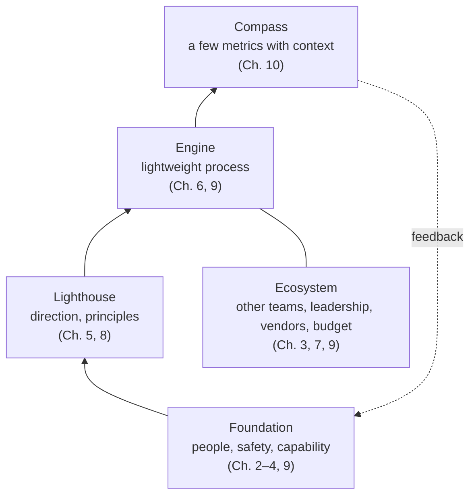
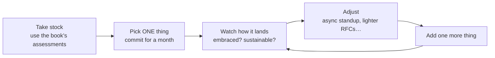

# 11. Fitting It All Together

[← 10. Metrics That Matter](10-metrics-that-matter-for-engineering-teams.md) · [Book](../README.md)

## Summary

The closing chapter ties the book together: leadership in chaos is showing up and making things a little better each day — and sometimes walking away is right for your health. With the leader as the conductor of a symphony, it layers the book's themes: a **foundation** of people and psychological safety, plus capability; a **lighthouse** of direction rather than drift; an **engine** of minimal, adaptable process; a **compass** of a few metrics with context; and an **ecosystem** beyond the team. It describes how organizations evolve from chaos to capability, admits that everything is harder than it sounds, and sets out a practice of one change at a time. Skills built in chaos become superpowers in stability, and the chapter ends with a call to lead while looking after yourself (pp. 227–239).

## Key takeaways

- **Every part influences every other,** creating virtuous or vicious cycles (p. 228).
- **Without psychological safety nothing else works** — but "a safe team that can't execute is just a support group" (pp. 228–229).
- **Direction in chaos creates coherence now;** a decent decision today usually beats a perfect one next month (pp. 229–230).
- **Process should be just enough to prevent disorder** and grow in response to real problems; "good enough" is a legitimate target (pp. 230–231).
- **A few metrics, each with a story** — "numbers cosplaying as truth" otherwise (pp. 231–232).
- **Change one thing at a time,** for at least a month, then add the next (pp. 235–236).
- **Take care of yourself;** build a support network (pp. 235, 238).

## Section outline

*From the book’s own table of contents (PDF bookmarks); printed page numbers.*

- The Symphony of Chaos — p. 228
- The Foundation: People and Safety — p. 228
- The Lighthouse: Direction, Not Drift — p. 229
- The Engine: Process and Execution — p. 230
- The Compass: Metrics and Measurement — p. 231
- The Ecosystem: Building Beyond Your Team — p. 232
- The Evolution: From Chaos to Capability — p. 233
- The Reality: It’s Harder Than It Looks — p. 234
- The Practice: Making It Real — p. 235
- The Future: Beyond Survival — p. 236
- The Call: Your Turn to Lead — p. 237
- The End, and the Beginning — p. 238

## Notes

Chaos "doesn't give out medals for endurance." Leadership in chaos isn't a perfect playbook but persistence — though persistence must not cost your mental and physical health; "Taking care of yourself first is always the right choice" (p. 227).

### The Symphony of Chaos

The leader is a conductor guiding the orchestra with cues and feedback: people are the foundation, technical infrastructure enables, processes flow beneath the surface, and metrics provide feedback. Success is momentum despite turbulence, not a perfect system (p. 228). The pieces interlock: principles shape collaboration, communication builds safety, and metrics show whether the rest works (p. 228).

*The chapter's layers as a diagram — the arrangement and chapter mapping are the vault's.*

### The Foundation: People and Safety

"If there is no trust, there is no team." Without safety, organizational scar tissue builds: innovation slows, problems fester, debt hides (pp. 228–229). Chaos itself feels unsafe, so the leader becomes the stability through consistency — listening to concerns, learning from mistakes, thanking challengers (p. 229). Safety also needs capability: user stories, code reviews, RFCs and retrospectives are scaffolding (p. 229).

### The Lighthouse: Direction, Not Drift

Direction isn't predicting the future; it's choosing a heading — north is "improve reliability," east "rapid feature development" — and knowing which ways you're *not* going. Principles create alignment without constant coordination. Be thoughtfully decisive: gather enough information, communicate, commit long enough to see results, adjust on new information without second-guessing every concern (pp. 229–230).

### The Engine: Process and Execution

Process should be "just enough to prevent disorder, but not so much that it prevents adaptation": a standup under 15 minutes, a simple Kanban board, reviews that aren't bottlenecks (p. 230). Every process costs time, energy and cognitive load (p. 231):

| Stage | Minimal viable process (p. 231) |
|---|---|
| Survival mode | Daily check-in and a shared priority list |
| Stabilizing | Add lightweight planning sessions |
| Growing | More structured communication patterns |

In chaos, "polished work is often irrelevant work": ship what solves 80% of the problem and iterate, but be intentional about the trade-offs and plan to address them (p. 231).

### The Compass: Metrics and Measurement

Don't measure everything; pick metrics for the current challenge — MTTR and change failure rate for reliability, cycle time and deployment frequency for delivery, bug rates and coverage for quality (pp. 231–232). In chaos, metrics swing for reasons unrelated to performance — a vendor outage, an emergency, finally tracking bugs properly — so every metric needs a story: otherwise "numbers cosplaying as truth" (p. 232).

### The Ecosystem: Building Beyond Your Team

RFCs give other teams visibility; documentation serves the support engineer at 2:00 a.m.; metrics build leadership's confidence. Communicate proactively upward — not hiding problems. Vendors and budgets form an extended capability network. Misalignment is expensive in chaos: every hour aligning with product saves days of rework (pp. 232–233).

### The Evolution: From Chaos to Capability

Chaos doesn't last: organizations evolve beyond it or fail. Progress is non-linear — two steps forward, one back. Each practice builds lasting capability: the RFC process may grow into architecture review, basic metrics into an insights platform. Skipping to the end state usually fails. Leaders grow too: instincts, networks, reputation (pp. 233–234).

### The Reality: It’s Harder Than It Looks

"Build psychological safety" means hundreds of small actions over months or years. "Set clear direction" means deciding with incomplete information, being wrong and admitting it. "Lightweight processes" means fighting process inflation — saying no to a process that helps one person but slows everyone else. "Meaningful metrics" means resisting measuring what's easy (pp. 234–235). Find outlets: Juan's photography ("film develops faster than organizations do"), James's productivity tools — and there's no shame in walking away (p. 235).

### The Practice: Making It Real

One lasting improvement beats ten superficial ones that evaporate under pressure. Find allies — the senior engineer holding things together (or hire one), a like-minded product manager, operations (pp. 235–236).

### The Future: Beyond Survival

Capabilities built in chaos become superpowers in stability: decision-making with incomplete information becomes agility; shipping iteratively becomes continuous delivery; safety under pressure becomes innovation. "You're not just fighting fires; you're building a fireproof foundation" (p. 236).

### The Call: Your Turn to Lead

No book can tell you exactly what to do; leadership in chaos is judgment, courage and persistence. Chaos is increasingly the norm, so the skill matters. Be present rather than perfect; you don't have to be a hero — leadership lives in small acts repeated consistently (p. 237). Extend safety and a sustainable pace to yourself, build a support network, learn selectively, keep perspective (p. 238).

### The End, and the Beginning

Engineering leadership in chaos is "not a problem to be solved but a practice to be developed." Your team needs you to help them find answers and navigate uncertainty — present, consistent, thoughtful and human. Make something better than it was yesterday (pp. 238–239).

## Trade-offs at a glance

| Choice | Buys | Costs |
|---|---|---|
| Deciding now with incomplete information | Momentum | Sometimes wrong — admit and adjust |
| Waiting for certainty | Comfort | The context changes before you decide |
| Adding process | Order | Time, energy, cognitive load |
| "Good enough" and iterate | Speed, relevance | Deliberate debt to track |
| Changing many things at once | Feels urgent | Overwhelm; nothing sticks |
| One change at a time | Lasting improvement | Feels slow |
| Persisting | Progress | Burnout, if it outweighs your health |

## Beyond the book

- **"In the arena"** (p. 237) echoes Theodore Roosevelt's 1910 "Citizenship in a Republic" speech, often quoted in leadership writing.
- **Minimal viable process** parallels the Cynefin framework's advice for chaotic domains — act first to establish stability, then sense and respond (Snowden and Boone, *HBR*, 2007).

## Connections

- **Related chapters:** every earlier chapter — [1. Embracing the Unknown](01-embracing-the-unknown.md), [3. Navigating Chaos](03-navigating-chaos.md) (safety and leadership modes), [5. Setting Direction](05-setting-direction.md), [6. Shipping Products and Code](06-shipping-products-and-code-in-chaotic-environments.md), [9. Collaborative Technical Practices](09-collaborative-technical-practices-and-decision-making.md), [10. Metrics That Matter](10-metrics-that-matter-for-engineering-teams.md).
- **Other books:** *The Manager's Path* ends with a similar call to manage yourself first.

## Check yourself

*Questions and answers are the vault's, written from the notes above; answers cite the book's printed pages.*

1. **Why is safety alone not enough?**

   *Answer:* "A safe team that can't execute is just a support group" — it also needs capability and cohesion, built with practices such as user stories, reviews, RFCs and retrospectives (p. 229).

2. **What does direction mean when you can't predict the future?**

   *Answer:* Choosing a general heading — and which ways you're not going — to create coherence in the present (pp. 229–230).

3. **What is the minimal viable process in pure survival mode?**
   - [x] A daily check-in and a shared list of priorities
   - [ ] Sprint planning, grooming, pointing, demos and architecture reviews
   - [ ] No process at all

   *Answer:* p. 231.

4. **Why does every metric need a story in chaos?**

   *Answer:* Metrics swing for reasons unrelated to team performance — vendor outages, emergencies, new tracking — so raw numbers mislead (p. 232).

5. **How do the authors recommend implementing the book?**

   *Answer:* Take stock, pick one thing, commit to it for at least a month, observe and adjust, then add one more (pp. 235–236).

6. **What happens to capabilities built in chaos once things stabilize?**

   *Answer:* They become superpowers — agility, continuous delivery, innovative culture (p. 236).
