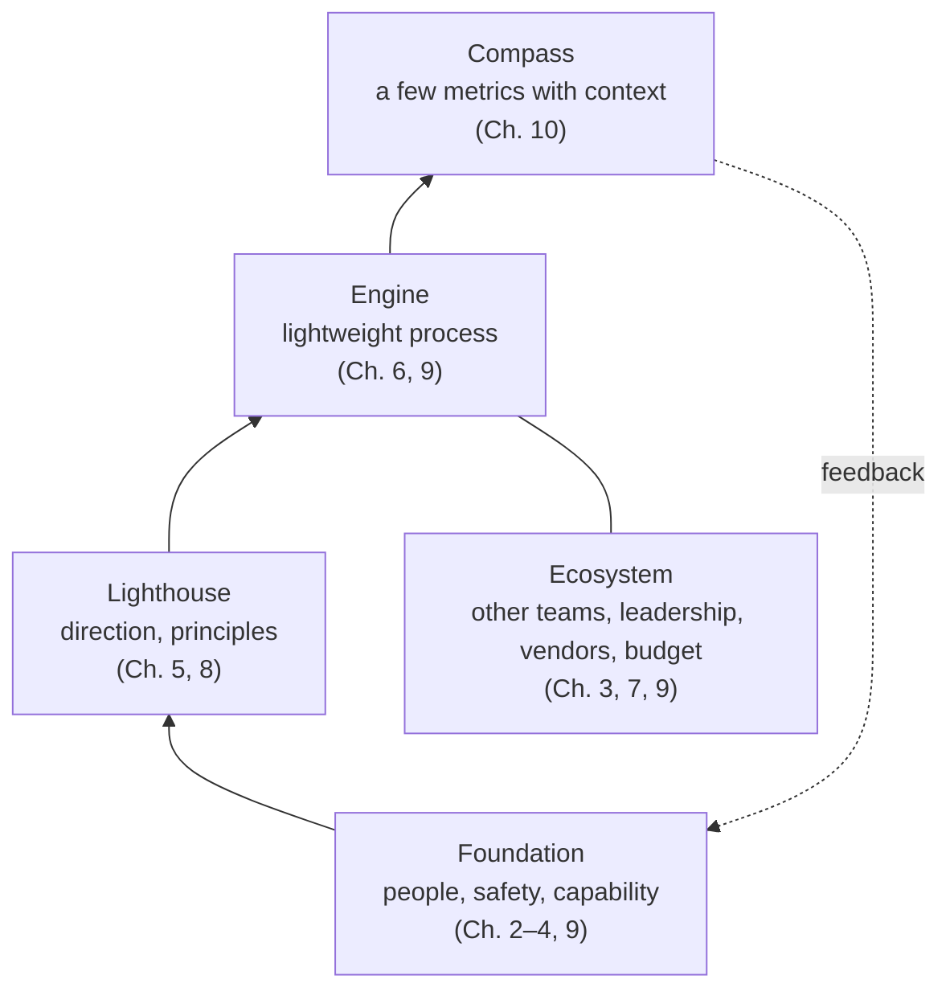
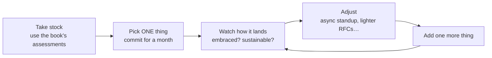

# فصل ۱۱: کنار هم گذاشتن همه چیز

[فصل ۱۰: متریک‌هایی که مهم‌اند →](10-metrics-that-matter-for-engineering-teams.md) · [کتاب](../README.md)

## خلاصه

فصل پایانی کتاب را به هم گره می‌زند: رهبری در آشوب یعنی حاضر شدن و هر روز کمی بهتر کردن اوضاع، و گاهی هم کنار کشیدن برای سلامتی‌تان همان کار درست است. با تصویر رهبر به‌عنوان رهبر ارکستر، درون‌مایه‌های کتاب را لایه‌لایه می‌چیند: **پایه‌ای** از آدم‌ها و امنیت روانی به‌علاوه‌ی توانمندی؛ **فانوس دریایی** جهت به‌جای رانش؛ **موتور** processی کمینه و تطبیق‌پذیر؛ **قطب‌نمای** چند متریک همراه با زمینه؛ و **زیست‌بومی** فراتر از تیم. می‌گوید سازمان‌ها چطور از آشوب به توانمندی تکامل می‌یابند، می‌پذیرد که همه چیز سخت‌تر از آن است که به نظر می‌رسد، و رویه‌ای می‌گذارد که هر بار یک چیز را عوض کنید. مهارت‌هایی که در آشوب ساخته می‌شوند در ثبات به ابرقدرت تبدیل می‌شوند، و فصل با دعوتی به رهبری کردن همراه با مراقبت از خودتان تمام می‌شود (pp. 227–239).

## نکته‌های کلیدی

- **هر بخش روی بخش‌های دیگر اثر می‌گذارد** و چرخه‌های فضیلت‌آمیز یا معیوب می‌سازد (p. 228).
- **بدون امنیت روانی هیچ چیز دیگری کار نمی‌کند**، ولی «تیم امنی که نمی‌تواند اجرا کند فقط یک گروه هم‌دردی است» (pp. 228–229).
- **جهت در آشوب همین حالا انسجام می‌سازد؛** تصمیم آبرومند امروز معمولاً از تصمیم بی‌نقص ماه بعد بهتر است (pp. 229–230).
- **مفهوم process باید فقط به‌اندازه‌ی جلوگیری از بی‌نظمی باشد** و در پاسخ به مسئله‌های واقعی رشد کند؛ «به‌اندازه‌ی کافی خوب» هدف مشروعی است (pp. 230–231).
- **چند متریک، هر کدام با یک روایت**؛ وگرنه «عددهایی‌اند که نقش حقیقت را بازی می‌کنند» (pp. 231–232).
- **هر بار یک چیز را عوض کنید**، دست‌کم برای یک ماه، و بعد بعدی را اضافه کنید (pp. 235–236).
- **مراقب خودتان باشید؛** شبکه‌ای از پشتیبانی بسازید (pp. 235, 238).

## فهرست بخش‌ها

*از فهرست مطالب خود کتاب، از bookmarkهای PDF؛ شماره‌ها صفحه‌ی چاپی‌اند.*

- سمفونی آشوب — p. 228
- پایه: آدم‌ها و امنیت — p. 228
- فانوس دریایی: جهت، نه رانش — p. 229
- موتور: process و اجرا — p. 230
- قطب‌نما: متریک و اندازه‌گیری — p. 231
- زیست‌بوم: ساختن فراتر از تیمتان — p. 232
- تکامل: از آشوب تا توانمندی — p. 233
- واقعیت: سخت‌تر از آن است که به نظر می‌رسد — p. 234
- رویه: واقعی کردنش — p. 235
- آینده: فراتر از بقا — p. 236
- دعوت: نوبت شماست که رهبری کنید — p. 237
- پایان، و آغاز — p. 238

## یادداشت‌ها

آشوب «برای تحمل کردن مدال نمی‌دهد». رهبری در آشوب دستورالعمل بی‌نقص نیست، پشتکار است، هرچند پشتکار نباید به قیمت سلامت روانی و جسمی‌تان تمام شود؛ «اول مراقب خودتان بودن همیشه انتخاب درستی است» (p. 227).

### سمفونی آشوب

رهبر مثل رهبر ارکستری است که با اشاره و بازخورد گروه را هدایت می‌کند: آدم‌ها پایه‌اند، زیرساخت فنی ممکن‌کننده است، processها زیر سطح جاری‌اند، و متریک‌ها بازخورد می‌دهند. موفقیت یعنی شتاب داشتن با وجود تلاطم، نه سیستمی بی‌نقص (p. 228). تکه‌ها در هم قفل‌اند: اصول به همکاری شکل می‌دهند، ارتباط امنیت می‌سازد، و متریک‌ها نشان می‌دهند بقیه کار می‌کنند یا نه (p. 228).

*لایه‌های این فصل به شکل نمودار؛ چیدمان و نگاشت فصل‌ها مال vault است.*

### پایه: آدم‌ها و امنیت

«اگر اعتمادی نباشد، تیمی نیست.» بدون امنیت، بافت زخمِ سازمانی ساخته می‌شود: نوآوری کند می‌شود، مسئله‌ها چرک می‌کنند و بدهی پنهان می‌ماند (pp. 228–229). خود آشوب حس ناامنی می‌دهد، پس رهبر با یکدستی خودش به ثبات تبدیل می‌شود، یعنی به نگرانی‌ها گوش می‌دهد، از اشتباه‌ها یاد می‌گیرد و از کسانی که به چالش می‌کشند تشکر می‌کند (p. 229). امنیت به توانمندی هم نیاز دارد: user story و code review و RFC و retrospective داربست‌اند (p. 229).

### فانوس دریایی: جهت، نه رانش

جهت یعنی پیش‌بینی آینده نیست؛ یعنی انتخاب یک سمت، که شمال «بهتر کردن reliability» باشد و شرق «توسعه‌ی سریع feature»، و دانستن این‌که به کدام سمت‌ها *نمی‌روید*. اصول بدون هماهنگی دائمی هم‌راستایی می‌سازند. سنجیده قاطع باشید: اطلاعات کافی جمع کنید، اعلام کنید، آن‌قدر پایش بمانید که نتیجه را ببینید، و با اطلاعات تازه تنظیم کنید بی‌آن‌که با هر نگرانی‌ای همه چیز را زیر سؤال ببرید (pp. 229–230).

### موتور: process و اجرا

مفهوم process باید «فقط به‌اندازه‌ی جلوگیری از بی‌نظمی باشد، ولی نه آن‌قدر که جلوی تطبیق را بگیرد»: standup زیر ۱۵ دقیقه، یک تخته‌ی ساده‌ی Kanban، و reviewهایی که گلوگاه نیستند (p. 230). هر processی وقت و انرژی و بار ذهنی خرج می‌کند (p. 231):

| مرحله | کمینه‌ی process قابل‌استفاده (p. 231) |
|---|---|
| حالت بقا | یک سرکشی روزانه و یک فهرست مشترک اولویت |
| در حال تثبیت | جلسه‌های برنامه‌ریزی سبک اضافه کنید |
| در حال رشد | الگوهای ارتباطی ساختارمندتر |

در آشوب، «کار صیقل‌خورده اغلب کار بی‌ربط است»: چیزی را تحویل بدهید که ۸۰٪ مسئله را حل می‌کند و تکرار کنید، ولی درباره‌ی معامله‌هایش عامدانه باشید و برای رسیدگی به آن‌ها برنامه بریزید (p. 231).

> **In practice:** process تیم داده باید سبک باشد: standup کوتاه، یک board ساده، و reviewی که گلوگاه نیست.
>
> **Your turn:** merge requestها در تیم به‌طور میانگین سه روز منتظر review می‌مانند. چه کار می‌کنید؟
>
> *Answer:* review را گلوگاه دیده و آن را سبک کنید: merge request کوچک‌تر، checkهای خودکار بیشتر در CI، و زمان روزانه برای review. کتاب process را فقط به‌اندازه‌ی جلوگیری از بی‌نظمی می‌خواهد (p. 230).

### قطب‌نما: متریک و اندازه‌گیری

همه چیز را اندازه نگیرید؛ متریک‌ها را برای چالش فعلی بردارید، یعنی MTTR و نرخ خرابی تغییر برای reliability، زمان چرخه و تکرار deployment برای تحویل، و نرخ باگ و پوشش برای کیفیت (pp. 231–232). در آشوب، متریک‌ها به دلیل‌هایی بی‌ربط به عملکرد نوسان می‌کنند، مثل قطعی یک فروشنده یا یک اورژانس یا این‌که بالاخره باگ‌ها را درست ثبت کرده‌اید، پس هر متریکی به یک روایت نیاز دارد؛ وگرنه «عددهایی‌اند که نقش حقیقت را بازی می‌کنند» (p. 232).

> **In practice:** متریک‌های تیم داده را برای چالش فعلی انتخاب کنید، نه همه را با هم.
>
> **Your turn:** این فصل incidentهای داده زیاد بوده. کدام دو metric را در Grafana جلوی تیم می‌گذارید؟
>
> *Answer:* MTTR برای incidentهای داده و نرخ خرابی تغییر، یعنی deployهایی که داده‌ی غلط ساختند؛ وقتی پایدار شد، سراغ metricهای تحویل بروید. کتاب متریک را بر اساس چالش فعلی انتخاب می‌کند (pp. 231–232).

### زیست‌بوم: ساختن فراتر از تیمتان

سندهای RFC به تیم‌های دیگر دید می‌دهند؛ مستندات به کار مهندس پشتیبانی ساعت ۲ بامداد می‌آیند؛ و متریک‌ها اعتماد رهبری را می‌سازند. پیش‌دستانه رو به بالا ارتباط بگیرید و مسئله‌ها را پنهان نکنید. فروشنده‌ها و بودجه شبکه‌ی توانمندی گسترده‌ای می‌سازند. ناهم‌راستایی در آشوب گران است: هر ساعتی که صرف هم‌راستایی با product می‌شود روزها دوباره‌کاری را صرفه‌جویی می‌کند (pp. 232–233).

### تکامل: از آشوب تا توانمندی

آشوب ماندگار نیست: سازمان‌ها یا از آن فراتر می‌روند یا شکست می‌خورند. پیشرفت خطی نیست؛ دو قدم جلو و یک قدم عقب. هر رویه توانمندی ماندگاری می‌سازد: process مربوط به RFC می‌تواند به بازبینی معماری رشد کند و متریک‌های پایه به یک platform بینش. پریدن مستقیم به وضعیت نهایی معمولاً شکست می‌خورد. رهبرها هم رشد می‌کنند: حس‌ها، شبکه‌ها، و اعتبار (pp. 233–234).

### واقعیت: سخت‌تر از آن است که به نظر می‌رسد

«امنیت روانی بسازید» یعنی صدها اقدام کوچک در ماه‌ها یا سال‌ها. «جهت روشن بگذارید» یعنی تصمیم گرفتن با اطلاعات ناقص و اشتباه کردن و پذیرفتنش. «process سبک» یعنی جنگیدن با تورم process، یعنی نه گفتن به processی که به یک نفر کمک می‌کند و بقیه را کند. «متریک معنادار» یعنی مقاومت در برابر اندازه گرفتن چیزی که اندازه‌گیری‌اش آسان است (pp. 234–235). دریچه‌ای برای خودتان پیدا کنید: عکاسی Juan، که «فیلم سریع‌تر از سازمان‌ها ظاهر می‌شود»، و ابزارهای بهره‌وری James؛ و کنار کشیدن هم شرمی ندارد (p. 235).

### رویه: واقعی کردنش

یک بهبود ماندگار از ده بهبود سطحی بهتر است که زیر فشار بخار می‌شوند. هم‌پیمان پیدا کنید: همان مهندس ارشدی که همه چیز را سر پا نگه داشته، یا استخدامش کنید، یک product manager هم‌فکر، و واحد عملیات (pp. 235–236).

### آینده: فراتر از بقا

توانمندی‌هایی که در آشوب ساخته می‌شوند در ثبات ابرقدرت می‌شوند: تصمیم‌گیری با اطلاعات ناقص به چابکی تبدیل می‌شود؛ تحویل تکرارشونده به continuous delivery؛ و امنیت زیر فشار به نوآوری. «شما فقط آتش خاموش نمی‌کنید؛ دارید پایه‌ای ضدآتش می‌سازید» (p. 236).

### دعوت: نوبت شماست که رهبری کنید

هیچ کتابی نمی‌تواند دقیقاً بگوید چه کار کنید؛ رهبری در آشوب قضاوت و شجاعت و پشتکار است. آشوب بیش از پیش به قاعده تبدیل می‌شود، پس این مهارت اهمیت دارد. به‌جای بی‌نقص بودن، حاضر باشید؛ لازم نیست قهرمان باشید، چون رهبری در کارهای کوچکی زندگی می‌کند که پیوسته تکرار می‌شوند (p. 237). امنیت و سرعت پایدار را به خودتان هم تعمیم بدهید، شبکه‌ی پشتیبانی بسازید، گزینشی یاد بگیرید، و چشم‌انداز را نگه دارید (p. 238).

### پایان، و آغاز

رهبری مهندسی در آشوب «مسئله‌ای برای حل کردن نیست، رویه‌ای است برای پروراندن». تیم شما لازم دارد کمک کنید پاسخ‌ها را پیدا کنند و از دل بلاتکلیفی رد شوند؛ حاضر و یکدست و سنجیده و انسانی. چیزی را از دیروزش بهتر کنید (pp. 238–239).

## بده‌بستان‌ها در یک نگاه

| انتخاب | چه می‌دهد | چه می‌گیرد |
|---|---|---|
| تصمیم گرفتن همین حالا با اطلاعات ناقص | شتاب | گاهی اشتباه است؛ بپذیرید و تنظیم کنید |
| انتظار برای قطعیت | راحتی | تا تصمیم بگیرید زمینه عوض شده |
| اضافه کردن process | نظم | وقت و انرژی و بار ذهنی |
| «به‌اندازه‌ی کافی خوب» و بعد تکرار | سرعت، ربط داشتن | بدهی عامدانه‌ای که باید پیگیری شود |
| عوض کردن چند چیز با هم | حس فوریت | غرق‌شدگی؛ هیچ چیز نمی‌ماند |
| هر بار یک تغییر | بهبود ماندگار | حس کندی |
| پشتکار | پیشرفت | فرسودگی، اگر از سلامتتان سنگین‌تر شود |

## فراتر از کتاب

- **عبارت «در میدان»** (p. 237) یادآور سخنرانی «Citizenship in a Republic» از Theodore Roosevelt در سال ۱۹۱۰ است که در نوشته‌های رهبری زیاد نقل می‌شود.
- **کمینه‌ی process قابل‌استفاده** با توصیه‌ی چارچوب Cynefin برای قلمروهای آشوب‌زده هم‌راستاست، یعنی اول عمل کنید تا ثبات برقرار شود و بعد حس کنید و پاسخ بدهید (Snowden و Boone، *HBR*، ۲۰۰۷).

## پیوندها

- **فصل‌های مرتبط:** همه‌ی فصل‌های پیشین، یعنی [فصل ۱: پذیرفتن ناشناخته](01-embracing-the-unknown.md)، [فصل ۳: راه بردن در آشوب](03-navigating-chaos.md) که امنیت و حالت‌های رهبری را دارد، [فصل ۵: تعیین جهت](05-setting-direction.md)، [فصل ۶: تحویل محصول و کد](06-shipping-products-and-code-in-chaotic-environments.md)، [فصل ۹: کارهای فنی مشارکتی](09-collaborative-technical-practices-and-decision-making.md)، و [فصل ۱۰: متریک‌هایی که مهم‌اند](10-metrics-that-matter-for-engineering-teams.md).
- **کتاب‌های دیگر:** *The Manager's Path* هم با دعوتی مشابه تمام می‌شود که اول خودتان را مدیریت کنید.

## خودتان را بسنجید

*پرسش‌ها و پاسخ‌ها مال vault است و از روی یادداشت‌های بالا نوشته شده؛ پاسخ‌ها به صفحه‌ی چاپی کتاب ارجاع می‌دهند.*

1. **چرا امنیت به‌تنهایی کافی نیست؟**

   *Answer:* «تیم امنی که نمی‌تواند اجرا کند فقط یک گروه هم‌دردی است»؛ به توانمندی و انسجام هم نیاز دارد که با رویه‌هایی مثل user story و review و RFC و retrospective ساخته می‌شوند (p. 229).

2. **وقتی نمی‌توانید آینده را پیش‌بینی کنید، جهت یعنی چه؟**

   *Answer:* انتخاب یک سمت کلی، و این‌که به کدام سمت‌ها نمی‌روید، تا همین حالا انسجام ساخته شود (pp. 229–230).

3. **کمینه‌ی process قابل‌استفاده در حالت بقای محض چیست؟**
   - [x] یک سرکشی روزانه و یک فهرست مشترک اولویت
   - [ ] برنامه‌ریزی sprint و مرتب‌سازی و امتیازدهی و دمو و بازبینی معماری
   - [ ] اصلاً هیچ processی

   *Answer:* p. 231.

4. **چرا در آشوب هر متریکی به یک روایت نیاز دارد؟**

   *Answer:* متریک‌ها به دلیل‌هایی بی‌ربط به عملکرد تیم نوسان می‌کنند، مثل قطعی فروشنده و اورژانس و ثبت تازه، پس عدد خام گمراه می‌کند (p. 232).

5. **نویسنده‌ها برای پیاده کردن کتاب چه پیشنهاد می‌دهند؟**

   *Answer:* وضعیت را بسنجید، یک چیز را بردارید، دست‌کم یک ماه پایش بمانید، نتیجه را ببینید و تنظیم کنید، و بعد یکی دیگر اضافه کنید (pp. 235–236).

6. **وقتی اوضاع باثبات شود، سر توانمندی‌هایی که در آشوب ساخته شده‌اند چه می‌آید؟**

   *Answer:* به ابرقدرت تبدیل می‌شوند، یعنی چابکی و continuous delivery و فرهنگ نوآور (p. 236).
