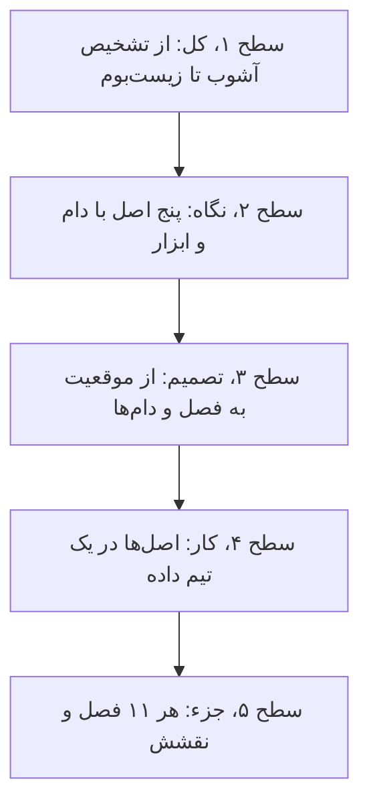
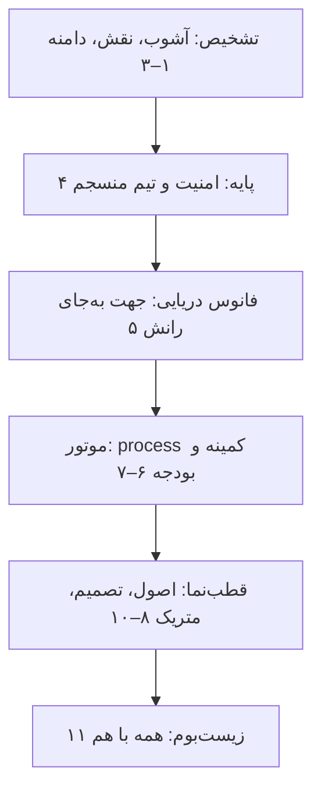
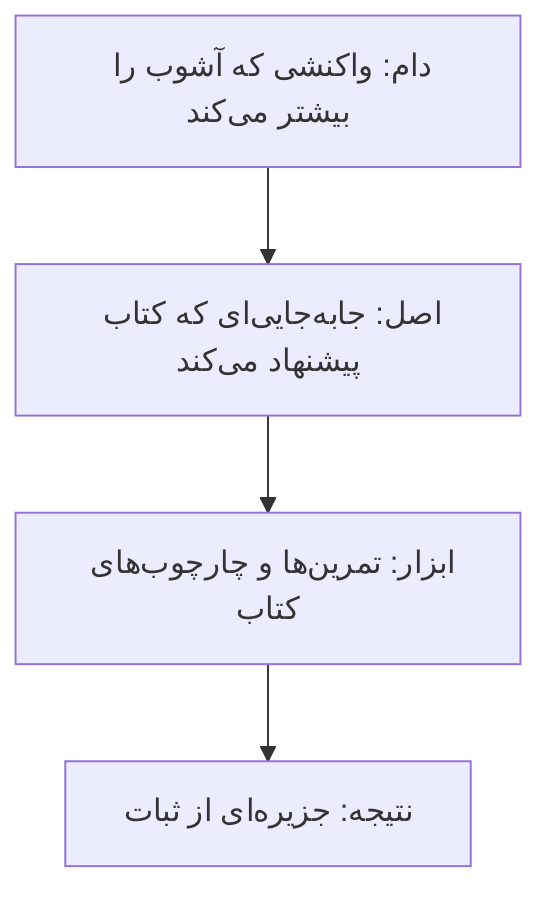
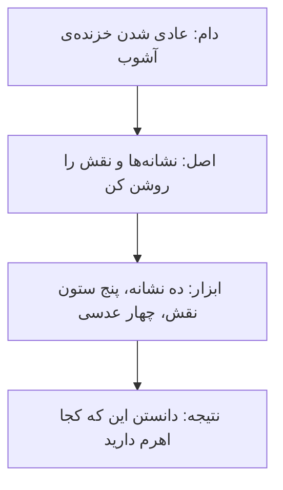
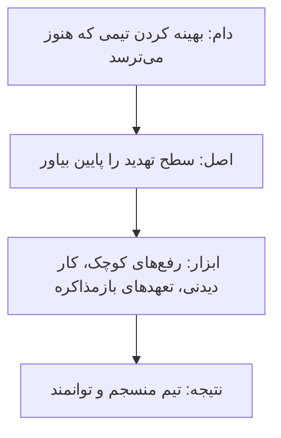
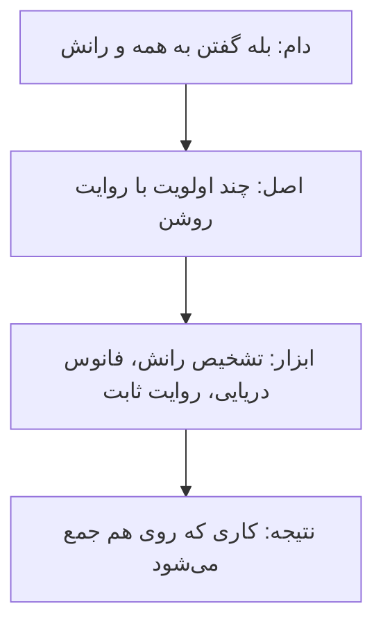
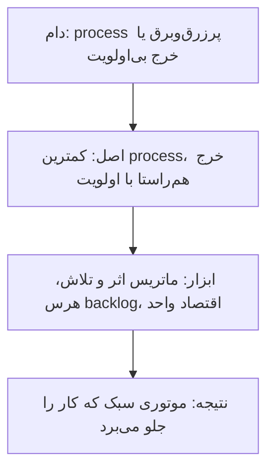
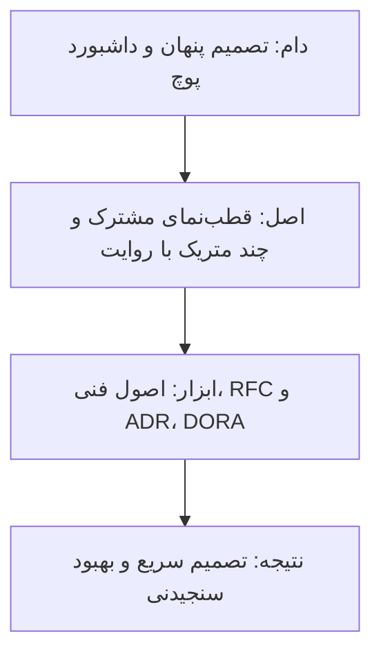

# چارچوب کتاب: رهبری در آشوب، از تشخیص تا قطب‌نما

[کتاب](README.md) · [فصل ۱ ←](chapters/01-embracing-the-unknown.md)

این صفحه **سنتز خود vault** است، نه بخشی از کتاب. فصل آخر کتاب خودش درون‌مایه‌ها را لایه‌لایه می‌چیند: پایه، فانوس دریایی، موتور، قطب‌نما و زیست‌بوم ([۱۱](chapters/11-fitting-it-all-together.md)). این چارچوب همان لایه‌ها را برمی‌دارد، تشخیص آشوب را پیش از همه می‌گذارد و پنج اصل از دل فصل‌ها بیرون می‌کشد.

چارچوب سه لایه دارد. **نقشه‌ی کتاب** نشان می‌دهد فصل‌ها چطور از شناختن آشوب به ساختن تیم و جهت و process و متریک می‌رسند. **پنج اصل** همان رشته‌ها را نام می‌برند، هر کدام با دام و ابزار و نتیجه. **راهنمای تصمیم و stack** می‌گوید در هر موقعیت کدام فصل را باز کنید و هر اصل در یک تیم داده‌ی کوچک کجا می‌نشیند. لایه‌های فصل ۱۱ مال نویسندگان‌اند؛ اصل‌ها و پیوندها مال vault است.

## تصویر کل

### کل کتاب در سه جمله

خوانش vault از کتاب، پیش از هر جزئی:

1. **آشوب را با کنترل درست نمی‌کنید؛ با دامنه و تشخیص درستش می‌کنید.** اول بشناسید با چه چیزی طرفید و نقش خودتان چیست ([۱](chapters/01-embracing-the-unknown.md)-[۳](chapters/03-navigating-chaos.md)).
2. **ترتیب مهم است: امنیت، بعد کارکرد، بعد جهت، بعد process سبک.** هر لایه روی لایه‌ی قبلی می‌ایستد ([۴](chapters/04-building-cohesive-teams.md)-[۶](chapters/06-shipping-products-and-code-in-chaotic-environments.md)، [۱۱](chapters/11-fitting-it-all-together.md)).
3. **پول و استراتژی و تصمیم و متریک ابزار هم‌راستایی‌اند، نه کنترل.** هر کدام باید کار را به هدف کسب‌وکار وصل کند و تیم را، نه فرد را، بسنجد ([۷](chapters/07-budgeting-costs-and-vendors.md)-[۱۰](chapters/10-metrics-that-matter-for-engineering-teams.md)).

### از کل به جزء

## نقشه‌ی کتاب

### شش لایه

*سطح ۱ از ۵: کل.*

لایه‌ی اول، تشخیص، اضافه‌ی vault است؛ پنج لایه‌ی بعد همان چیدمان فصل ۱۱‌اند ([۱۱](chapters/11-fitting-it-all-together.md)).

### لایه‌ها و پرسش‌هایشان

| لایه | پرسش اصلی | فصل‌ها |
|---|---|---|
| تشخیص | با چه آشوبی طرفم و کار من چیست؟ | [۱](chapters/01-embracing-the-unknown.md)، [۲](chapters/02-understanding-your-role.md)، [۳](chapters/03-navigating-chaos.md) |
| پایه | آیا تیم امن است و کارش دیدنی است؟ | [۴](chapters/04-building-cohesive-teams.md) |
| فانوس دریایی | به کجا می‌رویم و چرا فقط این چند کار؟ | [۵](chapters/05-setting-direction.md) |
| موتور | کمترین process و پولی که کار را جلو می‌برد چیست؟ | [۶](chapters/06-shipping-products-and-code-in-chaotic-environments.md)، [۷](chapters/07-budgeting-costs-and-vendors.md) |
| قطب‌نما | با چه اصلی تصمیم می‌گیریم و از کجا می‌فهمیم جواب داده؟ | [۸](chapters/08-technical-principles-and-strategy.md)، [۹](chapters/09-collaborative-technical-practices-and-decision-making.md)، [۱۰](chapters/10-metrics-that-matter-for-engineering-teams.md) |
| زیست‌بوم | این‌ها چطور روی هم اثر می‌گذارند؟ | [۱۱](chapters/11-fitting-it-all-together.md) |

## پنج اصل

*سطح ۲ از ۵: نگاه.*

هر اصل با یک زنجیره‌ی چهارتایی شروع می‌شود: **دام** رایج، **اصل**، **ابزاری** از کتاب که اصل را عملی می‌کند و **نتیجه**.

### اصل ۱: پیش از عمل تشخیص بده

- **آشوب می‌تواند عادی‌شدنی خزنده باشد** و هم فرصت است و هم فرساینده ([۱](chapters/01-embracing-the-unknown.md)).
- **نقش رهبر پنج ستون دارد**: آدم‌ها، مأموریت، برنامه، process و محصول؛ به کار فنی راحت عقب‌نشینی نکنید ([۲](chapters/02-understanding-your-role.md)).
- **تشخیص خنثی نیست**؛ با دامنه، و نه کنترل، بین خلبان و امدادگر و مهندس جابه‌جا شوید ([۳](chapters/03-navigating-chaos.md)).

### اصل ۲: اول امنیت، بعد سرعت

- **از درون به بیرون بازسازی کنید**: امنیت، کارکرد، توانمندی و بعد رشد ([۴](chapters/04-building-cohesive-teams.md)).
- **رفع‌های کوچک اعتماد می‌سازند** و همه‌ی کار باید دیدنی و اولویت‌بندی‌شده باشد ([۴](chapters/04-building-cohesive-teams.md)).
- **بدون امنیت روانی هیچ چیز دیگری کار نمی‌کند** ([۱۱](chapters/11-fitting-it-all-together.md)).

### اصل ۳: تمرکز به‌علاوه‌ی شتاب

- **از بیرون، آشوب شبیه شتاب است و از درون حس رانش دارد** ([۵](chapters/05-setting-direction.md)).
- **جهت خوب یعنی تمرکز به‌علاوه‌ی شتاب**؛ هم‌راستایی توافق نیست ([۵](chapters/05-setting-direction.md)).
- **برنامه‌ها عوض می‌شوند ولی روایت می‌ماند**؛ استراتژی فنی همان جهت را به انتخاب‌های فنی می‌برد ([۵](chapters/05-setting-direction.md)، [۸](chapters/08-technical-principles-and-strategy.md)).

### اصل ۴: process و پول به اندازه

- **همیشه می‌شود process اضافه کرد ولی برداشتنش سخت است**؛ یک process که ۸۰٪ وقت‌ها کار کند موفقیت است ([۶](chapters/06-shipping-products-and-code-in-chaotic-environments.md)).
- **بودجه‌ریزی همان اولویت‌بندی است** و خرج باید با اولویت‌های اعلام‌شده بخواند ([۷](chapters/07-budgeting-costs-and-vendors.md)).
- **اقتصاد واحد تصمیم فنی را به تصمیم کسب‌وکاری تبدیل می‌کند** ([۷](chapters/07-budgeting-costs-and-vendors.md)).

### اصل ۵: اصل مشترک، تصمیم ثبت‌شده، متریک تیمی

- **اصول فنی قطب‌نمایند** و فناوری کسل‌کننده را انتخاب کنید ([۸](chapters/08-technical-principles-and-strategy.md)).
- **سند RFC پیش از پیاده‌سازی تصمیم می‌گیرد و ADR ثبت می‌کند**؛ code review خروجی تیم را بهتر می‌کند، دروازه‌بانی نمی‌کند ([۹](chapters/09-collaborative-technical-practices-and-decision-making.md)).
- **با DORA شروع کنید و تیم را اندازه بگیرید، نه افراد را** ([۱۰](chapters/10-metrics-that-matter-for-engineering-teams.md)).

## از موقعیت به فصل

*سطح ۳ از ۵: تصمیم.*

| موقعیت | اول بخوانید | بعد |
|---|---|---|
| تازه رهبر تیمی آشفته شده‌اید | [۱](chapters/01-embracing-the-unknown.md) | [۲](chapters/02-understanding-your-role.md) |
| نمی‌دانید وقتتان را کجا بگذارید | [۲](chapters/02-understanding-your-role.md) | [۳](chapters/03-navigating-chaos.md) |
| تیم می‌ترسد و همه را سرزنش می‌کنند | [۴](chapters/04-building-cohesive-teams.md) | [۱۱](chapters/11-fitting-it-all-together.md) |
| بیست اولویت «حیاتی» دارید | [۵](chapters/05-setting-direction.md) | [۶](chapters/06-shipping-products-and-code-in-chaotic-environments.md) |
| process سنگین شده و کسی رعایتش نمی‌کند | [۶](chapters/06-shipping-products-and-code-in-chaotic-environments.md) | [۹](chapters/09-collaborative-technical-practices-and-decision-making.md) |
| باید برای نیروی تازه یا ابزار پول بگیرید | [۷](chapters/07-budgeting-costs-and-vendors.md) | [۵](chapters/05-setting-direction.md) |
| بحث فناوری بی‌پایان است | [۸](chapters/08-technical-principles-and-strategy.md) | [۹](chapters/09-collaborative-technical-practices-and-decision-making.md) |
| تصمیم‌ها گم می‌شوند و دوباره بحث می‌شوند | [۹](chapters/09-collaborative-technical-practices-and-decision-making.md) | [۸](chapters/08-technical-principles-and-strategy.md) |
| مدیر می‌پرسد تیم چطور است | [۱۰](chapters/10-metrics-that-matter-for-engineering-teams.md) | [۱۱](chapters/11-fitting-it-all-together.md) |
| خودتان فرسوده شده‌اید | [۱](chapters/01-embracing-the-unknown.md) | [۱۱](chapters/11-fitting-it-all-together.md) |

## دام‌ها

1. **عادت کردن به آشوب** تا جایی که دیگر دیده نشود ([۱](chapters/01-embracing-the-unknown.md)).
2. **پناه بردن به کار فنی راحت** به‌جای کار رهبری ([۲](chapters/02-understanding-your-role.md)).
3. **اشتباه گرفتن فرسودگی با مقاومت** ([۳](chapters/03-navigating-chaos.md)).
4. **بهینه کردن پیش از تثبیت** ([۴](chapters/04-building-cohesive-teams.md)).
5. **اشتباه گرفتن فعالیت با پیشرفت** ([۳](chapters/03-navigating-chaos.md)، [۵](chapters/05-setting-direction.md)).
6. **اضافه کردن process بدون برداشتن** ([۶](chapters/06-shipping-products-and-code-in-chaotic-environments.md)).
7. **دیدن بودجه به‌عنوان مسئله‌ی کسب‌وکار دیگران** ([۷](chapters/07-budgeting-costs-and-vendors.md)).
8. **رفتن سراغ scale بر پایه‌ی پیش‌بینی** به‌جای شواهد ([۸](chapters/08-technical-principles-and-strategy.md)).
9. **دروازه‌بانی در code review** ([۹](chapters/09-collaborative-technical-practices-and-decision-making.md)).
10. **تبدیل متریک به هدف** یا سنجیدن افراد ([۱۰](chapters/10-metrics-that-matter-for-engineering-teams.md)).
11. **عوض کردن همه چیز با هم** ([۱۱](chapters/11-fitting-it-all-together.md)).

## در stack شما

*سطح ۴ از ۵: کار.*

هر اصل در [stack مرجع](../../practice/reference-stack.md)، به‌ویژه بخش «تیم چطور کار می‌کند»، یک جای مشخص دارد. کادرهای *In practice* هر فصل جزئیاتش را می‌دهند.

| بخش stack | اصل | فصل‌ها | یادآوری |
|---|---|---|---|
| درخواست‌های ذی‌نفع‌ها و interrupt «داده غلط است» | ۱، ۳ | [۱](chapters/01-embracing-the-unknown.md)، [۵](chapters/05-setting-direction.md) | نشانه‌ی آشوب را بشناسید و چند اولویت با روایت بدهید |
| on-call و incident review بی‌سرزنش | ۲ | [۴](chapters/04-building-cohesive-teams.md) | سطح تهدید پایین؛ اقدام پیگیری، نه مقصر |
| board و issueها در GitLab | ۲، ۴ | [۴](chapters/04-building-cohesive-teams.md)، [۶](chapters/06-shipping-products-and-code-in-chaotic-environments.md) | همه‌ی کار دیدنی؛ backlog هرس‌شده |
| هزینه‌ی warehouse و ابزارها | ۴ | [۷](chapters/07-budgeting-costs-and-vendors.md) | خرج را به اولویت‌ها و اقتصاد واحد وصل کنید |
| انتخاب dbt یا ابزار تازه | ۵ | [۸](chapters/08-technical-principles-and-strategy.md)، [۹](chapters/09-collaborative-technical-practices-and-decision-making.md) | فناوری کسل‌کننده، RFC پیش از تصمیم، ADR بعد از آن |
| merge request و review | ۵ | [۹](chapters/09-collaborative-technical-practices-and-decision-making.md) | مفهوم review یعنی یاد گرفتن، نه دروازه |
| lead time و deploy frequency از GitLab و Argo CD | ۵ | [۱۰](chapters/10-metrics-that-matter-for-engineering-teams.md) | متریک DORA برای تیم، هرگز برای فرد |

> **In practice:** تیم داده هر هفته چند درخواست فوری از product و finance و risk می‌گیرد و پروژه‌ی مهاجرت به dbt هم نیمه‌کاره مانده است.
>
> **Your turn:** با این چارچوب، سه قدم اول شما چیست؟
>
> *Answer:* اول تشخیص بدهید: آیا این حالت بحران دائمی یکی از نشانه‌های آشوب است و کدام ستون نقشتان کم‌کار مانده ([۱](chapters/01-embracing-the-unknown.md)، [۲](chapters/02-understanding-your-role.md)). بعد همه‌ی کار را روی board دیدنی کنید و چند اولویت با روایت روشن بگذارید، حتی اگر یعنی نه گفتن ([۴](chapters/04-building-cohesive-teams.md)، [۵](chapters/05-setting-direction.md)). تصمیم dbt را با یک RFC کوتاه بگیرید و نتیجه را در یک ADR ثبت کنید ([۹](chapters/09-collaborative-technical-practices-and-decision-making.md)).

## نقشه‌ی فصل‌ها

*سطح ۵ از ۵: جزء.*

| فصل | لایه | اصل | نقش در چارچوب |
|---|---|---|---|
| [۱](chapters/01-embracing-the-unknown.md) | تشخیص | ۱ | ده نشانه‌ی آشوب، فرصت و هزینه‌اش |
| [۲](chapters/02-understanding-your-role.md) | تشخیص | ۱ | پنج ستون نقش رهبر |
| [۳](chapters/03-navigating-chaos.md) | تشخیص | ۱ | دامنه، چهار عدسی و سه نقش |
| [۴](chapters/04-building-cohesive-teams.md) | پایه | ۲ | امنیت، کارکرد، توانمندی، رشد |
| [۵](chapters/05-setting-direction.md) | فانوس دریایی | ۳ | رانش، تمرکز و روایت |
| [۶](chapters/06-shipping-products-and-code-in-chaotic-environments.md) | موتور | ۴ | مفهوم process سبک و اولویت‌بندی |
| [۷](chapters/07-budgeting-costs-and-vendors.md) | موتور | ۴ | بودجه، هزینه، فروشنده و اقتصاد واحد |
| [۸](chapters/08-technical-principles-and-strategy.md) | قطب‌نما | ۳، ۵ | اصول و استراتژی فنی |
| [۹](chapters/09-collaborative-technical-practices-and-decision-making.md) | قطب‌نما | ۵ | ارتباط، code review، RFC و ADR |
| [۱۰](chapters/10-metrics-that-matter-for-engineering-teams.md) | قطب‌نما | ۵ | متریک‌های تیمی و DORA |
| [۱۱](chapters/11-fitting-it-all-together.md) | زیست‌بوم | همه | لایه‌ها کنار هم و مراقبت از خود |
