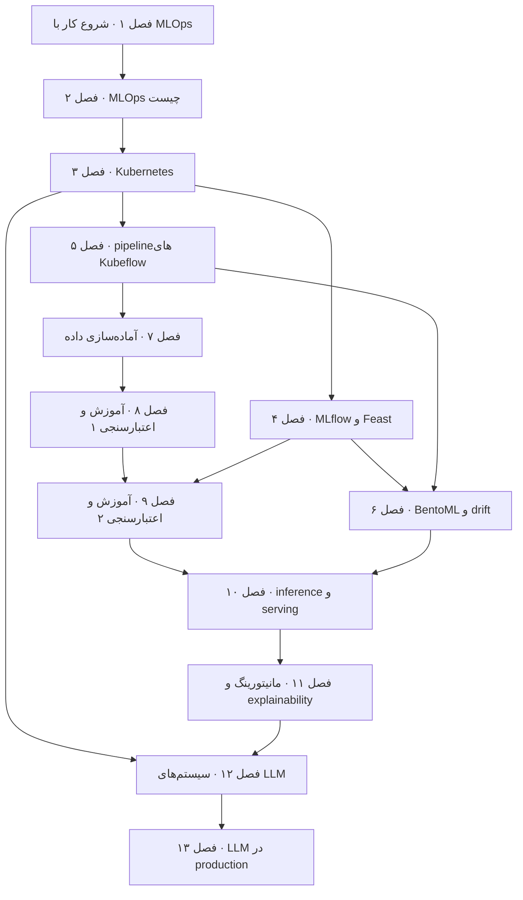

# Machine Learning Platform Engineering

**فایل [`index.html`](index.html) را در مرورگر باز کنید** تا نسخه‌ی تعاملی را ببینید: برای هر فصل یک درس اسلاید‌به‌اسلاید، با شکل‌های خود کتاب، شبیه‌سازی‌های جاسازی‌شده و خودسنجی. هر چیزی که این‌جاست روی GitHub هم خوب خوانده می‌شود.

## درباره‌ی کتاب

نقطه‌ی شروع کتاب این است که بیشتر پروژه‌های ML هرگز به production نمی‌رسند، و مشکل ساختن مدل نیست، deploy قابل‌اطمینان، مانیتورینگ و نگهداری آن است (p. xiv). کتاب یک **platform ML داخلی** را از صفر می‌سازد: Docker و Kubernetes، MLflow برای tracking و registry، Feast برای feature store، Kubeflow Pipelines برای ارکستراسیون، BentoML برای serving و Evidently و deepchecks برای drift (pp. xiv–xvi). مخاطبش data scientist و مهندس نرم‌افزاری است که می‌خواهد از notebook به سیستم production برود؛ Python و مفهوم‌های پایه‌ی ML کافی است و تجربه‌ی Docker و Kubernetes لازم نیست (p. xiv).

سه سیستم در طول کتاب ساخته می‌شود (pp. xiv–xv):

- **خود platform**، که با یک نقشه‌ی ذهنی از مؤلفه‌های شماره‌دار پیش می‌رود و هر فصل یکی را روشن می‌کند.
- **دو پروژه‌ی ML سنتی**: تشخیص کارت شناسایی با YOLO و recommender فیلم با matrix factorization، از آماده‌سازی داده تا مانیتورینگ.
- **دستیار مستندات DakkaBot**، یک RAG با مدیریت prompt، آزمون معنایی، guardrail و بهینه‌سازی هزینه.

نویسندگان در Bank Jago و DKatalis در اندونزی و در Continental Automotive روی platform ML و مهندسی ML کار می‌کنند (pp. xviii–xix). کد کتاب در GitHub زیر سازمان `practical-mlops` است (p. xvii).

## محتوای این پوشه

| مسیر | چه چیزی است |
|---|---|
| [`chapters/NN-*.md`](chapters/01-getting-started-with-mlops-and-ml-engineering.md) | یادداشت‌های فصل، **منبع حقیقت**. هر `.md` یک درس `.html` ساخته‌شده کنارش دارد |
| [`figures/`](figures/figures.tsv) | شکل‌های خود کتاب، بریده از PDF؛ `figures.tsv` صفحه و کادر هر برش را نگه می‌دارد |
| [`widgets/`](widgets/02-mlops-loop.html) | شبیه‌سازی‌های دست‌ساز، جاسازی‌شده در درس‌ها؛ هر کدام جدا هم باز می‌شود |
| [`lab/`](lab/06-drift-window-size/README.md) | آزمایش‌های اجرا‌شدنی Python با خروجی مورد انتظار |
| [`framework.md`](framework.md) | چارچوب vault: نقشه، اصول، راهنمای تصمیم و نقشه‌ی فصل‌ها |
| `index.html` | صفحه‌ی اصلی کتاب، ساخته‌شده از این README و فصل‌ها |

## کتاب چطور به هم وصل است

کتاب چهار بخش دارد (pp. xv–xvi):

- بخش ۱، فصل‌های ۱ تا ۳، پایه را می‌گذارد: چرخه‌ی عمر ML، خود MLOps در برابر DevOps، و Docker و Kubernetes و CI/CD و Prometheus.
- بخش ۲، فصل‌های ۴ تا ۶، قابلیت‌های هسته‌ی platform را می‌سازد: tracking و registry و feature store، pipelineهای Kubeflow، و serving و drift.
- بخش ۳، فصل‌های ۷ تا ۱۱، همه را روی دو پروژه‌ی واقعی اعمال می‌کند: آماده‌سازی داده، آموزش و اعتبارسنجی، serving، و مانیتورینگ و explainability.
- بخش ۴، فصل‌های ۱۲ و ۱۳، MLOps را به LLM گسترش می‌دهد: ساختن یک RAG و سخت کردنش برای production.

*فلش‌ها خوانش vault از وابستگی فصل‌هاست؛ ترتیب و بخش‌بندی فصل‌ها مال خود کتاب است.*

چند رشته در کل کتاب می‌دوند:

- **نقشه‌ی ذهنی platform** در فصل ۱ کشیده می‌شود و هر فصل بعدی با روشن کردن یکی از مؤلفه‌هایش شروع می‌شود؛ فصل ۱۲ نیمه‌ی LLM را کنارش می‌گذارد.
- **دو فاز آزمایش و production** در فصل ۱ تعریف می‌شود، در فصل ۲ به سطح‌های بلوغ MLOps می‌رسد و در فصل‌های ۸ و ۹ به اعتبارسنجی پیش از ترفیع مدل.
- **مفهوم drift** در فصل ۶ برای داده‌ی جدولی، در فصل ۱۱ برای تصویر و embedding، و در فصل ۱۳ به شکل ارزیابی معنایی پاسخ‌های LLM برمی‌گردد.
- **«کد همه چیز است»**: pipeline در فصل ۵، Bento در فصل ۱۰، و prompt در فصل ۱۳ همه نسخه و tag و rollback دارند.

## فصل‌ها

| # | فصل | صفحه |
|---:|---|---|
| ۱ | [شروع کار با MLOps و ML engineering](chapters/01-getting-started-with-mlops-and-ml-engineering.md) | ۳–۲۰ |
| ۲ | [MLOps چیست؟](chapters/02-what-is-mlops.md) | ۲۱–۴۱ |
| ۳ | [ساختن برنامه روی Kubernetes](chapters/03-building-applications-on-kubernetes.md) | ۴۲–۹۴ |
| ۴ | [طراحی سیستم‌های ML قابل‌اطمینان](chapters/04-designing-reliable-ml-systems.md) | ۹۷–۱۲۳ |
| ۵ | [ارکستراسیون pipelineهای ML](chapters/05-orchestrating-ml-pipelines.md) | ۱۲۴–۱۴۸ |
| ۶ | [بردن مدل‌های ML به production](chapters/06-productionizing-ml-models.md) | ۱۴۹–۱۸۰ |
| ۷ | [تحلیل و آماده‌سازی داده](chapters/07-data-analysis-and-preparation.md) | ۱۸۳–۲۳۴ |
| ۸ | [آموزش و اعتبارسنجی مدل: بخش ۱](chapters/08-model-training-and-validation-part-1.md) | ۲۳۵–۲۶۰ |
| ۹ | [آموزش و اعتبارسنجی مدل: بخش ۲](chapters/09-model-training-and-validation-part-2.md) | ۲۶۱–۲۹۸ |
| ۱۰ | [inference و serving مدل](chapters/10-model-inference-and-serving.md) | ۲۹۹–۳۲۴ |
| ۱۱ | [مانیتورینگ و explainability](chapters/11-monitoring-and-explainability.md) | ۳۲۵–۳۵۶ |
| ۱۲ | [طراحی سیستم‌های مبتنی بر LLM](chapters/12-designing-llm-powered-systems.md) | ۳۵۹–۴۰۸ |
| ۱۳ | [طراحی سیستم LLM در production](chapters/13-production-llm-system-design.md) | ۴۰۹–۴۵۳ |

بازه‌های صفحه، صفحه‌ی چاپی‌اند. صفحه‌های ۱، ۹۵، ۱۸۱ و ۳۵۷ صفحه‌ی آغاز بخش‌اند. صفحه‌های اول کتاب با عدد رومی شماره خورده‌اند، و پس از فصل ۱۳ دو پیوست می‌آید: نصب platform روی ماشین محلی و راهنمای YAML (p. xvi).

## مفهوم‌های کلیدی

این ایده‌ها در فصل‌ها تکرار می‌شوند؛ هر ردیف فصل‌هایی را می‌آورد که بحثشان می‌کنند. تعریف‌ها خلاصه‌های vault از توضیح‌های کتاب‌اند.

| مفهوم | تعریف | فصل‌ها |
|---|---|---|
| چرخه‌ی عمر ML | دو فاز: آزمایش، از تعریف مسئله تا اعتبارسنجی مدل، و development/staging/production که همان pipeline را خودکار و deploy و پایش می‌کند. هر مرحله حلقه دارد. | [۱](chapters/01-getting-started-with-mlops-and-ml-engineering.md) · [۲](chapters/02-what-is-mlops.md) |
| platform ML | مجموعه‌ای از ابزار و زیرساخت خودسرویس که data scientist را از notebook به production می‌برد؛ کتاب آن را کم‌کم و روی Kubeflow می‌سازد. | [۱](chapters/01-getting-started-with-mlops-and-ml-engineering.md) · [۳](chapters/03-building-applications-on-kubernetes.md) · [۱۲](chapters/12-designing-llm-powered-systems.md) |
| سطح بلوغ MLOps | از فرایند دستی تا pipeline خودکار با CI/CD و retrain خودکار. | [۲](chapters/02-what-is-mlops.md) |
| experiment tracking و model registry | ثبت پارامتر، متریک و artifact هر run در MLflow، و نسخه و alias مدل‌ها برای ترفیع و rollback. | [۴](chapters/04-designing-reliable-ml-systems.md) · [۹](chapters/09-model-training-and-validation-part-2.md) · [۱۰](chapters/10-model-inference-and-serving.md) |
| feature store | یک تعریف از feature برای آموزش و serving، با join نقطه‌در‌زمان که از نشت داده‌ی آینده جلوگیری می‌کند. | [۴](chapters/04-designing-reliable-ml-systems.md) |
| pipeline و component | گام‌های container‌شده با ورودی و خروجی تعریف‌شده که Kubeflow Pipelines به هم وصل و اجرا می‌کند. | [۵](chapters/05-orchestrating-ml-pipelines.md) · [۷](chapters/07-data-analysis-and-preparation.md) · [۸](chapters/08-model-training-and-validation-part-1.md) |
| data drift | جابه‌جایی توزیع داده‌ی ورودی یا رابطه‌اش با هدف نسبت به داده‌ی آموزش؛ با آزمون آماری روی ستون‌ها، ویژگی‌های تصویر یا factorهای پنهان سنجیده می‌شود. | [۶](chapters/06-productionizing-ml-models.md) · [۱۱](chapters/11-monitoring-and-explainability.md) |
| اعتبارسنجی مدل | بررسی مدل تازه پیش از ترفیع، با «اعتماد کن، ولی وارسی کن». | [۸](chapters/08-model-training-and-validation-part-1.md) · [۹](chapters/09-model-training-and-validation-part-2.md) |
| BentoML Service و runner | API server که درخواست را می‌گیرد و runnerهایی که inference را در worker خودشان اجرا می‌کنند؛ Bento بسته‌ی قابل‌deploy با tag است. | [۶](chapters/06-productionizing-ml-models.md) · [۱۰](chapters/10-model-inference-and-serving.md) |
| مانیتورینگ پایه و متریک سفارشی | منابع و متریک درخواست برای SLA، به‌علاوه‌ی متریک کسب‌وکار مثل histogram اطمینان پیش‌بینی، و هشدار با Alertmanager. | [۳](chapters/03-building-applications-on-kubernetes.md) · [۱۱](chapters/11-monitoring-and-explainability.md) |
| explainability | توضیح این‌که مدل چرا تصمیمی گرفته؛ مبتنی بر مدل یا پسینی مثل SHAP و Eigen-CAM. | [۱۱](chapters/11-monitoring-and-explainability.md) |
| RAG | جدا کردن بازیابی سند از تولید پاسخ، تا LLM بدون retrain به دانش خصوصی و تازه تکیه کند. | [۱۲](chapters/12-designing-llm-powered-systems.md) · [۱۳](chapters/13-production-llm-system-design.md) |
| prompt به‌عنوان کد | system prompt منطق کسب‌وکار است و نسخه، label، آزمون و rollback می‌خواهد. | [۱۲](chapters/12-designing-llm-powered-systems.md) · [۱۳](chapters/13-production-llm-system-design.md) |
| guardrail | لایه‌های ورودی و خروجی که PII را پاک، نام رقیب را مسدود و hallucination را می‌گیرند. | [۱۳](chapters/13-production-llm-system-design.md) |
| اقتصاد token | هزینه به ازای token، نه به ازای server؛ با مسیریابی بین مدل‌ها، cache معنایی و prompt کوتاه‌تر کنترل می‌شود. | [۱۲](chapters/12-designing-llm-powered-systems.md) · [۱۳](chapters/13-production-llm-system-design.md) |

## این یادداشت‌ها چطور نوشته شده‌اند

- **هر چیزی بالای *فراتر از کتاب* در یک یادداشت فصل، خود کتاب را بازگو می‌کند**، با ارجاع صفحه‌ی چاپی. مطالب تکمیلی زیر *فراتر از کتاب* یا در کادرهای `> **Vault note:**` می‌نشینند.
- فهرست‌های بخش، همان فهرست مطالب تو‌در‌توی خود کتاب‌اند که از bookmarkهای PDF گرفته شده.
- شکل‌ها از خود کتاب بریده شده‌اند و هر کدام برچسب و صفحه‌ی چاپی دارد؛ نمودارهای Mermaid خلاصه‌های vault‌اند و زیرنویسشان این را می‌گوید.
- کادرهای `> **In practice:**` ایده‌ی هر بخش را به یک platform داده‌ی عمومی، یعنی [stack مرجع](../../practice/reference-stack.md)، وصل می‌کنند.
- پرسش و پاسخ‌های *خودتان را بسنجید* مال vault است و از روی یادداشت‌ها نوشته شده؛ پاسخ‌ها به صفحه ارجاع می‌دهند.
- شبیه‌سازی‌ها و آزمایش‌ها پیاده‌سازی‌های خود vault از سازوکارهایی‌اند که کتاب توضیحشان می‌دهد. هر کدام می‌گوید کدام صفحه‌ها را نشان می‌دهد و چه چیزی را ساده کرده.
- کتاب کد زیادی دارد؛ یادداشت‌ها کد را بازنویسی نمی‌کنند و فقط نام کلاس‌ها و پارامترهایی را می‌آورند که سازوکار را توضیح می‌دهند.

## منبع

- **منبع اصلی:** فایل PDF ناشر از ویراست اول، © 2026 Manning Publications، با ۵۰۴ صفحه‌ی PDF. شماره‌ی صفحه‌ی چاپی برابر شماره‌ی صفحه‌ی PDF منهای ۲۱ است. فایل PDF بیرون از کنترل نسخه نگه داشته می‌شود؛ `.gitignore` را ببینید.
- **فهرست مطالب:** از فهرست bookmarkهای PDF گرفته شده، که بخش‌ها و زیربخش‌های هر فصل را با شماره‌ی صفحه می‌دهد.
- **ساختار:** صفحه‌های اول، یعنی پیش‌گفتار و قدردانی و درباره‌ی این کتاب و درباره‌ی نویسندگان، بعد چهار بخش با سیزده فصل که هر کدام با یک خلاصه تمام می‌شوند، دو پیوست و یک index.
- **پوشش:** هر سیزده فصل پوشانده شده‌اند؛ پیوست‌ها نه.
