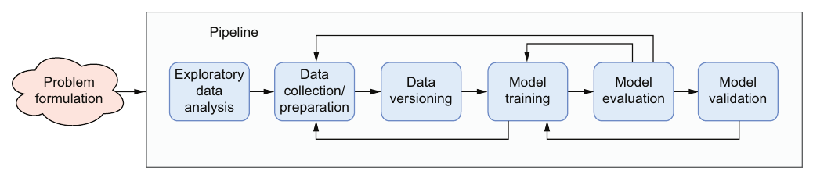
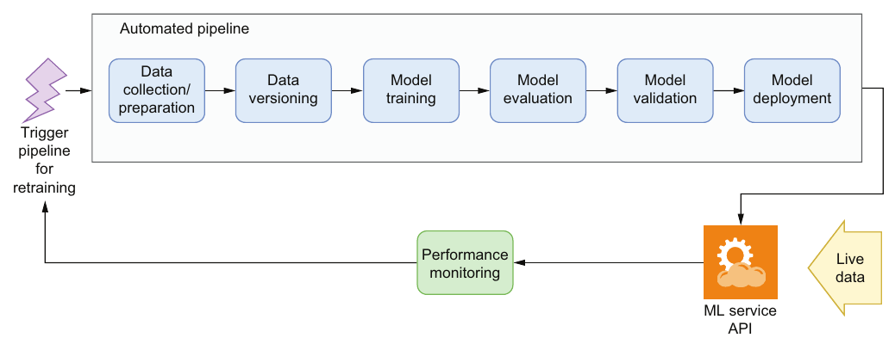
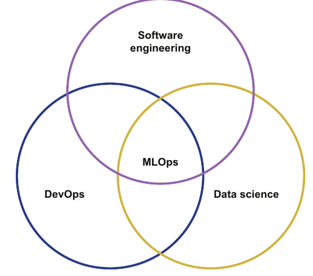
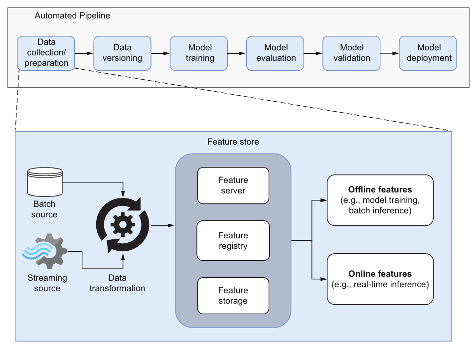
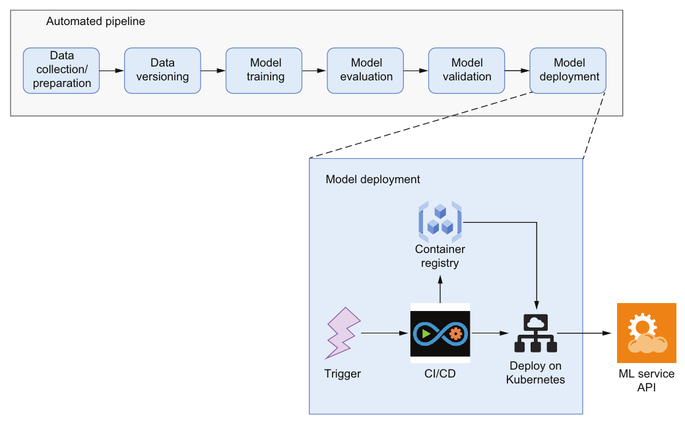

# فصل ۱: شروع کار با MLOps و ML engineering

[کتاب](../README.md) · [فصل ۲: MLOps چیست؟ ←](02-what-is-mlops.md)

## خلاصه

فصل اول نقشه‌ی کل کتاب را می‌کشد. پروژه‌ی ML برخلاف بیشتر پروژه‌های نرم‌افزاری تکرارشونده است و هیچ پروژه‌ای سراغ نداریم که اولین deploy پایانش بوده باشد (p. 4). **چرخه‌ی عمر ML** دو فاز دارد: فاز **آزمایش**، که از تعریف مسئله تا اعتبارسنجی مدل می‌رود و از همان اول در یک pipeline ارکستر‌شده جمع می‌شود، و فاز **development/staging/production**، که همان pipeline را کاملاً خودکار می‌کند و deploy و مانیتورینگ و retraining را به آن اضافه (pp. 4–8). کار MLOps ترکیبی از مهندسی نرم‌افزار و DevOps و علم داده است (p. 8). بعد فصل **پلتفرم ML** را معرفی می‌کند: نقشه‌ی ذهنی‌ای با مؤلفه‌های شماره‌دار و حرف‌دار که کل کتاب روی آن جلو می‌رود، و ابزارهایش، یعنی Kubeflow Pipelines و feature store و model registry و deploy با CI/CD (pp. 9–17). دست آخر سه پروژه‌ی کتاب را معرفی می‌کند: تشخیص کارت شناسایی، recommender فیلم، و دستیار مستندات DakkaBot با RAG (pp. 17–19).

## نکته‌های کلیدی

- **پروژه‌ی ML خطی نیست.** فلش‌های نمودار چرخه‌ی عمر یک‌طرفه‌اند، ولی تقریباً هر مرحله حلقه دارد؛ مثلاً اگر متریک ارزیابی بد باشد به معماری مدل یا حتی به کیفیت داده برمی‌گردید (p. 4).
- **پیش از هر چیز بپرسید اصلاً ML لازم است یا نه.** گاهی یک heuristic ساده کافی است؛ ML وقتی لازم می‌شود که داده پیچیده و پرابعاد و الگوها غیرخطی‌اند (p. 5).
- **تغییر داده مثل تغییر کد رفتار سیستم را عوض می‌کند**، پس data versioning پیش‌شرط reproducibility است؛ ولی جامعه‌ی ML هنوز ابزاری به فراگیری Git برای داده ندارد (p. 6).
- **آموزش مدل کمترین سهم وقت را می‌گیرد**، برخلاف تصور تازه‌کارها؛ تمرکز کتاب هم روی آن نیست (p. 6).
- **مدل‌ها معمولاً از اولین برخورد با production جان سالم به در نمی‌برند.** دو دسته متریک را باید پایید: متریک‌های سیستمی و عملیاتی، و متریک‌های مخصوص ML مثل data drift و model drift، به‌علاوه‌ی متریک‌های کسب‌وکار (p. 8).
- **پلتفرم را کم‌کم بسازید.** هیچ معماری یکسانی برای همه نیست؛ کتاب Kubeflow را پایه می‌گذارد و هر جا کم آورد، مثلاً نداشتن feature store، ابزاری اضافه می‌کند (p. 10).
- **فاصله‌ی training و serving را feature store می‌بندد**، چون یک تعریف واحد feature هم برای آموزش و هم برای inference سرو می‌شود (p. 15).

## فهرست بخش‌ها

*از فهرست مطالب خود کتاب، از bookmarkهای PDF؛ شماره‌ها صفحه‌ی چاپی‌اند.*

- ۱.۱ چرخه‌ی عمر ML — ص. ۴
  - ۱.۱.۱ فاز آزمایش — ص. ۴
  - ۱.۱.۲ فاز development/staging/production — ص. ۶
- ۱.۲ مهارت‌های لازم برای MLOps — ص. ۸
  - ۱.۲.۱ مهارت‌های لازم برای ML engineer — ص. ۹
  - ۱.۲.۲ پیش‌نیازها — ص. ۹
- ۱.۳ ساختن یک پلتفرم ML — ص. ۹
  - ۱.۳.۱ ساختن یا خریدن — ص. ۱۰
  - ۱.۳.۲ نگاهی به جلو: از MLOps به LLMOps — ص. ۱۲
  - ۱.۳.۳ ابزارهای این کتاب — ص. ۱۲
- ۱.۴ ساختن سیستم‌های ML — ص. ۱۷
  - ۱.۴.۱ معرفی پروژه‌های ML — ص. ۱۸
  - ۱.۴.۲ پروژه‌های ML — ص. ۱۹

## یادداشت‌ها

کتاب قول می‌دهد که خواننده را به ML engineerی تبدیل کند که پروژه را از ایده تا production می‌برد، و این کار را عملی پیش می‌برد: هر فصل روی فصل قبلی ساخته می‌شود و ابزار تازه را همان وقتی معرفی می‌کند که لازم شده (pp. 3–4). مسیر کتاب این است: پایه‌های MLOps، ساختن پلتفرم و ارکستراسیون pipeline، آماده‌سازی داده و آموزش و اعتبارسنجی، serving و مانیتورینگ و explainability، و دست آخر pipeline یک LLM (p. 4).

### ۱.۱ چرخه‌ی عمر ML

گام‌های ساختن و deploy کردن مدل در پروژه‌های مختلف شبیه هم‌اند، ولی پروژه‌ی ML برخلاف نرم‌افزار، که پایداری در آن اولویت دارد، تکرارشونده است (p. 4).

#### ۱.۱.۱ فاز آزمایش (pp. 4–6)

*Figure 1.1 (p. 5): فلش‌ها یک‌طرفه‌اند ولی کار نیست؛ همین حلقه‌های پنهان دلیل جمع کردن همه‌ی مرحله‌ها در یک pipeline ارکستر‌شده از روز اول است.*

ارکستر کردن مرحله‌ها از همان آزمایش، خطاهایی را که ردگیری‌شان سخت است حذف می‌کند (p. 5). مرحله‌ها:

| مرحله | پرسش اصلی | نکته‌ی کتاب |
|---|---|---|
| تعریف مسئله | اصلاً ML لازم است؟ | وسوسه‌ی «پتک ML» را سرکوب کنید؛ تیمی از کسب‌وکار و فنی تصمیم می‌گیرد. نمونه: OCR برای بیرون کشیدن شماره‌ی کارت شناسایی (p. 5) |
| جمع‌آوری و آماده‌سازی داده | داده از کجا می‌آید و چطور برچسب می‌خورد؟ | گاهی داده‌ی synthetic؛ annotatorها دور شماره‌ی کارت bounding box می‌کشند؛ بعد تقسیم به train و validation و test (pp. 5–6) |
| versioning داده | با همان داده و کد، همان مدل درمی‌آید؟ | داده شکل‌های گوناگون دارد و ابزاری هم‌سطح Git برایش جا نیفتاده (p. 6) |
| آموزش مدل | پارامترها کدام‌اند؟ | خودکارسازی از روز اول یعنی چند آزمایش هم‌زمان و reproducible (p. 6) |
| ارزیابی مدل | روی داده‌ی ندیده چطور است؟ | متریک‌هایی مثل precision و recall و AUC (p. 6) |
| اعتبارسنجی مدل | کار مورد انتظار را می‌کند؟ | اغلب ذی‌نفعان کسب‌وکار، نه تیم سازنده (p. 6) |

#### ۱.۱.۲ فاز development/staging/production (pp. 6–8)

مرز آزمایش و production مهم است: آزمایش شاید هیچ‌وقت تمام نشود، ولی تمرکز از کاوش به نگه‌داری و بهبود مدل در production می‌رود، و ملاحظه‌هایی مثل اخلاق و امنیت و scalability و latency پررنگ می‌شوند (pp. 6–7).

*Figure 1.2 (p. 7): دو چیز تازه نسبت به شکل ۱.۱: مرحله‌ی deploy در انتهای pipeline، و حلقه‌ی برگشت از مانیتورینگ به trigger.*

| مرحله | چه چیزی اضافه می‌شود |
|---|---|
| trigger | از CI یا فراخوانی برنامه‌ای؛ در موردهای پیچیده‌تر، افت متریک زیر آستانه (p. 7) |
| deploy مدل | ساده‌ترینش یک REST API است، بعد container و cloud؛ ولی load test و auto-scaling و versioning هر deploy و راه rollback هم لازم است (pp. 7–8) |
| مانیتورینگ مدل | متریک‌های سیستمی مثل RPS و کدهای HTTP، متریک‌های ML مثل data drift و model drift، و متریک‌های کسب‌وکار مثل churn و retention (p. 8) |
| retraining | تا جای ممکن خودکار، با برنامه‌ی ثابت مثل ماهانه یا با عبور از آستانه، مثلاً افت ناگهانی تعداد وام‌های تأییدشده (p. 8) |

> **Vault note:** کتاب می‌گوید در بعضی سازمان‌ها deploy جایی است که کار به IT یا DevOps تحویل می‌شود، ولی نویسنده‌ها از درگیر کردن خود data scientistها در آن سود دیده‌اند (p. 7). این همان مرزی است که فصل ۲ با «مالکیت سر‌تا‌سری» دوباره سراغش می‌رود.

> **In practice:** در stack مرجع، notebookها و MLflow و یک API پیش‌بینی کوچک همین دو فاز را می‌سازند: آزمایش در notebook، و production پشت API.
>
> **Your turn:** مدل دسته‌بندی متن تراکنش به دسته‌ی هزینه، سه ماه است بی‌تغییر روی API پیش‌بینی کار می‌کند. چه چیزی باید هشدار بدهد که وقت retraining رسیده؟
>
> *Answer:* کتاب دو راه می‌دهد: برنامه‌ی ثابت، یا عبور یک متریک از آستانه (p. 8). برای این مدل، سهم پیش‌بینی‌های دسته‌ی «سایر» یا افت اطمینان مدل را به‌عنوان متریک Prometheus بیرون بدهید و در Grafana آستانه بگذارید؛ متریک‌های سیستمی مثل RPS به‌تنهایی drift را نشان نمی‌دهند.

### ۱.۲ مهارت‌های لازم برای MLOps

*Figure 1.3 (p. 8): MLOps هیچ‌کدام از سه حوزه به‌تنهایی نیست؛ لازم نیست از روز اول در هر سه متخصص باشید.*

#### ۱.۲.۱ مهارت‌های لازم برای ML engineer (p. 9)

- **مهندس نرم‌افزار درست‌وحسابی** که سیستم‌های غیربدیهی deploy کرده و debug کردن و پیدا کردن گلوگاه کارایی را بلد است.
- **فهم ML و علم داده**، بدون نیاز به جزئیات backpropagation؛ ولی راحت با TensorFlow و PyTorch و scikit-learn، و بی‌ترس از چارچوب تازه.
- **کمی مهندسی داده**، چون سخت‌ترین چالش‌ها معمولاً داده‌ی کافی و باکیفیت است.
- **خودکارسازی و reproducibility**: خودکارسازی خطا را کم و بازخورد را تند می‌کند، و reproducibility وقتی مدل زیر قانون و audit است حیاتی می‌شود؛ نتیجه‌ی reproducible اعتماد می‌سازد.

#### ۱.۲.۲ پیش‌نیازها (p. 9)

مثل خوردن فیل، تکه‌تکه: لازم نیست همه‌ی مهارت‌ها را یک‌جا داشته باشید. کتاب اول مبانی Kubernetes را می‌دهد و بعد گشتی سریع در ابزارهای MLOps.

### ۱.۳ ساختن یک پلتفرم ML

پلتفرم ML پایه‌ی ساختن سیستم‌های قابل‌اطمینان است: ابزار و زیرساخت همه‌ی بخش‌های اصلی چرخه‌ی عمر را فراهم می‌کند (p. 9). بیشتر سیستم‌های داده، یعنی data warehouse و پردازنده‌های batch و stream و منبع‌ها، بیرون از مرز پلتفرم‌اند (p. 10).

*Figure 1.4 (p. 11): این نقشه در کل کتاب تکرار می‌شود؛ حرف‌ها، یعنی A تا E، زیرساخت‌اند و عددها مرحله‌های داده، و ترتیبشان همان ترتیب معرفی در کتاب و جریان معمول داده است (p. 10).*

- **قلب کار Kubeflow است**، پلتفرم ML متن‌باز روی Kubernetes، و Kubeflow Pipelines بخش ارکستراسیونش (p. 10).
- **پلتفرم بر اساس use case رشد می‌کند**: هر جا Kubeflow کم بیاورد، مثل نداشتن feature store، ابزاری اضافه می‌شود (p. 10).
- **کادر No one-size-fits-all:** نویسنده‌ها همین معماری را در سازمان‌هایشان به کار برده‌اند، ولی توصیه‌شان رشد تدریجی پلتفرم است، مخصوصاً وقتی از صفر شروع می‌کنید (p. 10).

#### ۱.۳.۱ ساختن یا خریدن (pp. 10–12)

اگر سازمان روی SageMaker یا Vertex AI تصمیم گرفته، باز هم ارزش دارد یک بار پلتفرم را از صفر بسازید: یاد می‌گیرید ابزارها چطور با هم کار می‌کنند و محدودیت‌ها را چطور دور بزنید، مهارتی که کمتر جایی درس داده می‌شود (pp. 10–12).

#### ۱.۳.۲ نگاهی به جلو: از MLOps به LLMOps (p. 12)

همین پایه با چند مؤلفه‌ی تازه برای LLMها گسترش می‌یابد: پردازش سند، retrieval و مانیتورینگ مخصوص (p. 12).

*Figure 1.5 (p. 13): مؤلفه‌های سمت چپ حذف نمی‌شوند؛ LLMOps کنارشان می‌نشیند، و pipeline orchestration و deploy و مانیتورینگ همان مهارت‌های قبلی‌اند.*

**کادر A word about tool choices:** ابزارهای کتاب نقطه‌ی شروع‌اند، نه راه‌حل قطعی. چند روز با یک proof of concept امتحانشان کنید؛ کتاب خودش هم برای یک هدف، مثل data drift، دو ابزار متفاوت به کار می‌برد (p. 12).

#### ۱.۳.۳ ابزارهای این کتاب (pp. 12–17)

| ابزار | جای آن در چرخه | چه می‌کند |
|---|---|---|
| Kubeflow Pipelines | اتوماسیون pipeline | هر مرحله یک component است که داده را از قبلی می‌گیرد و به بعدی می‌دهد (p. 14) |
| feature store با Feast | جمع‌آوری و آماده‌سازی داده | feature server و feature registry و feature storage؛ سرو offline برای آموزش و batch inference، و online برای inference هم‌زمان (pp. 14–15) |
| model registry با MLflow | بعد از آموزش | مدل و artifact و metadata و hyperparameter هر run را نگه می‌دارد؛ ارتقای مدل از staging به production (p. 16) |
| deploy مدل با CI/CD | انتهای pipeline | container registry و CI/CD و manifestهای Kubernetes با هم سرویس ML را بالا می‌آورند (p. 17) |

*Figure 1.7 (p. 15): feature store داده‌ی خام نمی‌گیرد، داده‌ی transform‌شده می‌گیرد؛ و دو خروجی offline و online از یک تعریف واحد درمی‌آیند.*

**پدیده‌ی training-serving skew** وقتی پیش می‌آید که transformation داده در آموزش با inference فرق کند؛ اشتباهی که دیدنش آسان نیست و feature store با یک تعریف مشترک جلویش را می‌گیرد (p. 15).

*Figure 1.9 (p. 17): manifestهای Kubernetes به imageی ارجاع می‌دهند که CI همین الان ساخته؛ apply کردن آن‌ها یعنی deploy نسخه‌ی تازه.*

کار deploy مدل کاملاً مهندسی است: portability با container، scalability با replicaهای Kubernetes، کارایی با GPU یا CPU و RAM بیشتر، و قابلیت اطمینان (p. 17).

> **In practice:** stack مرجع همین زنجیره‌ی شکل ۱.۹ را دارد: GitLab CI image را می‌سازد و tag را در repo deploy بالا می‌برد، و Argo CD cluster را با Git هم‌گام می‌کند.
>
> **Your turn:** data scientist مدل تازه‌ای را در MLflow ثبت کرده، ولی API پیش‌بینی هنوز مدل قبلی را جواب می‌دهد. در زنجیره‌ی شکل ۱.۹ کدام حلقه جا افتاده؟
>
> *Answer:* ثبت در registry به‌تنهایی deploy نیست: یا سرویس باید مدل را از registry با نام و مرحله بخواند، یا CI باید image تازه بسازد و tag را در repo deploy عوض کند تا Argo CD آن را sync کند (pp. 16–17). کدام راه را انتخاب کنید، رد آن را در Git نگه دارید.

### ۱.۴ ساختن سیستم‌های ML

دو نوع سیستم با چالش‌های متفاوت: یکی با تصویر و یکی با داده‌ی جدولی (pp. 17–18).

#### ۱.۴.۱ معرفی پروژه‌های ML (p. 18)

پروژه‌ها کل چرخه را از آماده‌سازی داده تا مانیتورینگ و بازنشستگی مدل طی می‌کنند و سه مشاهده را جا می‌اندازند:

- **پروژه‌ی ML خطی نیست**: گاهی به مرحله‌های قبل برمی‌گردید؛ کتاب این برگشت‌ها را عمداً در پروژه‌ها گذاشته.
- **نیازمندی‌ها در طول زمان عوض می‌شوند** و راه‌حل فعلی را باید دوباره سنجید.
- **مفهوم‌های اصلی MLOps تقریباً همه‌جا به کار می‌آیند**، حتی وقتی بعضی گام‌ها حذف یا ادغام می‌شوند.

#### ۱.۴.۲ پروژه‌های ML (p. 19)

| پروژه | داده | چه چیزی را نشان می‌دهد |
|---|---|---|
| ۱. سیستم OCR | تصویر کارت شناسایی | ساختن dataset، detector اولیه با کتابخانه‌ی متن‌باز، fine-tune با داده‌ی برچسب‌دار، deploy به‌عنوان سرویس |
| ۲. recommender فیلم | جدولی | feature store، drift detection، آزمون مدل و observability |
| ۳. دستیار مستندات DakkaBot | سند و متن | RAG: ingestion سند، embedding، guardrail، بهینه‌سازی هزینه و ارزیابی معنایی |

## بده‌بستان‌ها در یک نگاه

| انتخاب | چه می‌دهد | چه می‌گیرد |
|---|---|---|
| heuristic ساده به‌جای ML | سادگی و هزینه‌ی کم | روی داده‌ی پرابعاد و الگوهای غیرخطی کم می‌آورد (p. 5) |
| pipeline ارکستر‌شده از فاز آزمایش | reproducibility و خطای کمتر | هزینه‌ی راه‌اندازی زودهنگام (p. 5) |
| retraining با برنامه‌ی ثابت | ساده و قابل‌پیش‌بینی | ممکن است دیر یا بی‌جا باشد (p. 8) |
| retraining با آستانه | واکنش به افت واقعی | به متریک قابل‌اعتماد و مانیتورینگ نیاز دارد (p. 8) |
| ساختن پلتفرم | فهم عمیق و سفارشی‌سازی | هزینه‌ی نگه‌داری (pp. 10–12) |
| خریدن پلتفرم مدیریت‌شده | راه‌اندازی تند | وابستگی به vendor و محدودیت‌هایش (p. 10) |

## فراتر از کتاب

- **مقاله‌ی Hidden Technical Debt in Machine Learning Systems** از Sculley و همکاران در NeurIPS 2015 همان مشاهده‌ی کتاب را با شکل معروفش نشان می‌دهد: کد مدل تکه‌ی کوچکی از یک سیستم ML واقعی است و بقیه زیرساخت و داده و مانیتورینگ است.
- **کتاب‌های دیگر vault** زمینه‌ی همین پلتفرم را دارند: [فصل ۱ کتاب DDIA](../../designing-data-intensive-applications/README.md) برای سیستم‌های داده‌ی بیرون از مرز پلتفرم، و [Data Engineering Design Patterns](../../data-engineering-design-patterns/README.md) برای pipelineهایی که featureها را می‌سازند.

## پیوندها

- **فصل‌های مرتبط:** [فصل ۲: MLOps چیست؟](02-what-is-mlops.md) که همین چرخه را به حلقه‌ی MLOps و سطح‌های بلوغ می‌برد، [فصل ۳: ساختن برنامه روی Kubernetes](03-building-applications-on-kubernetes.md) که زیرساخت شکل ۱.۹ است، [فصل ۴: طراحی سیستم‌های ML قابل‌اطمینان](04-designing-reliable-ml-systems.md) که MLflow و Feast را می‌سازد، و [فصل ۱۲: طراحی سیستم‌های مبتنی بر LLM](12-designing-llm-powered-systems.md) که سمت راست شکل ۱.۵ است.

## خودتان را بسنجید

*پرسش‌ها و پاسخ‌ها مال vault است و از روی یادداشت‌های بالا نوشته شده؛ پاسخ‌ها به صفحه‌های کتاب ارجاع می‌دهند.*

1. **اولین پرسش در هر پروژه‌ی ML احتمالی چیست؟**
   - [ ] کدام معماری مدل بهتر است؟
   - [x] اصلاً باید از ML استفاده کرد یا نه؟
   - [ ] داده از کجا می‌آید؟

   *Answer:* کتاب می‌گوید اول بپرسید اصلاً ML لازم است، چون گاهی heuristic ساده کافی است (p. 5).

2. **چرا data versioning پیش‌شرط reproducibility است؟**

   *Answer:* در ML تغییر داده هم مثل تغییر کد رفتار سیستم را عوض می‌کند؛ بدون نسخه‌ی داده نمی‌شود مطمئن بود که همان داده و کد همان مدل را می‌دهد (p. 6).

3. **فاز development/staging/production چه چیزی به pipeline آزمایش اضافه می‌کند؟**
   - [ ] فقط مرحله‌ی ارزیابی مدل
   - [x] خودکارسازی کامل، deploy مدل در انتها، و حلقه‌ی مانیتورینگ و retraining
   - [ ] حذف مرحله‌ی اعتبارسنجی

   *Answer:* pipeline کاملاً خودکار می‌شود، deploy به انتهایش اضافه می‌شود و مانیتورینگ کارایی می‌تواند دوباره trigger را بزند (p. 7).

4. **پدیده‌ی training-serving skew چیست و feature store چطور جلویش را می‌گیرد؟**

   *Answer:* فرق داده‌ای که مدل در آموزش می‌بیند با داده‌ی inference، مثلاً به خاطر transformation متفاوت؛ feature store featureهای یکسان را هم offline برای آموزش و هم online برای inference سرو می‌کند (p. 15).

5. **چرا نویسنده‌ها حتی با وجود SageMaker یا Vertex AI توصیه می‌کنند یک بار پلتفرم را از صفر بسازید؟**

   *Answer:* چون یاد می‌گیرید ابزارها چطور با هم کار می‌کنند و محدودیت‌ها را چطور دور بزنید، مهارتی که کمتر جایی پوشش داده می‌شود (pp. 10–12).
