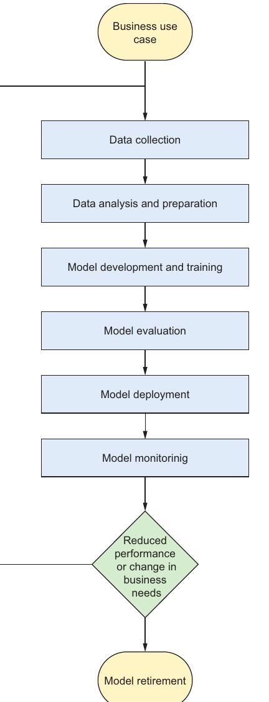
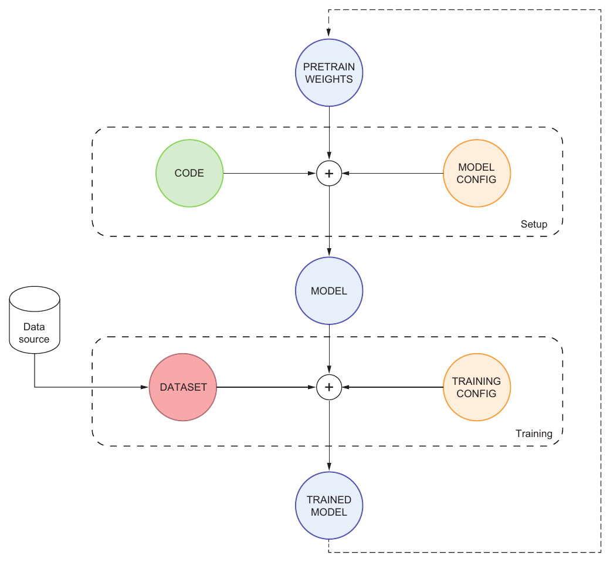
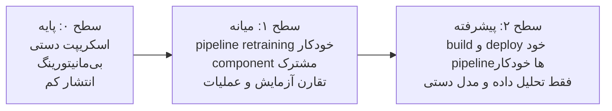

# فصل ۲: MLOps چیست؟

[فصل ۱: شروع کار با MLOps و ML engineering →](01-getting-started-with-mlops-and-ml-engineering.md) · [کتاب](../README.md) · [فصل ۳: ساختن برنامه روی Kubernetes ←](03-building-applications-on-kubernetes.md)

## خلاصه

مدل ML معمولاً محصول نهایی سازمان نیست، وسیله است؛ و سختی MLOps از فاصله‌ی ارزش کسب‌وکار و نیازمندی‌ها و زیرساخت لازم می‌آید (p. 21). وقتی مسئله و معماری روشن شد، پرسش‌های سخت تازه شروع می‌شوند: مدل چطور آموزش می‌بیند، داده چطور به آن می‌رسد، کجا اجرا می‌شود و چطور در طول زمان دقیق می‌ماند (p. 22). فصل ML را یک **حلقه‌ی بسته** می‌بیند که مدل و داده و hyperparameterها در آن گذرا‌اند و کل حلقه تکامل پیدا می‌کند، و هر مرحله‌اش را با نیازهای MLOps باز می‌کند: جمع‌آوری داده با lineage، تحلیل اکتشافی، مدل‌سازی با کد ماژولار، ارزیابی، deploy، مانیتورینگ و نگه‌داری (pp. 22–36). بعد می‌گوید چرا MLOps سخت است، در سازمان بالغ چه می‌دهد، چه فرقی با DevOps دارد، و سه سطح بلوغ گوگل را معرفی می‌کند (pp. 36–40).

## نکته‌های کلیدی

- **چرخه‌ی ML را حلقه ببینید، نه خط.** مدل و داده و hyperparameterها گذرا‌اند؛ چیزی که باید پایدار بماند فرایند تغییر مدل است، تا سرعت توسعه قربانی نشود (p. 22).
- **مدل و کد دو موجودیت جدا‌اند**: وزن‌ها و شبکه یک طرف، معماری و کد پشتیبان طرف دیگر؛ پس lineage و ردگیری حیاتی است (p. 23).
- **صورت مسئله باید با ذی‌نفعان هم‌سو و دقیق باشد.** «نرخ churn مشتری‌ها را پیش‌بینی کن» برای مدل‌سازی و انتخاب معیار ارزیابی کافی نیست (p. 24).
- **سازوکار lineage داده را از روز اول بگذارید.** مثل بدهی فنی، سرعت اول کار را با پیچیدگی آینده معامله می‌کند؛ با lineage درست، ساختن دوباره‌ی dataset یک کوئری ساده است، نه بازنویسی اسکریپت‌های استخراج (p. 26).
- **هر فرض درباره‌ی داده تا وقتی تأیید نشده یک ریسک است**، و باید زود در pipeline داده برایش check گذاشت (p. 28).
- **مدل آموزش‌دیده artifact اعمال config و داده روی codebase است.** کد ماژولار با config در Git، hyperparameter search و lineage را ساده می‌کند؛ ولی گرفتار overparametrization نشوید (pp. 29–31).
- **رشته‌ی MLOps از DevOps جداست** چون داده جزء اصلی است، مدل بدون تغییر کد هم عوض می‌شود و continuous training لازم دارد، و خود آزمایش‌ها باید ردگیری شوند، نه فقط build (p. 39).
- **بلوغ با میزان خودکارسازی سنجیده می‌شود**: سطح ۰ دستی، سطح ۱ pipeline آموزش خودکار و تقارن آزمایش و عملیات، سطح ۲ خودکارسازی build و deploy خود pipelineها (p. 40).

## فهرست بخش‌ها

*از فهرست مطالب خود کتاب، از bookmarkهای PDF؛ شماره‌ها صفحه‌ی چاپی‌اند.*

- ۲.۱ چرخه‌ی عمر تکرارشونده‌ی MLOps — ص. ۲۲
  - ۲.۱.۱ جمع‌آوری داده — ص. ۲۵
  - ۲.۱.۲ تحلیل اکتشافی داده — ص. ۲۸
  - ۲.۱.۳ مدل‌سازی و آموزش — ص. ۲۹
  - ۲.۱.۴ ارزیابی مدل — ص. ۳۱
  - ۲.۱.۵ deploy — ص. ۳۳
  - ۲.۱.۶ مانیتورینگ — ص. ۳۴
  - ۲.۱.۷ نگه‌داری، به‌روزرسانی و بازبینی — ص. ۳۵
- ۲.۲ چرا MLOps محکم مهم است؟ — ص. ۳۶
- ۲.۳ نقش MLOps در سازمان بالغ — ص. ۳۷
- ۲.۴ مقایسه‌ی DevOps و MLOps — ص. ۳۹
- ۲.۵ سطح‌های بلوغ MLOps — ص. ۴۰
  - ۲.۵.۱ سطح ۰: پایه — ص. ۴۰
  - ۲.۵.۲ سطح ۱: میانه — ص. ۴۰
  - ۲.۵.۳ سطح ۲: پیشرفته — ص. ۴۰

## یادداشت‌ها

بیشتر شرکت‌ها روی توسعه‌ی مدل پژوهش نمی‌کنند؛ معماری‌های موجود را دوباره به کار می‌برند و مدل‌های آماده را برای دامنه‌ی خودشان آموزش می‌دهند، و کتابخانه‌هایی مثل Hugging Face مدل‌سازی را تقریباً پیش‌پاافتاده کرده‌اند (pp. 21–22). روی نقشه‌ی ذهنی فصل ۱، این فصل بیشتر روی جعبه‌های ۱ و ۲ است: نیازمندی و تعریف مسئله و طراحی مدل (p. 22).

### ۲.۱ چرخه‌ی عمر تکرارشونده‌ی MLOps

مدل‌ها در دنیای واقعی زیاد عوض می‌شوند؛ نمونه‌ی کتاب مدل قیمت‌گذاری خودروی دست‌دوم است که با تغییر بازار تکامل پیدا می‌کند و شاید نسخه‌هایی هم برای خودروی تجاری بگیرد. workflow محکم برای ساختن و آزمون و deploy یعنی تمرکز روی ارزش کسب‌وکار، نه روی deploy (p. 22).

*Figure 2.2 (p. 24): لوزی پایین مهم‌ترین بخش است: افت کارایی یا تغییر نیاز، حلقه را دوباره راه می‌اندازد، و بازنشستگی مدل هم بخشی از چرخه است.*

پرسش‌هایی که پیش از شروع باید با هر گروه ذی‌نفع جواب داده شوند (pp. 24–25):

| ذی‌نفع | پرسش‌ها |
|---|---|
| کسب‌وکار و محصول | چه مسئله‌ای و چرا با ML؟ هدف و متریک موفقیت؟ ارزش در برابر تلاش؟ زمان‌بندی؟ هزینه‌ی پیش‌بینی غلط و تحمل خطا؟ |
| تیم فنی | ML راه‌حل بهینه است؟ داده کجاست و چه pipeline داده‌ای لازم است؟ معیار ارزیابی؟ منابع محاسباتی آموزش و serving؟ راهبرد deploy برای ارتقای آینده؟ کدام متریک retraining را trigger می‌کند؟ |
| حقوقی و انطباق | ملاحظه‌های اخلاقی و حریم خصوصی؟ با داده‌ی حساس چه کنیم؟ نیازهای data governance؟ |

نتیجه: دامنه‌ی روشن، هم‌سویی هدف کسب‌وکار و پیاده‌سازی، شناسایی زودهنگام چالش‌ها، و ارتباط بهتر data scientist و ML engineer (p. 25).

#### ۲.۱.۱ جمع‌آوری داده (pp. 25–28)

هر bias این مرحله به همه‌ی مرحله‌های بعد منتقل می‌شود (p. 25). پژوهشگر اغلب dataset باکیفیت و بازبینی‌شده‌ی متن‌باز دارد، ولی سازمان اغلب باید از صفر بسازد، یا دست‌کم مدل را روی داده‌ی محیط deploy، fine-tune کند، یعنی transfer learning (p. 25). نیازهای مشترک هر دو:

- ربط داده به دامنه‌ی مسئله، و اندازه‌ی کافی نسبت به پیچیدگی مسئله
- کیفیت، و پیشگیری از bias مضر و نشت نمونه
- توزیعی نماینده‌ی محیط deploy، و تنوع کافی در جمع‌آوری
- **ثبت lineage** و ردگیری داده‌ی خام و نسخه‌های میانی و داده‌ی annotate‌شده (pp. 25–26)

**چرا lineage** (p. 26): منشأ داده را ثبت می‌کند، یعنی کی و کجا و چطور و چرا جمع شده، و versioning را خطی می‌کند تا بشود داده‌ی غلط را درست کرد. تجربه‌ی نویسنده‌ها این است که نسخه‌ی اول dataset تقریباً هیچ‌وقت بهترین نیست. برای قیمت‌گذاری خودرو یعنی فقط خودروهای سواری دست‌دوم، نمونه‌برداری نماینده، و یک pipeline ETL نسخه‌دار (p. 26).

| پروژه | dataset | نکته |
|---|---|---|
| تشخیص کارت شناسایی | MIDV-500: ۵۰۰ ویدیو از ۵۰ نوع سند هویتی؛ annotation انسانی با CVAT | چون داده‌ی synthetic است، برچسب لازم ندارد (pp. 26–28) |
| recommender فیلم | MovieLens 1M: یک میلیون امتیاز، حدود ۳۰۰۰ فیلم، ۶۰۰۰ کاربر | به تکه‌های کوچک تقسیم می‌شود تا رسیدن داده‌ی تازه در production شبیه‌سازی شود (p. 28) |

#### ۲.۱.۲ تحلیل اکتشافی داده (pp. 28–29)

تحلیل EDA اولین خط دفاع در برابر مسئله‌های بد‌تعریف‌شده است و تخمین تلاش لازم را دقیق‌تر می‌کند (p. 28). پرسش‌هایش: schema چیست و عوض می‌شود؟ توزیع و تعادل کلاس‌ها چطور است؟ featureها قوی‌اند و محاسبه‌شان گران است؟ داده چرخه‌ای است یا به عامل بیرونی وابسته؟ با outlierها در production چه کنیم؟ برای داده‌ی چندمتغیره، کاهش ابعاد با PCA یا t-SNE (p. 28).

**همه‌ی فرض‌ها تا تأیید نشده‌اند ریسک‌اند**؛ از schema ورودی تا bias پنهان نمونه‌برداری یا بد فهمیدن یک فیلد. check زودهنگام در pipeline داده ساعت‌ها debug را ذخیره می‌کند و اجازه می‌دهد زود مسیر را عوض کنید (pp. 28–29). ML engineer هم در EDA سهم دارد، چون همین فهم بعداً به ریشه‌یابی drift کمک می‌کند (p. 29).

> **In practice:** در stack مرجع، data-quality checkهای برنامه‌ریزی‌شده بین لایه‌ها، یعنی freshness و volume و یکتایی و schema drift، همان «فرض به‌عنوان ریسک» کتاب‌اند.
>
> **Your turn:** مدل دسته‌بندی تراکنش روی ستون متن تاجر در Silver آموزش دیده. بعد از تغییری در منبع، این ستون برای بخشی از ردیف‌ها خالی می‌آید. فرض پنهان کجا بود و check کجا باید باشد؟
>
> *Answer:* فرض این بود که متن تاجر همیشه پر است؛ کتاب می‌گوید چنین فرضی را زود در pipeline داده check کنید (p. 28). یک check نرخ null روی همین ستون بین Bronze و Silver، پیش از آن‌که داده به آموزش یا API برسد، مشکل را در لایه‌ی داده نگه می‌دارد.

#### ۲.۱.۳ مدل‌سازی و آموزش (pp. 29–31)

انتخاب مدل به کارایی نظری و نوع داده‌ی ورودی و رده‌ی مسئله، یعنی classification یا detection یا regression، بستگی دارد (p. 29). جعبه‌ابزار MLOps در این مرحله:

| ابزار | چه می‌دهد |
|---|---|
| versioning مدل و داده | هر مدل به نسخه‌ی مشخصی از dataset گره می‌خورد و برای debug یا انطباق از صفر بازتولید می‌شود |
| experiment tracking | هر نتیجه با داده و config و checkpoint دقیقش ثبت می‌شود؛ هیچ آزمایشی گم نمی‌شود |
| pipeline آموزش | حذف گام‌های دستی خطاپذیر |
| hyperparameter search | خودکار: توسعه‌دهنده فضای جست‌وجو و تابع loss را می‌دهد |

رشته‌ی مشترک همه، lineage و traceability است (p. 29).

*Figure 2.5 (p. 30): پنج دایره‌ی جدا، یعنی وزن‌ها و کد و config مدل و dataset و config آموزش، هر کدام نسخه‌ی خودشان را دارند؛ مدل آموزش‌دیده فقط ترکیب آن‌هاست.*

- **سرعت آزمایش**: عوض کردن معماری یا رژیم آموزش با ویرایش یک فایل config؛ مثلاً برای overfitting، کوچک کردن مدل با یک پارامتر (pp. 30–31).
- **نگه‌داشتن config در Git** و ترکیبش با lineage مدل، introspection و debug قوی می‌دهد (p. 31).
- **یادداشت NOTE کتاب:** الگوی factory برای مدل‌های انعطاف‌پذیر مهم است، ولی گرفتار overparametrization نشوید؛ با config ساده شروع کنید (p. 31).

برای کارت شناسایی: YOLO، که روی COCO با ۹۱ کلاس آموزش دیده و هیچ‌کدام کارت شناسایی نیست، با fine-tune یاد می‌گیرد؛ برای recommender: یک baseline ساده در notebook و بعد pipeline؛ برای RAG: embedding و vector database و رابط چت (p. 31).

#### ۲.۱.۴ ارزیابی مدل (pp. 31–32)

- **متریک را با دامنه انتخاب کنید**: precision و recall و F1 برای classification و detection، MAE و MSE برای regression. کاربرد پزشکی روی false positive و precision سخت‌گیر است و مؤسسه‌ی مالی شاید recall را ارزشمند‌تر بداند تا رویدادی را از دست ندهد (p. 32).
- **یک holdout set** جدا و نماینده‌ی production، با همان سخت‌گیری lineage و versioning داده‌ی آموزش؛ اگر تقسیم train و test و holdout عوض شود، data leakage پیش می‌آید و ارزیابی و retraining دوباره لازم است (p. 32).
- **تحلیل خطا**: نمونه‌های اشتباه را بررسی کنید و الگوهایشان را به جمع‌آوری داده برگردانید؛ آزمون adversarial و edge case (p. 32).
- **یادداشت NOTE کتاب درباره‌ی interpretability**: LIME و SHAP قوی‌اند ولی پیاده‌سازی‌شان پیچیده است؛ پیش از برنامه‌ریزی، سودشان را بسنجید (p. 32).

#### ۲.۱.۵ deploy (p. 33)

| روش | کجا |
|---|---|
| API endpoint در معماری microservice | رایج‌ترین |
| سخت‌افزار مشخص یا edge device | خودرو، دستگاه امنیتی، رباتیک |

- **کارایی را روی نسخه‌ی بهینه‌شده‌ی نهایی بسنجید**؛ مدلی که روی GPU آموزش دیده روی دستگاه embedded با quantization ممکن است رفتار دیگری داشته باشد.
- **روش deploy دومرحله‌ای**: اول staging در حالت ارزیابی در برابر مدل production، بعد ارتقای خودکار؛ با versioning و lineage، rollback یعنی عوض کردن مدل production.
- **ابزارهای کتاب:** BentoML برای HTTP، Docker، و Yatai برای deploy؛ Chainlit برای رابط چت RAG. BentoML از همان اول متریک‌های Prometheus مثل RPS و کدهای HTTP را بیرون می‌دهد.

#### ۲.۱.۶ مانیتورینگ (pp. 34–35)

| گونه | چه چیزی را می‌پاید |
|---|---|
| مانیتورینگ داده | ویژگی‌های آماری ورودی؛ data drift یعنی داده‌ی production با داده‌ی آموزش فرق دارد |
| مانیتورینگ کارایی | دقت و پیش‌بینی مدل در production در طول زمان |
| مانیتورینگ خطا | پیش‌بینی‌های غلط و فهم رفتار مدل در edge caseها |

داشتن version control مدل زمینه‌ی کارایی را می‌دهد و logging بازتولید edge case و ردیابی مشکل‌های ناشی از تغییر کد را؛ این دو با هم در صنعت‌های تحت نظارت مستندات‌اند (p. 34). **alerting قابل‌اعتماد**: بهترین متریک‌ها و lineage اگر به شخص مسئول نرسند، مثل نداشتنشان است (p. 34). کتاب برای drift سراغ Evidently می‌رود (p. 35).

#### ۲.۱.۷ نگه‌داری، به‌روزرسانی و بازبینی (pp. 35–36)

این مؤلفه حلقه را می‌بندد: رفع باگ، جمع کردن داده برای edge caseها، و کاهش اثر data drift با retraining. ولی در کل حلقه پخش است: deploy هم نگه‌داری دارد، چون مدل production را با نسخه‌ی تازه عوض می‌کند (p. 35). برای پروژه‌ها: کارت شناسایی ندیده، کاربرهای تازه‌ی recommender و معماری تازه، و برای RAG، observability مخصوص LLM و guardrail و آزمون adversarial و hallucination (pp. 35–36).

> **Try it:** [حلقه‌ی MLOps و سطح‌های بلوغ](../widgets/02-mlops-loop.html) — یک مدل را در طول ماه‌ها جلو ببرید، drift تزریق کنید و ببینید در سطح ۰ و ۱ و ۲ چقدر طول می‌کشد تا افت دیده و مدل تازه deploy شود.

### ۲.۲ چرا MLOps محکم مهم است؟

دلیل‌های سختی MLOps از دید کتاب (pp. 36–37):

| دلیل | چرا سخت است |
|---|---|
| هر بلوک حلقه یک تخصص است | هر بلوک لایه‌ای پیچیدگی اضافه می‌کند و بار اول درست درنمی‌آید |
| داده | حریم خصوصی و امنیت و بی‌طرفی در مقیاس گران است و ریسک حقوقی دارد |
| پیچیدگی سیستم | آن‌قدر قطعه‌ی متحرک که تصویر کل و خطای سیستمی دیده نمی‌شود |
| زبان مشترک نیست | data scientist از precision و F1 حرف می‌زند و ML engineer از registry و latency serving |
| بهینه‌سازی و scale | بهترین مدل اگر زیر بار بشکند ارزشی ندارد؛ مدل بهینه‌شده رفتار دیگری دارد |
| داده‌ی آشفته‌ی دنیای واقعی | edge case می‌تواند بی‌خطای آشکار خروجی را کج کند |
| governance | explainability و پرهیز از bias اجباری است |
| پراکندگی ابزار | فقط برای model registry دست‌کم ۱۰ محصول هست؛ راه‌حل جامع کم است |

تیم‌های کوچک اغلب از MLOps می‌گذرند و تند می‌سازند؛ کوتاه‌مدت کار می‌کند، ولی بدهی فنی بزرگی می‌سازد و مدل‌ها را نگه‌داری‌ناپذیر می‌کند (p. 37).

### ۲.۳ نقش MLOps در سازمان بالغ

سودهای کلیدی (pp. 37–38): **نوآوری و آزمایش تندتر** با انتزاع زیرساخت و A/B testing آسان؛ **هزینه‌ی بهینه** به‌جای silo‌های جدا؛ **همکاری بین تیم‌ها** با ابزار مشترک؛ **کارایی بیشتر** با خودکار کردن کارهای تکراری؛ **تکرارپذیری و traceability** با امکان rollback و پیدا کردن config و dataset هر مدل؛ و **scale محکم**.

خلاصه‌ی کتاب: MLOps خوب **مانع کار درست را پایین می‌آورد**؛ وقتی logging مدل از قبل در codebase آموزش پیکربندی شده، data scientist به‌طور پیش‌فرض از آن استفاده می‌کند (p. 38).

> **In practice:** در stack مرجع، notebook برای هر نفر، MLflow و image پایه‌ی مشترک همین «پایین آوردن مانع» را می‌کنند، به شرط آن‌که tracking از پیش پیکربندی شده باشد.
>
> **Your turn:** دو analyst هر کدام در notebook خودشان مدلی آموزش می‌دهند و نتیجه‌ها را در یک spreadsheet می‌نویسند. ارزان‌ترین گام برای رسیدن به traceability کدام است؟
>
> *Answer:* MLflow tracking را در image پایه‌ی notebook از پیش پیکربندی کنید تا run و پارامتر و متریک بی‌زحمت ثبت شوند؛ کتاب همین را نمونه‌ی پایین آوردن مانع کار درست می‌آورد (p. 38).

### ۲.۴ مقایسه‌ی DevOps و MLOps

| | DevOps | MLOps |
|---|---|---|
| اشتراک | خودکارسازی، CI/CD، تیم چندرشته‌ای | همان سه |
| تمرکز | چرخه‌ی عمر نرم‌افزار و زیرساخت | آموزش و deploy و مانیتورینگ و بهینه‌سازی مدل |
| داده | سخت‌گیری کمی روی مدیریت داده | داده بلوک اصلی است و چرخه‌ی عمر خودش را دارد |
| تغییر | با تغییر کد | مدل بدون تغییر کد هم عوض می‌شود؛ continuous training |
| مسئولیت اضافه | — | interpretability و bias |
| مانیتورینگ | خطا و در دسترس بودن | افت کارایی به خاطر تغییر داده‌ی ورودی |
| چه چیزی ردگیری می‌شود | build | خود آزمایش‌ها |

*بر پایه‌ی فهرست‌های p. 39.*

### ۲.۵ سطح‌های بلوغ MLOps

به گفته‌ی گوگل، میزان خودکارسازی گام‌های حلقه شاخص خوبی برای بلوغ است و مستقیم به سرعت ساختن مدل تازه تبدیل می‌شود (p. 40).

*نمودار vault از سه زیربخش ۲.۵ (p. 40).*

- **سطح ۰**: deploy فقط مدل است؛ مانیتورینگی نیست.
- **سطح ۱**: deploy یک pipeline کامل retraining است که مدل را پیوسته به سرویس پیش‌بینی می‌رساند. همان pipeline در development و production اجرا می‌شود، یعنی **experimental-operational symmetry**. پیش‌نیازها: اعتبارسنجی محکم داده و مدل، feature store در صورت نیاز، مانیتورینگ و lineage و metadata برای pipeline، و pipeline با trigger خودکار.
- **سطح ۲**: pipelineها و componentها مال کل تیم‌اند و data scientistها هم component تازه می‌سازند.

سطح‌ها راهنمای تقریبی‌اند و سختی‌شان خطی بالا نمی‌رود؛ ابزارهای کتاب در همه‌ی سطح‌ها کار می‌کنند (p. 40).

> **In practice:** stack مرجع تکه‌هایی از سطح ۱ را دارد، یعنی Airflow و MLflow و CI، ولی معیار سطح ۱ از دید کتاب این است که آن‌چه deploy می‌شود pipeline retraining باشد، نه فقط مدل.
>
> **Your turn:** مدل دسته‌بندی تراکنش در notebook آموزش می‌بیند، دستی در MLflow ثبت می‌شود و API آن را می‌خواند. Airflow هم داریم. تیم در کدام سطح است و قدم بعدی چیست؟
>
> *Answer:* سطح ۰ است، چون آموزش و deploy دستی‌اند. قدم سطح ۱ این است که آموزش و ارزیابی و ثبت در registry یک pipeline با trigger خودکار شوند و همان pipeline در dev و production اجرا شود (p. 40).

## بده‌بستان‌ها در یک نگاه

| انتخاب | چه می‌دهد | چه می‌گیرد |
|---|---|---|
| ساختن تند بدون MLOps | سرعت کوتاه‌مدت برای یک مدل | بدهی فنی بزرگ و مدل نگه‌داری‌ناپذیر (p. 37) |
| lineage از روز اول | بازسازی dataset با یک کوئری | سرعت اولیه‌ی کمتر (p. 26) |
| کد ماژولار با config | آزمایش تند و hyperparameter search خودکار | خطر overparametrization (p. 31) |
| precision در برابر recall | کمینه کردن آسیب در پزشکی | از دست دادن رویداد در مالی، و برعکس (p. 32) |
| deploy دومرحله‌ای staging و production | ارزیابی در برابر مدل فعلی و rollback ساده | زیرساخت و زمان بیشتر (p. 33) |

## فراتر از کتاب

- **سطح‌های بلوغ** کتاب از سند گوگل با عنوان *MLOps: Continuous delivery and automation pipelines in machine learning* در مستندات Google Cloud گرفته شده‌اند، که همین سطح ۰ و ۱ و ۲ را با نمودار معماری هر سطح می‌دهد.
- **مقاله‌ی The ML Test Score** از Breck و همکاران در IEEE Big Data 2017 فهرست آزمون‌هایی برای داده و مدل و زیرساخت و مانیتورینگ می‌دهد که برای سنجیدن «فرض‌ها به‌عنوان ریسک» در عمل به کار می‌آید.

## پیوندها

- **فصل‌های مرتبط:** [فصل ۱: شروع کار با MLOps و ML engineering](01-getting-started-with-mlops-and-ml-engineering.md) که چرخه‌ی عمر و نقشه‌ی پلتفرم را دارد، [فصل ۴: طراحی سیستم‌های ML قابل‌اطمینان](04-designing-reliable-ml-systems.md) که experiment tracking و registry را پیاده می‌کند، [فصل ۶: بردن مدل‌های ML به production](06-productionizing-ml-models.md) که BentoML و Evidently را دارد، و [فصل ۱۱: مانیتورینگ و explainability](11-monitoring-and-explainability.md) که مانیتورینگ داده و کارایی و خطا را می‌سازد.

## خودتان را بسنجید

*پرسش‌ها و پاسخ‌ها مال vault است و از روی یادداشت‌های بالا نوشته شده؛ پاسخ‌ها به صفحه‌های کتاب ارجاع می‌دهند.*

1. **چرا «نرخ churn مشتری‌ها را پیش‌بینی کن» صورت مسئله‌ی کافی نیست؟**

   *Answer:* برای مدل‌سازی درست و پیدا کردن معیار ارزیابی دقیق نیست؛ صورت مسئله باید دقیق و با ذی‌نفعان هم‌سو باشد (p. 24).

2. **ثبت lineage داده چه دو سودی دارد؟**
   - [x] منشأ داده را ثبت می‌کند و versioning را خطی می‌کند تا بشود داده‌ی غلط را درست کرد
   - [ ] آموزش را تندتر و مدل را دقیق‌تر می‌کند
   - [ ] نیاز به holdout set را حذف می‌کند

   *Answer:* lineage منشأ داده را مستند می‌کند و ساختن دوباره‌ی dataset را به یک کوئری ساده تبدیل می‌کند (p. 26).

3. **در شکل ۲.۵، مدل آموزش‌دیده از چه چیزی درست می‌شود؟**

   *Answer:* از ترکیب وزن‌های pretrain و کد و config مدل در setup، و dataset و config آموزش در training؛ هر کدام نسخه‌ی جدا و lineage دارند (pp. 29–30).

4. **کدام ویژگی MLOps را از DevOps جدا می‌کند؟**
   - [ ] استفاده از CI/CD
   - [x] مدل بدون تغییر کد هم عوض می‌شود و continuous training لازم است
   - [ ] تیم چندرشته‌ای

   *Answer:* CI/CD و تیم چندرشته‌ای مشترک‌اند؛ تغییر مدل بدون تغییر کد، به خاطر داده، مخصوص MLOps است (p. 39).

5. **اصل experimental-operational symmetry چیست و مال کدام سطح بلوغ است؟**

   *Answer:* این که همان pipeline برای deploy در development و production به کار برود؛ ویژگی سطح ۱ است (p. 40).

6. **چرا کارایی مدل باید روی نسخه‌ی بهینه‌شده‌ی نهایی سنجیده شود؟**

   *Answer:* بهینه‌سازی برای محیط deploy، مثل quantization روی دستگاه embedded، رفتار مدل را عوض می‌کند؛ نتیجه‌ی GPU آموزش لزوماً در دنیای واقعی تکرار نمی‌شود (p. 33).
