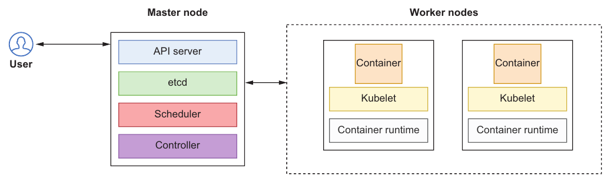
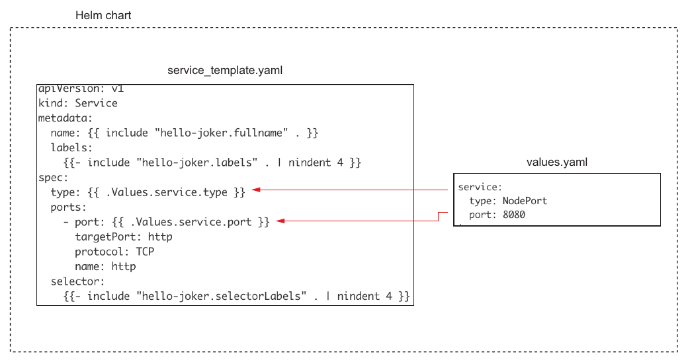
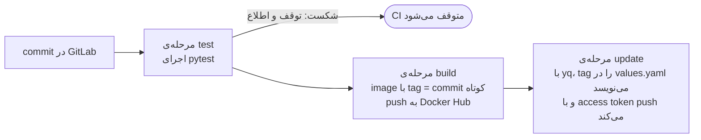
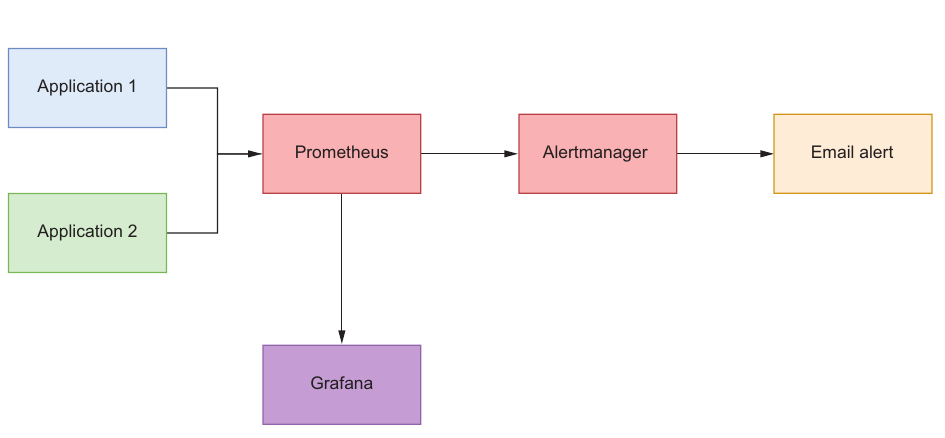

# فصل ۳: ساختن برنامه روی Kubernetes

[فصل ۲: MLOps چیست؟ →](02-what-is-mlops.md) · [کتاب](../README.md) · [فصل ۴: طراحی سیستم‌های ML قابل‌اطمینان ←](04-designing-reliable-ml-systems.md)

## خلاصه

این فصل ستون زیرساختی پلتفرم ML را می‌سازد، با ابزارهایی که مخصوص ML نیستند ولی هر سیستم ML قابل‌اطمینان روی آن‌ها می‌ایستد (pp. 42–44). کل فصل روی یک برنامه‌ی FastAPI کوچک به نام hello-joker جلو می‌رود که یک جوک تصادفی برمی‌گرداند (p. 45). اول **Docker** برنامه را با وابستگی‌هایش در یک image می‌گذارد که در container registry ذخیره می‌شود (pp. 45–51). بعد **Kubernetes** آن image را اجرا می‌کند: معماری master و worker، و objectهای pod و ReplicaSet و Deployment با rolling update و rollback، سه نوع service، namespace و ConfigMap و secret، و بسته‌بندی همه با **Helm** (pp. 51–80). سپس **CI/CD**: GitLab CI آزمون می‌کند و image می‌سازد و tag را در Helm chart بالا می‌برد، و **Argo CD** cluster را با Git یکی نگه می‌دارد (pp. 80–88). دست آخر **Prometheus و Grafana** متریک برنامه را جمع و نمایش می‌دهند (pp. 88–94).

## نکته‌های کلیدی

- **هر container برنامه و وابستگی‌هایش را یک‌جا می‌برد**، مثل کانتینر استاندارد حمل‌ونقل که روی کامیون و کشتی و قطار یکسان بار می‌شود (pp. 46–47).
- **مقدار tag یک image می‌تواند نسخه یا commit ID گیت باشد**؛ CI کتاب tag را از commit کوتاه‌شده می‌سازد تا هر image به یک commit برگردد (pp. 49, 82).
- **مفهوم pod کوچک‌ترین واحد Kubernetes است**؛ ReplicaSet تعداد podها را نگه می‌دارد و حتی podهایی را که پیش از خودش ساخته شده‌اند با selector حساب می‌کند (pp. 53–58).
- **شیء Deployment روی ReplicaSet سوار است** و rolling update و rollback می‌دهد: اگر image تازه pull نشود، rollout می‌ایستد و نسخه‌ی قدیمی سر جایش می‌ماند (pp. 59–62).
- **یک service جای IP متغیر podها را می‌گیرد**: ClusterIP برای داخل cluster، NodePort برای آزمون، LoadBalancer برای production با دسترسی بیرونی (pp. 63–69).
- **یک secret در Kubernetes فقط base64 است، نه رمزنگاری**؛ داده‌ی حساس را بیرون از Kubernetes با ابزار مدیریت secret نگه دارید (p. 72).
- **در GitOps، Git تنها منبع حقیقت است**: Argo CD هر تغییر دستی در cluster را out of sync نشان می‌دهد و با auto-sync به حالت Git برمی‌گرداند (pp. 86–88).
- **ابزار Prometheus متریک را pull می‌کند**: برنامه یک endpoint مثل `/metrics` باز می‌کند، Prometheus scrape می‌کند، Grafana با PromQL نمایش می‌دهد و Alertmanager هشدار را مسیر‌یابی می‌کند (pp. 88–91).

## فهرست بخش‌ها

*از فهرست مطالب خود کتاب، از bookmarkهای PDF؛ شماره‌ها صفحه‌ی چاپی‌اند.*

- ۳.۱ container و ابزارها — ص. ۴۴
- ۳.۲ ابزار Docker — ص. ۴۵
  - ۳.۲.۱ نوشتن کد برنامه — ص. ۴۷
  - ۳.۲.۲ نوشتن Dockerfile — ص. ۴۸
  - ۳.۲.۳ ساختن و push کردن image در Docker — ص. ۴۹
- ۳.۳ سیستم Kubernetes — ص. ۵۱
  - ۳.۳.۱ نگاهی به معماری Kubernetes — ص. ۵۱
  - ۳.۳.۲ ابزار kubectl — ص. ۵۲
  - ۳.۳.۳ objectهای Kubernetes — ص. ۵۳
  - ۳.۳.۴ شبکه و serviceها — ص. ۶۳
  - ۳.۳.۵ objectهای دیگر — ص. ۶۹
  - ۳.۳.۶ چارت‌های Helm — ص. ۷۵
  - ۳.۳.۷ جمع‌بندی — ص. ۸۰
- ۳.۴ continuous integration و deployment — ص. ۸۰
  - ۳.۴.۱ ابزار GitLab CI — ص. ۸۱
  - ۳.۴.۲ ابزار Argo CD — ص. ۸۶
- ۳.۵ ابزارهای Prometheus و Grafana — ص. ۸۸

## یادداشت‌ها

روی نقشه‌ی ذهنی، این فصل پایه‌ی پلتفرم است: Kubernetes به‌علاوه‌ی CI/CD و مانیتورینگ (p. 43). هدف‌ها: بسته‌بندی یکسان با Docker، deploy و مدیریت روی Kubernetes، خودکارسازی با CI/CD و پاییدن سلامت برنامه (pp. 42–43).

### ۳.۱ container و ابزارها

کار serving مدل، چه ML سنتی چه LLM، از مهم‌ترین بخش‌های پلتفرم است و معمولاً با container انجام می‌شود. containerها باید منبع کافی بگیرند، زیر بار scale شوند، اگر زیرساخت افتاد جایگزین شوند، و همه‌ی این‌ها خودکار و پاییده شود (p. 44).

*Figure 3.2 (p. 45): دو شاخه از GitLab CI بیرون می‌آید، یکی image و یکی تغییر chart؛ Argo CD فقط دومی را نگاه می‌کند.*

| کار | ابزار کتاب |
|---|---|
| container | Docker |
| ارکستراسیون container | Kubernetes |
| CI | GitLab CI |
| CD | Argo CD |
| متریک و داشبورد | Prometheus و Grafana |

ابزارها وسیله‌اند؛ Kubernetes انتخاب شده چون scalable و portable و cloud-agnostic است و همان workload روی دیتاسنتر و cloudهای مختلف یکسان اجرا می‌شود (p. 44).

### ۳.۲ ابزار Docker

مسئله: برنامه‌ی تشخیص شیء روی لپ‌تاپ به TensorFlow و NumPy و OpenCV و CMake وابسته است؛ در cloud، با توزیع لینوکس دیگری، همه باید دوباره نصب شوند (pp. 45–46). **containerization** برنامه را با وابستگی‌هایش طوری بسته‌بندی می‌کند که تقریباً همه‌جا اجرا شود (p. 46).

| حمل سنتی | حمل با کانتینر استاندارد |
|---|---|
| هر کالا بسته‌بندی و دستور حمل خودش را دارد | هر کالا در کانتینر هم‌اندازه |
| بار و تخلیه زمان‌بر است | بار روی هر وسیله بی‌تغییر |
| ناسازگاری با وسیله‌ی حمل | استاندارد واحد |

*بر پایه‌ی قیاس کتاب (pp. 46–47): کالا برنامه است، دستور حمل وابستگی‌ها و config، و کانتینر خود container.*

#### ۳.۲.۱ نوشتن کد برنامه (p. 47)

برنامه یک `main.py` با FastAPI است که با `pyjokes` جوک می‌دهد و با Uvicorn روی پورت 8083 اجرا می‌شود. FastAPI در ML برای ساختن APIهایی که مدل serve می‌کنند به کار می‌آید.

#### ۳.۲.۲ نوشتن Dockerfile (p. 48)

فایل Dockerfile فهرست دستورهای ساختن است، یعنی همان manifest کانتینر در قیاس کتاب. هر دستور یک **layer** است:

| دستور | کار |
|---|---|
| `FROM` | image پایه |
| `WORKDIR` | پوشه‌ی کاری |
| `RUN` | اجرای فرمان، مثل نصب بسته |
| `COPY` | کپی requirements و کد |
| `ARG` و `ENV` | آرگومان زمان build و متغیر محیطی |
| `ENTRYPOINT` | فرمان پیش‌فرض اجرای image |

#### ۳.۲.۳ ساختن و push کردن image در Docker (pp. 49–51)

- **یک image** بسته‌ای آماده‌ی ارسال است و **container** نمونه‌ی در حال اجرای آن (p. 49).
- نام و **tag**، مثل `hello-joker:v1`؛ tag می‌تواند نسخه یا commit ID باشد (p. 49).
- فرمان `docker run -p 8081:8083` پورت container را به پورت میزبان وصل می‌کند (pp. 49–50).
- **یک container registry** مثل Git برای imageهاست: Docker Hub یا GCR یا ECR؛ orchestrator image را از آن pull می‌کند (p. 50).

### ۳.۳ سیستم Kubernetes

اگر container به خاطر Out of Memory بیفتد، چه کسی بالایش می‌آورد؟ چه کسی آن را روی سرور schedule می‌کند؟ جواب Kubernetes است، یا K8s (p. 51).

#### ۳.۳.۱ نگاهی به معماری Kubernetes (pp. 51–52)

یک نود یعنی نقطه‌ی شکست واحد؛ پس cluster با چند نود، و یک نود master که نودهای worker را می‌پاید (p. 51).

*Figure 3.4 (p. 52): کاربر فقط با API server حرف می‌زند؛ بقیه‌ی کار بین مؤلفه‌های master و kubeletهای workerها پخش است.*

| مؤلفه | نود | نقش |
|---|---|---|
| API server | master | frontend Kubernetes؛ فرمان‌ها را می‌گیرد |
| etcd | master | key-value store توزیع‌شده؛ منبع حقیقت حالت cluster |
| scheduler | master | container را بر اساس CPU و حافظه‌ی لازم و آزاد روی نود می‌نشاند |
| controller | master | ارکستراسیون؛ اگر container افتاد، تازه‌ای راه می‌اندازد |
| container runtime | worker | اجرای container |
| kubelet | worker | مطمئن می‌شود containerها درست اجرا می‌شوند و به master گزارش می‌دهد |

#### ۳.۳.۲ ابزار kubectl (pp. 52–53)

ابزار خط فرمان برای کار با cluster: `kubectl get nodes` و `kubectl cluster-info` و بقیه.

#### ۳.۳.۳ objectهای Kubernetes (pp. 53–62)

هر object چهار بخش دارد: `apiVersion` و `kind` و `metadata`، که label را هم می‌گیرد، و `spec` (pp. 53–54).

| object | چه می‌کند | نکته‌ی کتاب |
|---|---|---|
| **pod** | کوچک‌ترین واحد؛ یک نمونه از برنامه | چند container در یک pod شبکه و storage مشترک دارند، مثل اتاق‌های یک آپارتمان؛ معمولاً یک container کمکی برای logging. با image غلط، وضعیت `ErrImagePull` و `READY 0/1` (pp. 53–56) |
| **ReplicaSet** | تعداد podها را نگه می‌دارد | `template` و `replicas` و `selector`؛ selector اجازه می‌دهد podهای از‌قبل‌موجود را هم بشمارد: با یک pod دستی، فقط دو pod تازه می‌سازد (pp. 56–58) |
| **Deployment** | روی ReplicaSet، با rolling update و rollback | YAML همان ReplicaSet است با `kind: Deployment` (pp. 59–60) |

**روش rolling update در عمل** (pp. 60–62): با تغییر tag به `v2`، ReplicaSet تازه یکی‌یکی بالا می‌رود و قدیمی یکی‌یکی پایین، از ۳ و ۰ تا ۰ و ۳. با imageی که وجود ندارد، ReplicaSet تازه فقط به ۱ می‌رسد، قدیمی پایین نمی‌آید و `READY 3/3` ولی `UP-TO-DATE 1` می‌ماند؛ `kubectl rollout undo` آن pod خراب را برمی‌دارد. بیشتر برنامه‌های stateless، از جمله سرویس‌های inference فصل‌های بعد، با Deployment بالا می‌آیند (p. 62).

> **Try it:** [rolling update و rollback](../widgets/03-rolling-update.html) — نسخه‌ی تازه را با image سالم یا خراب rollout کنید، ببینید دو ReplicaSet چطور یکی‌یکی بالا و پایین می‌روند و rollout خراب کجا می‌ایستد، و بعد undo کنید.

> **In practice:** در stack مرجع، API پیش‌بینی یک Deployment است و هر rollout از Argo CD می‌آید؛ پس rollout خراب همان چیزی است که اینجا دیدید.
>
> **Your turn:** بعد از merge یک تغییر، Argo CD برنامه را Synced نشان می‌دهد ولی `kubectl get deployment` می‌گوید `READY 3/3` و `UP-TO-DATE 1`. کاربرها خطا می‌بینند؟ و rollback درست کدام است؟
>
> *Answer:* خطا نمی‌بینند: Deployment podهای قدیمی را پایین نیاورده چون pod تازه سالم بالا نیامده (pp. 61–62). در GitOps، rollback را با revert همان commit در Git بکنید، نه با `kubectl rollout undo`، وگرنه Argo CD دوباره نسخه‌ی خراب Git را اعمال می‌کند (pp. 86–88).

#### ۳.۳.۴ شبکه و serviceها (pp. 63–69)

همه‌ی podها IP دارند ولی گذرا‌اند؛ service لایه‌ی انتزاع پایداری است برای کاربرها و برنامه‌های دیگر، مثل frontendی که با backend حرف می‌زند (p. 63).

| | ClusterIP | NodePort | LoadBalancer |
|---|---|---|---|
| دسترسی | فقط داخل cluster | از بیرون با IP نود و یک پورت | از بیرون با load balancer ارائه‌دهنده‌ی cloud |
| کاربرد | ارتباط داخلی | development و آزمون | production با load balancing خودکار |
| پیکربندی | ساده‌ترین | پورت ثابت در بازه‌ی ۳۰۰۰۰ تا ۳۲۷۶۷ | provision کردن load balancer بیرونی |

*بر پایه‌ی جدول p. 69.*

- در NodePort سه پورت هست: `targetPort` روی pod، `port` روی service و `nodePort` روی نود (p. 64).
- نام service در ClusterIP همان hostname داخل cluster است و DNS آن را به IP نگاشت می‌کند (p. 66).

#### ۳.۳.۵ objectهای دیگر (pp. 69–75)

| object | کار | هشدار |
|---|---|---|
| namespace | cluster مجازی داخل cluster فیزیکی؛ جداسازی تیم‌ها و پروژه‌ها | برای صدا زدن service از namespace دیگر باید قرارداد DNS را رعایت کرد (pp. 70–71) |
| ConfigMap | config، مثل URL دیتابیس، جدا از کد | از راه `configMapKeyRef` به متغیر محیطی تبدیل می‌شود (pp. 71–74) |
| secret | داده‌ی حساس؛ گونه‌های Opaque و Docker Registry و TLS | base64 رمزنگاری نیست؛ داده‌ی حساس را بیرون از Kubernetes رمز و نگه دارید (pp. 72–74) |

#### ۳.۳.۶ چارت‌های Helm (pp. 75–80)

خود Kubernetes برنامه را یک کل نمی‌بیند، هر object را جدا می‌بیند؛ Helm همه‌ی objectهای یک برنامه را با **chart** بسته‌بندی می‌کند (p. 75).

*Figure 3.9 (p. 76): chart یعنی template به‌علاوه‌ی values؛ با عوض کردن values.yaml همان template برنامه‌ی دیگری می‌شود.*

- **سایت Artifact Hub** برای chartها همان نقش Docker Hub را برای imageها دارد؛ نمونه‌ی کتاب نصب Redis با chart بیتنامی است (pp. 76–78).
- برای hello-joker با `helm create` و تغییر `replicaCount` و image و نوع service در `values.yaml`، یک `helm install` همه‌ی service و Deployment و ReplicaSet و podها را می‌سازد (pp. 78–80).

#### ۳.۳.۷ جمع‌بندی (p. 80)

بستر Kubernetes برای workloadهای ML پرمنبع و پویا مناسب است: منابع محاسباتی آموزش و inference را scale و مدیریت می‌کند، و تیم‌های داده روی مدل تمرکز می‌کنند.

### ۳.۴ continuous integration و deployment

کار deploy دستی در production دردسر است: tag غلط نسخه‌ی غلط را بالا می‌آورد، یا deploy محلی کسی آخرین deploy را بازنویسی می‌کند (p. 80). **CI** آزمون و build و به‌روزرسانی Helm chart را می‌کند؛ **CD** chart به‌روز را deploy می‌کند و مراقب است آن‌چه اجرا می‌شود همان آخرین image باشد (p. 80).

#### ۳.۴.۱ ابزار GitLab CI (pp. 81–86)

*نمودار vault از فهرست ۳.۱۳ (pp. 82–84).*

- همه‌ی jobهای یک stage هم‌زمان اجرا می‌شوند؛ اگر `test_code` شکست بخورد، stageهای بعد اجرا نمی‌شوند (pp. 82–83).
- همه‌ی credentialها مثل `DOCKER_PASSWORD` در متغیرهای CI/CD تعریف می‌شوند، نه در کد (p. 82).
- خود commit به‌روزرسانی chart طوری ساخته می‌شود که CI را دوباره راه نیندازد (p. 84).
- با GitLab Runner می‌شود یک job را محلی آزمود (p. 85).

#### ۳.۴.۲ ابزار Argo CD (pp. 86–88)

ابزار Argo CD مخزن Git و برنامه‌ی deploy‌شده را مدام می‌پاید: commit تازه به production می‌رود، و هر تغییر دستی در production با Git سنجیده و، اگر ناسازگار بود، به حالت Git برگردانده می‌شود؛ Git تنها منبع حقیقت است (p. 86). در آزمون کتاب، عوض کردن دستی نوع service برنامه را out of sync می‌کند و diff دقیقاً همان نوع service را نشان می‌دهد؛ با auto-sync، Argo CD خودش برمی‌گرداند (p. 88).

> **In practice:** stack مرجع همین زنجیره را دارد: GitLab CI image می‌سازد و tag را در repo deploy بالا می‌برد، Argo CD sync می‌کند و rollback یعنی revert در Git.
>
> **Your turn:** کسی شب برای رفع فوری یک مشکل، `replicas` سرویس API پیش‌بینی را با `kubectl scale` از ۲ به ۵ برده. صبح دوباره ۲ است. چه شد و راه درست چه بود؟
>
> *Answer:* Argo CD با auto-sync تغییر دستی را با Git ناسازگار دید و به حالت Git برگرداند (pp. 86–88). راه درست، تغییر در repo deploy با یک merge request است، یا اگر scale خودکار می‌خواهید، HorizontalPodAutoscaler در همان manifestها.

### ۳.۵ ابزارهای Prometheus و Grafana

ثبت log برای debug منطق برنامه خوب است، ولی پرسش‌هایی مثل «در یک ساعت گذشته چند درخواست آمد؟» یا «چند درصد درخواست‌ها زیر ۲ ثانیه جواب گرفتند؟» **متریک** می‌خواهند (p. 88). هشدارهای رایج: بالا یا پایین بودن برنامه، عبور percentile ۹۵ زمان پاسخ از آستانه، افت تعداد درخواست‌ها (p. 88).

*Figure 3.17 (p. 90): جهت فلش‌ها گمراه‌کننده نیست: Prometheus خودش سراغ endpoint برنامه‌ها می‌رود و pull می‌کند.*

مؤلفه‌های Prometheus (p. 89): پایگاه‌داده‌ی time series، worker که scrape می‌کند، UI برای نگاه سریع، و Alertmanager برای مسیر‌یابی هشدار. داشبورد را Grafana با کوئری‌های PromQL می‌سازد (p. 89).

| نوع متریک | رفتار | کاربرد در کتاب |
|---|---|---|
| counter | فقط بالا می‌رود | `starlette_requests_total`، تعداد درخواست‌ها |
| gauge | بالا و پایین | مصرف حافظه |
| histogram | شمارش در bucketهای از پیش تعریف‌شده | percentile ۹۵ زمان پاسخ |

*بر پایه‌ی p. 91.*

- برای FastAPI، `starlette_exporter` با دو خط کد endpoint `/metrics` را می‌سازد؛ متریک سفارشی با کتابخانه‌ی کلاینت Prometheus (pp. 90–92).
- ابزار Prometheus با **service discovery** و سه annotation روی pod، برنامه‌ی تازه را پیدا می‌کند؛ در Status > Targets می‌بینید scrape می‌شود یا نه (p. 92).
- نمودار درخواست‌های ۱۰ دقیقه‌ی اخیر با `sum by` روی کد پاسخ HTTP و تابع `increase` (pp. 92–93).
- حتی jobهای batch می‌توانند با **Pushgateway** متریک push کنند (p. 94).

> **In practice:** در stack مرجع، loaderها و API پیش‌بینی همین مسیر را دارند: Prometheus scrape می‌کند و Grafana هشدار می‌دهد.
>
> **Your turn:** job بارگذاری روزانه یک CronJob کوتاه‌عمر است که در ۴۰ ثانیه تمام می‌شود. متریک «تعداد ردیف‌های بارگذاری‌شده»ی آن در Grafana گاهی هست و گاهی نیست. چرا، و چه باید کرد؟
>
> *Answer:* Prometheus در بازه‌های ثابت pull می‌کند؛ podی که پیش از scrape بعدی تمام شود متریکش گم می‌شود. کتاب برای jobهای batch، Pushgateway را پیشنهاد می‌کند تا job در پایان کارش متریک را push کند (pp. 89, 94).

## بده‌بستان‌ها در یک نگاه

| انتخاب | چه می‌دهد | چه می‌گیرد |
|---|---|---|
| ReplicaSet تنها | نگه داشتن تعداد podها | بدون rolling update و rollback (pp. 56–59) |
| Deployment | rolling update و rollback بی‌اثر روی کاربر | لایه‌ی انتزاع بیشتر (p. 59) |
| ClusterIP | ساده‌ترین، فقط داخلی | دسترسی بیرونی ندارد (p. 69) |
| NodePort | دسترسی بیرونی بی‌تنظیم پیچیده | پورت ثابت؛ مناسب آزمون (p. 69) |
| LoadBalancer | دسترسی بیرونی و load balancing خودکار | provision و تنظیم مخصوص cloud (p. 69) |
| secret در Kubernetes | جدا کردن داده‌ی حساس از کد | فقط base64، رمزنگاری نیست (p. 72) |
| auto-sync در Argo CD | cluster همیشه برابر Git | تغییر دستی اضطراری هم برگردانده می‌شود (p. 88) |

## فراتر از کتاب

- **سازوکار Liveness و readiness probe** در کتاب نیامده‌اند، ولی همان چیزی‌اند که Deployment برای فهمیدن «pod تازه سالم است؟» در rolling update به آن‌ها تکیه می‌کند؛ بدون readiness probe، podی که بالا آمده ولی مدلش هنوز load نشده ترافیک می‌گیرد.
- **ماژول Sealed Secrets و ابزار External Secrets Operator** دو راه رایج برای همان توصیه‌ی کتاب‌اند که secret را بیرون از Kubernetes رمز کنید و در Git فقط نسخه‌ی رمزشده بماند.
- **کتاب Kubernetes in Action** که خود کتاب پیشنهاد می‌کند (p. 80)، جای خوبی برای عمیق‌تر شدن در objectهاست.

## پیوندها

- **فصل‌های مرتبط:** [فصل ۱: شروع کار با MLOps و ML engineering](01-getting-started-with-mlops-and-ml-engineering.md) که زنجیره‌ی deploy شکل ۱.۹ را دارد، [فصل ۶: بردن مدل‌های ML به production](06-productionizing-ml-models.md) که مدل را با BentoML و Yatai روی همین Kubernetes deploy می‌کند، [فصل ۷: تحلیل و آماده‌سازی داده](07-data-analysis-and-preparation.md) که affinity و toleration را برای notebookها به کار می‌برد، و [فصل ۱۱: مانیتورینگ و explainability](11-monitoring-and-explainability.md) که Prometheus و Grafana را با Alertmanager و Loki کامل می‌کند.

## خودتان را بسنجید

*پرسش‌ها و پاسخ‌ها مال vault است و از روی یادداشت‌های بالا نوشته شده؛ پاسخ‌ها به صفحه‌های کتاب ارجاع می‌دهند.*

1. **چرا ReplicaSet به selector نیاز دارد وقتی template را دارد؟**

   *Answer:* چون می‌تواند podهایی را هم که پیش از خودش ساخته شده‌اند بپاید و بشمارد؛ template فقط برای ساختن pod تازه است وقتی تعداد کم باشد (pp. 56–58).

2. **در rollout با imageی که وجود ندارد، Deployment چه می‌کند؟**
   - [ ] همه‌ی podهای قدیمی را پایین می‌آورد و برنامه از دسترس خارج می‌شود
   - [x] فقط یک pod تازه می‌سازد، ادامه نمی‌دهد و podهای قدیمی را نگه می‌دارد
   - [ ] خودکار به نسخه‌ی قبل rollback می‌کند

   *Answer:* rollout پس از خطای pull می‌ایستد و سه pod قدیمی اجرا می‌مانند؛ rollback با `kubectl rollout undo` دستی است (pp. 61–62).

3. **کدام نوع service برای ارتباط frontend و backend داخل یک cluster مناسب است؟**
   - [x] ClusterIP
   - [ ] NodePort
   - [ ] LoadBalancer

   *Answer:* ClusterIP فقط داخل cluster در دسترس است و ساده‌ترین پیکربندی را دارد (pp. 66, 69).

4. **چرا secret در Kubernetes برای داده‌ی حساس کافی نیست؟**

   *Answer:* مقدارها فقط base64 می‌شوند، که encoding است نه encryption، و به‌راحتی decode می‌شوند؛ کتاب می‌گوید داده‌ی حساس را بیرون از Kubernetes رمز و نگه دارید (p. 72).

5. **اگر کسی نوع service را مستقیم در cluster عوض کند، Argo CD چه می‌کند؟**

   *Answer:* برنامه را out of sync نشان می‌دهد و diff تغییر را می‌دهد؛ با auto-sync، cluster را به حالت Git برمی‌گرداند چون Git تنها منبع حقیقت است (pp. 86–88).

6. **برای percentile ۹۵ زمان پاسخ کدام نوع متریک Prometheus به کار می‌رود؟**

   *Answer:* histogram، که در bucketهای از پیش تعریف‌شده می‌شمارد و percentile از روی آن‌ها حساب می‌شود (p. 91).
