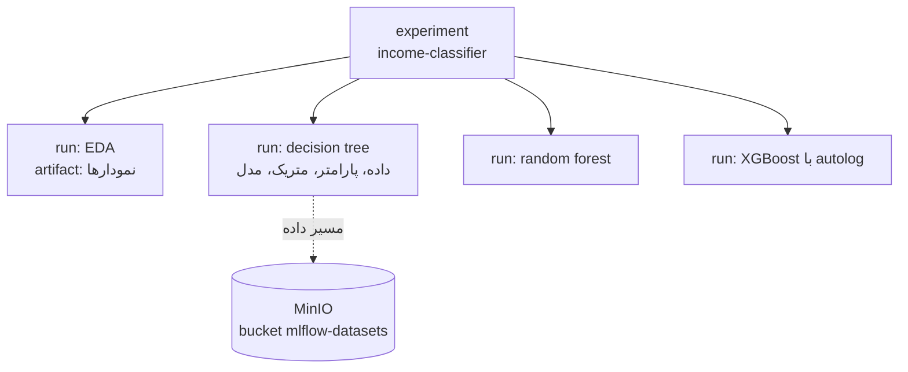

# فصل ۴: طراحی سیستم‌های ML قابل‌اطمینان

[فصل ۳: ساختن برنامه روی Kubernetes →](03-building-applications-on-kubernetes.md) · [کتاب](../README.md) · [فصل ۵: ارکستراسیون pipelineهای ML ←](05-orchestrating-ml-pipelines.md)

## خلاصه

بخش دوم کتاب با این پرسش شروع می‌شود که چطور آزمایش‌های ML را قابل‌ردیابی و تکرارپذیر کنیم (p. 95). این فصل دو مؤلفه از نقشه‌ی ذهنی فصل ۱ را می‌سازد: **experiment tracking** و **model registry** با MLflow، و **feature store** با Feast (pp. 97–99). مثال یک classifier دودویی درآمد است، با برچسب‌های `<=50K` و `>50K` (p. 98). با MLflow نمودارهای EDA، داده‌ها، پارامترها و متریک‌های سه مدل ثبت می‌شوند، بهترین مدل با یک کوئری پیدا و در registry ثبت می‌شود (pp. 100–114). با Feast، featureها در سه فایل جدا با entity و FeatureView ثبت می‌شوند، برای آموزش با **point-in-time join** از offline store و برای inference از online store خوانده می‌شوند (pp. 114–123).

## نکته‌های کلیدی

- **کار tracking به سه دلیل لازم است**: تکرارپذیری، انتخاب مدل و مقایسه‌ی کارایی مدل retrain‌شده با نسخه‌های قبلی (pp. 98–100).
- **در MLflow هر اجرا یک run است** با run ID یکتا، و runها زیر یک experiment جمع می‌شوند؛ artifact می‌تواند مدل، داده یا نمودار باشد (p. 103).
- **مسیر داده را هم ثبت کنید، نه فقط متریک را**: کتاب داده‌ی train و test را در MinIO می‌گذارد و با `mlflow.data.from_pandas` مسیر و schema را در run ثبت می‌کند (pp. 106–107).
- **قابلیت autolog راحت است ولی کامل نیست**: متریک سفارشی را ثبت نمی‌کند و داده‌ی آموزش را به‌صورت آرایه ثبت می‌کند، نه DataFrame (p. 108).
- **بهترین مدل با کوئری پیدا می‌شود**، در UI یا با `MlflowClient`، و با `register_model` در registry نسخه می‌خورد (pp. 111–113).
- **هر feature درست یعنی آخرین مقدار پیش از زمان رویداد**: برای ۲۲ مه، مقدار ۲۱ مه، نه دسامبر؛ Feast این point-in-time join را خودش می‌سازد (p. 115).
- **بخش offline store برای آموزش و batch، online store برای real-time**؛ materialization داده را از اولی به دومی می‌برد (pp. 115–120).
- **مقدار TTL حد نگاه به گذشته است**: با TTL دو روزه برای ۲۲ مه، داده‌ی پیش از ۲۰ مه نادیده گرفته می‌شود (p. 117).

## فهرست بخش‌ها

*از فهرست مطالب خود کتاب، از bookmarkهای PDF؛ شماره‌ها صفحه‌ی چاپی‌اند.*

- ۴.۱ ابزار MLflow برای experiment tracking — ص. ۹۸
  - ۴.۱.۱ کاوش داده — ص. ۱۰۰
  - ۴.۱.۲ ردیابی با MLflow — ص. ۱۰۲
  - ۴.۱.۳ model registry در MLflow — ص. ۱۱۱
- ۴.۲ ابزار Feast به‌عنوان feature store — ص. ۱۱۴
  - ۴.۲.۱ ثبت featureها — ص. ۱۱۶
  - ۴.۲.۲ بازیابی featureها — ص. ۱۱۸
  - ۴.۲.۳ سرور feature — ص. ۱۲۱
  - ۴.۲.۴ کار با UI در Feast — ص. ۱۲۲

## یادداشت‌ها

کار مثل بیشتر data scientistها با شناخت داده شروع می‌شود: EDA، تقسیم داده و آزمودن چند مدل. MLflow آزمایش‌ها را نگه می‌دارد و بهترین مدل را با وابستگی‌هایش در registry می‌گذارد؛ featureهای تازه هم در Feast ثبت می‌شوند چون در deploy لازم‌اند (p. 98). روی شکل ۴.۱، این فصل روی سه حرف می‌ایستد: feature store (D)، experiment tracking (C) و model registry (B) (p. 99). کد فصل در `github.com/practical-mlops/chapter-4` است (p. 98).

| ابزار | مؤلفه‌ی نقشه | پرسشی که جواب می‌دهد |
|---|---|---|
| MLflow tracking | C | کدام پارامترها بهترین نتیجه را دادند؟ |
| MLflow model registry | B | کدام نسخه‌ی مدل در production است؟ |
| Feast | D | آیا آموزش و inference همان featureها را می‌بینند؟ |

*پرسش‌های ستون آخر از p. 100 و p. 114.*

### ۴.۱ ابزار MLflow برای experiment tracking

چه باید ثبت شود؟ داده‌ی train و test، وزن‌های مدل و متریک‌ها (p. 98). commit کردن پارامترها در Git ممکن است ولی tag زدن منظم می‌خواهد، و فایل پارامتر کنار notebook توضیح اضافه می‌خواهد؛ **tracking server** مرکزی این دو را حل می‌کند و چند تیم روی آن آزمایش‌ها را مقایسه و تکرار می‌کنند (p. 100). سه پرسشی که MLflow جواب می‌دهد: کدام نسخه در production است، کدام پارامترها بهترین نتیجه را دادند، و آیا نتیجه‌ی شش ماه پیش تکرارپذیر است (p. 100).

#### ۴.۱.۱ کاوش داده (pp. 100–102)

داده حدود ۳۰٬۱۶۲ ردیف دارد، همه categorical: Workclass و Education و Marital-Status و Occupation و Relationship و Race و Sex و Native_country، و target دودویی (pp. 100–101). نمودار هر متغیر در برابر target ساخته و ذخیره می‌شود؛ مثلاً خوداشتغال‌ها احتمال بیشتری دارند بالای ۵۰ هزار دلار درآمد داشته باشند (p. 102).

#### ۴.۱.۲ ردیابی با MLflow (pp. 102–111)

*نمودار vault از pp. 103–108.*

| مفهوم | معنا در کتاب |
|---|---|
| experiment | چیزی مثل پروژه؛ اینجا `income-classifier` (p. 103) |
| run | یک اجرای آزمایش با run ID یکتا؛ نام run با `uuid4` ساخته می‌شود تا runهای EDA از مدل‌سازی جدا بمانند (p. 103) |
| artifact | فایل مدل، داده یا نمودار؛ با `log_artifacts` (p. 103) |
| dataset input | `mlflow.data.from_pandas` با مسیر بیرونی؛ MLflow نام و نوع ستون‌ها و تعداد ردیف را نگه می‌دارد (p. 106) |
| متریک و پارامتر | `log_metric` و `log_params`، مثلاً accuracy و AUC (pp. 106–107) |

- همه‌ی featureهای categorical با one-hot به dummy تبدیل می‌شوند و فهرست ستون‌ها برای inference با pickle ذخیره می‌شود (p. 105).
- داده در MinIO همان cluster Kubeflow ذخیره می‌شود؛ هر object store دیگری مثل GCS یا S3 هم می‌شود (p. 106).
- سه مدل: decision tree، random forest و XGBoost (p. 106).
- **قابلیت autolog** با یک خط برای XGBoost مدل و نمودارها و پارامترها را ثبت می‌کند، حتی نمودار feature importance، ولی متریک سفارشی را نه (pp. 108–111).

> **In practice:** در stack مرجع MLflow و JupyterHub هست؛ پرسش این است که هر run چه چیزی را واقعاً ثبت می‌کند.
>
> **Your turn:** data scientist شما مدل دسته‌بندی متن تراکنش را در notebook آموزش داده و متریک‌ها و مدل در MLflow هست. شش ماه بعد کسی می‌پرسد مدل روی کدام برش داده آموزش دید. چه چیزی کم است؟
>
> *Answer:* داده. کتاب train و test را در object store می‌گذارد و مسیرشان را با `mlflow.data.from_pandas` و `log_input` ثبت می‌کند تا هر run به داده‌ی خودش برگردد (pp. 106–107). در stack مرجع یعنی ذخیره‌ی Parquet برش آموزش با تاریخ و ثبت مسیرش در run، و autolog تنها کافی نیست چون داده را آرایه ثبت می‌کند (p. 108).

#### ۴.۱.۳ model registry در MLflow (pp. 111–114)

بهترین مدل را با کوئری پیدا کنید: در UI عبارت `metrics.roc_auc_score_test > 0.8` و نمای نمودار، یا با `MlflowClient` و `search_runs` مرتب‌شده بر AUC؛ بعد `register_model` با model URI همان run (pp. 111–113). در این مثال random forest برنده است (p. 111). مدل ثبت‌شده مثل کد از staging به production ارتقا پیدا می‌کند (p. 113).

- ابزار MLflow اکنون زبانه‌ی Prompts هم دارد، ولی به گفته‌ی کتاب هنوز محدود است و فصل‌های ۱۲ و ۱۳ سراغ Langfuse می‌روند (p. 113).
- نمونه‌ی محلی همکاری نمی‌دهد؛ MLflow باید در محیط مشترک، مثل cluster Kubernetes، نصب شود (p. 114).

### ۴.۲ ابزار Feast به‌عنوان feature store

در دنیای واقعی featureها از چند جدول می‌آیند. کتاب برای شبیه‌سازی، داده را به سه فایل با timestamp و `user_id` می‌شکند: featureهای demographic، relationship و occupation (p. 114).

**نسخه‌ی feature درست کدام است؟** کاربری که featureهایش در ۷ ژانویه، ۲۱ مه و ۴ دسامبر ثبت شده، برای ۲۲ مه باید مقدار ۲۱ مه را بگیرد (p. 115). این منطق را می‌شود با SQL نوشت، که یک چیز دیگر برای نگه‌داری است، یا به Feast سپرد که **point-in-time correct** می‌سازد (p. 115).

*Figure 4.10 (p. 115): مدل از دو در تغذیه می‌شود، ولی هر دو را یک registry تعریف می‌کند؛ همین است که آموزش و inference را هم‌خوان نگه می‌دارد.*

| | offline store | online store |
|---|---|---|
| در کتاب | فایل Parquet در MinIO | Redis |
| برای | آموزش و inference دسته‌ای | inference بلادرنگ با latency کم |
| فراخوانی | `get_historical_features` | `get_online_features` |
| چه برمی‌گرداند | مقدار point-in-time برای هر ردیف entity | آخرین مقدار |

*بر پایه‌ی pp. 115–120.*

یک location مشترک منطق تولید feature را از منطق مدل جدا می‌کند و featureها را بین تیم‌ها قابل اشتراک می‌کند (p. 115).

#### ۴.۲.۱ ثبت featureها (pp. 116–118)

| مفهوم | تعریف | مثال کتاب |
|---|---|---|
| entity | شناسه‌ای که feature برایش جمع می‌شود | `user_id`؛ برای محصول، `product_id` (p. 116) |
| file source | مسیر فایل در S3 یا MinIO، فقط Parquet | با override endpoint به MinIO (p. 116) |
| FeatureView | گروه منطقی featureها با entity و schema و TTL و منبع | `demographic` (p. 117) |
| TTL | حد نگاه به گذشته در ساخت داده‌ی تاریخی | کتاب ۳۶۵ روز می‌گذارد تا چیزی جا نیفتد (p. 117) |
| `feature_store.yaml` | نام پروژه، محل registry، config دو store | registry در bucket `feature-registry` (pp. 117–118) |

فرمان `feast apply` تعریف‌ها را در registry می‌نویسد و Redis را برای online store آماده می‌کند (p. 118).

#### ۴.۲.۲ بازیابی featureها (pp. 118–120)

- تابع `get_historical_features` یک DataFrame entity با ستون‌های `user_id` و `event_timestamp` و فهرست featureها مثل `demographic:Sex` می‌گیرد (pp. 118–119).
- فرمان `feast materialize` با زمان شروع و پایان، داده‌ی آن بازه را از offline به online می‌برد (p. 120).
- تابع `get_online_features` فقط آخرین مقدار را برمی‌گرداند (p. 120).

> **Try it:** [point-in-time join](../widgets/04-point-in-time-join.html) — زمان رویداد و TTL را جابه‌جا کنید و ببینید Feast برای هر ردیف آموزش کدام مقدار feature را برمی‌دارد، و join ساده‌ی «آخرین مقدار» کجا از آینده نشت می‌کند.

> **In practice:** در stack مرجع Silver نسخه‌های ردیف‌ها را با `update_date` نگه می‌دارد؛ این همان مواد خام point-in-time است.
>
> **Your turn:** برای مدل پیش‌بینی نکول وام، تحلیل‌گری جدول آموزش را با join وام‌ها روی آخرین وضعیت مشتری در Gold ساخته. AUC آفلاین عالی است و در production ضعیف. چه اتفاقی افتاده؟
>
> *Answer:* آخرین وضعیت مشتری شامل اطلاعاتی است که بعد از زمان درخواست وام پیدا شده؛ مدل از آینده یاد گرفته. feature درست، آخرین مقدار پیش از زمان رویداد است (p. 115). با Silver که تاریخچه را دارد می‌شود همان join را با شرط `update_date <= event_time` و یک حد TTL ساخت، یا به feature store سپرد (pp. 115, 117).

#### ۴.۲.۳ سرور feature (pp. 121–122)

فرمان `feast serve` یک API می‌دهد برای برنامه‌هایی که به زبانی نوشته شده‌اند که SDK ندارد؛ با یک `curl` و فهرست featureها و `user_id`، مقدارها از online store برمی‌گردند (pp. 121–122).

#### ۴.۲.۴ کار با UI در Feast (pp. 122–123)

فرمان `feast ui` روی `localhost:8888` featureها و entityها و منبع داده را نشان می‌دهد و با tag فیلتر می‌کند (pp. 122–123). جمع‌بندی کتاب: MLflow و Feast دو مؤلفه‌ی مهم‌اند ولی هنوز کار دستی، مثل retrain، می‌خواهند؛ فصل بعد با Kubeflow خودکارش می‌کند (p. 123).

## بده‌بستان‌ها در یک نگاه

| انتخاب | چه می‌دهد | چه می‌گیرد |
|---|---|---|
| ثبت پارامترها در Git | بدون ابزار تازه | commit و tag منظم؛ مقایسه‌ی سخت (p. 100) |
| MLflow tracking server | مقایسه و تکرار مشترک | یک سرویس دیگر که باید در cluster اجرا شود (p. 114) |
| ثبت دستی | کنترل کامل بر قالب، از جمله DataFrame | کد بیشتر (pp. 106–107) |
| autolog | یک خط، حتی feature importance | متریک سفارشی نه؛ داده به‌صورت آرایه (p. 108) |
| join دستی با SQL | ابزار تازه نمی‌خواهد | یک چیز دیگر برای نگه‌داری و debug (p. 115) |
| Feast | point-in-time، اشتراک feature، online store | registry و materialization و Redis (pp. 115–120) |
| TTL کوتاه | featureهای تازه | ردیف‌هایی که مقدار تازه ندارند خالی می‌مانند (p. 117) |

## فراتر از کتاب

- **ابزار MLflow در نسخه‌های تازه stageها را کنار گذاشته** و به جای Staging و Production، alias و tag روی نسخه‌ی مدل پیشنهاد می‌کند؛ ایده‌ی کتاب، یعنی ارتقای کنترل‌شده‌ی مدل، همان می‌ماند.
- **منطق point-in-time** را بدون feature store هم می‌شود در warehouse ساخت، مثلاً با `ASOF JOIN` در ClickHouse، که برای هر ردیف چپ نزدیک‌ترین ردیف راست با زمان کوچک‌تر یا برابر را برمی‌دارد.

## پیوندها

- **فصل‌های مرتبط:** [فصل ۱: شروع کار با MLOps و ML engineering](01-getting-started-with-mlops-and-ml-engineering.md) که نقشه‌ی ذهنی را می‌دهد، [فصل ۵: ارکستراسیون pipelineهای ML](05-orchestrating-ml-pipelines.md) که همین MLflow و Feast را در pipeline Kubeflow به هم وصل می‌کند، و [فصل ۹: آموزش و اعتبارسنجی مدل: بخش ۲](09-model-training-and-validation-part-2.md) که MLflow را برای recommender به کار می‌برد.

## خودتان را بسنجید

*پرسش‌ها و پاسخ‌ها مال vault است و از روی یادداشت‌های بالا نوشته شده؛ پاسخ‌ها به صفحه‌های کتاب ارجاع می‌دهند.*

1. **سه دلیل کتاب برای ردیابی آزمایش‌ها چیست؟**

   *Answer:* تکرارپذیری برای همکارها، انتخاب بهترین مدل از بین چند مدل، و مقایسه‌ی مدل retrain‌شده با نسخه‌های قبلی (pp. 98–100).

2. **قابلیت autolog در MLflow چه چیزی را ثبت نمی‌کند؟**
   - [ ] پارامترهای مدل
   - [x] متریک‌های سفارشی
   - [ ] نمودار feature importance

   *Answer:* autolog مدل و پارامترها و نمودارها را ثبت می‌کند ولی متریک سفارشی را باید دستی ثبت کرد؛ داده‌ی آموزش را هم آرایه ثبت می‌کند (p. 108).

3. **فرض کنید featureهای کاربری در ۷ ژانویه، ۲۱ مه و ۴ دسامبر ثبت شده‌اند. برای رویدادی در ۲۲ مه، Feast کدام را برمی‌دارد؟**
   - [ ] ۴ دسامبر، چون تازه‌ترین است
   - [x] ۲۱ مه
   - [ ] ۷ ژانویه

   *Answer:* point-in-time correct یعنی آخرین مقدار پیش از زمان رویداد (p. 115).

4. **با TTL دو روزه، برای رویداد ۲۲ مه، Feast تا کجا به گذشته نگاه می‌کند؟**

   *Answer:* تا ۲۰ مه؛ هر مقداری پیش از آن در ساخت داده‌ی تاریخی نادیده گرفته می‌شود (p. 117).

5. **فرق `get_historical_features` و `get_online_features` چیست؟**

   *Answer:* اولی از offline store برای هر ردیف entity و timestamp مقدار point-in-time را می‌دهد و برای آموزش و batch است؛ دومی از online store، پس از materialization، فقط آخرین مقدار را با latency کم می‌دهد و برای inference بلادرنگ است (pp. 118–120).
