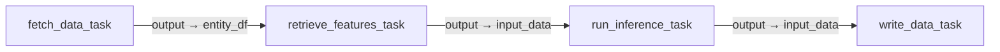

# فصل ۵: ارکستراسیون pipelineهای ML

[فصل ۴: طراحی سیستم‌های ML قابل‌اطمینان →](04-designing-reliable-ml-systems.md) · [کتاب](../README.md) · [فصل ۶: بردن مدل‌های ML به production ←](06-productionizing-ml-models.md)

## خلاصه

با MLflow و Feast آزمایش‌ها و featureها مرتب شدند، ولی هماهنگ کردن آموزش و به‌روزرسانی feature و inference هنوز دستی است (p. 124). این فصل حرف A روی نقشه‌ی ذهنی را می‌سازد: **ارکستراسیون** با Kubeflow Pipelines یا KFP (p. 125). نمونه یک pipeline برای **batch inference** classifier درآمد است در چهار گام: خواندن فهرست `user_id` از MinIO، گرفتن featureها از Feast، گرفتن مدل از MLflow و پیش‌بینی، و نوشتن نتیجه در MinIO (p. 126). هر گام یک **component** است: کد Python، یک Docker image و یک `component.yaml` با ورودی و خروجی؛ هر component در pod خودش اجرا می‌شود (pp. 126–138). componentها در یک DAG به هم وصل، به YAML compile و در UI بارگذاری می‌شوند، و هر اجرا یک run زیر یک experiment است (pp. 139–147).

## نکته‌های کلیدی

- **بیشتر pipelineهای inference یک شکل دارند**: داده را بگیر، پیش‌پردازش کن، مدل را بار کن، پیش‌بینی کن و نتیجه را بنویس؛ به‌علاوه‌ی اجرای دوره‌ای و پارامترهای زمان اجرا مثل تاریخ (pp. 125–126).
- **هر component در pod خودش اجرا می‌شود**، پس هر گام محیطی تمیز و جدا دارد (p. 126).
- **هر component سه قطعه دارد**: کد Python، image آن، و `component.yaml` که ورودی‌ها و خروجی‌ها را با نوع‌شان، مثل `Dataset`، تعریف می‌کند (p. 130).
- **داده بین componentها از مسیرهای ورودی و خروجی می‌گذرد**: `outputPath` یک گام، `inputPath` گام بعد می‌شود و داده‌های میانی در MinIO می‌مانند (pp. 133, 138).
- **چهار قاعده‌ی طراحی component**: یک مسئولیت، ورودی و خروجی دقیق، پارامتری بودن به جای hardcode، و مستندسازی (pp. 138–139).
- **هر pipeline یک DAG است**: یال‌ها جهت دارند و حلقه ندارند؛ گامی فقط وقتی اجرا می‌شود که وابستگی‌هایش تمام شده باشند (p. 139).
- **وابستگی با خروجی task ساخته می‌شود**: وقتی ورودی یک task خروجی task دیگری است، ترتیب اجرا هم همین را می‌گوید (p. 141).
- **ابزار KFP برای batch خوب است**؛ برای inference بلادرنگ کتاب سراغ BentoML در فصل بعد می‌رود (p. 145).

## فهرست بخش‌ها

*از فهرست مطالب خود کتاب، از bookmarkهای PDF؛ شماره‌ها صفحه‌ی چاپی‌اند.*

- ۵.۱ ابزار Kubeflow Pipelines برای ارکستراسیون task — ص. ۱۲۵
  - ۵.۱.۱ componentهای Kubeflow — ص. ۱۲۶
  - ۵.۱.۲ pipeline classifier درآمد — ص. ۱۳۹

## یادداشت‌ها

کد فصل در `github.com/practical-mlops/chapter-5` است (p. 124). پرسش‌هایی که component جوابشان را می‌دهد: چطور workflow ML را تکرارپذیر کنیم، گام‌ها را بین مدل‌ها استاندارد کنیم و جریان داده بین گام‌ها را قابل‌اطمینان کنیم (p. 126).

### ۵.۱ ابزار Kubeflow Pipelines برای ارکستراسیون task

ابزار KFP یک SDK Python به نام `kfp` دارد که pipeline را با آن تعریف می‌کنیم؛ اول گام‌ها یا componentها، بعد pipelineی که آن‌ها را ترکیب می‌کند (p. 126).

#### ۵.۱.۱ componentهای Kubeflow (pp. 126–139)

هر component واحد کار قابل‌استفاده‌ی دوباره و ترکیب‌پذیر در یک workflow ML است (p. 126). ساختن هر component سه گام دارد (p. 130):

| گام | در component خواندن داده |
|---|---|
| ۱. کد Python | `read_data.py` با کلاینت MinIO، فایل Parquet را به DataFrame می‌خواند و در `data_output_path` می‌نویسد؛ آرگومان‌ها با `argparse` (pp. 126–127) |
| ۲. image | Dockerfile بر پایه‌ی `python:3.10-slim-buster`، نصب requirements و کپی کد؛ build و push به registry (pp. 128–129) |
| ۳. `component.yaml` | نام، توضیح، ورودی‌ها با نوع `String`، خروجی `data_output` با نوع `Dataset`، image و فرمان اجرا (pp. 129–130) |

چهار component pipeline:

| component | ورودی | کار | خروجی |
|---|---|---|---|
| read data | مشخصات MinIO، bucket، نام فایل | فهرست `user_id` | DataFrame entity |
| retrieve features | DataFrame entity، فهرست feature | `get_historical_features` با `feature_store.yaml` از MinIO | DataFrame feature |
| run inference | DataFrame feature، نام و stage مدل، میزبان MLflow | بار کردن مدل از registry و `predict_proba` | DataFrame پیش‌بینی |
| write data | DataFrame پیش‌بینی | نوشتن Parquet در MinIO | فایل در bucket |

*بر پایه‌ی pp. 126–137.*

- نشانی registry محلی فصل ۴ به localhost اشاره می‌کرد؛ featureها باید دوباره با endpoint داخلی MinIO و از داخل cluster ثبت شوند، با یک **Job** Kubernetes که برخلاف Deployment پس از اجرای فرمان تمام می‌شود (p. 131).
- خود component inference بسته به framework مدل، `mlflow.sklearn.load_model` یا متد هم‌خانواده را صدا می‌زند و برای framework ناشناخته `NotImplementedError` می‌دهد (pp. 133–134).

*Figure 5.2 (p. 138): هر component فقط با MinIO و یک سرویس دیگر حرف می‌زند؛ هیچ دو component مستقیم به هم داده نمی‌دهند.*

**قاعده‌های طراحی** (pp. 138–139):

| قاعده | در مثال کتاب |
|---|---|
| یک مسئولیت | inference و نوشتن داده دو component جدا |
| ورودی و خروجی دقیق | در `component.yaml` هر component |
| پارامتری بودن | `mlflow_host` و `bucket_name` و `minio_host` پارامترند تا در محیط‌های دیگر هم کار کنند |
| مستندسازی | کار، ورودی، خروجی و نحوه‌ی استفاده |

نتیجه: استفاده‌ی دوباره در pipelineهای دیگر، کار هم‌زمان افراد مختلف روی componentهای مختلف، و آزمون جداگانه‌ی هر component که debug را ساده می‌کند (p. 139).

> **In practice:** loaderهای stack مرجع هم از همین قاعده‌ها پیروی می‌کنند: هر جدول در یک container، با YAML اعلانی.
>
> **Your turn:** یک تیم می‌خواهد کل pipeline امتیازدهی شبانه را در یک اسکریپت بنویسد که داده را بخواند، feature بسازد، مدل را صدا بزند و در ClickHouse بنویسد. وقتی گام آخر به خاطر قطع شبکه شکست بخورد، چه هزینه‌ای می‌دهند؟
>
> *Answer:* کل کار، از جمله ساخت feature و پیش‌بینی، دوباره اجرا می‌شود و نمی‌شود فقط نوشتن را تکرار کرد. کتاب گام‌ها را به componentهای تک‌مسئولیتی می‌شکند که خروجی‌شان در object store می‌ماند، پس هر گام جدا آزموده و جدا تکرار می‌شود (pp. 138–139).

#### ۵.۱.۲ pipeline classifier درآمد (pp. 139–148)

*نمودار vault از p. 141: هر یال یک خروجی است که ورودی task بعد شده، و همین ترتیب اجرا را تعیین می‌کند.*

| گام | چه می‌کند |
|---|---|
| تعریف | `load_component_from_file` برای هر `component.yaml`؛ تابع pipeline با `@dsl.pipeline` و پارامترهای زمان اجرا با مقدار پیش‌فرض (pp. 139–142) |
| اتصال | `task.outputs` یک task ورودی task بعد می‌شود (p. 141) |
| compile | `compiler` تابع را به `income_classifier_pipeline.yaml` تبدیل می‌کند (p. 142) |
| upload | در UI، Pipelines و Upload pipeline (pp. 142–143) |
| experiment | گروهی از runها برای ردیابی و مقایسه (p. 143) |
| run | یک اجرای pipeline با پارامترهای زمان اجرا (pp. 145–147) |

پیش‌بینی‌ها در bucket `inference-datasets` ذخیره می‌شوند (p. 145).

> **In practice:** در stack مرجع Airflow همین نقش را دارد: یک DAG برای هر جدول، با taskهایی که هر کدام یک container است.
>
> **Your turn:** اگر امتیازدهی شبانه‌ی مدل دسته‌بندی تراکنش‌ها را در Airflow پیاده کنید، معادل `outputPath` و `inputPath` کتاب چیست، و چرا نباید DataFrame را مستقیم بین taskها جابه‌جا کرد؟
>
> *Answer:* هر task خروجی‌اش را در object storage به‌صورت Parquet می‌نویسد و مسیرش را به task بعد می‌دهد، همان کاری که کتاب با MinIO می‌کند (p. 138). taskها در podهای جدا اجرا می‌شوند (p. 126)، پس حافظه‌ی مشترکی ندارند؛ فایل میانی هم امکان تکرار یک گام را بدون اجرای دوباره‌ی کل DAG می‌دهد.

## بده‌بستان‌ها در یک نگاه

| انتخاب | چه می‌دهد | چه می‌گیرد |
|---|---|---|
| یک اسکریپت یکپارچه | ساده برای شروع | تکرار و آزمون جزءبه‌جزء ممکن نیست (p. 139) |
| componentهای تک‌مسئولیتی | استفاده‌ی دوباره، کار هم‌زمان، آزمون جدا | یک image و یک `component.yaml` برای هر گام (pp. 130, 139) |
| pod برای هر component | محیط تمیز و جدا | داده‌ی میانی باید در storage نوشته شود (pp. 126, 138) |
| پارامترهای زمان اجرا | همان pipeline در چند محیط | فهرست بلندتر پارامترها در هر run (pp. 139, 145) |
| KFP | batch، ردیابی runها زیر experiment | برای inference بلادرنگ نیست (p. 145) |

## فراتر از کتاب

- **مثال کتاب secret MinIO را به‌صورت پارامتر pipeline می‌دهد**؛ در production بهتر است component آن را از یک secret Kubernetes بخواند تا در UI و تاریخچه‌ی runها دیده نشود، همان توصیه‌ی فصل ۳ درباره‌ی secretها.
- **نسخه‌ی KFP v2 componentهای سبک Python را هم پشتیبانی می‌کند** که با decorator `@dsl.component` تعریف می‌شوند و Dockerfile جدا نمی‌خواهند؛ فصل ۷ کتاب به همین شیوه می‌رسد.

## پیوندها

- **فصل‌های مرتبط:** [فصل ۴: طراحی سیستم‌های ML قابل‌اطمینان](04-designing-reliable-ml-systems.md) که MLflow و Feast را می‌سازد، [فصل ۶: بردن مدل‌های ML به production](06-productionizing-ml-models.md) که serving بلادرنگ و یک component تشخیص drift را اضافه می‌کند، و [فصل ۷: تحلیل و آماده‌سازی داده](07-data-analysis-and-preparation.md) که انتقال داده بین componentها را با artifactهای KFP v2 دقیق‌تر می‌کند.

## خودتان را بسنجید

*پرسش‌ها و پاسخ‌ها مال vault است و از روی یادداشت‌های بالا نوشته شده؛ پاسخ‌ها به صفحه‌های کتاب ارجاع می‌دهند.*

1. **سه قطعه‌ای که هر component کتاب دارد کدام‌اند؟**

   *Answer:* کد Python که کار را انجام می‌دهد، Docker image آن، و `component.yaml` با ورودی‌ها و خروجی‌ها و فرمان اجرا (p. 130).

2. **چرا ثبت دوباره‌ی featureها در فصل ۵ لازم شد؟**
   - [ ] چون Feast نسخه‌ی تازه‌ای می‌خواست
   - [x] چون registry محلی به localhost اشاره می‌کرد و component داخل cluster باید به endpoint داخلی MinIO برسد
   - [ ] چون featureها پاک شده بودند

   *Answer:* MinIO فقط یک service داخلی است، نه LoadBalancer؛ پس `feast apply` با endpoint داخلی و از داخل cluster با یک Job اجرا می‌شود (p. 131).

3. **در DAG pipeline، ترتیب اجرای taskها از کجا می‌آید؟**

   *Answer:* از وابستگی داده: وقتی خروجی یک task ورودی task دیگر است، دومی فقط پس از تمام شدن اولی اجرا می‌شود (pp. 139–141).

4. **کدام یکی از قاعده‌های طراحی component کتاب نیست؟**
   - [ ] پارامتری بودن به جای hardcode
   - [ ] یک مسئولیت برای هر component
   - [x] نگه داشتن همه‌ی گام‌ها در یک image برای سرعت

   *Answer:* چهار قاعده یک مسئولیت، ورودی و خروجی دقیق، پارامتری بودن و مستندسازی‌اند (pp. 138–139).

5. **فرق experiment و run در KFP چیست؟**

   *Answer:* run یک اجرای pipeline است؛ experiment runها را برای ردیابی و مقایسه گروه می‌کند (p. 143).
