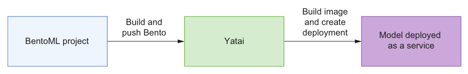
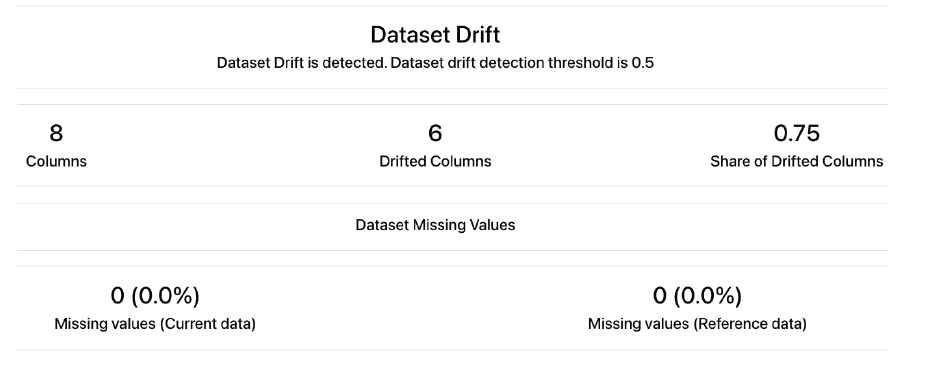
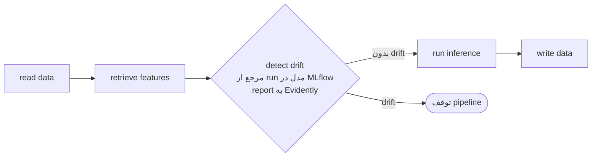

# فصل ۶: بردن مدل‌های ML به production

[فصل ۵: ارکستراسیون pipelineهای ML →](05-orchestrating-ml-pipelines.md) · [کتاب](../README.md) · [فصل ۷: تحلیل و آماده‌سازی داده ←](07-data-analysis-and-preparation.md)

## خلاصه

پس از ارکستراسیون، دو چالش می‌ماند: مدل را چطور قابل‌اطمینان serve کنیم، و چطور بفهمیم با گذشت زمان هنوز خوب کار می‌کند (p. 149). این فصل حرف E روی نقشه‌ی ذهنی است، یعنی مدل به‌صورت API (p. 150). **BentoML** مدل را از MLflow برمی‌دارد، با یک service و runner و یک `bentofile.yaml` در قالبی به نام **Bento** بسته‌بندی می‌کند، و **Yatai** آن را بی‌Dockerfile و بی‌manifest روی Kubernetes deploy می‌کند، با endpoint `/metrics` آماده (pp. 151–164). بخش دوم **data drift** است: انواع drift، آزمون‌های آماری، و **Evidently** با report و dashboard؛ یک component تشخیص drift در pipeline batch فصل ۵ و یک پنجره‌ی microbatch در سرویس بلادرنگ (pp. 164–180).

## نکته‌های کلیدی

- **راه دستی فصل ۳ زمان‌بر است** و همه‌ی data scientistها مهارتش را ندارند: image، چند manifest، کد مانیتورینگ و CI/CD (p. 151).
- **هر Bento یک بایگانی یکپارچه برای برنامه‌ی ML است**، مثل جعبه‌ی غذای ژاپنی؛ Yatai همان را deploy و scale و مانیتور می‌کند (p. 151).
- **بخش service منطق serving را تعریف می‌کند و runner محاسبه را**؛ runnerها در workerهای جدا اجرا و مستقل scale می‌شوند (p. 153).
- **در deploy دو نوع pod هست**: API Server که درخواست را می‌گیرد و Runner که مدل را نگه می‌دارد و inference می‌کند؛ هر کدام جدا scale می‌شود (p. 161).
- **پدیده‌ی data drift یعنی افت کارایی مدل چون آمار داده‌ی ورودی عوض شده**؛ کتاب label drift، prior probability shift، covariate shift و sudden drift را جدا می‌کند (pp. 164–165).
- **هر آزمون drift یک امتیاز دارد**؛ برای Wasserstein آستانه‌ی پیش‌فرض Evidently ۰٫۱ است (p. 167).
- **در pipeline batch، component drift پیش از inference می‌نشیند** و اگر drift دید، pipeline را متوقف می‌کند (p. 171).
- **برای API، drift را روی یک درخواست نسنجید**؛ روی یک پنجره‌ی microbatch بسنجید. با پنجره‌ی ۵۰ تایی، کتاب ۸۷٪ ستون‌ها را drifted می‌بیند در حالی که داده از همان مجموعه‌ی آموزش آمده است (pp. 175–178).

## فهرست بخش‌ها

*از فهرست مطالب خود کتاب، از bookmarkهای PDF؛ شماره‌ها صفحه‌ی چاپی‌اند.*

- ۶.۱ ابزار BentoML به‌عنوان پلتفرم deploy — ص. ۱۵۱
  - ۶.۱.۱ ساختن Bento — ص. ۱۵۲
  - ۶.۱.۲ ساختن و push کردن Bento — ص. ۱۵۶
  - ۶.۱.۳ deploy کردن Bento — ص. ۱۵۸
- ۶.۲ ابزار Evidently برای مانیتورینگ data drift — ص. ۱۶۴
  - ۶.۲.۱ report و dashboard تشخیص data drift — ص. ۱۶۵
  - ۶.۲.۲ component تشخیص data drift در pipeline Kubeflow — ص. ۱۷۱
  - ۶.۲.۳ تشخیص data drift برای مدلی که API است — ص. ۱۷۵

## یادداشت‌ها

این تکنیک‌ها هم برای مدل‌های سنتی و هم برای LLM کار می‌کنند؛ جزئیات مخصوص LLM، مثل prompt و observability و ارزیابی، در فصل‌های ۱۲ و ۱۳ می‌آید (p. 151). کد فصل در `github.com/practical-mlops/chapter-6` است (p. 151).

### ۶.۱ ابزار BentoML به‌عنوان پلتفرم deploy

فصل ۵ مدل را batch اجرا کرد؛ اینجا همان classifier درآمد به یک endpoint API تبدیل می‌شود (p. 151).

*Figure 6.2 (p. 151): data scientist فقط تا جعبه‌ی وسط کار می‌کند؛ ساختن image و manifest کار Yatai است.*

#### ۶.۱.۱ ساختن Bento (pp. 152–156)

| گام | چه می‌شود |
|---|---|
| ۱. ثبت مدل | `bentoml.mlflow.import_model` مدل را با نام و stage از MLflow به store محلی BentoML می‌آورد (p. 152) |
| ۲. service و runner | runner مدل را اجرا می‌کند؛ service با `@svc.on_startup` فهرست ستون‌ها را از MLflow و feature store را با مشخصات MinIO آماده و در `context.state` نگه می‌دارد (pp. 153–154) |
| ۳. API | ورودی `user_id` به‌صورت JSON؛ featureها با `get_online_features`، نگاشت به ستون‌های dummy، پیش‌بینی، و خروجی `income_category` (p. 155) |
| ۴. `bentofile.yaml` | service، label مالک، فایل‌ها، requirements و متغیرهای محیطی مثل `ENV_NAME` (p. 156) |

چند runner در یک service برای وقتی است که چند مدل پشت یک API باشند، مثلاً برای مقایسه‌ی مدل‌ها (p. 153).

#### ۶.۱.۲ ساختن و push کردن Bento (pp. 156–158)

فرمان `bentoml build` Bento را با tag می‌سازد؛ `bentoml containerize` از آن image می‌سازد تا محلی با `docker run` آزموده شود؛ بعد با token به Yatai وارد می‌شوید و `bentoml push` هم مدل و هم Bento را به store دوردست می‌فرستد (pp. 156–158).

#### ۶.۱.۳ deploy کردن Bento (pp. 158–164)

- در UI Yatai، deployment با نام Bento و نسخه‌ی آن ساخته می‌شود؛ replica و CPU و حافظه برای API Server و runnerها جدا تنظیم می‌شود (pp. 158–161).
- سرویس Yatai با یک Job Kubernetes به نام `yatai-bento-image-builder-...` image می‌سازد و سپس podها بالا می‌آیند؛ در مثال کتاب یک pod API Server و دو pod Runner (p. 161).
- یک ingress ساخته می‌شود و صفحه‌ی Swagger برای آزمودن `/predict` در دسترس است (p. 162).
- نشانی endpoint `/metrics` متریک‌های استاندارد مثل درخواست در ثانیه و latency را برای scrape با Prometheus می‌دهد (pp. 162–164).

| راه دستی فصل ۳ | راه BentoML |
|---|---|
| Dockerfile | `bentofile.yaml` |
| manifestهای Kubernetes و Helm | deployment در UI Yatai |
| کد `/metrics` با exporter | `/metrics` آماده |
| یک Deployment برای همه | API Server و Runner جدا scale می‌شوند |

*مقایسه‌ی vault بر پایه‌ی pp. 151 و 161–164.*

> **In practice:** در stack مرجع، API پیش‌بینی یک image معمولی است که با GitLab CI ساخته و با Argo CD deploy می‌شود.
>
> **Your turn:** API دسته‌بندی متن تراکنش زیر بار کند شده. پروفایل نشان می‌دهد بیشتر زمان در inference مدل است و parsing درخواست سبک است. در طراحی API Server و Runner کتاب، کدام را scale می‌کنید و چرا این جدایی کمک می‌کند؟
>
> *Answer:* Runner را؛ کتاب API Server را frontend و Runner را جایی می‌داند که مدل نگه داشته و inference می‌شود، و این دو جدا scale می‌شوند (p. 161). در یک Deployment یکپارچه، برای بیشتر کردن ظرفیت inference باید کل برنامه را تکثیر کرد، از جمله بخش سبک.

### ۶.۲ ابزار Evidently برای مانیتورینگ data drift

مدلی که اول خوب بود، چند ماه بعد افت می‌کند چون featureها از چیزی که در آموزش دیده بود فاصله گرفته‌اند (p. 164). فرض آموزش این است که رابطه‌ی ورودی و خروجی و توزیع ورودی ثابت می‌ماند؛ در دنیای واقعی این فرض با گذشت زمان نمی‌ماند (p. 164).

| نوع drift | چه چیزی عوض می‌شود | مثال کتاب |
|---|---|---|
| label drift | معنای target | تعریف «معیوب» در خط تولید (p. 164) |
| prior probability shift | سهم کلاس‌ها | نسبت موارد مثبت و منفی در تشخیص fraud (p. 164) |
| covariate shift | توزیع featureهای ورودی | جمعیت‌شناسی یا رفتار مشتری (pp. 164–165) |
| sudden drift | تغییر ناگهانی | رفتار مشتری در یک pandemic (p. 165) |

#### ۶.۲.۱ report و dashboard تشخیص data drift (pp. 165–171)

| آزمون | برای | تفسیر |
|---|---|---|
| Kolmogorov–Smirnov | feature عددی؛ مقایسه‌ی CDFها | p-value زیر آستانه، مثلاً ۰٫۰۵، یعنی drift |
| chi-square | feature categorical | تغییر توزیع دسته‌ها |
| Wasserstein، یا Earth Mover's distance | فاصله‌ی دو توزیع | از صفر تا بی‌نهایت؛ بزرگ‌تر یعنی drift بیشتر |

*بر پایه‌ی pp. 165 و 167.*

ابزار Evidently خودش آزمون مناسب داده را انتخاب می‌کند، ولی می‌شود آزمون را صریح تعیین کرد یا آزمون خود را نوشت (p. 165). مفهوم‌ها (pp. 165–167):

- **هر report** از چند **metric** ساخته می‌شود، در سطح dataset یا ستون؛ مثلاً `DatasetMissingValuesMetric`.
- **هر metric preset** قالب آماده است: `DataDriftPreset` و `DataQualityPreset` و `RegressionPreset`.
- برای Wasserstein، امتیاز بالای ۰٫۱ یعنی drift detected (p. 167).

*Figure 6.16 (p. 167): دو آستانه در کار است: یکی برای هر ستون و یکی، اینجا ۰٫۵، برای سهم ستون‌های drifted که کل dataset را drifted اعلام می‌کند.*

هر report یک snapshot است؛ برای دیدن روند در زمان، Evidently UI با **workspace** و **project** و **panel** ساخته می‌شود: `DashboardPanelCounter` برای یک عدد، مثل سهم ستون‌های drifted با `CounterAgg.LAST`، و `DashboardPanelPlot` برای نمودار؛ بدون `project.save()` تغییر در UI دیده نمی‌شود (pp. 167–171).

#### ۶.۲.۲ component تشخیص data drift در pipeline Kubeflow (pp. 171–175)

*نمودار vault از p. 171.*

داده‌ی مرجع همان dataset ثبت‌شده در run مدل در MLflow است (فصل ۴)، که از MinIO دانلود می‌شود؛ داده‌ی فعلی خروجی Feast است؛ metricهای report باید با panelهای dashboard یکی باشند (p. 171). در اجرای کتاب هیچ ستونی drift معنادار ندارد و dashboard پس از هر run به‌روز می‌شود (pp. 173–174).

#### ۶.۲.۳ تشخیص data drift برای مدلی که API است (pp. 175–180)

برای fraud یا recommendation، drift بلادرنگ لازم است؛ ولی مقایسه‌ی داده‌ی مرجع با یک درخواست دقیق نیست، پس با یک **microbatch** مقایسه می‌کنیم (p. 175). `MonitoringService` پنجره‌ی لغزان می‌سازد: تا پر شدن پنجره، ردیف اضافه می‌کند؛ از آن به بعد، با هر درخواست report می‌سازد و قدیمی‌ترین ردیف را بیرون می‌اندازد (pp. 175–176).

با پنجره‌ی ۵۰، سهم ستون‌های drifted حدود ۰٫۸۷۵ است، با این‌که داده‌ی فعلی از خود داده‌ی آموزش آمده؛ کتاب آن را به اندازه‌ی کوچک نمونه نسبت می‌دهد و پیشنهاد می‌کند آستانه‌ها بازبینی و پنجره‌های بزرگ‌تر آزموده شوند (p. 178).

> **Run it:** [اندازه‌ی پنجره و هشدار drift کاذب](../lab/06-drift-window-size/README.md) — نمونه‌هایی از همان توزیع مرجع می‌کشد و نشان می‌دهد با پنجره‌ی کوچک، آزمون‌ها چند بار drift اعلام می‌کنند.

پس از تشخیص drift (p. 179):

1. اول drift را بررسی کنید: نوع و شدت، و این‌که روی دقت یا انصاف اثر دارد یا نه.
2. سپس pipelineهای بالادست و پیش‌پردازش را درست کنید اگر منشأ آن‌جاست.
3. مدل را با داده‌ی تازه retrain کنید اگر اثر جدی است.
4. انتخاب featureها را بازبینی کنید.

> **In practice:** در stack مرجع، Silver داده‌ی مرجع آموزش و داده‌ی روزانه هر دو را دارد، و هشدارها از Grafana می‌آیند.
>
> **Your turn:** هشدار drift مدل دسته‌بندی تراکنش‌ها برای ستون «مبلغ» فعال شده، درست روزی که loader منبع B تغییر واحد پول از ریال به تومان را بارگذاری کرده. از چهار گام کتاب، کدام اول است و کدام اشتباه است؟
>
> *Answer:* اول بررسی، و بعد درست کردن pipeline بالادست یا پیش‌پردازش، چون منشأ تغییر در داده است نه در رفتار مشتری (p. 179). retrain روی داده‌ای که واحدش عوض شده مشکل را در مدل پنهان می‌کند؛ اول داده را یکدست کنید.

## بده‌بستان‌ها در یک نگاه

| انتخاب | چه می‌دهد | چه می‌گیرد |
|---|---|---|
| deploy دستی با Docker و Helm | کنترل کامل | زمان و مهارت زیرساخت (p. 151) |
| BentoML و Yatai | بی‌Dockerfile و manifest، `/metrics` آماده | وابستگی به یک چارچوب و قالب Bento (pp. 151, 164) |
| batch در KFP | پیش‌بینی برای همه، drift روی کل batch | تأخیر تا اجرای بعدی (pp. 145, 171) |
| API بلادرنگ | پاسخ فوری | drift فقط روی microbatch معنا دارد (p. 175) |
| پنجره‌ی کوچک drift | واکنش سریع | هشدار کاذب، مثل ۰٫۸۷۵ روی داده‌ی آموزش (p. 178) |
| پنجره‌ی بزرگ drift | امتیاز پایدارتر | دیرتر متوجه تغییر می‌شوید (p. 178) |
| توقف pipeline روی drift | پیش‌بینی بد منتشر نمی‌شود | پیش‌بینی آن روز هم منتشر نمی‌شود (p. 171) |

## فراتر از کتاب

- **ساختار API بخش `bentoml.Service` و runner در BentoML 1.2 به بعد** با `@bentoml.service` و کلاس‌های Python جایگزین شده و Yatai دیگر فعالانه نگه‌داری نمی‌شود؛ ایده‌ی جدا کردن frontend سبک از worker سنگین inference در هر ابزار serving دیگری، مثل KServe که فصل ۱۰ اشاره می‌کند، باقی است.
- **شاخص Population Stability Index** که در اعتبارسنجی مدل‌های اعتباری رایج است، همان مقایسه‌ی bucketهای توزیع مرجع و فعلی است؛ همان آستانه‌ی ۰٫۱ و ۰٫۲۵ هم روی اندازه‌ی نمونه حساس است.

## پیوندها

- **فصل‌های مرتبط:** [فصل ۳: ساختن برنامه روی Kubernetes](03-building-applications-on-kubernetes.md) که راه دستی deploy و `/metrics` را نشان داد، [فصل ۵: ارکستراسیون pipelineهای ML](05-orchestrating-ml-pipelines.md) که pipeline batch را ساخت، [فصل ۱۰: inference و serving مدل](10-model-inference-and-serving.md) که BentoML را عمیق‌تر می‌کند، و [فصل ۱۱: مانیتورینگ و explainability](11-monitoring-and-explainability.md) که drift را برای تصویر و recommender ادامه می‌دهد.
- **Run it:** [اندازه‌ی پنجره و هشدار drift کاذب](../lab/06-drift-window-size/README.md)

## خودتان را بسنجید

*پرسش‌ها و پاسخ‌ها مال vault است و از روی یادداشت‌های بالا نوشته شده؛ پاسخ‌ها به صفحه‌های کتاب ارجاع می‌دهند.*

1. **مفهوم runner در BentoML چیست و چرا از service جداست؟**

   *Answer:* واحد محاسبه‌ای که روی worker Python جدا اجرا و مستقل scale می‌شود؛ service منطق serving را دارد و فراخوانی‌ها را بین workerهای runner پخش می‌کند (p. 153).

2. **سهم کلاس‌های مثبت در یک سیستم تشخیص fraud با زمان عوض شده. این کدام نوع drift است؟**
   - [ ] label drift
   - [x] prior probability shift
   - [ ] covariate shift

   *Answer:* تغییر احتمال پیشین کلاس‌ها؛ label drift یعنی تغییر معنای target (p. 164).

3. **خود component تشخیص drift در pipeline batch کجا می‌نشیند و اگر drift ببیند چه می‌کند؟**

   *Answer:* بین بازیابی feature و inference؛ اگر drift بین داده‌ی تازه و داده‌ی مرجع آموزش ببیند، اجرای pipeline را متوقف می‌کند (p. 171).

4. **چرا کتاب drift را روی هر درخواست API نمی‌سنجد؟**

   *Answer:* چون مقایسه‌ی داده‌ی مرجع با یک نمونه دقیق نیست؛ یک پنجره‌ی لغزان microbatch نگه می‌دارد و report را روی آن می‌سازد (p. 175).

5. **با پنجره‌ی ۵۰ و داده‌ای که از خود مجموعه‌ی آموزش آمده، سهم ستون‌های drifted حدود ۰٫۸۷۵ است. نتیجه‌ی درست چیست؟**
   - [ ] مدل باید فوراً retrain شود
   - [x] نمونه برای آزمون‌ها کوچک است؛ آستانه یا اندازه‌ی پنجره را بازبینی کنید
   - [ ] ابزار Evidently خراب است

   *Answer:* داده نباید drift داشته باشد؛ کتاب این را به اندازه‌ی کوچک نمونه نسبت می‌دهد (p. 178).
