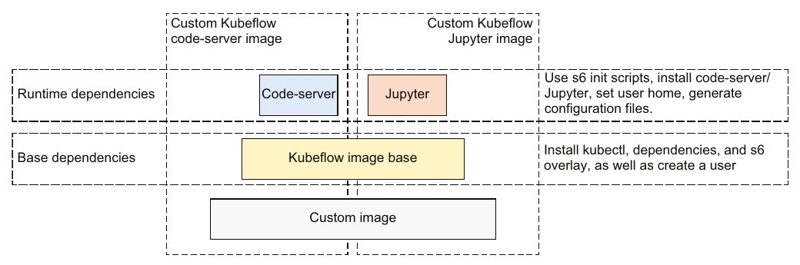
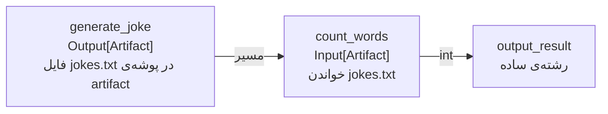
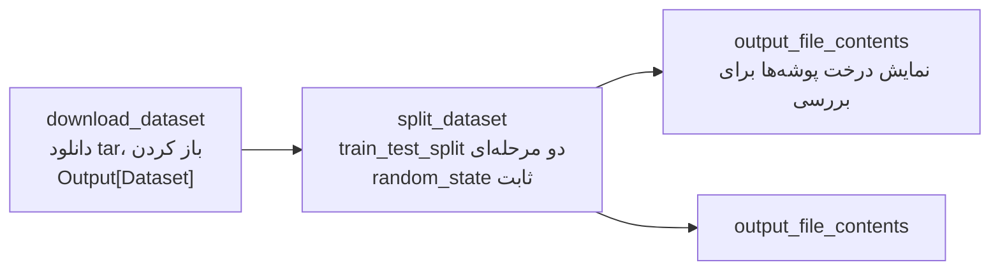

# فصل ۷: تحلیل و آماده‌سازی داده

[فصل ۶: بردن مدل‌های ML به production →](06-productionizing-ml-models.md) · [کتاب](../README.md) · [فصل ۸: آموزش و اعتبارسنجی مدل: بخش ۱ ←](08-model-training-and-validation-part-1.md)

## خلاصه

بخش سوم کتاب آموخته‌ها را روی دو پروژه‌ی واقعی پیاده می‌کند: یک **تشخیص‌دهنده‌ی کارت شناسایی** با YOLO و یک **recommender فیلم** با MovieLens (p. 184). این فصل گام اول نقشه‌ی ذهنی است، یعنی آماده‌سازی داده، چون «garbage in, garbage out» حقیقتی بنیادی است (p. 184). سه بخش دارد: **Kubeflow notebook** برای تحلیل نزدیک داده و روی همان cluster، با volume و PodDefault و affinity و image سفارشی (pp. 184–193)؛ **انتقال داده بین componentها** در KFP v2، از مقدار ساده تا مسیر داده‌ی بزرگ و انواع artifact (pp. 193–206)؛ و **pipelineهای آماده‌سازی** برای دو پروژه: دانلود، ذخیره در MinIO، تقسیم به train و validation و test، و بررسی کیفیت (pp. 206–234).

## نکته‌های کلیدی

- **تحلیل داده دو نیاز متضاد دارد**: نزدیک داده اجرا شود تا داده‌ی عظیم پردازش‌پذیر باشد، و دسترسی موردی به منابع گران مثل GPU بدهد که بالا و پایین شوند (pp. 184–186).
- **یک notebook روی همان cluster و با همان base image pipeline** محیط آزمایش را تا حد ممکن شبیه محیط deploy می‌کند، و image آن در همان CI ساخته می‌شود (p. 186).
- **یک notebook با GPU منابع را برای podهای دیگر قفل می‌کند**؛ قاعده‌ی چرخه‌ی عمر بگذارید که در زمان بی‌کاری متوقف شود (p. 187).
- **هر component در pod جدا اجرا می‌شود**، پس داده باید صریح منتقل شود؛ این جایی است که تازه‌کارها و باتجربه‌ها هر دو گیر می‌کنند (p. 193).
- **داده‌ی بزرگ را با مسیر بدهید، نه با مقدار**: هر pod حد حافظه دارد و عبور از آن `OOMKilled` است؛ کپی ۱۰ گیگابایت برای پنج component یعنی ۵۰ گیگابایت (pp. 198, 213–214).
- **نسخه‌ی KFP v2 انتقال داده را با artifactهای typed انجام می‌دهد**: `Input[T]` و `Output[T]` با `Dataset` و `Model` و `Metrics` و `ClassificationMetrics` و `HTML` و `Markdown` و `Artifact` (pp. 200–206).
- **یک containerized Python component** وابستگی‌ها را در زمان build نصب می‌کند، نه هر بار در زمان اجرا؛ سریع‌تر بالا می‌آید و وابستگی‌های پیچیده را تحمل می‌کند (pp. 225–226).
- **فرض‌های داده را زود اعتبارسنجی کنید**: یک component QA ساده دو خطای رایج، یعنی فایل گمشده و اندازه‌ی نادرست، را می‌گیرد (pp. 229–230).

## فهرست بخش‌ها

*از فهرست مطالب خود کتاب، از bookmarkهای PDF؛ شماره‌ها صفحه‌ی چاپی‌اند.*

- ۷.۱ تحلیل داده — ص. ۱۸۴
  - ۷.۱.۱ راه‌اندازی سرور notebook در Kubeflow — ص. ۱۸۶
  - ۷.۱.۲ volumeهای workspace و داده — ص. ۱۸۷
  - ۷.۱.۳ configها و affinity و toleration — ص. ۱۸۸
  - ۷.۱.۴ سفارشی کردن منو — ص. ۱۹۰
  - ۷.۱.۵ ساختن image سفارشی notebook برای Kubeflow — ص. ۱۹۲
- ۷.۲ انتقال داده — ص. ۱۹۳
  - ۷.۲.۱ سناریوی ۱: دادن مقدارهای ساده به componentهای بعدی — ص. ۱۹۳
  - ۷.۲.۲ سناریوی ۲: دادن مسیر برای داده‌ی بزرگ‌تر — ص. ۱۹۸
  - ۷.۲.۳ مروری بر انواع artifact در KFP v2 — ص. ۲۰۲
- ۷.۳ آماده‌سازی داده در عمل — ص. ۲۰۶
  - ۷.۳.۱ آماده‌سازی داده: تشخیص شیء — ص. ۲۰۶
  - ۷.۳.۲ آماده‌سازی داده: recommender فیلم — ص. ۲۲۳

## یادداشت‌ها

دو پروژه‌ی پایانی کتاب در این فصل شروع می‌شوند (p. 184):

| | تشخیص کارت شناسایی | recommender فیلم |
|---|---|---|
| داده | MIDV-500: ۵۰۰ کلیپ ویدئویی از ۵۰ نوع مدرک هویتی (p. 208) | MovieLens 25M: ۲۵ میلیون امتیاز از ۱۶۲ هزار کاربر برای ۶۲ هزار فیلم (pp. 223–224) |
| مدل | گونه‌ای از YOLO (p. 184) | recommender روی داده‌ی جدولی |
| ساختن pipeline | در UI Kubeflow | از داخل یک notebook با SDK (pp. 224, 230) |

پیش از پروژه‌ها، کتاب مفهوم‌ها را با pipeline ساده‌ی جوک توضیح می‌دهد (p. 184).

### ۷.۱ تحلیل داده

یک team کامل برای این فهرست نیازها لازم به نظر می‌رسد؛ Kubeflow notebook همه را با رابط آشنای Jupyter یا VS Code یا RStudio در مرورگر حل می‌کند، روی همان cluster pipelineها (p. 186).

#### ۷.۱.۱ راه‌اندازی سرور notebook در Kubeflow (pp. 186–187)

در ساختن notebook به namespace دقت کنید چون quota و volume را محدود می‌کند؛ منابع مثل request و limit در Kubernetes رفتار می‌کنند، پس حد حافظه را کم نگذارید (pp. 186–187).

#### ۷.۱.۲ volumeهای workspace و داده (pp. 187–188)

| volume | چیست | کی ساخته می‌شود |
|---|---|---|
| workspace | زیر `/home/jovyan`؛ جای پایدار برای محیط و config | هنگام شروع، با storage class پیش‌فرض cluster |
| داده | PVC از پیش موجود | در زمان اجرا mount می‌شود |

یک PVC درخواست storage است که یک برنامه‌ی container‌شده روی cluster می‌دهد (p. 187).

#### ۷.۱.۳ configها و affinity و toleration (pp. 188–190)

- **شیء PodDefault** در namespace چیزهایی را در زمان اجرا تزریق می‌کند؛ مثال کتاب `add-proxy-vars` است که متغیر `MLFLOW_TRACKING_URI` را می‌گذارد (pp. 188–189).
- **ویژگی affinity** pod را به نودهای خاص می‌کشد؛ **toleration** اجازه می‌دهد pod روی نود taint‌شده بنشیند و podهای بدون toleration را دور می‌کند؛ کاربرد رایج، کنترل دسترسی به نودهای GPU است (p. 189).
- هر notebook یک CRD است؛ تغییر آن redeploy می‌کند و داده‌ی ناپایدار از دست می‌رود (p. 190).

#### ۷.۱.۴ سفارشی کردن منو (pp. 190–192)

مدیر cluster با ConfigMap `jupyter-web-app-config` فهرست imageها و پیش‌فرض‌ها را تعیین می‌کند؛ هر گزینه `readOnly` دارد (pp. 190–191). با دو affinity `small-cpu` و `xl-cpu`، notebookها پیش‌فرض روی نودهای کوچک می‌روند و نودهای قوی برای نیاز واقعی می‌مانند؛ affinity تنها مانع نمی‌شود، برای محدود کردن واقعی باید taint و toleration هم بگذارید (pp. 191–192).

#### ۷.۱.۵ ساختن image سفارشی notebook برای Kubeflow (pp. 192–193)

*Figure 7.6 (p. 192): image شما فقط پایین‌ترین لایه است؛ دو لایه‌ی بالا آن را با Kubeflow سازگار می‌کنند، و همان base می‌تواند زیر image pipeline هم بنشیند.*

> **In practice:** stack مرجع JupyterHub دارد، نه Kubeflow notebook، ولی مسئله همان است.
>
> **Your turn:** مدل دسته‌بندی تراکنش در notebook با `pandas 2.2` آموزش دیده و در image API پیش‌بینی با `pandas 1.5` اجرا می‌شود، و رفتار پیش‌پردازش فرق دارد. راه کتاب برای جلوگیری از این چیست؟
>
> *Answer:* notebook را روی همان base image pipeline و serving بسازید و image آن را در همان CI بسازید، تا محیط آزمایش تا حد ممکن شبیه محیط deploy باشد و نسخه‌ها کنترل شوند (pp. 186, 192–193).

### ۷.۲ انتقال داده

هر component در pod جدا اجرا می‌شود، پس باید سازوکاری برای دادن و گرفتن داده داشته باشد (p. 193).

#### ۷.۲.۱ سناریوی ۱: دادن مقدارهای ساده به componentهای بعدی (pp. 193–198)

سه تابع `generate_joke` و `count_words` و `output_result` با type hint به component تبدیل می‌شوند و KFP serialization را انجام می‌دهد؛ در YAML compile‌شده، تعریف component، مشخصات deploy و task در DAG دیده می‌شوند، و KFP با تزریق کد کمکی، مقدار خروجی را در یک dictionary نگه می‌دارد (pp. 196–198). برای تابع‌های ساده و مقدارهای ساده عالی است (p. 198).

#### ۷.۲.۲ سناریوی ۲: دادن مسیر برای داده‌ی بزرگ‌تر (pp. 198–202)

*نمودار vault از pp. 199–200.*

- نوع `Output[Artifact]` پوشه‌ای است که component داده‌اش را در آن می‌نویسد؛ component بعدی با `Input[Artifact]` همان پوشه را می‌خواند (pp. 199–200).
- در KFP v1 قاعده‌های نام‌گذاری مثل پسوند `_path` و `_file` بود؛ v2 مستقیماً با artifactهای typed کار می‌کند. مهاجرت یعنی جایگزینی `InputPath` و `OutputPath` با `Input[T]` و `Output[T]` (pp. 200–202).

#### ۷.۲.۳ مروری بر انواع artifact در KFP v2 (pp. 202–206)

| نوع | برای | ویژگی |
|---|---|---|
| `Dataset` | داده از خام تا feature | metadata درباره‌ی ویژگی‌ها و تبدیل‌های داده (p. 202) |
| `Model` | مدل آموزش‌دیده | lineage از داده تا پارامترها (p. 203) |
| `Metrics` | سنجه‌های عددی | مقایسه در طول pipeline (p. 203) |
| `ClassificationMetrics` و `SlicedClassificationMetrics` | ROC و confusion matrix | نمایش ویژه در UI؛ دومی روی یک برش داده (pp. 203–204) |
| `HTML` | report تعاملی | نمایش در UI (p. 204) |
| `Markdown` | مستند و model card | خوانا هم به‌صورت متن (p. 205) |
| `Artifact` | هر فایل دیگر | پایه‌ی بقیه (pp. 205–206) |

### ۷.۳ آماده‌سازی داده در عمل

آماده‌سازی دو بخش دارد: دانلود و تقسیم به train و validation و test؛ هر کدام یک component (p. 206).

#### ۷.۳.۱ آماده‌سازی داده: تشخیص شیء (pp. 206–223)

مدل YOLOv8 قالب Ultralytics می‌خواهد: یک فایل config با مسیر ریشه، مسیر تصویرها برای سه بخش، و `names` با کلاس‌های صفرمبنا؛ اینجا فقط `id_card`؛ برچسب `images/id0042.png` در `labels/id0042.txt` است (pp. 206–207).

*نمودار vault از pp. 214–219.*

| گام | نکته‌ی کتاب |
|---|---|
| دانلود | در production این گام داده را از دیتابیس یا data lake می‌گیرد و ممکن است validation و logging هم داشته باشد (p. 208) |
| ذخیره | MinIO همراه Kubeflow است، رابط شبیه S3 و نسخه‌گذاری دارد؛ اعتبارنامه‌ی پیش‌فرض `minio/minio123` را در production عوض کنید و از چیزی مثل Vault استفاده کنید (pp. 208, 210) |
| component | تابع با `@dsl.component` و `packages_to_install` و `base_image`؛ importها داخل تابع (pp. 211–212) |
| تقسیم | `train_test_split` دو بار، با `random_state` برای تکرارپذیری (pp. 215–217) |
| pipeline | وقتی `split_op` خروجی `download_op` را می‌گیرد، KFP خودش ترتیب را تضمین می‌کند (p. 219) |

اجرای کامل روی ماشین نویسنده حدود ۳۰ دقیقه طول می‌کشد (p. 222). **هشدار log**: progress bar و log پرحجم در runهای تکراری دیسک را پر می‌کند؛ اگر MinIO روی نود Kubernetes باشد، diskPressure نود را از pod خالی می‌کند؛ در production چرخش و بایگانی خودکار log بگذارید (p. 223).

#### ۷.۳.۲ آماده‌سازی داده: recommender فیلم (pp. 223–234)

شش component که در عمل بعضی‌شان ادغام می‌شوند تا جابه‌جایی داده کم شود (p. 224):

| component | نکته |
|---|---|
| دانلود | مثل قبل، مستقیم در `output_path` (p. 224) |
| unzip | **containerized Python component** با `target_image`: image در زمان build ساخته و push می‌شود؛ به Docker daemon نیاز دارد (pp. 225–226) |
| تبدیل CSV به Parquet | Parquet ستونی، کوچک‌تر، با امکان shard؛ با pandas و fastparquet (pp. 226–227) |
| تقسیم | ورودی Parquet، خروجی پوشه‌ای با سه Parquet (p. 227) |
| آپلود به MinIO | هم فایل هم پوشه؛ `upload_file_name` چون نام `OutputPath` را Kubeflow تعیین می‌کند (pp. 228–229) |
| QA | چهار فایل مورد انتظار هست؟ train حدود ۷۵٪ کل است؟ با PyArrow (pp. 229–230) |

اجرا از notebook داخل cluster اعتبارنامه نمی‌خواهد چون متغیرهای محیطی تزریق شده‌اند؛ در راه‌اندازی چندکاربره، service account برای RBAC لازم است (p. 230).

> **In practice:** در stack مرجع، بررسی‌های کیفیت داده بین لایه‌ها به‌عنوان gate برنامه‌ریزی شده‌اند؛ component QA کتاب نسخه‌ی کوچک همان است.
>
> **Your turn:** برای برش آموزش مدل دسته‌بندی تراکنش، کدام دو بررسی کتاب را حتماً می‌گذارید، و چه بررسی‌ای از فهرست کیفیت stack مرجع اضافه می‌کنید؟
>
> *Answer:* وجود همه‌ی فایل‌های مورد انتظار و نسبت اندازه‌ی train به کل، که دو خطای رایج یعنی فایل گمشده و اندازه‌ی نادرست را می‌گیرند (pp. 229–230)؛ کتاب می‌گوید schema را هم اعتبارسنجی کنید (p. 230). از فهرست stack مرجع، بررسی نشت داده‌ی شخصی مهم است، چون متن تراکنش ممکن است شماره‌ی کارت داشته باشد.

## بده‌بستان‌ها در یک نگاه

| انتخاب | چه می‌دهد | چه می‌گیرد |
|---|---|---|
| notebook روی cluster | نزدیک داده، GPU موردی، محیط شبیه deploy | منابع قفل‌شده اگر notebook خاموش نشود (pp. 186–187) |
| affinity تنها | پیش‌فرض‌گذاری بدون انسداد | نودهای قوی هنوز podهای دیگر را می‌پذیرند (p. 192) |
| دادن مقدار | ساده | فقط برای مقدار کوچک (p. 198) |
| دادن مسیر artifact | بدون کپی و بدون `OOMKilled` | کار با فایل در هر component (pp. 198, 214) |
| lightweight Python component | بی‌Dockerfile | نصب وابستگی در هر اجرا (p. 225) |
| containerized Python component | شروع سریع، وابستگی پیچیده | Docker daemon و registry لازم است (pp. 225–226) |
| componentهای ریز | نمایش انتقال داده، آزمون جدا | جابه‌جایی داده‌ی بیشتر؛ در عمل ادغام می‌شوند (p. 224) |
| log پرحجم | بازخورد و debug | پر شدن دیسک و diskPressure (p. 223) |

## فراتر از کتاب

- **فایل‌های کوچک بسیار** برای object storage گران‌اند؛ کتاب داده را یک tar می‌گیرد تا انتقال کارا باشد (p. 209)، و همین دلیل است که برای داده‌ی جدولی Parquet با row groupهای بزرگ بر هزاران CSV کوچک برتری دارد.
- **تقسیم تصادفی برای داده‌ی زمانی خطرناک است**: برای مدلی که روی آینده پیش‌بینی می‌کند، تقسیم بر اساس زمان، مثلاً آموزش تا ماه قبل و آزمون روی ماه آخر، به رفتار production نزدیک‌تر است.

## پیوندها

- **فصل‌های مرتبط:** [فصل ۵: ارکستراسیون pipelineهای ML](05-orchestrating-ml-pipelines.md) که componentهای مبتنی بر `component.yaml` را ساخت، [فصل ۸: آموزش و اعتبارسنجی مدل: بخش ۱](08-model-training-and-validation-part-1.md) که روی همین داده YOLO را آموزش می‌دهد، و [فصل ۹: آموزش و اعتبارسنجی مدل: بخش ۲](09-model-training-and-validation-part-2.md) که داده را با PVC و PyArrow کاراتر می‌کند.

## خودتان را بسنجید

*پرسش‌ها و پاسخ‌ها مال vault است و از روی یادداشت‌های بالا نوشته شده؛ پاسخ‌ها به صفحه‌های کتاب ارجاع می‌دهند.*

1. **چرا کتاب notebookها را روی همان cluster و با همان base image pipelineها اجرا می‌کند؟**

   *Answer:* تا تحلیل نزدیک داده باشد و محیط آزمایش تا حد ممکن شبیه محیط deploy، با نسخه‌گذاری و CI یکسان برای imageها (p. 186).

2. **با affinity `small-cpu` به‌عنوان پیش‌فرض، آیا کاربرها از نودهای قوی منع می‌شوند؟**
   - [ ] بله، affinity podها را از نودهای دیگر منع می‌کند
   - [x] نه؛ اگر نودهای کوچک پر باشند، نودهای قوی هم pod می‌پذیرند؛ برای منع باید taint و toleration گذاشت
   - [ ] فقط اگر `readOnly` باشد

   *Answer:* affinity pod را جذب می‌کند ولی منع نمی‌کند؛ محدودیت واقعی با taint روی نود و toleration است (pp. 189, 192).

3. **چرا داده‌ی ۱۰ گیگابایتی را با مقدار بین componentها نمی‌دهیم؟**

   *Answer:* هر component در pod با حد حافظه اجرا می‌شود و بار کردن داده‌ی بزرگ به `OOMKilled` می‌رسد؛ و کپی برای پنج component یعنی ۵۰ گیگابایت. مسیر artifact را بدهید (pp. 198, 213–214).

4. **کدام نوع artifact در KFP v2 برای ROC و confusion matrix با نمایش ویژه در UI است؟**
   - [ ] `Metrics`
   - [x] `ClassificationMetrics`
   - [ ] `HTML`

   *Answer:* `ClassificationMetrics`، و `SlicedClassificationMetrics` برای یک برش داده (pp. 203–204).

5. **خود component QA recommender چه چیزی را بررسی می‌کند و چرا زود؟**

   *Answer:* وجود چهار فایل مورد انتظار و این‌که train حدود ۷۵٪ کل است؛ خطا در مرحله‌ی تولید داده ارزان‌تر از پایین‌دست پیدا و درست می‌شود (pp. 229–230).
