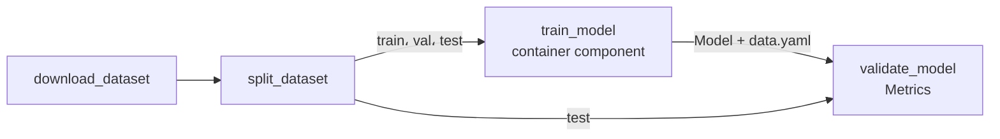

# فصل ۸: آموزش و اعتبارسنجی مدل: بخش ۱

[فصل ۷: تحلیل و آماده‌سازی داده →](07-data-analysis-and-preparation.md) · [کتاب](../README.md) · [فصل ۹: آموزش و اعتبارسنجی مدل: بخش ۲ ←](09-model-training-and-validation-part-2.md)

## خلاصه

سیستم ML قابل‌اطمینان فقط مدل دقیق نمی‌خواهد، فرایند آموزش تکرارپذیر و اعتبارسنجی محکم هم می‌خواهد (p. 235). این فصل گام‌های چهارم و پنجم نقشه‌ی ذهنی، یعنی آموزش و اعتبارسنجی، را برای تشخیص‌دهنده‌ی کارت شناسایی می‌سازد (p. 236). آموزش در notebook برای production scale نمی‌شود، پس به component تبدیل می‌شود: config داده برای YOLO، انتخاب مدل Nano و hyperparameterها، و یک **container component** که وابستگی سیستمی مثل `libgl1-mesa-glx` را نصب می‌کند (pp. 237–247). component اعتبارسنجی متریک‌های COCO را به‌صورت artifact `Metrics` بیرون می‌دهد تا در UI در کنار runهای قبلی دیده شوند (pp. 248–255). دست آخر، وزن‌های آموزش‌دیده محلی بار و با چشم وارسی می‌شوند: «اعتماد کن، ولی وارسی کن» (pp. 255–260).

## نکته‌های کلیدی

- **آموزش production باید تکرارپذیر، ماژولار و در pipeline جاافتاده باشد**؛ آموزش در notebook برای production scale نمی‌شود (p. 237).
- **در production پیش‌فرض‌های محکم بهتر از تنظیم دستی هر hyperparameter است**: توازن بین کارایی آموزش، مصرف منابع و نیاز دقت (p. 238).
- **اندازه‌ی مدل یک بده‌بستان است**: مدل‌های کوچک مثل YOLOv8n برای edge و بلادرنگ، مدل‌های بزرگ دقیق‌تر ولی پرهزینه‌تر؛ کتاب با Nano شروع می‌کند تا امکان‌پذیری را ارزان بسنجد (pp. 239–241).
- **حالت `@dsl.component` فقط بسته‌ی Python نصب می‌کند**؛ برای وابستگی سیستمی، `@dsl.container_component` و `dsl.ContainerSpec` فرمان دلخواه اجرا می‌کنند، به بهای تعریف پرحرف‌تر (pp. 242–246).
- **از «dependency hell» با imageهای آماده فرار کنید**، مثل base image خود Ultralytics، به جای انباشتن همه‌چیز در `requirements.txt` (p. 249).
- **متریک باید دیده شود**: artifact `Metrics` در UI کنار runهای قبلی می‌نشیند و حلقه‌ی بازخورد را کوتاه می‌کند (pp. 253–255, 260).
- **«اعتماد کن، ولی وارسی کن»**: نویسندگان بارها مدلی تحویل گرفته‌اند که بعداً معلوم شده درست کار نمی‌کرد (p. 255).
- **فایل `best.pt` بهترین epoch است، نه آخرین**؛ ولی اگر epoch کم باشد، بهترینِ چند epoch هنوز ناقص است (p. 259).

## فهرست بخش‌ها

*از فهرست مطالب خود کتاب، از bookmarkهای PDF؛ شماره‌ها صفحه‌ی چاپی‌اند.*

- ۸.۱ آموزش یک مدل تشخیص شیء — ص. ۲۳۷
  - ۸.۱.۱ آموزش YOLO روی dataset سفارشی — ص. ۲۳۷
  - ۸.۱.۲ آموزش مدل — ص. ۲۳۸
  - ۸.۱.۳ container component برای وابستگی‌های سیستمی — ص. ۲۴۲
  - ۸.۱.۴ ساختن component اعتبارسنجی — ص. ۲۴۸
  - ۸.۱.۵ ساختن pipeline — ص. ۲۵۰
  - ۸.۱.۶ اجرای pipeline — ص. ۲۵۱
  - ۸.۱.۷ وارسی artifactهای مدل — ص. ۲۵۵

## یادداشت‌ها

خود component آموزش سه کار می‌کند: تصویرها و برچسب‌های سه بخش را دانلود می‌کند، config داده را با مسیرها می‌سازد، و آموزش و ارزیابی را اجرا می‌کند؛ کتابخانه‌ی Ultralytics بیشتر کار سنگین را انجام می‌دهد ولی تمرکز فصل روی ساختار است (p. 237).

### ۸.۱ آموزش یک مدل تشخیص شیء

#### ۸.۱.۱ آموزش YOLO روی dataset سفارشی (pp. 237–238)

مدل YOLO به‌طور پیش‌فرض کارت شناسایی نمی‌شناسد؛ یک dictionary با مسیرها و تنها کلاس `id_card` به فایل YAML تبدیل می‌شود، و برچسب‌های هر بخش در پوشه‌ی `labels` کنار تصویرهای همان بخش‌اند (pp. 237–238).

#### ۸.۱.۲ آموزش مدل (pp. 238–242)

کلاس `YOLO` یک مدل از پیش آموزش‌دیده را بار می‌کند و `train` حلقه‌ی آموزش را اجرا می‌کند؛ پوشه‌ی `project` وزن‌ها، confusion matrix، نمودارهای precision و recall و نمونه‌ی inferenceهای هر epoch را جمع می‌کند (p. 239).

| hyperparameter | پیش‌فرض | توصیه‌ی کتاب |
|---|---|---|
| `model` | — | معماری و وزن متناسب با کاربرد، مثلاً `yolov8n.pt` |
| `data` | — | dataset مرتبط، خوب برچسب‌خورده و کافی |
| `epochs` | ۲۰ | بر پایه‌ی منابع و دقت مورد نیاز |
| `batch` | ۴ | بزرگ‌تر سریع‌تر، ولی مراقب حافظه‌ی GPU؛ `-1` برای AutoBatch |
| `imgsz` | ۶۴۰ | توازن دقت و هزینه؛ تصویر غیرمربع letterbox می‌شود |
| `pretrained` | True | شروع از وزن آماده یا از صفر |
| `optimizer` | `'auto'` | توازن سرعت همگرایی و پایداری |

*برگزیده از جدول ۸.۱ (pp. 241–242).*

| کاربرد | اولویت |
|---|---|
| دوربین نظارتی | سرعت و حافظه‌ی کم |
| خودروی خودران | دقت بیشتر، حتی با منابع بیشتر |

*مثال‌های p. 239.* کتاب با **Nano** شروع می‌کند: منابع کم، آزمون سریع امکان‌پذیری، و تکرار با بینش به‌دست‌آمده اگر کافی نبود (p. 241).

#### ۸.۱.۳ container component برای وابستگی‌های سیستمی (pp. 242–248)

خود image Ultralytics ممکن است با `ImportError: libGL.so.1` شکست بخورد؛ راه‌حل نصب `libgl1-mesa-glx` با `apt-get` است، که از `@dsl.component` برنمی‌آید (p. 242).

| | `@dsl.component` | `@dsl.container_component` |
|---|---|---|
| چه نصب می‌کند | فقط بسته‌ی Python | هر فرمان، مثل `apt-get` |
| تعریف | تابع Python | `dsl.ContainerSpec` با image و فرمان و آرگومان |
| کد آموزش | داخل تابع | اسکریپت با heredoc در container نوشته و اجرا می‌شود |
| هزینه | ساده | پرحرف‌تر و کم‌خواناتر |

*بر پایه‌ی pp. 242–247.*

سه گام کتاب: اسکریپت آموزش که مستقل اجراشدنی است با `parse_args` و `main`؛ container component با ورودی‌های `Dataset` سه بخش و خروجی‌های `Model` و فایل YAML؛ و تزریق اسکریپت با `cat << 'EOF'` و نگاشت مسیرها به آرگومان‌ها با پارامترهای موضعی Bash (pp. 243–247). در pipeline، هر دو نوع decorator کنار هم کار می‌کنند (p. 247).

> **In practice:** imageهای stack مرجع در GitLab CI ساخته می‌شوند، پس انتخاب بین نصب در زمان اجرا و image آماده همیشه مطرح است.
>
> **Your turn:** یک job آموزش در Kubernetes هر بار در شروع `pip install` بیست بسته را اجرا می‌کند و گاهی با تداخل نسخه شکست می‌خورد. کتاب چه می‌گوید؟
>
> *Answer:* از «dependency hell» با imageهای از پیش ساخته‌شده فرار کنید، مثل base image Ultralytics، و فقط چند بسته‌ی باقی‌مانده را اضافه کنید (p. 249). در stack مرجع یعنی یک base image آموزش که در CI ساخته و tag می‌خورد؛ containerized component فصل ۷ هم همین فایده را دارد (pp. 225–226).

#### ۸.۱.۴ ساختن component اعتبارسنجی (pp. 248–250)

اعتبارسنجی در production فقط سنجش دقت نیست؛ با ردیابی متریک‌های Kubeflow، بینش به‌صورت نظام‌مند جمع می‌شود (p. 248). component با `base_image` Ultralytics و چهار نوع artifact کار می‌کند: `Artifact` برای config، `Model` برای وزن‌ها، `Dataset` برای داده‌ی اعتبارسنجی و `Metrics` برای نتیجه؛ `model.val()` متریک‌های COCO مثل mean Average Precision را می‌دهد (pp. 249–250).

#### ۸.۱.۵ ساختن pipeline (pp. 250–251)

همان pipeline آماده‌سازی فصل ۷ به‌علاوه‌ی آموزش و اعتبارسنجی؛ پارامترهای run از پیش‌فرض‌های pipeline پر می‌شوند (pp. 250–252).

*نمودار vault از pp. 250–254: validate هم از train و هم مستقیم از split ورودی می‌گیرد.*

#### ۸.۱.۶ اجرای pipeline (pp. 251–255)

با dataset کتاب، هر epoch روی cluster نویسندگان حدود یک ساعت است (p. 251). خروجی Ultralytics معماری، تنظیم آموزش، اطلاعات dataset و تصویرهای خراب، پیشرفت و حافظه‌ی GPU و زمان باقی‌مانده را نشان می‌دهد (p. 251). متریک‌ها در زبانه‌ی Run output و به‌صورت خام در Output artifacts هستند و در صفحه‌ی Pipelines کنار همه‌ی runهای قبلی دیده می‌شوند (pp. 253–255).

#### ۸.۱.۷ وارسی artifactهای مدل (pp. 255–260)

| مدل | نتیجه روی نمونه‌ی گواهی‌نامه |
|---|---|
| YOLOv8n پیش‌فرض | چهره‌ها person با اطمینان ۰٫۷۹؛ کارت «book» با اطمینان ۰٫۲۸، ولی جعبه درست (pp. 256–257) |
| یک epoch آموزش | کلاس درست، جعبه‌ی تقریبی (p. 258) |
| حدود پنج epoch | جعبه کامل روی کارت، اطمینان مناسب (p. 258) |

*بر پایه‌ی pp. 255–258.*

پس از قانع شدن، به خودکارسازی فکر کنید: از اول، به‌صورت برنامه‌ای مطمئن شوید که اطمینان روی یک dataset بالای یک آستانه است و مختصات جعبه‌ها معقول‌اند (p. 259). تنظیم hyperparameter تکراری است؛ اگر مدل همگرا نشد، learning rate یا batch یا epochs را عوض کنید (pp. 259–260).

> **In practice:** مدل دسته‌بندی تراکنش در stack مرجع به MLflow و API پیش‌بینی می‌رود.
>
> **Your turn:** data scientist می‌گوید مدل تازه F1 بالاتری دارد و آماده‌ی deploy است. پیش از merge کردن tag تازه در repo deploy، کتاب چه می‌خواهد که روی چند تراکنش واقعی انجام دهید، و چطور آن را خودکار می‌کنید؟
>
> *Answer:* وزن‌ها را محلی بار کنید و خروجی را روی نمونه‌هایی که در آموزش نبوده‌اند با چشم ببینید، «اعتماد کن، ولی وارسی کن» (pp. 255–256). بعد همان را به یک آزمون خودکار تبدیل کنید که مثلاً اطمینان روی یک مجموعه‌ی ثابت بالای آستانه باشد، و در CI اجرا شود (p. 259).

## بده‌بستان‌ها در یک نگاه

| انتخاب | چه می‌دهد | چه می‌گیرد |
|---|---|---|
| آموزش در notebook | تکرار سریع | برای production scale نمی‌شود (p. 237) |
| مدل Nano | منابع کم، آزمون سریع امکان‌پذیری | دقت کمتر از مدل‌های بزرگ (pp. 239–241) |
| `imgsz` بزرگ‌تر | دقت بیشتر | حافظه و زمان آموزش بیشتر (p. 239) |
| `@dsl.component` | تعریف ساده | فقط بسته‌ی Python (p. 242) |
| container component | وابستگی سیستمی | تعریف پرحرف و کم‌خوانا (pp. 242, 246) |
| `requirements.txt` بزرگ | آشنا | dependency hell (p. 249) |
| epoch کم | زمان کم، یک ساعت برای هر epoch | `best.pt` ممکن است ناقص باشد (pp. 251, 259) |

## فراتر از کتاب

- **مجوز وزن‌های Ultralytics YOLOv8** از نوع AGPL-3.0 است؛ برای استفاده‌ی تجاری بسته، مجوز را پیش از انتخاب مدل بررسی کنید.
- **یک «golden set» کوچک و ثابت** از نمونه‌های دشوار که هر مدل تازه روی آن سنجیده شود، همان وارسی دستی کتاب را به یک آزمون regression تبدیل می‌کند؛ مقایسه با مدل فعلی production معیار بهتری از یک آستانه‌ی مطلق است.

## پیوندها

- **فصل‌های مرتبط:** [فصل ۷: تحلیل و آماده‌سازی داده](07-data-analysis-and-preparation.md) که داده‌ی همین pipeline را آماده کرد، [فصل ۹: آموزش و اعتبارسنجی مدل: بخش ۲](09-model-training-and-validation-part-2.md) که دانلود تکراری را با PVC حذف و TensorBoard و MLflow را اضافه می‌کند، و [فصل ۱۰: inference و serving مدل](10-model-inference-and-serving.md) که همین وزن‌ها را serve می‌کند.

## خودتان را بسنجید

*پرسش‌ها و پاسخ‌ها مال vault است و از روی یادداشت‌های بالا نوشته شده؛ پاسخ‌ها به صفحه‌های کتاب ارجاع می‌دهند.*

1. **چرا کتاب با YOLOv8n شروع می‌کند؟**

   *Answer:* منابع محاسبه را کم نگه می‌دارد، امکان‌پذیری را سریع و ارزان می‌سنجد، و اگر کافی نبود، بینش آن برای انتخاب مدل بزرگ‌تر به کار می‌آید (p. 241).

2. **یک component به نصب `libgl1-mesa-glx` با `apt-get` نیاز دارد. کدام راه کتاب است؟**
   - [ ] پارامتر `packages_to_install` در `@dsl.component`
   - [x] حالت `@dsl.container_component` با `dsl.ContainerSpec`
   - [ ] نصب دستی روی نودهای cluster

   *Answer:* `@dsl.component` فقط بسته‌ی Python نصب می‌کند؛ container component فرمان دلخواه اجرا می‌کند (pp. 242–246).

3. **خود component اعتبارسنجی کدام چهار نوع artifact را به کار می‌برد؟**

   *Answer:* `Artifact` برای config، `Model` برای وزن‌ها، `Dataset` برای داده‌ی اعتبارسنجی و `Metrics` برای نتیجه (p. 249).

4. **با ۱۰۰ epoch، `best.pt` ممکن است از کدام epoch باشد؟**
   - [ ] همیشه epoch ۱۰۰
   - [x] هر epochی که بهترین کارایی اعتبارسنجی را داشت، حتی epoch ۴
   - [ ] همیشه epoch اول

   *Answer:* Ultralytics کارایی اعتبارسنجی را دنبال و بهترین وزن را ذخیره می‌کند، چون کارایی ممکن است ثابت بماند یا افت کند (p. 259).

5. **مدل YOLOv8n پیش‌فرض گواهی‌نامه را چه تشخیص داد و چرا این وارسی مهم بود؟**

   *Answer:* «book» با اطمینان ۰٫۲۸، هرچند جعبه درست بود؛ نشان می‌دهد مدل پیش‌فرض کلاس را نمی‌شناسد و پس از آموزش، تشخیص درست با جعبه‌ی کامل آمد. این همان «اعتماد کن، ولی وارسی کن» است (pp. 255–258).
