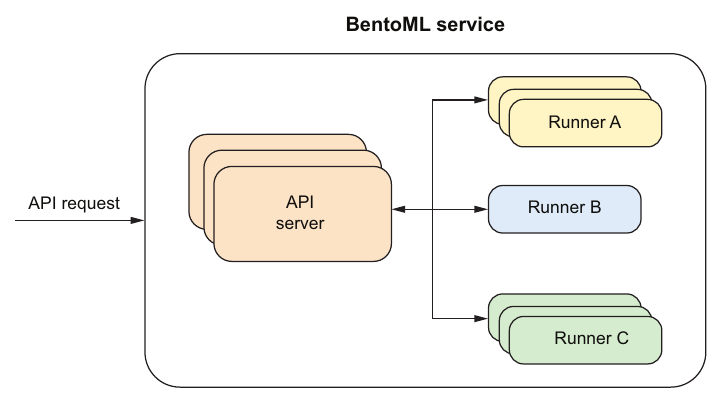
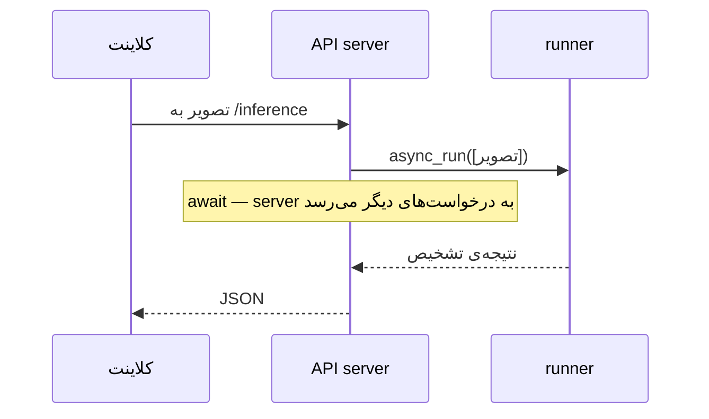
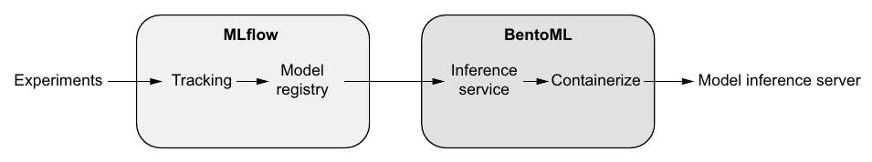

# فصل ۱۰: inference و serving مدل

[فصل ۹: آموزش و اعتبارسنجی مدل: بخش ۲ →](09-model-training-and-validation-part-2.md) · [کتاب](../README.md) · [فصل ۱۱: مانیتورینگ و explainability ←](11-monitoring-and-explainability.md)

## خلاصه

با pipeline آموزش و اعتبارسنجی آماده، مدل باید به‌صورت سرویس در دسترس قرار گیرد (p. 299). فصل با **deploy خودسرویس** شروع می‌کند: data scientist مدل را در محیط غیر production خودش deploy می‌کند، بی‌آن‌که نیاز به مهندس deploy در production از بین برود (pp. 300–301). بعد فهرست پیچیدگی‌هایی را می‌دهد که ML به deploy نرم‌افزار اضافه می‌کند (pp. 301–302). هسته‌ی فصل ساختن یک **BentoML Service** برای YOLOv8 است: API server و runner، endpointهای `/inference` و `/render`، فراخوانی ناهم‌زمان با `await`، چند runner برای پیش‌پردازش یا مقایسه‌ی دو مدل، و probeهای سلامت و متریک Prometheus آماده (pp. 303–315). سپس Bento ساخته و containerize می‌شود (pp. 315–318). برای recommender، مدل با alias `prod` از MLflow بار می‌شود (pp. 318–321). فصل با دو جایگزین تمام می‌شود: فقط MLflow، و **KServe** (pp. 321–324).

## نکته‌های کلیدی

- **روش deploy خودسرویس** خطای دستی را کم می‌کند، deployپذیری را زود ثابت می‌کند، سخت‌افزار قوی‌تر را در دسترس می‌گذارد، انتظار برای مهندس ML را حذف می‌کند و همکاری را بهتر می‌کند (pp. 300–301).
- **دنیای ML به deploy نرم‌افزار پیچیدگی تازه اضافه می‌کند**: الگوی inference، scale، مانیتورینگ و drift، یادگیری پیوسته، وابستگی داده، سخت‌افزار، نسخه‌ی مدل، explainability، مدیریت منابع، امنیت و حریم خصوصی (pp. 301–302).
- **هر service یک یا چند API server و یک یا چند نوع runner را در بر می‌گیرد**؛ API server ورودی را parse و اعتبارسنجی می‌کند و runner inference را در worker Python خودش اجرا می‌کند (pp. 303–304).
- **کلیدواژه‌ی `await` روی `async_run` حیاتی است**: بی‌آن، کد با یک وعده‌ی نتیجه ادامه می‌دهد، نه خود نتیجه؛ با آن، server در این فاصله به درخواست‌های دیگر می‌رسد (pp. 308–309).
- **چند runner در یک service** برای پیش‌پردازش جدا، مثل تبدیل به خاکستری، یا اجرای موازی دو مدل با `asyncio.gather` است (pp. 309–310).
- **ابزار BentoML probeهای liveness و readiness و متریک Prometheus را آماده می‌دهد**؛ liveness پاسخ ندهد، Kubernetes pod را restart می‌کند؛ readiness پاسخ ندهد، ترافیک نمی‌گیرد (pp. 313–314).
- **هر Bento را مثل image Docker با tag صریح بسازید**، برای نسخه‌گذاری، deploy یکسان و تکرارپذیری (p. 316).
- **انتخاب ابزار به team بستگی دارد**: KServe بومی Kubernetes و scalable ولی دانش Kubernetes می‌خواهد؛ BentoML ساده است؛ MLflow کل چرخه‌ی عمر را دارد (pp. 322–324).

## فهرست بخش‌ها

*از فهرست مطالب خود کتاب، از bookmarkهای PDF؛ شماره‌ها صفحه‌ی چاپی‌اند.*

- ۱۰.۱ deploy مدل سخت است — ص. ۳۰۱
- ۱۰.۲ ابزار BentoML: ساده کردن deploy مدل — ص. ۳۰۲
- ۱۰.۳ گشتی سریع در BentoML — ص. ۳۰۳
  - ۱۰.۳.۱ service و runnerها در BentoML — ص. ۳۰۳
- ۱۰.۴ اجرای محلی BentoML Service — ص. ۳۰۶
  - ۱۰.۴.۱ بار کردن مدل با runner در BentoML — ص. ۳۰۶
- ۱۰.۵ ساختن Bento: بسته‌بندی سرویس برای deploy — ص. ۳۱۵
  - ۱۰.۵.۱ tagهای Bento: نسخه‌گذاری و مدیریت — ص. ۳۱۶
- ۱۰.۶ ترکیب BentoML و MLflow برای inference — ص. ۳۱۸
- ۱۰.۷ ساختن سرویس inference فقط با MLflow — ص. ۳۲۱
- ۱۰.۸ ابزار KServe: جایگزینی برای BentoML — ص. ۳۲۲

## یادداشت‌ها

روی نقشه‌ی ذهنی، این فصل گام deploy مدل و در دسترس گذاشتن آن است (p. 300). دو مدل فصل‌های ۸ و ۹، اول محلی و بعد در container، deploy می‌شوند (p. 299).

### ۱۰.۱ deploy مدل سخت است

کار deploy نرم‌افزار خودش پیچیده است: version control، آزمون‌ها، CI و CD (p. 301). ML این‌ها را اضافه می‌کند (pp. 301–302):

| چالش | پرسش |
|---|---|
| الگوی inference | batch، بلادرنگ یا هر دو؟ |
| scale | بار متغیر را چطور تحمل کنیم؟ |
| مانیتورینگ | کارایی و drift را چطور بپاییم؟ |
| یادگیری پیوسته | retrain و deploy خودکار نسخه‌ی بهتر؟ |
| وابستگی داده | همان پیش‌پردازش آموزش در serving تکرار می‌شود؟ |
| سخت‌افزار | GPU لازم است؟ |
| نسخه‌ی مدل | چند نسخه و rollback؟ |
| explainability | تصمیم مدل را در صنعت‌های قانون‌مند چطور توضیح دهیم؟ |
| امنیت و حریم خصوصی | مدل اطلاعات حساس نشت نمی‌دهد و در برابر حمله‌ی adversarial مقاوم است؟ |

### ۱۰.۲ ابزار BentoML: ساده کردن deploy مدل

ابزار BentoML برای پر کردن فاصله‌ی ساخت و deploy است: serving یکسان برای هر framework، batch و بلادرنگ، scale روی Kubernetes، مانیتورینگ و logging، نسخه‌گذاری مدل، build تکرارپذیر، **adaptive microbatching** برای دسته کردن خودکار درخواست‌ها، و کنترل ریز منابع (pp. 302–303).

### ۱۰.۳ گشتی سریع در BentoML

#### ۱۰.۳.۱ service و runnerها در BentoML (pp. 303–306)

*Figure 10.2 (p. 303): تعداد نمونه‌های هر جعبه مستقل است؛ مدلی که سنگین‌تر است runner بیشتری می‌گیرد، بی‌آن‌که API server زیاد شود.*

| چند API server | فایده |
|---|---|
| scale افقی | بار و درخواست‌های هم‌زمان بیشتر |
| load balancing | هیچ نمونه‌ای گلوگاه نمی‌شود |
| پردازش موازی | پاسخ سریع‌تر |

*بر پایه‌ی p. 304.* دو endpoint سرویس YOLOv8: `/inference` که JSON برمی‌گرداند و برای ماشین است، و `/render` که تصویر با جعبه و برچسب و احتمال را برمی‌گرداند و برای debug و نمایش است (pp. 304–306).

### ۱۰.۴ اجرای محلی BentoML Service

#### ۱۰.۴.۱ بار کردن مدل با runner در BentoML (pp. 306–315)

- کلاس `YOLOv8Runnable` از `bentoml.Runnable` ارث می‌برد و مدل را در constructor بار می‌کند؛ این ساده‌ترین راه است و registry مدل BentoML بار کردن پویا و نسخه‌گذاری را می‌دهد (pp. 306–307).
- عبارت `@bentoml.Runnable.method(batchable=False)` متدی می‌سازد که از راه دور فراخوانی می‌شود؛ به runner نام بدهید چون نام پیش‌فرض، یعنی نام کلاس، در log گنگ است (p. 307).

*نمودار vault از pp. 308–309.*

چند runner: یک runner تبدیل به خاکستری، و دو تشخیص‌دهنده که با `asyncio.gather` موازی روی همان تصویر اجرا می‌شوند و نتیجه‌ها با کلیدهای `model_a` و `model_b` برمی‌گردند (pp. 309–310).

**فهرست endpointهای observability** (pp. 313–314):

| endpoint | چه کسی صدا می‌زند | اگر شکست بخورد |
|---|---|---|
| `/healthz` | liveness probe | Kubernetes ممکن است pod را restart کند |
| `/readyz` | readiness probe | pod ترافیک نمی‌گیرد |
| `/metrics` | Prometheus | — |

ابزار BentoML همه را آماده می‌دهد تا کد تکراری ننویسید (p. 313).

> **In practice:** API پیش‌بینی stack مرجع روی Kubernetes است و Prometheus آن را scrape می‌کند.
>
> **Your turn:** pod تازه‌ی API پیش‌بینی بالا می‌آید و بیست ثانیه طول می‌کشد مدل را از MLflow دانلود کند. در این مدت چند درخواست با خطای ۵۰۰ برمی‌گردد. کدام probe کتاب این را حل می‌کند و چطور؟
>
> *Answer:* readiness probe روی `/readyz`؛ pod تا آماده نشده ترافیک نمی‌گیرد (p. 313). liveness فقط می‌گوید pod زنده است و در اینجا کمکی نمی‌کند؛ اگر liveness را روی آماده بودن مدل بگذارید، Kubernetes pod را در حین بار کردن restart می‌کند.

### ۱۰.۵ ساختن Bento: بسته‌بندی سرویس برای deploy

فایل `bentofile.yaml` فایل service، فایل‌های لازم و base image را مشخص می‌کند و `bentoml build` یک Bento با tag یکتا می‌سازد؛ `bentoml containerize` آن را image می‌کند و `docker run` آن را روی پورت ۳۰۰۰ با صفحه‌ی API آشنا بالا می‌آورد (pp. 315–318).

#### ۱۰.۵.۱ tagهای Bento: نسخه‌گذاری و مدیریت (pp. 316–318)

می‌شود فقط `yolo_v8` نوشت، ولی مثل tagهای Docker بهتر است tag صریح بدهید: برای نسخه‌گذاری، deploy یکسان نسخه‌ی درست در محیط‌ها، و تکرارپذیری (p. 316).

### ۱۰.۶ ترکیب BentoML و MLflow برای inference

*Figure 10.11 (p. 318): مرز دو ابزار همان مرز دو نقش است: سمت چپ برای data scientist، سمت راست برای مهندس عملیات.*

سرویس recommender URI آخرین مدل با alias `prod` را از MLflow می‌گیرد، دانلود و serve می‌کند؛ در pipeline می‌شود کلاینت MLflow را حذف کرد و URI را ورودی گام قبل گرفت (p. 320). بدون BentoML باید API server سفارشی، endpointهای سلامت و مانیتورینگ و batching و مدیریت GPU را خودتان می‌نوشتید (p. 320). مزیت واقعی به تجربه‌ی نویسندگان: بالا آوردن سریع مدل staging روی ماشین توسعه، و A/B test بین مدل pipeline خودکار و مدلی با پیش‌پردازش متفاوت (pp. 320–321).

### ۱۰.۷ ساختن سرویس inference فقط با MLflow

ابزار MLflow هم مدل ثبت‌شده را با یک فرمان serve می‌کند، با `/health` و `/invocations`؛ Kubernetes نمی‌خواهد و برای teamهایی که سادگی را ترجیح می‌دهند مناسب است (pp. 321–322).

### ۱۰.۸ ابزار KServe: جایگزینی برای BentoML

ابزار KServe همراه Kubeflow است و مدل‌ها را به‌صورت microservice Kubernetes deploy می‌کند: یک namespace، یک **InferenceService** که CRD هسته‌ی KServe است، و پس از آماده شدن، یک URL (p. 322).

| ویژگی | KServe | BentoML | MLflow |
|---|---|---|---|
| تمرکز | ارکستراسیون serving | deploy و serving ساده | کل چرخه‌ی عمر ML |
| framework و cloud | آزاد | آزاد | آزاد |
| بومی Kubernetes | بله | نه | نه |
| سهولت | کمتر؛ دانش Kubernetes لازم | بیشتر | بیشتر |
| experiment tracking | نه | نه | بله |

*از جدول ۱۰.۱ (p. 323).*

> **In practice:** stack مرجع یک API پیش‌بینی ساده دارد و team کوچک است.
>
> **Your turn:** team می‌خواهد دومین مدل، تشخیص تراکنش مشکوک، را اضافه کند و بحث این است که KServe نصب شود یا همان الگوی موجود ادامه یابد. معیار کتاب برای این انتخاب چیست؟
>
> *Answer:* تخصص team، زیرساخت و نیاز پروژه (p. 323). KServe کنترل ریز و scale بومی Kubernetes می‌دهد ولی دانش Kubernetes بیشتری می‌خواهد و آزمودن مدل را برای توسعه‌دهنده سخت‌تر می‌کند (p. 322)؛ با یک team کوچک و دو مدل، ادامه‌ی الگوی ساده‌تر معمولاً منطقی‌تر است.

## بده‌بستان‌ها در یک نگاه

| انتخاب | چه می‌دهد | چه می‌گیرد |
|---|---|---|
| deploy خودسرویس | سرعت و تکرار | مهندس deploy برای production هنوز لازم است (p. 301) |
| مدل در constructor runner | ساده | بی‌نسخه‌گذاری پویا (p. 306) |
| `async_run` با `await` | server پاسخ‌گو | باید ناهم‌زمانی را درست فهمید (pp. 308–309) |
| چند runner | پیش‌پردازش جدا، مقایسه‌ی موازی | منابع بیشتر (pp. 309–310) |
| BentoML و MLflow | تجربه‌ی خوب برای هر دو نقش | دو ابزار و جابه‌جایی بینشان (p. 321) |
| فقط MLflow | ساده، بی‌Kubernetes | گزینه‌های deploy و مانیتورینگ کمتر (p. 322) |
| KServe | بومی Kubernetes، scalable | دانش Kubernetes لازم (p. 322) |

## فراتر از کتاب

- **این فصل با BentoML 1.1.6 نوشته شده** (p. 303)؛ در BentoML 1.2 به بعد `Runnable` و `Runner` به کلاس‌هایی با `@bentoml.service` تبدیل شده‌اند، ولی جدایی API server از workerهای inference همان است.
- **سازوکار startup probe** در Kubernetes برای همین حالت مدلی است که بار کردنش طول می‌کشد: تا وقتی پاس نشده، liveness و readiness اجرا نمی‌شوند.

## پیوندها

- **فصل‌های مرتبط:** [فصل ۶: بردن مدل‌های ML به production](06-productionizing-ml-models.md) که Bento را با Yatai deploy کرد، [فصل ۹: آموزش و اعتبارسنجی مدل: بخش ۲](09-model-training-and-validation-part-2.md) که alias `prod` را ساخت، و [فصل ۱۱: مانیتورینگ و explainability](11-monitoring-and-explainability.md) که همین سرویس‌ها را با متریک سفارشی و هشدار می‌پاید.

## خودتان را بسنجید

*پرسش‌ها و پاسخ‌ها مال vault است و از روی یادداشت‌های بالا نوشته شده؛ پاسخ‌ها به صفحه‌های کتاب ارجاع می‌دهند.*

1. **کار API server و runner در یک BentoML Service چیست؟**

   *Answer:* API server درخواست HTTP را می‌گیرد و ورودی را parse و اعتبارسنجی می‌کند؛ runner مدل را در worker Python خودش دارد و inference را اجرا می‌کند (pp. 303–304).

2. **اگر `await` را پیش از `async_run` جا بیندازید چه می‌شود؟**
   - [ ] درخواست سریع‌تر پاسخ می‌گیرد
   - [x] کد با یک وعده‌ی نتیجه ادامه می‌دهد و پردازش نتیجه احتمالاً شکست می‌خورد
   - [ ] خود runner اجرا نمی‌شود

   *Answer:* `async_run` وعده‌ی نتیجه‌ی آینده را برمی‌گرداند، نه خود نتیجه (pp. 308–309).

3. **دو کاربرد چند runner در یک service کدام‌اند؟**

   *Answer:* پیش‌پردازش جدا، مثل تبدیل تصویر به خاکستری پیش از تشخیص، و آزمودن هم‌زمان دو نسخه‌ی مدل روی یک ورودی با `asyncio.gather` (pp. 309–310).

4. **یک pod زنده است ولی هنوز نمی‌تواند درخواست را پاسخ دهد. کدام endpoint باید شکست بخورد؟**
   - [ ] `/healthz`
   - [x] `/readyz`
   - [ ] `/metrics`

   *Answer:* readiness probe روی `/readyz` تعیین می‌کند pod ترافیک بگیرد یا نه؛ liveness روی `/healthz` به restart منجر می‌شود (p. 313).

5. **طبق جدول ۱۰.۱، کدام ابزار experiment tracking دارد و کدام بومی Kubernetes است؟**

   *Answer:* MLflow experiment tracking دارد؛ KServe بومی Kubernetes است (p. 323).
