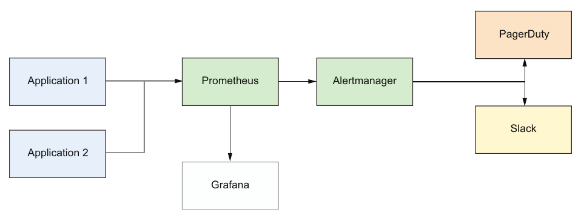
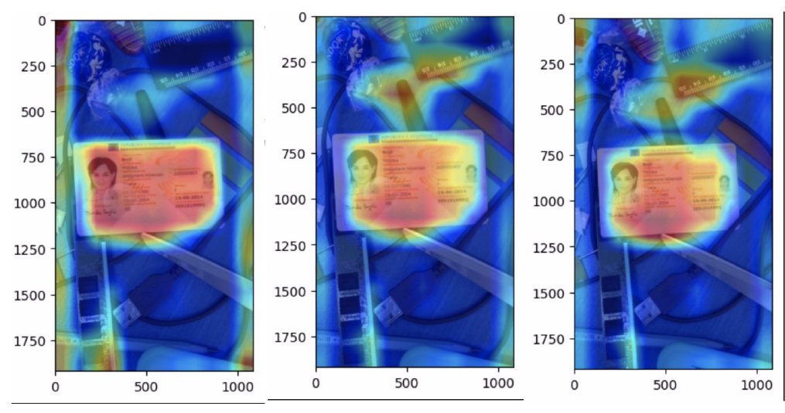

# فصل ۱۱: مانیتورینگ و explainability

[فصل ۱۰: inference و serving مدل →](10-model-inference-and-serving.md) · [کتاب](../README.md) · [فصل ۱۲: طراحی سیستم‌های مبتنی بر LLM ←](12-designing-llm-powered-systems.md)

## خلاصه

بردن مدل به production فقط گام اول است؛ نگه داشتن کارایی آن به مانیتورینگ و فهم رفتارش نیاز دارد (p. 325). فصل مانیتورینگ را دو بخش می‌کند: **مانیتورینگ پایه** برای سلامت عملیاتی سرویس و SLA، و **مانیتورینگ drift** برای این‌که داده‌ی ورودی و رابطه‌اش با هدف همان باشد که در آموزش دیده شد (p. 327). برای بخش اول dashboard آماده‌ی BentoML در Grafana، متریک سفارشی، log متمرکز با Loki و هشدار با Alertmanager را می‌سازد (pp. 327–343). برای بخش دوم با deepchecks drift تصویر و drift در embeddingهای recommender را پیدا می‌کند (pp. 343–350). در پایان **explainability** را با Eigen-CAM برای تشخیص شیء و یک مدل matrix factorization توضیح‌پذیر برای recommender نشان می‌دهد (pp. 350–355).

## نکته‌های کلیدی

- **هیچ برنامه‌ای بدون مانیتورینگ آماده‌ی production نیست**؛ هشدار باید آدم مناسب را خبر کند (p. 327).
- **مانیتورینگ پایه دو دسته متریک دارد**: مصرف منابع، چون CPU و حافظه و تعداد pod سقف دارند، و متریک درخواست مثل latency و تعداد پاسخ غیر ۲۰۰ (pp. 327–328).
- **متریک سفارشی منطق کسب‌وکار را می‌پاید**: histogram اطمینان پیش‌بینی برای تشخیص شیء، counter درخواست‌های دارای فیلم رتبه‌بندی‌شده برای recommender (pp. 331–334).
- **ثبت log جزئیاتی می‌دهد که متریک ندارد**، و log و متریک بهتر است در یک جا متمرکز شوند؛ Loki فقط metadata را index می‌کند و برای همین ارزان است (pp. 334–336).
- **قاعده‌ی `up == 0` حذف deployment را نمی‌بیند**؛ برای آن `absent(up{...})` لازم است (p. 338).
- **پدیده‌ی drift تصویر با ویژگی‌های تصویر سنجیده می‌شود**، مثل روشنایی و نسبت ابعاد و مساحت، نه با ستون‌های جدول (pp. 343–344).
- **نشانه‌ی drift در recommender را می‌شود در factorهای پنهان دید**: پس از retrain روی داده‌ی تغییرکرده، توزیع factor همان فیلم جابه‌جا می‌شود (pp. 348–350).
- **مفهوم explainability دو نوع است**: مبتنی بر مدل، که خود مدل شفاف است، و پسینی مثل SHAP و LIME (p. 351).

## فهرست بخش‌ها

*از فهرست مطالب خود کتاب، از bookmarkهای PDF؛ شماره‌ها صفحه‌ی چاپی‌اند.*

- ۱۱.۱ مانیتورینگ — ص. ۳۲۷
  - ۱۱.۱.۱ مانیتورینگ پایه — ص. ۳۲۷
  - ۱۱.۱.۲ متریک‌های سفارشی — ص. ۳۳۱
  - ۱۱.۱.۳ logging — ص. ۳۳۴
  - ۱۱.۱.۴ هشدار — ص. ۳۳۷
- ۱۱.۲ تشخیص data drift — ص. ۳۴۳
  - ۱۱.۲.۱ تشخیص شیء — ص. ۳۴۳
  - ۱۱.۲.۲ recommender فیلم — ص. ۳۴۸
- ۱۱.۳ explainability — ص. ۳۵۰
  - ۱۱.۳.۱ تشخیص شیء — ص. ۳۵۲
  - ۱۱.۳.۲ پیشنهاد فیلم — ص. ۳۵۴

## یادداشت‌ها

روی نقشه‌ی ذهنی، این فصل گام مانیتورینگ مدل است و هر دو پروژه‌ی سرویس‌شده در فصل ۱۰ را می‌پاید (pp. 325–327).

### ۱۱.۱ مانیتورینگ

مانیتورینگ با کشف زودهنگام ناهنجاری، downtime را کم و SLA را حفظ می‌کند؛ هشدار مشکل را به‌موقع به آدم درست می‌رساند (p. 327). متریک‌های رایج SLA: uptime، throughput، latency پاسخ و کیفیت پاسخ؛ بیشتر سرویس‌ها **error budget** ثابتی دارند (p. 327).

#### ۱۱.۱.۱ مانیتورینگ پایه (pp. 327–331)

ابزار BentoML از پیش endpoint `/metrics` دارد و این متریک‌ها برای مانیتورینگ پایه کافی‌اند؛ فقط باید مطمئن شد Prometheus آن‌ها را scrape می‌کند (p. 328). این کار را یک **PodMonitor** انجام می‌دهد: resource سفارشی‌ای که می‌گوید کدام podها، کدام پورت و endpoint و با چه بسامدی scrape شوند (pp. 328–329). dashboard آماده‌ی BentoML که در Grafana import می‌شود، درخواست‌های در جریان، RPS، نرخ موفقیت هر endpoint و مصرف CPU و حافظه را نشان می‌دهد (pp. 330–331).

#### ۱۱.۱.۲ متریک‌های سفارشی (pp. 331–334)

| پروژه | متریک | نوع Prometheus | چرا |
|---|---|---|---|
| تشخیص شیء | امتیاز اطمینان پیش‌بینی، bucketهای دهک از ۰ تا ۱ | Histogram | دوره‌های اطمینان پایین: تصویر بی‌کیفیت یا افت مدل (pp. 331–332) |
| recommender | تعداد درخواست‌هایی که فیلم رتبه‌بندی‌شده دارند | Counter | مقدار تجمعی که فقط بالا می‌رود (p. 334) |

متریک histogram با `observe` در کد inference پر می‌شود و صدک ۹۰ آن در Grafana به‌صورت gauge با یک پرس‌وجوی PromQL نمایش داده می‌شود (pp. 332–333).

> **In practice:** API پیش‌بینی stack مرجع دسته‌ی تراکنش را از متن merchant حدس می‌زند و Prometheus آن را scrape می‌کند.
>
> **Your turn:** latency و نرخ خطای API عالی است، ولی تیم مالی می‌گوید این هفته دسته‌ها عجیب شده‌اند. معادل متریک سفارشی کتاب برای این سرویس چیست؟
>
> *Answer:* یک histogram از احتمال کلاس برنده، مثل امتیاز اطمینان YOLO در کتاب (pp. 331–333)، و شاید یک counter به ازای هر دسته. افت صدک‌های اطمینان یا جابه‌جایی سهم دسته‌ها پیش از شکایت کاربر دیده می‌شود؛ متریک‌های پایه فقط می‌گویند سرویس پاسخ می‌دهد، نه این‌که پاسخ درست است.

#### ۱۱.۱.۳ logging (pp. 334–337)

متریک اندازه می‌دهد، log جزئیات: پیام خطا، stack trace و ترتیب رویدادها تا شکست (pp. 334–335). logger BentoML یک logger معمولی Python است؛ مثلاً تصویری که برای inference خیلی کوچک است با یک trace id در log ثبت می‌شود (p. 335). روی GKE یا EKS log به Cloud Logging یا CloudWatch می‌رود و متریک در Grafana می‌ماند؛ کتاب متمرکز کردن را توصیه می‌کند چون یک جا برای دیدن incident، تشخیص سریع‌تر و دسترسی چند team می‌دهد (pp. 335–336). **Loki** از Grafana Labs فقط metadata را index می‌کند، نه کل متن، و برای همین ارزان و scalable است (p. 336).

#### ۱۱.۱.۴ هشدار (pp. 337–343)

*Figure 11.10 (p. 337): Prometheus فقط تشخیص می‌دهد که شرط برقرار است؛ این‌که چه کسی و از چه کانالی خبر شود کار Alertmanager است.*

| قاعده | عبارت | چه را می‌گیرد |
|---|---|---|
| `ServiceDown` | `up{...} == 0` | target هست ولی scrape نمی‌شود |
| `MissingUpMetric` | `absent(up{...}) == 1` | deployment حذف شده و متریکی نمانده |

*از pp. 338–339.* هر دو `for: 5m` دارند: هشدار اول **pending** می‌شود، زرد در UI، و فقط اگر شرط پنج دقیقه بماند **firing** می‌شود، قرمز (pp. 338–340). کتاب حذف deployment در Yatai را آزمون می‌کند و هشدار را به Gmail می‌فرستد (pp. 340–341). Alertmanager بر اساس namespace یا label مسیر می‌دهد؛ مثلاً `severity: critical` به PagerDuty و بقیه به Slack یا email (p. 342).

> **In practice:** Airflow در stack مرجع DAG بارگیری شبانه‌ی ClickHouse را اجرا می‌کند و Prometheus و Grafana آماده‌اند.
>
> **Your turn:** کسی DAG را pause می‌کند و دیگر هیچ متریکی از اجرای آن نمی‌آید. هشدار «نرخ شکست DAG بالاتر از صفر» چیزی نمی‌گوید. درس `absent` کتاب اینجا چیست؟
>
> *Answer:* هشداری که روی مقدار یک متریک است، وقتی متریک اصلاً نیست ساکت می‌ماند (p. 338). باید روی نبود سیگنال هم هشدار داد: `absent` یا معادلش، مثلاً «آخرین اجرای موفق یا تازگی داده‌ی Silver بیشتر از ۲۶ ساعت».

### ۱۱.۲ تشخیص data drift

فصل ۶ drift جدولی را با Evidently دید؛ اینجا همان ایده برای تصویر و برای embedding گسترش می‌یابد (p. 343).

#### ۱۱.۲.۱ تشخیص شیء (pp. 343–348)

داده‌ی تصویر ستون از پیش تعریف‌شده ندارد؛ پس ویژگی‌هایی مثل روشنایی، کنتراست، نسبت ابعاد و مساحت را برای تصویرهای آموزش و inference حساب و مقایسه می‌کنیم (pp. 343–344). **deepchecks** این را آماده دارد، به‌علاوه‌ی بررسی یکپارچگی داده، اعتبارسنجی مدل و checkهای سفارشی (p. 344).

| گام | کار |
|---|---|
| ساختن drift | حدود ۱۰۰ تصویر کارت شناسایی با `adjust_brightness` و ضریب کمتر از ۱ تاریک‌تر می‌شوند (p. 344) |
| dataset | `IDCardDataset` زیرکلاس `VisionDataset` و `load_dataset` که `VisionData` برمی‌گرداند (pp. 345–346) |
| بررسی | `ImagePropertyDrift` روی train و test، با گزارش HTML (p. 346) |
| نتیجه | drift روشن در Brightness؛ Area و Aspect Ratio بی‌تغییر (pp. 346–348) |

در production باید تصویرها و برچسب‌های پیش‌بینی‌شده در bucket یا پایگاه داده ذخیره شوند تا drift به‌صورت دوره‌ای حساب شود (p. 348).

#### ۱۱.۲.۲ recommender فیلم (pp. 348–350)

مدل recommender یک matrix factorization است و باید زیاد retrain شود، ولی drift در رتبه‌ها هم ارزشمند است چون جابه‌جایی سلیقه یا محبوبیت را نشان می‌دهد (p. 348). کتاب رتبه‌ی چند فیلم را یکی بالا می‌برد، مدل را روی هر دو نسخه retrain می‌کند و با **FeatureDrift** توزیع factor پنهان همان فیلم را مقایسه می‌کند؛ drift دیده می‌شود (pp. 349–350).

### ۱۱.۳ explainability

مانیتورینگ می‌گوید مدل خوب کار می‌کند یا نه؛ explainability می‌گوید **چرا** (p. 350). برای مهندس، debug و یافتن سوگیری و همبستگی کاذب؛ برای کسب‌وکار، اعتماد، الزام قانونی و تصمیم بهتر (p. 351). مثال کتاب: قانون ECOA در آمریکا وام‌دهنده را ملزم می‌کند دلیل مشخص رد وام را بگوید (p. 351).

| نوع | شیوه | مثال |
|---|---|---|
| مبتنی بر مدل | ساختار خود مدل شفاف است | رگرسیون خطی، درخت تصمیم |
| پسینی | پس از آموزش مدل جعبه‌سیاه را تقریب می‌زند | SHAP، LIME |

*از p. 351.*

#### ۱۱.۳.۱ تشخیص شیء (pp. 352–354)

**روش Eigen-CAM** از خانواده‌ی Class Activation Mapping، heatmap ناحیه‌هایی را می‌سازد که بیشترین اثر را در تصمیم دارند، بی‌نیاز به retrain (p. 352).

*Figure 11.20 (p. 354): مدل درست روی کارت تمرکز دارد، ولی گوشه‌های تصویر هم کمی گرم‌اند؛ اجرای دوره‌ای همین تصویر بعد از هر retrain نشان می‌دهد تمرکز عوض شده یا نه.*

برای کارت شناسایی می‌شود دید مدل به چهره نگاه می‌کند یا نه؛ اگر چهره مهم نباشد، مدل به کارت‌های بی‌چهره هم تعمیم می‌یابد (p. 353).

#### ۱۱.۳.۲ پیشنهاد فیلم (pp. 354–355)

اینجا رویکرد مبتنی بر مدل است: **explainable matrix factorization**، که امتیاز توضیح‌پذیری را از نسبت کاربران مشابهِ رتبه‌داده به کل رتبه‌دهندگان می‌سازد و آن را وزن آموزش می‌کند (p. 354). خروجی برای هر پیشنهاد یک دیکشنری «رتبه: تعداد کاربر مشابه» است؛ مثلاً از ۹ کاربر مشابه، ۸ نفر ۴ یا بالاتر داده‌اند، و پیشنهاد اول در مثال کتاب اصلاً توضیحی ندارد (p. 355).

## بده‌بستان‌ها در یک نگاه

| انتخاب | چه می‌دهد | چه می‌گیرد |
|---|---|---|
| dashboard آماده‌ی BentoML | مانیتورینگ پایه بی‌دردسر | منطق کسب‌وکار را نمی‌بیند (p. 331) |
| متریک سفارشی | دید بر کیفیت پیش‌بینی | کد و نگهداری بیشتر (pp. 331–334) |
| log متمرکز با Loki | یک جا برای log و متریک، ارزان | جست‌وجوی کامل متن ضعیف‌تر چون فقط metadata index می‌شود (p. 336) |
| `for: 5m` در قاعده‌ی هشدار | هشدار کاذب کمتر | پنج دقیقه دیرتر خبر می‌شوید (p. 340) |
| drift روی ویژگی تصویر | بی‌برچسب کار می‌کند | فقط ویژگی‌هایی را می‌بیند که انتخاب کرده‌اید (pp. 346–348) |
| explainability مبتنی بر مدل | توضیح ذاتی | محدود به مدل‌های خاص (pp. 351, 354) |
| explainability پسینی | برای هر مدل | تقریب است (p. 351) |

## فراتر از کتاب

- **ابزار Alertmanager** هشدارهای هم‌زمان را با `group_by` گروه می‌کند و با inhibition هشدار وابسته را خاموش می‌کند؛ این همان مشکل «یک email برای هر هشدار» در Figure 11.15 است.
- **رمز Gmail در مثال کتاب** یک app password است؛ در یک platform واقعی این مقدار در secret Kubernetes می‌رود، نه در values file که در git است.

## پیوندها

- **فصل‌های مرتبط:** [فصل ۳: ساختن برنامه روی Kubernetes](03-building-applications-on-kubernetes.md) که Prometheus و Grafana را نصب کرد، [فصل ۶: بردن مدل‌های ML به production](06-productionizing-ml-models.md) که drift جدولی را با Evidently دید، و [فصل ۱۰: inference و serving مدل](10-model-inference-and-serving.md) که سرویس‌هایی را ساخت که اینجا پاییده می‌شوند.
- **Run it:** [اندازه‌ی پنجره و هشدار کاذب drift](../lab/06-drift-window-size/README.md) — همان آزمون آماری، با پنجره‌های کوچک‌تر و بزرگ‌تر.

## خودتان را بسنجید

*پرسش‌ها و پاسخ‌ها مال vault است و از روی یادداشت‌های بالا نوشته شده؛ پاسخ‌ها به صفحه‌های کتاب ارجاع می‌دهند.*

1. **دو دسته متریک مانیتورینگ پایه کدام‌اند؟**

   *Answer:* مصرف منابع، یعنی CPU و حافظه و تعداد pod که سقف دارند، و متریک درخواست مثل latency و تعداد پاسخ غیر ۲۰۰ (pp. 327–328).

2. **یک deployment در Yatai حذف شده است. کدام قاعده هشدار می‌دهد؟**
   - [ ] `up == 0`
   - [x] `absent(up{...}) == 1`
   - [ ] هر دو

   *Answer:* با حذف deployment، سری `up` دیگر وجود ندارد که صفر شود؛ `absent` نبود متریک را می‌گیرد (p. 338).

3. **هشدار زرد در UI Prometheus یعنی چه؟**

   *Answer:* pending: شرط برقرار شده ولی هنوز به مدت `for` نمانده؛ پس از آن قرمز و firing می‌شود (p. 340).

4. **چرا drift تصویر را با ستون‌ها نمی‌سنجیم؟**

   *Answer:* تصویر ستون از پیش تعریف‌شده ندارد؛ ویژگی‌هایی مثل روشنایی، کنتراست، نسبت ابعاد و مساحت حساب و مقایسه می‌شوند (pp. 343–344).

5. **روش Eigen-CAM مبتنی بر مدل است یا پسینی، و retrain لازم دارد؟**

   *Answer:* روی مدل آموزش‌دیده اعمال می‌شود و retrain یا تغییر مدل لازم ندارد (p. 352)؛ پس پسینی است. EMF برعکس مبتنی بر مدل است (p. 354).
