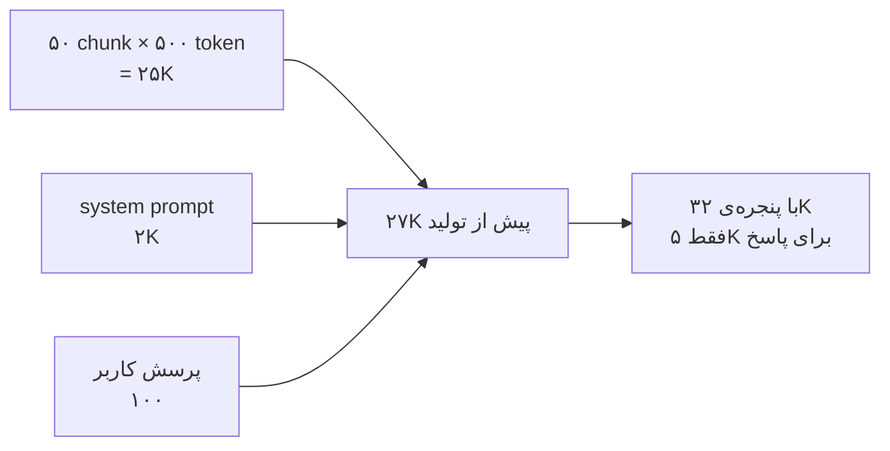
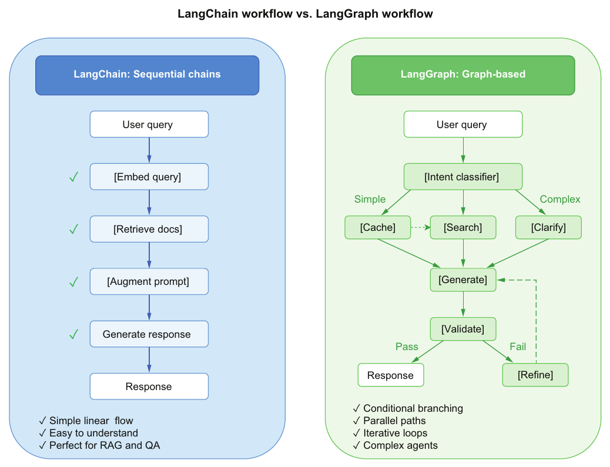
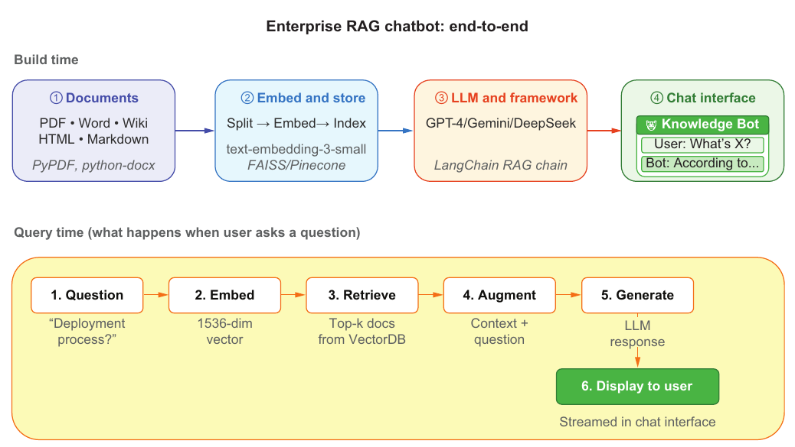

# فصل ۱۲: طراحی سیستم‌های مبتنی بر LLM

[فصل ۱۱: مانیتورینگ و explainability →](11-monitoring-and-explainability.md) · [کتاب](../README.md) · [فصل ۱۳: طراحی سیستم LLM در production ←](13-production-llm-system-design.md)

## خلاصه

بخش چهارم کتاب MLOps را به LLM گسترش می‌دهد، با این ادعا که **LLMOps بازسازی نیست، تکامل است**: cluster Kubernetes، مانیتورینگ و CI/CD می‌مانند و چند جزء تازه کنارشان می‌نشیند (pp. 360–361). فصل اول توضیح می‌دهد LLM کجا فرضیات MLOps را می‌شکند: خروجی nondeterministic، زنجیره‌ی چندمرحله‌ای، prompt به‌عنوان کد، هزینه‌ی وابسته به token و بردارهای حمله‌ی تازه (pp. 360–367). بعد ابزارهای پایه را معرفی می‌کند: embedding، پایگاه داده‌ی برداری FAISS، LangChain و LangGraph، Langfuse و Promptfoo (pp. 367–373). هسته‌ی فصل ساختن **DakkaBot** است: یک RAG برای مستندات داخلی شرکت خیالی DataKrypt با Gemini، FAISS و LangChain، با UI در Chainlit (pp. 373–399). فصل با **observability مخصوص LLM** در Langfuse تمام می‌شود: trace هر پرسش، token و هزینه و latency (pp. 399–407).

## نکته‌های کلیدی

- **ویژگی nondeterminism آزمون سنتی را می‌شکند**: `assert model.predict(x) == y` برای LLM بی‌معنی است و باید درستی معنایی سنجیده شود (p. 362).
- **پارامتر temperature صفر ≠ deterministic**؛ برای آزمون به‌قدر کافی یکنواخت است، ولی تکرارپذیر نیست (pp. 385, 407).
- **بودجه‌ی token یک قید معماری است**: ۵۰ chunk در ۵۰۰ token، به‌علاوه‌ی system prompt و پرسش، ۲۷ هزار token را پیش از تولید پاسخ می‌خورد (p. 363).
- **«مدل» حالا یک pipeline است**: prompt، embedding، پارامترهای retrieval و پیکربندی LLM هر کدام نسخه دارند؛ تغییر system prompt به اندازه‌ی عوض کردن مدل رفتار را عوض می‌کند (pp. 365–366, 408).
- **معماری RAG بازیابی را از تولید جدا می‌کند**، پس دانش بدون retrain به‌روز می‌شود، داده‌ی خصوصی در دسترس است و پاسخ به سند تکیه دارد (pp. 375–376).
- **ساختن embedding سند و پرسش می‌تواند نامتقارن باشد**: `RETRIEVAL_DOCUMENT` برای index و `RETRIEVAL_QUERY` برای جست‌وجو (pp. 378–379).
- **هر index برداری artifact است**: باید ذخیره، نسخه‌گذاری و با همان مدل embedding بار شود (pp. 382–383).
- **متریک‌های سنتی می‌گویند کی خراب است، trace می‌گوید چرا پاسخ بد است** (pp. 399–400, 407).

## فهرست بخش‌ها

*از فهرست مطالب خود کتاب، از bookmarkهای PDF؛ شماره‌ها صفحه‌ی چاپی‌اند.*

- ۱۲.۱ LLMOps: چالش‌های تازه، اصول آشنا — ص. ۳۶۰
  - ۱۲.۱.۱ چه چیزی برنامه‌های LLM را متفاوت می‌کند — ص. ۳۶۰
  - ۱۲.۱.۲ گسترش platform ML برای LLM — ص. ۳۶۴
  - ۱۲.۱.۳ ابزارهای اساسی برای برنامه‌های LLM — ص. ۳۶۷
- ۱۲.۲ ساختن DakkaBot برای DataKrypt: یک معماری RAG ساده — ص. ۳۷۳
  - ۱۲.۲.۱ چه می‌سازید — ص. ۳۷۴
  - ۱۲.۲.۲ فراتر از یک فراخوانی API: طراحی برای ترکیب‌پذیری — ص. ۳۷۵
  - ۱۲.۲.۳ LLM و embeddingهای Gemini گوگل — ص. ۳۷۶
  - ۱۲.۲.۴ جزء retrieval — ص. ۳۷۷
  - ۱۲.۲.۵ جزء augmentation — ص. ۳۸۴
  - ۱۲.۲.۶ جزء generation — ص. ۳۸۵
- ۱۲.۳ دادن UI به DakkaBot — ص. ۳۸۷
- ۱۲.۴ observability برای برنامه‌های LLM — ص. ۳۹۹
  - ۱۲.۴.۱ راه‌اندازی Langfuse با Docker — ص. ۴۰۰
  - ۱۲.۴.۲ یکپارچه کردن Langfuse با DakkaBot — ص. ۴۰۰
  - ۱۲.۴.۳ observability بیشتر در DakkaBotCore — ص. ۴۰۰
  - ۱۲.۴.۴ فراتر از متریک‌های سنتی — ص. ۴۰۴

## یادداشت‌ها

نقشه‌ی ذهنی این فصل دو نیمه دارد: سمت چپ اجزای MLOps که در فصل‌های قبل ساخته شد، سمت راست افزوده‌های LLM: ingestion سند، پایگاه داده‌ی برداری، مدیریت prompt، guardrailهای ایمنی و observability (p. 360).

### ۱۲.۱ LLMOps: چالش‌های تازه، اصول آشنا

#### ۱۲.۱.۱ چه چیزی برنامه‌های LLM را متفاوت می‌کند (pp. 360–364)

| پارامتر sampling | چه می‌کند |
|---|---|
| temperature | صفر یعنی همیشه محتمل‌ترین token؛ ۰٫۷ تا ۱ تنوع بیشتر و انسجام کمتر |
| top-K | فقط K token محتمل؛ `top_k=1` یعنی deterministic |
| top-P | کوچک‌ترین مجموعه‌ای که احتمال تجمعی‌اش به P می‌رسد؛ اندازه‌اش با اطمینان مدل عوض می‌شود |

*از p. 362.* nondeterminism همیشه دشمن نیست: برای ایده‌پردازی و گفت‌وگوی طبیعی لازم است؛ برای بازیابی واقعیت temperature صفر بگذارید (p. 362).

| تفاوت | پیامد |
|---|---|
| خروجی احتمالاتی | ارزیابی معنایی به‌جای assert دقیق (pp. 362, 364) |
| محدودیت token | ورودی بیش از حد یعنی شکست درخواست؛ خروجی بیش از حد یعنی پاسخ بریده (p. 363) |
| زنجیره‌ی چندمرحله‌ای | debug خطای مرحله‌ی ۵ از ۱۲ سخت است (p. 364) |
| prompt engineering | prompt کد است و نسخه و آزمون می‌خواهد (p. 364) |
| هزینه‌ی وابسته به token | یک پرسش پیچیده می‌تواند ۱۰۰ برابر یک پرسش ساده هزینه داشته باشد (p. 364) |

**بودجه‌ی token، مثال کتاب** (p. 363):

#### ۱۲.۱.۲ گسترش platform ML برای LLM (pp. 364–367)

**چه می‌ماند:** container، load balancer و autoscaling، CI/CD فصل ۳، experiment tracking و lineage فصل‌های ۴ و ۹، Prometheus و Grafana، و احراز هویت و network policy (pp. 364–366).

**چه اضافه می‌شود:**

| جزء | نیاز production |
|---|---|
| پایگاه داده‌ی برداری | backup، نسخه‌ی index و rollback، مانیتورینگ جست‌وجو (p. 366) |
| مدیریت prompt | نسخه در git، A/B test، deploy و rollback مثل کد (pp. 366–367) |
| LLM gateway | مسیریابی بین providerها، cache **معنایی**، rate limit بر حسب token، fallback به مدل با پنجره‌ی بزرگ‌تر (p. 367) |
| مانیتورینگ ویژه | هزینه‌ی token، کیفیت پاسخ، trace چندمرحله‌ای، هشدار نقض ایمنی (p. 367) |

**امنیت:** prompt injection، data poisoning، jailbreak، injection غیرمستقیم از داده‌ی بیرونی و نشت داده‌ی آموزش (p. 366). مدل‌های سنتی و برنامه‌های LLM در یک cluster، با همان ingress و HPA اجرا می‌شوند (p. 367).

> **In practice:** API پیش‌بینی stack مرجع در MLflow نسخه‌ی مدل و پارامترها را ثبت می‌کند و GitLab CI و Argo CD آن را deploy می‌کنند.
>
> **Your turn:** team می‌خواهد یک دستیار پرسش و پاسخ روی مستندات dbt و runbookها بسازد. کدام چیزها باید مثل وزن مدل نسخه‌گذاری و از همان CI و Argo CD رد شوند؟
>
> *Answer:* system prompt و template، شناسه‌ی مدل LLM و پارامترهایی مثل temperature و max_tokens، مدل embedding، پارامترهای retrieval مثل k و اندازه‌ی chunk، و خود index برداری (pp. 365–366). کتاب می‌گوید تغییر system prompt به اندازه‌ی عوض کردن مدل اثر دارد (p. 408)؛ پس یک PR روی prompt همان review و rollback را می‌خواهد.

#### ۱۲.۱.۳ ابزارهای اساسی برای برنامه‌های LLM (pp. 367–373)

| ابزار | نقش |
|---|---|
| مدل embedding | متن را به بردار تبدیل می‌کند تا جست‌وجو معنایی باشد، نه کلیدواژه‌ای (pp. 367–368) |
| FAISS | جست‌وجوی سریع نزدیک‌ترین بردارها؛ در مقیاس بزرگ Pinecone، Weaviate یا Chroma (pp. 368–369) |
| LangChain | loader، splitter، embedding، vector store و LLM با رابط یکسان و قابل‌تعویض، به‌علاوه‌ی retry و cache و streaming (pp. 369–371) |
| LangGraph | انشعاب شرطی، اجرای موازی و حلقه برای agentها (p. 372) |
| Langfuse | trace، هزینه، زمان تا اولین token و مدیریت prompt (p. 373) |
| Promptfoo | پیدا کردن آسیب‌پذیری در خود برنامه‌ی LLM (p. 373) |

*Figure 12.4 (p. 372): فرق در شکل گراف است: سمت چپ هیچ تصمیمی در زمان اجرا نیست؛ سمت راست حلقه‌ی Fail→Refine→Generate همان چیزی است که زنجیره‌ی خطی نمی‌تواند بیان کند.*

توصیه‌ی کتاب: با LangChain شروع کنید و وقتی نیازها روشن شد، ببینید abstractionها هنوز به کارتان می‌آیند یا نه (p. 373).

### ۱۲.۲ ساختن DakkaBot برای DataKrypt: یک معماری RAG ساده

#### ۱۲.۲.۱ چه می‌سازید (pp. 373–375)

شرکت DataKrypt از ۵۰ نفر به بیش از ۲۰۰ مهندس رسیده و مستندات خوبش برای تازه‌واردها زیاد و گیج‌کننده شده است؛ DakkaBot پرسش‌ها را از روی همین مستندات پاسخ می‌دهد (pp. 373–374).

*Figure 12.5 (p. 374): دو حلقه با دو آهنگ: ردیف بالا هر بار که مستندات عوض می‌شود اجرا می‌شود، ردیف پایین در هر پرسش.*

#### ۱۲.۲.۲ فراتر از یک فراخوانی API: طراحی برای ترکیب‌پذیری (pp. 375–376)

| محدودیت یک prompt بزرگ | پاسخ RAG |
|---|---|
| پنجره‌ی context محدود است | فقط بخش‌های مرتبط بازیابی می‌شوند |
| prompt طولانی کیفیت استدلال را پایین می‌آورد | context متمرکز |
| خطا همه یا هیچ است | گام‌ها جدا شکست می‌خورند |
| پردازش تکراری context بزرگ گران است | فقط آنچه لازم است |
| مدل در تاریخ آموزش منجمد است | سند تازه بدون retrain |
| مدل داده‌ی خصوصی را ندیده | دسترسی به داده‌ی خصوصی و زنده |
| hallucination | پاسخ با منبع |

*از pp. 375–376.*

#### ۱۲.۲.۳ LLM و embeddingهای Gemini گوگل (pp. 376–377)

دستیار DakkaBot از `text-embedding-004` و `gemini-2.5-flash` استفاده می‌کند؛ کتاب تأکید می‌کند این توصیه‌ی تجاری نیست و دلیلش free tier است (p. 376). exponential backoff لازم است، چون throttling در سرویس مشترک گاهی به کل platform مربوط است نه به مصرف شما، و fallback به provider دیگر هم باید در نظر باشد (pp. 376–377).

#### ۱۲.۲.۴ جزء retrieval (pp. 377–384)

| عامل | انتخاب کتاب |
|---|---|
| embedding نامتقارن | `RETRIEVAL_DOCUMENT` برای index، `RETRIEVAL_QUERY` برای پرسش؛ معمولاً ۱۰ تا ۲۰ درصد retrieval بهتر (pp. 378–379) |
| chunking | `RecursiveCharacterTextSplitter`، ۱۰۰۰ کاراکتر با ۲۰۰ همپوشانی، شکستن در مرز سرتیتر و پاراگراف و جمله (p. 381) |
| معیار شباهت | cosine برای بیشتر متن‌ها مناسب است (p. 379) |
| تعداد k | کم یعنی از دست دادن، زیاد یعنی نویز (p. 380) |

در production، تشخیص تغییر با hash یا timestamp برای re-index انتخابی، indexهای نسخه‌دار برای rollback و blue-green برای indexهای بزرگ (p. 380). index با `save_local` ذخیره و با همان کلاس embedding بار می‌شود؛ `allow_dangerous_deserialization` یعنی pickle، پس فایل index باید امن نگه داشته شود (pp. 382–384).

#### ۱۲.۲.۵ جزء augmentation (pp. 384–385)

همه‌ی chunkهای بازیابی‌شده با پرسش در یک prompt ترکیب می‌شوند؛ نسخه‌ی ساده فقط آن‌ها را پشت هم می‌چسباند و production به حذف تکرار و قالب‌بندی بهتر نیاز دارد (pp. 384–385).

#### ۱۲.۲.۶ جزء generation (pp. 385–387)

پارامتر temperature صفر خروجی را بسیار یکنواخت‌تر می‌کند ولی کاملاً deterministic نه؛ برای آزمون کافی است (p. 385). template با بخش‌های برچسب‌دار Context و Question و Answer مدل را به مستندات زمین می‌زند و hallucination را کم می‌کند (p. 386).

### ۱۲.۳ دادن UI به DakkaBot (pp. 387–399)

منطق RAG در کلاس **DakkaBotCore** جدا می‌شود تا همان هسته پشت Chainlit، FastAPI یا آزمون batch بنشیند (pp. 388–389):

| الگو | چرا |
|---|---|
| مقداردهی تنبل و async | بار کردن index و اتصال مدل کند است و ممکن است شکست بخورد (p. 389) |
| خروجی ساختاریافته | پاسخ، منبع‌ها، تعداد سند و خطا برای UI (p. 391) |
| system prompt | قالب یکسان، مرز توانایی، جلوگیری از نشت دستورها، persona، guardrail (p. 391) |
| streaming | اول منبع‌ها، بعد token به token، بعد سیگنال پایان (pp. 391–393) |
| اعتبارسنجی ورودی پیش از LLM | دفاع اول در برابر injection و صرفه در هزینه (pp. 396–398) |

**ابزار Chainlit** رابط گفت‌وگو را بی‌React و CSS می‌سازد (pp. 387–388).

### ۱۲.۴ observability برای برنامه‌های LLM

#### ۱۲.۴.۱ تا ۱۲.۴.۳ Langfuse (pp. 400–404)

ابزار Langfuse متن‌باز با Docker بالا می‌آید و با یک callback handler در LangChain، prompt، پاسخ، token، latency، retrieval و هزینه را ثبت می‌کند؛ metadata کسب‌وکار هم می‌شود اضافه کرد (pp. 400–402). dashboard: trace در زمان، هزینه به ازای مدل، مصرف کاربر و صدک‌های latency (pp. 402–404). یک trace نمونه: ۱۱٫۴۸ ثانیه، ۱٬۴۰۸ token ورودی و ۲٬۳۵۹ خروجی، ۰٫۰۰۶۳۲ دلار (p. 404).

#### ۱۲.۴.۴ فراتر از متریک‌های سنتی (pp. 404–406)

| بعد | چرا متریک سنتی کافی نیست |
|---|---|
| دقت | درستی طیف است؛ یکنواختی بین پرسش‌های هم‌معنی، hallucination و لحن دیده نمی‌شوند |
| latency | زمان تا اولین token با زمان کل فرق دارد؛ پاسخ ۳ ثانیه‌ای که منبع را فوراً نشان می‌دهد سریع‌تر حس می‌شود |
| زنجیره‌ی استدلال | خطا در retrieval، ساختن context یا تولید؟ |
| token | نسبت ورودی به خروجی، بهره‌وری context، هزینه به ازای نوع پرسش؛ پرسش عیب‌یابی ممکن است ۱۰ برابر token بخورد |

*از pp. 404–406.*

> **In practice:** stack مرجع Prometheus و Grafana و OTel دارد.
>
> **Your turn:** دستیار مستندات team راه افتاده. Grafana نشان می‌دهد latency و نرخ خطا عالی است، ولی کاربران می‌گویند پاسخ‌ها درباره‌ی DAGهای Airflow غلط‌اند. کدام داده را باید نگاه کنید که الان ندارید؟
>
> *Answer:* trace هر پرسش: کدام chunkها بازیابی شدند، context نهایی چه بود و مدل چه گفت (pp. 399–400). اگر chunkهای مرتبط اصلاً بازیابی نشده‌اند مشکل retrieval است، مثلاً chunking یا index کهنه؛ اگر بازیابی شده‌اند ولی پاسخ غلط است مشکل prompt یا مدل است (p. 406).

## بده‌بستان‌ها در یک نگاه

| انتخاب | چه می‌دهد | چه می‌گیرد |
|---|---|---|
| temperature صفر | پاسخ یکنواخت برای پرسش واقعیت | تنوع کمتر، و هنوز کاملاً تکرارپذیر نیست (p. 385) |
| k بزرگ‌تر | پوشش بیشتر | بودجه‌ی token و نویز (pp. 363, 380) |
| chunk کوچک | تطابق دقیق | context کم (p. 379) |
| FAISS | ساده و سریع | بی‌توزیع و بی‌فیلتر metadata، بارگذاری با pickle (pp. 369, 382) |
| LangChain | قطعات قابل‌تعویض، retry آماده | abstraction شاید بعداً سد شود (p. 373) |
| LangGraph | انشعاب و حلقه | پیچیدگی بیشتر (p. 372) |
| یک نمونه‌ی مشترک DakkaBotCore | پاسخ سریع | باید به thread safety فکر کرد (p. 396) |

## فراتر از کتاب

- **نام‌های مدل زود کهنه می‌شوند**: `text-embedding-004` و Gemini 1.5 از وقت نگارش کتاب جانشین گرفته‌اند؛ الگوی wrapper کتاب برای همین است که عوض کردنشان ارزان باشد.
- **کیفیت retrieval را جدا ارزیابی کنید**: یک مجموعه‌ی کوچک پرسش با سند درست، و سنجیدن recall@k، پیش از نگاه به کیفیت پاسخ، خطای retrieval را از خطای مدل جدا می‌کند.

## پیوندها

- **فصل‌های مرتبط:** [فصل ۳: ساختن برنامه روی Kubernetes](03-building-applications-on-kubernetes.md) که همان cluster و CI/CD را ساخت، [فصل ۱۱: مانیتورینگ و explainability](11-monitoring-and-explainability.md) که observability سنتی است، و [فصل ۱۳: طراحی سیستم LLM در production](13-production-llm-system-design.md) که DakkaBot را با prompt management، ارزیابی، guardrail و کنترل هزینه سخت‌تر می‌کند.

## خودتان را بسنجید

*پرسش‌ها و پاسخ‌ها مال vault است و از روی یادداشت‌های بالا نوشته شده؛ پاسخ‌ها به صفحه‌های کتاب ارجاع می‌دهند.*

1. **چرا `assert model.predict(x) == y` برای LLM کار نمی‌کند؟**

   *Answer:* همان ورودی می‌تواند چند پاسخ معتبر متفاوت داشته باشد؛ باید درستی معنایی، دقت واقعیت و پایبندی به دستور سنجیده شود (p. 362).

2. **پنجره‌ی ۳۲K، system prompt دو هزار token، پرسش صد token و ۵۰ chunk پانصدتایی. برای پاسخ چه می‌ماند؟**
   - [ ] ۲۷K
   - [x] ۵K
   - [ ] هیچ

   *Answer:* ۲۵K + ۲K + ۱۰۰ ≈ ۲۷K مصرف می‌شود و حدود ۵K می‌ماند (p. 363).

3. **چرا DakkaBot برای سند و پرسش task type متفاوت می‌فرستد؟**

   *Answer:* مدل embedding بردار را برای ذخیره و برای جست‌وجو جدا بهینه می‌کند و این معمولاً ۱۰ تا ۲۰ درصد retrieval را بهتر می‌کند (pp. 378–379).

4. **چه وقت از LangChain به LangGraph بروید؟**

   *Answer:* وقتی جریان کار انشعاب شرطی، اجرای موازی یا حلقه‌ی بهبود می‌خواهد، مثل agentها؛ RAG خطی با LangChain بس است (pp. 372–373).

5. **یک cache معنایی در LLM gateway با cache معمولی چه فرقی دارد؟**

   *Answer:* بر اساس شباهت embedding جواب می‌دهد، پس دو پرسش با واژه‌های متفاوت و معنای یکسان پاسخ cacheشده‌ی یکسان می‌گیرند (p. 367).
