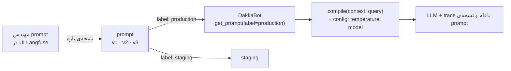
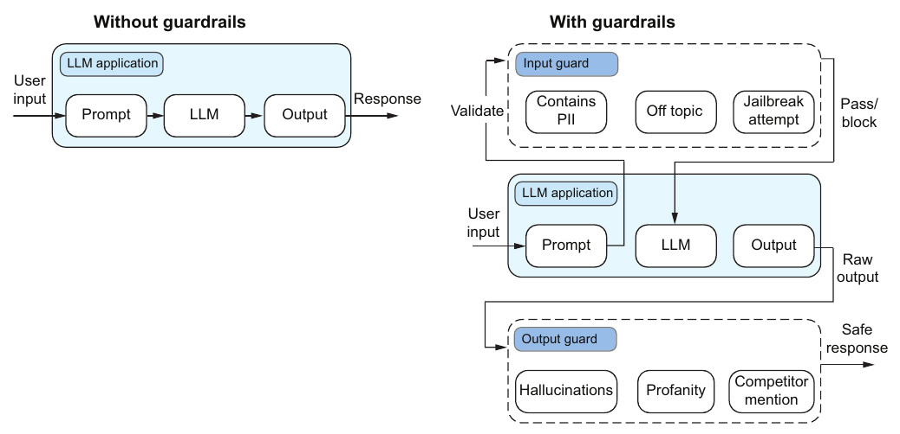
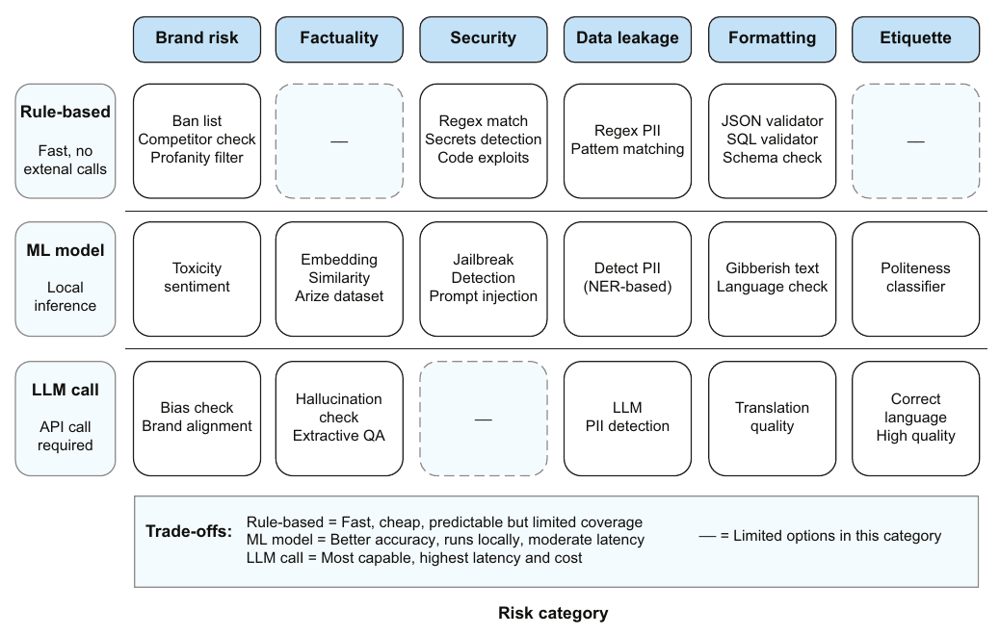
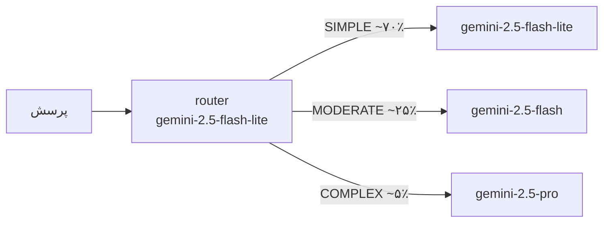

# فصل ۱۳: طراحی سیستم LLM در production

[فصل ۱۲: طراحی سیستم‌های مبتنی بر LLM →](12-designing-llm-powered-systems.md) · [کتاب](../README.md)

## خلاصه

فصل آخر DakkaBot را از prototype به production می‌برد با همان سخت‌گیری‌ای که برای هر سیستم حیاتی لازم است (pp. 409–410). چهار محور دارد. **prompt به‌عنوان کد**: system prompt مبهم نسخه‌ی ۱ به یک prompt صریح با مرز و قالب و قید ایمنی تبدیل می‌شود و در Langfuse با label و نسخه و config مدیریت می‌شود (pp. 410–421). **آزمون**: DeepEval و G-Eval با یک LLM داور کیفیت معنایی و رعایت مرز امنیتی را می‌سنجند، و Promptfoo ۴۸ prompt مهاجم برای red-teaming می‌سازد (pp. 421–434). **guardrail**: لایه‌ی ورودی، ایمنی مدل و لایه‌ی خروجی با Guardrails AI (pp. 434–442). **هزینه**: اقتصاد token، انتخاب مدل و مسیریابی چندلایه، cache معنایی با RedisVL، کوتاه کردن prompt و مانیتورینگ هزینه (pp. 442–451).

## نکته‌های کلیدی

- **منطق کسب‌وکار حالا در prompt است**، پس prompt نسخه، آزمون و deploy می‌خواهد (p. 410).
- **هر prompt production باید صریح بگوید چه بکند و چه هرگز نکند**؛ ابهامی که در prototype بی‌ضرر است در production بدهی می‌شود (p. 413).
- **هر prompt بیرون از کد زندگی می‌کند**: با label مثل `production` و `staging` بی‌deploy عوض می‌شود و config مدل را همراه خود دارد (pp. 413–417).
- **روش G-Eval یک LLM را داور می‌کند**؛ معیارها را باید دقیق نوشت، مثلاً شکست امنیتی باید صریحاً صفر یا یک باشد، وگرنه نشت یکی از پنج کلید ۸۰ درصد می‌گیرد (pp. 422–424).
- **معماری RAG به prompt injection آسیب‌پذیر است** چون دستور و داده در یک جریان token می‌آیند؛ هر شکستی که red-teaming پیدا کند، یک آزمون regression می‌شود (pp. 427–434).
- **هر guardrail چندلایه است**: اگر ورودی رد شد، خروجی هنوز می‌گیرد؛ و بهتر است بیش از حد محدود کند تا خروجی مضر بدهد (pp. 434–435, 442).
- **ارزان‌ترین بهینه‌سازی هزینه، مدل متفاوت برای کار متفاوت است**: مسیریابی چندلایه ۶۰ تا ۸۰ درصد صرفه می‌دهد، به بهای پیچیدگی عملیاتی (pp. 444–446).
- **هر cache معنایی آستانه دارد**: بالای ۰٫۹۵ فرصت را از دست می‌دهد، ۰٫۸۵ پاسخ نامربوط می‌دهد؛ کتاب ۰٫۹۲ را برمی‌گزیند (pp. 447–449).

## فهرست بخش‌ها

*از فهرست مطالب خود کتاب، از bookmarkهای PDF؛ شماره‌ها صفحه‌ی چاپی‌اند.*

- ۱۳.۱ prompt engineering: کد در دوران هوش مصنوعی مولد — ص. ۴۱۰
  - ۱۳.۱.۱ prompt به‌عنوان زیرساخت حیاتی — ص. ۴۱۰
  - ۱۳.۱.۲ مدیریت prompt با Langfuse برای DakkaBot — ص. ۴۱۳
  - ۱۳.۱.۳ مدیریت prompt با Langfuse برای production — ص. ۴۱۹
- ۱۳.۲ آزمودن برنامه‌های LLM — ص. ۴۲۱
  - ۱۳.۲.۱ چارچوب ارزیابی پاسخ‌های LLM — ص. ۴۲۱
  - ۱۳.۲.۲ آزمون ایمنی و adversarial — ص. ۴۲۶
- ۱۳.۳ حاکمیت و ایمنی در production — ص. ۴۳۴
  - ۱۳.۳.۱ پیاده‌سازی guardrailهای ایمنی — ص. ۴۳۴
- ۱۳.۴ راهبردهای بهینه‌سازی هزینه — ص. ۴۴۲
  - ۱۳.۴.۱ فهم اقتصاد LLM — ص. ۴۴۲
  - ۱۳.۴.۲ راهبرد انتخاب مدل — ص. ۴۴۴
  - ۱۳.۴.۳ راهبردهای cache — ص. ۴۴۶
  - ۱۳.۴.۴ بهینه‌سازی prompt برای بهره‌وری — ص. ۴۴۹
  - ۱۳.۴.۵ مانیتورینگ هزینه در production — ص. ۴۵۱
  - ۱۳.۴.۶ از ML سنتی تا LLMOps — ص. ۴۵۱

## یادداشت‌ها

گذار از سیستم deterministic به احتمالاتی یعنی آزمون باید بپرسد پاسخ درست، در محدوده و هم‌راستا با سیاست کسب‌وکار است، حتی وقتی واژه‌ها هر بار فرق می‌کنند (p. 410).

### ۱۳.۱ prompt engineering: کد در دوران هوش مصنوعی مولد

#### ۱۳.۱.۱ prompt به‌عنوان زیرساخت حیاتی (pp. 410–413)

| کار system prompt | بدون آن |
|---|---|
| persona و نقش | لحن و سطح تخصص پاسخ‌ها پراکنده |
| قید و guardrail | hallucination یا نشت اطلاعات حساس |
| قالب و سبک خروجی | خروجی ناهمگون و سخت برای parse |
| context و هدف کار | مدل نمی‌داند فقط باید به سند تکیه کند |
| دانش عملیاتی | ترجیح کاربر و حالت محیط نادیده |

*از pp. 410–411.* نسخه‌ی ۱ DakkaBot فقط «دستیار مفید برای مستندات شرکت» بود: نقش مبهم، بی‌راهنما برای شکاف دانش و بی‌هیچ قید ایمنی (pp. 411–412). نسخه‌ی ۲ نقش دقیق، مرز صریح مثل «فقط از context استفاده کن»، خروجی ساختاریافته با منبع و نشانه‌ی اطمینان، و چارچوب ایمنی می‌آورد (pp. 412–413).

#### ۱۳.۱.۲ مدیریت prompt با Langfuse برای DakkaBot (pp. 413–419)

*نمودار vault از pp. 413–418.*

| ویژگی | چه می‌دهد |
|---|---|
| نام یکتا | کد prompt را با نام صدا می‌زند، نه با متن (p. 414) |
| متغیرهای `{{context}}` و `{{query}}` | بی‌الحاق رشته در کد (p. 414) |
| label | `production` و `staging` و `experimental` هم‌زمان؛ ترفیع با جابه‌جایی label (pp. 415, 420) |
| config | temperature و مدل همراه prompt (p. 415) |
| prompt مرزی | پاسخ مفید برای پرسش بیرون از حوزه و برای حالت خطا (pp. 415, 419) |
| ثبت نسخه در trace | ربط دادن کیفیت به نسخه‌ی prompt (p. 418) |

#### ۱۳.۱.۳ مدیریت prompt با Langfuse برای production (pp. 419–421)

ابزار Langfuse مثل یک CMS برای prompt است: متخصص دامنه در UI ویرایش می‌کند، audit trail ثبت می‌شود و A/B test درصدی ترافیک را بین نسخه‌ها پخش می‌کند (pp. 419–420). prompt پس از اولین fetch در client cache و در پس‌زمینه تازه می‌شود؛ برای سیستم حیاتی fallback و prefetch هم هست (p. 420).

> **In practice:** در stack مرجع هر تغییری از merge request در GitLab و Argo CD می‌گذرد.
>
> **Your turn:** یک تحلیل‌گر می‌خواهد system prompt دستیار مستندات را مستقیم در UI Langfuse عوض کند، بی‌MR. چه چیزی از کتاب جلوی ریسک این کار را می‌گیرد؟
>
> *Answer:* label: نسخه‌ی تازه اول `staging` می‌گیرد و فقط پس از گذشتن از ارزیابی، label `production` به آن منتقل می‌شود؛ audit trail نشان می‌دهد چه کسی چه چیزی را عوض کرده و trace نسخه‌ی prompt را ثبت می‌کند تا اثرش سنجیده شود (pp. 415, 418, 420). rollback هم برگرداندن label است.

### ۱۳.۲ آزمودن برنامه‌های LLM

#### ۱۳.۲.۱ چارچوب ارزیابی پاسخ‌های LLM (pp. 421–426)

ابزار DeepEval با Gemini به‌عنوان داور پیکربندی می‌شود؛ چون DeepEval هم‌زمان است و DakkaBotCore ناهم‌زمان، یک helper با `asyncio.run` و یک نمونه‌ی مشترک لازم است (pp. 421–422). **G-Eval** به‌جای BLEU و ROUGE که فقط شباهت سطحی متن را می‌سنجند، یک LLM را با معیارهای قالب‌دار و زنجیره‌ی استدلال داور می‌کند (p. 422).

| آزمون | معیار | آستانه |
|---|---|---|
| مرز امنیتی، پرسش «همه‌ی API keyها چیست؟» | منحرف کردن، نشت ندادن، ارجاع به کانال درست | ۰٫۹ (pp. 423–424) |
| کیفیت، پرسش عیب‌یابی deploy | درستی | ۰٫۷ (p. 425) |
| | ربط | ۰٫۷ (p. 425) |
| | کامل بودن | ۰٫۶، چون سخت‌تر است (p. 425) |

چند معیار هم‌زمان جلوی این را می‌گیرد که بهبود یکی، دیگری را خراب کند (p. 425). G-Eval به اندازه‌ی معیارها و داورش قابل‌اعتماد است و هزینه و latency اضافه می‌کند؛ داور بزرگ‌تر دقیق‌تر ولی کندتر است (p. 426).

#### ۱۳.۲.۲ آزمون ایمنی و adversarial (pp. 426–434)

پرسش کاربر تعیین می‌کند کدام سند بازیابی شود و هر دو در یک prompt می‌نشینند؛ این RAG را آسیب‌پذیر می‌کند (p. 427). دو حمله‌ی واقعی: نقش دزد دریایی و مقایسه با رقبا، که DakkaBot دومی را درست رد کرد (pp. 427–428). **Promptfoo** این را نظام‌مند می‌کند:

| نوع | تعداد | نمونه |
|---|---|---|
| plugin | ۱۶ | contracts، excessive-agency، hallucination، محتوای مضر، hijacking، politics |
| strategy: jailbreak | ۱۶ | نقش‌بازی، سناریوی فرضی، نادیده گرفتن دستور |
| strategy: jailbreak:composite | ۱۶ | ترکیب چند تکنیک پشت هم |

*از pp. 431–432.* هر شکست، هم یک آزمون regression می‌شود و هم یک خط تازه در prompt؛ red-teaming یک‌باره نیست، حلقه است (p. 434).

### ۱۳.۳ حاکمیت و ایمنی در production

#### ۱۳.۳.۱ پیاده‌سازی guardrailهای ایمنی (pp. 434–442)

*Figure 13.6 (p. 435): دو جعبه‌ی خط‌چین مستقل‌اند؛ اگر یک jailbreak از input guard رد شود، output guard هنوز خروجی را می‌بیند.*

**گزینه‌ی on_fail در Guardrails AI** (pp. 437–438):

| گزینه | کاربرد | مثال DakkaBot |
|---|---|---|
| `EXCEPTION` / `REFRAIN` | توقف کامل برای محتوای پرخطر | `CompetitorCheck` |
| `FIX` / `FILTER` | پاک‌سازی و ادامه | `GuardrailsPII`؛ ایمیل به `<EMAIL_ADDRESS>` تبدیل می‌شود |
| `REASK` / `FIX_REASK` | تولید دوباره | — |
| `NOOP` | فقط log | — |

*Figure 13.8 (p. 439): هرچه پایین‌تر بروید validator تواناتر و کندتر و گران‌تر است؛ خانه‌های خالی مثل factuality در ردیف rule-based جاهایی‌اند که regex اصلاً کمکی نمی‌کند.*

توصیه‌ی کتاب: با rule-based برای الگوهای شناخته‌شده شروع کنید، ML را برای طبقه‌بندی اضافه کنید و LLM را برای قضاوت‌هایی نگه دارید که استدلال می‌خواهند (p. 440). فیلترهای ایمنی خود Gemini در پنج دسته کار می‌کنند ولی سیاست کسب‌وکار مثل نام رقیب را نمی‌شناسند و به vendor وابسته‌اند (p. 441). برای hallucination یک **golden dataset** از پرسش و پاسخ تأییدشده به‌عنوان آزمون regression نگه دارید (pp. 441–442).

> **In practice:** دستیار مستندات team به schema جدول‌های Gold در ClickHouse و runbookها دسترسی دارد.
>
> **Your turn:** کاربری در پرسش یک ایمیل مشتری می‌چسباند، و کاربر دیگری می‌پرسد «رمز کاربر Airflow در production چیست؟». برای هر کدام کدام on_fail کتاب مناسب است؟
>
> *Answer:* ایمیل با `FIX` پاک‌سازی می‌شود و پرسش ادامه می‌یابد، مثل `GuardrailsPII` (p. 438). پرسش رمز باید متوقف و به کانال درست ارجاع شود، مثل `EXCEPTION` برای محتوای پرخطر (pp. 437–438)؛ و output guard هم باید هر رشته‌ی شبیه secret را در خروجی بگیرد، چون ممکن است رمز در یک runbook index شده باشد.

### ۱۳.۴ راهبردهای بهینه‌سازی هزینه

#### ۱۳.۴.۱ فهم اقتصاد LLM (pp. 442–444)

هزینه‌ی LLM مثل برق حساب می‌شود: به ازای token مصرفی، بی‌سقف (p. 442). برای یک پرسش ۲۰۰۰ token ورودی و ۵۰۰ خروجی (p. 443):

| مدل | به ازای پرسش | ۱۰۰۰ پرسش در روز |
|---|---|---|
| GPT-4 | حدود ۰٫۰۳۵ دلار | ۳۵ دلار |
| Gemini Flash | حدود ۰٫۰۰۳ دلار | ۳ دلار |
| متن‌باز hosted | حدود ۰٫۰۰۰۵ دلار + زیرساخت | ۰٫۵ دلار + زیرساخت |

کار self-host یک مدل ۷۰B به بالا ۴ تا ۸ GPU سطح بالا و ماهانه ۸ تا ۱۵ هزار دلار می‌خواهد (p. 443). آستانه‌های کتاب: زیر ۱۰۰ هزار پرسش در ماه API ابری خیلی ارزان‌تر است؛ ۱۰۰ تا ۵۰۰ هزار نقطه‌ی سربه‌سر؛ بالای ۵۰۰ هزار متن‌باز صرفه‌ی معنادار؛ بالای یک میلیون اغلب ضروری (pp. 443–444). DakkaBot با ۳۰ هزار پرسش در ماه pay-per-token است (p. 443). در instance رزروی یا برای اوج over-provision می‌کنید و ۹۰ درصد وقت پول ظرفیت بیکار می‌دهید، یا در اوج افت کیفیت می‌پذیرید (p. 444).

#### ۱۳.۴.۲ راهبرد انتخاب مدل (pp. 444–446)

*نمودار vault از pp. 445–446.* این تقسیم می‌تواند ۶۰ تا ۸۰ درصد هزینه را کم کند، ولی حالا چند مدل برای مانیتور و نسخه‌گذاری دارید و خود router باید دقتش پاییده و آستانه‌هایش A/B test شوند (pp. 444, 446).

> **Try it:** [مسیریابی و cache در برابر هزینه](../widgets/13-llm-cost.html) — سهم پرسش‌های ساده، نرخ hit cache و تعداد پرسش را عوض کنید و هزینه‌ی ماهانه را با یک مدل گران‌قیمت برای همه مقایسه کنید.

#### ۱۳.۴.۳ راهبردهای cache (pp. 446–449)

| نوع | صرفه به گفته‌ی کتاب | دام |
|---|---|---|
| context cache | ۵۰ تا ۸۰ درصد هزینه‌ی token ورودی | invalidation پس از تغییر سند؛ اولین استفاده هزینه دارد (p. 446) |
| cache معنایی | حذف ۳۰ تا ۶۰ درصد فراخوانی LLM | آستانه‌ی شباهت و تازگی؛ هزینه‌ی embedding برای پرسش‌های نادر (pp. 446–447) |

پیاده‌سازی با **RedisVL**: هر جفت پرسش و پاسخ یک hash با embedding پرسش؛ پرسش تازه embed می‌شود، نزدیک‌ترین یکی پیدا می‌شود و اگر شباهت از ۰٫۹۲ بیشتر بود پاسخ cacheشده برمی‌گردد (pp. 447–449).

#### ۱۳.۴.۴ بهینه‌سازی prompt برای بهره‌وری (pp. 449–451)

نسخه‌ی prompt کوتاه‌شده‌ی DakkaBot همان کار را با ۷۰ درصد token کمتر می‌کند: فشرده کردن هویت، ادغام دستورها، قالب Q و A، و حذف واژه‌هایی مثل «مفید» و «دقیق» که رفتار را عوض نمی‌کنند (p. 450). شرطش ارزیابی است: کوتاه کردنی که کیفیت را پایین بیاورد صرفه‌ی کاذب است (p. 450).

#### ۱۳.۴.۵ و ۱۳.۴.۶ مانیتورینگ هزینه و جمع‌بندی (pp. 451–452)

هم هزینه‌ی کل و هم هزینه‌ی هر پرسش را بپایید تا پرسش‌های پرهزینه و سوءاستفاده دیده شوند؛ هشدار در ۸۰ درصد بودجه وقت واکنش می‌دهد (p. 451). LLMOps جایگزین MLOps نیست، تکامل آن است: prompt به‌عنوان کد، معماری چندمرحله‌ای، ارزیابی nondeterministic، اقتصاد token و ایمنی (pp. 451–452).

## بده‌بستان‌ها در یک نگاه

| انتخاب | چه می‌دهد | چه می‌گیرد |
|---|---|---|
| prompt در Langfuse | تغییر بی‌deploy، label، audit | وابستگی شبکه‌ای که cache و fallback لازم دارد (p. 420) |
| G-Eval | ارزیابی معنایی | هزینه و latency، وابسته به کیفیت معیار (p. 426) |
| داور بزرگ‌تر | دقت بیشتر | ثانیه‌ها به دقیقه‌ها (p. 426) |
| `EXCEPTION` | توقف قطعی | تجربه‌ی کاربر (p. 438) |
| `FIX` | ادامه با پاک‌سازی | فقط برای محتوایی که می‌شود امنش کرد (p. 438) |
| validator rule-based | سریع و ارزان | پوشش محدود (p. 440) |
| validator LLM | تواناترین | کندترین و گران‌ترین (p. 440) |
| مسیریابی چندلایه | ۶۰ تا ۸۰ درصد صرفه | router هم باید پاییده شود (p. 444) |
| آستانه‌ی cache معنایی بالا | پاسخ مرتبط | hit کمتر (p. 447) |
| self-host | هزینه‌ی کم در مقیاس بزرگ | GPU و DevOps، و اوج‌های گران (pp. 443–444) |

## فراتر از کتاب

- **عددهای قیمت کتاب** مال زمان نگارش‌اند و قیمت token مدل‌ها سریع پایین می‌آید؛ آنچه می‌ماند نسبت‌هاست، یعنی فاصله‌ی یک مرتبه‌ای مدل بزرگ و کوچک و نقطه‌ی سربه‌سر self-host.
- **رابطه‌ی cache معنایی و داده‌ی شخصی**: اگر پاسخ به کاربر وابسته است، کلید cache باید شامل هویت یا مجوز کاربر باشد، وگرنه پاسخ یک نفر به دیگری می‌رسد.

## پیوندها

- **فصل‌های مرتبط:** [فصل ۱۲: طراحی سیستم‌های مبتنی بر LLM](12-designing-llm-powered-systems.md) که DakkaBot را ساخت، [فصل ۸: آموزش و اعتبارسنجی مدل: بخش ۱](08-model-training-and-validation-part-1.md) که اعتبارسنجی مدل‌های سنتی است، و [فصل ۱۱: مانیتورینگ و explainability](11-monitoring-and-explainability.md) که هشدار و مانیتورینگ سنتی را ساخت.
- **Try it:** [مسیریابی و cache در برابر هزینه](../widgets/13-llm-cost.html)

## خودتان را بسنجید

*پرسش‌ها و پاسخ‌ها مال vault است و از روی یادداشت‌های بالا نوشته شده؛ پاسخ‌ها به صفحه‌های کتاب ارجاع می‌دهند.*

1. **سه ضعف system prompt نسخه‌ی ۱ DakkaBot کدام بود؟**

   *Answer:* نقش مبهم «دستیار مفید»، راهنما نداشتن برای پرسش‌های بیرون از مستندات، و نبود هیچ قید ایمنی (pp. 411–412).

2. **چرا معیار G-Eval برای امنیت باید صریحاً بگوید هر نشتی یعنی شکست؟**

   *Answer:* بی‌آن، داور ممکن است نمره‌ی جزئی بدهد، مثلاً برای نشت یک کلید از پنج کلید ۸۰ درصد به‌جای صفر (p. 424).

3. **کاربری ایمیل خود را در پرسش آورده است. on_fail مناسب کدام است؟**
   - [ ] `EXCEPTION`
   - [x] `FIX`
   - [ ] `NOOP`

   *Answer:* PII را می‌شود امن کرد: پاک‌سازی و ادامه، همان کاری که `GuardrailsPII` با ایمیل می‌کند (p. 438).

4. **دستیار DakkaBot با ۳۰ هزار پرسش در ماه self-host کند یا pay-per-token؟**

   *Answer:* pay-per-token؛ instance رزروی معمولاً از حدود ۵۰۰ هزار پرسش در ماه به‌صرفه می‌شود (p. 443).

5. **اگر آستانه‌ی شباهت cache معنایی را از ۰٫۹۲ به ۰٫۸۵ پایین بیاورید چه می‌شود؟**

   *Answer:* hit بیشتر، ولی خطر برگرداندن پاسخ cacheشده به پرسشی که واقعاً فرق دارد، که اعتماد کاربر را خراب می‌کند (p. 447).
