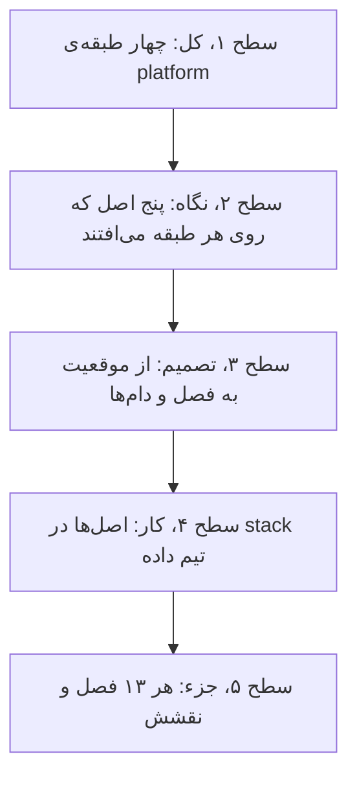
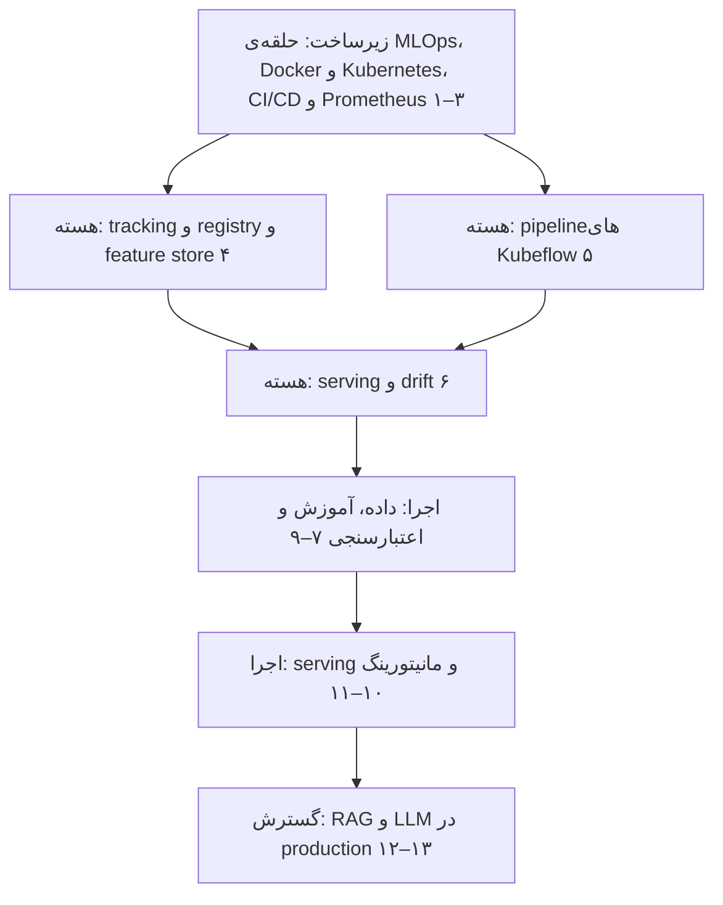
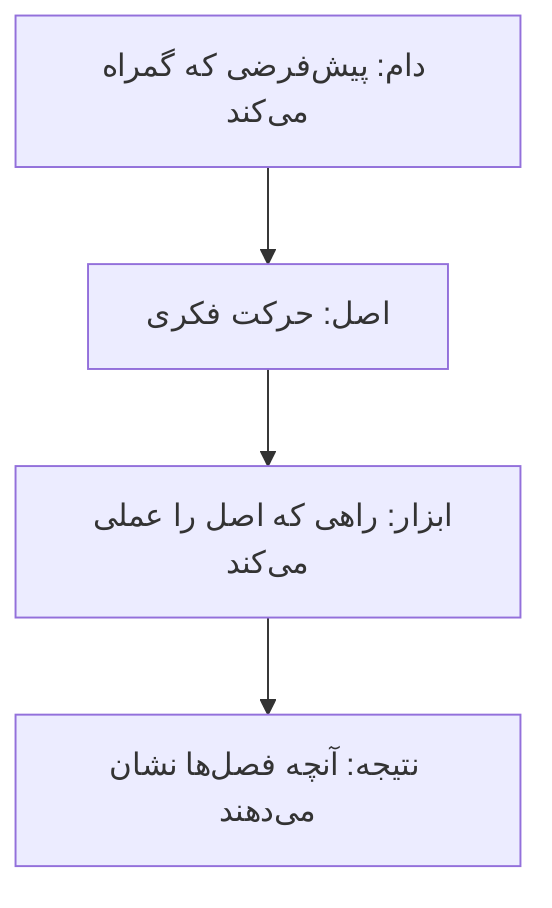
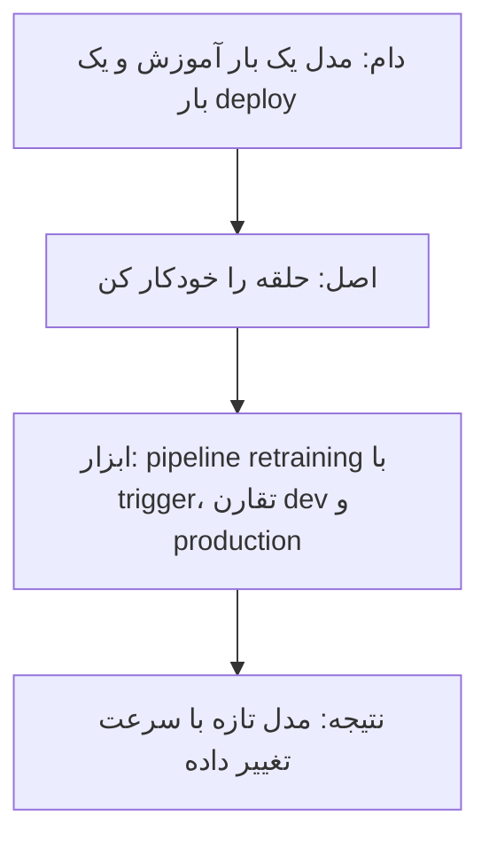
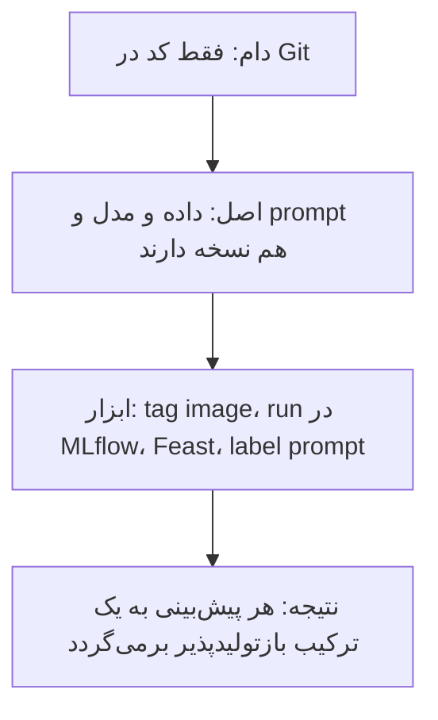
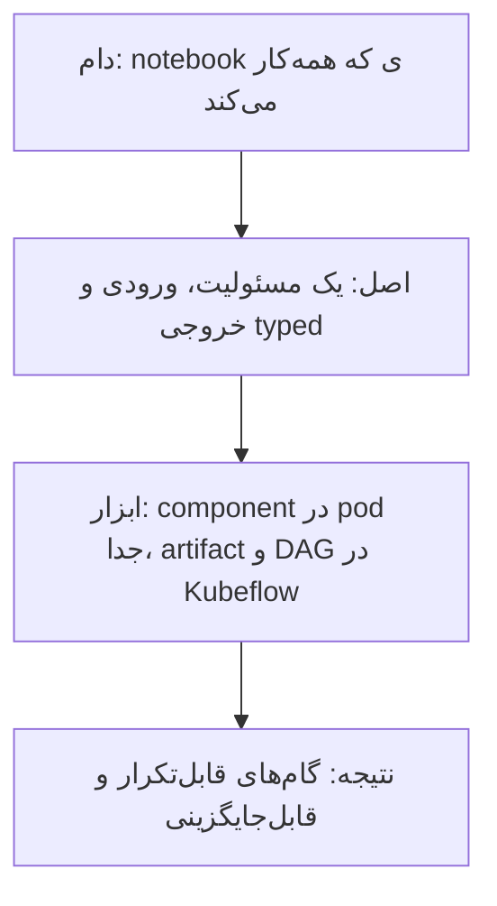
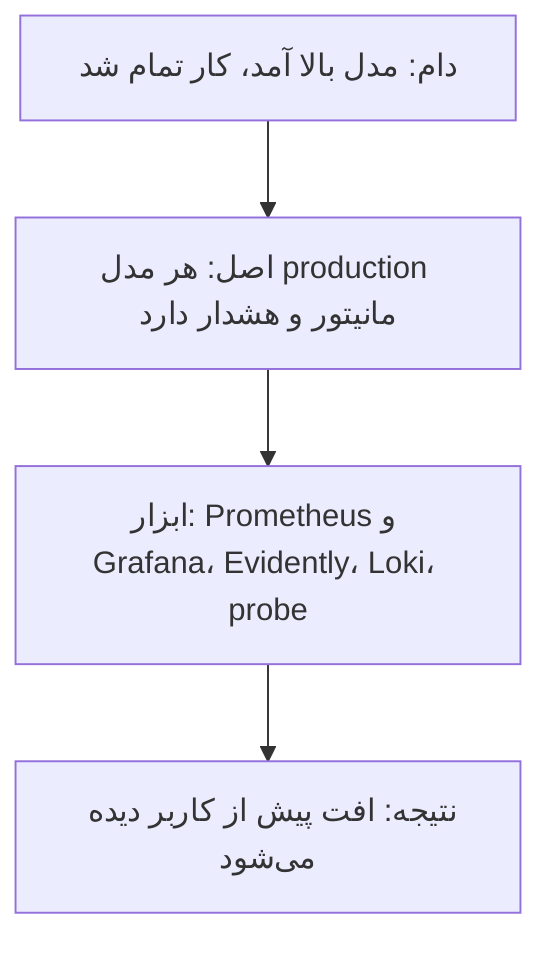
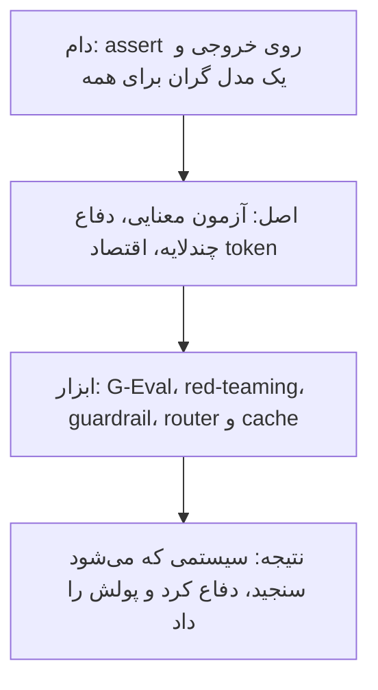

# چارچوب کتاب: platform یعنی حلقه‌ای که خودش را تکرار می‌کند

[کتاب](README.md) · [فصل ۱ ←](chapters/01-getting-started-with-mlops-and-ml-engineering.md)

این صفحه **سنتز خود vault** است، نه بخشی از کتاب. کتاب یک platform ML را تکه‌تکه روی Kubernetes می‌سازد و بعد روی دو پروژه و یک سیستم RAG امتحانش می‌کند؛ این‌جا همان تکه‌ها کنار هم می‌نشینند تا ببینید هر فصل کدام قطعه را اضافه می‌کند و چرا.

چارچوب سه لایه دارد. **نقشه‌ی کتاب** می‌گوید platform از چه طبقه‌هایی ساخته می‌شود: زیرساخت، قابلیت‌های هسته، اجرای پروژه و گسترش به LLM. **پنج اصل** می‌گوید با چه نگاهی هر طبقه را بخوانید. **راهنمای تصمیم و stack** می‌گوید برای هر موقعیت کدام فصل را باز کنید و هر اصل در stack تیم داده کجا می‌نشیند. همه‌ی ادعاها به فصل‌ها ارجاع می‌دهند؛ نام‌گذاری اصل‌ها مال vault است.

## تصویر کل

### کل کتاب در سه جمله

خوانش vault از کتاب، پیش از هر جزئی:

1. **کار ML یک حلقه است، نه یک خط، و آن‌چه باید پایدار بماند فرایند تغییر مدل است.** مدل و داده و hyperparameterها گذرا‌اند و بلوغ با میزان خودکار بودن حلقه سنجیده می‌شود ([۱](chapters/01-getting-started-with-mlops-and-ml-engineering.md)، [۲](chapters/02-what-is-mlops.md)).
2. **همین حلقه از چند قابلیت ساخته می‌شود که هر کدام یک ابزار دارد**: container و Kubernetes و GitOps زیر همه، و روی آن‌ها tracking و registry، feature store، pipeline، serving و مانیتورینگ ([۳](chapters/03-building-applications-on-kubernetes.md)، [۴](chapters/04-designing-reliable-ml-systems.md)، [۵](chapters/05-orchestrating-ml-pipelines.md)، [۶](chapters/06-productionizing-ml-models.md)).
3. **با LLM همان حلقه می‌ماند ولی «مدل» یک pipeline می‌شود**: prompt و embedding و index نسخه می‌خورند، آزمون معنایی است و ایمنی و هزینه جزء طراحی‌اند ([۱۲](chapters/12-designing-llm-powered-systems.md)، [۱۳](chapters/13-production-llm-system-design.md)).

### از کل به جزء

## نقشه‌ی کتاب

### چهار طبقه

*سطح ۱ از ۵: کل.*

طبقه‌بندی همان چهار بخش خود کتاب است. بخش ۱ زمین را آماده می‌کند، بخش ۲ قابلیت‌های هسته را می‌سازد، بخش ۳ همه را روی دو پروژه‌ی واقعی، یعنی تشخیص کارت شناسایی و recommender، اجرا می‌کند و بخش ۴ همان platform را به LLM می‌برد.

### طبقه‌ها و پرسش‌هایشان

| طبقه | پرسش اصلی | مفهوم‌های کلیدی | بده‌بستان اصلی | فصل‌ها |
|---|---|---|---|---|
| زیرساخت | حلقه چیست و روی چه چیزی اجرا می‌شود؟ | چرخه‌ی عمر، سطح بلوغ، Deployment، GitOps، `/metrics` | سرعت شروع در برابر پایه‌ی محکم | [۱](chapters/01-getting-started-with-mlops-and-ml-engineering.md)، [۲](chapters/02-what-is-mlops.md)، [۳](chapters/03-building-applications-on-kubernetes.md) |
| هسته | آزمایش و feature و pipeline را چطور تکرارپذیر کنیم؟ | run و registry، point-in-time join، component و DAG | تعریف صریح در برابر سرعت notebook | [۴](chapters/04-designing-reliable-ml-systems.md)، [۵](chapters/05-orchestrating-ml-pipelines.md) |
| production | مدل چطور سرو می‌شود و کی می‌فهمیم بد شده؟ | Bento، service و runner، data drift، پنجره‌ی microbatch | واکنش سریع در برابر هشدار کاذب | [۶](chapters/06-productionizing-ml-models.md)، [۱۰](chapters/10-model-inference-and-serving.md)، [۱۱](chapters/11-monitoring-and-explainability.md) |
| اجرا | همه‌ی این‌ها روی یک پروژه‌ی واقعی چه شکلی دارند؟ | artifact typed، PVC، alias در registry، متریک سفارشی | محلی در برابر شبکه، کوچک در برابر دقیق | [۷](chapters/07-data-analysis-and-preparation.md)، [۸](chapters/08-model-training-and-validation-part-1.md)، [۹](chapters/09-model-training-and-validation-part-2.md) |
| گسترش به LLM | وقتی خروجی nondeterministic است چه چیزی عوض می‌شود؟ | بودجه‌ی token، RAG، trace، G-Eval، guardrail، مسیریابی و cache | کیفیت در برابر هزینه و latency | [۱۲](chapters/12-designing-llm-powered-systems.md)، [۱۳](chapters/13-production-llm-system-design.md) |

## پنج اصل

*سطح ۲ از ۵: نگاه.*

پنج حرکت فکری در سراسر کتاب تکرار می‌شوند. هر اصل با یک زنجیره‌ی چهارتایی شروع می‌شود: **دام** رایج، **اصلی** که آن را می‌بندد، **ابزاری** که اصل را عملی می‌کند و **نتیجه**.

### اصل ۱: فرایند تغییر را پایدار کن، نه مدل را

- **پروژه‌ی ML خطی نیست** و تقریباً هر مرحله به عقب حلقه می‌زند ([۱](chapters/01-getting-started-with-mlops-and-ml-engineering.md)، [۲](chapters/02-what-is-mlops.md)).
- **سطح بلوغ با خودکار بودن حلقه سنجیده می‌شود**: در سطح ۱ آن‌چه deploy می‌شود pipeline retraining است، نه فقط مدل ([۲](chapters/02-what-is-mlops.md)).
- **ارتقای مدل با alias در registry است**، پس rollback یعنی عوض کردن یک اشاره‌گر ([۴](chapters/04-designing-reliable-ml-systems.md)، [۹](chapters/09-model-training-and-validation-part-2.md)).

### اصل ۲: هر چیزی که رفتار را عوض می‌کند نسخه بخورد

- **تغییر داده مثل تغییر کد رفتار را عوض می‌کند**، و مدل و کد دو موجودیت جدا‌اند ([۱](chapters/01-getting-started-with-mlops-and-ml-engineering.md)، [۲](chapters/02-what-is-mlops.md)).
- **تگ image به commit برمی‌گردد و Git تنها منبع حقیقت cluster است** ([۳](chapters/03-building-applications-on-kubernetes.md)).
- **در LLM، prompt و index برداری هم artifactاند**؛ تغییر system prompt به اندازه‌ی عوض کردن مدل رفتار را عوض می‌کند ([۱۲](chapters/12-designing-llm-powered-systems.md)، [۱۳](chapters/13-production-llm-system-design.md)).

### اصل ۳: هر گام یک component با قرارداد صریح

- **هر component در pod خودش اجرا می‌شود** و چهار قاعده دارد: یک مسئولیت، ورودی و خروجی دقیق، پارامتری بودن و مستندسازی ([۵](chapters/05-orchestrating-ml-pipelines.md)).
- **داده‌ی بزرگ را با مسیر بدهید، نه با مقدار**، و فرض‌های داده را در یک component QA زود بسنجید ([۷](chapters/07-data-analysis-and-preparation.md)).
- **وقتی وابستگی داده‌ای با PVC حذف شد، ترتیب را باید صریح گفت** ([۹](chapters/09-model-training-and-validation-part-2.md)).

### اصل ۴: production یعنی دیدن، نه deploy کردن

- **هیچ برنامه‌ای بدون مانیتورینگ آماده‌ی production نیست** و هشدار باید به آدم مناسب برسد ([۲](chapters/02-what-is-mlops.md)، [۱۱](chapters/11-monitoring-and-explainability.md)).
- **سنجش drift روی یک پنجره است، نه یک درخواست**، و پنجره‌ی کوچک هشدار کاذب می‌دهد ([۶](chapters/06-productionizing-ml-models.md)).
- **قاعده‌ی `up == 0` حذف شدن را نمی‌بیند** و probeهای readiness نمی‌گذارند pod ناآماده ترافیک بگیرد ([۱۰](chapters/10-model-inference-and-serving.md)، [۱۱](chapters/11-monitoring-and-explainability.md)).

### اصل ۵: با LLM، ارزیابی و ایمنی و هزینه جزء طراحی‌اند

- **ویژگی nondeterminism آزمون سنتی را می‌شکند** و trace می‌گوید چرا پاسخ بد است ([۱۲](chapters/12-designing-llm-powered-systems.md)).
- **هر شکستی که red-teaming پیدا کند یک آزمون regression می‌شود**، و guardrail چندلایه است ([۱۳](chapters/13-production-llm-system-design.md)).
- **ارزان‌ترین بهینه‌سازی، مدل متفاوت برای کار متفاوت است**، به بهای پیچیدگی عملیاتی ([۱۳](chapters/13-production-llm-system-design.md)).

## از موقعیت به فصل

*سطح ۳ از ۵: تصمیم.*

| موقعیت | اول بخوانید | بعد |
|---|---|---|
| مدل در notebook آموزش می‌بیند و دستی deploy می‌شود | [۲](chapters/02-what-is-mlops.md) | [۵](chapters/05-orchestrating-ml-pipelines.md) |
| نسخه‌ی تازه‌ی سرویس rollout شد ولی کامل نشد | [۳](chapters/03-building-applications-on-kubernetes.md) | [۱۰](chapters/10-model-inference-and-serving.md) |
| نمی‌دانیم مدل production با کدام داده آموزش دیده | [۴](chapters/04-designing-reliable-ml-systems.md) | [۹](chapters/09-model-training-and-validation-part-2.md) |
| دقت آموزش خیلی بالاتر از production است | [۴](chapters/04-designing-reliable-ml-systems.md) | [۱](chapters/01-getting-started-with-mlops-and-ml-engineering.md) |
| یک گام pipeline با `OOMKilled` می‌افتد | [۷](chapters/07-data-analysis-and-preparation.md) | [۹](chapters/09-model-training-and-validation-part-2.md) |
| هشدار drift مدام می‌آید ولی چیزی عوض نشده | [۶](chapters/06-productionizing-ml-models.md) | [۱۱](chapters/11-monitoring-and-explainability.md) |
| سرویس بالاست ولی کسی نمی‌داند پیش‌بینی‌ها خوب‌اند | [۱۱](chapters/11-monitoring-and-explainability.md) | [۱۰](chapters/10-model-inference-and-serving.md) |
| یک chatbot روی سندهای داخلی لازم است | [۱۲](chapters/12-designing-llm-powered-systems.md) | [۱۳](chapters/13-production-llm-system-design.md) |
| قبض LLM هر ماه بالاتر می‌رود | [۱۳](chapters/13-production-llm-system-design.md) | [۱۲](chapters/12-designing-llm-powered-systems.md) |

## دام‌ها

1. **رفتن سراغ ML وقتی یک heuristic ساده کافی است** ([۱](chapters/01-getting-started-with-mlops-and-ml-engineering.md)).
2. **دیدن چرخه‌ی ML به شکل خط** و deploy کردن فقط مدل ([۲](chapters/02-what-is-mlops.md)).
3. **حساب کردن secret در Kubernetes به‌عنوان رمزنگاری**، در حالی که فقط base64 است ([۳](chapters/03-building-applications-on-kubernetes.md)).
4. **ساختن داده‌ی آموزش با آخرین مقدار feature** به جای مقدار پیش از رویداد ([۴](chapters/04-designing-reliable-ml-systems.md)).
5. **پاس دادن داده‌ی بزرگ با مقدار بین componentها** ([۷](chapters/07-data-analysis-and-preparation.md)).
6. **اعتماد به مدل تحویلی بدون وارسی** ([۸](chapters/08-model-training-and-validation-part-1.md)).
7. **سنجیدن drift روی پنجره‌ی خیلی کوچک** ([۶](chapters/06-productionizing-ml-models.md)).
8. **فراموش کردن `await` روی `async_run`** در service ([۱۰](chapters/10-model-inference-and-serving.md)).
9. **اتکا به `up == 0` برای دیدن deployment حذف‌شده** ([۱۱](chapters/11-monitoring-and-explainability.md)).
10. **فرض این‌که temperature صفر یعنی deterministic** ([۱۲](chapters/12-designing-llm-powered-systems.md)).
11. **معیار مبهم در G-Eval و آستانه‌ی بی‌دقت در cache معنایی** ([۱۳](chapters/13-production-llm-system-design.md)).

## در stack شما

*سطح ۴ از ۵: کار.*

هر اصل در [stack مرجع](../../practice/reference-stack.md) یک جای مشخص دارد. کادرهای *In practice* هر فصل جزئیاتش را می‌دهند.

| بخش stack | اصل | فصل‌ها | یادآوری |
|---|---|---|---|
| GitLab CI و Argo CD | ۲ | [۳](chapters/03-building-applications-on-kubernetes.md) | rollback یعنی revert در Git، نه `kubectl rollout undo` |
| MLflow و registry | ۱، ۲ | [۴](chapters/04-designing-reliable-ml-systems.md)، [۹](chapters/09-model-training-and-validation-part-2.md) | مسیر و schema داده را هم در run ثبت کنید؛ ارتقا با alias |
| Silver با `update_date` | ۲ | [۴](chapters/04-designing-reliable-ml-systems.md) | مواد خام point-in-time join همین تاریخچه است |
| DAGهای Airflow | ۱، ۳ | [۵](chapters/05-orchestrating-ml-pipelines.md)، [۷](chapters/07-data-analysis-and-preparation.md) | هر task یک مسئولیت، داده با مسیر، check داده زود |
| prediction API روی Kubernetes | ۴ | [۶](chapters/06-productionizing-ml-models.md)، [۱۰](chapters/10-model-inference-and-serving.md) | readiness probe تا مدل load نشده ترافیک نگیرد |
| Prometheus و Grafana و OTel | ۴ | [۱۱](chapters/11-monitoring-and-explainability.md) | کنار CPU و latency، یک متریک سفارشی کسب‌وکار؛ `absent()` برای حذف |
| هر سرویس LLM | ۵ | [۱۲](chapters/12-designing-llm-powered-systems.md)، [۱۳](chapters/13-production-llm-system-design.md) | trace برای هر پرسش، بودجه‌ی token، هشدار هزینه پیش از سقف |

> **In practice:** اصل‌های «فرایند تغییر را پایدار کن» و «production یعنی دیدن» در retraining یک مدل به هم می‌رسند.
>
> **Your turn:** مدل دسته‌بندی تراکنش هر ماه با یک DAG در Airflow retrain و در MLflow ثبت می‌شود و prediction API همیشه آخرین نسخه را می‌خواند. یک ماه داده‌ی Silver ناقص بود و مدل تازه بدتر شد، ولی کسی تا گزارش کاربرها نفهمید. چه چیزی کم بود؟
>
> *Answer:* سه چیز. یک check داده پیش از آموزش که فرض «داده کامل است» را بسنجد ([۷](chapters/07-data-analysis-and-preparation.md)). یک گام ارزیابی که مدل تازه را فقط وقتی به alias production ببرد که از نسخه‌ی قبلی بدتر نباشد، تا rollback یعنی عوض کردن alias ([۹](chapters/09-model-training-and-validation-part-2.md)). و مانیتورینگ و هشدار روی خود پیش‌بینی‌ها، نه فقط روی سلامت سرویس ([۶](chapters/06-productionizing-ml-models.md)، [۱۱](chapters/11-monitoring-and-explainability.md)).

## نقشه‌ی فصل‌ها

*سطح ۵ از ۵: جزء.*

| فصل | طبقه | اصل | نقش در چارچوب |
|---|---|---|---|
| [۱. شروع کار با MLOps و ML engineering](chapters/01-getting-started-with-mlops-and-ml-engineering.md) | زیرساخت | ۱، ۲ | نقشه‌ی ذهنی platform و این‌که اصلاً ML لازم است یا نه |
| [۲. MLOps چیست؟](chapters/02-what-is-mlops.md) | زیرساخت | ۱ | حلقه‌ی MLOps، فرقش با DevOps و سطح‌های بلوغ |
| [۳. ساختن برنامه روی Kubernetes](chapters/03-building-applications-on-kubernetes.md) | زیرساخت | ۲، ۴ | Docker، Kubernetes، Helm، GitOps و Prometheus زیر همه |
| [۴. طراحی سیستم‌های ML قابل‌اطمینان](chapters/04-designing-reliable-ml-systems.md) | هسته | ۱، ۲ | tracking و registry با MLflow، feature store با Feast |
| [۵. ارکستراسیون pipelineهای ML](chapters/05-orchestrating-ml-pipelines.md) | هسته | ۳ | component و DAG در Kubeflow |
| [۶. بردن مدل‌های ML به production](chapters/06-productionizing-ml-models.md) | production | ۴ | serving با BentoML و Yatai، drift با Evidently |
| [۷. تحلیل و آماده‌سازی داده](chapters/07-data-analysis-and-preparation.md) | اجرا | ۳ | notebook روی cluster، artifact typed، QA داده |
| [۸. آموزش و اعتبارسنجی مدل: بخش ۱](chapters/08-model-training-and-validation-part-1.md) | اجرا | ۳ | آموزش در pipeline، container component، متریک قابل‌دید |
| [۹. آموزش و اعتبارسنجی مدل: بخش ۲](chapters/09-model-training-and-validation-part-2.md) | اجرا | ۱، ۳ | PVC، TensorBoard و MLflow، ارتقا با alias |
| [۱۰. inference و serving مدل](chapters/10-model-inference-and-serving.md) | production | ۴ | service و runner، probe و انتخاب ابزار serving |
| [۱۱. مانیتورینگ و explainability](chapters/11-monitoring-and-explainability.md) | production | ۴ | متریک سفارشی، log، هشدار، drift تصویر و recommender |
| [۱۲. طراحی سیستم‌های مبتنی بر LLM](chapters/12-designing-llm-powered-systems.md) | گسترش به LLM | ۲، ۵ | بودجه‌ی token، RAG، index به‌عنوان artifact، trace |
| [۱۳. طراحی سیستم LLM در production](chapters/13-production-llm-system-design.md) | گسترش به LLM | ۲، ۵ | prompt به‌عنوان کد، G-Eval، red-teaming، guardrail و هزینه |
