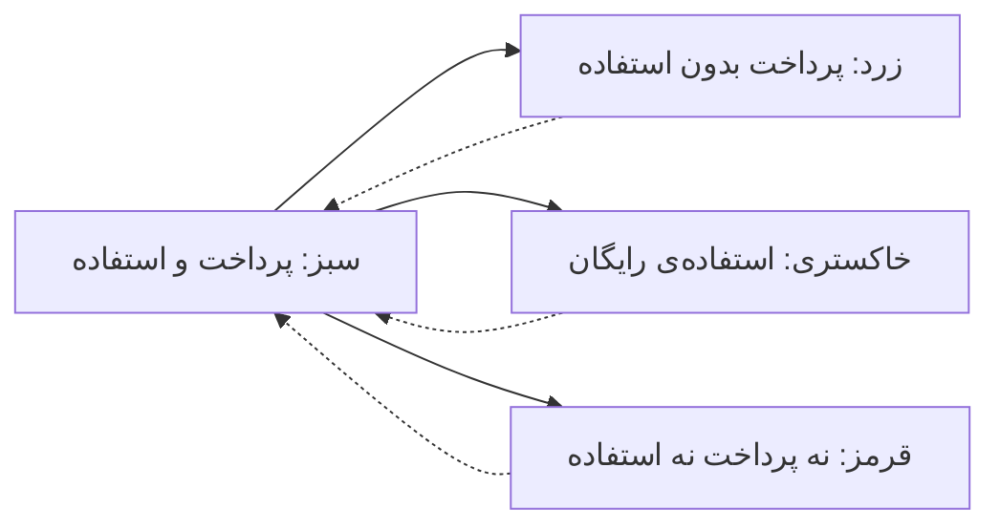

# نوشته‌ی ۲۲: رشد PLG: نگه داشتن و پولی کردن کاربران

[نوشته‌ی ۲۱: تسلط بر ضریب MCC →](21-mastering-the-mcc-coefficient.md) · [مجموعه](../README.md) · [نوشته‌ی ۲۳: رشد PLG: نگه داشتن کاربران ←](23-plg-growth-retaining-users.md)

> **مقاله‌ی اصلی:** [PLG growth: retaining (& monetizing) users](https://medium.com/@paul.levchuk/plg-growth-retaining-monetizing-users-d8566b3e9386) · Medium، ۲۰۲۳-۰۶-۲۱

## خلاصه

فاز سوم استراتژی PLG بعد از جذب و فعال‌سازی retention است، که احتمالاً سخت‌ترین و مهم‌ترین کار هر تیم محصول است. نویسنده اول می‌گوید چرا retention برای رشد استارتاپ حیاتی است. با اسلایدی از IVP دو شرکت را مقایسه می‌کند: شرکت A سریع‌تر می‌دود ولی retention پایین دارد و شرکت B آهسته‌تر ولی retention بالا. بعد از ۳۶ ماه شرکت B با اینکه فروش ماهانه‌اش نصف است ۱٫۵۵ برابر سریع‌تر رشد می‌کند و شرکت A به مجانب حدود ۲ میلیون دلار می‌رسد. بعد می‌گوید در مدل freemium چهار نوع مشتری هست و استراتژی retention فقط «پیش‌بینی ریزش سبزها و بازگرداندن قرمزها» نیست.

## نکته‌های کلیدی

- **حفظ retention احتمالاً سخت‌ترین و مهم‌ترین کار هر تیم محصول است.**
- **مقایسه‌ی دو شرکت (اسلاید IVP):** شرکت A ماهانه ۲۰۰ هزار دلار درآمد جدید با retention ماهانه‌ی ۹۰٪ و شرکت B ماهانه ۱۰۰ هزار دلار با retention ۹۹٪.
- **بعد از ۳۶ ماه** شرکت A به run rate حدود ۲ میلیون دلار در ماه می‌رسد و شرکت B حدود ۳٫۱ میلیون؛ یعنی B با وجود نصف بودن فروش ماهانه ۱٫۵۵ برابر سریع‌تر رشد می‌کند.
- **شرکت A تا retention را بهتر نکند نمی‌تواند سریع‌تر رشد کند:** روی ۲ میلیون یک مجانب هست و churn رشد را زیر آن نگه می‌دارد.
- **چهار نوع مشتری در freemium:** سبز، پول می‌دهد و استفاده می‌کند؛ زرد، هنوز پول می‌دهد ولی دیگر استفاده نمی‌کند؛ خاکستری، پول نمی‌دهد ولی نسخه‌ی رایگان را ادامه می‌دهد؛ قرمز، نه پول می‌دهد و نه استفاده می‌کند.
- **فعالیت‌های کلاسیک:** پیش‌بینی ریزش سبز به قرمز و بازگرداندن قرمز به سبز.
- **دو گزینه‌ی دیگر:** فعال‌سازی دوباره‌ی زردها و خاکستری‌ها به سبز.
- **سه استراتژی بنیادی بلندمدت:** مطمئن شوید محصول برای سبزها ارزش می‌دهد؛ برای سبزها عادت استفاده‌ی منظم بسازید؛ و مطمئن شوید محصول برای کاربران رایگان فعال که ممکن است بعداً پولی شوند ارزش می‌دهد.

## فهرست بخش‌ها

*این نوشته در پی سلسله‌ی PLG است.*

- چرا retention برای رشد استارتاپ حیاتی است
- نگه داشتن مشتری یعنی چه
- سه استراتژی بنیادی

## یادداشت‌ها

استراتژی رشد محصول‌محور چند فاز دارد. امروز درباره‌ی فاز سوم حرف می‌زنیم که بعد از جذب کاربران جدید و فعال‌سازی‌شان می‌آید: **retention**. نگه داشتن کاربر احتمالاً سخت‌ترین و مهم‌ترین کار هر تیم محصول است.

**چرا retention برای رشد استارتاپ حیاتی است؟** اسلایدی از ارائه‌ی صندوق IVP را ببینید. دو شرکت هست: شرکت A و شرکت B. شرکت A سریع‌تر می‌دود، ۲۰۰ هزار دلار درآمد جدید در ماه، ولی retention کمتری دارد: retention ماهانه‌ی ۹۰٪ که یعنی هر ماه ۱۰٪ کاربران را از دست می‌دهد. شرکت B آهسته‌تر می‌دود، ۱۰۰ هزار دلار درآمد جدید در ماه، ولی retention بالاتری دارد: ۹۹٪ در ماه، یعنی فقط ۱٪ کاربران را از دست می‌دهد. از اسلاید می‌فهمیم اگر این دو شرکت ۳ سال، یعنی ۳۶ ماه، با پارامترهای رشد بالا ادامه بدهند run rate کاملاً متفاوتی خواهند داشت. شرکت A حدود ۲ میلیون دلار run rate ماهانه خواهد داشت و شرکت B حدود ۳٫۱ میلیون دلار. شرکت B به‌خاطر retention خیلی بهتر ۱٫۵۵ برابر سریع‌تر از شرکت A رشد می‌کند، با این‌که ماهانه ۲ برابر کمتر فروش می‌سازد.

| | شرکت A | شرکت B |
|---|---|---|
| درآمد جدید ماهانه | ۲۰۰ هزار دلار | ۱۰۰ هزار دلار |
| retention ماهانه | ۹۰٪ | ۹۹٪ |
| run rate ماهانه بعد از ۳۶ ماه | حدود ۲ میلیون دلار | حدود ۳٫۱ میلیون دلار |

مهم‌تر این‌که اگر شرکت A retention را بهتر نکند **نمی‌تواند سریع‌تر رشد کند**. خطی مجانب در حدود ۲ میلیون دلار هست و شرکت A نمی‌تواند از آن رد شود، چون churn رشدش را زیر این خط می‌راند. برای همین retention کلید رشد سالم و بلندمدت استارتاپ است.

> **Try it:** [مجانب churn](../widgets/01-churn-asymptote.html): جذب و churn را عوض کنید و ببینید سقف رشد چرا با churn پایین می‌آید.

**نگه داشتن مشتری یعنی چه؟** پیش از باز کردن این پرسش، به‌خاطر محبوبیت مدل freemium، وقتی درباره‌ی مشتری حرف می‌زنیم باید چهار حالت ممکن را در نظر بگیریم. نمودار چهار نوع مشتری را نشان می‌دهد: مشتریانی که برای محصول **پول می‌دهند** و **استفاده می‌کنند** (سبز)؛ مشتریانی که **هنوز پول می‌دهند** ولی **استفاده را متوقف کرده‌اند** (زرد)؛ مشتریانی که **پرداخت را متوقف کرده‌اند** ولی نسخه‌ی رایگان را **ادامه می‌دهند** (خاکستری)؛ و مشتریانی که **پرداخت را متوقف کرده‌اند** و **استفاده را هم متوقف کرده‌اند** (قرمز).

وقتی شرکت‌ها درباره‌ی استراتژی‌های retention حرف می‌زنند معمولاً فقط فعالیت‌های «کلاسیک» را در نظر دارند: پیش‌بینی این‌که کدام مشتریان سبز به قرمز تبدیل می‌شوند، و بازگرداندن مشتریان قرمز به سبز. با توجه به نمودار آشکار است دو گزینه‌ی دیگر برای نگه داشتن مشتری هست: فعال‌سازی دوباره‌ی مشتریان زرد به سبز، و فعال‌سازی دوباره‌ی مشتریان خاکستری به سبز.

در **بلندمدت** این سه استراتژی بنیادی باید در کانون توجه باشد تا به بیشترین retention برسیم: مطمئن شوید محصول برای مشتریان **سبز** ارزش می‌دهد؛ برای مشتریان سبز عادت استفاده‌ی منظم از محصول بسازید؛ و مطمئن شوید محصول برای کاربران **پولی‌نشده‌ی فعال**، که در نمودار نیامده‌اند و ممکن است در آینده مشتری پولی شوند، ارزش به‌طور مداوم می‌دهد.

> **In practice:** مقایسه‌ی دو شرکت A و B یک شبیه‌سازی ساده است: جذب ماهانه و retention ورودی، درآمد ۳۶ ماهه خروجی؛ آن را در یک notebook با پارامترهای خود محصول تکرار کنید.
>
> **Your turn:** تیم فروش می‌گوید بودجه را به جذب بیشتر بدهید چون فروش ماهانه بالاتر است. با چه عددی جواب می‌دهید؟
>
> *Answer:* با retention و مجانب درآمد؛ شرکتی که retention پایین دارد به سقف می‌رسد و شرکت با فروش نصف ولی retention بالا بعد از ۳۶ ماه سریع‌تر رشد می‌کند (بخش «چرا retention برای رشد استارتاپ حیاتی است»).

## پیوندها

- **بر پایه‌ی:** [فصل ۱](01-churn-rate-evolution-at-netflix.md) که همین مجانب churn را در مثال Netflix می‌سازد.
- **ادامه در:** [فصل ۲۳](23-plg-growth-retaining-users.md) که می‌گوید چه چیزی retention را می‌راند، یعنی stickiness، و [فصل ۵۶](56-user-transition-states-diagram.md) که چهار وضعیت مشتری را به نمودار گذار تبدیل می‌کند.

## خودتان را بسنجید

*پرسش‌ها و پاسخ‌ها مال vault است.*

1. **چرا شرکت B با نصف فروش ماهانه سریع‌تر رشد می‌کند؟**
   - [x] چون retention بسیار بیشتری دارد و churn رشد شرکت A را زیر یک مجانب نگه می‌دارد.
   - [ ] چون قیمت بالاتری دارد.
   - [ ] چون کاربران بیشتری جذب می‌کند.

   *Answer:* (بخش «چرا retention برای رشد استارتاپ حیاتی است»).

2. **مشتری زرد در freemium چه کسی است و چه کاری باید با او کرد؟**

   *Answer:* کسی که هنوز پول می‌دهد ولی استفاده نمی‌کند؛ باید دوباره فعال شود تا به سبز برگردد (بخش «نگه داشتن مشتری یعنی چه»).
