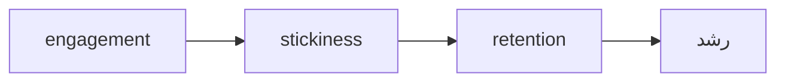

# نوشته‌ی ۲۳: رشد PLG: نگه داشتن کاربران

[نوشته‌ی ۲۲: رشد PLG: نگه داشتن و پولی کردن کاربران →](22-plg-growth-retaining-monetizing-users.md) · [مجموعه](../README.md) · [نوشته‌ی ۲۴: بینش‌های stickiness ←](24-in-the-last-post-i-discussed-how-stickiness-relates-to.md)

> **مقاله‌ی اصلی:** [PLG Growth: retaining users](https://medium.com/@paul.levchuk/plg-growth-retaining-users-25ecb728b2ce) · Medium، ۲۰۲۳-۰۶-۲۷

## خلاصه

نوشته‌ی قبل گفت چرا retention حیاتی است؛ این نوشته می‌گوید چه چیزی retention را می‌راند. نویسنده از مقاله‌ی Sequoia مدل رشد retention را می‌گیرد: retention رشد را می‌راند، stickiness retention را و engagement stickiness را. چون retention یک شاخص تأخیری است، باید به شاخص‌های پیشرو نگاه کرد. stickiness تابع دو چیز است: هر چند وقت مشتری می‌خواهد ارزش بگیرد و محصول چه‌قدر می‌تواند عادت استفاده‌ی منظم یا شدید بسازد. نویسنده Lness را به DAU/MAU ترجیح می‌دهد، چون توزیع است نه عدد فشرده. روی cohort هفته‌ی ۲۰۲۲-۱۹ نشان می‌دهد کاربران L4+ retention بالا و تخت دارند.

## نکته‌های کلیدی

- **تحلیل cohort برای دیدن اثر زمان و بهبود retention خوب است ولی retention شاخص تأخیری است:** تا رفتار کاربر به‌شدت عوض نشود در retention دیده نمی‌شود.
- **مدل Sequoia از شاخص‌های پیشرو:** retention رشد را می‌راند، stickiness retention را و engagement stickiness را.
- **میزان stickiness تابع دو عامل است:** مشتری هر چند وقت می‌خواهد ارزش بگیرد، و محصول چه‌قدر می‌تواند عادت استفاده‌ی منظم یا شدید بسازد. هر دو لازم‌اند؛ عامل اول تا ۷۰٪ موفقیت retention و دوم فقط تا ۳۰٪.
- **سنجش stickiness:** DAU ÷ MAU، WAU ÷ MAU و Lness یعنی درصد کاربران که در هفته X روز برمی‌گردند.
- **شاخص Lness بهتر است:** توزیع است نه عدد فشرده، و در سطح کاربر حساب می‌شود. DAU/MAU نمی‌تواند از ۳٫۲٪ کمتر باشد و WAU/MAU از ۲۰٪.
- **در cohort هفته‌ی ۲۰۲۲-۱۹:** حدود ۸۲٪ کاربران L1 و حدود ۱٫۳٪ کاربران L4+.
- **در retention هفته‌ی ۲۰۲۲-۲۲:** L1 برابر ۲٫۳٪ و L4+ بالای ۳۱٫۸٪ و در آن تخت از دوره‌ی دوم؛ هر چه روز بیشتر، retention بیشتر.
- **سهم L1 در هفته‌های ۲۰ تا ۲۲** کم می‌شود (۶۰٫۱٪ و ۵۱٫۵٪ و ۵۰٫۹٪)، L2 ثابت است (۲۳٫۸٪ و ۲۴٫۶٪ و ۲۲٫۷٪) و L4 زیاد می‌شود (۴٫۰٪ و ۵٫۲٪ و ۶٫۴٪).
- **حدود stickiness:** حتی کم‌درگیرترین‌ها (L1) ممکن است منظم برگردند و حتی درگیرترین‌ها (L4+) ممکن است ریزش کنند.

## فهرست بخش‌ها

*این نوشته در پی سلسله‌ی PLG است.*

- شاخص‌های پیشرو
- مفهوم stickiness و سنجش آن
- توزیع Lness
- رابطه‌ی stickiness و retention
- حدود stickiness

## یادداشت‌ها

در نوشته‌ی قبل نویسنده گفت چرا retention برای رشد استارتاپ این‌قدر حیاتی است. امروز درباره‌ی این صحبت می‌کنیم که چه چیزی retention را می‌راند. معمولاً برای ارزیابی retention تحلیل‌گران از cohort کاربر استفاده می‌کنند. نکته‌های خوب cohort این است که کمک می‌کند ببینیم در طول زمان، مثلاً ۱ هفته یا ۶ ماه بعد، چه اتفاقی برای کاربران می‌افتد، و راه راحت و مقاومی برای ارزیابی این است که retention در طول زمان بهتر می‌شود یا نه، با مقایسه‌ی cohortها با هم. نکته‌ی بد این است که retention یک **شاخص تأخیری** است: تا زمانی که رفتار کاربر به‌شدت عوض نشود ما آن را از راه retention نمی‌بینیم.

**چه گزینه‌هایی برای بالا بردن retention داریم؟** نویسنده مدت‌ها پیش مقاله‌ی جالبی از Sequoia، یکی از شرکت‌های سرمایه‌گذاری پیشرو در آمریکا، خوانده بود که مدل رشد retention زیر را پیشنهاد می‌کرد. ایده‌ی کلیدی مقاله این بود که درباره‌ی رشد retention با **شاخص‌های پیشرو** فکر کنید: retention رشد را می‌راند، stickiness retention را می‌راند و engagement stickiness را می‌راند. نوشته‌ی امروز درباره‌ی stickiness است.

**میزان stickiness به‌طور خلاصه تابع دو عامل است:** مشتری‌ها هر چند وقت می‌خواهند با استفاده از محصول ارزش بگیرند یا مشکلی را حل کنند؟ و محصول چه‌قدر می‌تواند عادت استفاده‌ی منظم و یا شدید از خودش را بسازد؟ برای داشتن محصول واقعاً چسبنده هر دو عامل باید باشند. اگر مشتری نخواهد یا نیاز نداشته باشد که مرتب ارزش بگیرد، محصول می‌تواند سعی کند او را تحریک کند ولی فقط تا حدی جواب می‌دهد. برای همین نویسنده می‌گوید عامل اول تا ۷۰٪ موفقیت retention را می‌سازد و دومی فقط تا ۳۰٪.

**میزان stickiness را چطور بسنجیم؟** در سطوح مختلف می‌شود: DAU ÷ MAU یعنی درصد کاربرانی که به محصول **روزانه** در طول یک **ماه** برمی‌گردند؛ WAU ÷ MAU یعنی درصد کاربرانی که **هفتگی** در طول یک **ماه** برمی‌گردند؛ و Lness یعنی درصد کاربرانی که در یک **هفته** **X روز** به محصول برمی‌گردند. نویسنده Lness را ترجیح می‌دهد چون اطلاعات خیلی مفیدتری نسبت به نسبت‌های DAU/MAU یا WAU/MAU می‌دهد. Lness همیشه توزیع است، در حالی که DAU/MAU یا WAU/MAU فقط عددهای فشرده‌اند. Lness را می‌شود ساده در سطح کاربر حساب کرد. و DAU/MAU یا WAU/MAU را باید با احتیاط تفسیر کرد: DAU/MAU نمی‌تواند از ۳٫۲٪ یعنی ۱ ÷ ۳۰ پایین‌تر باشد و WAU/MAU از ۲۰٪ یعنی ۱ ÷ ۵.

| معیار | معنی | کف |
|---|---|---|
| DAU ÷ MAU | درصد کاربرانی که در ماه روزانه برمی‌گردند | ۳٫۲٪ |
| WAU ÷ MAU | درصد کاربرانی که در ماه هفتگی برمی‌گردند | ۲۰٪ |
| Lness | درصد کاربرانی که در هفته X روز برمی‌گردند | توزیع کامل |

**توزیع Lness.** نمودار نشان می‌دهد حدود ۸۲٪ کاربران cohort هفته‌ی ۲۰۲۲-۱۹ فقط ۱ روز در هفته از اپ استفاده کردند، یعنی کاربران L1، و حدود ۱٫۳٪ ۴ روز یا بیشتر در هفته، یعنی کاربران L4+. به نظر می‌رسد کاربران این cohort در ابتدا چندان با اپ درگیر نیستند. این می‌تواند کاملاً اشکال نداشته باشد، چون اپ‌های زیادی نیستند که قرار باشد هر روز برای مشتری ارزش بیاورند.

**رابطه‌ی stickiness و retention.** cohort را با Lness بخش‌بندی می‌کنیم. از نمودار واضح است: کاربرانی که ۱ روز با اپ درگیر شدند، L1، کمترین retention را دارند و در هفته‌ی ۲۰۲۲-۲۲ برابر ۲٫۳٪. کاربران ۴+ روز، L4+، retention خیلی بالاتر دارند، بیشتر یا برابر ۳۱٫۸٪، و مهم‌تر این‌که از دوره‌ی دوم، هفته‌ی ۲۰۲۲-۲۱، **تخت** است. هر چه کاربران روز بیشتری درگیر شوند retentionشان بالاتر است. بین stickiness یعنی Lness و retention رابطه‌ی قوی هست.

چون کاربرانی که در هفته‌ی ثبت‌نام درگیرترند retention بهتری دارند، سهم‌شان در هفته‌های بعد باید زیاد شود و تفکیک Lness کاربران باید عوض شود. این را هم بررسی می‌کنیم: سهم L1، کم‌درگیرترین‌ها، در هفته‌های ۲۰ و ۲۱ و ۲۲ **کم می‌شود**، ۶۰٫۱٪ و ۵۱٫۵٪ و ۵۰٫۹٪. سهم L2، کاربران معمولی، نسبتاً ثابت است، ۲۳٫۸٪ و ۲۴٫۶٪ و ۲۲٫۷٪. سهم L4، بسیار درگیرها، **زیاد می‌شود**، ۴٫۰٪ و ۵٫۲٪ و ۶٫۴٪. سهم کاربران درگیرتر هفته‌به‌هفته بالا می‌رود و به همین دلیل retention در دوره‌های بعدی بهتر می‌شود.

**حدود stickiness.** شاید بعضی از شما فکر کنید هر اپ باید برای رسیدن به بیشترین stickiness تلاش کند، چون با کاربرانی که می‌مانند همبستگی قوی دارد. مسلماً stickiness به‌عنوان یکی از شاخص‌های **پیشرو** می‌تواند برای پیش‌بینی یا اثر گذاشتن روی retention به کار برود. ولی باید **حدودش** را هم در نظر بگیریم: حتی **کم‌درگیرترین** کاربران، L1، ممکن است به‌طور منظم **برگردند**؛ و حتی **درگیرترین** کاربران، L4+، ممکن است **ریزش کنند**. نویسنده می‌گوید این دو ادعا را در نوشته‌ی بعد ثابت می‌کند.

> **Try it:** [توزیع Lness در برابر یک عدد](../widgets/23-lness-vs-dau-mau.html): توزیع L1 تا L4+ را تغییر دهید و ببینید با میانگین روز فعال برابر، retention کل چقدر فرق می‌کند.

> **In practice:** توزیع Lness، یعنی تعداد روزهای فعال در هفته، یک جدول Gold کاربر‑هفته است و از DAU/MAU اطلاعات بیشتری می‌دهد.
>
> **Your turn:** داشبورد فقط نسبت DAU/MAU را نشان می‌دهد. چه چیزی جایگزینش می‌کنید؟
>
> *Answer:* نمودار توزیع L1 تا L7؛ DAU/MAU یک عدد فشرده است و دو محصول با توزیع کاملاً متفاوت ممکن است همان نسبت را داشته باشند (بخش «توزیع Lness»).

## پیوندها

- **بر پایه‌ی:** [فصل ۲۲](22-plg-growth-retaining-monetizing-users.md) که اهمیت retention را می‌گوید و [فصل ۴](04-how-regular-are-users-using-this-feature-per-week.md) که توزیع تعداد روز را همین‌طور به‌جای میانگین می‌خواند.
- **ادامه در:** [فصل ۲۴](24-in-the-last-post-i-discussed-how-stickiness-relates-to.md) که رابطه‌ی stickiness و retention و حدودش را ادامه می‌دهد، و [فصل ۲۵](25-stickiness-insights-part-2.md) و [فصل ۲۷](27-stickiness-insights-part3.md).

## خودتان را بسنجید

*پرسش‌ها و پاسخ‌ها مال vault است.*

1. **چرا Lness بر DAU/MAU ترجیح دارد؟**
   - [x] چون توزیع است و در سطح کاربر حساب می‌شود، نه یک عدد فشرده.
   - [ ] چون ساده‌تر است.
   - [ ] چون کف ندارد.

   *Answer:* (بخش «مفهوم stickiness و سنجش آن»).

2. **چرا retention شاخص تأخیری است و stickiness پیشرو؟**

   *Answer:* retention تا رفتار کاربر به‌شدت عوض نشود دیده نمی‌شود؛ stickiness همین رفتار را زودتر نشان می‌دهد (بخش «شاخص‌های پیشرو»).
