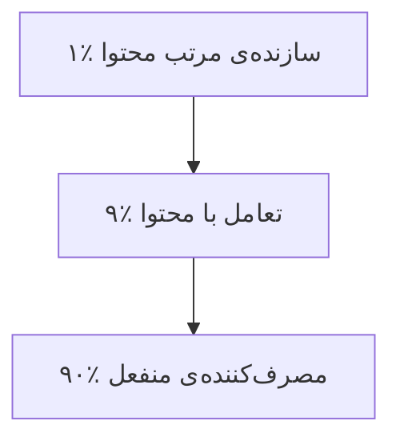

# نوشته‌ی ۲۶: تحلیل رشد Threads

[نوشته‌ی ۲۵: بینش‌های stickiness، بخش دوم →](25-stickiness-insights-part-2.md) · [مجموعه](../README.md) · [نوشته‌ی ۲۷: بینش‌های stickiness، بخش سوم ←](27-stickiness-insights-part3.md)

> **مقاله‌ی اصلی:** [Threads growth analysis](https://medium.com/@paul.levchuk/threads-growth-analysis-2f9cafc2c4c7) · Medium، ۲۰۲۳-۰۷-۲۳

## خلاصه

نویسنده بعد از دیدن بحثی بین Brian Balfour و Casey Winters و Fareed Mosavat درباره‌ی این‌که Threads و Twitter یک سال بعد چند DAU دارند، داده‌ی رشد Threads را از چند منبع جمع می‌کند: ثبت‌نام از Quiver Quantitative، DAU از Sensor Tower و دقیقه‌ی روزانه از Similarweb. در ۱۲ روز اول ۵۰ میلیون حساب در روز راه‌اندازی و ۹۰ میلیون در سه روز اول ساخته شد، ولی شروع سریع یعنی ساخته شدن محصول موفق نیست. دقیقه‌ی روزانه از ۱۴ به ۴ دقیقه، یعنی ۷۱٪ افت، رسید و DAU هم از روز سوم پایین آمد. با حدس‌های cohort، نویسنده برآورد می‌کند ۹۶٪ کاربران cohort روز اول در ۱۲ روز ریزش کردند.

## نکته‌های کلیدی

- **داده‌ها از منابع بیرونی‌اند** و نویسنده خودش آن‌ها را برداشته و در Excel گذاشته؛ پس تحلیل پر از فرض است.
- **ثبت‌نام:** روز راه‌اندازی ۵۰ میلیون حساب، ۴۴٪ همه‌ی حساب‌های دوره‌ی تحلیل؛ سه روز اول ۹۰ میلیون، ۷۹٪.
- **شروع سریع کافی نیست.** برای محصول موفق باید تعداد زیادی کاربر جدید داشت که مشکلی دارند و مرتب تجربه‌اش می‌کنند، محصولی ساخت که آن مشکل را بهتر از موجودها حل کند، و سریع onboarding کرد تا مرتب ارزش بدهد.
- **دو منبع کاربر:** Instagram که Meta هل‌شان داده و بیشتر تصویری‌اند و Twitter که کنجکاوند و تغییرهای داخلی Twitter هلشان داده.
- **گراف کاربر Twitter بهتر است:** کاربرانی که دنبال‌شان می‌کنید و در شبکه‌ی دیگری با آن‌ها وصل نیستید و عادت به‌اشتراک‌گذاری محتوای ارزشمند دارند.
- **قاعده‌ی ۹۰ و ۹ و ۱:** ۹۰٪ منفعل مصرف می‌کنند، ۹٪ با محتوا تعامل می‌کنند و ۱٪ مرتب محتوای یکتا می‌سازند. سخت‌ترین بخش رشد Threads شکل دادن به نسل سازندگان است.
- **دقیقه‌ی روزانه با DAU همبستگی ۰٫۸۷ دارد** و از روز سوم کم شد؛ از ۱۴ به ۴ دقیقه یعنی ۷۱٪ افت.
- **شاخص DAU:** روز راه‌اندازی ۶ ژوئیه فقط ۳۲ میلیون با ۵۰ میلیون ثبت‌نام؛ اوج در روز دوم ۴۴ میلیون؛ از روز سوم نزول؛ افت عجیب در روز ۱۱ام، ۱۶ ژوئیه.
- **نمودار cohortهای حدسی:** با فعال‌سازی ۶۴٪ که تدریجاً به بیش از ۸۰٪ می‌رسد و retention نسبی بین ۰٫۳ تا ۰٫۹۵ و MAPE برابر ۲٫۵٪؛ در ۱۲ روز فقط ۴٫۰٪ از cohort روز اول زنده ماندند.

## فهرست بخش‌ها

*این نوشته عنوان بخش‌های مفصل دارد.*

- آمار ثبت‌نام
- تعداد زیادی کاربر جدید
- محصول بهتر
- فرایند onboarding و تحویل ارزش
- دقیقه‌ی روزانه
- شاخص DAU
- نمودار cohortهای حدسی

## یادداشت‌ها

هفته‌ی گذشته نویسنده بحث بسیار جالبی بین Brian Balfour و Casey Winters و Fareed Mosavat دیده بود که می‌کوشیدند حدس بزنند «یک سال بعد Threads و Twitter چند DAU دارند؟». دیروز چند مقاله با داده‌ی رشد Threads پیدا کرد: ثبت‌نام‌های Threads از Quiver Quantitative، DAU از Sensor Tower و دقیقه‌ی روزانه از Similarweb. تصمیم گرفت این داده‌ها را بردارد و در Excel بگذارد.

**از آمار ثبت‌نام چه می‌آموزیم؟** داده‌ی ۱۲ روز اول بعد از راه‌اندازی Threads را داریم. در روز راه‌اندازی Threads ۵۰ میلیون حساب کاربری جمع کرد، که ۴۴٪ همه‌ی حساب‌های دوره‌ی تحلیل است. در ۳ روز اول ۹۰ میلیون حساب جمع کرد، یعنی ۷۹٪. علاوه بر آن می‌شود دید Threads رکورد سریع‌ترین رشد اپ در تاریخ را زده است. ولی شروع سریع تضمین نمی‌کند محصول موفقی ساخته‌اید و ارزش به کاربران رسانده‌اید. برای ساختن محصول موفق باید: تعداد زیادی کاربر جدید داشته باشید که مشکلی دارند و مرتب تجربه‌اش می‌کنند؛ محصولی بسازید که آن مشکل را بهتر از محصول‌های موجود بازار حل کند؛ و سریع کاربران را onboarding کنید تا شروع به استفاده کنند و محصولی که مرتب ارزش بدهد.

**تعداد زیادی کاربر جدید.** به نظر کاملاً آشکار است که Meta تصمیم گرفت کاربران را از دو منبع بگیرد: از Instagram که مال Meta است و از Twitter که رقیب اصلی است. انگیزه‌ی این دو گروه برای امتحان کردن Threads فرق دارد. کاربران Instagram را Meta فقط هل داد؛ این کاربران عموماً تصویری‌اند، عکس و ویدئو می‌بینند و به اشتراک می‌گذارند، و این‌که نیاز دارند افکارشان را با متن به اشتراک بگذارند پرسش بازی است. کاربران Twitter می‌توانستند کنجکاو باشند و بیشتر تغییرهای داخلی Twitter هل‌شان داد.

**محصول بهتر.** نویسنده کاربر فعال Twitter نیست و Threads را نصب نکرده. با این حال می‌تواند فرض کند تا اینجا Twitter به‌عنوان محصول بسیار بالغ‌تر است و مجموعه‌ی قابلیت‌های غنی‌تری دارد.

**فرایند onboarding و تحویل ارزش.** ولی شاید مهم‌تر این است که Twitter گراف کاربر خیلی بهتری دارد: تعداد کاربرانی که به آن‌ها علاقه دارید و احتمالاً در شبکه‌های اجتماعی دیگر به آن‌ها وصل نیستید؛ و این کاربران مورد علاقه عادت دارند محتوای ارزشمندی به اشتراک بگذارند که می‌خواهید مرتب مصرفش کنید. چرا مهم است؟ وقتی شبکه‌های اجتماعی تازه شروع به رشد کردند، پژوهشگران زود فهمیدند در هر شبکه‌ی اجتماعی تقریباً همان توزیع فعالیت کاربر هست: ۹۰٪ کاربران **منفعلانه محتوای دیگران را مصرف** می‌کنند؛ ۹٪ با محتوای دیگران **تعامل** می‌کنند، لایک و کامنت و بازنشر؛ و ۱٪ **مرتب محتوای یکتا می‌سازند**. پس سخت‌ترین بخش رشد Threads شکل دادن به نسل سازندگانی است که محتوا می‌سازند و کاربرانی که این محتوا را برای کاربران منفعل بازتوزیع می‌کنند. وگرنه اگر کاربران مورد علاقه نباشند یا محتوای جذاب کافی نسازند، دلیلی برای برگشتن به محصول نیست.

برگشتن به محصول ما را به DAU و دقیقه‌ی روزانه می‌رساند.

**از دقیقه‌ی روزانه چه می‌آموزیم؟** دقیقه‌ی روزانه‌ی Threads همبستگی بسیار بالایی با DAU دارد، ضریب همبستگی ۰٫۸۷. و دقیقه‌ی روزانه‌ی Threads خیلی سریع شروع به افت کرد، در روز سوم بعد از راه‌اندازی. می‌توانیم فرض کنیم دقیقه‌ی روزانه‌ی Threads **جانشین** ارزش محصول است. چون از ۱۴ دقیقه به ۴ دقیقه، یعنی ۷۱٪ افت، رسید، می‌شود فرض کرد Threads نتوانست نسل سازندگان محتوا و کاربران بازتوزیع‌کننده برای کاربران منفعل را شکل بدهد؛ و به همین دلیل DAU هم شروع به کاهش کرد.

**از آمار DAU چه می‌آموزیم؟** در روز راه‌اندازی، ۶ ژوئیه، Threads ۵۰ میلیون حساب کاربری جمع کرد ولی DAU فقط ۳۲ میلیون کاربر بود. بیشترین DAU در دوره‌ی تحلیل در روز دوم بعد از راه‌اندازی بود، ۴۴ میلیون کاربر در ۷ ژوئیه. از روز سوم بعد از راه‌اندازی DAU شروع به کاهش کرد، همراه با دقیقه‌ی روزانه. و افت عجیبی در DAU روز یازدهم، ۱۶ ژوئیه، هست. چنان‌که گفته شد، اگر کاربران از محصول ارزش نگیرند باید ریزش کنند. بهترین راه یادگیری درباره‌ی churn ساختن cohort کاربر است.

**نمودار cohortهای حدسی Threads.** نویسنده با استفاده از عددهای ثبت‌نام و DAU نرخ‌های churn ممکن را برای هر cohort ثبت‌نام روزانه حدس زد. چند فرض کرد: تیم محصول Threads توانست فعال‌سازی کاربر را بهتر کند؛ در ابتدا ۶۴٪ بود، یعنی ۳۲ میلیون DAU تقسیم بر ۵۰ میلیون ثبت‌نام، ولی تدریجاً به بیش از ۸۰٪ رسید. retention نسبی، از روز به روز، از روزی به روز دیگر بالا می‌رود که رفتار عادی cohortهاست؛ او با Excel Solver خطای کل را کمینه کرد و retention نسبی در بازه‌ی ۰٫۳ تا ۰٫۹۵ است.

آشکار است نمودار فرض‌های زیادی دارد. با این حال علاقه‌ی اصلی نویسنده برآورد DAU ممکن Threads در یک روز مشخص بود، و می‌خواست افت شدید ۱۶ ژوئیه را توضیح بدهد. بر اساس مدل: خطای مطلق درصدی میانگین کل مدل، یعنی MAPE، برابر ۲٫۵٪ است که برای برآورد سریع به نظر نویسنده خوب است. خطا تا ۱۵ ژوئیه خوب بود ولی دو روز بعد مدل با داده‌ی مرجع جور نیست. آیا داده‌ی مرجع در آن بازه نادقیق بود؟ چه اتفاقی ممکن بود افتاده باشد؟

اگر فرض کنیم حدس درباره‌ی cohort ۶ ژوئیه جهت‌دار درست است، در ۱۲ روز فقط ۴٫۰٪ کاربران زنده ماندند. به عبارت دیگر ۹۶٫۰٪ کاربران این cohort به نوعی ریزش کردند. با در نظر گرفتن این‌که cohort ۶ ژوئیه بزرگ‌ترین بود، ۵۰ میلیون، و بر پایه‌ی داده‌ای که فعلاً داریم، آینده‌ی موفقیت محصول Threads فعلاً کاملاً مشکوک به نظر می‌رسد.

> **Vault note:** این تحلیل از داده‌ی عمومی بیرونی و فرض‌های نویسنده ساخته شده و داده‌ی داخلی Meta نیست؛ خود او می‌گوید برآورد سریع است. اعداد بعدی Threads در دنیای واقعی ممکن است متفاوت باشد.

> **In practice:** وقتی داده‌ی داخلی ندارید و از چند منبع بیرونی عدد جمع می‌کنید، منبع و تعریف هر ستون را در خود جدول Gold یا notebook ثبت کنید تا عددها با هم قاطی نشوند.
>
> **Your turn:** ثبت‌نام روز راه‌اندازی رکورد زده و همه جشن گرفته‌اند. کدام سنجه را در هفته‌ی دوم نگاه می‌کنید؟
>
> *Answer:* دقیقه‌ی استفاده‌ی روزانه و DAU؛ شروع سریع یعنی محصول موفق نیست و افت ۷۱٪ دقیقه‌ی روزانه زودتر از ثبت‌نام ریزش را نشان می‌دهد (بخش «دقیقه‌ی روزانه»).

## پیوندها

- **بر پایه‌ی:** [فصل ۲۲](22-plg-growth-retaining-monetizing-users.md) و [فصل ۲۳](23-plg-growth-retaining-users.md) که retention و stickiness را می‌سنجند.
- **همان ایده در:** [فصل ۵۱](51-rf-matrix-frequency-dimension.md) و [فصل ۵۲](52-rr-ff-matrices-introduction-to-customer-states.md) که cohort را به وضعیت مشتری می‌بندند، و [فصل ۴۰](40-all-user-cohorts-are-noisy-but-some-can-tell-you-a-story.md) که cohortهای پرنویز را می‌خواند.

## خودتان را بسنجید

*پرسش‌ها و پاسخ‌ها مال vault است.*

1. **چرا رکورد سریع‌ترین رشد اپ تضمین موفقیت محصول نیست؟**
   - [x] چون باید مشکل کاربران را بهتر حل کند و سریع ارزش بدهد؛ دقیقه‌ی روزانه از ۱۴ به ۴ رسید.
   - [ ] چون ثبت‌نام را نمی‌شود شمرد.
   - [ ] چون DAU مهم نیست.

   *Answer:* (بخش «آمار ثبت‌نام»).

2. **قاعده‌ی ۹۰ و ۹ و ۱ در شبکه‌های اجتماعی چیست؟**

   *Answer:* ۹۰٪ منفعل مصرف می‌کنند، ۹٪ تعامل می‌کنند و ۱٪ مرتب محتوا می‌سازند (بخش «فرایند onboarding و تحویل ارزش»).
