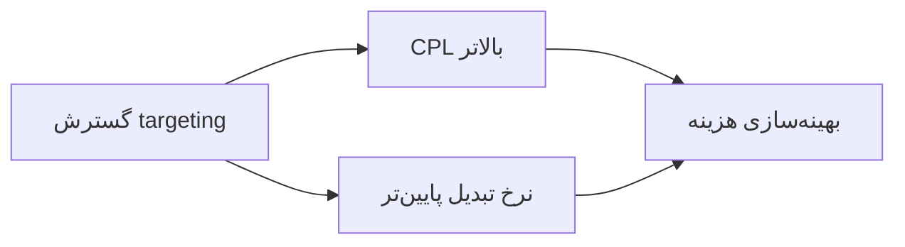

# نوشته‌ی ۲۸: مدل‌های رشد

[نوشته‌ی ۲۷: بینش‌های stickiness، بخش سوم →](27-stickiness-insights-part3.md) · [مجموعه](../README.md) · [نوشته‌ی ۲۹: درگیری کاربر: مقدمه ←](29-user-engagement-introduction.md)

> **مقاله‌ی اصلی:** [Growth models](https://medium.com/@paul.levchuk/growth-models-1369a5763413) · Medium، ۲۰۲۳-۰۸-۲۳

## خلاصه

نویسنده یک artifact از Reforge را نقد می‌کند: مدل رشد آمریکایی Quizlet از Phil Carter، با داده‌ی ساختگی برای حفظ محرمانگی. مدل چهار بخش دارد: فرض‌ها، پیش‌بینی پایه، پیش‌بینی جایگزین و تفاضل. مهم‌ترین بخش هر مدل رشد فرض‌هاست. او پیشنهاد می‌کند عامل‌های رشد را به‌جای مرحله‌ی کاربر بر پایه‌ی کانال گروه کنیم، فصلی بودن و محدودیت رشد را وارد مدل کنیم، هزینه‌ی مقیاس‌دهی کانال پولی را ببینیم، درآمد مشترکان قدیمی را با cohort بسنجیم و مدل را در یک برگه‌ی Excel نگه داریم.

## نکته‌های کلیدی

- **چهار بخش مدل:** فرض‌ها، پیش‌بینی پایه، پیش‌بینی جایگزین، تفاضل. روش کار: فرض‌ها را عوض کن، نتیجه را در پیش‌بینی جایگزین ببین، از تفاضل یاد بگیر.
- **فرض‌ها** باید روشن بگویند کدام عامل‌ها برای کسب‌وکار مهم‌اند و از دوره‌ای به دوره‌ی دیگر چقدر سریع رشد می‌کنند.
- **اپ Quizlet بازار دوطرفه است** و برای دانش‌آموز و معلم فرض‌های جدا دارد: acquisition، retention و monetization.
- **عامل‌ها را بر پایه‌ی کانال گروه کنید.** هر کانال یک جریان درآمد جداست؛ تیم هر کانال اثرش را بر درآمد می‌بیند، قیف کامل کانال را می‌بیند و فرق قیف‌ها را یاد می‌گیرد.
- **فصلی بودن:** ترافیک Quizlet در سه ماه تابستان از ۱۲۷٫۳ میلیون به ۶۹٫۲ میلیون افت می‌کند، یعنی ۴۶٪. نرخ رشد ثابت ۱۰٪ برآورد خوش‌بینانه می‌دهد.
- **کانال‌ها رشد متفاوت دارند:** CPC سریع‌تر از Organic مقیاس می‌گیرد ولی آن هم به فصل و بودجه حساس است. Organic از ۵۰ هزار به ۱۰۰ هزار، ۲ برابر، و CPC از ۵۰ هزار به ۲۵۰ هزار، ۵ برابر.
- **مقیاس‌دهی هزینه دارد:** گسترش targeting باعث بالا رفتن CPL و پایین آمدن نرخ تبدیل می‌شود؛ پس همزمان targeting را گسترش می‌دهند و هزینه را بهینه می‌کنند.
- **درآمد مشترکان قدیمی را با cohort حساب کنید:** درآمد ۱۲ ماه اخیر را بسنجید و برای دم بلند تعدیل کنید.
- **اندازه‌ی مدل:** بزرگ‌ترین مدلی که دیده ۲۴ برگه داشت. بهتر است ماژولار و در یک برگه باشد، با Group range در Excel.
- **یادگیری از مدل مهم‌تر از اعداد آن است.**

## فهرست بخش‌ها

- مجموعه‌ی artifactهای Reforge
- فرض‌ها
- گروه‌بندی بر پایه‌ی کانال
- فصلی بودن و محدودیت رشد
- هزینه‌ی مقیاس‌دهی
- تحلیل cohort برای مشترکان قدیمی
- اندازه‌ی مدل

## یادداشت‌ها

دو نفر، Brian Balfour و Dan Wolchonok به‌تازگی در LinkedIn artifactهایی از Reforge به اشتراک می‌گذارند: کار واقعی کسانی از شرکت‌های سطح بالا که این مسیر را قبلاً رفته‌اند. نویسنده درباره‌ی یکی از آن‌ها حرف می‌زند: مدل رشد آمریکایی Quizlet، ساخته‌ی Phil Carter. این artifact مجموعه‌ای از screenshotهای یک مدل رشد همراه توضیح‌های سازنده‌اش است. عددهای آن داده‌ی نمونه‌ی ساختگی برای حفظ محرمانگی است و داده‌ی واقعی Quizlet نیست.

مدل چهار بخش دارد:

| بخش | کار |
|---|---|
| فرض‌ها | تنظیم عامل‌های رشد |
| پیش‌بینی پایه | وضعیت بدون تغییر |
| پیش‌بینی جایگزین | نتیجه‌ی فرض‌های تغییر کرده |
| تفاضل | جایگزین منهای پایه |

هدف اصلی مدل این است که عامل‌های رشد را مدل کنیم و اثرشان بر سود نهایی شرکت را بسنجیم، با این گام‌ها: عامل‌های رشد را در بخش فرض‌ها تنظیم کن، نتیجه را در پیش‌بینی جایگزین ببین و از فرق‌ها در بخش تفاضل یاد بگیر. نویسنده رویکرد Phil Carter را دوست دارد. از تجربه‌اش مهم‌ترین بخش هر مدل رشد فرض‌هاست و به همین دلیل در این نوشته روی آن تمرکز می‌کند.

**فرض‌ها.** فرض‌ها به چشم‌انداز کسب‌وکار وصل‌اند و باید روشن بگویند کدام عامل‌ها برای کسب‌وکار شما مهم‌اند و هر کدام از دوره‌ای به دوره‌ی بعد چقدر سریع رشد می‌کنند. در artifact فرض‌ها این‌طور بخش شده‌اند: فرض‌های acquisition، فرض‌های retention و فرض‌های monetization. چون Quizlet بازار دوطرفه است، دو طرف دارد، دانش‌آموزان و معلمان، و هر بخش برای هر کدام فرض رشد مستقل دارد.

- **مرحله‌ی acquisition:** رشد ترافیک بر پایه‌ی کانال، نرخ تبدیل ثبت‌نام بر پایه‌ی کانال، هزینه و CPM ترافیک پولی، و تبدیل به مشترک پولی.
- **مرحله‌ی retention:** درصد churn، درصد reactivation و متریک‌های فعالیت‌های کلیدی.
- **مرحله‌ی monetization:** درصد تمدید و درصد bookings بر پایه‌ی طرح تعرفه.

تا اینجا همه‌چیز خوب است. حالا نویسنده می‌گوید چه چیزهایی را جور دیگر انجام می‌داد.

**گروه‌بندی بر پایه‌ی کانال.** در artifact عامل‌های کلیدی بر پایه‌ی مرحله‌ی کاربر گروه شده‌اند، acquisition و retention و monetization، نه بر پایه‌ی کانال. شاید دلیل اصلی توزیع ترافیک باشد: جست‌وجوی ارگانیک و ترافیک مستقیم حدود ۹۵٪ ترافیک را می‌سازند. اگر این کانال‌ها رفتار کاربر مشابهی دارند، یعنی نرخ تبدیل ثبت‌نام و تناوب پرداخت و مبلغ پرداخت، شاید جدا نکردن‌شان منطقی باشد. با این حال نویسنده توصیه می‌کند همه‌ی عامل‌های مربوط به یک کانال کنار هم گروه شوند، و ایده‌ی اصلی این است که هر کانال را جریان درآمد جداگانه ببینیم. اعداد نمونه‌ی خود نویسنده ساختگی ولی نزدیک واقعی است.

مزایای این تغییر کوچک:

- تیم هر کانال اثر خودش بر درآمد را روشن می‌بیند.
- تیم هر کانال قیف کامل کانال را می‌بیند و می‌تواند قابلیت‌های محصول و کانال را اولویت‌بندی کند، نه فقط روی ترافیک یا نرخ تبدیل کار کند.
- تیم هر کانال فرق نرخ تبدیل قیف خودش را با کانال‌های دیگر یاد می‌گیرد.

**فصلی بودن و محدودیت رشد را حساب کنید.** در artifact هر عامل رشد نرخ ثابتی دارد و دائماً رشد می‌کند، که در واقعیت بسیار نادر است. برآورد ترافیک Similarweb برای Quizlet نشان می‌دهد در ماه‌های تابستان ترافیک از ۱۲۷٫۳ میلیون به ۶۹٫۲ میلیون افت کرد. فصلی بودن شدید است: ارقام در سه ماه ۴۶٪ کم شد. از طرف دیگر اگر نرخ رشد ثابت، مثلاً ۱۰٪، حتی روی ارقام سال قبل اعمال شود، باز هم برآورد بیش از حد خوش‌بینانه می‌شود.

نویسنده برای توضیح بیشتر نمودار جلسه‌ی مدل رشد خودش را نشان می‌دهد با تعداد sessionها از سه کانال:

- **کانال Local:** بخشی از ترافیک ارگانیک با فصلی بودن خاص.
- **کانال Organic:** بخش دیگر ترافیک ارگانیک.
- **کانال CPC:** بیشتر Google Ads.

از نمودار می‌بینیم کانال‌ها نرخ رشد خیلی متفاوتی دارند که از دوره‌ای به دوره‌ی دیگر بالا و پایین می‌شود. CPC بسیار سریع‌تر از Organic مقیاس می‌گیرد، ولی حتی CPC هم از فصلی بودن و محدودیت بودجه اثر می‌پذیرد. نکته‌ی آخر این‌که بازی کردن با اعداد در Excel خیلی آسان است. برای واقع‌گرایانه‌تر شدن مدل، تیم هر کانال باید از قبل مجموعه‌ی مشخصی از initiativeها را برای هر ماه برنامه‌ریزی کند تا به این اعداد برسد. این بخش در screenshot مدل نویسنده نبود ولی تیم هر کانال هنگام برنامه‌ریزی ارقام رشد انجام داده بود.

**مقیاس‌دهی قیمت خودش را دارد.** به بخش کانال CPC در مدل نگاه کنید. کانال‌های پولی را می‌شود سریع مقیاس داد. در نمودار بالا CPC برای ۱۲ ماه آینده سریع‌تر از Organic رشد می‌کرد: Organic از ۵۰ هزار به ۱۰۰ هزار، رشد ۲ برابر، و CPC از ۵۰ هزار به ۲۵۰ هزار، رشد ۵ برابر. ولی مقیاس‌دهی قیمت دارد. معمولاً برای مقیاس دادن کانال‌های پولی با targeting بازی می‌کنید و آشکارترین کار گسترش targeting است. دو پیامد گریزناپذیر دارد:

- شاخص CPL، هزینه‌ی هر lead، بالا می‌رود.
- درصد تبدیل ترافیک دانش‌آموز پایین می‌آید.

به همین دلیل در مدل‌های رشد اغلب دو فرایند موازی می‌بینید: گسترش targeting تبلیغات و بهینه‌سازی هزینه‌ی تبلیغات. این مثال خوبی است برای این‌که چرا گروه کردن همه‌ی عامل‌های یک کانال در یک بخش مفید است: تیم کانال اقتصاد واحد کانال را در نظر می‌گیرد.

**تحلیل cohort برای برآورد درآمد مشترکان قدیمی.** قابل‌اعتمادترین راه برآورد درآمد مشترکان قدیمی ساختن cohortها و جمع کردن درآمد هر cohort تا امروز است. مشکل اصلی این رویکرد این است که هر ماه باید داده‌ی به‌روز cohort را جایگذاری کنید. یک راه‌حل ممکن این است که درآمد cohortهای ۱۲ ماه اخیر را بسنجید و بعد برای حساب کردن دم بلند تعدیل کنید.

**اندازه‌ی مدل.** نکته‌ی آخر دیده‌شدن مدل رشد است. بزرگ‌ترین مدلی که نویسنده دیده بود بر پایه‌ی ۲۴ برگه‌ی Excel بود و نگهداری آن بسیار دشوار است، یادگیری از آن و توضیحش به دیگران هم. مدل Phil Carter این‌قدر بزرگ نیست، که عالی است، ولی باز هم بر چند برگه بنا شده. نویسنده همیشه می‌کوشد مدل ماژولاری بسازد که در یک برگه‌ی Excel دیده شود. برای این کار از قابلیت Group range در Excel استفاده می‌کند: اگر جزئیاتی لازم نیست می‌شود آن بخش را جمع کرد.

**جمع‌بندی:**

- همچنین Phil Carter مدل رشد عالی ساخته که به Quizlet کمک می‌کند سریع‌تر رشد کند.
- نویسنده توصیه می‌کند برای هر دوره نرخ رشد جدا برای هر عامل به کار برود تا فصلی بودن و محدودیت‌ها مدل شوند؛ و اگر چند کانال رفتار متفاوت دارند، همه‌ی عامل‌های کلیدی هر کانال با هم گروه شوند.
- آنچه از مدل رشد یاد می‌گیریم از اعداد واقعی ارزشمندتر است، پس به محاسبه‌های مشخص زیاد گیر ندهید و از artifactها مثل کار Phil Carter یاد بگیرید.

> **Vault note:** اعداد artifact ساختگی‌اند و Quizlet واقعی را نشان نمی‌دهند؛ عددهای مدل خود نویسنده هم «شبیه واقعی»اند نه واقعی.

> **In practice:** مدل رشد را مثل هر کد دیگری در Git نگه دارید و فرض‌هایش را جدا از محاسبه بنویسید؛ مقدار فرض‌ها از جدول‌های Gold کانال و cohort بیاید، نه از عدد دستی.
>
> **Your turn:** مدل رشد تیم فقط بر حسب مرحله‌ی کاربر است و پیش‌بینی جذب پولی همیشه خوش‌بینانه درمی‌آید. چه چیزی کم است؟
>
> *Answer:* گروه‌بندی بر پایه‌ی کانال و هزینه‌ی مقیاس‌دهی کانال پولی؛ هزینه‌ی هر کاربر با بزرگ شدن بودجه بالا می‌رود (بخش «هزینه‌ی مقیاس‌دهی»).

## پیوندها

- **بر پایه‌ی:** [فصل ۲۶](26-threads-growth-analysis.md) که با فرض‌های حدسی cohort ساخته شده، و [فصل ۲۳](23-plg-growth-retaining-users.md) که کانال محصول را مطرح می‌کند.
- **ادامه در:** [فصل ۴۱](41-when-do-you-need-to-use-the-ltv-projection.md) تا [فصل ۴۸](48-ltv-forecasting-how-good-the-corrective-models-are.md) که اقتصاد واحد هر کانال را با LTV و CAC می‌سنجند، و [فصل ۶۲](62-stop-decomposing-metric-tree.md) که attribution را روی همین کانال‌ها بررسی می‌کند.

## خودتان را بسنجید

*پرسش‌ها و پاسخ‌ها مال vault است.*

1. **چرا نویسنده پیشنهاد می‌کند عامل‌های رشد را بر پایه‌ی کانال گروه کنیم؟**
   - [x] چون هر کانال یک جریان درآمد جداست و تیم آن اثر و قیف کامل خودش را می‌بیند.
   - [ ] چون تعداد برگه‌ها کم می‌شود.
   - [ ] چون ترافیک مستقیم همیشه ۹۵٪ است.

   *Answer:* (بخش «گروه‌بندی بر پایه‌ی کانال»).

2. **چرا نرخ رشد ثابت ۱۰٪ برآورد خوش‌بینانه می‌دهد؟**

   *Answer:* چون ترافیک فصلی است، مثلاً Quizlet در سه ماه تابستان ۴۶٪ افت می‌کند، و کانال‌ها به بودجه هم محدودند (بخش «فصلی بودن و محدودیت رشد»).
