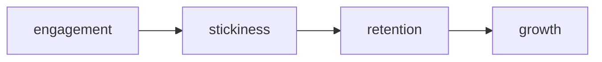

# نوشته‌ی ۲۹: درگیری کاربر: مقدمه

[نوشته‌ی ۲۸: مدل‌های رشد →](28-growth-models.md) · [مجموعه](../README.md) · [نوشته‌ی ۳۰: درگیری کاربر: بازه‌ی تحلیل ←](30-user-engagement-period-of-analysis.md)

> **مقاله‌ی اصلی:** [User Engagement — Introduction](https://medium.com/@paul.levchuk/user-engagement-introduction-94e79391e0a5) · Medium، ۲۰۲۳-۱۰-۱۹

## خلاصه

این نوشته سلسله‌ی user engagement را شروع می‌کند. چارچوب Sequoia می‌گوید engagement باعث stickiness می‌شود، آن retention را می‌سازد و آن هم growth را. نویسنده engagement را در دو پرسش می‌ببیند: کاربر چقدر محصول را به کار می‌برد، که با تعداد sessionها در روز و عمق تعامل سنجیده می‌شود، و آیا محصول برایش ارزشمند است، که با همبستگی بین استفاده از feature و retention بررسی می‌شود. در یک use case جلسه‌ی اول بیشترین ریزش را دارد و کاربرانی که همان روز به جلسه‌ی دوم برمی‌گردند engagement بیشتری نشان می‌دهند.

## نکته‌های کلیدی

- **چارچوب:** engagement باعث stickiness می‌شود، stickiness باعث retention و retention باعث growth.
- **ایده‌ی engagement:** هرچه کاربر بیشتر با محصول درگیر باشد احتمال بیشتری دارد آن را ارزشمند بیابد و به استفاده ادامه دهد.
- **ادامه‌ی استفاده دو پرسش دارد:** در روز چند بار؟ و تعامل چقدر عمیق است؟
- **سیگنال تعداد session در روز:** مصنوعی است و به تعریف session بستگی دارد. Amplitude در موبایل پنج دقیقه و در مرورگر سی دقیقه بی‌فعالیتی را مرز می‌گیرد.
- **سه سیگنال عمق:** زمان هر session، تعداد event در هر session و فهرست event‌های استفاده.
- **سیگنال زمان غیبت:** زمانی که کاربر بعد از ترک محصول تا بازگشت دیگر به کار دیگری می‌پردازد.
- **همه‌ی سیگنال‌ها جز فهرست event آماره‌ی توصیفی‌اند.**
- **ارزشمند بودن** را با همبستگی بین استفاده از feature و retention می‌سنجیم، با ضریب MCC.
- **نمونه‌ی use case:** میانه‌ی event در جلسه‌ی اول ۵۰، میانه‌ی زمان ۳۶۹ ثانیه، ۲۴۰۱ کاربر به جلسه‌ی دوم همان روز برگشتند، میانه‌ی غیبت ۸۳۵۸ ثانیه و میانگین session در روز صفر ۱٫۲.
- **مقایسه‌ی برگشته‌ها و برنگشته‌ها:** event تقریباً برابر (۵۱ در برابر ۵۰)، جلسه‌ی طولانی‌تر (۴۷۹ در برابر ۳۵۷ ثانیه، ۳۴٪ بیشتر) و برگشتن بیشتر در d1 (۲۹٫۴٪ در برابر ۱۳٫۳٪).
- **مرز ۲۴ ساعته، نه روز تقویمی:** یادگیری مهم بعدی.

## فهرست بخش‌ها

- سلسله‌ی engagement
- متریک‌های رایج engagement
- ادامه‌ی استفاده از محصول
- ارزشمند بودن محصول
- نمونه‌ی use case

## یادداشت‌ها

چند ماه پیش نویسنده چارچوبی را معرفی کرد که در مقاله‌ی Sequoia درباره‌ی رشد کاربر پیدا کرده بود: engagement باعث stickiness می‌شود، آن retention را می‌سازد و آن هم growth را. امروز بحث user engagement را شروع می‌کند.

ایده‌ی user engagement ساده است: هرچه کاربر بیشتر با محصول درگیر باشد، احتمال بیشتری دارد آن را ارزشمند بیابد و به استفاده ادامه دهد. چون سنجیدن ارزشمند بودن دشوارتر است، از جهت «ادامه‌ی استفاده» شروع می‌کنیم.

**ادامه‌ی استفاده از محصول.** از نظر فنی دو پرسش دارد:

- در روز **چند بار** از محصول استفاده می‌شود؟
- کاربر **چقدر عمیق** با محصول تعامل می‌کند؟

برای پاسخ به پرسش اول سیگنال **تعداد session در روز** را داریم. برای پرسش دوم سه سیگنال: **زمان هر session**، **تعداد event در هر session** و **فهرست event‌های استفاده**.

**تعداد session در روز** سیگنال نسبتاً مصنوعی است. بسته به این‌که session کاربر را چطور تعریف کنیم تصویر خیلی متفاوتی از تعامل کاربر به دست می‌آید. مثلاً Amplitude برای موبایل و وب session را متفاوت تعریف می‌کند:

| بستر | شروع session | پایان session |
|---|---|---|
| موبایل | اپ به foreground می‌آید | اپ به background می‌رود و دست‌کم پنج دقیقه event نیست |
| مرورگر | سایت باز می‌شود و SDK آغاز می‌شود | آخرین event؛ مهلت ۳۰ دقیقه به‌صورت پیش‌فرض |

**زمان هر session** مدتی است که کاربر پیش از پایان session در اپ می‌ماند. **تعداد event در هر session** مجموع تعامل‌های کاربر در یک session است. **فهرست event‌های استفاده** فهرست زمان‌مرتب event‌های مشخصی است که کاربر در یک session انجام داد.

یک سیگنال دیگر هم هست که درباره‌ی درگیری کاربر اطلاعات می‌دهد: **زمان غیبت**، یعنی زمانی که کاربر بعد از ترک محصول تا بازگشت دوباره به چیز دیگری می‌پردازد. همه‌ی این سیگنال‌ها، جز فهرست event‌های استفاده، آماره‌ی توصیفی‌اند.

**ارزشمند بودن محصول.** راه مستقیمی برای سنجش این‌که محصول به کاربر ارزش می‌دهد نیست. راهی که نویسنده به آن باور دارد این است که ببینیم بین استفاده از feature‌های محصول و retention کاربر همبستگی هست یا نه. معمولاً برای کمّی کردن این رابطه ضریب MCC را به کار می‌برد. در نوشته‌های بعدی نشان می‌دهد با آن چطور بفهمیم کدام feature‌ها بیشترین اثر را بر engagement دارند.

**نمونه‌ی use case.** نویسنده جدول آمار کاربر را با چند اندازه ساخت. چند متریک:

- **ستون d0_s1 events:** تعداد event هر کاربر در جلسه‌ی اول.
- **ستون d0_s1 time sec:** زمان جلسه‌ی اول.
- **ستون d0_s2 users:** نشانه‌ی برگشتن کاربر به جلسه‌ی دوم در روز صفر.
- **ستون d0_s1-s2 user abs time sec:** زمان غیبت بین جلسه‌ی اول و دوم در روز صفر.
- **ستون d0 sessions:** تعداد session هر کاربر در روز صفر.

از ردیف «Total» آماره‌ی خلاصه می‌خوانیم:

| اندازه | مقدار |
|---|---|
| میانه‌ی event در جلسه‌ی اول | ۵۰ |
| میانه‌ی زمان جلسه‌ی اول | ۳۶۹ ثانیه، حدود ۶ دقیقه |
| کاربران برگشته به جلسه‌ی دوم در d0 | ۲۴۰۱ |
| میانه‌ی غیبت بین جلسه‌ی اول و دوم | ۸۳۵۸ ثانیه، حدود ۲ ساعت و ۲۰ دقیقه |
| میانگین session هر کاربر در d0 | ۱٫۲ |

می‌بینیم تا ۵۰٪ کاربران ارقام نسبتاً متوسطی دارند، بر پایه‌ی میانه. در واقع جلسه‌ی اول معمولاً جایی است که بزرگ‌ترین ریزش کاربران جذب‌شده رخ می‌دهد، و نویسنده در نوشته‌های بعدی به آن می‌پردازد.

ساده‌ترین تحلیل: کاربران را با نشانه‌ی «به جلسه‌ی دوم d0 برگشت / برنگشت» تجمیع می‌کنیم و آماره‌شان را مقایسه می‌کنیم. چه می‌آموزیم؟

- کاربرانی که به جلسه‌ی دوم d0 برگشتند، به‌طور میانگین تقریباً **همان** تعداد event را در جلسه‌ی اول داشتند، ۵۱ در برابر ۵۰.
- جلسه‌ی اول‌شان **طولانی‌تر** بود، ۴۷۹ ثانیه در برابر ۳۵۷، یعنی ۳۴٪ بیشتر.
- درصد **بیشتری** از آن‌ها در d1 هم برگشتند، ۲۹٫۴٪ در برابر ۱۳٫۳٪، یعنی ۲۲۱٪ بیشتر.

پس به نظر می‌رسد کاربرانی که به جلسه‌ی دوم d0 برگشتند درگیرترند. پرسش‌های کلیدی: آیا این تفاوت **معنادار** است؟ و آیا می‌شود آن را **تعمیم** داد؟ پیش از ورود به دنیای رگرسیون خطی، یک یادگیری مهم: باید به مرزهای **۲۴ ساعته** پایبند باشید، نه به مرز روز تقویمی.

> **Vault note:** تعریف session در ابزار شما ممکن است با Amplitude فرق کند و اعداد use case به محصول خود نویسنده برمی‌گردد؛ برای محصول دیگر میانه‌ها متفاوت‌اند.

> **In practice:** تعداد session در روز به تعریف session نیاز دارد؛ آن را یک بار با فاصله‌ی بیکاری در Silver بسازید و همه‌ی سنجه‌های engagement از آن بخوانند.
>
> **Your turn:** دو داشبورد تعداد session متفاوتی نشان می‌دهند. اول چه چیزی را بررسی می‌کنید؟
>
> *Answer:* تعریف session در هر کدام، یعنی آستانه‌ی بیکاری؛ engagement به این تعریف وابسته است و باید یک‌جا ساخته شود (بخش «متریک‌های رایج engagement»).

## پیوندها

- **بر پایه‌ی:** [فصل ۲۳](23-plg-growth-retaining-users.md) که چارچوب Sequoia را مطرح می‌کند، و [فصل ۱۰](10-retention-deep-dive.md) و [فصل ۱۱](11-product-feature-retention-deep-dive-mcc-coefficient.md) که MCC را می‌سازند.
- **ادامه در:** [فصل ۳۰](30-user-engagement-period-of-analysis.md) که دوره‌ی تحلیل engagement را با مرز ۲۴ ساعته می‌سنجد.

## خودتان را بسنجید

*پرسش‌ها و پاسخ‌ها مال vault است.*

1. **کدام سیگنال‌ها عمق تعامل را می‌سنجند؟**
   - [x] زمان هر session، تعداد event در هر session و فهرست event‌های استفاده.
   - [ ] تعداد session در روز.
   - [ ] زمان غیبت.

   *Answer:* (بخش «ادامه‌ی استفاده از محصول»).

2. **در use case چه فرقی بین کاربران برگشته به جلسه‌ی دوم و برنگشته‌ها دیده شد؟**

   *Answer:* event تقریباً برابر بود ولی جلسه‌ی اول ۳۴٪ طولانی‌تر بود و برگشتن در d1 ۲۹٫۴٪ در برابر ۱۳٫۳٪ بود (بخش «نمونه‌ی use case»).
