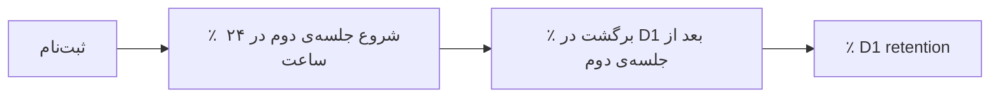

# نوشته‌ی ۳۲: درگیری کاربر: retention روز اول

[نوشته‌ی ۳۱: درگیری کاربر: تجربه‌ی اولیه‌ی کاربر →](31-user-engagement-first-time-user-experience.md) · [مجموعه](../README.md) · [نوشته‌ی ۳۳: retention روز اول: متریکی که پیش‌بینی‌اش حیله‌گر است ←](33-d1-retention-a-tricky-metric-to-predict.md)

> **مقاله‌ی اصلی:** [User Engagement — D1 retention](https://medium.com/@paul.levchuk/user-engagement-d1-retention-8348e299ab1d) · Medium، ۲۰۲۳-۱۱-۲۱

## خلاصه

شاخص D1 retention اولین نقطه‌ی عطف مهم هر محصول است. برای بهبود هر سنجه دو رویکرد قدرتمند هست: سفر کاربر را به مرحله‌های معنادار تقسیم کن و سنجه‌های مرحله‌ها را در هم ضرب کن، یا کاربران را با چند event رفتاری کلیدی بخش‌بندی کن. این نوشته رویکرد اول را به کار می‌برد: D1 retention برابر است با ضرب «درصد شروع جلسه‌ی دوم در ۲۴ ساعت» و «درصد برگشت در D1 بعد از جلسه‌ی دوم». با k-means روی این دو عامل چهار خوشه ساخته می‌شود. نتیجه: مرحله‌بندی بیشتر برای تشخیص سناریوهای بد جذب کاربر کار می‌کند.

## نکته‌های کلیدی

- **دو رویکرد قدرتمند:** مرحله‌بندی سفر و ضرب سنجه‌ها، یا بخش‌بندی بر پایه‌ی event رفتاری کلیدی.
- **سه مرحله‌ی D1:** جلسه‌ی اول (خیلی کمتر از ۲۴ ساعت)، درصد شروع جلسه‌ی دوم در ۲۴ ساعت بعد ثبت‌نام و درصد برگشت در D1 بعد از جلسه‌ی دوم.
- **شاخص D1 در بازه‌ی ۲۴ تا ۴۸ ساعت بعد ثبت‌نام** سنجیده می‌شود.
- **جدول:** مقیاس‌دهی جذب از ۲۰ مه شروع شد و احتمالاً کیفیت ترافیک افت کرد و D1 پایین آمد.
- **مرتب کردن بر پایه‌ی D1** الگو را روشن می‌کند: روزهای D1 بالا عامل‌های بالا دارند و روزهای D1 پایین عامل‌های پایین؛ پس تجزیه معنادار است و mutability هدف را توضیح می‌دهد.
- **خوشه‌بندی k-means:** بهترین D1 وقتی هر دو تبدیل بالاست (خوشه‌ی ۴).
- **با تبدیل کم به جلسه‌ی دوم هم** می‌شود D1 را بهبود داد اگر در جلسه‌ی دوم کاربر درگیر شود (خوشه‌ی ۳).
- **عامل برگشت در D1 بعد از جلسه‌ی دوم مهم‌تر است** از عامل برگشتن به جلسه‌ی دوم؛ یعنی رساندن اولین ارزش، حتی در جلسه‌ی دوم یا بعد، مهم‌تر از فقط برگرداندن کاربر به جلسه‌ی دوم است.
- **میانه‌ها قاعده‌ی سرانگشتی‌اند** برای حدس روزهای خوب D1.
- **نمودار D7 خوشه‌ها:** cohortهای خوشه‌ی ۲ (هر دو عامل پایین) خیلی سریع‌تر می‌میرند، ولی خوشه‌ی ۴ فقط کمی بهتر از بقیه است.
- **نتیجه:** مرحله‌بندی کاربر بیشتر برای بررسی سناریوهای بد جذب کاربر به کار می‌آید.

## فهرست بخش‌ها

- رویکرد کلی
- تجزیه‌ی D1 بر پایه‌ی مرحله‌های کاربر
- خوشه‌بندی
- بررسی D7 خوشه‌ها

## یادداشت‌ها

هر مدیر محصول می‌داند D1 retention اولین نقطه‌ی عطف مهم محصولش است. این‌که محصول بتواند D1 retention بالا بگیرد یا نه پرسشی است که بهترین محصول‌ها را از بقیه جدا می‌کند.

**رویکرد کلی.** وقتی سنجه‌ای دارید و می‌خواهید آن را بهبود دهید، دو گزینه‌ی قدرتمند هست:

- سفر کاربر را به چند **مرحله‌ی معنادار** تقسیم کن، برای هر مرحله سنجه تعریف کن و آن‌ها را در هم ضرب کن تا سنجه‌ی هدف به دست آید.
- کاربران را بر پایه‌ی چند **event رفتاری کلیدی** بخش‌بندی کن تا اندازه‌ی بخش‌ها و سنجه‌ی هدفشان را بفهمی.

این دو رویکرد دو دید متفاوت از آنچه در محصول می‌گذرد می‌دهند. این نوشته رویکرد اول را نشان می‌دهد؛ رویکرد دوم در [فصل ۳۳](33-d1-retention-a-tricky-metric-to-predict.md) می‌آید.

**تجزیه‌ی D1 retention بر پایه‌ی مرحله‌های کاربر.** سنجه‌ی هدف ما D1 retention است، یعنی چند کاربر در بازه‌ی ۲۴ تا ۴۸ ساعت بعد از ثبت‌نام برمی‌گردند. سفر را به چه مرحله‌هایی تقسیم کنیم؟

- جلسه‌ی اول، که همیشه خیلی کمتر از ۲۴ ساعت است.
- درصد کاربرانی که در ۲۴ ساعت بعد ثبت‌نام جلسه‌ی دوم را شروع کردند.
- درصد کاربرانی که بعد از جلسه‌ی دوم در D1 برگشتند.

حالا می‌توانیم جدول سنجه‌ها را بسازیم. از جدول می‌آموزیم:

- بازاریابی از ۲۰ مه شروع به مقیاس‌دهی جذب کاربر کرد. احتمالاً کیفیت ترافیک شروع به افت کرد و به همین دلیل D1 retention کم شد.
- درصد شروع جلسه‌ی دوم و درصد برگشت در D1 بعد از جلسه‌ی دوم خیلی تغییر می‌کنند. تا اینجا روشن نیست بین این عامل‌ها و درصد برگشت در D1 رابطه‌ای هست یا نه.

جدول را بر پایه‌ی سنجه‌ی هدف، درصد برگشت در D1، نزولی مرتب می‌کنیم. تصویر روشن‌تر می‌شود:

- روزهایی که سنجه‌ی هدف **بالاست** عامل‌های تجزیه هم **بالا** هستند.
- روزهایی که سنجه‌ی هدف **پایین** است عامل‌های تجزیه هم **پایین** هستند.

یعنی دو چیز: تجزیه معنادار است و می‌شود با آن mutability متغیر هدف را توضیح داد.

**خوشه‌بندی.** k-means ساده‌ای بر پایه‌ی همین دو عامل اجرا می‌کنیم و سنجه‌ها را در سطح خوشه تجمیع می‌کنیم. از جدول می‌آموزیم:

- بهترین نتیجه‌ی D1 retention وقتی ممکن است که هر دو تبدیل بالا باشند، خوشه‌ی ۴.
- حتی با تبدیل کم به جلسه‌ی دوم می‌شود D1 retention را بهتر کرد، به شرط موفقیت در درگیر کردن کاربران در جلسه‌ی دوم، خوشه‌ی ۳.

در کل درصد کاربرانی که بعد از جلسه‌ی دوم در D1 برگشتند از درصد کاربرانی که جلسه‌ی دوم را شروع کردند بالاتر است. چون برای رسیدن به D1 باید عامل‌ها را در هم ضرب کنیم، نتیجه می‌گیریم عامل «برگشت در D1 بعد از جلسه‌ی دوم» از عامل «برگشتن به جلسه‌ی دوم» مهم‌تر است. به بیان دیگر: **رساندن اولین سهم ارزش به کاربر، حتی اگر در جلسه‌ی دوم یا دیرتر رخ دهد، مهم‌تر از فقط موفق شدن در برگرداندن کاربر به جلسه‌ی دوم است.**

حالا درون خوشه‌ها را ببینیم. نمودار پراکنش می‌سازیم تا پراکندگی نقطه‌ها در خوشه‌ها را بفهمیم. برای معنا گرفتن بیشتر دو میانه اضافه شد و درصد برگشت در D1 اندازه‌ی نقطه‌هاست. به نظر می‌رسد میانه‌ها به‌عنوان قاعده‌ی سرانگشتی برای تشخیص این‌که کدام تاریخ‌ها بهترین D1 retention را خواهند داشت قابل استفاده‌اند.

> **Try it:** [قیف و وضعیت‌های گذار](../widgets/56-transition-states.html): تجزیه‌ی ضربی را روی مرحله‌های قیف خودتان بازی کنید.

**نمودار D7 خوشه‌ها.** برای مطمئن شدن که خوشه‌بندی در بلندمدت معنا دارد، cohortها را بر پایه‌ی خوشه‌ها می‌سازیم و D7 را می‌سنجیم. از نمودار می‌آموزیم:

- اعضای cohortهای خوشه‌ی ۲، که هر دو عامل **پایین** است، خیلی سریع‌تر از بقیه می‌میرند.
- اعضای cohortهای خوشه‌ی ۴، که هر دو عامل **بالاست**، بهتر از cohortهای خوشه‌های دیگر پیش می‌روند ولی **خیلی بهتر نه**.

نکته‌ی آخر ما را به نتیجه‌ی مهمی می‌رساند: **رویکرد مرحله‌بندی کاربر بیشتر برای بررسی سناریوهای بد جذب کاربر کار می‌کند.**

> **Vault note:** خوشه‌ها روی چند ده روز داده ساخته شده‌اند؛ تعداد خوشه و مرزها قراردادی‌اند و تکرارپذیری باید روی دوره‌ی دیگر امتحان شود.

> **In practice:** تجزیه‌ی D1 به حاصل‌ضرب دو مرحله یعنی دو ستون در جدول Gold cohort روزانه؛ هر بار D1 افت کرد، هر دو ستون را ببینید.
>
> **Your turn:** شاخص D1 این هفته افت کرده. چطور می‌فهمید مشکل از جذب است یا محصول؟
>
> *Answer:* D1 را به دو عامل بشکنید: درصد شروع جلسه‌ی دوم و درصد برگشت بعد از آن؛ نویسنده می‌گوید مرحله‌بندی بیشتر سناریوهای بد جذب را نشان می‌دهد (بخش «تجزیه‌ی D1 بر پایه‌ی مرحله‌های کاربر»).

## پیوندها

- **بر پایه‌ی:** [فصل ۳۰](30-user-engagement-period-of-analysis.md) و [فصل ۳۱](31-user-engagement-first-time-user-experience.md).
- **ادامه در:** [فصل ۳۳](33-d1-retention-a-tricky-metric-to-predict.md) که همان D1 را با event رفتاری کلیدی بخش‌بندی می‌کند، و [فصل ۵۵](55-user-acquisition-funnel.md) و [فصل ۵۶](56-user-transition-states-diagram.md) که تجزیه‌ی قیف را به گذار حالت‌ها می‌برند.

## خودتان را بسنجید

*پرسش‌ها و پاسخ‌ها مال vault است.*

1. **کدام عامل در تجزیه‌ی D1 مهم‌تر است؟**
   - [x] برگشت در D1 بعد از جلسه‌ی دوم، یعنی رساندن اولین ارزش.
   - [ ] فقط برگشتن به جلسه‌ی دوم.
   - [ ] هر دو دقیقاً مساوی‌اند.

   *Answer:* (بخش «خوشه‌بندی»).

2. **رویکرد مرحله‌بندی بیشتر به چه کاری می‌آید؟**

   *Answer:* بررسی سناریوهای بد جذب کاربر؛ خوشه‌ی بهتر در D7 فقط کمی بهتر از بقیه بود (بخش «بررسی D7 خوشه‌ها»).
