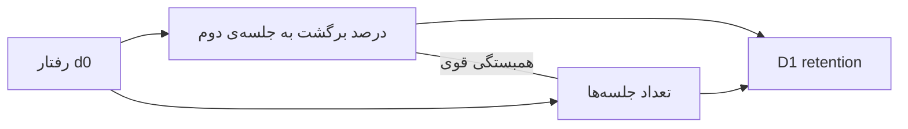

# نوشته‌ی ۳۳: retention روز اول: متریکی که پیش‌بینی‌اش حیله‌گر است

[نوشته‌ی ۳۲: درگیری کاربر: retention روز اول →](32-user-engagement-d1-retention.md) · [مجموعه](../README.md) · [نوشته‌ی ۳۴: درگیری کاربر: رویدادهای کلیدی ←](34-user-engagement-key-events.md)

> **مقاله‌ی اصلی:** [D1 retention — a tricky metric to predict](https://medium.com/@paul.levchuk/d1-retention-a-tricky-metric-to-predict-ad4759b12d21) · Medium، ۲۰۲۳-۱۲-۰۶

## خلاصه

شاخص D1 retention درصد کاربرانی است که ۲۴ تا ۴۸ ساعت بعد ثبت‌نام برمی‌گردند و D1 churn بزرگ‌ترین ریزش روزانه‌ی هر محصول است. تجزیه‌ی سنجه کافی نیست؛ باید از رفتار کاربر هم یاد گرفت. نویسنده شش سیگنال رفتار روز صفر را برای cohortهای روزانه حساب می‌کند و با رگرسیون خطی می‌سنجد هر کدام چقدر D1 را پیش‌بینی می‌کند. چهار سیگنال R2 بین ۰٫۰ و ۰٫۰۵ دارند ولی دو سیگنال، درصد برگشت به جلسه‌ی دوم در d0 و تعداد کل جلسه‌ها در d0، حدود ۰٫۳ دارند. حذف outlier آن‌ها را به ۰٫۴۴ و ۰٫۵۲ می‌رساند.

## نکته‌های کلیدی

- **شاخص D1 churn برابر ۱ منهای D1 retention** بزرگ‌ترین ریزش روزانه‌ی محصول است.
- **شش سیگنال d0:** زمان جلسه‌ی اول، زمان غیبت بین جلسه‌ی اول و دوم، درصد برگشت به جلسه‌ی دوم، کل زمان در d0، کل event در d0 و کل تعداد جلسه در d0.
- **سه چیز در رگرسیون:** امتیاز R2، پراکندگی نقطه‌ها دور خط، و outlierها (حذف‌شان و بررسی دوباره‌ی R2).
- **چهار سیگنال ضعیف:** زمان جلسه‌ی اول، زمان غیبت، کل زمان d0 و کل event در d0، با R2 بین ۰٫۰ و ۰٫۰۵. دلیل اصلی واریانس بسیار بالای این سیگنال‌هاست.
- **دو سیگنال قوی:** درصد برگشت به جلسه‌ی دوم در d0 و کل تعداد جلسه در d0 با R2 حدود ۰٫۳، یعنی ۱۰ برابر قوی‌تر از چهارتای اول.
- **زمان غیبت بین جلسه‌ی ۱ و ۲:** حذف یک نقطه‌ی outlier R2 را از ۰٫۰۳ به ۰٫۲۳ می‌رساند. غیبت بین ۱۰ هزار ثانیه (حدود ۲٫۵ ساعت) و ۲۰ هزار ثانیه (حدود ۵٫۵ ساعت) است و برخلاف حدس نویسنده، فاصله‌ی بیشتر بهتر است. شاید جلسه‌ی بعدی کم‌استرس‌تر است، مثلاً عصر.
- **زمان غیبت از زمان جلسه‌ی اول قدرت بیشتری دارد.**
- **درصد برگشت به جلسه‌ی دوم:** با حذف outlier R2 از ۰٫۳۱ به ۰٫۴۴. معنایش روشن است: اگر انتظار داریم کاربر در D1 برگردد باید در d0 رفتار مشابه نشان دهد. همین توصیه‌ی CUPED است که بهترین کوواریت همان متغیر در دوره‌ی قبل است.
- **تعداد جلسه در d0:** با حذف outlier از ۰٫۲۹ به ۰٫۵۲؛ هرچه کاربر در روز بیشتر برگردد احتمال برگشت روز بعد بیشتر است. این سیگنال گسترش سیگنال قبلی است و با آن همبستگی مثبت قوی دارد.
- **جمع‌بندی:** همه‌ی سیگنال‌ها به یک اندازه مفید نیستند؛ قوی‌ترین سیگنال‌ها معمولاً همان سیگنال‌ها در دوره‌ی قبل‌اند؛ و همه‌ی سیگنال‌ها اطلاعات یکتا ندارند.

## فهرست بخش‌ها

- سیگنال‌های d0
- مقدار R2 و واریانس
- نقطه‌های outlier
- جمع‌بندی

## یادداشت‌ها

تعریف D1 retention ساده است: درصد کاربرانی که در بازه‌ی ۲۴ تا ۴۸ ساعت بعد ثبت‌نام به محصول برمی‌گردند. D1 churn برابر ۱ منهای D1 retention بزرگ‌ترین ریزشی است که محصول هر روز تجربه می‌کند. در [فصل ۳۲](32-user-engagement-d1-retention.md) پیشنهاد شد D1 retention به دو سنجه تجزیه شود: درصد برگشت به جلسه‌ی دوم و درصد برگشت در D1 بعد از جلسه‌ی دوم. این رویکرد مفید است، ولی تحلیل محصول فقط تجزیه‌ی سنجه نیست، یادگیری از رفتار کاربر هم هست.

سفر کاربر در d0 را ترسیم کنیم و ببینیم چه چیزهایی از روز صفر می‌دانیم:

- زمانی که کاربر در جلسه‌ی اول در محصول گذراند.
- زمان غیبت بین جلسه‌ی اول و دوم در d0.
- درصد کاربرانی که در d0 به جلسه‌ی دوم برگشتند.
- کل زمان کاربر در محصول در d0.
- کل تعداد event کاربر در d0.
- کل تعداد جلسه‌های کاربر در d0.

این سنجه‌ها را برای cohortهای روزانه حساب می‌کنیم و رگرسیون خطی می‌سازیم تا ببینیم هر کدام سنجه‌ی «درصد برگشت در D1» را چقدر خوب پیش‌بینی می‌کند. سه چیز را باید در نظر گرفت:

- **مقدار R2** امتیاز برازش مدل خطی؛ هرچه به ۱٫۰ نزدیک‌تر بهتر.
- **واریانس** نقطه‌ها دور خط رگرسیون؛ هرچه کمتر بهتر.
- **نقطه‌های outlier**؛ نقطه‌هایی که غیرعادی دورند. حذف‌شان و بررسی دوباره‌ی R2.

**مقدار R2 و واریانس.** این چهار سیگنال R2 بسیار پایین دارند، بین ۰٫۰ و ۰٫۰۵: زمان جلسه‌ی اول، زمان غیبت بین جلسه‌ی ۱ و ۲، کل زمان d0 و کل event در d0. یعنی رگرسیون خطی واریانس سنجه‌ی هدف را خوب توضیح نمی‌دهد. دلیل اصلی واریانس بسیار بالای این سیگنال‌هاست. دو سیگنال دیگر برازش خیلی بهتری دارند: درصد برگشت به جلسه‌ی دوم در d0 و کل تعداد جلسه‌ها در d0. R2 هنوز خیلی کمتر از ۱٫۰ است ولی دست‌کم حدود ۰٫۳ است، و مهم‌تر این‌که این دو سیگنال **۱۰ برابر** قوی‌تر از گروه چهارتایی قبلی‌اند.

| سیگنال | R2 اولیه | R2 بعد از حذف outlier |
|---|---|---|
| زمان غیبت بین جلسه‌ی ۱ و ۲ | ۰٫۰۳ | ۰٫۲۳ |
| درصد برگشت به جلسه‌ی دوم در d0 | ۰٫۳۱ | ۰٫۴۴ |
| کل تعداد جلسه در d0 | ۰٫۲۹ | ۰٫۵۲ |

**نقطه‌های outlier.** نقطه‌هایی که غیرعادی از بقیه دورند با رنگ قرمز مشخص شده‌اند.

*زمان غیبت بین جلسه‌ی ۱ و ۲.* اگر نقطه‌ی قرمز را برداریم برازش از ۰٫۰۳ به ۰٫۲۳ می‌رسد، بهبود چشمگیر. حالا فکر کردن درباره‌ی معنای این سیگنال می‌ارزد. این سیگنال زمانی است که کاربران بعد از پایان جلسه‌ی اول صرف کار دیگری کردند. بر پایه‌ی نمودار، این زمان بین ۱۰ هزار ثانیه، حدود ۲٫۵ ساعت، و ۲۰ هزار ثانیه، حدود ۵٫۵ ساعت، تغییر می‌کند. حدس اولیه‌ی نویسنده این بود که هرچه فاصله‌ی جلسه‌ی اول و دوم کمتر بهتر؛ ولی داده عکس را نشان می‌دهد. شاید وقتی کاربران وقت می‌گذارند جلسه‌ی بعدی‌شان کم‌استرس‌تر است، مثلاً عصر، و در نتیجه ارزش بیشتری از محصول می‌گیرند و روز بعد برمی‌گردند. نکته‌ی جالب این‌که سیگنال زمان غیبت از سیگنال زمان جلسه‌ی اول قدرت بیشتری دارد. به آن فکر کنید.

*درصد برگشت به جلسه‌ی دوم در d0.* با حذف نقطه‌های قرمز برازش از ۰٫۳۱ به ۰٫۴۴ می‌رسد، بهبود عالی. هرچه درصد کاربران برگشته به جلسه‌ی دوم در روز ثبت‌نام بالاتر باشد، درصد کاربران برگشته روز بعد هم بالاتر است. نویسنده این را کاملاً منطقی می‌داند: اگر انتظار داریم کاربران در D1 برگردند باید در d0 رفتار مشابه نشان دهند. این یادآور توصیه‌ی یافتن کوواریت در مقاله‌ی CUPED است: در دسته‌ی بزرگی از سنجه‌ها نتایج همواره نشان داد استفاده از همان متغیر در دوره‌ی پیش از آزمایش به‌عنوان کوواریت بهترین کاهش واریانس را می‌دهد.

*کل تعداد جلسه در d0.* با حذف نقطه‌های قرمز برازش از ۰٫۲۹ به ۰٫۵۲ می‌رسد. این سیگنال می‌گوید کاربران به‌طور میانگین در روز ثبت‌نام چند بار به محصول برگشتند. هرچه کاربر در روز بیشتر برگردد، شانس برگشتنش روز بعد بیشتر است. در این معنا، سنجه‌ی تعداد کل جلسه در d0 گسترش سنجه‌ی درصد برگشت به جلسه‌ی دوم در d0 است. هر دو اطلاعات مشابهی درباره‌ی رفتار کاربر دارند و به همین دلیل همبستگی مثبت قوی دارند.

**جمع‌بندی:**

- همه‌ی سیگنال‌های رفتار یک اندازه مفید نیستند. همیشه رابطه‌ی سیگنال‌ها و سنجه‌ی هدف را بررسی کنید.
- قوی‌ترین سیگنال‌ها معمولاً همان سیگنال‌های دوره‌ی قبل‌اند.
- همه‌ی سیگنال‌ها اطلاعات یکتا ندارند.

> **Vault note:** R2 روی تعداد کمی cohort روزانه حساب شده و حذف outlier قضاوت تحلیلگر است؛ بهبود R2 با حذف نقطه نباید جای اعتبارسنجی روی داده‌ی تازه را بگیرد.

> **In practice:** پیش از ساختن مدل D1 در MLflow، R2 هر سیگنال روز صفر را جدا بسنجید و outlierها را با یک قاعده‌ی ثبت‌شده حذف کنید، نه با چشم.
>
> **Your turn:** شش سیگنال روز صفر دارید و می‌خواهید همه را در مدل بگذارید. کدام‌ها را اول نگه می‌دارید؟
>
> *Answer:* برگشت به جلسه‌ی دوم در d0 و تعداد کل جلسه‌ها در d0؛ بقیه R2 نزدیک صفر دارند (بخش «مقدار R2 و واریانس»).

## پیوندها

- **بر پایه‌ی:** [فصل ۳۲](32-user-engagement-d1-retention.md) و [فصل ۲۹](29-user-engagement-introduction.md).
- **ادامه در:** [فصل ۳۴](34-user-engagement-key-events.md) که به‌جای سنجه‌ی کلی، event کلیدی را پیدا می‌کند، و [فصل ۶۳](63-best-ua-signal-less-revenue-than-nothing.md) که تله‌ی دقت در پیش‌بینی را می‌گوید.

## خودتان را بسنجید

*پرسش‌ها و پاسخ‌ها مال vault است.*

1. **کدام دو سیگنال d0 قوی‌ترین پیش‌بینی D1 را می‌دهند؟**
   - [x] درصد برگشت به جلسه‌ی دوم در d0 و تعداد کل جلسه در d0.
   - [ ] زمان جلسه‌ی اول و کل event در d0.
   - [ ] زمان غیبت و کل زمان d0.

   *Answer:* (بخش «مقدار R2 و واریانس»).

2. **چرا بین «برگشت به جلسه‌ی دوم» و «تعداد جلسه» همبستگی قوی هست؟**

   *Answer:* چون هر دو اطلاعات مشابهی درباره‌ی رفتار کاربر می‌دهند؛ تعداد جلسه گسترش درصد برگشت به جلسه‌ی دوم است (بخش «نقطه‌های outlier»).
