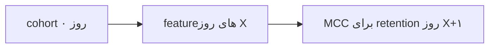

# نوشته‌ی ۳۵: چرا تحلیل محصول از تحلیل featureهای محصول فراتر می‌رود؟

[نوشته‌ی ۳۴: درگیری کاربر: رویدادهای کلیدی →](34-user-engagement-key-events.md) · [مجموعه](../README.md) · [نوشته‌ی ۳۶: retention cohort کاربران ←](36-user-cohort-retention.md)

> **مقاله‌ی اصلی:** [Why does Product Analytics go beyond product feature analysis?](https://medium.com/@paul.levchuk/why-does-product-analytics-go-beyond-product-feature-analysis-3053f4a1d8ce) · Medium، ۲۰۲۴-۰۲-۱۹

## خلاصه

تحلیل event کلیدی بر پایه‌ی تقویم، ترکیبی از کاربران جدید و قدیمی را در هر دوره دارد. نویسنده به تحلیل بر پایه‌ی cohort می‌رود: کاربرانی که در روز صفر از feature‌های مشخص استفاده کردند، و بعد ببیند در روز X چه feature‌هایی را به کار بردند و آن‌ها چقدر برای retention در روز X+۱ مهم بودند. نقطه‌های بررسی روز اول، دوم و هفتم‌اند. event‌های کلیدی با زمان جابه‌جا می‌شوند، feature‌های هسته‌ای روزانه یا هفتگی داریم، feature هسته‌ای عمر دارد و بالاخره باید zoom out هم کرد: جدول MCC برای ۱۵ روز عمر.

## نکته‌های کلیدی

- **تحلیل بر پایه‌ی تقویم** در هر دوره کاربران جدید و قدیم را مخلوط می‌کند. راه حل: cohort روز ۰ را بگیر، feature‌های روز X را ببین و MCC برای retention روز X+۱ را حساب کن.
- **زمینه‌ی استفاده سه جزء دارد:** چرخه‌ی عمر کاربر، زمینه‌ی استفاده‌ی قبلی و زمینه‌ی استفاده‌ی بعدی.
- **مثال ۱:** feature32 و feature28 برای تنظیم و دریافت push notification‌اند و معقول است در ابتدا نمایش داده شوند، چون همه‌ی feature‌های بعدی همکاری و ارتباط به آن‌ها تکیه دارد.
- **مثال ۲:** feature3 و feature10 و feature33 و feature17 اشتراک محتوا، دنبال کردن و دعوت دیگران‌اند؛ پیش‌نیاز لایه‌ی بعدی ارزش، یعنی همکاری و ارتباط.
- **مثال ۳:** feature35 جست‌وجوی محتواست و کاربران فقط در یک هفته به سراغش می‌روند، وقتی محتوای کافی ساخته شده است.
- **استفاده از feature تصادفی نیست:** کاربران برای کارهای مشخص در مراحل مختلف feature‌های مختلفی را استخدام می‌کنند.
- **یک feature هسته‌ای** مرتب استفاده می‌شود و ارزش پایدار می‌رساند. اگر در هفته در ۴ روز یا بیشتر استفاده شود هسته‌ای روزانه است و اگر در ماه در ۳ هفته یا بیشتر هسته‌ای هفتگی.
- **در هفته‌ی اول فقط feature43** که مصرف محتواست بر retention اثر مرتب داشت. feature49 هم هسته‌ای است ولی با ضرب‌آهنگ متفاوت.
- **عمر feature هسته‌ای:** feature43 در روز ۱۴ علامت عوض کرد و اثر منفی گرفت؛ وقتی کاربران محتوا ساخته‌اند، دعوت داده‌اند و همکاری کرده‌اند، رفتن سراغ محتوای جدید ضدتولید است. بهترین محصول‌ها کاربر را روی رسیدن به هدفش متمرکز نگه می‌دارند، نه پراکنده.
- **نگاه zoom out:** مثال push notification: از هفته‌ی دوم اثر منفی دارد، چون کاربر زیر اعلان‌ها گم می‌شود، با الگوی هفتگی مثبت در روزهای ۶ و ۱۳. دعوت کاربران تا دو هفته مرتب ادامه می‌یابد و زود اشباع نمی‌شود. feature27 و feature34 و feature49 همکاری‌اند و حدس هفتگی بودن feature49 غلط بود؛ از هفته‌ی دوم روزانه‌اند، وقتی راه‌اندازی محصول کامل است.
- **جمع‌بندی:** تحلیل یک feature مثل برداشتن یک قطعه از پازل است. باید رویکرد cohort بگیرید، زمینه‌ی استفاده را در نظر بگیرید و zoom in و zoom out را کنار هم بگذارید.

## فهرست بخش‌ها

- از تقویم به cohort
- جابه‌جایی event‌های کلیدی
- نقش feature‌های هسته‌ای
- عمر feature هسته‌ای
- نگاه zoom out
- جمع‌بندی

## یادداشت‌ها

در [فصل ۳۴](34-user-engagement-key-events.md) نویسنده نشان داد درباره‌ی event‌های کلیدی محصول چطور فکر کنیم. برای هر تاریخ فهرست event‌های محصول را گرفت و ضریب MCC را حساب کرد تا بفهمد کدام event‌ها برای برگشتن روز بعد مهم‌تر بودند. این تحلیل بر پایه‌ی تقویم مفید است ولی همه‌ی ظرفیت این رویکرد را آزاد نمی‌کند، چون در هر دوره ترکیبی از کاربران جدید و قدیم داریم. برای رفع این ایراد از تحلیل بر پایه‌ی تقویم به تحلیل بر پایه‌ی **cohort** می‌رویم: کاربرانی را که در **روز ۰** از feature‌های مشخص استفاده کردند می‌گیرد، می‌بیند در **روز X** از کدام feature‌ها استفاده کردند و آن feature‌ها چقدر برای retention در **روز X+۱** مهم بودند. نقطه‌های بررسی: روز اول، دوم و هفتم.

مهم‌ترین feature‌های هر نقطه‌ی بررسی بالا هستند، یعنی بزرگ‌ترین MCC را دارند. می‌بینید که با گذشت زمان کاربران عمیق‌تر وارد محصول می‌شوند و درک و استفاده‌شان جابه‌جا می‌شود. جدول خلاصه‌ی پنج event کلیدی برتر در روزهای مشخص، بینش‌های زیادی می‌دهد.

**جابه‌جایی event‌های کلیدی.** همان‌طور که در نوشته‌ی قبل گفته شد event‌های کلیدی سیگنال‌های مهمی‌اند ولی باید عاقلانه از آن‌ها استفاده کرد. آن‌ها را نمی‌شود جدا از زمینه‌ی استفاده عمیق تحلیل کرد. زمینه‌ی استفاده شامل: چرخه‌ی عمر کاربر، زمینه‌ی استفاده‌ی قبلی و زمینه‌ی استفاده‌ی بعدی. به همین دلیل باید رویکرد cohort را گرفت: نمای cohort چرخه‌ی عمر کاربر را در نظر می‌گیرد و داستان تکامل رفتار کاربر در طول زمان را نشان می‌دهد.

*مثال ۱.* feature32 و feature28 برای تنظیم و دریافت push notification طراحی شده‌اند. معقول‌ترین کار نمایش آن‌ها در ابتدا به کاربر است، چون همه‌ی feature‌های همکاری و ارتباط بعدی برای رساندن اطلاعات مهم به کاربران به push notification تکیه می‌کنند.

*مثال ۲.* feature3 و feature10 و feature33 و feature17 برای اشتراک محتوا، دنبال کردن کاربران دیگر و دعوت از آن‌ها به همکاری آینده طراحی شده‌اند. بدون محتوا، فضای مجازی تنظیم‌شده و اعلان روشن، ارزش محصول بسیار محدود است. پس این feature‌ها پیش‌نیاز باز کردن لایه‌ی بعدی ارزش‌اند: همکاری و ارتباط.

*مثال ۳.* feature35 به جست‌وجوی محتوا مربوط است. کاربران فقط بعد از یک هفته شروع به جست‌وجو کردند، وقتی محتوای کافی ساخته شده بود و پیدا کردن محتوای مشخص با جست‌وجو راحت‌تر بود.

می‌بینیم کاربران در مراحل مختلف feature‌های مختلف را برای انجام کارهای مشخص «استخدام» می‌کنند. این پرسه‌ی تصادفی نیست. کاربران feature‌های مختلف را ترکیب می‌کنند تا از محصول ارزش بگیرند و زمینه‌ی استفاده اینجا بسیار مهم است: از کجا، به کجا و چرا.

**نقش feature‌های هسته‌ای.** feature هسته‌ای feature‌ای است که مرتب استفاده می‌شود و ارزش پایدار به کاربران می‌رساند. از جدول می‌آموزیم تنها feature کلیدی که در هفته‌ی اول مرتب استفاده شد feature43 بود، که به مصرف محتوا مربوط است. آیا این تنها feature هسته‌ای است؟ برای جواب باید فاصله‌ی استفاده از feature را بفهمیم:

- اگر feature در هفته در ۴ روز یا بیشتر استفاده شود، feature هسته‌ای **روزانه** است.
- اگر feature در ماه در ۳ هفته یا بیشتر استفاده شود، feature هسته‌ای **هفتگی** است.

از جدول می‌آموزیم feature49 هم feature هسته‌ای است و تنها فرقش این است که احتمالاً با ضرب‌آهنگ دیگری استفاده می‌شود: feature43 را **روزانه** و feature49 را **هفتگی** استفاده می‌کنند.

**عمر feature هسته‌ای.** شاید دقیق‌ترین خوانندگان دیده باشند feature43 علامتش عوض شد و در **روز ۱۴** اثر منفی بر retention گرفت. چطور ممکن است؟ وقتی کاربران محتوا ساخته‌اند، کاربران دیگر را دعوت کرده‌اند و حول آن محتوا همکاری را شروع کرده‌اند، تغییر تمرکز به محتوای جدید دیگر ضدتولید است. بهترین محصول‌ها را از بقیه همین جدا می‌کند: کاربران را روی رسیدن به هدفشان متمرکز می‌کنند، نه پراکنده کردن توجه‌شان.

**نگاه zoom out.** تا اینجا zoom in کردیم و feature‌ها را در روزهای مشخص دیدیم. تحلیل مقابل، zoom out، هم مهم است و از نتیجه‌گیری عجولانه محافظت می‌کند. جدول کامل MCC برای ۱۵ روز عمر بعد ثبت‌نام را می‌بینیم.

*مثال ۱.* feature32، push notification. از جدول می‌آموزیم از هفته‌ی دوم بعد ثبت‌نام push notification به retention آسیب می‌زند. محتمل‌ترین دلیل این‌که کاربران زیر اعلان‌های ارتباط و همکاری غرق می‌شوند و گم می‌شوند. باید در اولویت‌بندی آنچه کاربر را روی آن متمرکز می‌کنیم سرمایه‌گذاری کنیم. همچنین الگوی هفتگی هست از اینکه push notification اثر مثبت می‌گذارد، در روزهای ۶ و ۱۳. به نظر می‌رسد بعضی push notificationهای هفتگی مرتب ارزش می‌رسانند و باید بفهمیم کدام‌اند.

*مثال ۲.* feature17، دعوت کاربران. کاربران دو هفته‌ی کامل مرتب دعوت کردند. یعنی دعوت فرایندی است که زود اشباع نمی‌شود. باید این الگو را در نظر بگیریم و کاربران را قادر کنیم هر زمان آسان دعوت کنند.

*مثال ۳.* feature27 و feature34 و feature49، feature‌های همکاری. فرض اشتباه بود که feature49 فاصله‌ی استفاده‌ی هفتگی دارد؛ فاصله‌ی روزانه دارد. این feature‌ها از هفته‌ی دوم هسته‌ای روزانه می‌شوند. نکته‌ی کلیدی این‌که وقتی از آن‌ها استفاده می‌شود که راه‌اندازی محصول کامل است.

**جمع‌بندی.** تحلیل استفاده از یک feature مثل برداشتن یک قطعه‌ی پازل است. می‌توانید توصیفش کنید ولی احتمالاً کمکی نمی‌کند. فقط وقتی همه‌ی قطعه‌ها را کنار هم بگذارید تصویر کامل را می‌بینید: کِی و چطور محصول ارزش به کاربران می‌رساند. برای تصویر کامل استفاده از محصول:

- رویکرد cohort را به کار ببرید تا یاد بگیرید کاربران در محصول چطور تکامل می‌یابند.
- زمینه‌ی استفاده را در نظر بگیرید.
- دو نگاه zoom in و zoom out را کنار هم بگذارید تا فرضیه‌های محکم درباره‌ی استفاده بسازید.

> **Vault note:** نام feature‌ها در داده‌ی نویسنده ناشناس است. تفسیرهایی مثل «غرق شدن در اعلان» حدس نویسنده‌اند و بدون آزمایش علّی ثابت نشده‌اند.

> **In practice:** تحلیل event کلیدی بر پایه‌ی cohort یعنی شرط روی `days_since_signup` در Gold، نه روی تاریخ تقویمی.
>
> **Your turn:** event کلیدی ماه پیش با event کلیدی امروز فرق دارد. آیا تحلیل اشتباه است؟
>
> *Answer:* نه لزوماً؛ eventهای کلیدی با عمر کاربر جابه‌جا می‌شوند، و تحلیل تقویمی کاربر جدید و قدیمی را قاطی می‌کند (بخش «جابه‌جایی event‌های کلیدی»).

## پیوندها

- **بر پایه‌ی:** [فصل ۳۴](34-user-engagement-key-events.md).
- **ادامه در:** [فصل ۳۶](36-user-cohort-retention.md) که cohortها را به‌طور کامل می‌گوید، و [فصل ۶۷](67-flo-health-what-zero-uplift-really-means.md) که تفکیک ترکیب از رفتار را تحلیل می‌کند.

## خودتان را بسنجید

*پرسش‌ها و پاسخ‌ها مال vault است.*

1. **چرا از تحلیل تقویمی به cohort می‌رویم؟**
   - [x] چون تحلیل تقویمی در هر دوره کاربران جدید و قدیم را مخلوط می‌کند.
   - [ ] چون تقویم نامنظم است.
   - [ ] چون MCC با تقویم کار نمی‌کند.

   *Answer:* (بخش «از تقویم به cohort»).

2. **چرا feature43 در روز ۱۴ اثر منفی گرفت؟**

   *Answer:* چون کاربر محتوا ساخته و همکاری کرده و رفتن سراغ محتوای جدید ضدتولید شده است (بخش «عمر feature هسته‌ای»).
