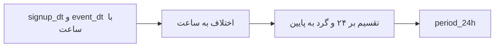

# نوشته‌ی ۳۸: cohort کاربر را درست بسازید

[نوشته‌ی ۳۷: retention مخلوط در برابر retention هر cohort →](37-blended-retention-vs-cohort-retention.md) · [مجموعه](../README.md) · [نوشته‌ی ۳۹: cohortهای کاربر را درست رنگ‌آمیزی و بخوانید ←](39-how-to-draw-and-read-user-cohorts-properly.md)

> **مقاله‌ی اصلی:** [How to build user cohort properly](https://medium.com/@paul.levchuk/how-to-build-user-cohort-properly-b70a74e5e1c8) · Medium، ۲۰۲۴-۰۳-۱۵

## خلاصه

نمای cohort تقویمی را می‌شود در Matrix Power BI یا Pivot Table Excel با دو محور signup_date و event_date و سنجه‌ی تعداد کاربر ساخت. برای مقایسه، cohort تراز چپ لازم است که از cohort بر پایه‌ی lifetime به دست می‌آید. اشتباه رایج این است که تاریخ ثبت‌نام و تاریخ event را بی‌توجه به ساعت بگیریم؛ باید بازه‌ی ۲۴ ساعته را از اختلاف ساعت بین ثبت‌نام و event گرفت. با بازه‌ی ۲۴ ساعته cohort بدتر دیده می‌شود، در دوره‌ی اول نسبت دو روش ۱٫۸۱ برابر است و میانه‌ی نسبت ۱٫۱۱. بازه‌ی روز خوش‌بینانه است.

## نکته‌های کلیدی

- **ساخت cohort تقویمی:** Matrix در Power BI یا Pivot در Excel با محور Y برابر signup_date و محور X برابر event_date و سنجه‌ی تعداد کاربر.
- **نمای cohort تراز چپ** برای مقایسه‌ی retention cohortها لازم است: تاریخ را با lifetime جایگزین کن، period_d برابر event_date منهای signup_date.
- **درصد نسبت به t=۰:** چون cohortها اندازه‌ی متفاوت دارند، درصد کاربران نسبت به دوره‌ی اولیه را حساب کن.
- **اشتباه:** استفاده از signup_date و event_date بدون در نظر گرفتن ساعت.
- **فرمول درست:** period_24h برابر INT(DATEDIFF(signup_dt, event_dt, HOUR) / 24).
- **مشاهده‌ها:** cohort با بازه‌ی ۲۴ ساعته در کل بدتر دیده می‌شود، بزرگ‌ترین فرق در دوره‌ی اول t=۱ است و با گذشت زمان فرق کم می‌شود.
- **نسبت period_d به period_24h:** در t=۱ برابر ۱٫۸۱ و در t=۲ برابر ۱٫۲۹ و میانه‌ی فرق ۱٫۱۱.
- **قاعده‌ها:** هرگز بازه‌ی روز را به کار نبرید چون بیش‌ازحد خوش‌بینانه است و از تجربه‌ی نویسنده فرق معمولاً بین ۱۰٪ تا ۳۰٪ است؛ retention دوره‌ی اول با بازه‌ی روز کاملاً غلط است؛ بازه‌ی ۲۴ ساعته تنها راه مطمئن ساخت و ارزیابی cohort است.

## فهرست بخش‌ها

- نمای cohort تقویمی
- نمای cohort بر پایه‌ی lifetime
- اشتباه ساعت
- مقایسه‌ی دو روش

## یادداشت‌ها

در [فصل ۳۷](37-blended-retention-vs-cohort-retention.md) به‌اختصار دو شکل نمایش cohort گفته شد: تقویمی و بر پایه‌ی lifetime.

**نمای cohort تقویمی.** ساخت آن بسیار آسان است: Matrix Visual را در Power BI بگیرید، یا Pivot Table را در Excel، دو ستون به محورها اضافه کنید، محور Y برابر signup_date و محور X برابر event_date، و سنجه‌ی تعداد کاربران را بیفزایید. چون مقایسه‌ی retention cohortهای مختلف در این شکل راحت نیست، ساخت cohort تراز چپ توصیه می‌شود.

**نمای cohort بر پایه‌ی lifetime.** برای ساخت cohort تراز چپ باید از تاریخ تقویمی به lifetime کاربر برویم. در رویکرد lifetime در محور افقی به‌جای تاریخ‌ها از دوره‌هایی استفاده می‌کنیم که کاربران اقدام کردند:

فرمول: period_d = event_date منهای signup_date

دو نمودار یک عدد را نشان می‌دهند و انتظار همین بود. چون cohortهای جذب اندازه‌ی متفاوت دارند، مقایسه‌شان سخت است. برای ساده‌تر شدن، درصد کاربران نسبت به کاربران دوره‌ی اولیه t=۰ را حساب می‌کنیم و cohort درصدی بر پایه‌ی lifetime می‌سازیم. خوب به نظر می‌رسد؟ نویسنده فکر نمی‌کند.

**اشتباه ساعت.** اشتباهی که کردیم این است که signup_date و event_date را بدون در نظر گرفتن ساعت وقوع این دو event به کار بردیم. جذب کاربر در تمام ۲۴ ساعت رخ می‌دهد: بعضی کاربران ساعت ۰۰:۳۰ ثبت‌نام می‌کنند و بعضی ساعت ۲۳:۳۰. کاربران ساعت ۰۰:۳۰، ۲۳ ساعت و ۳۰ دقیقه وقت دارند با محصول تعامل کنند، اولین ارزش را بگیرند و روز بعد برگردند. کاربران ساعت ۲۳:۳۰ فقط ۳۰ دقیقه. روشن است که این دو گروه شرایط **نابرابر** دارند ([فصل ۳۰](30-user-engagement-period-of-analysis.md)). پس cohort بر پایه‌ی lifetime را با در نظر گرفتن بخش ساعت می‌سازیم:

فرمول: period_24h = INT( DATEDIFF( signup_dt, event_dt, HOUR ) / 24 )

دیدید چیزی عوض شد؟ برای روشن‌تر شدن، هر دو محاسبه را در یک نمودار می‌گذاریم.

**مقایسه‌ی دو روش.** مشاهده‌ها از نمودار:

- نمای cohortهای بر پایه‌ی lifetime که با بازه‌ی ۲۴ ساعته حساب شده‌اند در کل **بدتر دیده می‌شوند** تا آن‌هایی که با بازه‌ی روز حساب شده‌اند.
- بزرگ‌ترین فرق در **دوره‌ی اول** t=۱ است.
- به نظر می‌رسد با گذشت زمان فرق دو رویکرد **کمتر محسوس** می‌شود.

برای حس بهتر از اندازه‌ی فرق، نسبت cohort با period_d به cohort با period_24h را در طول زمان مقایسه می‌کنیم:

| دوره | نسبت period_d به period_24h |
|---|---|
| t=۱ | ۱٫۸۱ برابر |
| t=۲ | ۱٫۲۹ برابر |
| میانه‌ی فرق | ۱٫۱۱ برابر |

> **Try it:** [مجانب مرگ](../widgets/57-asymptote-of-death.html): ببینید cohort خوش‌بینانه‌تر دیده‌شده چقدر از مجانب واقعی دور است.

**جمع‌بندی.** ساخت cohort بر پایه‌ی lifetime ساده به نظر می‌رسد ولی مهم است درست انجام شود:

- هرگز رویکرد بازه‌ی روز را به کار نبرید چون بیش‌ازحد خوش‌بینانه است. از تجربه‌ی نویسنده فرق می‌تواند به‌طور متوسط بین ۱۰٪ تا ۳۰٪ باشد.
- در دوره‌ی اول retention cohortهایی که با بازه‌ی روز حساب شده‌اند کاملاً غلط خواهد بود!
- بازه‌ی ۲۴ ساعته تنها راه مطمئن ساخت و ارزیابی cohortهای کاربر است.

در نوشته‌ی بعد نشان می‌دهد چطور cohort کاربر را [رنگ کنیم و بخوانیم](39-how-to-draw-and-read-user-cohorts-properly.md).

> **Vault note:** این قاعده برای دوره‌ی روزانه است؛ برای دوره‌ی هفته یا ماه همان منطق اختلاف زمان کامل بین ثبت‌نام و event برقرار است.

> **In practice:** cohort تراز چپ در ClickHouse یعنی ستون دوره با `intDiv(dateDiff('hour', signup_ts, event_ts), 24)`، نه تفاوت دو تاریخ.
>
> **Your turn:** نمودار cohort در Metabase بهتر از عدد notebook است. اولین حدستان چیست؟
>
> *Answer:* داشبورد تاریخ را بی‌ساعت گرفته است؛ روز تقویمی خوش‌بینانه است و در دوره‌ی اول تا ۱٫۸ برابر فرق می‌کند (بخش «اشتباه ساعت»).

## پیوندها

- **بر پایه‌ی:** [فصل ۳۰](30-user-engagement-period-of-analysis.md) و [فصل ۳۷](37-blended-retention-vs-cohort-retention.md).
- **ادامه در:** [فصل ۳۹](39-how-to-draw-and-read-user-cohorts-properly.md) که رنگ و خواندن cohort را می‌گوید.

## خودتان را بسنجید

*پرسش‌ها و پاسخ‌ها مال vault است.*

1. **کدام فرمول cohort را درست می‌سازد؟**
   - [x] فرمول INT(DATEDIFF(signup_dt, event_dt, HOUR) / 24)
   - [ ] فرمول event_date منهای signup_date
   - [ ] فرمول MONTH(event_date)

   *Answer:* (بخش «اشتباه ساعت»).

2. **بزرگ‌ترین فرق دو روش در کدام دوره است؟**

   *Answer:* دوره‌ی اول t=۱ با نسبت ۱٫۸۱ برابر (بخش «مقایسه‌ی دو روش»).
