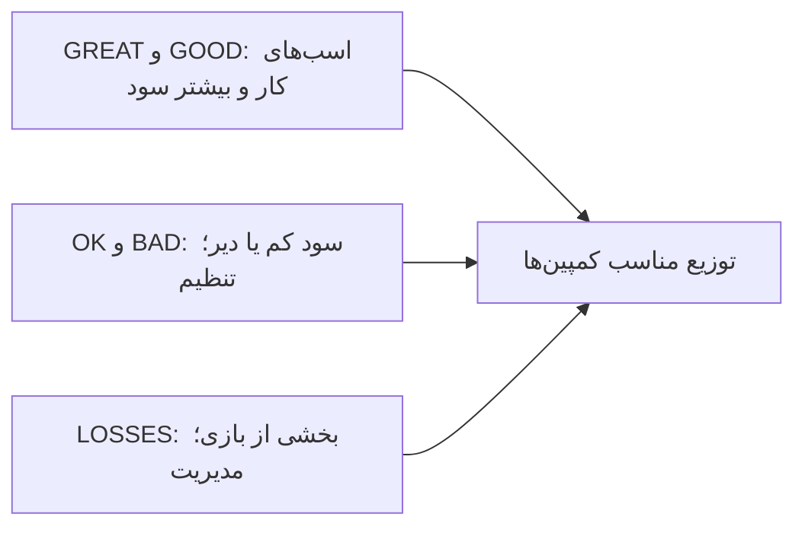

# نوشته‌ی ۴۳: بنچمارک دوره‌ی بازگشت CAC

[نوشته‌ی ۴۲: دوره‌ی بازگشت CAC →](42-cac-payback-period.md) · [مجموعه](../README.md) · [نوشته‌ی ۴۴: دوره‌ی بازگشت CAC در برابر LTV / CAC ←](44-cac-payback-period-vs-ltv-cac.md)

> **مقاله‌ی اصلی:** [CAC payback period benchmarks](https://medium.com/@paul.levchuk/cac-payback-period-benchmarks-a4e1b5b2bb79) · Medium، ۲۰۲۴-۰۶-۱۰

## خلاصه

محاسبه‌ی یک سنجه سخت‌ترین بخش نیست؛ تفسیرش سخت است. نویسنده معیارهای دوره‌ی بازگشت CAC از Lenny Rachitsky را روی داده‌ی کمپین‌های پولی خودش امتحان می‌کند. برای B2C: تا ۱ ماه عالی، تا ۶ ماه خوب، تا ۱۲ ماه قابل‌قبول و بازگشت در تراکنش اول استثنایی. در سطح کانال دوره‌ی بازگشت ۹ دوره است، بین خوب و قابل‌قبول. ولی در سطح کمپین-ماه mutability شدید است و ۵۲٪ موردها بد یا زیان‌اند. معیار فقط تا حدی مفید است؛ هدف داشتن توزیع مناسب کمپین‌هاست، و نه صرفاً کمپین عالی.

## نکته‌های کلیدی

- **تفسیر سنجه سخت‌تر از محاسبه است.** سه منبع: تجربه‌ی خودتان، معیار منتشرشده، یا آمار منابع باز.
- **معیار Lenny برای B2C:** تا ۱ ماه عالی (GREAT)، تا ۶ ماه خوب (GOOD)، تا ۱۲ ماه قابل‌قبول (OK) و بازگشت در تراکنش اول استثنایی (Exceptional).
- **هشدار:** برای ارزیابی درست، هر کمپین باید زمان یکسان برای بازگشت هزینه داشته باشد؛ داده‌ی نویسنده برای هر کمپین ۳۶ دوره دارد.
- **تورم رسانه:** CPM و CPC و CPA به مرور بالا می‌روند، پس دوره‌ی بازگشت فقط طولانی‌تر می‌شود.
- **سطح کانال:** دوره‌ی بازگشت ۹ دوره، بین GOOD و OK.
- **سطح کمپین، ۱۲ کمپین:** ۰ استثنایی؛ ۱ عالی (۸٪)؛ ۴ خوب (۳۳٪)؛ ۳ قابل‌قبول (۲۵٪)؛ ۴ طولانی یا بازنگشته.
- **سطح کمپین-ماه:** هر ماه کمپین‌های متفاوتی آزموده می‌شود و هیچ کمپینی در هزینه و درآمد پایدار نیست. نمی‌شود با یک معیار گفت تیم UA عالی کار می‌کند یا نه؛ باید توزیع داده را با توزیع معیار مقایسه کرد.
- **توزیع کمپین‌ها از ژانویه تا مه:** مورد بازگشت فوری نادر است؛ عالی و خوب با هم حدود ۳۵٪ (در سطح کمپین ۴۱٪)؛ قابل‌قبول از ۲۵٪ به ۱۰٪؛ بد و زیان با هم ۵۲٪ (در سطح کمپین ۳۳٪). بد هنوز سود می‌دهد ولی دیر؛ زیان زیان است.
- **نقل‌قول معروف:** نیمی از پولی که خرج تبلیغات می‌کنم هدر می‌رود؛ مشکل این است که نمی‌دانم کدام نیمه. می‌دانیم کدام کمپین هدر بود، ولی بعد از خرج و ۳۶ دوره انتظار.
- **معیارها تا حدی مفیدند.** فقط کمپین ۱۳ پایدار بود؛ چهار کمپین خوب ۱۶ و ۱۸ و ۱۵ و ۱۹ ماه‌هایی بد یا زیان داشتند؛ کمپین‌های زیان ۲۳ و ۲۴ هیچ ماهی حتی قابل‌قبول نبودند. دنبال کردن بی‌چون‌وچرای معیار می‌تواند کسب‌وکار را متوقف کند.
- **کمپین خوب یا قابل‌قبول را خاموش نکنید:** نظارت و تنظیم؛ الگوریتم‌های Google Ads و Facebook Ads زمان یادگیری دارند و با یک هفته توقف نمی‌شود به نقطه‌ی قبل برگشت. کمپین بد یا زیان را جدی تنظیم کنید.
- **سود را اضافه کنید:** «درآمد را نمی‌توان به حساب بانکی گذاشت، فقط سود را.» ROI تجمعی فقط در ژانویه منفی ۴٪ بود و بقیه‌ی ماه‌ها بالای ۶۰٪ و در آوریل ۳۱٪ که به دو کمپین زیان ربط نداشت.
- **توزیع سود:** کمپین استثنایی ۱۳٪ سود ساخت ولی نمی‌شود به آن تکیه کرد؛ پرداخت سریع همیشه سود بزرگ آینده را پیش‌بینی نمی‌کند. کمپین عالی و خوب اسب‌های کار و بیشترین سودند. زیان بخشی از بازی است و باید مدیریتش کرد.
- **جمع‌بندی:** معیار B2C از نظر سود معنادار است ولی برای مدل کسب‌وکار خودتان بسنجید؛ همه‌ی کمپین‌ها را عالی یا خوب نخواهید؛ خاموش کردن بد و زیان به هدف بستگی دارد، سود شرکت یا رشد مشتری؛ توزیع مناسب کمپین‌ها کلید است.

## فهرست بخش‌ها

- معیار دوره‌ی بازگشت
- سطح کانال
- سطح کمپین
- سطح کمپین-ماه
- توزیع عملکرد
- معیارها چقدر مفیدند
- سود

## یادداشت‌ها

در [فصل ۴۲](42-cac-payback-period.md) یک مورد جذب کاربر نزدیک به واقعیت را نشان دادم و همه‌ی سنجه‌های مربوط، از جمله CAC و LTV و دوره‌ی بازگشت CAC، را حساب کردم. معمولاً محاسبه‌ی سنجه دشوارترین بخش نیست. دشوارترین بخش تفسیر سنجه است: نتیجه عالی است، نزدیک به میانگین یا رضایت‌بخش نیست. برای ارزیابی سنجه معمولاً از تجربه‌مان استفاده می‌کنیم: آنچه قبلاً در این کسب‌وکار یا مشابه آن دیده‌ایم. گزینه‌ی دیگر بررسی منابع بازی است که کسی آمار سنجه‌ی مورد علاقه‌تان را جمع کرده است.

امروز درباره‌ی معیارهای دوره‌ی بازگشت CAC حرف می‌زنیم که Lenny Rachitsky جمع کرد. او با مهم‌ترین مدیران رشد و بازاریابی تماس گرفت، درباره‌ی دوره‌ی بازگشت CAC مصاحبه کرد و آن را در جدول معیار خلاصه کرد. بعضی ممکن است بگویند آمار کمی قدیمی است، ولی از تجربه‌ی نویسنده CPM و CPC و CPA به مرور بالا می‌روند چون تورم رسانه‌ای در کار است. پس دوره‌ی بازگشت CAC فقط طولانی‌تر می‌شود.

به جدول معیار Lenny برمی‌گردیم. برای کسب‌وکارهای B2C معیارهای زیر هست:

| دوره‌ی بازگشت | رتبه |
|---|---|
| تا ۱ ماه | عالی، GREAT |
| تا ۶ ماه | خوب، GOOD |
| تا ۱۲ ماه | قابل‌قبول، OK |
| بازگشت در تراکنش اول | استثنایی، Exceptional |

**هشدار مهم:** برای ارزیابی درست دوره‌ی بازگشت CAC باید به هر کمپین پولی زمان یکسان برای بازگشت هزینه‌ی سرمایه‌گذاری‌شده بدهیم. در مجموعه‌داده‌ی نویسنده هر کمپین پولی آمار پرداخت تا ۳۶ دوره، حدود ۳ سال، دارد.

**سطح کانال پولی.** در سطح بسیار بالا، یعنی کانال پولی، دوره‌ی بازگشت CAC برابر ۹ دوره است و هر دوره ۳۰ روز. بر پایه‌ی معیار Lenny، این نتیجه‌ی کلی بین GOOD و OK است. چون در سطح کانال چیز جالبی نیست، به سطح کمپین می‌رویم.

**سطح کمپین پولی.** با شکستن آمار کانال بر پایه‌ی کمپین می‌آموزیم دوره‌ی بازگشت بین کمپین‌ها چطور فرق دارد. از ۱۲ کمپین پولی:

| رتبه | تعداد |
|---|---|
| استثنایی | ۰ |
| عالی | ۱ |
| خوب | ۴ |
| قابل‌قبول | ۳ |
| دوره‌ی بازگشت طولانی یا بازنگشته | ۴ |

یعنی توزیع کمپین‌ها: عالی ۸٪، خوب ۳۳٪ و قابل‌قبول ۲۵٪. نکته‌ی مهم این‌که آمار کمپین‌ها هم **تجمیع**‌شده است؛ هر کمپین ۵ ماه اجرا شده بود و نتایج در سطح کمپین تجمیع شد.

**سطح کمپین-ماه.** جالب‌ترین اتفاق‌ها اینجا می‌افتد. این سطح عملیاتی است که تیم جذب کاربر UA روی آن کار می‌کند. جدول هزینه‌ای که UA برای جذب کاربر جدید خرج کرد و درآمد خالص هر کمپین در ۳۶ دوره‌ی بعد را نشان می‌دهد. مهم‌ترین نکات:

- تیم UA در ماه‌های مختلف کمپین‌های مختلف را آزمود. به همین دلیل تفکیک هزینه بر پایه‌ی کمپین از ماهی به ماه دیگر فرق دارد.
- هیچ کمپینی از نظر هزینه و درآمد پایدار نبود. گاه هزینه نوسان داشت و گاه درآمد.

حالا پیچیدگی را بیشتر می‌کنیم و دوره‌ی بازگشت CAC را برای هر کمپین پولی راه‌اندازی‌شده در ماه مشخص حساب می‌کنیم. شرط می‌بندم این‌قدر mutability انتظار نداشتید. نمی‌توانید فقط با یک معیار بگویید تیم UA عالی کار می‌کند یا نه. برای جواب باید توزیع داده‌تان را بفهمید و با توزیع معیار مقایسه کنید. اینجاست که دنیای ایده‌آل معیارها با واقعیت روبه‌رو می‌شود.

**توزیع عملکرد کمپین‌های پولی.** توزیع دوره‌ی بازگشت CAC کمپین‌های پولی اجراشده از ژانویه تا مه چیزهای جالب زیادی می‌آموزد:

- بالاخره موردی را گرفتیم که کمپین فوراً بازگشت. متأسفانه بسیار نادر است و حتی رنگش نکردم.
- عالی و خوب با هم حدود ۳۵٪ همه‌ی موردهاست. در سطح کمپین ۴۱٪ بود. هر دو را مثبت می‌دانم و سبز رنگ کردم.
- موردهای قابل‌قبول از ۲۵٪ به ۱۰٪ کم شد. دلیل؟ بعضی کمپین‌ها هنگام آزمایش ساده **بد** شدند یا **زیان** دادند. این را حالت خنثی می‌دانم و زرد رنگ کردم.
- بد و زیان با هم حدود ۵۲٪ موردهاست، رقم عظیمی. در سطح کمپین ۳۳٪ بود. این دو را جدا می‌دانم: بد هنوز سود می‌دهد هرچند خیلی دیر، پس خاکستری کردم. زیان‌ها زیان‌اند و قرمز.

نکته‌ی آخر نقل‌قول معروف را یادآوری می‌کند: «نیمی از پولی که برای تبلیغات خرج می‌کنم هدر می‌رود؛ مشکل این است که نمی‌دانم کدام نیمه.» ما فهمیدیم کدام کمپین‌های پولی در کدام دوره‌ها هدر رفتند. ولی متأسفانه برای فهمیدنش پول را خرج کردیم و ۳۶ دوره صبر کردیم. چنین چالشی پرسش یک‌میلیون‌دلاری هر تیم بازاریابی است.

**آیا معیارها اصلاً مفیدند؟** پاسخ بی‌رحمانه صادقانه: تا حدی. بر پایه‌ی نمودار دوره‌ی بازگشت کمپین‌های اجراشده از ژانویه تا مه:

- فقط کمپین ۱۳ از ماهی به ماه دیگر نسبتاً پایدار بود.
- چهار کمپین خوب بعدی، ۱۶ و ۱۸ و ۱۵ و ۱۹، ماه‌هایی داشتند که در حالت **بد** یا حتی **زیان** بودند.
- کمپین‌های زیان، ۲۳ و ۲۴، هیچ ماهی نداشتند که حتی در حالت **قابل‌قبول** باشند.

می‌بینید دنیای واقعی ایستا نیست و پیروی سخت از معیارها ممکن است کسب‌وکار را متوقف کند. شاید باید بعضی کمپین‌ها را خاموش کنیم؟ از یک طرف خاموش کردن کمپین‌های خوب یا قابل‌قبول **معنا ندارد** چون تضمینی نیست کمپین‌های تازه بهتر و پایدار باشند. باید آن‌ها را بپاییم، بفهمیم چرا از کار افتادند، تنظیم کنیم و جلو برویم. شبکه‌های تبلیغاتی بزرگ مثل Google Ads و Facebook Ads هم زمان لازم دارند تا بفهمند کدام ترافیک به محصول شما می‌خورد. اگر کمپینی را یک هفته متوقف کنید، برگشتن به نقطه‌ی توقف ساده غیرممکن است؛ باید صبر کنید الگوریتم‌های ML آن‌ها دوباره از محصول شما یاد بگیرند. از طرف دیگر تنظیم جدی کمپین‌های **بد** یا **زیان** **منطقی** است. اگر تنظیم کمکی نکرد، ... نوشته را ادامه بدهید. مشکلی نیست که بعضی از کمپین‌های پولی گاهی شکست بخورند. کلید داشتن **توزیع مناسب** کمپین‌های پولی با دوره‌های بازگشت متناظر است.

**چه کار دیگری می‌شود کرد؟** ضرب‌المثل خوبی هست: «درآمد را نمی‌توان به حساب بانکی گذاشت، فقط سود را.» برای فهمیدن این‌که تیم UA واقعاً بد کار می‌کند، سود را اضافه می‌کنیم. این می‌تواند نشان دهد آزمایش‌های UA برای کسب‌وکار گران‌اند یا نه. از جمع‌های جدول:

- فقط در ژانویه تیم UA ROI تجمعی منفی ۴٪ داشت.
- حتی با در نظر گرفتن زیان‌های منظم کمپین‌های ۲۳ و ۲۴ تیم UA باز هم ROI تجمعی بسیار خوبی در ماه‌ها گرفت، بالای ۶۰٪. وقتی ROI تجمعی در آوریل تا ۳۱٪ افت کرد، به این دو کمپین زیان ربط نداشت.

از نظر مالی، در حدود ۳ سال تیم UA نتایج کاملاً مناسبی نشان داد. در پایان توزیع سود:

- حتی اگر کمپین‌های **استثنایی** ۱۳٪ سود ساختند، به‌سختی می‌شود به آن‌ها تکیه کرد. پرداخت سریع همیشه پیش‌بینی‌کننده‌ی قوی سود بزرگ آینده نیست، مثلاً در آوریل سود کمپین ۱۵ نسبتاً کم است.
- **عالی** و **خوب** اسب‌های کارند و بیشتر سود را می‌سازند. حتی اگر کمپین خوب زیاد و عالی بسیار کمتر داشته باشید هم می‌تواند خوب کار کند.
- داشتن کمپین‌های **زیان** بخشی از بازی است. نمی‌توانید از رویارویی با آن‌ها فرار کنید ولی می‌توانید مدیریتشان کنید.

**جمع‌بندی:**

- معیارهای B2C پیشنهادی از نظر سود معنا دارند. همیشه خوب است بسنجید برای مدل کسب‌وکار شما هم معنا دارند.
- نخواهید فقط کمپین عالی یا خوب داشته باشید؛ غیرممکن است. هر کمپین عالی یا خوب هم گاهی شکست می‌خورد. آماده باشید.
- با کمپین‌های بد و زیان چه کنیم پرسش باز است. گاهی خاموش کردن‌شان منطقی است و گاهی نه. بستگی به هدف شما دارد: **سود** شرکت یا **رشد** مشتری.
- کلید داشتن توزیع مناسب کمپین‌های پولی با دوره‌های بازگشت متناظر است.

در نوشته‌ی بعد ([فصل ۴۴](44-cac-payback-period-vs-ltv-cac.md)) استراتژی بهینه‌سازی دوره‌ی بازگشت CAC و LTV به CAC را مقایسه می‌کند و مهم‌تر این‌که در کدام موردها هر کدام بهتر است.

> **Vault note:** معیارهای Lenny Rachitsky جمع‌آوری خود اوست و نویسنده فقط آن را روی داده‌ی نزدیک به واقعی خودش آزمود؛ اینجا بازنشر کامل جدول معیار نیست.

> **In practice:** معیارهای بیرونی را مثل یک جدول مرجع کوچک در Gold نگه دارید و توزیع کمپین‌ها را در برابرش نشان دهید، نه فقط میانگین کانال.
>
> **Your turn:** دوره‌ی بازگشت کانال ۹ ماه است و «قابل‌قبول» به نظر می‌رسد. چه چیزی را هم نگاه می‌کنید؟
>
> *Answer:* توزیع کمپین‑ماه؛ در سطح کمپین‑ماه ۵۲٪ موردها بد یا زیان‌اند و عدد کانال آن را پنهان می‌کند (بخش «سطح کمپین-ماه»).

## پیوندها

- **بر پایه‌ی:** [فصل ۴۲](42-cac-payback-period.md) و [فصل ۴۱](41-when-do-you-need-to-use-the-ltv-projection.md).
- **ادامه در:** [فصل ۴۴](44-cac-payback-period-vs-ltv-cac.md) که دو استراتژی را با هم مقایسه می‌کند و [فصل ۶۰](60-the-four-questions-churn-analysis-should-answer.md) که ریزش را چهارتا پرسش می‌بیند.

## خودتان را بسنجید

*پرسش‌ها و پاسخ‌ها مال vault است.*

1. **چرا نباید فقط با یک معیار قضاوت کرد تیم UA خوب است؟**
   - [x] چون عملکرد سطح کمپین-ماه بسیار متغیر است؛ باید توزیع داده را با توزیع معیار مقایسه کرد.
   - [ ] چون معیار همیشه غلط است.
   - [ ] چون تیم UA سنجیده نمی‌شود.

   *Answer:* (بخش «سطح کمپین-ماه»).

2. **چرا کمپین خوب را موقتاً خاموش نمی‌کنیم؟**

   *Answer:* چون الگوریتم‌های شبکه‌های تبلیغاتی زمان یادگیری دارند و بعد از توقف برگشتن به نقطه‌ی قبل ممکن نیست (بخش «معیارها چقدر مفیدند»).
