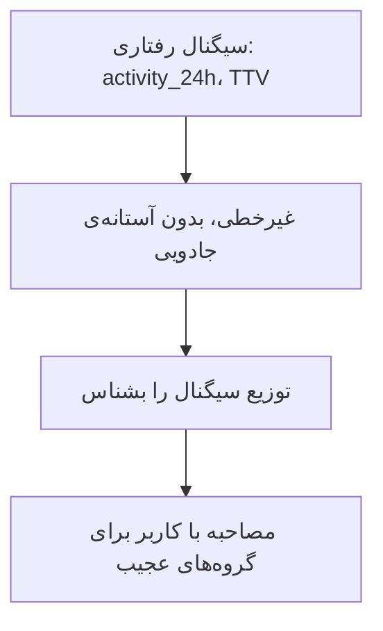

# نوشته‌ی ۴۵: LTV و سیگنال‌های رفتاری

[نوشته‌ی ۴۴: دوره‌ی بازگشت CAC در برابر LTV / CAC →](44-cac-payback-period-vs-ltv-cac.md) · [مجموعه](../README.md) · [نوشته‌ی ۴۶: پیش‌بینی LTV: مقدمه ←](46-ltv-forecasting-introduction.md)

> **مقاله‌ی اصلی:** [LTV and behavioral signals](https://medium.com/@paul.levchuk/ltv-and-behavioral-signals-d3f870bbe006) · Medium، ۲۰۲۴-۰۷-۰۸

## خلاصه

خواننده‌ای خواست پژوهش اقتصاد واحد با سنجه‌های رفتاری غنی شود. نویسنده دو سیگنال ساده ساخت: activity_24h یعنی میانگین تعداد درخواست‌های ارسالی در ۲۴ ساعت اول و TTV یعنی میانگین ساعت‌های لازم تا اولین درخواست. داده از بازاری دوطرفه است. توزیع هر دو سیگنال غیرخطی است و رابطه‌شان با LTV مستقیم نیست: درخواست بیشتر LTV بیشتر نمی‌دهد و TTV کوتاه هم LTV بیشتر نمی‌دهد. سیگنال‌های رفتاری LTV را به‌خوبی توضیح نمی‌دهند چون LTV به سیگنال‌های پولی بستگی دارد. بهتر است توزیع سیگنال را بشناسیم تا همبستگی بگیریم.

## نکته‌های کلیدی

- **دو سیگنال:** activity_24h یعنی میانگین تعداد درخواست ارسالی در ۲۴ ساعت اول؛ TTV یعنی میانگین ساعت‌هایی که طول می‌کشد کاربر اولین درخواستش را بفرستد، زمان تا ارزش.
- **زمینه:** بازار دوطرفه با کاربران طرف تقاضا، که دنبال خدمت‌اند، و طرف عرضه، که خدمت می‌دهند.
- **توزیع تعداد خریداران و LTV** نسبت به activity_24h غیرخطی است.
- **چهار بخش activity_24h:** صفر درخواست در ۲۴ ساعت (حدود ۲٪)، یک درخواست (۸٪ خریداران)، بسیار (۱۳ یا بیشتر) درخواست (۶۳٪) و بین این دو (۲۷٪). بخش کاربران «کند» گاهی بزرگ‌تر است و تنظیم onboarding برایش می‌تواند خیلی سودمند باشد.
- **تمرکز ۱۳ یا بیشتر درخواست** ممکن است یعنی توصیه‌های ما درست کار نمی‌کند؛ با این کاربران مصاحبه کنید.
- **هرچه درخواست بیشتر، LTV کمتر** (همبستگی منفی). اگر محصول کاربر را بیش‌ازحد روی ارسال درخواست متمرکز کند، شانس دریافت خدمت و رضایت کم می‌شود و کاربر طرف تقاضا با مدیریت ارتباط با عرضه‌کننده‌ها مشغول می‌شود. ارسال درخواست ارزش را باز می‌کند ولی نمی‌رساند.
- **جانشین بدون درک رابطه بد است:** تمرکز کورکورانه روی بالا بردن سنجه‌ی جانشین بدون درک رابطه‌اش با هدف کار بدی است.
- **درآمد بر پایه‌ی سطح فعالیت:** گروه یک درخواست بیشترین اثر بر درآمد را دارد و آستانه‌ی جادویی نیست. گروه‌های درخواست زیاد LTV کمتر ولی بخش بزرگی دارند و درآمد زیادی می‌سازند؛ پس باید مراقب بود. گروه‌های ۴ و ۷ و ۱۴ و ۲۳ بین سهم خریداران و درآمد ناهماهنگی دارند و LTV بسیار کم؛ شاید کاربران طرف عرضه‌شان ناصالح‌اند.
- **شاخص TTV مبهم است:** گاه زمان بیشتر در اپ یعنی درگیری بیشتر و گاه سریع‌تر ارزش گرفتن یعنی ماندن بیشتر.
- **سه بخش TTV:** ≤ ۵ ساعت (۴٫۴٪)، ۶ تا ۲۲ ساعت (۹۱٫۴٪) و ≥ ۲۳ ساعت (۴٫۲٪). سهم بسیار کوچک خریداران که سریع درخواست می‌فرستند یعنی چیزی با تجربه‌ی اول درست نیست؛ شاید مهم‌ترین بینش پژوهش. تیم محصول باید مصاحبه با کاربر را جدی بگیرد.
- **بین ۷ و ۲۱ ساعت** TTV و LTV همبستگی مثبت دارند: وقتی کاربر وقت می‌گذارد و عرضه‌کننده‌ی مناسب را پیدا می‌کند LTV بالا می‌رود. پس سؤال هل دادنش به تماس سریع‌تر باز است. فیلتر پیشرفته جایگزین احتمالی است. این‌که کاربر کنترل کند یا حس کنترل داشته باشد هم جهت جالبی است.
- **بیشترین درآمد از TTV برابر ۱۹ ساعت** است؛ بزرگ‌ترین سهم درآمد با کاربران کند.
- **همیشه یک آستانه‌ی ساده‌ی رفتاری که جانشین خوبی باشد پیدا نمی‌شود،** و آستانه‌ی مصنوعی بی‌پشتوانه‌ی داده کسب‌وکار را آسیب می‌زند. مشتری سریع و باهوش آن چیزی است که فکر می‌کنیم؛ کند و گیج واقعیت است. از مشتری واقعی یاد بگیرید، نه از مشتری ذهن خودتان.
- **جمع‌بندی:** LTV را سیگنال رفتاری به‌سختی توضیح می‌دهد؛ فعالیت بیشتر LTV بیشتر تضمین نمی‌کند؛ TTV کوتاه هم تضمین نمی‌کند؛ یادگیری از توزیع سیگنال بینش بیشتر از همبستگی می‌دهد.

## فهرست بخش‌ها

- سیگنال activity_24h
- سیگنال TTV
- جمع‌بندی

## یادداشت‌ها

در چند نوشته‌ی قبل، [فصل ۴۱](41-when-do-you-need-to-use-the-ltv-projection.md) تا [فصل ۴۴](44-cac-payback-period-vs-ltv-cac.md)، اقتصاد واحد را در سطح کمپین پولی بررسی کردم. یکی از خوانندگان خواست پژوهش را با سنجه‌های رفتاری غنی کنم. چون داده و وقت آزاد محدود دارم، سریع چند سنجه‌ی رفتاری ساده ساختم:

- **ستون activity_24h** میانگین تعداد درخواست‌های ارسالی در ۲۴ ساعت اول را حساب می‌کند.
- **شاخص TTV** میانگین ساعت‌هایی را حساب می‌کند که کاربران لازم دارند تا اولین درخواست را بفرستند، یعنی Time To Value.

کمی زمینه: داده به بازاری با دو طرف مربوط است: کاربرانی که دنبال خدمت‌اند، طرف تقاضا، و کاربرانی که خدمت می‌دهند، طرف عرضه. امروز عمیق‌تر به رابطه‌ی سیگنال‌های رفتاری و LTV می‌پردازیم.

**سیگنال activity_24h.** نمودار رابطه‌ی activity_24h و LTV را می‌سازیم. چون انتظار داریم LTV پرنوسان باشد، اطلاعات درصد خریداران را هم به نمودار می‌افزاییم. سریع می‌فهمیم:

- توزیع تعداد خریداران **غیرخطی** است.
- توزیع LTV هم **غیرخطی** است.

عمیق‌تر شویم. بخشی از کاربران هستند که در ۲۴ ساعت اول هیچ درخواستی نفرستادند. در این مورد این بخش نسبتاً کوچک است، حدود ۲٪، و لازم نیست زیاد نگرانش باشیم. ولی گاهی این بخش کاربران «کند» خیلی بزرگ‌تر است، پس تنظیم onboarding برای این بخش می‌تواند بسیار سودمند باشد. سه بخش کاربر دیگر با اندازه‌ها و سطح‌های فعالیت متفاوت هم هست:

| بخش | سهم خریداران |
|---|---|
| ۱ درخواست | ۸٪ |
| بسیار، ۱۳ یا بیشتر | ۶۳٪ |
| بین این دو | ۲۷٪ |

از یک طرف بزرگ‌ترین تمرکز کاربران را با ۱۳ یا بیشتر درخواست ارسالی می‌بینیم. اگر کاربران درخواست زیادی بفرستند ممکن است توصیه‌های ما درست کار نمی‌کنند. می‌ارزد با کاربرانی که درخواست زیاد فرستادند مصاحبه کنیم تا بفهمیم چیزی را از قلم انداخته‌ایم. از طرف دیگر می‌بینیم وقتی تعداد درخواست‌ها زیاد می‌شود LTV **کم** می‌شود، همبستگی منفی. چطور ممکن است؟ در بازار دوطرفه، در کل اگر بیش از یک درخواست بفرستید شانس دریافت خدمت بالاتر می‌رود. ولی اگر محصول کاربران را **بیش‌ازحد** روی ارسال درخواست متمرکز کند، شانس دریافت خدمت و رضایت **کم** می‌شود. کاربران طرف تقاضا **بیش‌ازحد مشغول** مدیریت ارتباط با کاربران طرف عرضه می‌شوند، به‌جای این‌که جلو بروند و خدمت بگیرند. این یکی از مشکل‌هایی است که تیم‌های محصول اغلب نمی‌بینند: ارسال درخواست ارزش را باز می‌کند، ولی هنوز نمی‌رساند. استفاده از بعضی فعالیت‌ها به‌عنوان جانشین خدمت رسانده‌شده کار خوبی است. ولی تمرکز کورکورانه بر افزایش سنجه‌های جانشین، بدون درک عمیق رابطه‌ی سنجه‌ی جانشین با سنجه‌ی هدف، کار بدی است.

حالا درآمد را برای هر سطح فعالیت مقایسه می‌کنیم. می‌آموزیم:

- گروه کاربران با ۱ درخواست ارسالی کاملاً مهم است چون بیشترین اثر را بر درآمد دارد.
- در کل هیچ آستانه‌ی جادویی نیست که بتوان با آن هم‌راستا شد.

چند نکته‌ی جالب. اول، هرچند کاربرانی که درخواست زیاد فرستادند LTV کمتری دارند، این بخش بزرگ است و در نتیجه درآمد زیادی می‌سازد. پس برای حفظ درآمد کل باید مراقب باشیم هنگام کار با آن. دوم، چند گروه، ۴ و ۷ و ۱۴ و ۲۳، بین سهم خریداران و درآمد ناهماهنگی بزرگ دارند، یعنی LTV بسیار کم. می‌ارزد کاربران متناظر طرف عرضه را بررسی کنیم چون ممکن است بعضی‌شان ساده ناصالح باشند. این را به‌سختی با تحلیل همبستگی ساده می‌یابید.

**سیگنال TTV.** در کل سنجه‌های مربوط به زمان تا ارزش بسیار مبهم‌اند. چرا؟ تفسیرشان به محصول و زمینه خیلی بستگی دارد:

- در بعضی موردها هرچه کاربر زمان بیشتری در اپ بگذراند، درگیرتر است و در نتیجه شانس ادامه‌ی استفاده بیشتر است.
- در موردهای دیگر هرچه کاربر سریع‌تر اولین ارزش را بگیرد، شانس تصمیم به ادامه‌ی استفاده بیشتر است.

از نمودار رابطه‌ی TTV و LTV نتیجه می‌گیریم سه بخش هست:

| بخش | سهم |
|---|---|
| TTV ≤ ۵ ساعت | ۴٫۴٪ |
| TTV بین ۶ تا ۲۲ ساعت | ۹۱٫۴٪ |
| TTV ≥ ۲۳ ساعت | ۴٫۲٪ |

این آمار بسیار روشنگر است. از یک طرف درصد بسیار کمی از خریداران خیلی سریع، در چند ساعت، شروع به ارسال درخواست کردند. چرا این درصد این‌قدر کم است؟

- آیا نیت کاربران این بخش چندان فوری نیست؟
- آیا UX کاربر را گیج می‌کند؟
- آیا فهرست توصیه درست کار نمی‌کند؟

قطعاً چیزی با تجربه‌ی اول اشتباه است و تیم محصول باید سرمایه‌گذاری سنگین روی مصاحبه با کاربر بکند. این بینش شاید مهم‌ترین بینش کل این پژوهش باشد. از طرف دیگر درصد خریدارانی که در ۴۸ ساعت یا دیرتر درخواست می‌فرستند هم بسیار محدود است. پس کاربران نیازشان را به تأخیر نمی‌اندازند. در هر صورت می‌ارزد onboarding را برای این کاربران «کند» هم تنظیم کنیم.

اگر نمودار را دقیق ببینیم، بین ۷ تا ۲۱ ساعت همبستگی **مثبت** بین TTV و LTV هست. به بیان دیگر وقتی کاربران وقت می‌گذارند و کاربران مناسب طرف عرضه را پیدا کرده‌اند، LTV‌شان بالا می‌رود. به همین دلیل این پرسش که آیا کاربران را به تماس سریع‌تر با کاربران توصیه‌شده‌ی طرف عرضه هل بدهیم باز است. روشن است که باید فهرست توصیه را مرتب بهتر کنیم. ولی بعضی کاربران ساده نیازهای یکتا یا بسیار مشخصی دارند که با فهرست توصیه برآورده نمی‌شود. جایگزین می‌تواند هدایت توجه این کاربران به فیلترهای پیشرفته برای ظریف کردن نتایج جست‌وجو باشد. جنبه‌ی دیگری هم هست: آیا می‌خواهیم کاربران را کنترل کنیم یا کاری کنیم حس کنند کنترل دارند. حدس بزنید کاربران کدام را دوست دارند و کدام را نه. جهت جالبی است ولی قطعاً خارج از حوصله‌ی این نوشته.

حالا درآمد را برای هر سطح TTV مقایسه می‌کنیم:

- بیشترین درآمد را از کاربران با TTV برابر ۱۹ ساعت می‌گیریم، کاربران «کند».
- در کل هیچ آستانه‌ی جادویی برای هم‌راستایی نیست.

بیشترین سهم درآمد به کاربران «کند» مربوط است. پس برای حفظ درآمد کل باید مراقب باشیم هنگام کار با آن‌ها. در کل داده‌ی فعالیت‌ها و TTV به‌روشنی نشان می‌دهد **همیشه** نمی‌شود یک آستانه‌ی رفتاری ساده و زیبا پیدا کرد که تیم محصول بتواند جانشین بگیرد. علاوه بر این، استفاده از آستانه‌ی مصنوعی که داده پشتیبانی‌اش نمی‌کند ساده می‌تواند کسب‌وکار را آسیب بزند. به بیان دیگر مشتری سریع و باهوش آن چیزی است که درباره‌شان فکر می‌کنیم. مشتری کند و گیج آن چیزی است که در واقعیت هستند. همیشه از مشتری‌های واقعی یاد بگیرید، نه مشتری‌های درون ذهنتان.

**جمع‌بندی:**

- مقدار LTV را به‌سختی می‌شود با سیگنال‌های رفتاری خوب توضیح داد چون LTV به‌شدت به سیگنال‌های پولی وابسته است که از دایره‌ی رفتار بیرون‌اند.
- داشتن فعالیت **بیشتر** کاربر، LTV بالاتر را **تضمین نمی‌کند**.
- داشتن زمان تا ارزش **کوتاه** هم LTV بالاتر را **تضمین نمی‌کند**.
- یادگیری از **توزیع سیگنال** بسیار روشنگرتر از محاسبه‌ی همبستگی بین سیگنال‌های رفتاری و LTV است.

در نوشته‌ی بعد ([فصل ۴۶](46-ltv-forecasting-introduction.md)) بحث پیش‌بینی LTV را باز می‌کند.

> **Vault note:** داده‌ی این نوشته از یک بازار دوطرفه خاص است؛ توصیه‌ی «از توزیع سیگنال یاد بگیرید» قابل تعمیم است ولی اعداد بخش‌ها نه.

> **In practice:** سیگنال‌هایی مثل activity_24h و TTV را در یک feature table در Gold بسازید و پیش از ورود به مدل LTV توزیعشان را ببینید.
>
> **Your turn:** تیم مطمئن است کاربرانی که زود به ارزش می‌رسند LTV بیشتری دارند. چطور می‌سنجید؟
>
> *Answer:* توزیع TTV را بر حسب LTV ببینید؛ نویسنده رابطه‌ی مستقیمی پیدا نکرد، چون LTV به سیگنال‌های پولی بیشتر وابسته است تا رفتاری (بخش «سیگنال TTV»).

## پیوندها

- **بر پایه‌ی:** [فصل ۴۱](41-when-do-you-need-to-use-the-ltv-projection.md) تا [فصل ۴۴](44-cac-payback-period-vs-ltv-cac.md) که اقتصاد واحد کمپین را می‌ساختند، و [فصل ۳۱](31-user-engagement-first-time-user-experience.md) که غیرخطی بودن زمان جلسه‌ی اول را دید.
- **ادامه در:** [فصل ۴۶](46-ltv-forecasting-introduction.md) که LTV را پیش‌بینی می‌کند و [فصل ۶۴](64-long-tail-eats-your-ltv-model.md) که دیدن توزیع را بدون خطای دقت مطرح می‌کند.

## خودتان را بسنجید

*پرسش‌ها و پاسخ‌ها مال vault است.*

1. **آیا فعالیت بیشتر در ۲۴ ساعت اول LTV بیشتر می‌دهد؟**
   - [x] نه؛ در این داده همبستگی منفی بود چون ارسال درخواست ارزش را باز می‌کند ولی نمی‌رساند.
   - [ ] بله، همیشه.
   - [ ] رابطه‌ای نیست.

   *Answer:* (بخش «سیگنال activity_24h»).

2. **چرا آستانه‌ی رفتاری مصنوعی خطرناک است؟**

   *Answer:* چون داده پشتیبانی‌اش نمی‌کند و می‌تواند کسب‌وکار را آسیب بزند؛ مشتری واقعی کند و گیج است (بخش «سیگنال TTV»).
