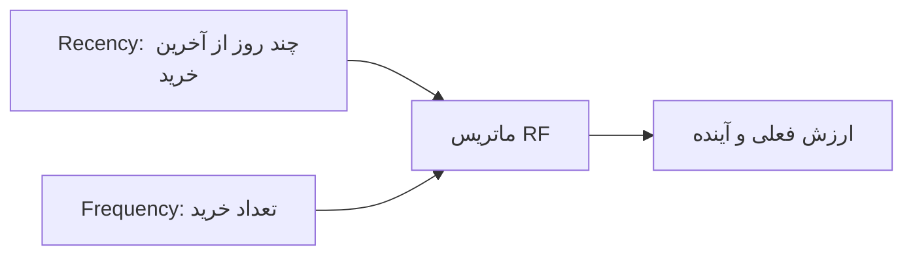

# نوشته‌ی ۴۹: ماتریس RF: مقدمه

[نوشته‌ی ۴۸: پیش‌بینی LTV: مدل‌های اصلاحی چقدر خوب‌اند →](48-ltv-forecasting-how-good-the-corrective-models-are.md) · [مجموعه](../README.md) · [نوشته‌ی ۵۰: ماتریس RF: جادوی Recency ←](50-rf-matrix-the-magic-of-recency.md)

> **مقاله‌ی اصلی:** [RF matrix — introduction](https://medium.com/@paul.levchuk/rf-matrix-introduction-b4246d373bbf) · Medium، ۲۰۲۴-۱۲-۲۱

## خلاصه

وقتی کاربر جدید اولین خریدش را انجام می‌دهد مشتری می‌شود، ولی برای برگشت CAC باید چند خرید انجام دهد و بعد هم خرید بیشتر برای سود. پس کار بازاریاب بعد از اولین خرید تازه شروع می‌شود. ماتریس RF با دو محور Recency، چه زمانی آخرین خرید بود به روز، و Frequency، تعداد خرید، سه پرسش را جواب می‌دهد: کدام مشتریان فعال‌اند، پایگاه مشتری فعال چقدر کارآمد انباشته می‌شود و کدام‌ها ارزش بالا دارند. در مثال فقط ۱۷٫۲٪ مشتریان پتانسیل بالای خرید آینده دارند و ۴۲٫۹٪ بیش از ۱۸۰ روز خرید نکرده‌اند. ۶۴٫۱٪ خریدار یک‌بار هستند.

## نکته‌های کلیدی

- **بعد از اولین خرید کار تازه شروع می‌شود:** برای برگشت CAC چند خرید لازم است و برای سود باز هم خرید بیشتر.
- **سه پرسش بنیادی مدیریت پایگاه مشتری:** کدام مشتریان فعال‌اند؟ پایگاه مشتری فعال با چه سرعت و کارایی انباشته می‌شود؟ کدام‌ها ارزش بالا دارند؟
- **منبع:** کتاب Drilling Down نوشته‌ی Jim Novo؛ ماتریس RF همان LCG در اصطلاح او است.
- **ماتریس RF:** دو محور. Recency روز از آخرین خرید. Frequency تعداد خریدها.
- **عکس لحظه‌ای است:** با اجرای همان تحلیل در دوره‌های مساوی می‌توان فرق وضعیت فعلی و قبلی را حساب کرد و فهمید ارزش پایگاه مشتری بالا رفته یا نه.
- **چرا RF و نه تعداد مشتری:** تعداد کل مشتریان هر شرکت با زمان فقط بالا می‌رود، پس سنجه‌ی پوچ است؛ همه‌ی مشتریان برابر نیستند. باید ارزش **فعلی** و **آینده** را بسنجیم.
- **ارزش فعلی:** تعداد تراکنش F یا پولی که خرج کرده M. F جانشین M است با همبستگی قوی؛ در داده‌ی نویسنده ضریب r بین F و M برابر ۰٫۷۴.
- **ارزش آینده:** احتمال خرید آینده؛ جانشین خوب Recency است: هرچه فاصله از آخرین خرید بیشتر، احتمال تکرار کمتر.
- **از جدول درصد کل:** اگر Recency جانشین ارزش آینده باشد، فقط ۱۷٫۲٪ از همه‌ی مشتریان پتانسیل بالا برای خرید آینده دارند و ۴۲٫۹٪ همه‌ی مشتریان بیش از ۱۸۰ روز خرید نکرده‌اند و به احتمال زیاد دیگر نمی‌خرند.
- **آستانه‌ی ۳۰ روز:** بیشتر کسب‌وکارهای آنلاین هر ماه درآمدزایی می‌کنند. محصولی که فصلی یا سالی یک بار استفاده می‌شود باید گام Recency را تنظیم کند.
- **چرا این‌همه مشتری رفتند:** بازاریاب‌ها اغلب شیفته‌ی UA می‌شوند و مشتریان فعلی و گذشته را فراموش می‌کنند. هیچ مشتری تا ابد نمی‌ماند؛ هر مشتری چرخه‌های عمر دارد و در نهایت churn می‌کند. شمردن کل مشتریان سنجه‌ی گمراه‌کننده است که پتانسیل پایگاه مشتری را بیش‌ازحد برآورد می‌کند.
- **خریداران یک‌بار:** با درصد ستون ۶۴٫۱٪ همه‌ی مشتریان فقط یک بار خریدند و هرچه Recency کمتر، سهم خریداران یک‌بار بیشتر است.
- **معیار از تجربه‌ی ۱۵ ساله:** فقط یک کسب‌وکار با خریدار یک‌بار کمتر از ۴۰٪ دیده، چند کسب‌وکار بالای ۹۰٪ و بیشتر بین ۴۰٪ و ۶۰٪.
- **دلیل‌های خریدار یک‌بار:** خرید خودجوش بدون برنامه‌ی استفاده، ارزش کافی برای ادامه نیافت (بدون مشکل محصول)، مشکلی در محصول جلوی ارزش را گرفت، یا ارزان‌تر پیدا کرد. بعضی قابل‌رفع نیستند و بعضی فقط کاهش‌پذیرند.
- **تجربه‌ی نویسنده:** در کمپین‌های فعال‌سازی گوناگون برای خریداران یک‌بار حداکثر ۱۰٪ کاهش این مشتریان را گرفت. بدبین باشید و روی مشتریان با ارزش بالا تمرکز کنید.
- **جمع‌بندی:** درصد مشتریان اخیر حقیقت پایگاه مشتری فعال را می‌گوید؛ درصد خریداران یک‌بار می‌گوید تلاش UA چقدر خوب است، PMF دارید یا نه، یا Recency ≤ ۳۰ با فاصله‌ی استفاده از محصول نمی‌خواند.

## فهرست بخش‌ها

- بعد از اولین خرید
- ماتریس RF
- چرا RF و نه تعداد مشتری
- جدول درصد کل
- خریداران یک‌بار

## یادداشت‌ها

وقتی در تجارت الکترونیک مدیر بازاریابی بودم، سهامداران همیشه می‌پرسیدند جذب کاربر، UA، چطور پیش می‌رود. بخش بزرگی از کارم جذب cohortهای کاربر جدید و اطمینان از دوره‌ی بازگشت CAC کوتاه، حداکثر ۳ ماه، بود. کارایی سرمایه یکی از سنجه‌هایی بود که گزارش می‌دادم. بخش بزرگ دیگر تلاش‌های رشد، که بیرون دیده نمی‌شد، رشد پایگاه مشتری فعال بود.

وقتی کاربر جدیدی جذب می‌کنید و او اولین خریدش را می‌کند، مشتری می‌شود. معمولاً برای بازگرداندن هزینه‌ی جذب مشتری، CAC، باید مطمئن شوید مشتری چند خرید کرد. وقتی کرد و به نقطه‌ی سربه‌سر رسیدید، هنوز می‌خواهید دست‌کم X خرید دیگر بسازد تا برای کسب‌وکار سود کند. پس کار شما بعد از اولین خرید مشتری تمام نمی‌شود، در واقع تازه شروع می‌شود. برای انجام کارآمد این کار ابزاری لازم است که کمک کند بفهمید:

- کدام مشتریان فعال‌اند؟
- پایگاه مشتری فعال را با چه سرعت و کارایی انباشته می‌کنید؟
- کدام‌ها ارزش بالا دارند؟

این سه پرسش برای مدیریت پایگاه مشتری بنیادی‌اند. بعداً در نوشته‌ها می‌بینید چرا. وقتی دنبال جواب این پرسش‌ها بودم کتاب فوق‌العاده‌ای از Jim Novo پیدا کردم: «Drilling Down: Turning Customer Data into Profits with a Spreadsheet». چند مفهوم هست که از Jim خوب یاد گرفتم و امروز می‌خواهم تجربه‌ی استفاده از **ماتریس RF** را، LCG در اصطلاح Jim، به اشتراک بگذارم.

**ماتریس RF** ماتریسی با دو محور است: **R**ecency و **F**requency.

- شاخص Recency: آخرین بار که مشتری خرید کرد، به روز.
- شاخص Frequency: مشتری چند خرید کرد، تعداد.

پس ماتریس RF عکس لحظه‌ای از چیزی است که در زمان تحلیل داده دارید. همان‌طور که گفتم عکس لحظه‌ای عملکرد مشتریان تا امروز است. با اجرای همان تحلیل در دوره‌های مساوی می‌توانید فرق بین آنچه الان دارید و آنچه قبلاً داشتید را حساب کنید. به بیان دیگر می‌توانید ارزیابی کنید ارزش پایگاه مشتری شما بالا رفته یا نه.

شاید بعضی از شما پرسیده باشید چرا باید مشتریان را بر پایه‌ی R و F بخش‌بندی کنیم و فقط تعداد مشتری را نشماریم؟ جواب ساده است:

- تعداد کل مشتریان هر شرکت با زمان فقط بالا می‌رود، پس سنجه‌ی پوچ است.
- همه‌ی مشتریان برابر نیستند.

پس منطقی نیست فقط مشتریان را بشماریم؛ باید بخش‌بندی کنیم تا حس بهتری از آنچه داریم و آنچه از این مشتریان انتظار داریم بگیریم. به بیان دیگر می‌خواهیم ارزیابی کنیم: ارزش **فعلی** مشتریان و ارزش **آینده** مشتریان. ارزش **فعلی** با تعداد تراکنش‌ها، F، یا پولی که خرج کردند، M، سنجیده می‌شود. می‌شود F را جانشین M گرفت و دلیلش همبستگی مثبت قوی است. در مجموعه‌داده‌ای که برای این نوشته استفاده می‌کنم ضریب همبستگی r بین F و M برابر ۰٫۷۴ است. ارزش **آینده** به احتمال خرید مشتری در آینده مربوط است. جانشین خوب احتمال خرید Recency است. منطق ساده است: هرچه از آخرین خرید مشتری بیشتر بگذرد، احتمال تکرارش کمتر است.

برای هر مشتری تعداد روزهای از آخرین خرید، R، و کل تعداد خریدها، F، را حساب می‌کنیم و در Pivot Table تجمیع می‌کنیم. چون هر سلول مقیاس متفاوتی دارد، به‌سختی می‌شود گفت پایگاه مشتری ما وضعیت خوبی دارد یا نه. پس به درصد از جمع کل می‌رویم. چه می‌آموزیم؟

- اگر باور کنیم Recency واقعاً جانشین ارزش آینده است، فقط **۱۷٫۲٪** همه‌ی مشتریان پتانسیل بالا برای خرید آینده دارند.
- علاوه بر آن **۴۲٫۹٪** همه‌ی مشتریان بیش از ۱۸۰ روز است خرید نکرده‌اند و به احتمال زیاد دیگر نخواهند خرید.

اینجا بایستیم و این نتیجه را بحث کنیم. اول، سمت راست‌ترین گام Recency را ۳۰ روز گرفتم. آستانه‌ی خوبی است؟ بیشتر کسب‌وکارهای آنلاین روی درآمدزایی از کاربران هر ماه تمرکز دارند. برای آن‌ها استفاده از آستانه‌ی Recency پیشنهادی برای درآمدزایی خوب کار می‌کند. ولی بعضی کسب‌وکارهای نادر محصولی دارند که هر فصل یا حتی سالی یک بار استفاده می‌شود. برای آن‌ها قطعاً باید گام Recency را تنظیم کنید. دوم، چرا مشتریان زیادی دیگر برای محصول پول نمی‌دهند؟ اینجاست که churn وارد می‌شود. بازاریاب‌ها اغلب آن‌قدر شیفته‌ی UA می‌شوند که مشتریان فعلی و گذشته و نیازهایشان را کاملاً فراموش می‌کنند. شاید فکر می‌کنند محصول آن‌قدر عالی است که مشتریان تا ابد می‌خرند. متأسفانه این‌طور نیست. هیچ مشتری تا ابد به محصول نمی‌چسبد. هر مشتری در کسب‌وکار شما چرخه‌های عمر را می‌گذراند و در نهایت churn می‌کند. به همین دلیل شمردن کل مشتریان واقعاً ایده‌ی بدی است. سنجه‌ی گمراه‌کننده‌ای است که پتانسیل پایگاه مشتری را بیش‌ازحد برآورد می‌کند و شدیداً توصیه می‌کنم نکنید.

چه چیز دیگری می‌آموزیم؟ اگر دقیق نگاه کنید می‌بینید بیشتر مشتریان از دست‌رفته مشتریانی هستند که فقط یک خرید کردند، خریداران یک‌بار. برای روشن شدن این بینش Pivot Table را روی درصد از جمع ستون تنظیم می‌کنیم. حالا چه می‌بینید؟

- **۶۴٫۱٪** همه‌ی مشتریان خریداران یک‌بارند.
- هرچه مشتریان کمتر اخیر باشند، سهم خریداران یک‌بار بزرگ‌تر است.

آیا معیاری اینجا هست؟ در ۱۵ سال کارم دیده‌ام:

- فقط یک کسب‌وکار که سهم خریداران یک‌بار کمتر از ۴۰٪ داشت.
- چند کسب‌وکار که سهم خریداران یک‌بار بالای ۹۰٪ داشتند.
- برای بیشتر کسب‌وکارها سهم خریداران یک‌بار بین ۴۰٪ و ۶۰٪.

روشن است که دلیل‌های بسیار متفاوتی می‌تواند وجود داشته باشد که چرا مشتریان تصمیم گرفتند محصول شما را نخرند. آشکارترین دلیل‌ها برای خریداران یک‌بار:

- خرید خودجوش بود. مشتری قصد استفاده از چنین محصولی را نداشت.
- مشتری خرید کرد ولی ارزش کافی برای ادامه‌ی پرداخت نیافت، محصول مشکلی نداشت.
- مشتری خرید کرد ولی فهمید محصول مشکلاتی دارد که اجازه نمی‌دهد ارزش مورد انتظار را بگیرد.
- مشتری خرید کرد ولی فهمید می‌تواند محصول مشابه را ارزان‌تر بخرد.

بعضی از دلیل‌های بالا قابل رفع نیستند و بعضی را فقط می‌شود کاهش داد. در واقع زمان بسیار زیادی را صرف اجرای کمپین‌های فعال‌سازی بسیار متفاوت برای این خریداران یک‌بار کردم. بیشترین نتیجه‌ای که گرفتم ۱۰٪ کاهش این مشتریان بود. پس شما را تشویق می‌کنم نسبت به تلاش‌های بازفعال‌سازی خریداران یک‌بار بدبین باشید و بیشتر روی مشتریان با ارزش بالا تمرکز کنید. در نوشته‌های بعد به این موضوع می‌پردازم.

> **Try it:** [گذار حالت‌های مشتری](../widgets/56-transition-states.html): ببینید مشتری با گذر زمان بین حالت‌های RF جابه‌جا می‌شود.

**جمع‌بندی:**

- درصد مشتریان اخیر به احتمال زیاد حقیقت پایگاه مشتری فعال شما را می‌گوید.
- درصد خریداران یک‌بار به احتمال زیاد می‌گوید تلاش‌های UA شما چقدر خوب است، PMF دارید یا نه، یا Recency ≤ ۳۰ با فاصله‌ی استفاده از محصول شما نمی‌خواند.

در نوشته‌ی بعد ([فصل ۵۰](50-rf-matrix-the-magic-of-recency.md)) بیشتر در Recency فرو می‌روم و نشان می‌دهم چرا Recency این‌قدر مهم است و چطور با احتمال خرید در دوره‌ی بعد همبستگی دارد.

> **Vault note:** مفهوم ماتریس RF از کتاب Jim Novo است؛ اینجا فقط تجربه‌ی نویسنده و داده‌ی خودش خلاصه شده است و کتاب را بازنویسی نکرده‌ایم.

> **In practice:** ماتریس RF از جدول تراکنش در Silver با دو ستون `dateDiff('day', max(ts), today())` و `count()` برای هر مشتری ساخته می‌شود و هر شب در Gold دوباره ساخته می‌شود.
>
> **Your turn:** گزارش ماهانه فقط تعداد کل مشتری را نشان می‌دهد و هر ماه بالا می‌رود. چرا کافی نیست؟
>
> *Answer:* چون مشتری یک‌بارخرید و مشتری‌ای که شش ماه خرید نکرده هم شمرده می‌شوند؛ ماتریس RF نشان می‌دهد چند نفر واقعاً فعال و باارزش‌اند (بخش «چرا RF و نه تعداد مشتری»).

## پیوندها

- **بر پایه‌ی:** [فصل ۳۶](36-user-cohort-retention.md) که churn و خریدار یک‌بار را بر cohort می‌دید، و [فصل ۴۴](44-cac-payback-period-vs-ltv-cac.md) که CAC را برمی‌گرداند.
- **ادامه در:** [فصل ۵۰](50-rf-matrix-the-magic-of-recency.md) و [فصل ۵۱](51-rf-matrix-frequency-dimension.md) که Recency و Frequency را باز می‌کنند، و [فصل ۵۲](52-rr-ff-matrices-introduction-to-customer-states.md) و [فصل ۵۳](53-customer-state-a-key-building-block-of-advanced-customer.md) که وضعیت‌های مشتری را می‌سازند.

## خودتان را بسنجید

*پرسش‌ها و پاسخ‌ها مال vault است.*

1. **چرا شمردن کل مشتریان سنجه‌ی پوچ است؟**
   - [x] چون فقط با زمان بالا می‌رود و مشتریان همه برابر نیستند؛ پتانسیل را بیش‌ازحد برآورد می‌کند.
   - [ ] چون سخت شمرده می‌شود.
   - [ ] چون F و M همبسته نیستند.

   *Answer:* (بخش «چرا RF و نه تعداد مشتری»).

2. **چه سهمی از مشتریان در مثال خریدار یک‌بار بود؟**

   *Answer:* ۶۴٫۱٪ (بخش «خریداران یک‌بار»).
