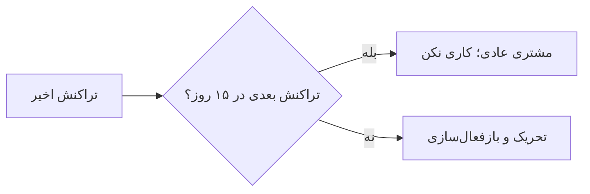

# نوشته‌ی ۵۱: ماتریس RF: بُعد Frequency

[نوشته‌ی ۵۰: ماتریس RF: جادوی Recency →](50-rf-matrix-the-magic-of-recency.md) · [مجموعه](../README.md) · [نوشته‌ی ۵۲: ماتریس‌های RR/FF: مقدمه‌ای بر وضعیت‌های مشتری ←](52-rr-ff-matrices-introduction-to-customer-states.md)

> **مقاله‌ی اصلی:** [RF matrix — Frequency dimension](https://medium.com/@paul.levchuk/rf-matrix-frequency-dimension-ac21794851c3) · Medium، ۲۰۲۵-۰۲-۱۰

## خلاصه

شاخص Recency پتانسیل آینده‌ی مشتری را می‌گوید ولی ارزش فعلی را نه؛ Frequency، تعداد کل تراکنش‌های مشتری تا یک تاریخ، ارزش فعلی را نشان می‌دهد. در مثال ۶۴٪ مشتریان خریدار یک‌بارند. احتمال انجام تراکنش بعدی تا تراکنش ششم بالا می‌رود (۲۵٪ و ۴۹٪ برای F برابر ۱ و ۲) و بعد تقریباً ثابت و ۸۱٪ است، یعنی حتی مشتریان باارزش با هر تراکنش ۲۰٪ ریزش دارند. LTV تا امروز برای F برابر ۱ حدود ۹ دلار، برای F بین ۴ تا ۹ حدود ۱۸۱ دلار و برای F از ۱۰ بیشتر حدود ۴۴۳ دلار است. ضرب‌آهنگ تراکنش مهم‌ترین سنجه‌ی عملیاتی است. با WOE و IV، Recency دو برابر Frequency و Monetary قوی‌تر است.

## نکته‌های کلیدی

- **شاخص Frequency:** تعداد کل تراکنش‌های مشتری تا یک تاریخ؛ هرچه تراکنش بیشتر، ارزش بیشتر. کمینه ۱ است چون برای مشتری شدن باید دست‌کم یک تراکنش باشد؛ بیشینه نظراً نامحدود.
- **هیستوگرام Frequency:** بزرگ‌ترین بین خریداران یک‌بار است. در مثال ۶۴٪ که به معیار ۴۰٪ تا ۶۰٪ نزدیک است. کمپین‌های فعال‌سازی برای آن‌ها حداکثر ۱۰٪ کاهش داد؛ بدبین باشید.
- **ارزشمندتر از هیستوگرام احتمال تراکنش بعدی است:** یعنی درصد کسانی که به بین بعدی می‌روند. تا تراکنش ششم بالا می‌رود و بعد تقریباً ثابت، ۸۱٪. تقریباً ثابت چون نمونه‌ی هر بین بعدی شدید کم می‌شود.
- **از احتمال خرید مشروط به Frequency:** همه‌ی مشتریان احتمال غیرصفر دارند؛ مشتریان با چند تراکنش کم احتمال دارند: F برابر ۱ و ۲ به ترتیب ۲۵٪ و ۴۹٪؛ حتی مشتریان باارزش بالا با ۶ تراکنش یا بیشتر با هر تراکنش ۲۰٪ ریزش دارند. نباید به این حس تکیه کرد که مشتریان باارزش امن‌اند.
- **مقدار LTV تا امروز بر ماتریس RF:** F برابر ۱ حدود ۹ دلار؛ F بین ۴ تا ۹ حدود ۱۸۱ دلار، حدود ۲۰ برابر F یک؛ F بیشتر از ۱۰ حدود ۴۴۳ دلار، حدود ۵۰ برابر. یک مشتری باارزش معادل تا ۵۰ مشتری جدید است.
- **ضرب‌آهنگ:** فاصله‌ی تراکنش اول و دوم حدود ۵ روز؛ بعد از دومی مشتری کند می‌شود تا ۱۵ روز بین تراکنش‌ها. دارند ضرب‌آهنگشان را پیدا می‌کنند. به هر مشتری با ۵ تراکنش یا بیشتر تا ۱۵ روز برای تراکنش بعدی فرصت بدهید: اگر انجام داد کاری نکن و اگر نداد تحریکش کن.
- **ضرب‌آهنگ تراکنش مهم‌ترین سنجه‌ی عملیاتی است:** حسابش ساده و فهمش آسان است. نویسنده بازاریابی مخصوص مشتریان قدیمی بر پایه‌ی ضرب‌آهنگ استخدام کرد و میانگین LTV مشتری را در کمتر از یک سال بیش از ۲ برابر کرد.
- **آیا Frequency مهم‌تر از Recency است؟** برای هر مشتری پرچم خرید ۳۰ روز بعد می‌سازیم و WOE و IV هر ویژگی RFM را حساب می‌کنیم. WOE تفاوت توزیع خریداران و غیرخریداران را نشان می‌دهد و IV آن را به امتیاز توان جداسازی فشرده می‌کند.
- **مقدار WOE:** Recency اخیر با R ≤ ۳۰ احتمال خرید بیشتر دارد؛ Frequency با F ≥ ۲، یعنی غیرخریدار یک‌بار؛ Monetary با M ≥ ۳۲، یعنی مشتری غیرحساس به قیمت.
- **مقدار IV در این داده:** Recency حدود ۲ برابر قوی‌تر از Frequency و Monetary است و Frequency و Monetary اطلاعات بسیار مشابه دارند. اهمیت سیگنال‌های RFM به شکل پرسش بستگی دارد؛ مثلاً برای «آیا مشتری در ۳۰ روز آینده ۱۰۰ دلار می‌سازد» می‌تواند چیز دیگری باشد.
- **جمع‌بندی:** Frequency جانشین خوب ارزش پولی است؛ ضرب‌آهنگ تراکنش را بیاموزید؛ با WOE و IV نقاط عطف retention را پیدا کنید.

## فهرست بخش‌ها

- شاخص Frequency چیست
- احتمال تراکنش بعدی
- ارزش فعلی
- ضرب‌آهنگ تراکنش
- انتخاب Frequency یا Recency

## یادداشت‌ها

در [فصل ۵۰](50-rf-matrix-the-magic-of-recency.md) چند جزئیات Recency را گفتم. Recency درباره‌ی پتانسیل آینده‌ی مشتریان چیزی می‌گوید، ولی درباره‌ی ارزش فعلی‌شان هیچ. امروز درباره‌ی Frequency حرف می‌زنیم. تعریف Frequency ساده است: کل تعداد تراکنش‌هایی که مشتری تا تاریخ مشخص انجام داده. هرچه مشتری تراکنش بیشتری بکند، ارزش بیشتری به شرکت آورده است.

**درباره‌ی Frequency چه می‌دانیم؟** برای مشتری شدن، کاربر باید دست‌کم یک تراکنش انجام دهد. پس کمینه‌ی Frequency برابر ۱ است. بیشینه‌ی Frequency نظراً نامحدود است. هیستوگرام Frequency (تراکنش) می‌سازیم و از آن می‌آموزیم. همان‌طور که انتظار می‌رفت بزرگ‌ترین بین هیستوگرام کاربرانی است که فقط ۱ تراکنش کردند. به آن‌ها خریداران یک‌بار می‌گوییم. در یکی از نوشته‌های قبل گفتم بسیاری از کسب‌وکارها ۴۰٪ تا ۶۰٪ خریدار یک‌بار دارند. در مورد ما سهم خریداران یک‌بار ۶۴٪ است، نسبتاً نزدیک به معیار. زمان زیادی صرف اجرای کمپین‌های فعال‌سازی بسیار متفاوت برای این خریداران یک‌بار کردم. بیشترین نتیجه ۱۰٪ کاهش این گروه مشتریان بود. پس شما را تشویق می‌کنم نسبت به تلاش‌هایتان در این جهت بدبین باشید.

احتمالاً آماره‌ی ارزشمندتر هیستوگرام احتمال انجام یک تراکنش دیگر است، به بیان دیگر درصد کسانی که به بین بعدی می‌روند. در نمودار می‌بینیم احتمال انجام تراکنش بعدی تا تراکنش ششم بالا می‌رود. بعد از آن نسبتاً ثابت است، ۸۱٪. می‌گویم «نسبتاً ثابت» چون اندازه‌ی نمونه‌ی هر بین بعدی شدید کم می‌شود و بالا و پایین‌هایی در دم هست.

**از احتمال خرید مشروط به Frequency چه می‌آموزیم؟**

- همه‌ی مشتریان (F برابر ۱ یا مثلاً F برابر ۱۰) احتمال خرید غیرصفر دارند.
- مشتریان با فقط چند تراکنش احتمال خرید خیلی کمتری دارند (F برابر ۱ و ۲ به ترتیب ۲۵٪ و ۴۹٪). یعنی باید برای گرفتن تراکنش بعدی از مشتریان جدید زمان و انرژی بیشتری نسبت به قدیمی‌ها صرف کنیم.
- حتی مشتریان کاملاً باارزش (۶ تراکنش یا بیشتر) هنوز با هر تراکنش بعدی ۲۰٪ ریزش دارند.

نکته‌ی آخر احتمالاً نگران‌کننده‌ترین است. نمی‌توانیم به این حس تکیه کنیم که مشتریان باارزش امن‌اند و همه‌شان به سهم‌دهی به درآمد شرکت ادامه می‌دهند.

**آیا مشتریانی که فقط چند تراکنش دارند واقعاً با کسانی که بیش از ۱۰ تراکنش دارند فرق دارند؟** برای متقاعد کردن شما که مشتریان با Frequency بالا واقعاً بسیار باارزش‌اند، LTV تا امروز را حساب می‌کنیم و روی ماتریس RF می‌گذاریم. از جدول می‌آموزیم:

| گروه | میانگین LTV تا امروز |
|---|---|
| F برابر ۱، مشتریان جدید | حدود ۹ دلار |
| F بین ۴ و ۹ | حدود ۱۸۱ دلار، حدود ۲۰ برابر F یک |
| F از ۱۰ بیشتر | حدود ۴۴۳ دلار، حدود ۵۰ برابر F یک |

پس نگه داشتن مشتریان باارزش خیلی معنا دارد. به بیان دیگر یک مشتری باارزش (F از ۱۰ بیشتر) تا ۵۰ مشتری جدید می‌ارزد.

**چطور می‌شود مشتریان باارزش در حال لغزیدن را سریع شناسایی کرد؟** معمولاً مشتری بعد از هر تراکنش به مدتی نیاز دارد تا برای تراکنش بعدی آماده شود. زمان بین تراکنش‌های مشتری را حساب می‌کنیم تا سرعت خرید مشتری را بشناسیم. در حالی که زمان بین تراکنش اول و دوم حدود ۵ روز است، بعد از تراکنش دوم مشتریان کند شدند و به ۱۵ روز بین تراکنش‌ها رسیدند. دارند ضرب‌آهنگ خود را پیدا می‌کنند. این جست‌وجوی ضرب‌آهنگ نه بد است نه خوب. بعضی مشتریان می‌فهمند چطور از محصول استفاده کنند، بعضی با حجم محصول بازی می‌کنند. در هر حال می‌کوشند محصول را به زندگی روزانه‌شان بیاورند. برای ما فقط یک معنا دارد: می‌توانیم به هر مشتری با ۵ تراکنش یا بیشتر تا ۱۵ روز برای انجام تراکنش بعدی فرصت بدهیم:

- اگر تراکنش بعدی را در این بازه انجام داد، مثل مشتری عادی رفتار کرده و نباید کاری کنیم.
- اگر در این بازه انجام نداد، باید تحریکش کنیم.

به‌عنوان بازاریاب تأکید می‌کنم ضرب‌آهنگ تراکنش کاربر احتمالاً مهم‌ترین سنجه‌ی عملیاتی است که می‌توانید داشته باشید. اول، حسابش ساده است. دوم، فهمش آسان است. در یکی از شرکت‌های قبلی که کار می‌کردم بازاریاب اختصاصی استخدام کردم که بر پایه‌ی ضرب‌آهنگ تراکنش برای مشتریان قدیمی کمپین اجرا می‌کرد. این به من اجازه داد میانگین LTV مشتری را در کمتر از ۱ سال بیش از ۲ برابر کنم.

**آیا Frequency عامل مهم‌تری از Recency است؟** برای جواب این پرسش جالب، برای هر مشتری پرچمی حساب می‌کنیم که آیا ۳۰ روز بعد خرید می‌کند یا نه، و بعد WOE و IV را برای هر ویژگی RFM مشتری حساب می‌کنیم. **WOE** تفاوت توزیع مشتریانی که ۳۰ روز بعد می‌خرند و آن‌هایی که نمی‌خرند را نشان می‌دهد. **IV** آن تفاوت را به امتیازی فشرده می‌کند که یک ویژگی چقدر خوب خریداران و غیرخریداران را جدا می‌کند.

- مقدار WOE و IV برای Recency: مشتریانی که نسبتاً اخیرند، R ≤ ۳۰، محتمل‌ترند بخرند تا نخرند.
- مقدار WOE و IV برای Frequency: مشتریانی که خریدار یک‌بار نیستند، F ≥ ۲، محتمل‌ترند بخرند.
- مقدار WOE و IV برای Monetary: مشتریانی که به قیمت حساس نیستند، M ≥ ۳۲، محتمل‌ترند بخرند.

هرچند هر جدول بینش اضافه می‌دهد که هر بین چطور به خرید بعدی در ۳۰ روز کمک می‌کند، روی امتیاز IV تمرکز می‌کنیم. اگر همه‌ی امتیازهای IV را در یک جدول بگذاریم، از جدول می‌آموزیم (در مجموعه‌داده‌ی ما):

- مهم‌ترین سیگنال Recency است (حدود ۲ برابر قوی‌تر از Frequency و Monetary).
- دو شاخص Frequency و Monetary اطلاعات بسیار مشابهی درباره‌ی این‌که مشتری در ۳۰ روز بعد می‌خرد دارند.

اهمیت سیگنال‌های RFM به شکل‌بندی پرسش بستگی دارد. مثلاً اگر بخواهیم به پرسشی مثل «آیا مشتری در ۳۰ روز بعد ۱۰۰ دلار می‌سازد» جواب دهیم، اهمیت سیگنال‌های RFM می‌تواند چیز دیگری باشد.

**جمع‌بندی:**

- شاخص Frequency جانشین خوبی برای ارزیابی ارزش پولی مشتری است.
- ضرب‌آهنگ تراکنش مشتری را تحلیل کنید تا بفهمید مشتریان دقیقاً چطور برای شرکت ارزش می‌سازند.
- از WOE و IV برای یادگیری نقاط عطف retention استفاده کنید.

> **Vault note:** F و M همبستگی ۰٫۷۴ داشتند و اینجا Frequency را جانشین M می‌گیریم؛ در محصولی که قیمت سبد بسیار متنوع است این جانشینی ضعیف‌تر است.

> **In practice:** احتمال تراکنش بعدی برای هر مقدار Frequency یک `GROUP BY` روی جدول Gold مشتری است؛ IV و WOE را در notebook از همان جدول بسازید.
>
> **Your turn:** تیم می‌خواهد مشتری‌ها را فقط با Frequency بخش‌بندی کند. چه چیزی را یادآوری می‌کنید؟
>
> *Answer:* نویسنده با WOE و IV نشان می‌دهد Recency تقریباً دو برابر Frequency قوی‌تر است؛ Frequency ارزش فعلی را می‌گوید و Recency پتانسیل آینده را (بخش «انتخاب Frequency یا Recency»).

## پیوندها

- **بر پایه‌ی:** [فصل ۴۹](49-rf-matrix-introduction.md) و [فصل ۵۰](50-rf-matrix-the-magic-of-recency.md) و [فصل ۴۲](42-cac-payback-period.md) که WOE را برای کمپین دید.
- **ادامه در:** [فصل ۵۲](52-rr-ff-matrices-introduction-to-customer-states.md) و [فصل ۵۳](53-customer-state-a-key-building-block-of-advanced-customer.md) که وضعیت مشتری را از R و F می‌سازند.

## خودتان را بسنجید

*پرسش‌ها و پاسخ‌ها مال vault است.*

1. **در مثال، کدام سیگنال RFM بیشترین IV را داشت؟**
   - [x] شاخص Recency، حدود ۲ برابر Frequency و Monetary.
   - [ ] شاخص Frequency.
   - [ ] شاخص Monetary.

   *Answer:* (بخش «انتخاب Frequency یا Recency»).

2. **چرا ضرب‌آهنگ تراکنش سنجه‌ی عملیاتی عالی است؟**

   *Answer:* حسابش ساده و فهمش آسان است و با بازاریاب مخصوص، LTV میانگین را در کمتر از یک سال بیش از ۲ برابر کرد (بخش «ضرب‌آهنگ تراکنش»).
