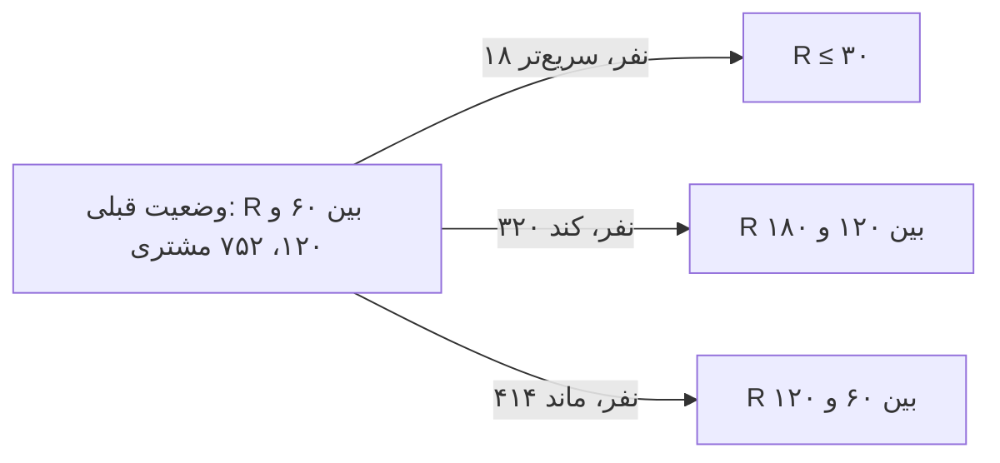

# نوشته‌ی ۵۲: ماتریس‌های RR/FF: مقدمه‌ای بر وضعیت‌های مشتری

[نوشته‌ی ۵۱: ماتریس RF: بُعد Frequency →](51-rf-matrix-frequency-dimension.md) · [مجموعه](../README.md) · [نوشته‌ی ۵۳: وضعیت مشتری: بلوک سازنده‌ی تحلیل پیشرفته‌ی مشتری ←](53-customer-state-a-key-building-block-of-advanced-customer.md)

> **مقاله‌ی اصلی:** [RR/FF matrices — introduction to customer states](https://medium.com/@paul.levchuk/rr-ff-matrices-introduction-to-customer-states-6313c118e455) · Medium، ۲۰۲۵-۰۳-۲۸

## خلاصه

ماتریس RF مشتریان را با عملکرد کل‌شان بخش‌بندی می‌کند و مسیر رشدشان را نمی‌داند. برای دیدن مسیر، آمار را در دوره‌ی جاری و برای همان مشتریان در دوره‌ی قبل حساب می‌کنیم؛ نتیجه ماتریس RR و FF است. هر مشتری قدیمی در Recency یکی از سه مسیر دارد: سریع‌تر شد، کند شد یا ماند. Frequency تجمعی است و کم نمی‌شود، پس فقط دو مسیر دارد. این وضعیت‌ها نشان می‌دهند مشتریان با چه سرعتی تکامل می‌یابند و نیازشان چقدر قوی است، بدون این‌که مشتری قدیمی و جدید با هم قاطی شوند.

## نکته‌های کلیدی

- **ماتریس RF برای همه‌ی مشتریان از عملکرد کلی استفاده می‌کند** و از گذشته چیزی نمی‌داند، به‌جز ۲۹۸ مشتری سلول R ≤ ۳۰ و F برابر ۱ که جدید بودند و سابقه نداشتند.
- **راه جایگزین:** آمار مشتری را در دوره‌ی جاری و برای همان مشتریان در دوره‌ی قبل حساب کن. این وضعیت مشتری و مسیر مهاجرت از وضعیتی به وضعیت دیگر را می‌دهد، و مشتری جدید و قدیمی را با هم قاطی نمی‌کند.
- **وضعیت Recency:** برای ۳۰ مه و ۳۰ آوریل. مشتری جدید وضعیت قبلی ندارد و خالی است و Recency آن ≤ ۳۰ است.
- **سه مسیر Recency هر مشتری قدیمی:** سریع‌تر شد (سبز): ۱ خرید یا بیشتر کرد و به R ≤ ۳۰ آمد؛ کند شد (قرمز): خرید نکرد و به وضعیت جدایی بعدی رفت؛ ماند (زرد): خرید نکرد ولی در همان وضعیت ماند.
- **مثال R بین ۶۰ و ۱۲۰:** ۷۵۲ مشتری در ۳۰ آوریل. بعد از ۳۰ روز ۱۸ نفر به R ≤ ۳۰ رفتند (سریع‌تر)، ۳۲۰ نفر به R بین ۱۲۰ و ۱۸۰ (کند) و ۴۱۴ نفر ماندند.
- **ایده‌ها:** روی دلیل‌های کند شدن تمرکز کنید (اشاره: کاربران اغلب feature جدید نمی‌خواهند؛ نمی‌توانند فعلی‌ها را به کار ببرند)؛ از مشتریان سریع‌شده بیاموزید چه چیزی خرید دیگر را راند، چه feature‌هایی را به کار بردند و چه feature‌هایی را نه؛ کمپین win-back را برای «کند شده‌ها» و «مانده‌ها» جدا کنید، کند شده‌ها اقدام و پیشنهاد تهاجمی‌تری می‌خواهند.
- **وضعیت Frequency:** مشتری جدید وضعیت قبلی ندارد. از ماتریس RF می‌دانیم ۲۹۸ مشتری جدید فقط ۱ خرید داشتند؛ حالا می‌دانیم بعضی چند خرید کردند و ۳ نفر ۱۰ یا بیشتر.
- **شاخص Frequency تجمعی است و کم نمی‌شود:** پس مشتری قدیمی دو مسیر دارد: ماند (زرد) یا سریع‌تر شد (سبز) با یک خرید بیشتر و رفتن به وضعیت درگیر بعدی.
- **بینش‌های ماتریس FF:** بعضی مشتریان در مدت کوتاه چند وضعیت را پریدند و از این قهرمان‌ها می‌شود یاد گرفت؛ نیاز مشتریان F بین ۴ و ۹ با F برابر ۲ احتمالاً فرق دارد و با فهمیدن آن می‌شود محصول و پیشنهاد را برای مشتریان پیشرفته تنظیم کرد.
- **جمع‌بندی:** پایش وضعیت مشتری سرعت تکامل و قدرت نیاز را نشان می‌دهد؛ هر مشتری در هر لحظه می‌تواند سریع‌تر شود، کند شود یا بماند؛ مشتری جدید و قدیمی را قاطی نکنید.

## فهرست بخش‌ها

- از RF به وضعیت مشتری
- وضعیت Recency
- وضعیت Frequency
- جمع‌بندی

## یادداشت‌ها

[ماتریس RF](49-rf-matrix-introduction.md) ابزار خوبی برای ارزیابی پایگاه مشتری است. Recency اجازه می‌دهد پتانسیل آینده‌ی مشتریان را بسنجیم و Frequency اجازه می‌دهد ارزش فعلی‌شان را. ماتریس RF در ۳۰ مه می‌تواند شبیه نمونه باشد. وقتی ماتریس RF می‌سازیم، بخش R و F را برای **همه‌ی** مشتریان با عملکرد **کلی**‌شان حساب می‌کنیم. از آنچه مشتریان در گذشته کردند چیزی نمی‌دانیم، به‌جز فقط ۲۹۸ مشتری سلول R ≤ ۳۰ و F برابر ۱. این مشتریان جدید بودند و آماری از گذشته نداشتند.

اگر می‌خواهیم درباره‌ی مسیر تکامل مشتریان بیاموزیم، باید دنبال نمایش داده‌ی جایگزین باشیم. یک راه ممکن برای یادگیری مسیر تکامل مشتریان این است که بعضی آمارهای مشتری را در **دوره‌ی جاری** حساب کنیم و بعد همان آمار را برای همان مشتریان در **دوره‌ی قبل** حساب کنیم. این به ما اجازه می‌دهد وضعیت‌های مشتری را تعریف کنیم، مسیرشان را دنبال کنیم، یعنی مشتریان چطور از وضعیتی به وضعیت دیگر مهاجرت می‌کنند، و مشتریان قدیمی و جدید را قاطی نکنیم. امتحان می‌کنیم.

**وضعیت Recency.** وضعیت Recency مشتریان را در ۳۰ مه حساب می‌کنیم. بعد همین مشتریان را می‌گیریم و وضعیت Recency قبلی‌شان را در ۳۰ آوریل حساب می‌کنیم. در نتیجه برای هر مشتری ۲ وضعیت داریم:

- وضعیت Recency **قبلی**
- وضعیت Recency **جاری**

ماتریس RR را می‌سازیم و می‌آموزیم برای مشتریان چه اتفاقی افتاده. مشتریان جدید وضعیت Recency قبلی ندارند، آن را *خالی* علامت می‌زنیم. همه‌ی مشتریان جدید تازه‌اند و Recency‌شان ≤ ۳۰ روز است. هر مشتری قدیمی می‌تواند یکی از ۳ مسیر Recency ممکن را بگیرد:

| مسیر | رنگ | معنا |
|---|---|---|
| سریع‌تر شد | سبز | ۱ خرید یا بیشتر کرد و به وضعیت R ≤ ۳۰ رفت |
| کند شد | قرمز | هیچ خرید جدیدی نکرد و به وضعیت جدایی بعدی رفت |
| ماند | زرد | هیچ خرید جدیدی نکرد ولی در وضعیت فعلی ماند |

یک مثال: ردیف R بین ۶۰ و ۱۲۰ را بگیرید. در این وضعیت ۷۵۲ مشتری در ۳۰ آوریل بودند. بعد از ۳۰ روز مسیرهای مشتری این‌هاست: ۱۸ مشتری به وضعیت R ≤ ۳۰ رفتند، سریع‌تر شدند؛ ۳۲۰ مشتری به وضعیت R بین ۱۲۰ و ۱۸۰ رفتند، کند شدند؛ ۴۱۴ مشتری هنوز در وضعیت R بین ۶۰ و ۱۲۰ بودند، ماندند. این آمارها می‌تواند ما را به چند ایده‌ی جالب برساند:

- شدیداً روی دلیل‌های کند شدن این‌همه مشتری تمرکز کنید. *اشاره*: کاربران اغلب feature جدید نمی‌خواهند؛ ساده نمی‌توانند فعلی‌ها را به کار ببرند.
- از مشتریان سریع‌شده بیاموزید چه چیزی آن‌ها را به یک خرید دیگر راند: از کدام feature‌های محصول استفاده کردند و به کدام دست نزدند.
- کمپین‌های win-back را برای آن‌هایی که کند شدند و آن‌هایی که در بخش فعلی ماندند جدا کنید: گروه اول اقدام‌ها و پیشنهادهای تهاجمی‌تری از طرف ما می‌خواهد.

**وضعیت Frequency.** حالا وقت حساب وضعیت‌های Frequency در تاریخ‌های ۳۰ مه و ۳۰ آوریل است. ماتریس FF اینجاست. مشتریان جدید وضعیت Frequency قبلی ندارند، *خالی* علامت می‌زنیم. از ماتریس RF آموختیم ۲۹۸ مشتری جدید بودند و فقط ۱ خرید کردند. حالا می‌دانیم بعضی مشتریان جدید توانستند چند خرید بکنند و ۳ نفرشان توانستند ۱۰ خرید یا بیشتر. طبق تعریف Frequency سنجه‌ی تجمعی است و ساده نمی‌تواند کم شود. به همین دلیل در ۳۰ روز هر مشتری قدیمی می‌تواند یکی از ۲ مسیر Frequency ممکن را بگیرد:

- *ماند* (زرد): هیچ خرید جدیدی نکرد ولی در وضعیت فعلی ماند.
- *سریع‌تر شد* (سبز): یک خرید دیگر کرد و به وضعیت درگیر بعدی رفت.

چند بینش جالب از ماتریس FF:

- بعضی مشتریان توانستند در مدت کوتاه چند وضعیت را سریع بپرند: می‌توانیم از این قهرمان‌ها بیاموزیم.
- نیازهای کاربر مشتریان F بین ۴ و ۹ احتمالاً با مشتریان F برابر ۲ فرق دارد: با یادگیری نیازهایشان می‌توانیم محصول و پیشنهادها را برای مشتریان پیشرفته تنظیم کنیم.

> **Try it:** [گذار حالت‌های مشتری](../widgets/56-transition-states.html): مسیر سریع‌تر شد، کند شد و ماند را روی ماتریس RR بازی کنید.

**جمع‌بندی:**

- پایش وضعیت مشتری می‌تواند دیدگاه جالبی درباره‌ی این‌که مشتریان با چه سرعتی تکامل می‌یابند و نیازشان چقدر قوی است بدهد.
- در هر لحظه هر مشتری شما می‌تواند سریع‌تر شود، کند شود یا همان بماند.
- مهم است مشتریان جدید و قدیمی را قاطی نکنید.

در نوشته‌ی بعد ([فصل ۵۳](53-customer-state-a-key-building-block-of-advanced-customer.md)) ایده‌ی ترکیب وضعیت‌های مشتری در مسیرهای مشتری را بسط می‌دهم.

> **Vault note:** دسته‌بندی «سریع‌تر، کند، ماند» بر پایه‌ی فاصله‌ی ۳۰ روزه است؛ با دوره‌ی دیگر مرز مسیرها جابه‌جا می‌شود.

> **In practice:** وضعیت مشتری یعنی RF همان مشتری در دو دوره؛ جدول Gold را به‌صورت snapshot ماهانه نگه دارید تا join بین دوره‌ها ممکن باشد.
>
> **Your turn:** جدول RF فقط آخرین وضعیت را نگه می‌دارد. برای ماتریس RR و FF چه کم دارید؟
>
> *Answer:* snapshot دوره‌ی قبل؛ بدون آن نمی‌شود دید مشتری سریع‌تر شده، کند شده یا مانده است (بخش «وضعیت Recency»).

## پیوندها

- **بر پایه‌ی:** [فصل ۴۹](49-rf-matrix-introduction.md) تا [فصل ۵۱](51-rf-matrix-frequency-dimension.md).
- **ادامه در:** [فصل ۵۳](53-customer-state-a-key-building-block-of-advanced-customer.md) که مسیر سه‌دوره‌ای می‌سازد، [فصل ۵۵](55-user-acquisition-funnel.md) و [فصل ۵۶](56-user-transition-states-diagram.md) که وضعیت‌ها را به قیف و گذار می‌برند.

## خودتان را بسنجید

*پرسش‌ها و پاسخ‌ها مال vault است.*

1. **چرا Frequency فقط دو مسیر دارد؟**
   - [x] چون تجمعی است و کم نمی‌شود؛ یا می‌ماند یا سریع‌تر می‌شود.
   - [ ] چون فقط دو مشتری داریم.
   - [ ] چون F محاسبه نمی‌شود.

   *Answer:* (بخش «وضعیت Frequency»).

2. **سه مسیر Recency هر مشتری قدیمی چیست؟**

   *Answer:* سریع‌تر شد، کند شد و ماند (بخش «وضعیت Recency»).
